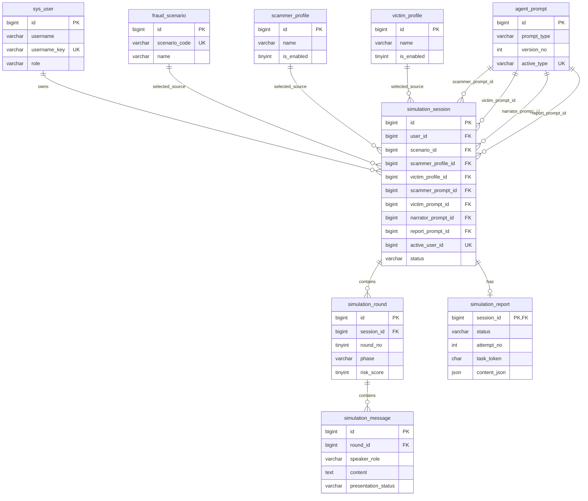
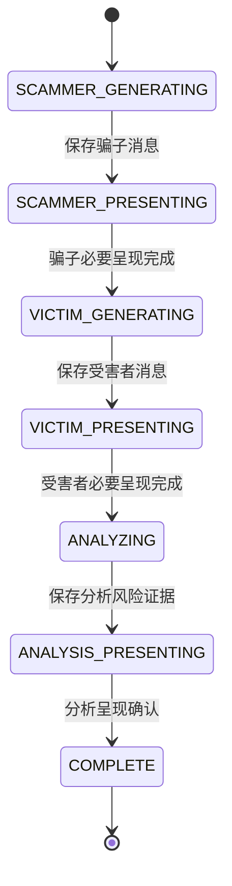
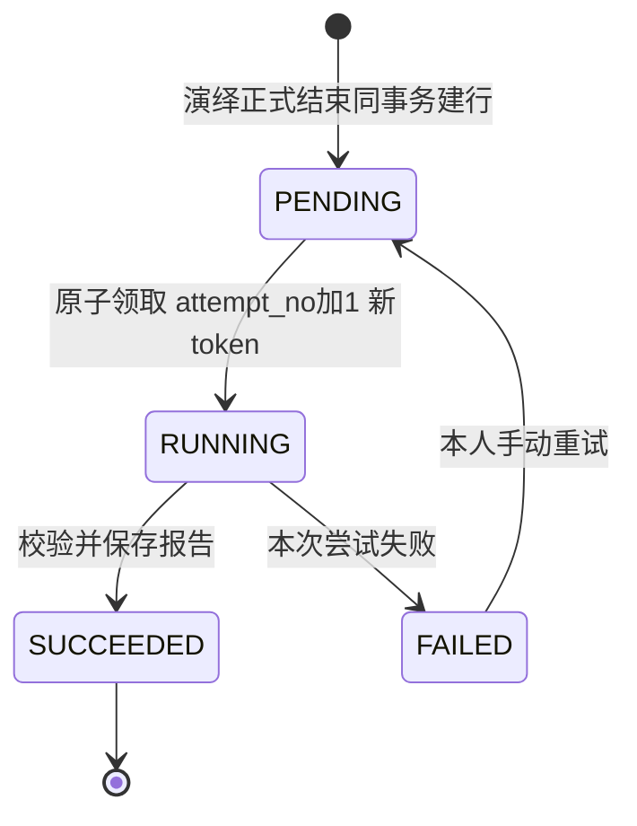

# AI反诈情景推演平台 数据库设计文档 V1.0

| 文档信息 | 内容 |
|---|---|
| 产品名称 | AI反诈情景推演平台 |
| 文档版本 | V1.0 |
| 编制日期 | 2026年10月15日 |
| 文档状态 | 设计评审稿；已完成文档一致性审查，尚未由需求方冻结；未执行建库、迁移或数据库集成测试 |
| 业务基线 | 《AI反诈情景推演平台 PRD V3.1 正式开发基线版》 |
| 架构基线 | 《AI反诈情景推演平台 系统架构设计文档 V1.0》 |
| 补充依据 | 本次提供的既有讨论：9张表、轮次与消息分表、提示词版本固定、报告表兼任持久化任务、先设计后生成SQL；已确认MySQL 8.0.45 |
| 适用范围 | 参赛MVP、PC浏览器、Spring Boot模块化单体、MySQL 8.0.45、单实例运行起点 |
| 最近修订 | 2026-10-16：按PRD已确认修订，演绎时长上限300秒→600秒；数据库版本确定并锁定为MySQL 8.0.45（原8.4表述作废）；补`focus`固定映射表；明确`interruption_detail`由服务端填充 |
| 本文交付 | 实体关系、完整字段字典、约束与索引、状态与短事务、快照、提示词、报告任务、初始化迁移备份及验证计划 |
| 本文边界 | 不提供建表SQL，不修改两份输入文档，不新增产品页面，不代替接口、Prompt正文或端到端验证 |

## 目录

1. 文档概述与设计依据
2. 数据库总体设计与设计原则
3. 数据库表清单及职责划分
4. 数据库ER关系设计
5. 九张数据表的详细字段设计
6. 数据完整性、唯一约束与索引设计
7. 演绎过程的数据保存及状态管理
8. Agent提示词版本管理
9. 复盘报告的异步任务与数据一致性
10. 用户权限、数据安全及历史快照
11. 数据库初始化、迁移与备份方案
12. 设计验证与需求追踪

附录A：技术决策与待验证项  
附录B：官方技术参考

## 1. 文档概述与设计依据

### 1.1 依据及效力

| 来源 | 本文承接的内容 |
|---|---|
| PRD第4、8.1节 | 固定单角色、用户名规则、普通用户本人数据隔离、管理员禁止访问用户演绎与报告 |
| PRD第8.3、8.8、11.1～11.3节 | 三个固定场景、双方画像分开维护、定性参数、情境和有效头像、各类至少一项可用 |
| PRD第10、11.4～11.5节 | 五档风险、实际行为与结局分离、最多20轮及600秒、先保存再展示、完整快照、长期保存 |
| 架构第6、9～12章 | 短事务、重启收敛、呈现回执、原子终态、报告持久任务、历史只读 |
| 架构第13～15章 | 安全边界、版本化头像、备份恢复、单机部署及必须实测的技术事项 |
| 本次补充讨论 | 固定采用本文9张表；提示词由开发人员受控维护；不增加独立历史、风险、调用日志或任务表 |

业务规则以PRD为准。本文选择实现方法，不重新开放已确认的业务需求。技术决策使用`DBD-xx`编号，验证使用`DBV-xx`编号，不占用或假装新增既有架构文档的AD编号。

本次未能直接读取所引用聊天的完整记录；讨论依据是用户在本次聊天中提供的补充文本。本文没有将未取得的聊天内容当作已确认事实。

### 1.2 本次设计计划及完成判据

| 步骤 | 工作 | 验证判据 |
|---|---|---|
| 1 | 将已确认规则分配到9张表及应用事务 | 每项关键规则均有存储位置和执行责任 |
| 2 | 完成字段、ER、约束、索引及状态转换 | 无孤立关系；半轮、失败、重复与迟到请求可表达 |
| 3 | 审查主链路、异常链路和需求追踪 | 不违反权限、唯一终态、快照、20轮及600秒口径 |
| 4 | 提交V1.0供冻结，随后进入SQL阶段 | 本文明确标注设计与实测的边界；不把设计说明写成测试通过 |

### 1.3 不变量

1. 每个普通用户同时至多有一条`RUNNING`演绎；重复请求不能重置计时。
2. 每条角色消息只能在保存成功后发布；消息存在不等于必要媒体完成。
3. 每轮至多一条骗子消息、一条受害者消息、一组解说及风险；解说不算额外一轮。
4. 风险缺失为`NULL`；合法分数只有0、25、50、75、100；风险下降不删除既有受骗事实。
5. 演绎只有`RUNNING → FINISHED`或`RUNNING → INTERRUPTED`，终态不可逆。
6. 正式结局只存于演绎主记录；中断没有正式结局与报告任务。
7. 正式结束和报告待处理记录在同一事务提交；成功报告不可改写。
8. 当时场景、全部画像内容、头像版本和提示词版本固定，后续维护不影响旧记录。
9. 本人历史不自动过期；临时语音不进入长期数据库或历史回放。

## 2. 数据库总体设计与设计原则

### 2.1 存储基线

| 项目 | 本文设计选择 | 说明 |
|---|---|---|
| 数据库 | 单个MySQL业务库，建议库名`anti_scam` | 三类业务信息不等于三个物理数据库 |
| 版本 | 按MySQL **8.0.45**设计；小版本锁定为8.0.45 | 本项目已确定使用MySQL 8.0.45，无需改用8.4；本文依赖的生成列、生成列索引、`CHECK`约束、`utf8mb4_0900_bin`排序规则与`DESC`索引均为MySQL 8.0 GA特性，实际建表时按`DBV-01`复核 |
| 引擎 | InnoDB | 使用事务、行锁和物理外键 |
| 字符集 | `utf8mb4` | 保留中文及模型生成文本 |
| 默认排序规则 | `utf8mb4_0900_bin` | 精确比较代码和文本；用户名另用规范化键实现英文大小写无关 |
| 事务隔离 | 应用业务事务显式使用`READ COMMITTED` | 并发不变量靠锁和唯一约束，不能依赖普通查询的先查后写 |
| 主键 | `BIGINT UNSIGNED`自增 | 例外：报告以`session_id`同时作为主键和外键；前端传输ID使用字符串 |
| 时间 | `DATETIME(3)`，统一写入UTC | 数据库连接、应用和后台任务统一UTC；界面按Asia/Shanghai展示 |
| 枚举 | `VARCHAR`加`CHECK` | 便于阅读与迁移；不建立通用字典表，不依靠魔法数字 |
| JSON | 配置快照、运行配置、行为证据、报告结构 | 不把需关联和查询的核心ID、状态、轮次、风险全塞入JSON |
| 删除策略 | 无业务软删除字段，无级联删除 | 画像使用启停；历史、提示词版本和头像引用保留 |
| 执行条件 | 单实例Spring Boot，受控后台执行器 | 多实例扩容须重审恢复和任务所有权，不视为已支持 |

MySQL的唯一索引允许多条`NULL`，生成列可参与索引；本文利用这两项能力约束“至多一场活动演绎”和“每类至多一个当前提示词”。这属于本项目设计组合，能力依据见[MySQL索引说明](https://dev.mysql.com/doc/refman/8.0/en/create-table.html)与[生成列说明](https://dev.mysql.com/doc/refman/8.0/en/create-table-generated-columns.html)。

### 2.2 字段字典约定

- `N`：不允许为空；`Y`：允许为空；`G`：数据库生成列，由表达式决定，不由应用写入。
- 默认值`—`：无默认值，插入时必须明确提供。`NULL`：尚无事实；不能用空字符串、0或当前时间补造。
- `NOW`：默认`CURRENT_TIMESTAMP(3)`；只用于数据库记录创建时间，不能代替用户点击开始时间。
- `AI`：数据库自增。`GEN`：按本章及第6章表达式生成，后续DDL采用存储生成列。
- 所有外键字段与目标字段类型一致，采用`ON DELETE RESTRICT / ON UPDATE RESTRICT`，主键不可修改。
- 文本长度为建议存储容量，不新增PRD业务上限。若页面需要限制，须一致提示并拒绝超限；禁止静默截断。正文使用`TEXT/MEDIUMTEXT`，提交前校验数据库可容纳的字节长度。
- 年龄为画像年龄；情境时间为“工作日晚上”等文字，不能强制转成时间戳。性别保留文案，不擅自新增产品枚举规则。
- 账号与密码的“字符数”前后端按Unicode码点一致处理；密码不执行trim、大小写转换或Unicode规范化。

### 2.3 权威数据与必要冗余

| 信息 | 唯一权威位置 | 使用方式 |
|---|---|---|
| 当前可选场景与画像 | 三张基础内容表 | 配置页和后台使用 |
| 某次演绎的完整配置 | `simulation_session`的三份快照 | 本场生成、历史及报告使用；不得回查当前表替换内容 |
| 角色实际内容 | `simulation_message.content` | 字幕、TTS、证据和历史共用同一文本 |
| 逐轮解说、风险、事实分析 | `simulation_round` | 风险折线不在报告里复制另一套分数 |
| 正式结果 | `simulation_session.outcome_code/outcome_reason` | 报告只解释该结果，不另存可冲突的正式结果 |
| 正式报告内容与生成状态 | `simulation_report` | 同时承担待处理工作与当前尝试状态 |
| 角色模板正文 | 不可变的`agent_prompt`版本行 | 会话固定其ID，不复制四份大段Prompt到快照 |

画像快照与基础表内容重复是历史要求带来的有意冗余。会话的当前轮号、版本号是执行控制字段；已完成轮数、最新风险、历史列表名称均从保存内容读取，不另加可漂移的汇总列。

## 3. 数据库表清单及职责划分

| 序号 | 表名 | 中文名称 | 职责 | 明确不承担 |
|---|---|---|---|---|
| 1 | `sys_user` | 用户表 | 登录凭据、固定角色、数据归属、开始事务锁定锚点 | 用户管理、角色切换、用户能力评分 |
| 2 | `fraud_scenario` | 诈骗场景表 | 三类固定场景代码及可编辑名称简介 | 动态目标、流程、策略或RAG知识库 |
| 3 | `scammer_profile` | 骗子画像表 | 基础信息、三个定性参数、行为情境、头像及启停 | 个人私有画像、永久删除 |
| 4 | `victim_profile` | 受害者画像表 | 基础信息、两个定性参数、性格情境、头像及启停 | 观看用户画像、能力测评 |
| 5 | `simulation_session` | 演绎记录表 | 归属、快照、版本绑定、时间预算、活动约束和唯一终态 | 复制整场消息或风险曲线 |
| 6 | `simulation_round` | 演绎轮次表 | 轮内阶段、解说、风险、行为证据、完成和阅读停留 | 复制角色消息、存储正式报告 |
| 7 | `simulation_message` | 演绎消息表 | 双方完整文本、角色唯一性、必要呈现状态 | 解说的第二份存储、永久音频 |
| 8 | `simulation_report` | 复盘报告表 | 一场一份报告、待处理状态、尝试令牌与成功内容 | 独立演绎、完整尝试日志库 |
| 9 | `agent_prompt` | Agent提示词配置表 | 模板正文、类型、不可变版本和当前启用版本 | 新增管理员Prompt管理页面 |

报告提示词也采用同表的`REPORT`类型，仍为9张表、三个演绎Agent。这样报告重试能引用固定版本，避免同时维护数据库模板和无版本文件两套机制。本选择属于`DBD-06`，不是增加第四个演绎Agent。

不新增历史记录表、风险历史表、模型调用日志表、执行日志表、独立任务表、通用资源表或通用配置表。登录会话首期使用应用已有的服务端会话能力；重启要求重新登录，不因此引入第十张业务表。

## 4. 数据库ER关系设计

### 4.1 ER图



图中唯一键仅简示单列项；组合唯一约束详见第6章。图中的一对多不代表无限消息：每场最多20个轮号，每轮至多两个角色消息。

### 4.2 关系及约束责任

| 关系 | 基数与约束 |
|---|---|
| 用户 → 演绎 | 一对多；只有普通用户可拥有，物理外键只校验用户存在，角色由服务层检查 |
| 基础场景/画像 → 演绎 | 一对多；ID保留来源关系，显示内容以快照为准；停用不是删除 |
| 提示词 → 演绎 | 四条命名外键，每条均多对一；服务层分别验证对应类型 |
| 演绎 → 轮次 | 零到20条；`(session_id, round_no)`唯一，轮号连续由事务保证 |
| 轮次 → 消息 | 零到2条；`(round_id, speaker_role)`唯一；先骗子后受害者由阶段控制 |
| 演绎 → 报告 | 零或一条；正式结束必须同事务创建一条；进行中和中断不得有报告 |

消息通过轮次找到演绎和用户，不重复保存`session_id/user_id`；报告通过其主键找到演绎和归属。避免多处归属不一致。证据JSON中的消息ID是应用校验的引用，不冒称为JSON内部物理外键。

## 5. 九张数据表的详细字段设计

### 5.1 `sys_user`——用户表

| 字段 | 类型 | 空 | 默认 | 键/约束 | 业务说明 |
|---|---|---|---|---|---|
| `id` | BIGINT UNSIGNED | N | AI | PK | 账号ID |
| `username` | VARCHAR(24) | N | — | 长度2～24 | 去首尾空格且通过字符规则校验后的原展示名称 |
| `username_key` | VARCHAR(24) | G | GEN | UQ | `LOWER(username)`，使用`utf8mb4_0900_bin`；不由客户端提供 |
| `password_hash` | VARCHAR(255) | N | — | 非空 | 带算法标识和盐的密码哈希编码；不存确认密码 |
| `role` | VARCHAR(16) | N | `USER` | USER/ADMIN | 单一固定角色；注册服务强制USER |
| `created_at` | DATETIME(3) | N | NOW | — | 建立账号时间 |

全局唯一索引覆盖普通用户和管理员。对PRD允许的汉字、ASCII英文字母、数字和下划线，英文转小写后精确比较即可满足规则；不使用通用不区分重音的排序规则扩大等价范围。字符合法性、去首尾空格由服务层校验，DB校验长度并派生唯一键。数据库生成列与`LOWER()`行为必须纳入`DBV-01`实测。[MySQL字符串函数](https://dev.mysql.com/doc/refman/8.0/en/string-functions.html)

密码哈希采用Spring Security的带盐自适应单向方案，建议使用其PBKDF2编码器并保存算法标识，具体参数随锁定的框架版本进行成本测试；不手写加密算法。必须覆盖24个多字节字符、首尾空格和弱密码的接受行为，不能因哈希实现限制偷偷截断输入或改变PRD。算法升级不引入密码找回页面。[Spring Security密码存储](https://docs.spring.io/spring-security/reference/features/authentication/password-storage.html)

### 5.2 `fraud_scenario`——诈骗场景表

| 字段 | 类型 | 空 | 默认 | 键/约束 | 业务说明 |
|---|---|---|---|---|---|
| `id` | BIGINT UNSIGNED | N | AI | PK | 场景来源ID |
| `scenario_code` | VARCHAR(32) | N | — | UQ，固定三值 | 不可编辑的业务类型标识 |
| `name` | VARCHAR(100) | N | — | 非空 | 可编辑名称 |
| `description` | TEXT | N | — | 非空 | 可编辑简介 |
| `row_version` | INT UNSIGNED | N | 0 | 更新条件 | 防止两个后台编辑互相静默覆盖 |
| `created_at` | DATETIME(3) | N | NOW | — | 初始化时间 |
| `updated_at` | DATETIME(3) | N | NOW | 写入时更新 | 文案最后修改时间 |

| `scenario_code` | 初始名称 | 固定关键目标；由业务规则实现 |
|---|---|---|
| `TASK_REBATE` | 刷单返利诈骗 | 首笔垫付后又实际完成一次追加投入 |
| `FAKE_INVESTMENT` | 虚假投资诈骗 | 投资款已投入后又实际支付提现、解冻等额外费用 |
| `IMPERSONATION_LOAN` | 冒充亲友借款诈骗 | 未通过独立渠道核实身份即实际完成借款转账 |

`CHECK`限制代码集合，唯一键限制同代码只有一行；“恰好存在三行”由初始化、运行权限和启动检查保证，不能声称单行约束可以保证全表行数。年龄侧重和关键目标不是可编辑字段，不落库；接口与快照所需的`focus`由`scenario_code`按固定映射派生，映射如下表，不在后台可编辑范围内，随本设计版本受控维护。绑定的`ruleset_version`见会话运行快照。

| `scenario_code` | 固定`focus`文案（接口`focus`字段与`scenario_snapshot`取值） |
|---|---|
| `TASK_REBATE` | 青年群体 |
| `FAKE_INVESTMENT` | 中年群体 |
| `IMPERSONATION_LOAN` | 老年群体 |

### 5.3 `scammer_profile`——骗子画像表

| 字段 | 类型 | 空 | 默认 | 键/约束 | 业务说明 |
|---|---|---|---|---|---|
| `id` | BIGINT UNSIGNED | N | AI | PK | 画像ID |
| `name` | VARCHAR(64) | N | — | 非空 | 人物姓名，不设全局唯一 |
| `avatar_key` | VARCHAR(255) | N | — | 不可覆盖资源键 | 例如含内容摘要的`avatars/<sha256>.png`，不存临时签名URL |
| `age` | SMALLINT UNSIGNED | N | — | 正整数 | 人物年龄，不按场景自动改写 |
| `gender` | VARCHAR(16) | N | — | 非空 | 性别文案 |
| `identity` | VARCHAR(128) | N | — | 非空 | 固定基础身份，不是演绎中临时冒充身份 |
| `description` | TEXT | N | — | 非空 | 人物描述 |
| `fraud_experience` | VARCHAR(8) | N | — | LOW/MEDIUM/HIGH | 诈骗经验 |
| `speech_skill` | VARCHAR(8) | N | — | LOW/MEDIUM/HIGH | 话术能力 |
| `manipulation_skill` | VARCHAR(8) | N | — | LOW/MEDIUM/HIGH | 心理操控能力 |
| `behavior_traits` | TEXT | N | — | 非空 | 行为特点 |
| `context_time` | VARCHAR(128) | N | — | 非空 | 人物情境时间文字 |
| `context_place` | VARCHAR(128) | N | — | 非空 | 人物情境地点文字 |
| `current_state` | TEXT | N | — | 非空 | 当时人物状态 |
| `is_enabled` | TINYINT UNSIGNED | N | 1 | 0/1 | 是否可被新演绎选择 |
| `row_version` | INT UNSIGNED | N | 0 | 更新条件 | 编辑和启停时递增 |
| `created_at` | DATETIME(3) | N | NOW | — | 建立时间 |
| `updated_at` | DATETIME(3) | N | NOW | 写入时更新 | 最后修改时间 |

初始画像为陈启明、梁悦；完整内容直接取PRD第11.3节，不用简化示例覆盖原人物卡。MVP不限制画像总数为2。

### 5.4 `victim_profile`——受害者画像表

| 字段 | 类型 | 空 | 默认 | 键/约束 | 业务说明 |
|---|---|---|---|---|---|
| `id` | BIGINT UNSIGNED | N | AI | PK | 画像ID |
| `name` | VARCHAR(64) | N | — | 非空 | 人物姓名 |
| `avatar_key` | VARCHAR(255) | N | — | 不可覆盖资源键 | 与骗子画像采用同一文件管理规则 |
| `age` | SMALLINT UNSIGNED | N | — | 正整数 | 人物年龄 |
| `gender` | VARCHAR(16) | N | — | 非空 | 性别文案 |
| `identity` | VARCHAR(128) | N | — | 非空 | 人物身份 |
| `description` | TEXT | N | — | 非空 | 人物描述 |
| `anti_fraud_awareness` | VARCHAR(8) | N | — | LOW/MEDIUM/HIGH | 防骗意识，不是当前风险分数 |
| `risk_tendency` | VARCHAR(8) | N | — | LOW/MEDIUM/HIGH | 风险倾向 |
| `personality_traits` | TEXT | N | — | 非空 | 性格特点 |
| `context_time` | VARCHAR(128) | N | — | 非空 | 人物情境时间文字 |
| `context_place` | VARCHAR(128) | N | — | 非空 | 人物情境地点文字 |
| `current_state` | TEXT | N | — | 非空 | 当时人物状态 |
| `is_enabled` | TINYINT UNSIGNED | N | 1 | 0/1 | 是否可供新演绎选择 |
| `row_version` | INT UNSIGNED | N | 0 | 更新条件 | 编辑和启停时递增 |
| `created_at` | DATETIME(3) | N | NOW | — | 建立时间 |
| `updated_at` | DATETIME(3) | N | NOW | 写入时更新 | 最后修改时间 |

初始画像为林晓、赵诚、周桂兰。任一可用受害者可与任一场景组合，数据库不建立场景年龄限制或角色强制匹配表。

### 5.5 `simulation_session`——演绎记录表

| 字段 | 类型 | 空 | 默认 | 键/约束 | 业务说明 |
|---|---|---|---|---|---|
| `id` | BIGINT UNSIGNED | N | AI | PK | 一次演绎ID |
| `user_id` | BIGINT UNSIGNED | N | — | FK→sys_user | 由认证上下文确定 |
| `start_request_id` | CHAR(36) | N | — | 与user_id组合UQ | 一次点击对应的UUID；网络重发保持同值 |
| `scenario_id` | BIGINT UNSIGNED | N | — | FK→fraud_scenario | 所选基础场景来源 |
| `scammer_profile_id` | BIGINT UNSIGNED | N | — | FK→scammer_profile | 所选骗子来源 |
| `victim_profile_id` | BIGINT UNSIGNED | N | — | FK→victim_profile | 所选受害者来源 |
| `snapshot_schema_version` | SMALLINT UNSIGNED | N | 1 | 正整数 | 以下快照结构版本 |
| `scenario_snapshot` | JSON | N | — | OBJECT | 场景ID、代码、名称、简介、row_version及内容侧重 |
| `scammer_snapshot` | JSON | N | — | OBJECT | 骗子全量业务信息、头像键及来源版本 |
| `victim_snapshot` | JSON | N | — | OBJECT | 受害者全量业务信息、头像键及来源版本 |
| `scammer_prompt_id` | BIGINT UNSIGNED | N | — | FK→agent_prompt | 固定SCAMMER版本 |
| `victim_prompt_id` | BIGINT UNSIGNED | N | — | FK→agent_prompt | 固定VICTIM版本 |
| `narrator_prompt_id` | BIGINT UNSIGNED | N | — | FK→agent_prompt | 固定NARRATOR版本 |
| `report_prompt_id` | BIGINT UNSIGNED | N | — | FK→agent_prompt | 固定REPORT版本，失败重试继续使用 |
| `runtime_snapshot` | JSON | N | — | OBJECT | 规则、应用构建及调用配置，详见第8.3节 |
| `status` | VARCHAR(16) | N | `RUNNING` | RUNNING/FINISHED/INTERRUPTED | 演绎过程状态 |
| `active_user_id` | BIGINT UNSIGNED | G | GEN | UQ，可为NULL | RUNNING时为user_id，否则NULL |
| `current_round_no` | TINYINT UNSIGNED | N | 0 | 0～20 | 0为尚未建立首轮；否则为已建立的当前轮号 |
| `state_version` | BIGINT UNSIGNED | N | 0 | 单调递增 | 同场任务、回执与迟到写入的版本闸门 |
| `started_at` | DATETIME(3) | N | — | 不可修改 | 经前后端校准映射到服务端时间轴的点击开始时间 |
| `received_at` | DATETIME(3) | N | — | 服务端记录 | 开始请求最初到达时间，不能替代started_at |
| `timing_evidence` | JSON | N | — | OBJECT | 起点校准依据与方法版本，不含凭据；详见第7.7节 |
| `deadline_at` | DATETIME(3) | G | GEN | started_at+600秒 | 持久化的统一截止时间 |
| `ended_at` | DATETIME(3) | Y | NULL | 终态必填 | 已确认终态对应的事件时间，故障后收敛不得伪造早已提交 |
| `outcome_code` | VARCHAR(24) | Y | NULL | 正式结束才有 | GOAL_ACHIEVED/LOSS_STOPPED/NOT_DEFRAUDED/UNDETERMINED |
| `outcome_reason` | TEXT | Y | NULL | 与正式结局同时存在 | 最终依据，引用轮次与消息；不是仅保存一个分数 |
| `limit_reason` | VARCHAR(16) | Y | NULL | ROUND_LIMIT/TIME_LIMIT/BOTH | 仅UNDETERMINED填写；明确业务结局优先 |
| `interruption_code` | VARCHAR(32) | Y | NULL | 中断才有 | 稳定故障类别，详见第7.6节 |
| `interruption_detail` | VARCHAR(255) | Y | NULL | 安全说明 | 本人可见的简短原因；由服务端按`interruption_code`填充默认文案，不接受客户端提交，不存堆栈、密钥或模型原始异常 |
| `created_at` | DATETIME(3) | N | NOW | — | 记录创建时间，不作为演绎计时起点 |
| `updated_at` | DATETIME(3) | N | NOW | 写入时更新 | 最近一次成功持久化修改时间 |

不存`report_status`、最终风险和已完成轮数的第二份值。历史列表从本行快照取名称、关联报告状态；详情从实际轮次与消息读取过程。`state_version`每次状态或阶段事实变更时递增，但不会重新计算或延长`deadline_at`。

### 5.6 `simulation_round`——演绎轮次表

| 字段 | 类型 | 空 | 默认 | 键/约束 | 业务说明 |
|---|---|---|---|---|---|
| `id` | BIGINT UNSIGNED | N | AI | PK | 轮次记录ID |
| `session_id` | BIGINT UNSIGNED | N | — | FK→simulation_session | 所属演绎 |
| `round_no` | TINYINT UNSIGNED | N | — | 1～20，组合UQ | 同场内顺序号 |
| `phase` | VARCHAR(32) | N | `SCAMMER_GENERATING` | 第7.2节枚举 | 持久推进位置；中断时保留最后实际阶段 |
| `fraud_stage` | TEXT | Y | NULL | 分析成组写入 | 当前诈骗阶段描述 |
| `speech_analysis` | TEXT | Y | NULL | 分析成组写入 | 骗子话术分析 |
| `method_analysis` | TEXT | Y | NULL | 分析成组写入 | 诈骗手段分析 |
| `victim_psychology` | TEXT | Y | NULL | 分析成组写入 | 受害者心理分析 |
| `risk_score` | TINYINT UNSIGNED | Y | NULL | 0/25/50/75/100 | 本轮实际评分；NULL是尚未评分 |
| `risk_reason` | TEXT | Y | NULL | 分析成组写入 | 本轮风险依据 |
| `actual_fraud_occurred` | TINYINT UNSIGNED | Y | NULL | 0/1 | 截至本轮是否已有实际受骗行为；分析前为NULL |
| `goal_achieved` | TINYINT UNSIGNED | Y | NULL | 0/1 | 截至本轮是否达到固定场景关键目标 |
| `cooperation_stopped` | TINYINT UNSIGNED | Y | NULL | 0/1 | 本轮是否明确终止继续配合，不等于准备核实 |
| `evidence_json` | JSON | Y | NULL | ARRAY | 实际事实及判断引用，结构详见第7.4节 |
| `candidate_outcome` | VARCHAR(24) | Y | NULL | 三类明确业务结局 | 无明确结局为NULL；不在这里提前产生UNDETERMINED |
| `candidate_reason` | TEXT | Y | NULL | 与候选结果同存 | 语义判定依据；未正式结束时仅是候选 |
| `analysis_saved_at` | DATETIME(3) | Y | NULL | 成组保存时写入 | 解说、风险与证据均已持久化 |
| `analysis_presented_at` | DATETIME(3) | Y | NULL | 验证回执后写入 | 必要分析呈现已完成的服务端确认时间 |
| `reading_until` | DATETIME(3) | Y | NULL | 完成呈现后写入 | 正常为确认时间+5秒，与总截止时间取较早值 |
| `created_at` | DATETIME(3) | N | NOW | — | 建立当前轮的时间 |

`actual_fraud_occurred/goal_achieved`是每轮分析的累计事实，不是整个用户的属性；已经为1的事实在后轮不能回到0。应用依据既有消息验证，不由字段默认值替模型判定。`cooperation_stopped`是当前行为状态，不能用“风险为0”推导。

分析必须一次性保存完整字段组。尚未分析时，上述分析字段全部为NULL；已保存分析时必须具有合法分数、四项分析、风险理由、三个布尔值和证据数组。候选结局可以仍为NULL。整个约束不能仅写`CHECK(risk_score IN (...))`而遗漏成组完整性。

### 5.7 `simulation_message`——演绎消息表

| 字段 | 类型 | 空 | 默认 | 键/约束 | 业务说明 |
|---|---|---|---|---|---|
| `id` | BIGINT UNSIGNED | N | AI | PK | 消息ID，也是呈现回执关联对象 |
| `round_id` | BIGINT UNSIGNED | N | — | FK→simulation_round | 通过轮次追溯会话和本人归属 |
| `speaker_role` | VARCHAR(16) | N | — | SCAMMER/VICTIM，组合UQ | 不存NARRATOR消息；解说只在轮次表 |
| `content` | TEXT | N | — | 非空，正文不可改写 | 完整角色文本，包含必要的模拟行动叙述；字幕与TTS使用同一内容 |
| `presentation_status` | VARCHAR(16) | N | `PENDING` | PENDING/PRESENTING/COMPLETED/FAILED | PENDING包括语音尚未就绪，保存不等于播放 |
| `presentation_completed_at` | DATETIME(3) | Y | NULL | COMPLETED时必填 | 服务端验证该条必要呈现完成回执的时间 |
| `presentation_error_code` | VARCHAR(32) | Y | NULL | FAILED时必填 | TTS、播放、动画等已明确的故障类别 |
| `created_at` | DATETIME(3) | N | NOW | — | 完整消息写入时间 |

没有消息行表示尚无可靠保存的完整内容，不插入空消息占位。不持久化模型逐字草稿；保存内容不允许以重试结果覆盖。排序使用轮号升序及明确的SCAMMER→VICTIM顺序，不用自增ID代表业务因果顺序。

临时语音以会话/消息ID映射到受控临时存储，终态释放；数据库不保存永久音频地址。若仅整场超时或退出，不把所有未完成消息伪记为“媒体失败”，保留真实呈现状态并由父会话说明中断。

### 5.8 `simulation_report`——复盘报告表

| 字段 | 类型 | 空 | 默认 | 键/约束 | 业务说明 |
|---|---|---|---|---|---|
| `session_id` | BIGINT UNSIGNED | N | — | PK、FK→simulation_session | 一场最多一份；不再增加无用途的报告自增ID |
| `status` | VARCHAR(16) | N | `PENDING` | PENDING/RUNNING/SUCCEEDED/FAILED | 前两种对用户均映射“生成中” |
| `attempt_no` | INT UNSIGNED | N | 0 | 领取时递增 | 初始等待为0；每次真正领取递增1 |
| `task_token` | CHAR(36) | Y | NULL | 领取时生成UUID | 本次尝试令牌；与状态和次数共同阻止迟到写入 |
| `queued_at` | DATETIME(3) | N | — | 排队索引 | 首次正式结束或手动重试入队时间 |
| `started_at` | DATETIME(3) | Y | NULL | RUNNING时必填 | 当前尝试被领取时间 |
| `attempt_deadline_at` | DATETIME(3) | Y | NULL | started_at之后 | 该次生成/保存尝试的超时预算，不受演绎600秒限制 |
| `finished_at` | DATETIME(3) | Y | NULL | 成功/失败必填 | 最近尝试结束时间 |
| `content_schema_version` | SMALLINT UNSIGNED | N | 1 | 正整数 | 报告JSON结构版本 |
| `content_json` | JSON | Y | NULL | SUCCEEDED时必填OBJECT | 经过验证并成功保存的正式报告内容 |
| `error_code` | VARCHAR(32) | Y | NULL | FAILED时必填 | 生成失败、校验失败、保存失败、超时、重启等类别 |
| `created_at` | DATETIME(3) | N | NOW | — | 首次正式结束时建行 |
| `updated_at` | DATETIME(3) | N | NOW | 写入时更新 | 当前尝试或报告状态的最近更新时间 |

`content_json`最小结构为`summary`、`round_analyses`、`speech_analysis`、`victim_behavior_analysis`、`outcome_analysis`。`round_analyses`中的每项具有`round_no`和分析文字，必须指向本场已有轮次。风险曲线从`simulation_round`读取；正式结果从会话读取，不让模型再写一套权威风险值或结局。

本表保留当前/最近尝试状态，不承诺保存历次尝试正文。失败类型、尝试编号与耗时可进受限应用日志；成功后本行冻结。

### 5.9 `agent_prompt`——Agent提示词配置表

| 字段 | 类型 | 空 | 默认 | 键/约束 | 业务说明 |
|---|---|---|---|---|---|
| `id` | BIGINT UNSIGNED | N | AI | PK | 不可变模板版本ID |
| `prompt_type` | VARCHAR(16) | N | — | SCAMMER/VICTIM/NARRATOR/REPORT | 模板用途，建立后不修改 |
| `version_no` | INT UNSIGNED | N | — | 正整数，组合UQ | 同类型内版本号 |
| `template_content` | MEDIUMTEXT | N | — | 非空，建立后不修改 | 模板正文，不能包含供应商密钥或用户正文 |
| `is_active` | TINYINT UNSIGNED | N | 0 | 0/1 | 是否供新会话使用 |
| `active_type` | VARCHAR(16) | G | GEN | UQ，可为NULL | 启用时为prompt_type，否则NULL |
| `created_at` | DATETIME(3) | N | NOW | — | 版本发布时间 |

旧版本不更新正文、不删除；修正产生新行。当前版本切换只修改`is_active`，由受控部署流程完成。每类至少存在一个当前版本由发布/启动检查保证，唯一键只保证“至多一个”。普通业务数据库账号对本表只读。

## 6. 数据完整性、唯一约束与索引设计

### 6.1 主键、唯一约束和生成表达式

| 表 | 约束名 | 字段/表达式 | 目的 |
|---|---|---|---|
| 所有表 | PRIMARY | 第5章所列主键 | 行标识，报告以session_id作主键 |
| sys_user | `uq_user_username_key` | username_key=`LOWER(username)` | 全局用户名唯一且英文忽略大小写 |
| fraud_scenario | `uq_scenario_code` | scenario_code | 固定代码不重复 |
| simulation_session | `uq_session_start_request` | (user_id, start_request_id) | 同一次开始请求即使终态后重发也不新建 |
| simulation_session | `uq_session_active_user` | active_user_id=`CASE WHEN status='RUNNING' THEN user_id ELSE NULL END` | 每用户至多一个活动会话 |
| simulation_round | `uq_round_session_no` | (session_id, round_no) | 同场轮号不重复 |
| simulation_message | `uq_message_round_role` | (round_id, speaker_role) | 同轮同角色正式消息不重复 |
| simulation_report | PRIMARY | session_id | 一场至多一份报告与任务状态 |
| agent_prompt | `uq_prompt_type_version` | (prompt_type, version_no) | 同类型版本号唯一 |
| agent_prompt | `uq_prompt_active_type` | active_type=`CASE WHEN is_active=1 THEN prompt_type ELSE NULL END` | 每类至多一个当前版本 |

`deadline_at`按`started_at + INTERVAL 600 SECOND`生成，不能由重试请求重新提交。生成列具体DDL与MySQL版本兼容性在SQL阶段验证（目标版本MySQL 8.0.45）。禁止用`UNIQUE(user_id,status)`替代活动约束：它会错误阻止同一用户拥有多条已结束或中断记录。

### 6.2 外键清单

| 子表字段 | 父表字段 |
|---|---|
| simulation_session.user_id | sys_user.id |
| simulation_session.scenario_id | fraud_scenario.id |
| simulation_session.scammer_profile_id | scammer_profile.id |
| simulation_session.victim_profile_id | victim_profile.id |
| simulation_session.scammer_prompt_id | agent_prompt.id |
| simulation_session.victim_prompt_id | agent_prompt.id |
| simulation_session.narrator_prompt_id | agent_prompt.id |
| simulation_session.report_prompt_id | agent_prompt.id |
| simulation_round.session_id | simulation_session.id |
| simulation_message.round_id | simulation_round.id |
| simulation_report.session_id | simulation_session.id |

以上均为物理外键。数据库和资源本身均无业务删除入口，不设置级联删除。外键不校验当前用户是否有权访问，也不校验Prompt类型、JSON内引用或父会话是否正式结束，这些责任不能遗漏。[MySQL外键约束](https://dev.mysql.com/doc/refman/8.0/en/create-table-foreign-keys.html)

### 6.3 CHECK与跨行规则分工

| 规则 | 数据库可直接约束 | 服务层/事务必须完成 |
|---|---|---|
| 字段合法性 | 枚举、布尔0/1、轮号1～20、用户名长度、风险五档或NULL | Unicode字符规则、正文语义、图片真实格式与大小 |
| 活动唯一性 | active_user_id唯一 | 同账号开始锁、终态后不复活、重复请求返回原记录 |
| 完整轮 | 本行分析字段组与阶段的空值一致性 | 双方消息已保存且必要呈现完成、分析回执有效 |
| 分析一致性 | 未分析全部NULL；已分析必填；goal_achieved=1要求actual_fraud_occurred=1 | 历史受骗事实不丢失、目标证据与本场规则一致 |
| 候选结果 | 候选结果与理由同时有/无；只允许三个明确结局 | 目标达成优先；有受骗且停止为止损；无受骗且停止为未受骗 |
| 正式结果 | 会话状态与结局/原因空值组合 | 从本场完整轮取得候选；无候选时只有达到上限才能未定 |
| 报告状态 | 状态与内容、令牌、时间、错误码组合 | 仅FINISHED有行；终态和建行原子；尝试领取与迟到隔离 |
| 最低可用画像 | is_enabled只能0/1 | 同类启停串行化并重新计数，不以普通COUNT先查后写 |
| 历史不变 | 外键防止被引用对象直接删除 | 快照、正文、分析和成功报告禁止覆盖，头像文件不覆盖 |

会话空值组合必须精确约束：

- `RUNNING`：ended_at、outcome_code、outcome_reason、limit_reason、interruption_code、interruption_detail均为NULL。
- `FINISHED`：ended_at、outcome_code和outcome_reason非NULL，interruption_code/detail为NULL；仅UNDETERMINED的limit_reason非NULL，其余结局的limit_reason为NULL。
- `INTERRUPTED`：ended_at和interruption_code非NULL；outcome_code/reason、limit_reason为NULL；interruption_detail可选。

报告字段组合：

- `PENDING`：task_token、started_at、attempt_deadline_at、finished_at、content_json、error_code均为NULL；attempt_no可以为0或已尝试次数。
- `RUNNING`：attempt_no≥1，task_token、started_at、attempt_deadline_at非NULL；finished_at、content_json、error_code为NULL。
- `SUCCEEDED`：保留有效尝试令牌与开始/结束时间，content_json非NULL，error_code为NULL。
- `FAILED`：保留有效尝试令牌与开始/结束时间，error_code非NULL，content_json为NULL。

消息COMPLETED时必须有presentation_completed_at且无错误码；FAILED时必须有错误码且无完成时间；PENDING/PRESENTING两者都为空。分析呈现时间存在时，已保存分析必须存在且phase为COMPLETE；reading_until位于呈现时间与其后5秒之间，并由服务校验不超过会话deadline_at。

MySQL `CHECK`表达式为`UNKNOWN`时也能通过，因此有条件必填必须显式写`IS NOT NULL`及字段组的两种合法组合，不能只用含NULL的等式。跨表规则不尝试塞入CHECK。[MySQL CHECK约束](https://dev.mysql.com/doc/refman/8.0/en/create-table-check-constraints.html)

### 6.4 查询索引

| 表 | 索引名 | 列顺序 | 对应访问 |
|---|---|---|---|
| simulation_session | `idx_session_user_history` | (user_id, started_at DESC, id DESC) | 本人历史，稳定排序和游标分页 |
| simulation_session | `idx_session_status_deadline` | (status, deadline_at, id) | 查找活动及到期未收敛会话 |
| simulation_report | `idx_report_queue` | (status, queued_at, session_id) | 领取PENDING报告 |
| simulation_report | `idx_report_deadline` | (status, attempt_deadline_at, session_id) | 查找超时RUNNING尝试 |
| simulation_session | `idx_session_scenario` | (scenario_id) | 外键支撑 |
| simulation_session | `idx_session_scammer` | (scammer_profile_id) | 外键支撑 |
| simulation_session | `idx_session_victim` | (victim_profile_id) | 外键支撑 |
| simulation_session | `idx_session_scammer_prompt` | (scammer_prompt_id) | 外键支撑 |
| simulation_session | `idx_session_victim_prompt` | (victim_prompt_id) | 外键支撑 |
| simulation_session | `idx_session_narrator_prompt` | (narrator_prompt_id) | 外键支撑 |
| simulation_session | `idx_session_report_prompt` | (report_prompt_id) | 外键支撑 |

其余访问复用主键或组合唯一索引：轮次按(session_id,round_no)，消息按(round_id,speaker_role)，报告按session_id，当前Prompt按active_type，账号按username_key。user_id外键已有索引前缀，无需再建单列重复索引。

三场景和少量基础画像直接按主键浏览，暂不对低选择性`is_enabled`单独建索引；不对JSON正文、全文或未经需求支持的搜索建索引。历史分页先限制会话数量，再读取快照和报告状态；详情只加载一场最多20轮、40条消息，不在历史列表关联展开全部消息。

## 7. 演绎过程的数据保存及状态管理

### 7.1 开始事务与请求幂等

一次新演绎按以下顺序执行；全部数据库动作使用同一个短事务，不在事务内调用模型、TTS或等待浏览器：

1. 从登录会话取得用户ID并确认角色USER；验证请求格式和时间校准证据。
2. 锁定该`sys_user`行。先按(user_id,start_request_id)查找既有请求：存在则核对所选ID与请求含义一致并返回原记录，不能重建或重置时间；同一键却不同参数按冲突处理。
3. 检查该用户是否已有RUNNING会话，有则反馈既有活动状态；不得用新的请求替换它。
4. 依次读取并共享锁定所选场景、骗子画像、受害者画像；确认两画像仍启用、资源有效。按当前已锁定内容构建完整快照。
5. 一次查询取得四种类型的当前Prompt。确认每类恰好一项、类型与ID匹配；将这四个不可变版本和运行配置固定到新会话。
6. 校验统一时间预算仍允许开始。插入RUNNING会话，current_round_no=0；事务提交后才发布已开始状态、显示开场并调度首轮。

用户行锁提供清晰的串行入口，活动唯一索引承担最后一道数据库保护。唯一冲突不能转换成“未知错误后再创建”；回查既有请求或活动记录。数据库连接中断导致提交结果不确定时，使用同一个start_request_id核对；没有可靠建行就不能宣称已产生可回看的完整记录。

开始事务不因可重试数据库异常更换请求ID或点击时间。多个不同请求ID竞争同一用户时，只允许其中一个成为活动会话。已经结束的旧请求重发仍返回旧会话；用户再次体验必须新生成一次点击请求ID。

### 7.2 轮内阶段与呈现状态

| `simulation_round.phase` | 本阶段进入条件/保存事实 | 下一正常动作 |
|---|---|---|
| `SCAMMER_GENERATING` | 创建本轮；上轮已满足推进条件，首轮则开场已正常呈现 | 生成完整骗子内容，校验后保存消息 |
| `SCAMMER_PRESENTING` | 骗子消息已保存；消息可能仍PENDING等待TTS | 完成语音准备、发布文字与媒体，接收必要呈现回执 |
| `VICTIM_GENERATING` | 骗子消息COMPLETED | 基于已保存骗子内容生成受害者回应 |
| `VICTIM_PRESENTING` | 受害者消息已保存 | 准备并呈现受害者文字、语音与动画 |
| `ANALYZING` | 双方消息均COMPLETED | 生成、验证本轮四项解说、风险、事实与候选判定 |
| `ANALYSIS_PRESENTING` | 本轮分析字段组和analysis_saved_at已原子保存 | 发布本轮分析和风险，等待有效呈现回执 |
| `COMPLETE` | 双方必要呈现及分析呈现均已验证 | 检查结束条件；否则完成阅读停留后建立下一轮 |

同场正常顺序：



任一未终结阶段都可能使父会话转为INTERRUPTED；轮次保留中断时的真实phase，不强制回退或填成COMPLETE。

消息状态为：保存时PENDING；语音等资源已经就绪且准备发送时PRESENTING；验证实际呈现完成回执后COMPLETED；明确媒体故障则FAILED。PRESENTING不声称浏览器已经收到或播放。推送失败可核对并重发相同事实，不产生第二条内容，也不自动确认完成。

“完整双方互动”可由两条保存的角色消息识别；“完整轮结束位置”必须是phase=COMPLETE并具有相应完成证据。二者分别展示，不能把已有两条文本的轮次误当作已完整呈现，也不能因分析存在就补齐媒体完成。

### 7.3 短事务、版本与重复事件

| 事务 | 必须同时完成的写入 | 失败后处理 |
|---|---|---|
| 建立本轮 | 锁会话、检查RUNNING及轮号预算、插入round、更新current_round_no和state_version | 不产生悬空当前轮号 |
| 保存角色消息 | 检查期望会话版本和阶段、插入唯一消息、更新phase和state_version | 未提交的文本不正式发布 |
| 媒体就绪 | 检查本条消息及期望版本，将PENDING转PRESENTING、递增state_version | 不发放过期媒体或推进终态会话 |
| 角色完成回执 | 检查本人、当前消息与阶段，将消息置COMPLETED、推进phase、递增state_version | 重复回执只返回既有事实 |
| 保存本轮分析 | 同时写解说、风险、累计事实、证据和候选结果，推进phase，递增state_version | 不保留只写了一半的分析 |
| 分析完成回执 | 写呈现时间和reading_until，phase=COMPLETE；同步检查是否满足正式结束，递增state_version | 不能把只有前端本地完成的状态当落库成功 |
| 正式结束 | 写FINISHED及唯一结果，与PENDING报告建行同事务 | 任一失败全部回滚；不宣告正式结束 |
| 中断 | 原子RUNNING→INTERRUPTED，写原因及时间、递增state_version | 不删除过程、不创建报告 |

所有演绎写入先锁所属会话，再按“轮次→消息”的顺序访问子行；核对`status=RUNNING`、期望轮号/phase和任务捕获的`state_version`。外部调用之前捕获版本，返回后重新检查，版本不符或已终态则丢弃结果。任何后台调用不得仅凭“数据库里还没有消息”直接插入。

重复事件先识别业务对象是否已经完成，再作幂等返回；不能因版本已变化就把同一次合法重发误判成新的失败。对同一(round_id,speaker_role)的重复保存只读取原文本；若新载荷不同，拒绝覆盖并记录受限诊断。已保存分析也不可重新评分。前端回执只指明会话、轮次、消息及呈现事实，不接受客户端提交的正式结局。

提交后才发送SSE。会话ID、轮号、消息ID和事件类别可标识重复推送；不为MVP增加事件总线或Outbox表。通知丢失时查持久状态并重发同一事实；若已中断，只显示历史和中断状态，不恢复演出。保存返回不确定时先核对，不能重新生成另一段内容填补不确定性。

死锁或锁等待失败时回滚完整短事务，在仍有业务预算且已核对幂等结果的条件下有限重试。固定锁顺序并保持事务短小；不因重试延长deadline_at。[MySQL锁定读](https://dev.mysql.com/doc/refman/8.0/en/innodb-locking-reads.html)、[死锁处理](https://dev.mysql.com/doc/refman/8.0/en/innodb-deadlocks-handling.html)

### 7.4 风险、事实和目标证据

`evidence_json`按已发生事件保存证据。最小项目结构如下，示意字段约定，不代表真实用户记录：

```json
[
  {
    "fact_code": "INITIAL_PAYMENT_COMPLETED",
    "message_id": "8802",
    "event_order": 1,
    "quote": "我已经完成了第一笔垫付。"
  },
  {
    "fact_code": "ADDITIONAL_PAYMENT_COMPLETED",
    "message_id": "8804",
    "event_order": 1,
    "quote": "我又实际转出了一笔追加款。"
  }
]
```

固定事实代码至少覆盖：首笔垫付完成、追加投入完成、投资款投入完成、额外费用支付完成、借款转账完成、独立核实完成、明确终止配合，以及其他实际危险操作的已执行事实。它们是PRD判据的结构表达，不建立可由管理员编辑的策略库。

证据保存前必须校验：

1. 消息存在、属于本场且不晚于当前轮；`quote`确实出现在被引用文本中。实际受害行为、核实和停止不能只引用骗子声称。
2. `event_order`表达同一条消息内多个行为的先后。首笔投入和追加投入可以出现在同一条消息，但必须有两个明确、先后成立的实际行为证据；不能将一笔交易重复计为两次。
3. 三场景目标按固定判据检查；不设金额门槛。承诺、考虑和准备不编码为“已经完成”。冒充亲友借款须校验核实与转账的先后。
4. 每轮证据保留本轮判断所依据的既有关键事实引用；无对应事实时可为空数组，不制造示例证据。累计受骗或目标字段为1时必须有可追溯依据。
5. 既有实际受骗及目标达成事实不得被后续风险下降、拒绝或模板变化抹去。跨轮累计一致性由服务层依据已保存消息和分析检查。

风险由解说Agent给出合法五档，非法值按输出校验失败处理，不就近取整。明确业务候选优先级为：目标达成 → 已受骗且停止的止损 → 无受骗且停止的未受骗结束。若均不成立，candidate_outcome为NULL。0分/100分都不是程序自动结束条件。

### 7.5 正式结束与轮数上限

正式结束事务锁会话并核对当前轮处于COMPLETE、双方呈现完成、本轮解说和风险已经保存展示。然后：

1. 有明确候选结局时采用该结局与证据；同轮目标达成后又停止，仍为GOAL_ACHIEVED。
2. 无明确候选且本轮为第20轮，正式结果为UNDETERMINED，limit_reason=ROUND_LIMIT；若时间上限也已触发，按实际情况记BOTH。
3. 无明确候选、未到20轮但达到时限且仍在完整轮结束位置，使用UNDETERMINED和TIME_LIMIT。
4. 均不满足时保持RUNNING。正常阅读停留完成后方可建立下一轮；若剩余时间不足5秒则停留截止到deadline_at，按时间上限处理，不能提前写未定。

结果字段、status=FINISHED、ended_at、state_version递增和报告PENDING行同事务提交。正式结束重复请求返回既有结果；不能在报告已存在时悄悄覆盖它来掩盖非法状态。

最后阅读停留不是正式结束的前置条件。结束确认后可在剩余5秒停留内生成报告；此时用户离开不回退为中断。报告生成与阅读不计入演绎600秒。

禁止生成第21轮。第20轮若尚未完成必要呈现即失败或到时，按中断处理，不因为轮号已是20就补造正式未定结果。

### 7.6 中断、失败及重启收敛

| interruption_code | 触发条件 | 保存原则 |
|---|---|---|
| `USER_EXIT` | 正式结束前主动离开、刷新、关闭 | 保留实际已保存内容；单纯切换标签不使用此码 |
| `DIALOGUE_FAILED` | 角色生成或输出校验失败且无法继续 | 不补造缺失消息 |
| `ANALYSIS_FAILED` | 解说、风险或证据无法生成/通过校验 | 不补0分或默认分析 |
| `TTS_FAILED` | 必要角色语音合成失败 | 消息已保存也不能算完整体验 |
| `MEDIA_FAILED` | 播放、动画等必要呈现故障 | 已确认失败的消息标FAILED |
| `PERSISTENCE_FAILED` | 过程/结果保存失败 | 数据库恢复后核对；不可假称失败原因已立即落库 |
| `TIME_LIMIT` | 600秒到达时不在完整轮结束位置 | 保留半轮，无正式报告 |
| `CONNECTION_LOST` | 已按连接策略确认无法继续 | 不以一次心跳延迟或页面隐藏直接认定 |
| `SERVICE_RESTARTED` | 未终结会话执行上下文因重启丢失 | 不从中间轮续演 |

中断与正式结束竞争时均锁同一会话并验证当前事实，只有一次合法终态转换可以提交；后到操作返回既有终态。不能简单将所有竞争定义为无条件“先到先得”：正式结束仍须满足必要呈现与业务条件，中断仍须有真实原因。

重启恢复在接受新开始请求和启动业务执行前完成：先核对是否已经提交FINISHED，已提交则保持结果并检查报告行；仍未终结且上下文丢失的会话一律按SERVICE_RESTARTED故障中断收敛，释放活动唯一占位。即使已有COMPLETE轮次，也不能在重启后根据已经过去的deadline补写正式未定结果；保留原轮次事实即可。这是故障恢复规则，不替代正常运行中的完整轮到时正式结束路径。

结束前的中断不会删除候选分析或已保存消息。存储不可用时前端先停止继续播放并如实显示状态未知/保存失败；恢复后以数据库真实提交结果收敛。不得先在内存宣布正式完成，再试图补写数据库。

### 7.7 600秒的存储支撑与未闭合边界

本文用四类信息区分计时事实：

| 字段 | 含义 | 不得混用 |
|---|---|---|
| started_at | 验证并校准到服务端时间轴的用户点击起点 | 不是数据库建行时间 |
| received_at | 开始请求首次到达服务端时间 | 不能重新提供完整600秒 |
| deadline_at | started_at+600秒，建立后不变 | 不能随重试、刷新、恢复连接延长 |
| timing_evidence | 校准方法、样本时间、客户端单调点击值、偏移/误差说明 | 原始客户端自报值不是可信计时结论 |

`timing_evidence` V1约定至少包含`method_version`、`client_click_monotonic_ms`、校准样本的客户端发送/接收单调值及服务端采样UTC值、`estimated_offset_ms`、`uncertainty_ms`。由服务端校验样本关联、有效期及异常值后建立started_at；具体采样协议、可信绑定和可接受误差由接口设计与架构V-02验证确定。数据库JSON可容纳证据，但本字段定义不声称校准协议已经完成。

任务进入/退出模型、TTS、保存和媒体等待时都核对剩余预算。迟到回执不得事后把半轮超时记录补成完整轮。完整轮到时和半轮到时必须区分；禁止提前未定、附加宽限或一律中断。

数据库时间、事务提交、SSE到达和浏览器显示无法凭这些字段保证在同一瞬间完成。临界600秒的正式提交与页面切换、完全断网和设备挂起仍是交付阻断验证项。`ended_at`记录事件语义，不能用回填deadline_at掩盖实际晚提交；持久记录时间和端到端测量必须能揭示差异。若实测不满足PRD，应提交证据进行需求变更，不能在数据库设计中默默放宽。

### 7.8 画像编辑、最低可用数量及开始竞争

同类画像规模很小，采用同类行集合的短时锁定，避免另加计数表、分布式锁或通用锁表：

1. 启停事务按主键升序锁定该类型全部画像行并读取当前is_enabled值，在READ COMMITTED下根据锁定结果重新判断。
2. 停用目标若已停用，幂等返回；若当前可用总数为1，拒绝停用；否则更新目标、递增row_version并提交。
3. 并发的同类启停采用同样锁顺序，后一个请求只能基于前一个提交后的结果决策。禁止在事务外先COUNT，再仅锁目标行。
4. 正常编辑使用row_version条件更新，头像必须先准备好；启停字段不接受普通编辑请求偷偷覆盖。
5. 开始事务对选中画像使用共享行锁并在同事务复制快照；停用先提交则开始拒绝，开始先提交则后续停用不影响本场快照。

同类新增只增加可用项，不允许凭空插入禁用占位或永久删除旧行；初始化完成前不开放业务。新增、编辑与启停遇锁冲突回滚后重新读取，不忽略版本条件。不同模块不得出现“先锁画像再锁已有会话”的反向路径；内容管理不访问用户会话。

此方案用少量基础行的串行维护换取简单可靠；它不锁用户整场演绎。若画像规模和后台并发明显增长，再根据实测缩小锁范围，不预建复杂设施。

## 8. Agent提示词版本管理

### 8.1 发布与切换

1. 新模板生成新的(prompt_type,version_no)行，默认未启用；完成模板变量、输出结构与业务反例检查。
2. 受控发布事务锁定需要切换的类型版本，先停用旧版本，再启用新版本，整个切换同事务完成。
3. 四类模板需要协同升级时，在一个发布事务中一起切换，避免新会话混用不相容的模板组合。
4. 发布完成后检查四种类型均恰好一个active；缺任一种，新会话不能静默使用空模板或错误角色模板。
5. 切换只影响新开始的会话。旧会话及其报告、报告重试均读取已固定的四个ID。

开始时一次查询取得四个当前版本，利用发布事务的原子可见性得到同一已提交组合；正文版本不可变且外键阻止删除。这里不需要独立“模板包表”。如果确实需要更复杂的多组灰度发布，属于未来实证需求。

应用管理员无Prompt管理页面、接口或直接数据库权限。受控脚本是开发部署工具，不新增产品管理能力。模板升级不得用来绕过PRD的场景目标、权限或风险规则。

### 8.2 REPORT类型及失败重试

REPORT只是总结模板类型，不改变三Agent协作模型。创建演绎时绑定report_prompt_id；正式结束后任务读取它，用户手动重试也读取它。模板新版本不能重写已成功报告，不能让同一场的重试悄悄换一套结局规则。

若旧版本存在必须修复的问题，应通过受控缺陷修复流程评估原输入与生成错误，不提供面向普通用户或管理员的“升级历史报告”功能。MVP不自动重生成成功内容。

### 8.3 运行配置快照

`runtime_snapshot`是内部执行配置，不通过用户历史接口原样暴露。V1最小内容如下：

| 项 | 内容 |
|---|---|
| schema_version | 运行配置结构版本 |
| app_build | 应用构建标识，用于追踪渲染及规则执行代码 |
| ruleset_version | 与PRD判据相对应的固定规则版本 |
| model_config | 四种用途的供应商名称、请求模型标识、必要生成参数；不含密钥 |
| media_config | 双方声音标识、基础动画/呈现配置版本；不含永久音频URL |
| report_attempt_timeout_ms | 本场报告尝试预算，实测后配置；不采用演绎600秒作为报告时限 |

固定模板和请求模型标识不等于能够重放得到相同输出。供应商别名可能映射变化；实际返回模型标识、调用耗时、用量可在受限应用日志记录，但本期不创建调用日志表，也不承诺逐次模型响应的完整数据库审计。

角色上下文只装配本场相关事实。骗子/受害者不得读取解说答案或其他用户历史；REPORT只能读取本次已正式结束的快照、消息、分析和唯一结果。模板渲染中的变量和模型返回均按不可信文本处理，不执行其中的SQL或指令。

## 9. 复盘报告的异步任务与数据一致性

### 9.1 状态及用户映射



| 内部情况 | 用户展示 | 是否可手动重试 |
|---|---|---|
| 会话RUNNING，报告无行 | 演绎进行中 | 否 |
| 会话INTERRUPTED，报告无行 | 中断，无正式报告 | 否 |
| 会话FINISHED，报告PENDING/RUNNING | 生成中 | 否，重复点击关联当前工作 |
| 会话FINISHED，报告SUCCEEDED | 已完成 | 否 |
| 会话FINISHED，报告FAILED | 生成失败 | 是 |
| 会话FINISHED，报告缺行 | 一致性异常，服务端核对 | 不是正常“中断无报告”，不能掩盖缺行 |

### 9.2 持久触发及任务领取

正式结束事务创建PENDING行。后台按队列索引扫描，无需依赖一次内存事件；内存通知只能加速发现。首次attempt_no=0，真正领取时在短事务中：

1. 锁定候选报告行，确认仍PENDING，父会话为FINISHED。
2. 生成新的task_token，将attempt_no加1，设置RUNNING、started_at、attempt_deadline_at，清空上次错误和正文。
3. 事务提交后才调用外部模型。两个执行器竞争时只有一个能从PENDING变为RUNNING，另一个读取当前状态后退出。

读取父会话仅作已冻结事实校验，报告执行路径不反向锁会话；需要同时写父子时统一“会话→报告”锁顺序。执行器不持有跨模型调用的数据库事务。

### 9.3 成功提交及迟到隔离

模型返回后校验报告结构、逐轮引用、实际受骗事实、原结局与风险曲线来源。合格后，以以下全部条件进行原子保存：

- session_id对应本任务；
- status仍为RUNNING；
- attempt_no和task_token与领取时一致；
- 当前尝试未被取消/超时收敛，保存仍在允许的尝试预算内。

同一次提交写入content_json、finished_at并设置SUCCEEDED。受影响行数必须为1才可宣告本尝试成功；为0时读取当前结果，可能已经由同一提交成功、已失败或已进入更新尝试，禁止无条件覆盖。

报告内容和成功状态在同一行同一事务中提交，因此不存在“正文已成功落库却状态尚未成功”的正常中间态。若提交应答丢失，先按主键核对：已经SUCCEEDED则返回原报告；否则按原令牌核对，不重新请求模型来猜测结果。

### 9.4 手动重试及失败保存

重试先认证USER并验证父会话归属和FINISHED，再锁报告行：

- SUCCEEDED：返回已有报告，不重新生成。
- PENDING/RUNNING：返回已有任务，不增加attempt_no、不创建第二次有效尝试。
- FAILED：更新为PENDING、刷新queued_at，并将`task_token、started_at、attempt_deadline_at、finished_at、error_code、content_json`全部置NULL；attempt_no暂保留，实际领取时才加1。

任何旧回调即使知道session_id，也因状态/次数/token不匹配而无法覆盖新任务或成功结果。失败保存同样必须匹配当前尝试；数据库暂不可用时先停止成功发布，恢复后核对实际提交结果，不能声称FAILED已即时写入。

报告失败不修改会话的FINISHED、正式结局、原风险或原消息。已保存成功报告不可编辑；历史阅读不触发模型重算。

### 9.5 重启、超时和“仅一次”的实际含义

单实例进程启动时，在开启报告执行器前核对：PENDING仍可正常领取；SUCCEEDED原样保留；旧进程留下的RUNNING先确认成功内容是否已经原子提交，未成功者以SERVICE_RESTARTED收敛为FAILED，供本人手动重试。

运行中达到attempt_deadline_at时，原子将仍属该token的RUNNING标为FAILED并停止接收其结果，尝试取消外部请求。只有完成这种隔离后，手动重试才可建立下一次有效工作；不能见等待较久就直接领取第二次。

数据库保证一份正式报告和同一时刻一个有效尝试，不保证外部供应商只计算或收费一次。超时取消可能无法撤回已经发出的请求；旧任务可以在供应商侧继续，但其迟到响应不能写入本系统。此限制不以增加任务表掩盖。

FINISHED缺报告行是异常。恢复逻辑先核对会话结果完整且原事务未产生报告，再在会话锁内补一条PENDING并记录诊断；不能为INTERRUPTED补任务，也不能绕过唯一键。此机制仅用于故障/历史数据修复，不是允许平时分两步提交的理由。

## 10. 用户权限、数据安全及历史快照

### 10.1 数据访问规则

| 操作 | 普通用户 | 应用管理员 | 服务端后台任务 |
|---|---|---|---|
| 查询基础场景、可用画像 | 可 | 可，含维护所需停用项 | 按需 |
| 维护场景/画像 | 禁止 | 仅PRD规定内容 | 初始化/受控维护 |
| 创建演绎 | 可，归属自身 | 禁止 | 不代用户任意开场 |
| 历史、详情、报告、报告重试 | 仅本人 | 全部禁止 | 仅任务绑定会话 |
| SSE、媒体、呈现回执 | 仅本人且符合阶段 | 禁止 | 受编排控制 |
| Prompt读取/版本切换 | 不提供 | 不提供 | 应用只读；切换由部署维护身份完成 |

所有私有对象先验证普通用户角色，再根据已认证user_id限制会话归属。消息路径为message→round→session，报告路径为report→session；不能只校验一条孤立message_id或report_id。客户端传入的user_id不作为授权依据。

MySQL外键不是行级授权机制。应用管理员没有共享数据库凭据；受限运维身份与产品管理员分开。持有主机或数据库最高权限者属于运维安全边界，本文不声称应用角色规则能约束其直接读库行为。

### 10.2 完整快照结构

| 快照 | 必须包含 |
|---|---|
| scenario_snapshot | id、scenario_code、name、description、row_version、PRD固定内容侧重；固定目标按runtime_snapshot.ruleset_version追踪 |
| scammer_snapshot | id、row_version、name、avatar_key、age、gender、identity、description、fraud_experience、speech_skill、manipulation_skill、behavior_traits、context_time、context_place、current_state、开始时is_enabled |
| victim_snapshot | id、row_version、name、avatar_key、age、gender、identity、description、anti_fraud_awareness、risk_tendency、personality_traits、context_time、context_place、current_state、开始时is_enabled |

三个JSON均为完整对象，不以“未变化所以省略”制造依赖当前基础表的增量快照。BIGINT ID在JSON中使用十进制字符串，避免浏览器整数精度丢失。快照写入后不可更新；历史接口只映射用户需要的配置字段，不暴露内部Prompt正文、模型密钥或运行诊断信息。

后续基础表新增展示业务字段时，要同步升级snapshot_schema_version与写入/读取映射；旧快照按原版本读取，不用当前字段值填成“当时就有”。新增字段若影响业务需求，先更新PRD。

### 10.3 头像、媒体和外部资源一致性

1. 头像上传先验证真实JPG/PNG内容、≤5MB、可预览，并完成受控文件写入；不可仅验证文件后缀。大小的字节口径与接口统一，验收包含临界文件。
2. 文件使用不可覆盖键，推荐内容摘要命名；写入采用临时文件完成后原子落到正式资源位置，再在数据库事务中引用。数据库提交失败时可能留下未引用文件，但不能留下指向半文件的成功画像。
3. 更新头像形成新键。旧快照继续指向旧文件；旧文件不能被“换头像”或临时语音清理覆盖、删除。
4. MVP不自动清理已发布的头像版本。确需处理上传残留时，仅清理确认未发布的临时上传区，并避免与进行中的上传竞争，不扫描历史引用后盲删。
5. 临时演绎音频走本人权限校验，按会话终态释放；不进入业务备份，不提供历史回放。基础动画和声音配置版本随应用发布追踪。

九表方案不引入通用资源表，因此资源引用完整性由上传顺序、不可变文件键、备份清单及恢复验证共同承担；不能把JSON里有一个路径当作头像内容已经长期保存的充分条件。

### 10.4 凭据、日志和最小数据库权限

数据库运行账号只获得必需SELECT/INSERT/UPDATE权限，不获得DDL或业务DELETE；对固定场景只允许规定文案及版本/更新时间更新；对agent_prompt只读。迁移、初始化和备份使用受限的独立运维凭据，不向应用管理员开放。

普通业务账号不应更新用户role或画像主键。模板正文、消息正文、已保存分析、会话快照和成功报告的不可变性由明确写入方法及条件更新保护；不声称普通CHECK能禁止所有从旧值到新值的非法修改。数据库账号与应用被完全攻破后的任意改写不属于行约束可单独解决的能力。

密码、会话Cookie、供应商密钥不写日志或快照；SQL采用参数绑定。日志默认只记ID、阶段、错误类别、耗时、尝试编号和用量，不记录完整对话、报告和模板渲染上下文。前端按安全文本呈现模型内容，报告结构不允许执行HTML/脚本。

### 10.5 数据生命周期

| 数据 | MVP保留策略 |
|---|---|
| 账号 | 保留，无自助注销/删除/角色切换功能 |
| 固定场景、画像 | 场景不增删停用；画像可启停但不永久删除 |
| 演绎、消息、轮次、正式结果 | 保留实际成功保存内容，无自动到期和用户删除入口 |
| 正式报告及当前任务状态 | 保留；成功内容不可修改，失败可按规则重试 |
| Prompt旧版本 | 保留，特别是已有会话引用的版本 |
| 历史头像文件 | 保留实际内容版本，纳入备份 |
| 临时语音 | 终态后释放；重启时核对孤立临时资源后清理 |
| 运行日志与备份副本 | 受限运维周期，部署前确定；不能替代或删除线上用户历史 |

## 11. 数据库初始化、迁移与备份方案

### 11.1 初始化顺序

1. 锁定MySQL小版本、字符集、排序规则、严格SQL模式及UTC连接配置；采用可追踪的迁移文件建立表和约束。
2. 先建用户、固定场景、双方画像与Prompt，再建会话、轮次、消息、报告；不得依靠关闭外键来长期运行。
3. 以固定scenario_code插入PRD三场景。种子脚本只首次插入，不在每次启动覆盖管理员已编辑名称简介。
4. 准备并校验五张有效头像，按PRD完整初始化陈启明、梁悦、林晓、赵诚、周桂兰。没有真实有效图片时不能用描述文字或坏路径冒充已完成初始化。
5. 初始化SCAMMER、VICTIM、NARRATOR、REPORT四种模板，每类一个当前版本。Prompt正文单独设计与验证，本文不附虚构“已验证模板”。
6. 通过受控过程预开通ADMIN账号，凭据由环境安全注入并哈希存储；不提交通用明文默认密码，不新增管理员注册页。
7. 启动校验：三场景齐全、每类至少一个可用画像、头像可读、四类Prompt当前版本齐全且角色正确、约束实际生效。

初始化种子不写示例用户演绎到正式历史，不用虚构历史填空页面。工具自己的迁移历史表属于运维元数据，不属于本文9张业务表；若团队使用现成迁移工具，不应为“必须只有9张物理表”删除其必要元数据。

### 11.2 迁移和版本控制

本期无已给定的旧业务数据库，不设计未经需要的数据搬迁。首次建库SQL在本文冻结后生成。迁移文件提交后不可原地篡改已执行版本；后续变更追加新版本，并记录与本设计章节的对应。

结构演进优先采用“增加兼容字段/索引→兼容应用读写→验证→另次移除旧结构”的方式。JSON结构按schema_version读取；不批量把旧快照改成新人物卡。模板升级插入新版本行，不修改历史引用。

回退应用时必须确认旧应用能读当前结构；不能把恢复旧整库备份当作每次发布的常规回退手段，避免覆盖发布后新增用户数据。破坏性迁移需独立评审，本文未授权执行。

### 11.3 备份内容与一致性

备份包含：9张业务表及约束、迁移记录、所有已发布头像版本、应用/规则版本与部署配置清单。密钥通过独立受限机制管理；不将明文密钥塞进普通备份清单。

对InnoDB可采用一致性逻辑备份；备份期间禁止DDL。MySQL官方说明了`mysqldump --single-transaction`的一致性用途和DDL限制；具体命令及账户权限在部署方案中落实。[MySQL备份方法](https://dev.mysql.com/doc/refman/8.0/en/backup-methods.html)、[mysqldump说明](https://dev.mysql.com/doc/refman/8.0/en/mysqldump.html)

头像先落文件后提交数据库、已发布文件只增不改不删，因此可先取得数据库一致性备份，再收集该备份引用的全部头像文件和摘要清单；复制时多带几个后来新增的文件不影响一致性，漏掉被备份数据库引用的文件则不可接受。若资源存储方案无法保证此顺序，采用短维护窗口冻结写入后备份两者。

备份应保存到受限且独立于原主机故障域的位置。建议演示阶段至少每日备份且每次发布前备份；频率、保留代数、可接受数据损失与恢复时长仍需按实际部署确定，不能将本建议当作已验证SLA。启用及保留binlog可作为需要更小恢复损失时的后续配置，不能宣称仅每日备份能做到零丢失。

### 11.4 恢复演练

在隔离环境恢复数据库及匹配的头像目录，禁止直接覆盖现有运行库作验证。至少检查：

- 表、唯一键、外键、CHECK、生成列和字符集与设计一致，主键续号可用。
- 三场景、两类可用画像、当前及历史Prompt完整。
- 抽取正式结束和中断记录，快照头像可读，轮次/消息/风险/结果/报告相互对应。
- 多条同用户历史可同时存在，活动唯一约束仍生效。
- 恢复后不续演旧RUNNING会话；报告根据持久状态核对，成功报告不重生成。
- 用户A、用户B与管理员访问边界仍成立，备份访问不暴露给产品管理员。

记录实际备份时间点、恢复耗时和能够恢复的数据范围。没有恢复演练，不将“已生成备份文件”写成可恢复验证通过。

## 12. 设计验证与需求追踪

### 12.1 数据库与集成验证矩阵

以下是后续实现必须执行的验证，不表示当前已经通过。

| 编号 | 触发场景 | 必须成立的结果 | 需求/架构关联 |
|---|---|---|---|
| DBV-01 | 用户名1/2/24/25字符、中文、ABC/abc、首尾空格；密码5/6/24/25及多字节、首尾空格、123456 | 名称规则及全局唯一准确，密码原样校验和哈希，不偷偷收紧规则 | BR-P11、AP-08 |
| DBV-02 | 同用户两个标签同时开始；同请求重发；旧请求结束后重发；不同用户并发 | 同账号一场活动、同请求一条记录，不重置起点；不同账号正常并发 | BR-P06、AP-05、V-04 |
| DBV-03 | 重复轮号、角色消息、报告、当前Prompt；插入风险10/NULL/0；非法状态空值组合 | 数据库约束拒绝非法结构，NULL不伪装为0，合法多条历史不受阻 | BR-P01～02、DATA-03～04 |
| DBV-04 | 仅骗子保存、双方保存但语音失败、分析保存但未展示、提交成功推送丢失 | 半轮按事实可回看，无虚构分析/呈现；未满足完整位置不正式结束 | AP-02、AP-03、AP-05～06 |
| DBV-05 | 首笔支付/追加、承诺未执行、风险100后0、同轮目标后停止、未定但已受骗 | 事实不丢、目标依据正确、明确结果优先，报告和历史不重判 | AP-01、AP-03 |
| DBV-06 | 第20轮完整/不完整、无明确结局、目标提前达成 | 无第21轮；完整上限未定可报告；不完整故障中断无报告 | BR-P05、AP-04 |
| DBV-07 | 首次请求延迟、后台标签、完整轮/半轮到600秒、末尾不足5秒、迟到回执 | 时间口径不重置、不提前未定、不加宽限；记录实测临界结果 | AP-04、架构V-02/V-03 |
| DBV-08 | 正式结束与中断竞争；外部调用返回时已终态；服务重启 | 只有合法唯一终态，迟到数据不能复活会话；不续演 | AP-03、AP-05、V-04 |
| DBV-09 | 正式结束事务中途失败、提交后进程退出、报告未领取时重启 | 结果与PENDING任务全有或全无，持久扫描能发现待处理工作 | BR-P07、AP-06 |
| DBV-10 | 两工作线程领取、并发重试、旧token迟到、保存应答丢失、成功后重复生成 | 每场一份报告和一个有效尝试；原成功不可改写，旧token无写入权 | AP-06、V-04 |
| DBV-11 | 场景/画像/头像更新；模板切换；旧场报告失败后重试 | 当时完整配置与文件不变，固定Prompt版本不变，旧风险和报告不变 | BR-P10、AP-06～07 |
| DBV-12 | 两管理员同时停用最后两画像；开始与停用竞争；编辑版本冲突 | 每类至少一个启用，确定开始先后，停用后未开始必须重选 | BR-P09、AP-07、V-04 |
| DBV-13 | 用户A访问B的会话、消息、报告、重试、SSE、回执、音频；管理员同样访问 | 全部拒绝受限访问，不只隐藏页面；无正文泄漏 | PER-01～04、AC-03～05 |
| DBV-14 | 有效图片、伪后缀、超限、上传中断、头像替换与资源恢复 | 图片引用真实有效、旧文件不覆盖、数据库与资源恢复一致 | AP-07、V-06/V-07 |
| DBV-15 | 历史分页、半轮详情、未评分图表、报告失败入口 | 稳定顺序、本人数据、无缺失补0、无媒体回放、中断无报告重试 | PC-P05、AC-19～20 |
| DBV-16 | 约3场并行并含后台报告，注入数据库/网络/模型/TTS失败 | 锁等待和报告不拖垮截止控制，保存结果真实，容量以实测为准 | C-04、V-01～06、AP-09 |
| DBV-17 | 重复初始化、迁移失败、隔离环境恢复 | 不覆盖维护内容、约束完整、历史与头像可恢复，无静默数据丢失 | DATA-01～04、架构第14章 |

数据库级约束测试应在锁定的MySQL版本上运行，不能用SQLite等替代库证明生成列、排序规则和行锁正确。并发案例至少用两个独立连接，复现“同时读、随后竞争写”的时序；只有串行单元测试不足以证明单场、领取和最低可用数量约束。

### 12.2 需求到存储追踪

| 需求 | 存储与实现位置 |
|---|---|
| FR-AUTH、BR-P11 | sys_user及第5.1、6.1、10.1节 |
| FR-HOME、PC-P03 | 静态介绍及资讯空状态，无额外业务表 |
| FR-CFG、FR-ADM、DATA-01～02 | fraud_scenario、scammer_profile、victim_profile及第7.8节 |
| FR-SIM、AGT-01～04、BR-P02 | session→round→message；第7.1～7.4节 |
| BR-P01、BR-C01～03 | round.risk_score/risk_reason、累计事实及evidence_json |
| BR-P03～05 | round候选判定与呈现证据；session唯一结果、deadline_at、current_round_no |
| BR-P06、BR-P08 | 活动唯一键、start_request_id、state_version、短事务及中断收敛 |
| FR-REV、BR-P07、DATA-04 | simulation_report及第9章 |
| FR-HIS、BR-P10、PC-P05 | 本人会话查询、JSON快照、固定消息/风险/结果与报告 |
| PER-01～04、UX-04 | 认证角色和归属查询、第10章，不能仅依赖外键 |
| PC-P02、PC-P04 | 画像资源键、消息呈现状态、轮次呈现证据、临时媒体管理 |
| 架构第6、10、12章 | 短事务、不可逆终态、固定事实集、报告行持久领取与重试 |
| 用户补充：提示词独立存储 | agent_prompt、会话四个版本ID及第8章 |

### 12.3 本轮设计审查结论

| 审查项 | 文档检查结果 |
|---|---|
| 9表范围 | 覆盖MVP；无独立历史、风险、调用日志或任务表 |
| 分层存储 | 会话、轮次、双方消息、报告职责分离；解说不重复存消息表 |
| 数据权威性 | 正式结果仅会话、风险仅轮次、正文仅消息、报告正文仅报告；快照冗余有业务依据 |
| 不完整过程 | 可保留单条消息、已保存未呈现分析与实际中断阶段，不补缺失内容 |
| 并发与幂等 | 同用户活动唯一、请求唯一、轮号/角色唯一、报告领取令牌、同类画像启停锁均已定义 |
| 配置与提示词 | 快照完整；头像不可覆盖；四种模板在开始时固定；无Prompt管理产品功能 |
| 权限与留存 | 管理员不访问用户内容；历史不自动清理；临时音频不作历史资产 |
| 时间边界 | 必要字段和规则已明确；起点协议及临界提交仍待V-02/V-03实测，没有假称字段即可保证 |
| 当前完成程度 | 文档静态审查完成；没有执行DDL、真实并发、模型、媒体、部署或恢复验证 |

### 12.4 冻结与下一阶段入口

本次不需要重新评审已确认的产品范围，也无需逐项向需求方询问常规字段。冻结前需接受本文明确提出的技术取舍：MySQL 8.0.45设计基线、物理外键、JSON完整快照、报告Prompt同表并在开始时固定、报告行兼任任务、单实例恢复边界。

数据库文档冻结可以先于媒体和性能实测；但起点校准协议必须在相关接口实现前确定，V-02/V-03等阻断项必须在交付验收前关闭。不得把“文档已冻结”当作技术风险已验证。冻结后再生成MySQL建表及初始化迁移SQL，并按DBV矩阵实施验证。

## 附录A：技术决策与待验证项

### A.1 技术决策

| 编号 | 本次选择 | 理由及代价 |
|---|---|---|
| DBD-01 | 固定9张业务表 | 沿用已讨论范围；历史通过已有数据读取 |
| DBD-02 | MySQL 8.0.45、InnoDB、物理外键、CHECK和生成列 | 已确定使用MySQL 8.0.45；用数据库约束兜底，生成列与CHECK表达式在建表时按DBV-01实测 |
| DBD-03 | 两类画像分表、定性参数用明确列 | 与现有管理边界一致；重复少量公共字段，避免泛化角色模型 |
| DBD-04 | 会话保存三份JSON完整快照，资源键不可覆盖 | 保留历史原貌；需维护JSON版本和文件备份一致性 |
| DBD-05 | 用户行锁+活动生成列唯一索引+开始请求键 | 并发与重发分开处理；依赖短事务和一致锁顺序 |
| DBD-06 | Prompt不可变版本，含REPORT，开始时绑定四个ID | 防止运行/重试漂移；模板切换走受控发布，无后台页面 |
| DBD-07 | 轮次保存解说风险事实，消息只保存双方内容 | 维持单一权威来源；语义证据引用由服务层验证 |
| DBD-08 | 报告以session_id为主键并兼任务，使用attempt_no/token | 不增加任务表；不提供完整尝试历史，外部调用不保证恰好一次 |
| DBD-09 | 同类画像启停锁定少量现有行 | 简单保证至少一项启用；基础维护并发暂时串行 |
| DBD-10 | 应用单实例恢复，不续演旧任务 | 符合MVP与架构；增加实例前须重审恢复所有权 |

### A.2 后续必须关闭的事项

| 事项 | 负责人方向 | 关闭时点/证据 |
|---|---|---|
| MySQL 8.0.45及JDK/框架小版本、生成列与CHECK兼容 | 后端/部署 | 生成SQL和部署前；实际建库及约束测试 |
| 点击起点校准的样本绑定、误差与边界 | 前后端共同 | 接口实现前定协议，验收前通过V-02/V-03 |
| 600秒临界完整轮的提交和浏览器显示 | 前后端/测试 | 交付前提供端到端测量，不加隐式宽限 |
| 四类Prompt正文和输出校验 | 后端/内容 | 真实模型验证通过，不以数据库schema替代语义正确性 |
| 五张初始头像、动画/声音兼容与5MB字节口径 | 前端/后端 | 初始化及上传接口验收前 |
| 报告尝试超时、并发执行数和密码哈希成本 | 后端/部署 | 在目标环境测量后锁定，不凭设计文档宣称性能 |
| 备份频率、保留策略及恢复目标 | 部署/项目负责人 | 云交付前明确，并完成隔离恢复演练 |

## 附录B：官方技术参考

以下资料仅用于核对MySQL与Spring Security机制，不作为修改PRD业务规则的依据；查阅日期为2026年10月15日。

- [MySQL 8.0：表与唯一索引](https://dev.mysql.com/doc/refman/8.0/en/create-table.html)
- [MySQL 8.0：生成列](https://dev.mysql.com/doc/refman/8.0/en/create-table-generated-columns.html)
- [MySQL 8.0：CHECK约束](https://dev.mysql.com/doc/refman/8.0/en/create-table-check-constraints.html)
- [MySQL 8.0：外键约束](https://dev.mysql.com/doc/refman/8.0/en/create-table-foreign-keys.html)
- [MySQL 8.0：事务隔离级别](https://dev.mysql.com/doc/refman/8.0/en/innodb-transaction-isolation-levels.html)
- [MySQL 8.0：锁定读](https://dev.mysql.com/doc/refman/8.0/en/innodb-locking-reads.html)
- [MySQL 8.0：死锁处理](https://dev.mysql.com/doc/refman/8.0/en/innodb-deadlocks-handling.html)
- [MySQL 8.0：字符串函数](https://dev.mysql.com/doc/refman/8.0/en/string-functions.html)
- [MySQL 8.0：备份方法](https://dev.mysql.com/doc/refman/8.0/en/backup-methods.html)
- [MySQL 8.0：mysqldump](https://dev.mysql.com/doc/refman/8.0/en/mysqldump.html)
- [MySQL 8.0.45发布说明](https://dev.mysql.com/doc/relnotes/mysql/8.0/en/news-8-0-45.html)
- [Spring Security：密码存储](https://docs.spring.io/spring-security/reference/features/authentication/password-storage.html)

---

文档结束。本版完成数据库设计表达，不代表数据库已经建立、业务已实现或技术验证已经通过。

