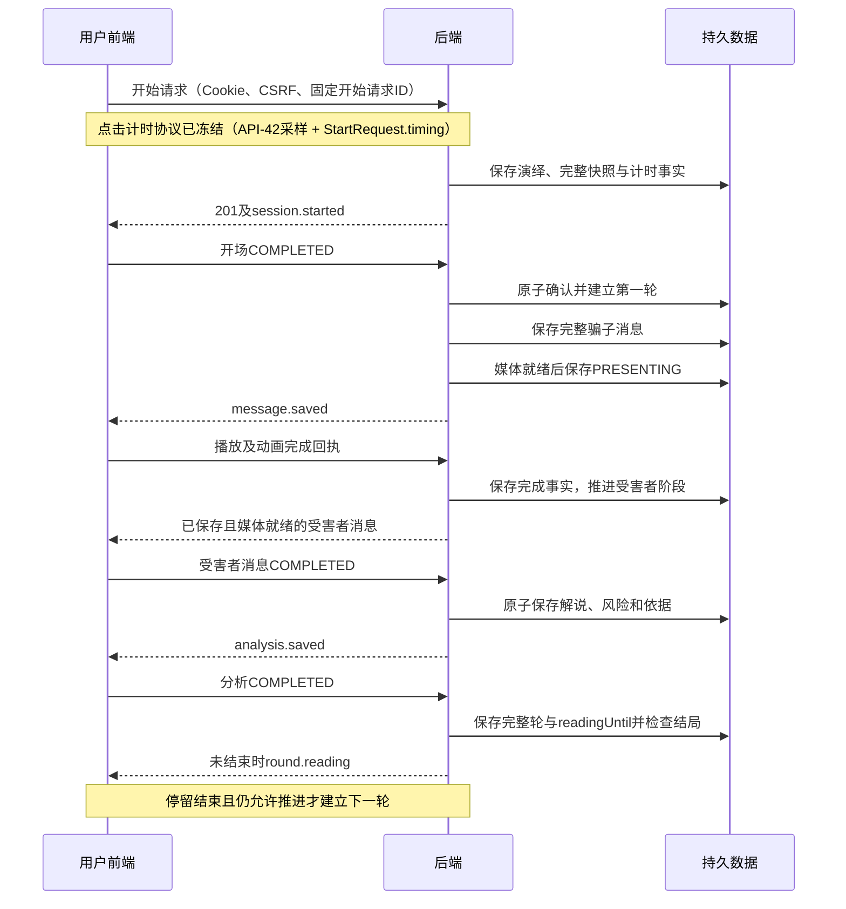
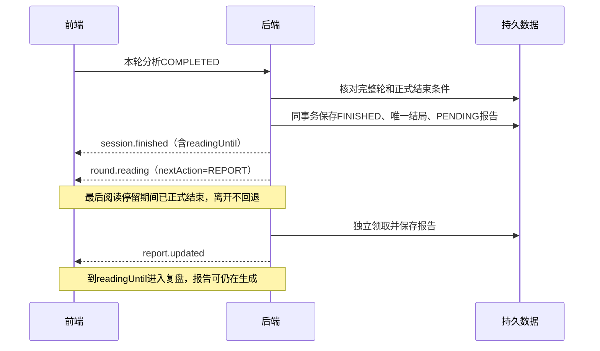
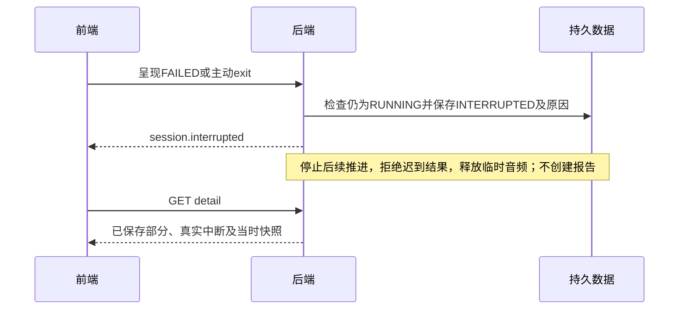
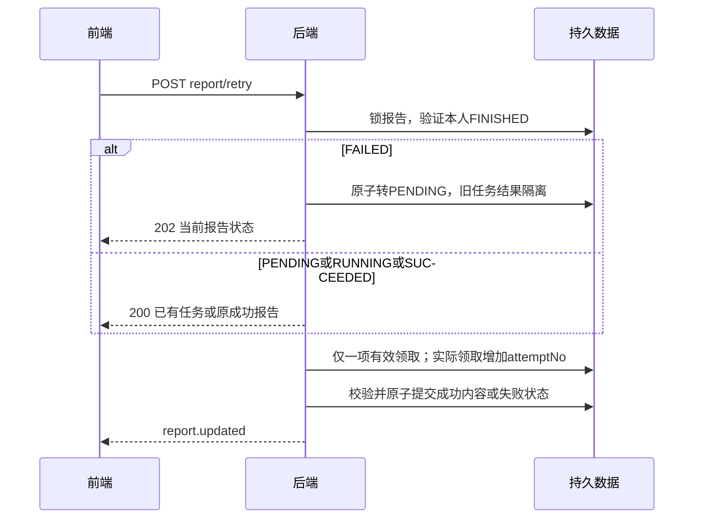

# AI反诈情景推演平台 接口文档 V1.0

| 项目 | 内容 |
|---|---|
| 编写日期 | 2026-10-16 |
| 文档状态 | 接口设计稿；已按确认计划编写，未实施服务端接口、数据库迁移或真实浏览器联调 |
| 使用对象 | 前端、后端、测试人员 |
| 配套契约 | [openapi.yaml](openapi.yaml)，OpenAPI 3.1.0 |
| 覆盖范围 | 42项正式HTTP操作、9类SSE事件；全部管理端接口纳入本期 |
| 冻结边界 | 已确认业务与接口选择可作为基线；TBD协议与运行参数不得视为已确认或已通过验证 |
| 最近修订 | 2026-10-16：演绎时限600秒（10分钟）；冻结点击计时协议并并入正式`StartRequest`（原TBD-01）；新增`round.started`事件与`nextAction`兜底（原TBD-05缺口）；明确`CONNECTION_LOST`判定规则；锁定音频格式（原TBD-07）；管理员不提供注册（原权限矩阵张力）；删除MySQL版本差异项（原TBD-08，版本已定为8.0.45） |

## 1. 依据、效力与设计记录

### 1.1 参考依据

- PRD V3.1《正式开发基线版》：业务、权限、账号规则、内容结构及验收的依据。V3.0不参与本次基线。
- 系统架构设计文档 V1.0：媒体、异步编排、保存发布、终态、重连及V-02/V-03的依据。
- 数据库设计文档 V1.0：字段语义、快照、幂等、版本条件、报告任务与数据一致性的依据。
- 用户最终接口基线及本轮五项确认：Cookie Session+CSRF、必要读取接口补齐、报告重试幂等返回、三类回执支持失败、SSE独立事件结构。

用户最新明确规则优先；本文补充具体传输契约，不重新定义已确认业务。所有“成功”示例都是示意数据，不代表已运行的服务，也不代替PRD初始三场景、两骗子、三受害者人物卡的完整初始化内容。各操作示例独立，不应把它们拼成一次完整演绎的连续时间线。

### 1.2 已确认规则与本次接口设计

| 类别 | 内容与效力 |
|---|---|
| 已确认 | 前缀`/anti.scam/v1`；Cookie Session+CSRF；不使用JWT；单实例内存登录Session，重启重新登录；HttpOnly、Secure、SameSite=Lax |
| 已确认 | 字符串ID、ISO 8601 UTC毫秒时间、游标分页、英文枚举；普通JSON统一`code/message/data/requestId` |
| 已确认 | 普通用户只访问本人演绎相关内容；管理员只维护基础场景、画像和头像，不能访问任何用户演绎、报告或AI反向记录 |
| 已确认 | 三类呈现回执必需；只有FAILED报告触发新尝试，其他已有任务/报告幂等返回；成功报告不可改写 |
| 已确认 | 原38项HTTP操作保留，增加用户头像读取与两类后台画像详情，合计41项；本次修订增加计时采样接口，合计42项；9类SSE事件独立于JSON封套 |
| 本次接口设计 | Cookie名`JSESSIONID`，Path=`/anti.scam/v1`，不设置Domain；匿名与已登录会话使用同一Cookie机制 |
| 本次接口设计 | JSON字段lowerCamelCase；成功`code="OK"`，失败code使用稳定英文码；requestId为服务端生成UUID，不是幂等键 |
| 本次接口设计 | 演绎stateVersion按非负十进制字符串传输，避免BIGINT精度损失；后台version为整数；轮号、计数与风险分为整数 |
| 本次接口设计 | 分页默认20、上限100；越界400；普通画像列表只接受enabled=true；停用画像普通详情返回404 |
| 本次接口设计 | 未登录401，角色禁止403；已确认角色后，资源不存在或不属于本人均404，避免泄露他人记录存在性 |
| 本次接口设计 | 点击计时协议已冻结：`GET /timing/samples`采样 + `StartRequest.timing`四字段，服务端据此建立`startedAt`与固定`deadlineAt`（详见第9.1节） |
| 本次接口设计 | 演绎时长上限600秒（10分钟）：`deadlineAt = startedAt + 600秒`，`readingUntil`与总截止时间取较早值 |
| 本次接口设计 | 管理员不提供注册入口，`/auth/register`仅对匿名与USER开放 |
| TBD | Session有效期、5MB字节口径、心跳/失联参数、报告运行参数及媒体兼容实测；见第9章。点击计时协议已冻结并并入正式`StartRequest` |

不引入新业务模块、删除/导出/分享/续演、暂停倍速回放、Prompt管理、用户管理、真实资讯或AI反向接口。角色限制作用于实际接口数据访问，不能以隐藏页面代替。

### 1.3 参考版本差异

目标目录中的PRD与架构文档与本次参考内容一致。数据库引擎版本已统一：四份文档均按**MySQL 8.0.45**表述，原8.4差异作废，本项不再是待定项。原三个文档未修改。

## 2. 公共传输、认证与权限

### 2.1 地址、类型和响应

前后端同源HTTPS。OpenAPI的`servers.url=/anti.scam/v1`，`paths`不再重复前缀。客户端不传userId决定归属；身份取服务器会话。JSON请求使用`application/json`，头像上传使用`multipart/form-data`；普通接口成功及失败均返回JSON。

```json
{"code":"OK","message":"成功","data":{},"requestId":"4aca43db-cd49-4b77-9abc-7e3490b55185"}
```

这是封套形状示例，实际data必须满足对应操作Schema，不是任意对象。四个顶层字段始终存在。业务分支依据HTTP状态和code，不依据message。失败data默认为null；字段错误或有权查看的冲突信息放入ErrorDetail。不得把失败都包装成HTTP 200。失败响应整体结构见[ErrorResponse](#schema-ErrorResponse)，字段级错误见[ErrorDetail](#schema-ErrorDetail)。

ID为正整数十进制字符串；`startRequestId/requestId`分别为业务幂等UUID和请求追踪UUID，不能互换。`sessionId`指演绎记录ID，绝不是Cookie中的登录会话值。时间例如`2026-10-15T02:00:00.000Z`，前端展示北京时间10:00；人物`contextTime`仍是情境文案。可选字段与可空字段分别按Schema定义，不用空字符串代替null；请求未知字段拒绝400，尤其role、userId、outcome、riskScore、reportContent等越权写入字段。

SSE成功响应是`text/event-stream`；图片和音频成功响应是二进制，两者均不套普通JSON。流/二进制响应开始前可按HTTP状态返回ErrorResponse；一旦已经发送成功响应头，不能再把JSON错误拼进字节流或修改HTTP状态。流中故障按第5章核对；二进制失败中止响应，由客户端提交真实媒体失败回执。

### 2.2 Cookie Session与CSRF调用顺序

1. 登录或注册页面先`GET /auth/csrf`，浏览器接收匿名Session Cookie，前端从JSON读取token。
2. 注册、登录、登出、开始、全部回执、退出、报告重试及后台写入均携带当前Cookie与`X-CSRF-TOKEN`。二者是同时满足的要求。
3. 登录成功轮换Session标识，设置`JSESSIONID=<opaque>; Path=/anti.scam/v1; HttpOnly; Secure; SameSite=Lax`，不通过JSON返回会话标识或JWT。客户端根据USER/ADMIN进入对应入口。
4. 登录成功后重新`GET /auth/csrf`获取与当前会话匹配的token；登出后的下一次登录/注册也先重新获取。获取新token不等于已登录。
5. POST登出销毁服务端当前Session，使用相同Path清除Cookie，关闭该Session的SSE与媒体访问。Session有效期、续期触发条件见TBD-02，不承诺“浏览器关闭必定删除全部凭据”。

注册不自动登录；用户名去首尾空格后按Unicode字符计数2—24，允许汉字、ASCII英文字母、数字、下划线；所有角色全局唯一、英文字母大小写不敏感。密码按Unicode字符计数6—24，空格原样保留，允许常见弱密码，包括123456；确认密码须原样一致。不得因哈希实现而截断或修改密码。登录失败统一“账号或密码错误”。

CSRF错误403，不自动重复可能已经提交的业务写请求；重新获取token后按业务幂等规则核对再处理。Session失效401时停止自动重试、关闭EventSource并引导重新登录。禁止把Cookie、密码、CSRF或供应商密钥写进日志、URL、样例中的真实值或历史快照。

登出时已有RUNNING演绎按主动离开收敛；退出持久化失败不阻止撤销登录凭据，但不得声称演绎中断已保存。后台故障核对保留真实事实。已正式结束的报告任务不因登出取消。Cookie与CSRF获取/刷新机制遵循[Spring Security官方CSRF说明](https://docs.spring.io/spring-security/reference/servlet/exploits/csrf.html)，具体配置必须匹配最终锁定的框架版本。

### 2.3 权限矩阵与访问次序

| 接口组 | 匿名 | USER | ADMIN |
|---|---|---|---|
| csrf、register、login | 允许；写操作仍需匿名Cookie+CSRF | 允许；不提供角色选择 | csrf/login允许；**register返回403**，管理员不提供注册 |
| me、logout | 401 | 当前账号 | 当前账号 |
| home、news、普通场景/画像读取、用户头像 | 401 | 按可用性或本人快照授权 | 403 |
| 演绎创建、状态、SSE、三类回执、退出、音频 | 401 | 本人且符合阶段 | 403 |
| 个人历史、报告及重试 | 401 | 仅本人，按状态限制 | 403 |
| 计时采样（/timing/samples） | 401 | 本人当前Session | 403 |
| 全部admin路径 | 401 | 403 | 仅基础内容 |

资源归属采用`message→round→session→user`或`report→session→user`的完整关联；路径里的id、messageId、roundNo必须指向同一演绎。管理员不能通过知道ID、请求头、画像权限或历史头像资源反查用户记录。禁止只校验消息ID存在。

在身份与角色允许后，跨用户与不存在统一404且不返回正文、头像归属或诊断信息。CSRF与认证同时失败时不承诺过滤器执行优先级；测试单一错误时确保其他前提有效。受保护API不重定向到HTML登录页。

### 2.4 分页、并发和缓存

- 历史采用`startedAt DESC,id DESC`复合游标；画像采用`id ASC`。首屏cursor省略或空字符串，后续原样传nextCursor。limit默认20、范围1—100，非法值400。
- cursor为服务端可校验的不透明值，绑定当前账号、接口、排序及固定筛选，不暴露SQL；损坏、篡改或跨查询使用返回400 INVALID_CURSOR。游标不是授权凭据，每页仍独立校验权限。分页不是数据库长事务快照，新插入项在刷新首屏后出现；启停可能改变后续可选项，不承诺跨页内容冻结。
- 返回`items/nextCursor/hasMore`；无下一页时nextCursor=null、hasMore=false；不提供total和页码。固定三场景及空资讯不分页；单场历史详情最多20轮、40条角色消息，全量返回。
- 开始请求按本人+startRequestId幂等，同键含义不同409；同账号不同请求若已有RUNNING则409并返回本人activeSessionId。报告重试、回执和启停分别执行各自幂等规则，不泛化为所有POST自动安全重试。
- 后台PUT必须提交读取时version，成功增加版本；同一过期请求重发返回409，读取核对后再决定，不自动覆盖。启停先识别目标状态已达到，再判断版本，避免重复操作误报冲突。
- 认证、用户私有JSON、SSE和临时音频使用no-store；头像采用private, no-store确保每次读取继续校验访问权。缓存不能绕过登出、终态或资源授权检查。

## 3. 领域状态与返回不变量

| 维度 | 对外语义 |
|---|---|
| RUNNING | outcome/interruption/endedAt为null；report为null；可有半轮或已保存但未呈现内容 |
| FINISHED | endedAt与唯一outcome存在；interruption=null；报告记录必须存在；缺记录500 DATA_INCONSISTENT |
| INTERRUPTED | endedAt与interruption存在；outcome/report=null；不生成部分正式报告 |
| 正式结局 | GOAL_ACHIEVED、LOSS_STOPPED、NOT_DEFRAUDED、UNDETERMINED；只有最后一项有ROUND_LIMIT/TIME_LIMIT/BOTH的limitReason |
| 报告 | PENDING/RUNNING→生成中；SUCCEEDED→已完成；FAILED→生成失败；只有FAILED的canRetry=true |
| 报告内容 | 只有SUCCEEDED时content非null；FAILED具有安全error，其他报告状态error=null；GET不生成或重算 |
| 风险 | 仅0/25/50/75/100；没有分析时analysis=null，尚未评分时latestRiskScore=null；不补0 |
| 完整双方互动 | 双方文本已保存；interactionComplete=true，仍可能媒体未完成 |
| 完整轮结束位置 | 必要双方呈现与分析呈现都经服务端确认，phase=COMPLETE、presentationComplete=true |
| 下一动作 | 会话级`nextAction`与轮次级一致：`NEXT_ROUND`（停留后由服务端建立下一轮）、`REPORT`（进入复盘）、null（尚未确定）；断线重连后以`session.state`中的该字段为准 |

实际结局由已保存事实及固定场景目标判定，风险0或100不直接触发结局。同轮关键目标达成后又停止配合仍保留GOAL_ACHIEVED；结果明确则结束，不补凑轮次。最多20轮、点击起点起总计600秒（10分钟），首次加载、等待、保存、媒体、逐轮和最后阅读停留均计入；不得生成第21轮或到时后继续播放收尾。

完整轮无明确结局到上限才正式UNDETERMINED；半轮或必要呈现未完成到时则TIME_LIMIT中断，无报告；不能提前未定、附加宽限或一律中断。正常阅读停留5秒，总剩余不足5秒则缩短。正式结束确认在最后阅读停留之前，结束后离开不回退。报告生成和阅读不占用演绎600秒。

历史列表和详情从当时快照读取展示内容，头像文件保留真实旧版本。当前画像编辑、停用、替换头像、Prompt或模型升级均不能改写过去。历史详情不含音频字段、不调用TTS、不恢复演出；报告风险曲线取原轮次数据，不由模型再生成一套权威评分。

## 4. 呈现、终态与异常交互

### 4.1 三类回执规则

| 回执 | COMPLETED条件 | FAILED允许类别 |
|---|---|---|
| 开场 | 场景文案、双方头像与必要初始动画正常呈现 | TEXT_RENDER_FAILED、AVATAR_LOAD_FAILED、ANIMATION_FAILED |
| 消息 | 当前消息文字呈现、语音时间轴和必要角色动画正常完成 | TEXT_RENDER_FAILED、ANIMATION_FAILED、AUDIO_LOAD_FAILED、AUDIO_PLAYBACK_FAILED |
| 分析 | 本轮完整解说、风险分与依据已呈现 | TEXT_RENDER_FAILED |

FAILED必须带errorCode，COMPLETED不得带errorCode。其他作用域的错误码400；客户端不提交TTS_FAILED、ANALYSIS_FAILED、PERSISTENCE_FAILED或任意正式结局。服务端收到合法必要呈现失败后核定MEDIA_FAILED；生成/TTS/保存故障由服务端自己的执行结果核定。

开场完成与第一轮建立必须形成可核对的持久推进事实；首次开场成功提交后，currentRoundNo不再是0。不能仅以内存布尔标记、HTTP 200或SSE发送成功证明开场完成。数据库现有轮次/消息/分析呈现事实支撑后续判断，不要求新增通用回执表。

| 情况 | 处理 |
|---|---|
| 当前阶段首次有效回执 | 保存事实后推进，effect=APPLIED |
| 相同已完成事实重发 | 先识别业务对象事实，返回ALREADY_APPLIED；不因版本变化重复推进 |
| RUNNING下同一对象相反结果 | 409 PRESENTATION_CONFLICT；不覆盖已保存呈现事实 |
| 未来轮次、非当前消息、阶段未满足 | 409 STAGE_CONFLICT；错误归属或错配对象404 |
| 已终态的新回执 | 返回200、IGNORED_TERMINAL和已有状态，不补写完成证据、不改变结局 |
| 已终态的已确认成功回执重发 | 可返回ALREADY_APPLIED及当前终态；不能复活演绎 |
| 回执提交结果未知 | 读取权威状态，再重发同对象同事实；不生成新消息或重算分析 |

COMPLETED仅证明技术呈现，不证明用户实际阅读或理解。静音是正常操作，使用静音播放或同一媒体时间轴，不跳过正常顺序或冒充媒体完成。自动播放受阻、后台动画停滞等必须通过V-03验证；无法正常完成必要呈现则按真实故障收敛。

### 4.2 正常推进



### 4.3 正式结束



### 4.4 中断与故障



对话/分析/TTS故障、服务端时限和连接失联也可触发中断，不要求前端伪造回执。若数据库不可用，停止推进并显示未保存状态，但不得发送声称已持久化的session.interrupted；恢复后先核对真实提交情况，再持久收敛并发布。不能保证尚未建行的开始请求已有历史记录。

### 4.5 报告失败重试



重复点击只保证同一时刻一个有效尝试，不承诺外部供应商恰好计算或收费一次。旧请求取消可能无法撤回供应商计算，但迟到结果必须不能覆盖新任务或成功报告。重启时PENDING可领取，失去可靠执行上下文且未成功保存的RUNNING报告收敛FAILED供本人重试；成功报告原样保留。

## 5. SSE协议与连接生命周期

原生EventSource连接同源`GET /anti.scam/v1/simulations/{id}/events`，凭Cookie认证，不传URL token，不加Authorization或CSRF头。使用`id:`、`event:`、`data:`并以空行结束一帧；JSON data为独立事件对象，不套普通响应。原生重连可携带Last-Event-ID，按[WHATWG SSE规范](https://html.spec.whatwg.org/multipage/server-sent-events.html)处理。

事件共同字段为eventId、sessionId、stateVersion、data。eventId是事件去重标识；同次发送重发保持，重连快照可用新标识。stateVersion是演绎状态快照版本，单调不下降，允许跳号；它不是消息数量、事件连续序号或报告任务版本。同一版本可包含多种事件，不能简单丢弃所有“版本相等”的事件。

- 客户端先按eventId去重；消息和分析再按业务对象ID/轮号合并，不能把重发当新台词。较旧演绎版本不能回退当前演绎状态，但历史内容是否缺失应按对象核对。
- report.updated可能携带相同演绎stateVersion；报告合并结合attemptNo、状态转换及updatedAt，不能只看演绎版本。旧尝试不得覆盖新尝试；SUCCEEDED不回退。存在不确定乱序时调用GET report重新核对。
- 本期没有持久事件日志，不承诺从Last-Event-ID补发全部事件。首次连接或重连以session.state返回当前演绎和报告事实；缺失完整已保存过程使用GET detail核对。对当前仍允许呈现的内容，按回执事实和当前阶段处理，不能重置时间或播放已经中断的演绎。
- message.saved选择在完整正文已保存、媒体就绪及PRESENTING也已保存后发布。TTS失败前已经保存的文字仍可在历史读取；未发事件不等于数据库未保存。不会增加未确认的audio.ready事件。
- 最后一轮先发布session.finished，再发布round.reading(nextAction=REPORT)，相应readingUntil也包含在状态中，防止漏事件导致前端错误等待。报告生成可在最后停留期间进行。
- **`nextAction`同时出现在`round.reading`事件与会话级`session.state`中**：漏收`round.reading`时，重连得到的`session.state.data.state.nextAction`与`readingUntil`共同决定下一步，前端不得因缺少事件而卡在停留态。
- `round.started`由服务端在建立每一轮时发布，是前端显示“内容生成中”等待态的唯一依据；下一轮的建立时机为`readingUntil`到期且会话仍为RUNNING、未到20轮且仍有剩余预算，由服务端自行调度，**客户端不发起任何推进请求**。若`readingUntil`到期而仍未收到`round.started`，前端以GET状态接口核对后继续等待，不自行重试或跳轮。
- RUNNING短暂失联不得直接误判主动退出；连接恢复只是核对。刷新、关闭、主动导航属于退出而非续演；标签切换不主动中断也不暂停计时。心跳、失联判断、页面实例区分及刷新兜底见TBD-05/V-03，不凭一个visibilitychange或心跳延迟直接认定退出。
- 导航退出优先带CSRF正常POST；pagehide尽力发送带自定义头的同源fetch keepalive。关闭/挂起不能保证通知送达，禁止以sendBeacon无法携带必需头为由取消CSRF。刷新识别机制冻结前不能宣称已满足退出规则。
- Session到期、登出后立即关闭对应流；浏览器onerror不能可靠取得失败JSON正文，可调用auth/me确认登录态，再按状态接口恢复页面。不得在401后无限重连；不把错误HTTP正文作为SSE事件处理。
- INTERRUPTED、报告SUCCEEDED/FAILED状态确认后客户端关闭无需继续订阅的流；FINISHED且报告生成中可继续订阅或通过GET report核对。报告重试返回202后重新建立该场events连接，先以session.state核对新任务；报告后台任务不随断开取消。
- 心跳采用注释帧，不包含业务结局，不构成第九类事件；间隔与代理配置见TBD-04。响应禁止缓存和代理缓冲。服务端流已开始后内部错误只能停止/关闭连接或发布已成功保存的合法业务事件，不能假造终态。

以下列出九类事件的载荷与完整帧示例。事件Schema字段表见第7章。

### round.started

服务端已建立本轮并写入`round_no`与初始`phase`；前端据此显示“内容生成中”等待态。本事件不代表已生成内容。

载荷：[RoundStartedEvent](#schema-RoundStartedEvent)。SSE帧：

```text
id: evt-example-round-started
event: round.started
sessionId: 501
data: {"eventId":"evt-example-round-started","sessionId":"501","stateVersion":"8","data":{"roundNo":2,"phase":"SCAMMER_GENERATING","startedAt":"2026-10-15T02:00:25.000Z","deadlineAt":"2026-10-15T02:10:00.000Z"}}

```

### session.started

演绎、配置快照与起止时间已成功保存，开场可展示；不表示开场已呈现。

载荷：[SessionStartedEvent](#schema-SessionStartedEvent)。SSE帧：

```text
id: evt-example-session-started
event: session.started
data: {"eventId":"evt-example-session-started","sessionId":"501","stateVersion":"0","data":{"sessionId":"501","status":"RUNNING","stateVersion":"0","startedAt":"2026-10-15T02:00:00.000Z","deadlineAt":"2026-10-15T02:10:00.000Z","endedAt":null,"currentRoundNo":0,"configuration":{"scenario":{"id":"1","code":"TASK_REBATE","name":"刷单返利诈骗","description":"以完成任务获得返利为由诱导垫付和追加投入。","focus":"青年群体"},"scammer":{"id":"11","avatar":{"key":"avatar_example_01","url":"/anti.scam/v1/avatars/avatar_example_01"},"name":"示例骗子甲","age":30,"gender":"男","identity":"示例人物身份","description":"仅用于接口字段演示，不代替PRD初始人物卡。","contextTime":"工作日晚间","contextPlace":"家中","currentState":"正在查看手机消息","fraudExperience":"HIGH","speechSkill":"HIGH","manipulationSkill":"MEDIUM","behaviorTraits":"善于利用小额返利建立信任。"},"victim":{"id":"21","avatar":{"key":"avatar_example_01","url":"/anti.scam/v1/avatars/avatar_example_01"},"name":"示例受害者乙","age":30,"gender":"女","identity":"示例人物身份","description":"仅用于接口字段演示，不代替PRD初始人物卡。","contextTime":"工作日晚间","contextPlace":"家中","currentState":"正在查看手机消息","antiFraudAwareness":"MEDIUM","riskTendency":"LOW","personalityTraits":"谨慎，遇到转账要求时会核实。"}},"currentRound":null,"latestRiskScore":null,"outcome":null,"interruption":null,"readingUntil":null,"report":null}}

```


### message.saved

正文已保存且TTS/必要资源已就绪、PRESENTING状态已保存后发布；未就绪时不提前推送可播放事件。

载荷：[MessageSavedEvent](#schema-MessageSavedEvent)。SSE帧：

```text
id: evt-example-message-saved
event: message.saved
data: {"eventId":"evt-example-message-saved","sessionId":"501","stateVersion":"7","data":{"id":"1001","roundNo":1,"speaker":"SCAMMER","content":"完成任务后即可领取返利，请先了解任务规则。","presentationStatus":"PRESENTING","presentationCompletedAt":null,"presentationErrorCode":null,"savedAt":"2026-10-15T02:00:10.000Z","audioUrl":"/anti.scam/v1/simulations/501/messages/1001/audio"}}

```


### analysis.saved

本轮解说、风险、依据已原子保存，等待呈现回执。

载荷：[AnalysisSavedEvent](#schema-AnalysisSavedEvent)。SSE帧：

```text
id: evt-example-analysis-saved
event: analysis.saved
data: {"eventId":"evt-example-analysis-saved","sessionId":"501","stateVersion":"7","data":{"roundNo":1,"analysis":{"fraudStage":"建立信任","speechAnalysis":"通过小额返利承诺吸引关注。","methodAnalysis":"以完成任务为由提出垫付。","victimPsychology":"对转账要求保持警惕。","riskScore":25,"riskReason":"尚未转账，已提出核实要求。","savedAt":"2026-10-15T02:00:20.000Z","presentedAt":null}}}

```


### round.reading

本轮分析呈现确认及readingUntil已保存；末轮为REPORT且在session.finished之后发送。

载荷：[RoundReadingEvent](#schema-RoundReadingEvent)。SSE帧：

```text
id: evt-example-round-reading
event: round.reading
data: {"eventId":"evt-example-round-reading","sessionId":"501","stateVersion":"7","data":{"roundNo":1,"readingUntil":"2026-10-15T02:00:25.000Z","nextAction":"NEXT_ROUND"}}

```


### session.finished

FINISHED、唯一结局与报告PENDING已同事务提交，之后可进行最后阅读停留。

载荷：[SessionFinishedEvent](#schema-SessionFinishedEvent)。SSE帧：

```text
id: evt-example-session-finished
event: session.finished
data: {"eventId":"evt-example-session-finished","sessionId":"501","stateVersion":"12","data":{"sessionId":"501","status":"FINISHED","stateVersion":"12","startedAt":"2026-10-15T02:00:00.000Z","deadlineAt":"2026-10-15T02:10:00.000Z","endedAt":"2026-10-15T02:00:20.000Z","currentRoundNo":1,"configuration":{"scenario":{"id":"1","code":"TASK_REBATE","name":"刷单返利诈骗","description":"以完成任务获得返利为由诱导垫付和追加投入。","focus":"青年群体"},"scammer":{"id":"11","avatar":{"key":"avatar_example_01","url":"/anti.scam/v1/avatars/avatar_example_01"},"name":"示例骗子甲","age":30,"gender":"男","identity":"示例人物身份","description":"仅用于接口字段演示，不代替PRD初始人物卡。","contextTime":"工作日晚间","contextPlace":"家中","currentState":"正在查看手机消息","fraudExperience":"HIGH","speechSkill":"HIGH","manipulationSkill":"MEDIUM","behaviorTraits":"善于利用小额返利建立信任。"},"victim":{"id":"21","avatar":{"key":"avatar_example_01","url":"/anti.scam/v1/avatars/avatar_example_01"},"name":"示例受害者乙","age":30,"gender":"女","identity":"示例人物身份","description":"仅用于接口字段演示，不代替PRD初始人物卡。","contextTime":"工作日晚间","contextPlace":"家中","currentState":"正在查看手机消息","antiFraudAwareness":"MEDIUM","riskTendency":"LOW","personalityTraits":"谨慎，遇到转账要求时会核实。"}},"currentRound":{"roundNo":1,"phase":"COMPLETE","interactionComplete":true,"presentationComplete":true,"messages":[{"id":"1001","roundNo":1,"speaker":"SCAMMER","content":"完成任务后即可领取返利，请先了解任务规则。","presentationStatus":"COMPLETED","presentationCompletedAt":"2026-10-15T02:00:20.000Z","presentationErrorCode":null,"savedAt":"2026-10-15T02:00:10.000Z","audioUrl":null},{"id":"1002","roundNo":1,"speaker":"VICTIM","content":"我不会转账，也不再参与这个任务。","presentationStatus":"COMPLETED","presentationCompletedAt":"2026-10-15T02:00:20.000Z","presentationErrorCode":null,"savedAt":"2026-10-15T02:00:10.000Z","audioUrl":null}],"analysis":{"fraudStage":"建立信任","speechAnalysis":"通过小额返利承诺吸引关注。","methodAnalysis":"以完成任务为由提出垫付。","victimPsychology":"对转账要求保持警惕。","riskScore":25,"riskReason":"尚未转账，已提出核实要求。","savedAt":"2026-10-15T02:00:20.000Z","presentedAt":"2026-10-15T02:00:20.000Z"},"readingUntil":"2026-10-15T02:00:25.000Z"},"latestRiskScore":25,"outcome":{"code":"NOT_DEFRAUDED","displayText":"未受骗结束","reason":"受害者拒绝转账并停止配合，未发生实际受骗行为。","limitReason":null},"interruption":null,"readingUntil":"2026-10-15T02:00:25.000Z","report":{"status":"PENDING","displayText":"生成中","canRetry":false,"attemptNo":0,"updatedAt":"2026-10-15T02:00:20.000Z","error":null}}}

```


### session.interrupted

INTERRUPTED与真实中断原因已持久化；无正式报告。

载荷：[SessionInterruptedEvent](#schema-SessionInterruptedEvent)。SSE帧：

```text
id: evt-example-session-interrupted
event: session.interrupted
data: {"eventId":"evt-example-session-interrupted","sessionId":"501","stateVersion":"5","data":{"sessionId":"501","status":"INTERRUPTED","stateVersion":"5","startedAt":"2026-10-15T02:00:00.000Z","deadlineAt":"2026-10-15T02:10:00.000Z","endedAt":"2026-10-15T02:00:20.000Z","currentRoundNo":0,"configuration":{"scenario":{"id":"1","code":"TASK_REBATE","name":"刷单返利诈骗","description":"以完成任务获得返利为由诱导垫付和追加投入。","focus":"青年群体"},"scammer":{"id":"11","avatar":{"key":"avatar_example_01","url":"/anti.scam/v1/avatars/avatar_example_01"},"name":"示例骗子甲","age":30,"gender":"男","identity":"示例人物身份","description":"仅用于接口字段演示，不代替PRD初始人物卡。","contextTime":"工作日晚间","contextPlace":"家中","currentState":"正在查看手机消息","fraudExperience":"HIGH","speechSkill":"HIGH","manipulationSkill":"MEDIUM","behaviorTraits":"善于利用小额返利建立信任。"},"victim":{"id":"21","avatar":{"key":"avatar_example_01","url":"/anti.scam/v1/avatars/avatar_example_01"},"name":"示例受害者乙","age":30,"gender":"女","identity":"示例人物身份","description":"仅用于接口字段演示，不代替PRD初始人物卡。","contextTime":"工作日晚间","contextPlace":"家中","currentState":"正在查看手机消息","antiFraudAwareness":"MEDIUM","riskTendency":"LOW","personalityTraits":"谨慎，遇到转账要求时会核实。"}},"currentRound":null,"latestRiskScore":null,"outcome":null,"interruption":{"code":"MEDIA_FAILED","message":"必要媒体呈现失败，本次演绎已中断。"},"readingUntil":null,"report":null}}

```


### report.updated

报告状态变化已保存；不依赖演绎stateVersion增长，不允许重写成功报告。

载荷：[ReportUpdatedEvent](#schema-ReportUpdatedEvent)。SSE帧：

```text
id: evt-example-report-updated
event: report.updated
data: {"eventId":"evt-example-report-updated","sessionId":"501","stateVersion":"7","data":{"sessionId":"501","simulationStatus":"FINISHED","report":{"status":"PENDING","displayText":"生成中","canRetry":false,"attemptNo":0,"updatedAt":"2026-10-15T02:00:20.000Z","error":null},"unavailableReason":null,"outcome":{"code":"NOT_DEFRAUDED","displayText":"未受骗结束","reason":"受害者拒绝转账并停止配合，未发生实际受骗行为。","limitReason":null},"content":null,"riskSeries":[{"roundNo":1,"score":25}]}}

```


### session.state

连接建立或重连时的权威状态核对，包括报告；不是历史事件日志或续演授权。

载荷：[SessionStateEvent](#schema-SessionStateEvent)。SSE帧：

```text
id: evt-example-session-state
event: session.state
data: {"eventId":"evt-example-session-state","sessionId":"501","stateVersion":"7","data":{"state":{"sessionId":"501","status":"RUNNING","stateVersion":"0","startedAt":"2026-10-15T02:00:00.000Z","deadlineAt":"2026-10-15T02:10:00.000Z","endedAt":null,"currentRoundNo":0,"configuration":{"scenario":{"id":"1","code":"TASK_REBATE","name":"刷单返利诈骗","description":"以完成任务获得返利为由诱导垫付和追加投入。","focus":"青年群体"},"scammer":{"id":"11","avatar":{"key":"avatar_example_01","url":"/anti.scam/v1/avatars/avatar_example_01"},"name":"示例骗子甲","age":30,"gender":"男","identity":"示例人物身份","description":"仅用于接口字段演示，不代替PRD初始人物卡。","contextTime":"工作日晚间","contextPlace":"家中","currentState":"正在查看手机消息","fraudExperience":"HIGH","speechSkill":"HIGH","manipulationSkill":"MEDIUM","behaviorTraits":"善于利用小额返利建立信任。"},"victim":{"id":"21","avatar":{"key":"avatar_example_01","url":"/anti.scam/v1/avatars/avatar_example_01"},"name":"示例受害者乙","age":30,"gender":"女","identity":"示例人物身份","description":"仅用于接口字段演示，不代替PRD初始人物卡。","contextTime":"工作日晚间","contextPlace":"家中","currentState":"正在查看手机消息","antiFraudAwareness":"MEDIUM","riskTendency":"LOW","personalityTraits":"谨慎，遇到转账要求时会核实。"}},"currentRound":null,"latestRiskScore":null,"outcome":null,"interruption":null,"readingUntil":null,"report":null},"reportView":{"sessionId":"501","simulationStatus":"RUNNING","report":null,"unavailableReason":"SIMULATION_RUNNING","outcome":null,"content":null,"riskSeries":[]}}}

```


## 6. HTTP接口逐项定义

本章路径均为完整路径。所有有请求体的操作遵循Schema的必填、可空及禁止额外字段约定；无请求体明确标注。读操作不产生业务推进。每项失败示例展示一个主要场景，完整状态码与业务码均列在对应表及OpenAPI responses中。

| 编号 | 方法 | 完整路径 | 用途 | 权限 |
|---|---|---|---|---|
| [API-01](#api-01) | GET | `/anti.scam/v1/auth/csrf` | 获取CSRF令牌 | PUBLIC |
| [API-02](#api-02) | POST | `/anti.scam/v1/auth/register` | 普通用户注册 | PUBLIC |
| [API-03](#api-03) | POST | `/anti.scam/v1/auth/login` | 共用登录 | PUBLIC |
| [API-04](#api-04) | POST | `/anti.scam/v1/auth/logout` | 登出 | USER|ADMIN |
| [API-05](#api-05) | GET | `/anti.scam/v1/auth/me` | 当前账号 | USER|ADMIN |
| [API-06](#api-06) | GET | `/anti.scam/v1/home` | 用户首页 | USER |
| [API-07](#api-07) | GET | `/anti.scam/v1/news` | 资讯空结构 | USER |
| [API-08](#api-08) | GET | `/anti.scam/v1/scenarios` | 固定三场景 | USER |
| [API-09](#api-09) | GET | `/anti.scam/v1/scammer-profiles` | 可用骗子画像 | USER |
| [API-10](#api-10) | GET | `/anti.scam/v1/scammer-profiles/{id}` | 骗子画像详情 | USER |
| [API-11](#api-11) | GET | `/anti.scam/v1/victim-profiles` | 可用受害者画像 | USER |
| [API-12](#api-12) | GET | `/anti.scam/v1/victim-profiles/{id}` | 受害者画像详情 | USER |
| [API-13](#api-13) | GET | `/anti.scam/v1/avatars/{key}` | 用户头像读取 | USER |
| [API-14](#api-14) | POST | `/anti.scam/v1/simulations` | 开始演绎 | USER |
| [API-15](#api-15) | GET | `/anti.scam/v1/simulations/{id}` | 当前演绎状态 | USER |
| [API-16](#api-16) | GET | `/anti.scam/v1/simulations/{id}/events` | 订阅演绎事件 | USER |
| [API-17](#api-17) | POST | `/anti.scam/v1/simulations/{id}/opening/presented` | 开场呈现回执 | USER |
| [API-18](#api-18) | POST | `/anti.scam/v1/simulations/{id}/messages/{messageId}/presentation` | 消息呈现回执 | USER |
| [API-19](#api-19) | POST | `/anti.scam/v1/simulations/{id}/rounds/{roundNo}/analysis/presented` | 分析呈现回执 | USER |
| [API-20](#api-20) | POST | `/anti.scam/v1/simulations/{id}/exit` | 主动退出 | USER |
| [API-21](#api-21) | GET | `/anti.scam/v1/simulations/{id}/messages/{messageId}/audio` | 临时语音访问 | USER |
| [API-22](#api-22) | GET | `/anti.scam/v1/simulations/{id}/report` | 报告状态与内容 | USER |
| [API-23](#api-23) | POST | `/anti.scam/v1/simulations/{id}/report/retry` | 报告失败重试 | USER |
| [API-24](#api-24) | GET | `/anti.scam/v1/simulations` | 本人历史列表 | USER |
| [API-25](#api-25) | GET | `/anti.scam/v1/simulations/{id}/detail` | 本人历史详情 | USER |
| [API-26](#api-26) | GET | `/anti.scam/v1/admin/scenarios` | 后台固定三场景 | ADMIN |
| [API-27](#api-27) | PUT | `/anti.scam/v1/admin/scenarios/{id}` | 编辑场景文案 | ADMIN |
| [API-28](#api-28) | GET | `/anti.scam/v1/admin/scammer-profiles` | 后台骗子画像列表 | ADMIN |
| [API-29](#api-29) | GET | `/anti.scam/v1/admin/scammer-profiles/{id}` | 后台骗子画像详情 | ADMIN |
| [API-30](#api-30) | POST | `/anti.scam/v1/admin/scammer-profiles` | 新增骗子画像 | ADMIN |
| [API-31](#api-31) | PUT | `/anti.scam/v1/admin/scammer-profiles/{id}` | 编辑骗子画像 | ADMIN |
| [API-32](#api-32) | POST | `/anti.scam/v1/admin/scammer-profiles/{id}/disable` | 停用骗子画像 | ADMIN |
| [API-33](#api-33) | POST | `/anti.scam/v1/admin/scammer-profiles/{id}/enable` | 启用骗子画像 | ADMIN |
| [API-34](#api-34) | GET | `/anti.scam/v1/admin/victim-profiles` | 后台受害者画像列表 | ADMIN |
| [API-35](#api-35) | GET | `/anti.scam/v1/admin/victim-profiles/{id}` | 后台受害者画像详情 | ADMIN |
| [API-36](#api-36) | POST | `/anti.scam/v1/admin/victim-profiles` | 新增受害者画像 | ADMIN |
| [API-37](#api-37) | PUT | `/anti.scam/v1/admin/victim-profiles/{id}` | 编辑受害者画像 | ADMIN |
| [API-38](#api-38) | POST | `/anti.scam/v1/admin/victim-profiles/{id}/disable` | 停用受害者画像 | ADMIN |
| [API-39](#api-39) | POST | `/anti.scam/v1/admin/victim-profiles/{id}/enable` | 启用受害者画像 | ADMIN |
| [API-40](#api-40) | POST | `/anti.scam/v1/admin/avatars` | 上传头像 | ADMIN |
| [API-41](#api-41) | GET | `/anti.scam/v1/admin/avatars/{key}` | 管理员头像预览 | ADMIN |
| [API-42](#api-42) | GET | `/anti.scam/v1/timing/samples` | 点击计时采样 | USER |

**接口↔事件关系：** API-42与API-14共同构成开始链路（采样→开始）；API-17/18/19三类回执是唯一可推进演绎的写操作；API-20/21用于退出与临时语音；SSE（API-16）只发布已保存事实，不产生业务推进。事件与接口的对应关系汇总如下。

| SSE事件 | 由哪个操作或服务端动作产生 | 客户端应做什么 |
|---|---|---|
| `session.started` | API-14提交成功后 | 展示开场，完成后调API-17 |
| `round.started` | 服务端建立首轮或`readingUntil`到期后建立下一轮时 | 显示“内容生成中”等待态，不发送推进请求 |
| `message.saved` | 服务端保存角色消息且媒体就绪后 | 播放文字、语音与动画，完成后调API-18 |
| `analysis.saved` | 服务端原子保存本轮解说与风险后 | 展示解说与风险，完成后调API-19 |
| `round.reading` | 服务端在分析呈现确认后写入`readingUntil`时 | 按`readingUntil`停留；`nextAction`决定下一动作 |
| `session.finished` | 服务端确认正式结束（末轮先于`round.reading`发出） | 按`readingUntil`进入复盘页 |
| `session.interrupted` | API-20或服务端核定中断后 | 停止播放，展示中断原因 |
| `report.updated` | 报告任务状态变化时 | 更新报告状态；必要时GET报告核对 |
| `session.state` | 订阅建立或重连时 | 以服务端状态覆盖本地，作为漏事件兜底 |

<a id="api-01"></a>

### API-01 获取CSRF令牌

`GET /anti.scam/v1/auth/csrf`

**operationId：** `getCsrf`；**权限：** PUBLIC。

允许匿名与已登录调用；绑定当前Session，必要时创建匿名Session。Cache-Control: no-store。重取不登录、不切换角色。

需求依据：PRD§8.1、BR-P11、PER-01～04；本轮Cookie Session+CSRF确认

**认证与请求参数**

| 参数 | 位置 | 必填 | 类型／约束 | 说明 |
|---|---|---|---|---|
| 无 | — | — | — | 无业务输入 |

**请求体：** 无。

**成功响应**

HTTP **200**，`application/json`。成功；业务载荷见CsrfToken

响应字段：[CsrfTokenResponse](#schema-CsrfTokenResponse)。

```json
{
  "code": "OK",
  "message": "成功",
  "data": {
    "token": "csrf-example-not-a-real-token",
    "headerName": "X-CSRF-TOKEN"
  },
  "requestId": "4aca43db-cd49-4b77-9abc-7e3490b55185"
}
```

**失败响应**

| HTTP状态 | code | 含义 |
|---|---|---|
| 400 | VALIDATION_FAILED | 请求字段不符合规则 |
| 500 | INTERNAL_ERROR | 服务暂时无法完成请求 |
| 503 | SERVICE_UNAVAILABLE | 服务暂不可用 |

失败示例：HTTP **400**。

```json
{
  "code": "VALIDATION_FAILED",
  "message": "请求字段不符合规则",
  "data": {
    "fieldErrors": [
      {
        "field": "$",
        "code": "VALUE_INVALID",
        "message": "字段值不符合接口约定"
      }
    ],
    "activeSessionId": null,
    "currentVersion": null
  },
  "requestId": "4aca43db-cd49-4b77-9abc-7e3490b55185"
}
```


<a id="api-02"></a>

### API-02 普通用户注册

`POST /anti.scam/v1/auth/register`

**operationId：** `register`；**权限：** PUBLIC。

只创建USER；不得提交role。注册成功仍未登录，返回登录页。密码和确认密码按原样比较。重复提交命中同名账号返回409，不重复建号。

需求依据：PRD§8.1、BR-P11、PER-01～04；本轮Cookie Session+CSRF确认

**认证与请求参数**

| 参数 | 位置 | 必填 | 类型／约束 | 说明 |
|---|---|---|---|---|
| JSESSIONID | Cookie | 是 | 不透明会话值 | 可为匿名Session；不是登录成功证明 |
| X-CSRF-TOKEN | Header | 是 | 当前Session绑定令牌 | 通过GET /auth/csrf取得 |

**请求体：** [RegisterRequest](#schema-RegisterRequest)，字段必填与约束见字典。

```json
{
  "username": "示例用户_01",
  "password": "123456",
  "confirmPassword": "123456"
}
```

**成功响应**

HTTP **201**，`application/json`。成功；业务载荷见Registration

响应字段：[RegistrationResponse](#schema-RegistrationResponse)。

```json
{
  "code": "OK",
  "message": "成功",
  "data": {
    "account": {
      "id": "101",
      "username": "示例用户_01",
      "role": "USER"
    },
    "nextAction": "LOGIN"
  },
  "requestId": "4aca43db-cd49-4b77-9abc-7e3490b55185"
}
```

**失败响应**

| HTTP状态 | code | 含义 |
|---|---|---|
| 400 | VALIDATION_FAILED | 请求字段不符合规则 |
| 403 | CSRF_INVALID | CSRF校验失败，请重新获取令牌 |
| 415 | UNSUPPORTED_MEDIA_TYPE | 不支持的请求或图片格式 |
| 409 | USERNAME_TAKEN | 用户名已被使用 |
| 500 | INTERNAL_ERROR | 服务暂时无法完成请求 |
| 503 | SERVICE_UNAVAILABLE | 服务暂不可用 |

失败示例：HTTP **409**。

```json
{
  "code": "USERNAME_TAKEN",
  "message": "用户名已被使用",
  "data": null,
  "requestId": "4aca43db-cd49-4b77-9abc-7e3490b55185"
}
```


<a id="api-03"></a>

### API-03 共用登录

`POST /anti.scam/v1/auth/login`

**operationId：** `login`；**权限：** PUBLIC。

携带匿名或当前Session Cookie及对应CSRF。登录成功轮换Session标识并设置安全Cookie；返回固定角色。随后重新GET /auth/csrf。失败统一账号或密码错误；不返回token/JWT。

需求依据：PRD§8.1、BR-P11、PER-01～04；本轮Cookie Session+CSRF确认

**认证与请求参数**

| 参数 | 位置 | 必填 | 类型／约束 | 说明 |
|---|---|---|---|---|
| JSESSIONID | Cookie | 是 | 不透明会话值 | 可为匿名Session；不是登录成功证明 |
| X-CSRF-TOKEN | Header | 是 | 当前Session绑定令牌 | 通过GET /auth/csrf取得 |

**请求体：** [LoginRequest](#schema-LoginRequest)，字段必填与约束见字典。

```json
{
  "username": "示例用户_01",
  "password": "123456"
}
```

**成功响应**

HTTP **200**，`application/json`。成功；业务载荷见Account

响应字段：[AccountResponse](#schema-AccountResponse)。

```json
{
  "code": "OK",
  "message": "成功",
  "data": {
    "id": "101",
    "username": "示例用户_01",
    "role": "USER"
  },
  "requestId": "4aca43db-cd49-4b77-9abc-7e3490b55185"
}
```

**失败响应**

| HTTP状态 | code | 含义 |
|---|---|---|
| 400 | VALIDATION_FAILED | 请求字段不符合规则 |
| 403 | CSRF_INVALID | CSRF校验失败，请重新获取令牌 |
| 415 | UNSUPPORTED_MEDIA_TYPE | 不支持的请求或图片格式 |
| 401 | INVALID_CREDENTIALS | 账号或密码错误 |
| 500 | INTERNAL_ERROR | 服务暂时无法完成请求 |
| 503 | SERVICE_UNAVAILABLE | 服务暂不可用 |

失败示例：HTTP **401**。

```json
{
  "code": "INVALID_CREDENTIALS",
  "message": "账号或密码错误",
  "data": null,
  "requestId": "4aca43db-cd49-4b77-9abc-7e3490b55185"
}
```


<a id="api-04"></a>

### API-04 登出

`POST /anti.scam/v1/auth/logout`

**operationId：** `logout`；**权限：** USER|ADMIN。

无请求体。有效Session及CSRF下销毁当前Session、清除Cookie，关闭其SSE并撤销临时媒体访问。已有RUNNING演绎按主动离开规则收敛，成功报告不受影响。重复请求若Session已失效返回401，客户端按已登出处理。

需求依据：PRD§8.1、BR-P11、PER-01～04；本轮Cookie Session+CSRF确认

**认证与请求参数**

| 参数 | 位置 | 必填 | 类型／约束 | 说明 |
|---|---|---|---|---|
| JSESSIONID | Cookie | 是 | 不透明会话值 | 有效登录Session，角色必须匹配 |
| X-CSRF-TOKEN | Header | 是 | 当前Session绑定令牌 | 通过GET /auth/csrf取得 |

**请求体：** 无。

**成功响应**

HTTP **200**，`application/json`。成功；业务载荷见LogoutResult

响应字段：[LogoutResultResponse](#schema-LogoutResultResponse)。

```json
{
  "code": "OK",
  "message": "成功",
  "data": {
    "loggedOut": true
  },
  "requestId": "4aca43db-cd49-4b77-9abc-7e3490b55185"
}
```

**失败响应**

| HTTP状态 | code | 含义 |
|---|---|---|
| 400 | VALIDATION_FAILED | 请求字段不符合规则 |
| 401 | UNAUTHENTICATED | 请重新登录 |
| 403 | FORBIDDEN | 当前角色无权访问 |
| 403 | CSRF_INVALID | CSRF校验失败，请重新获取令牌 |
| 415 | UNSUPPORTED_MEDIA_TYPE | 不支持的请求或图片格式 |
| 500 | INTERNAL_ERROR | 服务暂时无法完成请求 |
| 503 | SERVICE_UNAVAILABLE | 服务暂不可用 |

失败示例：HTTP **401**。

```json
{
  "code": "UNAUTHENTICATED",
  "message": "请重新登录",
  "data": null,
  "requestId": "4aca43db-cd49-4b77-9abc-7e3490b55185"
}
```


<a id="api-05"></a>

### API-05 当前账号

`GET /anti.scam/v1/auth/me`

**operationId：** `getMe`；**权限：** USER|ADMIN。

只返回当前账号与既定角色；不接受用户ID。无登录态401，不返回匿名伪账号。读取不改变演绎状态。

需求依据：PRD§8.1、BR-P11、PER-01～04；本轮Cookie Session+CSRF确认

**认证与请求参数**

| 参数 | 位置 | 必填 | 类型／约束 | 说明 |
|---|---|---|---|---|
| JSESSIONID | Cookie | 是 | 不透明会话值 | 有效登录Session，角色必须匹配 |

**请求体：** 无。

**成功响应**

HTTP **200**，`application/json`。成功；业务载荷见Account

响应字段：[AccountResponse](#schema-AccountResponse)。

```json
{
  "code": "OK",
  "message": "成功",
  "data": {
    "id": "101",
    "username": "示例用户_01",
    "role": "USER"
  },
  "requestId": "4aca43db-cd49-4b77-9abc-7e3490b55185"
}
```

**失败响应**

| HTTP状态 | code | 含义 |
|---|---|---|
| 400 | VALIDATION_FAILED | 请求字段不符合规则 |
| 401 | UNAUTHENTICATED | 请重新登录 |
| 403 | FORBIDDEN | 当前角色无权访问 |
| 500 | INTERNAL_ERROR | 服务暂时无法完成请求 |
| 503 | SERVICE_UNAVAILABLE | 服务暂不可用 |

失败示例：HTTP **401**。

```json
{
  "code": "UNAUTHENTICATED",
  "message": "请重新登录",
  "data": null,
  "requestId": "4aca43db-cd49-4b77-9abc-7e3490b55185"
}
```


<a id="api-06"></a>

### API-06 用户首页

`GET /anti.scam/v1/home`

**operationId：** `getHome`；**权限：** USER。

返回固定介绍、资讯空状态及语义入口；管理员不获得用户体验权限。

需求依据：PRD§8.2、FR-HOME-01～03

**认证与请求参数**

| 参数 | 位置 | 必填 | 类型／约束 | 说明 |
|---|---|---|---|---|
| JSESSIONID | Cookie | 是 | 不透明会话值 | 有效登录Session，角色必须匹配 |

**请求体：** 无。

**成功响应**

HTTP **200**，`application/json`。成功；业务载荷见Home

响应字段：[HomeResponse](#schema-HomeResponse)。

```json
{
  "code": "OK",
  "message": "成功",
  "data": {
    "title": "AI反诈情景推演平台",
    "introduction": "观看AI情景演绎，结合逐轮解说、风险与复盘学习反诈知识。",
    "newsState": "EMPTY",
    "entries": [
      "CONFIGURATION",
      "HISTORY"
    ]
  },
  "requestId": "4aca43db-cd49-4b77-9abc-7e3490b55185"
}
```

**失败响应**

| HTTP状态 | code | 含义 |
|---|---|---|
| 400 | VALIDATION_FAILED | 请求字段不符合规则 |
| 401 | UNAUTHENTICATED | 请重新登录 |
| 403 | FORBIDDEN | 当前角色无权访问 |
| 500 | INTERNAL_ERROR | 服务暂时无法完成请求 |
| 503 | SERVICE_UNAVAILABLE | 服务暂不可用 |

失败示例：HTTP **401**。

```json
{
  "code": "UNAUTHENTICATED",
  "message": "请重新登录",
  "data": null,
  "requestId": "4aca43db-cd49-4b77-9abc-7e3490b55185"
}
```


<a id="api-07"></a>

### API-07 资讯空结构

`GET /anti.scam/v1/news`

**operationId：** `listNews`；**权限：** USER。

data固定为[]；无分页、不加载真实或虚构资讯。

需求依据：PRD§8.2、PC-P03

**认证与请求参数**

| 参数 | 位置 | 必填 | 类型／约束 | 说明 |
|---|---|---|---|---|
| JSESSIONID | Cookie | 是 | 不透明会话值 | 有效登录Session，角色必须匹配 |

**请求体：** 无。

**成功响应**

HTTP **200**，`application/json`。成功；业务载荷见News

响应字段：[NewsResponse](#schema-NewsResponse)。

```json
{
  "code": "OK",
  "message": "成功",
  "data": [],
  "requestId": "4aca43db-cd49-4b77-9abc-7e3490b55185"
}
```

**失败响应**

| HTTP状态 | code | 含义 |
|---|---|---|
| 400 | VALIDATION_FAILED | 请求字段不符合规则 |
| 401 | UNAUTHENTICATED | 请重新登录 |
| 403 | FORBIDDEN | 当前角色无权访问 |
| 500 | INTERNAL_ERROR | 服务暂时无法完成请求 |
| 503 | SERVICE_UNAVAILABLE | 服务暂不可用 |

失败示例：HTTP **401**。

```json
{
  "code": "UNAUTHENTICATED",
  "message": "请重新登录",
  "data": null,
  "requestId": "4aca43db-cd49-4b77-9abc-7e3490b55185"
}
```


<a id="api-08"></a>

### API-08 固定三场景

`GET /anti.scam/v1/scenarios`

**operationId：** `listScenarios`；**权限：** USER。

固定三项，不分页；类型与目标不可由文案编辑改变。内容侧重不限制角色组合。

需求依据：PRD§8.3、PC-P01；数据库§5.2

**认证与请求参数**

| 参数 | 位置 | 必填 | 类型／约束 | 说明 |
|---|---|---|---|---|
| JSESSIONID | Cookie | 是 | 不透明会话值 | 有效登录Session，角色必须匹配 |

**请求体：** 无。

**成功响应**

HTTP **200**，`application/json`。成功；业务载荷见ScenarioList

响应字段：[ScenarioListResponse](#schema-ScenarioListResponse)。

```json
{
  "code": "OK",
  "message": "成功",
  "data": [
    {
      "id": "1",
      "code": "TASK_REBATE",
      "name": "刷单返利诈骗",
      "description": "以完成任务获得返利为由诱导垫付和追加投入。",
      "focus": "青年群体"
    },
    {
      "id": "2",
      "code": "FAKE_INVESTMENT",
      "name": "虚假投资诈骗",
      "description": "以投资收益诱导投入资金并支付额外费用。",
      "focus": "中年群体"
    },
    {
      "id": "3",
      "code": "IMPERSONATION_LOAN",
      "name": "冒充亲友借款诈骗",
      "description": "冒充亲友紧急借款并阻碍独立核实。",
      "focus": "老年群体"
    }
  ],
  "requestId": "4aca43db-cd49-4b77-9abc-7e3490b55185"
}
```

**失败响应**

| HTTP状态 | code | 含义 |
|---|---|---|
| 400 | VALIDATION_FAILED | 请求字段不符合规则 |
| 401 | UNAUTHENTICATED | 请重新登录 |
| 403 | FORBIDDEN | 当前角色无权访问 |
| 500 | INTERNAL_ERROR | 服务暂时无法完成请求 |
| 503 | SERVICE_UNAVAILABLE | 服务暂不可用 |

失败示例：HTTP **401**。

```json
{
  "code": "UNAUTHENTICATED",
  "message": "请重新登录",
  "data": null,
  "requestId": "4aca43db-cd49-4b77-9abc-7e3490b55185"
}
```


<a id="api-09"></a>

### API-09 可用骗子画像

`GET /anti.scam/v1/scammer-profiles`

**operationId：** `listScammerProfiles`；**权限：** USER。

只返回启用画像，按ID升序游标分页。enabled省略等同true，false为400。读取成功不保证稍后开始时仍可用。

需求依据：PRD§8.3、FR-CFG-02～04；数据库§5.3～5.4、§7.8

**认证与请求参数**

| 参数 | 位置 | 必填 | 类型／约束 | 说明 |
|---|---|---|---|---|
| JSESSIONID | Cookie | 是 | 不透明会话值 | 有效登录Session，角色必须匹配 |
| cursor | query | 否 | string；— | 首屏省略或空字符串；后续原样传nextCursor；不得跨用户、接口或筛选使用 |
| limit | query | 否 | integer；minimum=1；maximum=100；default=20 | 本次接口设计：默认20，范围1—100；越界400，不静默截断 |
| enabled | query | 否 | boolean；const=true；default=true | 用户端只允许true；false返回400，不能借此读取停用项 |

**请求体：** 无。

**成功响应**

HTTP **200**，`application/json`。成功；业务载荷见ScammerPage

响应字段：[ScammerPageResponse](#schema-ScammerPageResponse)。

```json
{
  "code": "OK",
  "message": "成功",
  "data": {
    "items": [
      {
        "id": "11",
        "avatar": {
          "key": "avatar_example_01",
          "url": "/anti.scam/v1/avatars/avatar_example_01"
        },
        "name": "示例骗子甲",
        "age": 30,
        "gender": "男",
        "identity": "示例人物身份",
        "description": "仅用于接口字段演示，不代替PRD初始人物卡。",
        "contextTime": "工作日晚间",
        "contextPlace": "家中",
        "currentState": "正在查看手机消息",
        "fraudExperience": "HIGH",
        "speechSkill": "HIGH",
        "manipulationSkill": "MEDIUM",
        "behaviorTraits": "善于利用小额返利建立信任。"
      }
    ],
    "nextCursor": null,
    "hasMore": false
  },
  "requestId": "4aca43db-cd49-4b77-9abc-7e3490b55185"
}
```

**失败响应**

| HTTP状态 | code | 含义 |
|---|---|---|
| 400 | VALIDATION_FAILED | 请求字段不符合规则 |
| 401 | UNAUTHENTICATED | 请重新登录 |
| 403 | FORBIDDEN | 当前角色无权访问 |
| 400 | INVALID_CURSOR | 分页游标无效 |
| 500 | INTERNAL_ERROR | 服务暂时无法完成请求 |
| 503 | SERVICE_UNAVAILABLE | 服务暂不可用 |

失败示例：HTTP **400**。

```json
{
  "code": "INVALID_CURSOR",
  "message": "分页游标无效",
  "data": null,
  "requestId": "4aca43db-cd49-4b77-9abc-7e3490b55185"
}
```


<a id="api-10"></a>

### API-10 骗子画像详情

`GET /anti.scam/v1/scammer-profiles/{id}`

**operationId：** `getScammerProfile`；**权限：** USER。

仅当前启用画像；停用或不存在返回404。旧演绎内容通过本人历史快照读取，不通过本接口绕过停用限制。

需求依据：PRD§8.3、BR-P09～10；数据库§10.2

**认证与请求参数**

| 参数 | 位置 | 必填 | 类型／约束 | 说明 |
|---|---|---|---|---|
| JSESSIONID | Cookie | 是 | 不透明会话值 | 有效登录Session，角色必须匹配 |
| id | path | 是 | [Id](#schema-Id)；— | 资源标识 |

**请求体：** 无。

**成功响应**

HTTP **200**，`application/json`。成功；业务载荷见ScammerProfile

响应字段：[ScammerProfileResponse](#schema-ScammerProfileResponse)。

```json
{
  "code": "OK",
  "message": "成功",
  "data": {
    "id": "11",
    "avatar": {
      "key": "avatar_example_01",
      "url": "/anti.scam/v1/avatars/avatar_example_01"
    },
    "name": "示例骗子甲",
    "age": 30,
    "gender": "男",
    "identity": "示例人物身份",
    "description": "仅用于接口字段演示，不代替PRD初始人物卡。",
    "contextTime": "工作日晚间",
    "contextPlace": "家中",
    "currentState": "正在查看手机消息",
    "fraudExperience": "HIGH",
    "speechSkill": "HIGH",
    "manipulationSkill": "MEDIUM",
    "behaviorTraits": "善于利用小额返利建立信任。"
  },
  "requestId": "4aca43db-cd49-4b77-9abc-7e3490b55185"
}
```

**失败响应**

| HTTP状态 | code | 含义 |
|---|---|---|
| 400 | VALIDATION_FAILED | 请求字段不符合规则 |
| 401 | UNAUTHENTICATED | 请重新登录 |
| 403 | FORBIDDEN | 当前角色无权访问 |
| 404 | NOT_FOUND | 资源不存在或不可访问 |
| 500 | INTERNAL_ERROR | 服务暂时无法完成请求 |
| 503 | SERVICE_UNAVAILABLE | 服务暂不可用 |

失败示例：HTTP **404**。

```json
{
  "code": "NOT_FOUND",
  "message": "资源不存在或不可访问",
  "data": null,
  "requestId": "4aca43db-cd49-4b77-9abc-7e3490b55185"
}
```


<a id="api-11"></a>

### API-11 可用受害者画像

`GET /anti.scam/v1/victim-profiles`

**operationId：** `listVictimProfiles`；**权限：** USER。

只返回启用画像，按ID升序游标分页。enabled省略等同true，false为400。读取成功不保证稍后开始时仍可用。

需求依据：PRD§8.3、FR-CFG-02～04；数据库§5.3～5.4、§7.8

**认证与请求参数**

| 参数 | 位置 | 必填 | 类型／约束 | 说明 |
|---|---|---|---|---|
| JSESSIONID | Cookie | 是 | 不透明会话值 | 有效登录Session，角色必须匹配 |
| cursor | query | 否 | string；— | 首屏省略或空字符串；后续原样传nextCursor；不得跨用户、接口或筛选使用 |
| limit | query | 否 | integer；minimum=1；maximum=100；default=20 | 本次接口设计：默认20，范围1—100；越界400，不静默截断 |
| enabled | query | 否 | boolean；const=true；default=true | 用户端只允许true；false返回400，不能借此读取停用项 |

**请求体：** 无。

**成功响应**

HTTP **200**，`application/json`。成功；业务载荷见VictimPage

响应字段：[VictimPageResponse](#schema-VictimPageResponse)。

```json
{
  "code": "OK",
  "message": "成功",
  "data": {
    "items": [
      {
        "id": "21",
        "avatar": {
          "key": "avatar_example_01",
          "url": "/anti.scam/v1/avatars/avatar_example_01"
        },
        "name": "示例受害者乙",
        "age": 30,
        "gender": "女",
        "identity": "示例人物身份",
        "description": "仅用于接口字段演示，不代替PRD初始人物卡。",
        "contextTime": "工作日晚间",
        "contextPlace": "家中",
        "currentState": "正在查看手机消息",
        "antiFraudAwareness": "MEDIUM",
        "riskTendency": "LOW",
        "personalityTraits": "谨慎，遇到转账要求时会核实。"
      }
    ],
    "nextCursor": null,
    "hasMore": false
  },
  "requestId": "4aca43db-cd49-4b77-9abc-7e3490b55185"
}
```

**失败响应**

| HTTP状态 | code | 含义 |
|---|---|---|
| 400 | VALIDATION_FAILED | 请求字段不符合规则 |
| 401 | UNAUTHENTICATED | 请重新登录 |
| 403 | FORBIDDEN | 当前角色无权访问 |
| 400 | INVALID_CURSOR | 分页游标无效 |
| 500 | INTERNAL_ERROR | 服务暂时无法完成请求 |
| 503 | SERVICE_UNAVAILABLE | 服务暂不可用 |

失败示例：HTTP **400**。

```json
{
  "code": "INVALID_CURSOR",
  "message": "分页游标无效",
  "data": null,
  "requestId": "4aca43db-cd49-4b77-9abc-7e3490b55185"
}
```


<a id="api-12"></a>

### API-12 受害者画像详情

`GET /anti.scam/v1/victim-profiles/{id}`

**operationId：** `getVictimProfile`；**权限：** USER。

仅当前启用画像；停用或不存在返回404。旧演绎内容通过本人历史快照读取，不通过本接口绕过停用限制。

需求依据：PRD§8.3、BR-P09～10；数据库§10.2

**认证与请求参数**

| 参数 | 位置 | 必填 | 类型／约束 | 说明 |
|---|---|---|---|---|
| JSESSIONID | Cookie | 是 | 不透明会话值 | 有效登录Session，角色必须匹配 |
| id | path | 是 | [Id](#schema-Id)；— | 资源标识 |

**请求体：** 无。

**成功响应**

HTTP **200**，`application/json`。成功；业务载荷见VictimProfile

响应字段：[VictimProfileResponse](#schema-VictimProfileResponse)。

```json
{
  "code": "OK",
  "message": "成功",
  "data": {
    "id": "21",
    "avatar": {
      "key": "avatar_example_01",
      "url": "/anti.scam/v1/avatars/avatar_example_01"
    },
    "name": "示例受害者乙",
    "age": 30,
    "gender": "女",
    "identity": "示例人物身份",
    "description": "仅用于接口字段演示，不代替PRD初始人物卡。",
    "contextTime": "工作日晚间",
    "contextPlace": "家中",
    "currentState": "正在查看手机消息",
    "antiFraudAwareness": "MEDIUM",
    "riskTendency": "LOW",
    "personalityTraits": "谨慎，遇到转账要求时会核实。"
  },
  "requestId": "4aca43db-cd49-4b77-9abc-7e3490b55185"
}
```

**失败响应**

| HTTP状态 | code | 含义 |
|---|---|---|
| 400 | VALIDATION_FAILED | 请求字段不符合规则 |
| 401 | UNAUTHENTICATED | 请重新登录 |
| 403 | FORBIDDEN | 当前角色无权访问 |
| 404 | NOT_FOUND | 资源不存在或不可访问 |
| 500 | INTERNAL_ERROR | 服务暂时无法完成请求 |
| 503 | SERVICE_UNAVAILABLE | 服务暂不可用 |

失败示例：HTTP **404**。

```json
{
  "code": "NOT_FOUND",
  "message": "资源不存在或不可访问",
  "data": null,
  "requestId": "4aca43db-cd49-4b77-9abc-7e3490b55185"
}
```


<a id="api-13"></a>

### API-13 用户头像读取

`GET /anti.scam/v1/avatars/{key}`

**operationId：** `getUserAvatar`；**权限：** USER。

仅当资源被当前启用画像引用，或被当前用户任一已保存演绎快照引用时允许。禁止访问未发布上传物及仅他人快照可见的资源；不允许路径穿越，不以key不可猜代替授权。

需求依据：PRD§8.3、§11.5；数据库§10.2～10.3；本轮清单补齐确认

**认证与请求参数**

| 参数 | 位置 | 必填 | 类型／约束 | 说明 |
|---|---|---|---|---|
| JSESSIONID | Cookie | 是 | 不透明会话值 | 有效登录Session，角色必须匹配 |
| key | path | 是 | [AvatarKey](#schema-AvatarKey)；— | 资源标识 |

**请求体：** 无。

**成功响应**

HTTP **200**，`image/jpeg, image/png`。返回真实JPG/PNG内容；不套JSON。

```http
HTTP/1.1 200 OK
Content-Type: image/png
Cache-Control: private, no-store
X-Content-Type-Options: nosniff

<已授权的二进制内容>
```

**失败响应**

| HTTP状态 | code | 含义 |
|---|---|---|
| 400 | VALIDATION_FAILED | 请求字段不符合规则 |
| 401 | UNAUTHENTICATED | 请重新登录 |
| 403 | FORBIDDEN | 当前角色无权访问 |
| 404 | NOT_FOUND | 资源不存在或不可访问 |
| 500 | INTERNAL_ERROR | 服务暂时无法完成请求 |
| 503 | SERVICE_UNAVAILABLE | 服务暂不可用 |

失败示例：HTTP **404**。

```json
{
  "code": "NOT_FOUND",
  "message": "资源不存在或不可访问",
  "data": null,
  "requestId": "4aca43db-cd49-4b77-9abc-7e3490b55185"
}
```


<a id="api-14"></a>

### API-14 开始演绎

`POST /anti.scam/v1/simulations`

**operationId：** `startSimulation`；**权限：** USER，必须核对本人归属。

先按本人+startRequestId核对原请求，同键同含义返回原场200（即使已终态），不同配置409；再检查单场活动，冲突返回本人activeSessionId。新建事务锁定有效配置并保存完整快照与计时事实，成功201；提交后才发布session.started。开始请求必须携带第7章的`timing`证据（取自API-42），服务端据此建立`startedAt`与`deadlineAt`；证据不可接受时返回400，不得以接收时间代替点击时间。

需求依据：PRD§8.3、BR-P05～06；数据库§7.1、§7.7

**认证与请求参数**

| 参数 | 位置 | 必填 | 类型／约束 | 说明 |
|---|---|---|---|---|
| JSESSIONID | Cookie | 是 | 不透明会话值 | 有效登录Session，角色必须匹配 |
| X-CSRF-TOKEN | Header | 是 | 当前Session绑定令牌 | 通过GET /auth/csrf取得 |

**请求体：** [StartRequest](#schema-StartRequest)，字段必填与约束见字典。

```json
{
  "startRequestId": "c34c01fd-8596-42ba-a356-0e802e1b7eb9",
  "scenarioId": "1",
  "scammerProfileId": "11",
  "victimProfileId": "21"
}
```

**成功响应**

HTTP **201**，`application/json`。成功；业务载荷见SimulationState

响应字段：[SimulationStateResponse](#schema-SimulationStateResponse)。

```json
{
  "code": "OK",
  "message": "成功",
  "data": {
    "sessionId": "501",
    "status": "RUNNING",
    "stateVersion": "0",
    "startedAt": "2026-10-15T02:00:00.000Z",
    "deadlineAt": "2026-10-15T02:10:00.000Z",
    "endedAt": null,
    "currentRoundNo": 0,
    "configuration": {
      "scenario": {
        "id": "1",
        "code": "TASK_REBATE",
        "name": "刷单返利诈骗",
        "description": "以完成任务获得返利为由诱导垫付和追加投入。",
        "focus": "青年群体"
      },
      "scammer": {
        "id": "11",
        "avatar": {
          "key": "avatar_example_01",
          "url": "/anti.scam/v1/avatars/avatar_example_01"
        },
        "name": "示例骗子甲",
        "age": 30,
        "gender": "男",
        "identity": "示例人物身份",
        "description": "仅用于接口字段演示，不代替PRD初始人物卡。",
        "contextTime": "工作日晚间",
        "contextPlace": "家中",
        "currentState": "正在查看手机消息",
        "fraudExperience": "HIGH",
        "speechSkill": "HIGH",
        "manipulationSkill": "MEDIUM",
        "behaviorTraits": "善于利用小额返利建立信任。"
      },
      "victim": {
        "id": "21",
        "avatar": {
          "key": "avatar_example_01",
          "url": "/anti.scam/v1/avatars/avatar_example_01"
        },
        "name": "示例受害者乙",
        "age": 30,
        "gender": "女",
        "identity": "示例人物身份",
        "description": "仅用于接口字段演示，不代替PRD初始人物卡。",
        "contextTime": "工作日晚间",
        "contextPlace": "家中",
        "currentState": "正在查看手机消息",
        "antiFraudAwareness": "MEDIUM",
        "riskTendency": "LOW",
        "personalityTraits": "谨慎，遇到转账要求时会核实。"
      }
    },
    "currentRound": null,
    "latestRiskScore": null,
    "outcome": null,
    "interruption": null,
    "readingUntil": null,
    "report": null
  },
  "requestId": "4aca43db-cd49-4b77-9abc-7e3490b55185"
}
```

HTTP **200**，`application/json`。同一开始请求的幂等结果，原记录可处于任意合法状态

响应字段：[SimulationStateResponse](#schema-SimulationStateResponse)。

```json
{
  "code": "OK",
  "message": "成功",
  "data": {
    "sessionId": "501",
    "status": "RUNNING",
    "stateVersion": "0",
    "startedAt": "2026-10-15T02:00:00.000Z",
    "deadlineAt": "2026-10-15T02:10:00.000Z",
    "endedAt": null,
    "currentRoundNo": 0,
    "configuration": {
      "scenario": {
        "id": "1",
        "code": "TASK_REBATE",
        "name": "刷单返利诈骗",
        "description": "以完成任务获得返利为由诱导垫付和追加投入。",
        "focus": "青年群体"
      },
      "scammer": {
        "id": "11",
        "avatar": {
          "key": "avatar_example_01",
          "url": "/anti.scam/v1/avatars/avatar_example_01"
        },
        "name": "示例骗子甲",
        "age": 30,
        "gender": "男",
        "identity": "示例人物身份",
        "description": "仅用于接口字段演示，不代替PRD初始人物卡。",
        "contextTime": "工作日晚间",
        "contextPlace": "家中",
        "currentState": "正在查看手机消息",
        "fraudExperience": "HIGH",
        "speechSkill": "HIGH",
        "manipulationSkill": "MEDIUM",
        "behaviorTraits": "善于利用小额返利建立信任。"
      },
      "victim": {
        "id": "21",
        "avatar": {
          "key": "avatar_example_01",
          "url": "/anti.scam/v1/avatars/avatar_example_01"
        },
        "name": "示例受害者乙",
        "age": 30,
        "gender": "女",
        "identity": "示例人物身份",
        "description": "仅用于接口字段演示，不代替PRD初始人物卡。",
        "contextTime": "工作日晚间",
        "contextPlace": "家中",
        "currentState": "正在查看手机消息",
        "antiFraudAwareness": "MEDIUM",
        "riskTendency": "LOW",
        "personalityTraits": "谨慎，遇到转账要求时会核实。"
      }
    },
    "currentRound": null,
    "latestRiskScore": null,
    "outcome": null,
    "interruption": null,
    "readingUntil": null,
    "report": null
  },
  "requestId": "4aca43db-cd49-4b77-9abc-7e3490b55185"
}
```

**失败响应**

| HTTP状态 | code | 含义 |
|---|---|---|
| 400 | VALIDATION_FAILED | 请求字段不符合规则 |
| 401 | UNAUTHENTICATED | 请重新登录 |
| 403 | FORBIDDEN | 当前角色无权访问 |
| 403 | CSRF_INVALID | CSRF校验失败，请重新获取令牌 |
| 415 | UNSUPPORTED_MEDIA_TYPE | 不支持的请求或图片格式 |
| 404 | NOT_FOUND | 资源不存在或不可访问 |
| 409 | ACTIVE_SIMULATION_EXISTS | 已有进行中的演绎 |
| 409 | IDEMPOTENCY_CONFLICT | 同一开始请求不能更换配置 |
| 409 | PROFILE_UNAVAILABLE | 所选画像已不可用，请重新选择 |
| 503 | TIMING_PROTOCOL_NOT_READY | 服务暂时无法生成有效计时样本，暂不能开始演绎 |
| 500 | INTERNAL_ERROR | 服务暂时无法完成请求 |
| 503 | SERVICE_UNAVAILABLE | 服务暂不可用 |

失败示例：HTTP **409**。

```json
{
  "code": "ACTIVE_SIMULATION_EXISTS",
  "message": "已有进行中的演绎",
  "data": {
    "fieldErrors": [],
    "activeSessionId": "501",
    "currentVersion": null
  },
  "requestId": "4aca43db-cd49-4b77-9abc-7e3490b55185"
}
```


<a id="api-15"></a>

### API-15 当前演绎状态

`GET /anti.scam/v1/simulations/{id}`

**operationId：** `getSimulation`；**权限：** USER，必须核对本人归属。

只读本人权威状态、开场快照和当前轮。PENDING消息可见已保存文字但不得播放或提交完成；历史完整过程走/detail。读取、重连不创建任务、不重置时限。终态audioUrl均为null。

需求依据：PRD§8.4；架构§5～6；数据库§7.2～7.3

**认证与请求参数**

| 参数 | 位置 | 必填 | 类型／约束 | 说明 |
|---|---|---|---|---|
| JSESSIONID | Cookie | 是 | 不透明会话值 | 有效登录Session，角色必须匹配 |
| id | path | 是 | [Id](#schema-Id)；— | 所属路径资源标识；必须校验父子关系 |

**请求体：** 无。

**成功响应**

HTTP **200**，`application/json`。成功；业务载荷见SimulationState

响应字段：[SimulationStateResponse](#schema-SimulationStateResponse)。

```json
{
  "code": "OK",
  "message": "成功",
  "data": {
    "sessionId": "501",
    "status": "RUNNING",
    "stateVersion": "0",
    "startedAt": "2026-10-15T02:00:00.000Z",
    "deadlineAt": "2026-10-15T02:10:00.000Z",
    "endedAt": null,
    "currentRoundNo": 0,
    "configuration": {
      "scenario": {
        "id": "1",
        "code": "TASK_REBATE",
        "name": "刷单返利诈骗",
        "description": "以完成任务获得返利为由诱导垫付和追加投入。",
        "focus": "青年群体"
      },
      "scammer": {
        "id": "11",
        "avatar": {
          "key": "avatar_example_01",
          "url": "/anti.scam/v1/avatars/avatar_example_01"
        },
        "name": "示例骗子甲",
        "age": 30,
        "gender": "男",
        "identity": "示例人物身份",
        "description": "仅用于接口字段演示，不代替PRD初始人物卡。",
        "contextTime": "工作日晚间",
        "contextPlace": "家中",
        "currentState": "正在查看手机消息",
        "fraudExperience": "HIGH",
        "speechSkill": "HIGH",
        "manipulationSkill": "MEDIUM",
        "behaviorTraits": "善于利用小额返利建立信任。"
      },
      "victim": {
        "id": "21",
        "avatar": {
          "key": "avatar_example_01",
          "url": "/anti.scam/v1/avatars/avatar_example_01"
        },
        "name": "示例受害者乙",
        "age": 30,
        "gender": "女",
        "identity": "示例人物身份",
        "description": "仅用于接口字段演示，不代替PRD初始人物卡。",
        "contextTime": "工作日晚间",
        "contextPlace": "家中",
        "currentState": "正在查看手机消息",
        "antiFraudAwareness": "MEDIUM",
        "riskTendency": "LOW",
        "personalityTraits": "谨慎，遇到转账要求时会核实。"
      }
    },
    "currentRound": null,
    "latestRiskScore": null,
    "outcome": null,
    "interruption": null,
    "readingUntil": null,
    "report": null
  },
  "requestId": "4aca43db-cd49-4b77-9abc-7e3490b55185"
}
```

**失败响应**

| HTTP状态 | code | 含义 |
|---|---|---|
| 400 | VALIDATION_FAILED | 请求字段不符合规则 |
| 401 | UNAUTHENTICATED | 请重新登录 |
| 403 | FORBIDDEN | 当前角色无权访问 |
| 404 | NOT_FOUND | 资源不存在或不可访问 |
| 500 | DATA_INCONSISTENT | 记录状态异常，请稍后重试 |
| 500 | INTERNAL_ERROR | 服务暂时无法完成请求 |
| 503 | SERVICE_UNAVAILABLE | 服务暂不可用 |

失败示例：HTTP **500**。

```json
{
  "code": "DATA_INCONSISTENT",
  "message": "记录状态异常，请稍后重试",
  "data": null,
  "requestId": "4aca43db-cd49-4b77-9abc-7e3490b55185"
}
```


<a id="api-16"></a>

### API-16 订阅演绎事件

`GET /anti.scam/v1/simulations/{id}/events`

**operationId：** `subscribeSimulation`；**权限：** USER，必须核对本人归属。

同源Cookie、原生EventSource，不附加token或自定义认证头。响应开始前完成角色与归属检查；重连先发session.state。仅发布已保存事实；心跳使用SSE注释，不计业务事件。终态不续演；FINISHED可继续订阅报告变化。见第5章。

需求依据：架构§5.4、§10.2；数据库§7.3；本轮SSE确认

**认证与请求参数**

| 参数 | 位置 | 必填 | 类型／约束 | 说明 |
|---|---|---|---|---|
| JSESSIONID | Cookie | 是 | 不透明会话值 | 有效登录Session，角色必须匹配 |
| id | path | 是 | [Id](#schema-Id)；— | 所属路径资源标识；必须校验父子关系 |
| Last-Event-ID | header | 否 | string；— | 原生EventSource重连可自动携带；只作核对提示，不承诺事件日志重放 |

**请求体：** 无。

**成功响应**

HTTP **200**，`text/event-stream`。原生SSE流；事件正文模型见x-event-schemas与第5章。

完整帧示例见第5章；开始响应前的拒绝使用下列JSON错误契约。

**失败响应**

| HTTP状态 | code | 含义 |
|---|---|---|
| 400 | VALIDATION_FAILED | 请求字段不符合规则 |
| 401 | UNAUTHENTICATED | 请重新登录 |
| 403 | FORBIDDEN | 当前角色无权访问 |
| 404 | NOT_FOUND | 资源不存在或不可访问 |
| 500 | INTERNAL_ERROR | 服务暂时无法完成请求 |
| 503 | SERVICE_UNAVAILABLE | 服务暂不可用 |

失败示例：HTTP **404**。

```json
{
  "code": "NOT_FOUND",
  "message": "资源不存在或不可访问",
  "data": null,
  "requestId": "4aca43db-cd49-4b77-9abc-7e3490b55185"
}
```


<a id="api-17"></a>

### API-17 开场呈现回执

`POST /anti.scam/v1/simulations/{id}/opening/presented`

**operationId：** `presentOpening`；**权限：** USER，必须核对本人归属。

仅RUNNING且currentRoundNo=0接受首次回执。COMPLETED必须确认场景及双方头像、必要动画正常；服务端把开场完成与建立首轮的持久事实一起提交后推进。 FAILED只接受本作用域可发生的错误，服务端核定MEDIA_FAILED并停止推进。相同已应用完成事实先做幂等识别；相反结果409；终态中新到回执200返回IGNORED_TERMINAL，不补写、不复活。详见第4章回执矩阵。

需求依据：PRD§8.4、BR-P06；架构§5.3；数据库§7.2～7.3；本轮失败回执确认

**认证与请求参数**

| 参数 | 位置 | 必填 | 类型／约束 | 说明 |
|---|---|---|---|---|
| JSESSIONID | Cookie | 是 | 不透明会话值 | 有效登录Session，角色必须匹配 |
| X-CSRF-TOKEN | Header | 是 | 当前Session绑定令牌 | 通过GET /auth/csrf取得 |
| id | path | 是 | [Id](#schema-Id)；— | 所属路径资源标识；必须校验父子关系 |

**请求体：** [PresentationReceipt](#schema-PresentationReceipt)，字段必填与约束见字典。

```json
{
  "status": "COMPLETED"
}
```

**成功响应**

HTTP **200**，`application/json`。成功；业务载荷见PresentationResult

响应字段：[PresentationResultResponse](#schema-PresentationResultResponse)。

```json
{
  "code": "OK",
  "message": "成功",
  "data": {
    "effect": "APPLIED",
    "state": {
      "sessionId": "501",
      "status": "RUNNING",
      "stateVersion": "1",
      "startedAt": "2026-10-15T02:00:00.000Z",
      "deadlineAt": "2026-10-15T02:10:00.000Z",
      "endedAt": null,
      "currentRoundNo": 1,
      "configuration": {
        "scenario": {
          "id": "1",
          "code": "TASK_REBATE",
          "name": "刷单返利诈骗",
          "description": "以完成任务获得返利为由诱导垫付和追加投入。",
          "focus": "青年群体"
        },
        "scammer": {
          "id": "11",
          "avatar": {
            "key": "avatar_example_01",
            "url": "/anti.scam/v1/avatars/avatar_example_01"
          },
          "name": "示例骗子甲",
          "age": 30,
          "gender": "男",
          "identity": "示例人物身份",
          "description": "仅用于接口字段演示，不代替PRD初始人物卡。",
          "contextTime": "工作日晚间",
          "contextPlace": "家中",
          "currentState": "正在查看手机消息",
          "fraudExperience": "HIGH",
          "speechSkill": "HIGH",
          "manipulationSkill": "MEDIUM",
          "behaviorTraits": "善于利用小额返利建立信任。"
        },
        "victim": {
          "id": "21",
          "avatar": {
            "key": "avatar_example_01",
            "url": "/anti.scam/v1/avatars/avatar_example_01"
          },
          "name": "示例受害者乙",
          "age": 30,
          "gender": "女",
          "identity": "示例人物身份",
          "description": "仅用于接口字段演示，不代替PRD初始人物卡。",
          "contextTime": "工作日晚间",
          "contextPlace": "家中",
          "currentState": "正在查看手机消息",
          "antiFraudAwareness": "MEDIUM",
          "riskTendency": "LOW",
          "personalityTraits": "谨慎，遇到转账要求时会核实。"
        }
      },
      "currentRound": {
        "roundNo": 1,
        "phase": "SCAMMER_GENERATING",
        "interactionComplete": false,
        "presentationComplete": false,
        "messages": [],
        "analysis": null,
        "readingUntil": null
      },
      "latestRiskScore": null,
      "outcome": null,
      "interruption": null,
      "readingUntil": null,
      "report": null
    }
  },
  "requestId": "4aca43db-cd49-4b77-9abc-7e3490b55185"
}
```

**失败响应**

| HTTP状态 | code | 含义 |
|---|---|---|
| 400 | VALIDATION_FAILED | 请求字段不符合规则 |
| 401 | UNAUTHENTICATED | 请重新登录 |
| 403 | FORBIDDEN | 当前角色无权访问 |
| 403 | CSRF_INVALID | CSRF校验失败，请重新获取令牌 |
| 415 | UNSUPPORTED_MEDIA_TYPE | 不支持的请求或图片格式 |
| 404 | NOT_FOUND | 资源不存在或不可访问 |
| 409 | STAGE_CONFLICT | 当前阶段不接受该呈现回执 |
| 409 | PRESENTATION_CONFLICT | 呈现结果与已保存事实冲突 |
| 500 | INTERNAL_ERROR | 服务暂时无法完成请求 |
| 503 | SERVICE_UNAVAILABLE | 服务暂不可用 |

失败示例：HTTP **409**。

```json
{
  "code": "STAGE_CONFLICT",
  "message": "当前阶段不接受该呈现回执",
  "data": null,
  "requestId": "4aca43db-cd49-4b77-9abc-7e3490b55185"
}
```


<a id="api-18"></a>

### API-18 消息呈现回执

`POST /anti.scam/v1/simulations/{id}/messages/{messageId}/presentation`

**operationId：** `presentMessage`；**权限：** USER，必须核对本人归属。

必须是本人当前轮当前角色消息且PRESENTING；COMPLETED要求文字、角色动画及语音时间轴正常结束。下载成功或静音按钮状态不能作为完成依据。 FAILED只接受本作用域可发生的错误，服务端核定MEDIA_FAILED并停止推进。相同已应用完成事实先做幂等识别；相反结果409；终态中新到回执200返回IGNORED_TERMINAL，不补写、不复活。详见第4章回执矩阵。

需求依据：PRD§8.4、BR-P06；架构§5.3；数据库§7.2～7.3；本轮失败回执确认

**认证与请求参数**

| 参数 | 位置 | 必填 | 类型／约束 | 说明 |
|---|---|---|---|---|
| JSESSIONID | Cookie | 是 | 不透明会话值 | 有效登录Session，角色必须匹配 |
| X-CSRF-TOKEN | Header | 是 | 当前Session绑定令牌 | 通过GET /auth/csrf取得 |
| id | path | 是 | [Id](#schema-Id)；— | 所属路径资源标识；必须校验父子关系 |
| messageId | path | 是 | [Id](#schema-Id)；— | 所属路径资源标识；必须校验父子关系 |

**请求体：** [PresentationReceipt](#schema-PresentationReceipt)，字段必填与约束见字典。

```json
{
  "status": "COMPLETED"
}
```

**成功响应**

HTTP **200**，`application/json`。成功；业务载荷见PresentationResult

响应字段：[PresentationResultResponse](#schema-PresentationResultResponse)。

```json
{
  "code": "OK",
  "message": "成功",
  "data": {
    "effect": "APPLIED",
    "state": {
      "sessionId": "501",
      "status": "RUNNING",
      "stateVersion": "4",
      "startedAt": "2026-10-15T02:00:00.000Z",
      "deadlineAt": "2026-10-15T02:10:00.000Z",
      "endedAt": null,
      "currentRoundNo": 1,
      "configuration": {
        "scenario": {
          "id": "1",
          "code": "TASK_REBATE",
          "name": "刷单返利诈骗",
          "description": "以完成任务获得返利为由诱导垫付和追加投入。",
          "focus": "青年群体"
        },
        "scammer": {
          "id": "11",
          "avatar": {
            "key": "avatar_example_01",
            "url": "/anti.scam/v1/avatars/avatar_example_01"
          },
          "name": "示例骗子甲",
          "age": 30,
          "gender": "男",
          "identity": "示例人物身份",
          "description": "仅用于接口字段演示，不代替PRD初始人物卡。",
          "contextTime": "工作日晚间",
          "contextPlace": "家中",
          "currentState": "正在查看手机消息",
          "fraudExperience": "HIGH",
          "speechSkill": "HIGH",
          "manipulationSkill": "MEDIUM",
          "behaviorTraits": "善于利用小额返利建立信任。"
        },
        "victim": {
          "id": "21",
          "avatar": {
            "key": "avatar_example_01",
            "url": "/anti.scam/v1/avatars/avatar_example_01"
          },
          "name": "示例受害者乙",
          "age": 30,
          "gender": "女",
          "identity": "示例人物身份",
          "description": "仅用于接口字段演示，不代替PRD初始人物卡。",
          "contextTime": "工作日晚间",
          "contextPlace": "家中",
          "currentState": "正在查看手机消息",
          "antiFraudAwareness": "MEDIUM",
          "riskTendency": "LOW",
          "personalityTraits": "谨慎，遇到转账要求时会核实。"
        }
      },
      "currentRound": {
        "roundNo": 1,
        "phase": "VICTIM_GENERATING",
        "interactionComplete": false,
        "presentationComplete": false,
        "messages": [
          {
            "id": "1001",
            "roundNo": 1,
            "speaker": "SCAMMER",
            "content": "完成任务后即可领取返利，请先了解任务规则。",
            "presentationStatus": "COMPLETED",
            "presentationCompletedAt": "2026-10-15T02:00:20.000Z",
            "presentationErrorCode": null,
            "savedAt": "2026-10-15T02:00:10.000Z",
            "audioUrl": null
          }
        ],
        "analysis": null,
        "readingUntil": null
      },
      "latestRiskScore": null,
      "outcome": null,
      "interruption": null,
      "readingUntil": null,
      "report": null
    }
  },
  "requestId": "4aca43db-cd49-4b77-9abc-7e3490b55185"
}
```

**失败响应**

| HTTP状态 | code | 含义 |
|---|---|---|
| 400 | VALIDATION_FAILED | 请求字段不符合规则 |
| 401 | UNAUTHENTICATED | 请重新登录 |
| 403 | FORBIDDEN | 当前角色无权访问 |
| 403 | CSRF_INVALID | CSRF校验失败，请重新获取令牌 |
| 415 | UNSUPPORTED_MEDIA_TYPE | 不支持的请求或图片格式 |
| 404 | NOT_FOUND | 资源不存在或不可访问 |
| 409 | STAGE_CONFLICT | 当前阶段不接受该呈现回执 |
| 409 | PRESENTATION_CONFLICT | 呈现结果与已保存事实冲突 |
| 500 | INTERNAL_ERROR | 服务暂时无法完成请求 |
| 503 | SERVICE_UNAVAILABLE | 服务暂不可用 |

失败示例：HTTP **409**。

```json
{
  "code": "STAGE_CONFLICT",
  "message": "当前阶段不接受该呈现回执",
  "data": null,
  "requestId": "4aca43db-cd49-4b77-9abc-7e3490b55185"
}
```


<a id="api-19"></a>

### API-19 分析呈现回执

`POST /anti.scam/v1/simulations/{id}/rounds/{roundNo}/analysis/presented`

**operationId：** `presentAnalysis`；**权限：** USER，必须核对本人归属。

必须本轮双方消息已完成且完整分析已保存、阶段ANALYSIS_PRESENTING；COMPLETED确认解说、风险及依据已呈现，不声称用户已理解。 FAILED只接受本作用域可发生的错误，服务端核定MEDIA_FAILED并停止推进。相同已应用完成事实先做幂等识别；相反结果409；终态中新到回执200返回IGNORED_TERMINAL，不补写、不复活。详见第4章回执矩阵。

需求依据：PRD§8.4、BR-P06；架构§5.3；数据库§7.2～7.3；本轮失败回执确认

**认证与请求参数**

| 参数 | 位置 | 必填 | 类型／约束 | 说明 |
|---|---|---|---|---|
| JSESSIONID | Cookie | 是 | 不透明会话值 | 有效登录Session，角色必须匹配 |
| X-CSRF-TOKEN | Header | 是 | 当前Session绑定令牌 | 通过GET /auth/csrf取得 |
| id | path | 是 | [Id](#schema-Id)；— | 所属路径资源标识；必须校验父子关系 |
| roundNo | path | 是 | integer；minimum=1；maximum=20 | 所属路径资源标识；必须校验父子关系 |

**请求体：** [PresentationReceipt](#schema-PresentationReceipt)，字段必填与约束见字典。

```json
{
  "status": "COMPLETED"
}
```

**成功响应**

HTTP **200**，`application/json`。成功；业务载荷见PresentationResult

响应字段：[PresentationResultResponse](#schema-PresentationResultResponse)。

```json
{
  "code": "OK",
  "message": "成功",
  "data": {
    "effect": "APPLIED",
    "state": {
      "sessionId": "501",
      "status": "FINISHED",
      "stateVersion": "12",
      "startedAt": "2026-10-15T02:00:00.000Z",
      "deadlineAt": "2026-10-15T02:10:00.000Z",
      "endedAt": "2026-10-15T02:00:20.000Z",
      "currentRoundNo": 1,
      "configuration": {
        "scenario": {
          "id": "1",
          "code": "TASK_REBATE",
          "name": "刷单返利诈骗",
          "description": "以完成任务获得返利为由诱导垫付和追加投入。",
          "focus": "青年群体"
        },
        "scammer": {
          "id": "11",
          "avatar": {
            "key": "avatar_example_01",
            "url": "/anti.scam/v1/avatars/avatar_example_01"
          },
          "name": "示例骗子甲",
          "age": 30,
          "gender": "男",
          "identity": "示例人物身份",
          "description": "仅用于接口字段演示，不代替PRD初始人物卡。",
          "contextTime": "工作日晚间",
          "contextPlace": "家中",
          "currentState": "正在查看手机消息",
          "fraudExperience": "HIGH",
          "speechSkill": "HIGH",
          "manipulationSkill": "MEDIUM",
          "behaviorTraits": "善于利用小额返利建立信任。"
        },
        "victim": {
          "id": "21",
          "avatar": {
            "key": "avatar_example_01",
            "url": "/anti.scam/v1/avatars/avatar_example_01"
          },
          "name": "示例受害者乙",
          "age": 30,
          "gender": "女",
          "identity": "示例人物身份",
          "description": "仅用于接口字段演示，不代替PRD初始人物卡。",
          "contextTime": "工作日晚间",
          "contextPlace": "家中",
          "currentState": "正在查看手机消息",
          "antiFraudAwareness": "MEDIUM",
          "riskTendency": "LOW",
          "personalityTraits": "谨慎，遇到转账要求时会核实。"
        }
      },
      "currentRound": {
        "roundNo": 1,
        "phase": "COMPLETE",
        "interactionComplete": true,
        "presentationComplete": true,
        "messages": [
          {
            "id": "1001",
            "roundNo": 1,
            "speaker": "SCAMMER",
            "content": "完成任务后即可领取返利，请先了解任务规则。",
            "presentationStatus": "COMPLETED",
            "presentationCompletedAt": "2026-10-15T02:00:20.000Z",
            "presentationErrorCode": null,
            "savedAt": "2026-10-15T02:00:10.000Z",
            "audioUrl": null
          },
          {
            "id": "1002",
            "roundNo": 1,
            "speaker": "VICTIM",
            "content": "我不会转账，也不再参与这个任务。",
            "presentationStatus": "COMPLETED",
            "presentationCompletedAt": "2026-10-15T02:00:20.000Z",
            "presentationErrorCode": null,
            "savedAt": "2026-10-15T02:00:10.000Z",
            "audioUrl": null
          }
        ],
        "analysis": {
          "fraudStage": "建立信任",
          "speechAnalysis": "通过小额返利承诺吸引关注。",
          "methodAnalysis": "以完成任务为由提出垫付。",
          "victimPsychology": "对转账要求保持警惕。",
          "riskScore": 25,
          "riskReason": "尚未转账，已提出核实要求。",
          "savedAt": "2026-10-15T02:00:20.000Z",
          "presentedAt": "2026-10-15T02:00:20.000Z"
        },
        "readingUntil": "2026-10-15T02:00:25.000Z"
      },
      "latestRiskScore": 25,
      "outcome": {
        "code": "NOT_DEFRAUDED",
        "displayText": "未受骗结束",
        "reason": "受害者拒绝转账并停止配合，未发生实际受骗行为。",
        "limitReason": null
      },
      "interruption": null,
      "readingUntil": "2026-10-15T02:00:25.000Z",
      "report": {
        "status": "PENDING",
        "displayText": "生成中",
        "canRetry": false,
        "attemptNo": 0,
        "updatedAt": "2026-10-15T02:00:20.000Z",
        "error": null
      }
    }
  },
  "requestId": "4aca43db-cd49-4b77-9abc-7e3490b55185"
}
```

**失败响应**

| HTTP状态 | code | 含义 |
|---|---|---|
| 400 | VALIDATION_FAILED | 请求字段不符合规则 |
| 401 | UNAUTHENTICATED | 请重新登录 |
| 403 | FORBIDDEN | 当前角色无权访问 |
| 403 | CSRF_INVALID | CSRF校验失败，请重新获取令牌 |
| 415 | UNSUPPORTED_MEDIA_TYPE | 不支持的请求或图片格式 |
| 404 | NOT_FOUND | 资源不存在或不可访问 |
| 409 | STAGE_CONFLICT | 当前阶段不接受该呈现回执 |
| 409 | PRESENTATION_CONFLICT | 呈现结果与已保存事实冲突 |
| 500 | INTERNAL_ERROR | 服务暂时无法完成请求 |
| 503 | SERVICE_UNAVAILABLE | 服务暂不可用 |

失败示例：HTTP **409**。

```json
{
  "code": "STAGE_CONFLICT",
  "message": "当前阶段不接受该呈现回执",
  "data": null,
  "requestId": "4aca43db-cd49-4b77-9abc-7e3490b55185"
}
```


<a id="api-20"></a>

### API-20 主动退出

`POST /anti.scam/v1/simulations/{id}/exit`

**operationId：** `exitSimulation`；**权限：** USER，必须核对本人归属。

本人RUNNING按USER_EXIT中断并保存；已终态返回原状态，正式结束不可回退。前端正常导航先提交退出；关闭/刷新通知只能尽力发送，需TBD-05兜底。不能使用无法携带X-CSRF-TOKEN的裸sendBeacon替代本契约。

需求依据：PRD BR-P06；架构§5.4、§9.4；数据库§7.6

**认证与请求参数**

| 参数 | 位置 | 必填 | 类型／约束 | 说明 |
|---|---|---|---|---|
| JSESSIONID | Cookie | 是 | 不透明会话值 | 有效登录Session，角色必须匹配 |
| X-CSRF-TOKEN | Header | 是 | 当前Session绑定令牌 | 通过GET /auth/csrf取得 |
| id | path | 是 | [Id](#schema-Id)；— | 所属路径资源标识；必须校验父子关系 |

**请求体：** [ExitRequest](#schema-ExitRequest)，字段必填与约束见字典。

```json
{
  "reason": "NAVIGATION"
}
```

**成功响应**

HTTP **200**，`application/json`。成功；业务载荷见SimulationState

响应字段：[SimulationStateResponse](#schema-SimulationStateResponse)。

```json
{
  "code": "OK",
  "message": "成功",
  "data": {
    "sessionId": "501",
    "status": "INTERRUPTED",
    "stateVersion": "2",
    "startedAt": "2026-10-15T02:00:00.000Z",
    "deadlineAt": "2026-10-15T02:10:00.000Z",
    "endedAt": "2026-10-15T02:00:10.000Z",
    "currentRoundNo": 0,
    "configuration": {
      "scenario": {
        "id": "1",
        "code": "TASK_REBATE",
        "name": "刷单返利诈骗",
        "description": "以完成任务获得返利为由诱导垫付和追加投入。",
        "focus": "青年群体"
      },
      "scammer": {
        "id": "11",
        "avatar": {
          "key": "avatar_example_01",
          "url": "/anti.scam/v1/avatars/avatar_example_01"
        },
        "name": "示例骗子甲",
        "age": 30,
        "gender": "男",
        "identity": "示例人物身份",
        "description": "仅用于接口字段演示，不代替PRD初始人物卡。",
        "contextTime": "工作日晚间",
        "contextPlace": "家中",
        "currentState": "正在查看手机消息",
        "fraudExperience": "HIGH",
        "speechSkill": "HIGH",
        "manipulationSkill": "MEDIUM",
        "behaviorTraits": "善于利用小额返利建立信任。"
      },
      "victim": {
        "id": "21",
        "avatar": {
          "key": "avatar_example_01",
          "url": "/anti.scam/v1/avatars/avatar_example_01"
        },
        "name": "示例受害者乙",
        "age": 30,
        "gender": "女",
        "identity": "示例人物身份",
        "description": "仅用于接口字段演示，不代替PRD初始人物卡。",
        "contextTime": "工作日晚间",
        "contextPlace": "家中",
        "currentState": "正在查看手机消息",
        "antiFraudAwareness": "MEDIUM",
        "riskTendency": "LOW",
        "personalityTraits": "谨慎，遇到转账要求时会核实。"
      }
    },
    "currentRound": null,
    "latestRiskScore": null,
    "outcome": null,
    "interruption": {
      "code": "USER_EXIT",
      "message": "用户主动离开，本次演绎已中断。"
    },
    "readingUntil": null,
    "report": null
  },
  "requestId": "4aca43db-cd49-4b77-9abc-7e3490b55185"
}
```

**失败响应**

| HTTP状态 | code | 含义 |
|---|---|---|
| 400 | VALIDATION_FAILED | 请求字段不符合规则 |
| 401 | UNAUTHENTICATED | 请重新登录 |
| 403 | FORBIDDEN | 当前角色无权访问 |
| 403 | CSRF_INVALID | CSRF校验失败，请重新获取令牌 |
| 415 | UNSUPPORTED_MEDIA_TYPE | 不支持的请求或图片格式 |
| 404 | NOT_FOUND | 资源不存在或不可访问 |
| 500 | INTERNAL_ERROR | 服务暂时无法完成请求 |
| 503 | SERVICE_UNAVAILABLE | 服务暂不可用 |

失败示例：HTTP **404**。

```json
{
  "code": "NOT_FOUND",
  "message": "资源不存在或不可访问",
  "data": null,
  "requestId": "4aca43db-cd49-4b77-9abc-7e3490b55185"
}
```


<a id="api-21"></a>

### API-21 临时语音访问

`GET /anti.scam/v1/simulations/{id}/messages/{messageId}/audio`

**operationId：** `getTemporaryAudio`；**权限：** USER，必须核对本人归属。

校验message→round→session归属及当前阶段。仅RUNNING当前允许呈现的消息可读取；同条播放所需网络重取可用，不提供历史回放。尚未就绪409；终态、已完成呈现或资源释放410。只有授权成功后才区分就绪/过期。禁公开目录与供应商重定向；终态释放。

需求依据：架构§13.4；数据库§5.7、§10.3

**认证与请求参数**

| 参数 | 位置 | 必填 | 类型／约束 | 说明 |
|---|---|---|---|---|
| JSESSIONID | Cookie | 是 | 不透明会话值 | 有效登录Session，角色必须匹配 |
| id | path | 是 | [Id](#schema-Id)；— | 所属路径资源标识；必须校验父子关系 |
| messageId | path | 是 | [Id](#schema-Id)；— | 所属路径资源标识；必须校验父子关系 |

**请求体：** 无。

**成功响应**

HTTP **200**，`audio/mpeg`。返回已授权二进制资源；不套JSON，不跳转到公开供应商URL。音频格式已锁定为MP3（`audio/mpeg`）；需在PC Chrome/Edge目标版本完成播放实测（TBD-07）。

```http
HTTP/1.1 200 OK
Content-Type: audio/<最终锁定的子类型，见TBD-07>
Cache-Control: private, no-store
X-Content-Type-Options: nosniff

<已授权的二进制内容>
```

**失败响应**

| HTTP状态 | code | 含义 |
|---|---|---|
| 400 | VALIDATION_FAILED | 请求字段不符合规则 |
| 401 | UNAUTHENTICATED | 请重新登录 |
| 403 | FORBIDDEN | 当前角色无权访问 |
| 404 | NOT_FOUND | 资源不存在或不可访问 |
| 409 | AUDIO_NOT_READY | 语音尚未就绪 |
| 410 | AUDIO_EXPIRED | 该消息语音已不可访问 |
| 500 | INTERNAL_ERROR | 服务暂时无法完成请求 |
| 503 | SERVICE_UNAVAILABLE | 服务暂不可用 |

失败示例：HTTP **409**。

```json
{
  "code": "AUDIO_NOT_READY",
  "message": "语音尚未就绪",
  "data": null,
  "requestId": "4aca43db-cd49-4b77-9abc-7e3490b55185"
}
```


<a id="api-22"></a>

### API-22 报告状态与内容

`GET /anti.scam/v1/simulations/{id}/report`

**operationId：** `getReport`；**权限：** USER，必须核对本人归属。

RUNNING/INTERRUPTED返回200且report/content为null，unavailableReason说明原因，不伪造FAILED。FINISHED必须有报告行，否则500 DATA_INCONSISTENT。成功内容仅来自已保存报告；风险和结局引用原事实。GET不触发生成或重试。

需求依据：PRD§8.5；数据库§9.1、§9.3

**认证与请求参数**

| 参数 | 位置 | 必填 | 类型／约束 | 说明 |
|---|---|---|---|---|
| JSESSIONID | Cookie | 是 | 不透明会话值 | 有效登录Session，角色必须匹配 |
| id | path | 是 | [Id](#schema-Id)；— | 所属路径资源标识；必须校验父子关系 |

**请求体：** 无。

**成功响应**

HTTP **200**，`application/json`。成功；业务载荷见ReportView

响应字段：[ReportViewResponse](#schema-ReportViewResponse)。

示例 `generating`：

```json
{
  "code": "OK",
  "message": "成功",
  "data": {
    "sessionId": "501",
    "simulationStatus": "FINISHED",
    "report": {
      "status": "PENDING",
      "displayText": "生成中",
      "canRetry": false,
      "attemptNo": 0,
      "updatedAt": "2026-10-15T02:00:20.000Z",
      "error": null
    },
    "unavailableReason": null,
    "outcome": {
      "code": "NOT_DEFRAUDED",
      "displayText": "未受骗结束",
      "reason": "受害者拒绝转账并停止配合，未发生实际受骗行为。",
      "limitReason": null
    },
    "content": null,
    "riskSeries": [
      {
        "roundNo": 1,
        "score": 25
      }
    ]
  },
  "requestId": "4aca43db-cd49-4b77-9abc-7e3490b55185"
}
```

示例 `running`：

```json
{
  "code": "OK",
  "message": "成功",
  "data": {
    "sessionId": "501",
    "simulationStatus": "FINISHED",
    "report": {
      "status": "RUNNING",
      "displayText": "生成中",
      "canRetry": false,
      "attemptNo": 1,
      "updatedAt": "2026-10-15T02:00:20.000Z",
      "error": null
    },
    "unavailableReason": null,
    "outcome": {
      "code": "NOT_DEFRAUDED",
      "displayText": "未受骗结束",
      "reason": "受害者拒绝转账并停止配合，未发生实际受骗行为。",
      "limitReason": null
    },
    "content": null,
    "riskSeries": [
      {
        "roundNo": 1,
        "score": 25
      }
    ]
  },
  "requestId": "4aca43db-cd49-4b77-9abc-7e3490b55185"
}
```

示例 `succeeded`：

```json
{
  "code": "OK",
  "message": "成功",
  "data": {
    "sessionId": "501",
    "simulationStatus": "FINISHED",
    "report": {
      "status": "SUCCEEDED",
      "displayText": "已完成",
      "canRetry": false,
      "attemptNo": 1,
      "updatedAt": "2026-10-15T02:00:20.000Z",
      "error": null
    },
    "unavailableReason": null,
    "outcome": {
      "code": "NOT_DEFRAUDED",
      "displayText": "未受骗结束",
      "reason": "受害者拒绝转账并停止配合，未发生实际受骗行为。",
      "limitReason": null
    },
    "content": {
      "summary": "受害者识别转账要求并终止配合。",
      "roundAnalyses": [
        {
          "roundNo": 1,
          "analysis": "收到垫付要求后提出核实并拒绝转账。"
        }
      ],
      "speechAnalysis": "以返利引导垫付。",
      "victimBehaviorAnalysis": "保持核实意识，没有执行转账。",
      "outcomeAnalysis": "未发生实际受骗行为，结局为未受骗结束。"
    },
    "riskSeries": [
      {
        "roundNo": 1,
        "score": 25
      }
    ]
  },
  "requestId": "4aca43db-cd49-4b77-9abc-7e3490b55185"
}
```

示例 `failed`：

```json
{
  "code": "OK",
  "message": "成功",
  "data": {
    "sessionId": "501",
    "simulationStatus": "FINISHED",
    "report": {
      "status": "FAILED",
      "displayText": "生成失败",
      "canRetry": true,
      "attemptNo": 1,
      "updatedAt": "2026-10-15T02:00:20.000Z",
      "error": {
        "code": "GENERATION_FAILED",
        "message": "报告生成失败，可手动重试。"
      }
    },
    "unavailableReason": null,
    "outcome": {
      "code": "NOT_DEFRAUDED",
      "displayText": "未受骗结束",
      "reason": "受害者拒绝转账并停止配合，未发生实际受骗行为。",
      "limitReason": null
    },
    "content": null,
    "riskSeries": [
      {
        "roundNo": 1,
        "score": 25
      }
    ]
  },
  "requestId": "4aca43db-cd49-4b77-9abc-7e3490b55185"
}
```

示例 `simulationRunning`：

```json
{
  "code": "OK",
  "message": "成功",
  "data": {
    "sessionId": "501",
    "simulationStatus": "RUNNING",
    "report": null,
    "unavailableReason": "SIMULATION_RUNNING",
    "outcome": null,
    "content": null,
    "riskSeries": []
  },
  "requestId": "4aca43db-cd49-4b77-9abc-7e3490b55185"
}
```

示例 `simulationInterrupted`：

```json
{
  "code": "OK",
  "message": "成功",
  "data": {
    "sessionId": "501",
    "simulationStatus": "INTERRUPTED",
    "report": null,
    "unavailableReason": "SIMULATION_INTERRUPTED",
    "outcome": null,
    "content": null,
    "riskSeries": []
  },
  "requestId": "4aca43db-cd49-4b77-9abc-7e3490b55185"
}
```

**失败响应**

| HTTP状态 | code | 含义 |
|---|---|---|
| 400 | VALIDATION_FAILED | 请求字段不符合规则 |
| 401 | UNAUTHENTICATED | 请重新登录 |
| 403 | FORBIDDEN | 当前角色无权访问 |
| 404 | NOT_FOUND | 资源不存在或不可访问 |
| 500 | DATA_INCONSISTENT | 记录状态异常，请稍后重试 |
| 500 | INTERNAL_ERROR | 服务暂时无法完成请求 |
| 503 | SERVICE_UNAVAILABLE | 服务暂不可用 |

失败示例：HTTP **500**。

```json
{
  "code": "DATA_INCONSISTENT",
  "message": "记录状态异常，请稍后重试",
  "data": null,
  "requestId": "4aca43db-cd49-4b77-9abc-7e3490b55185"
}
```


<a id="api-23"></a>

### API-23 报告失败重试

`POST /anti.scam/v1/simulations/{id}/report/retry`

**operationId：** `retryReport`；**权限：** USER，必须核对本人归属。

无请求体。仅本人FINISHED且报告FAILED时原子转PENDING，返回202；PENDING/RUNNING返回当前任务200，SUCCEEDED返回原报告200。RUNNING/INTERRUPTED演绎409。重试保留原配置/Prompt/风险/结局，领取才增加attemptNo，隔离旧任务迟到结果。

需求依据：PRD BR-P07；数据库§9.4；本轮幂等重试确认

**认证与请求参数**

| 参数 | 位置 | 必填 | 类型／约束 | 说明 |
|---|---|---|---|---|
| JSESSIONID | Cookie | 是 | 不透明会话值 | 有效登录Session，角色必须匹配 |
| X-CSRF-TOKEN | Header | 是 | 当前Session绑定令牌 | 通过GET /auth/csrf取得 |
| id | path | 是 | [Id](#schema-Id)；— | 所属路径资源标识；必须校验父子关系 |

**请求体：** 无。

**成功响应**

HTTP **202**，`application/json`。成功；业务载荷见ReportView

响应字段：[ReportViewResponse](#schema-ReportViewResponse)。

```json
{
  "code": "OK",
  "message": "成功",
  "data": {
    "sessionId": "501",
    "simulationStatus": "FINISHED",
    "report": {
      "status": "PENDING",
      "displayText": "生成中",
      "canRetry": false,
      "attemptNo": 1,
      "updatedAt": "2026-10-15T02:00:20.000Z",
      "error": null
    },
    "unavailableReason": null,
    "outcome": {
      "code": "NOT_DEFRAUDED",
      "displayText": "未受骗结束",
      "reason": "受害者拒绝转账并停止配合，未发生实际受骗行为。",
      "limitReason": null
    },
    "content": null,
    "riskSeries": [
      {
        "roundNo": 1,
        "score": 25
      }
    ]
  },
  "requestId": "4aca43db-cd49-4b77-9abc-7e3490b55185"
}
```

HTTP **200**，`application/json`。已有任务或成功报告，未创建新尝试

响应字段：[ReportViewResponse](#schema-ReportViewResponse)。

示例 `generating`：

```json
{
  "code": "OK",
  "message": "成功",
  "data": {
    "sessionId": "501",
    "simulationStatus": "FINISHED",
    "report": {
      "status": "PENDING",
      "displayText": "生成中",
      "canRetry": false,
      "attemptNo": 0,
      "updatedAt": "2026-10-15T02:00:20.000Z",
      "error": null
    },
    "unavailableReason": null,
    "outcome": {
      "code": "NOT_DEFRAUDED",
      "displayText": "未受骗结束",
      "reason": "受害者拒绝转账并停止配合，未发生实际受骗行为。",
      "limitReason": null
    },
    "content": null,
    "riskSeries": [
      {
        "roundNo": 1,
        "score": 25
      }
    ]
  },
  "requestId": "4aca43db-cd49-4b77-9abc-7e3490b55185"
}
```

示例 `running`：

```json
{
  "code": "OK",
  "message": "成功",
  "data": {
    "sessionId": "501",
    "simulationStatus": "FINISHED",
    "report": {
      "status": "RUNNING",
      "displayText": "生成中",
      "canRetry": false,
      "attemptNo": 1,
      "updatedAt": "2026-10-15T02:00:20.000Z",
      "error": null
    },
    "unavailableReason": null,
    "outcome": {
      "code": "NOT_DEFRAUDED",
      "displayText": "未受骗结束",
      "reason": "受害者拒绝转账并停止配合，未发生实际受骗行为。",
      "limitReason": null
    },
    "content": null,
    "riskSeries": [
      {
        "roundNo": 1,
        "score": 25
      }
    ]
  },
  "requestId": "4aca43db-cd49-4b77-9abc-7e3490b55185"
}
```

示例 `succeeded`：

```json
{
  "code": "OK",
  "message": "成功",
  "data": {
    "sessionId": "501",
    "simulationStatus": "FINISHED",
    "report": {
      "status": "SUCCEEDED",
      "displayText": "已完成",
      "canRetry": false,
      "attemptNo": 1,
      "updatedAt": "2026-10-15T02:00:20.000Z",
      "error": null
    },
    "unavailableReason": null,
    "outcome": {
      "code": "NOT_DEFRAUDED",
      "displayText": "未受骗结束",
      "reason": "受害者拒绝转账并停止配合，未发生实际受骗行为。",
      "limitReason": null
    },
    "content": {
      "summary": "受害者识别转账要求并终止配合。",
      "roundAnalyses": [
        {
          "roundNo": 1,
          "analysis": "收到垫付要求后提出核实并拒绝转账。"
        }
      ],
      "speechAnalysis": "以返利引导垫付。",
      "victimBehaviorAnalysis": "保持核实意识，没有执行转账。",
      "outcomeAnalysis": "未发生实际受骗行为，结局为未受骗结束。"
    },
    "riskSeries": [
      {
        "roundNo": 1,
        "score": 25
      }
    ]
  },
  "requestId": "4aca43db-cd49-4b77-9abc-7e3490b55185"
}
```

**失败响应**

| HTTP状态 | code | 含义 |
|---|---|---|
| 400 | VALIDATION_FAILED | 请求字段不符合规则 |
| 401 | UNAUTHENTICATED | 请重新登录 |
| 403 | FORBIDDEN | 当前角色无权访问 |
| 403 | CSRF_INVALID | CSRF校验失败，请重新获取令牌 |
| 415 | UNSUPPORTED_MEDIA_TYPE | 不支持的请求或图片格式 |
| 404 | NOT_FOUND | 资源不存在或不可访问 |
| 409 | REPORT_NOT_APPLICABLE | 该演绎不具备报告重试条件 |
| 500 | DATA_INCONSISTENT | 记录状态异常，请稍后重试 |
| 500 | INTERNAL_ERROR | 服务暂时无法完成请求 |
| 503 | SERVICE_UNAVAILABLE | 服务暂不可用 |

失败示例：HTTP **409**。

```json
{
  "code": "REPORT_NOT_APPLICABLE",
  "message": "该演绎不具备报告重试条件",
  "data": null,
  "requestId": "4aca43db-cd49-4b77-9abc-7e3490b55185"
}
```


<a id="api-24"></a>

### API-24 本人历史列表

`GET /anti.scam/v1/simulations`

**operationId：** `listSimulations`；**权限：** USER，必须核对本人归属。

仅本人已保存记录，含RUNNING/FINISHED/INTERRUPTED；按startedAt DESC,id DESC稳定分页，名称取快照。无记录items=[]。游标与本人身份及查询绑定，不能传userId读取他人数据。

需求依据：PRD§8.6；数据库§6.4、§10.1～10.2

**认证与请求参数**

| 参数 | 位置 | 必填 | 类型／约束 | 说明 |
|---|---|---|---|---|
| JSESSIONID | Cookie | 是 | 不透明会话值 | 有效登录Session，角色必须匹配 |
| cursor | query | 否 | string；— | 首屏省略或空字符串；后续原样传nextCursor；不得跨用户、接口或筛选使用 |
| limit | query | 否 | integer；minimum=1；maximum=100；default=20 | 本次接口设计：默认20，范围1—100；越界400，不静默截断 |

**请求体：** 无。

**成功响应**

HTTP **200**，`application/json`。成功；业务载荷见HistoryPage

响应字段：[HistoryPageResponse](#schema-HistoryPageResponse)。

```json
{
  "code": "OK",
  "message": "成功",
  "data": {
    "items": [
      {
        "sessionId": "501",
        "startedAt": "2026-10-15T02:00:00.000Z",
        "scenarioName": "刷单返利诈骗",
        "scammerName": "示例骗子甲",
        "victimName": "示例受害者乙",
        "status": "RUNNING",
        "report": null,
        "outcome": null,
        "interruption": null
      }
    ],
    "nextCursor": null,
    "hasMore": false
  },
  "requestId": "4aca43db-cd49-4b77-9abc-7e3490b55185"
}
```

**失败响应**

| HTTP状态 | code | 含义 |
|---|---|---|
| 400 | VALIDATION_FAILED | 请求字段不符合规则 |
| 401 | UNAUTHENTICATED | 请重新登录 |
| 403 | FORBIDDEN | 当前角色无权访问 |
| 404 | NOT_FOUND | 资源不存在或不可访问 |
| 400 | INVALID_CURSOR | 分页游标无效 |
| 500 | INTERNAL_ERROR | 服务暂时无法完成请求 |
| 503 | SERVICE_UNAVAILABLE | 服务暂不可用 |

失败示例：HTTP **400**。

```json
{
  "code": "INVALID_CURSOR",
  "message": "分页游标无效",
  "data": null,
  "requestId": "4aca43db-cd49-4b77-9abc-7e3490b55185"
}
```


<a id="api-25"></a>

### API-25 本人历史详情

`GET /anti.scam/v1/simulations/{id}/detail`

**operationId：** `getSimulationDetail`；**权限：** USER，必须核对本人归属。

返回完整当时配置、按轮号及角色排序的已保存过程、真实呈现状态、结局或中断及报告状态。半轮如实保留；没有分析为null。无audioUrl，不重新调用模型/TTS，不续演。

需求依据：PRD§8.6、§11.5；架构§12.3；数据库§10.2

**认证与请求参数**

| 参数 | 位置 | 必填 | 类型／约束 | 说明 |
|---|---|---|---|---|
| JSESSIONID | Cookie | 是 | 不透明会话值 | 有效登录Session，角色必须匹配 |
| id | path | 是 | [Id](#schema-Id)；— | 所属路径资源标识；必须校验父子关系 |

**请求体：** 无。

**成功响应**

HTTP **200**，`application/json`。成功；业务载荷见HistoryDetail

响应字段：[HistoryDetailResponse](#schema-HistoryDetailResponse)。

```json
{
  "code": "OK",
  "message": "成功",
  "data": {
    "sessionId": "501",
    "status": "INTERRUPTED",
    "startedAt": "2026-10-15T02:00:00.000Z",
    "deadlineAt": "2026-10-15T02:10:00.000Z",
    "endedAt": "2026-10-15T02:00:20.000Z",
    "configuration": {
      "scenario": {
        "id": "1",
        "code": "TASK_REBATE",
        "name": "刷单返利诈骗",
        "description": "以完成任务获得返利为由诱导垫付和追加投入。",
        "focus": "青年群体"
      },
      "scammer": {
        "id": "11",
        "avatar": {
          "key": "avatar_example_01",
          "url": "/anti.scam/v1/avatars/avatar_example_01"
        },
        "name": "示例骗子甲",
        "age": 30,
        "gender": "男",
        "identity": "示例人物身份",
        "description": "仅用于接口字段演示，不代替PRD初始人物卡。",
        "contextTime": "工作日晚间",
        "contextPlace": "家中",
        "currentState": "正在查看手机消息",
        "fraudExperience": "HIGH",
        "speechSkill": "HIGH",
        "manipulationSkill": "MEDIUM",
        "behaviorTraits": "善于利用小额返利建立信任。"
      },
      "victim": {
        "id": "21",
        "avatar": {
          "key": "avatar_example_01",
          "url": "/anti.scam/v1/avatars/avatar_example_01"
        },
        "name": "示例受害者乙",
        "age": 30,
        "gender": "女",
        "identity": "示例人物身份",
        "description": "仅用于接口字段演示，不代替PRD初始人物卡。",
        "contextTime": "工作日晚间",
        "contextPlace": "家中",
        "currentState": "正在查看手机消息",
        "antiFraudAwareness": "MEDIUM",
        "riskTendency": "LOW",
        "personalityTraits": "谨慎，遇到转账要求时会核实。"
      }
    },
    "rounds": [
      {
        "roundNo": 1,
        "phase": "SCAMMER_PRESENTING",
        "interactionComplete": false,
        "presentationComplete": false,
        "messages": [
          {
            "id": "1001",
            "roundNo": 1,
            "speaker": "SCAMMER",
            "content": "完成任务后即可领取返利，请先了解任务规则。",
            "presentationStatus": "PRESENTING",
            "presentationCompletedAt": null,
            "presentationErrorCode": null,
            "savedAt": "2026-10-15T02:00:10.000Z"
          }
        ],
        "analysis": null,
        "readingUntil": null
      }
    ],
    "outcome": null,
    "interruption": {
      "code": "MEDIA_FAILED",
      "message": "必要媒体呈现失败，本次演绎已中断。"
    },
    "report": null
  },
  "requestId": "4aca43db-cd49-4b77-9abc-7e3490b55185"
}
```

**失败响应**

| HTTP状态 | code | 含义 |
|---|---|---|
| 400 | VALIDATION_FAILED | 请求字段不符合规则 |
| 401 | UNAUTHENTICATED | 请重新登录 |
| 403 | FORBIDDEN | 当前角色无权访问 |
| 404 | NOT_FOUND | 资源不存在或不可访问 |
| 500 | DATA_INCONSISTENT | 记录状态异常，请稍后重试 |
| 500 | INTERNAL_ERROR | 服务暂时无法完成请求 |
| 503 | SERVICE_UNAVAILABLE | 服务暂不可用 |

失败示例：HTTP **500**。

```json
{
  "code": "DATA_INCONSISTENT",
  "message": "记录状态异常，请稍后重试",
  "data": null,
  "requestId": "4aca43db-cd49-4b77-9abc-7e3490b55185"
}
```


<a id="api-26"></a>

### API-26 后台固定三场景

`GET /anti.scam/v1/admin/scenarios`

**operationId：** `adminListScenarios`；**权限：** ADMIN。

固定三项完整管理字段，包含version；不提供新增、删除或停用场景。

需求依据：PRD§8.8、BR-P09；数据库§5.2

**认证与请求参数**

| 参数 | 位置 | 必填 | 类型／约束 | 说明 |
|---|---|---|---|---|
| JSESSIONID | Cookie | 是 | 不透明会话值 | 有效登录Session，角色必须匹配 |

**请求体：** 无。

**成功响应**

HTTP **200**，`application/json`。成功；业务载荷见AdminScenarioList

响应字段：[AdminScenarioListResponse](#schema-AdminScenarioListResponse)。

```json
{
  "code": "OK",
  "message": "成功",
  "data": [
    {
      "id": "1",
      "code": "TASK_REBATE",
      "name": "刷单返利诈骗",
      "description": "以完成任务获得返利为由诱导垫付和追加投入。",
      "focus": "青年群体",
      "version": 0,
      "createdAt": "2026-10-15T02:00:00.000Z",
      "updatedAt": "2026-10-15T02:00:00.000Z"
    },
    {
      "id": "2",
      "code": "FAKE_INVESTMENT",
      "name": "虚假投资诈骗",
      "description": "以投资收益诱导投入资金并支付额外费用。",
      "focus": "中年群体",
      "version": 0,
      "createdAt": "2026-10-15T02:00:00.000Z",
      "updatedAt": "2026-10-15T02:00:00.000Z"
    },
    {
      "id": "3",
      "code": "IMPERSONATION_LOAN",
      "name": "冒充亲友借款诈骗",
      "description": "冒充亲友紧急借款并阻碍独立核实。",
      "focus": "老年群体",
      "version": 0,
      "createdAt": "2026-10-15T02:00:00.000Z",
      "updatedAt": "2026-10-15T02:00:00.000Z"
    }
  ],
  "requestId": "4aca43db-cd49-4b77-9abc-7e3490b55185"
}
```

**失败响应**

| HTTP状态 | code | 含义 |
|---|---|---|
| 400 | VALIDATION_FAILED | 请求字段不符合规则 |
| 401 | UNAUTHENTICATED | 请重新登录 |
| 403 | FORBIDDEN | 当前角色无权访问 |
| 500 | INTERNAL_ERROR | 服务暂时无法完成请求 |
| 503 | SERVICE_UNAVAILABLE | 服务暂不可用 |

失败示例：HTTP **401**。

```json
{
  "code": "UNAUTHENTICATED",
  "message": "请重新登录",
  "data": null,
  "requestId": "4aca43db-cd49-4b77-9abc-7e3490b55185"
}
```


<a id="api-27"></a>

### API-27 编辑场景文案

`PUT /anti.scam/v1/admin/scenarios/{id}`

**operationId：** `adminUpdateScenario`；**权限：** ADMIN。

仅修改name/description；version为读取时条件，成功递增。禁止改code、focus、关键目标。旧版本409，不能覆盖他人修改；历史快照不变。相同内容携带过期版本仍409，客户端重新读取核对。

需求依据：PRD§8.8、BR-P09～10；数据库§5.2

**认证与请求参数**

| 参数 | 位置 | 必填 | 类型／约束 | 说明 |
|---|---|---|---|---|
| JSESSIONID | Cookie | 是 | 不透明会话值 | 有效登录Session，角色必须匹配 |
| X-CSRF-TOKEN | Header | 是 | 当前Session绑定令牌 | 通过GET /auth/csrf取得 |
| id | path | 是 | [Id](#schema-Id)；— | 资源标识 |

**请求体：** [ScenarioUpdate](#schema-ScenarioUpdate)，字段必填与约束见字典。

```json
{
  "name": "刷单返利诈骗",
  "description": "识别垫付与追加投入陷阱。",
  "version": 0
}
```

**成功响应**

HTTP **200**，`application/json`。成功；业务载荷见AdminScenario

响应字段：[AdminScenarioResponse](#schema-AdminScenarioResponse)。

```json
{
  "code": "OK",
  "message": "成功",
  "data": {
    "id": "1",
    "code": "TASK_REBATE",
    "name": "刷单返利诈骗",
    "description": "识别垫付与追加投入陷阱。",
    "focus": "青年群体",
    "version": 1,
    "createdAt": "2026-10-15T02:00:00.000Z",
    "updatedAt": "2026-10-15T02:00:10.000Z"
  },
  "requestId": "4aca43db-cd49-4b77-9abc-7e3490b55185"
}
```

**失败响应**

| HTTP状态 | code | 含义 |
|---|---|---|
| 400 | VALIDATION_FAILED | 请求字段不符合规则 |
| 401 | UNAUTHENTICATED | 请重新登录 |
| 403 | FORBIDDEN | 当前角色无权访问 |
| 403 | CSRF_INVALID | CSRF校验失败，请重新获取令牌 |
| 415 | UNSUPPORTED_MEDIA_TYPE | 不支持的请求或图片格式 |
| 404 | NOT_FOUND | 资源不存在或不可访问 |
| 409 | VERSION_CONFLICT | 内容已被修改，请重新读取 |
| 500 | INTERNAL_ERROR | 服务暂时无法完成请求 |
| 503 | SERVICE_UNAVAILABLE | 服务暂不可用 |

失败示例：HTTP **409**。

```json
{
  "code": "VERSION_CONFLICT",
  "message": "内容已被修改，请重新读取",
  "data": {
    "fieldErrors": [],
    "activeSessionId": null,
    "currentVersion": 1
  },
  "requestId": "4aca43db-cd49-4b77-9abc-7e3490b55185"
}
```


<a id="api-28"></a>

### API-28 后台骗子画像列表

`GET /anti.scam/v1/admin/scammer-profiles`

**operationId：** `adminListScammer`；**权限：** ADMIN。

包含启用及停用项；按ID升序分页，不以enabled=true过滤；返回完整管理字段与version。

需求依据：PRD§8.8、BR-P09～10；数据库§5.3～5.4、§7.8、§10.3

**认证与请求参数**

| 参数 | 位置 | 必填 | 类型／约束 | 说明 |
|---|---|---|---|---|
| JSESSIONID | Cookie | 是 | 不透明会话值 | 有效登录Session，角色必须匹配 |
| cursor | query | 否 | string；— | 首屏省略或空字符串；后续原样传nextCursor；不得跨用户、接口或筛选使用 |
| limit | query | 否 | integer；minimum=1；maximum=100；default=20 | 本次接口设计：默认20，范围1—100；越界400，不静默截断 |

**请求体：** 无。

**成功响应**

HTTP **200**，`application/json`。成功；业务载荷见AdminScammerPage

响应字段：[AdminScammerPageResponse](#schema-AdminScammerPageResponse)。

```json
{
  "code": "OK",
  "message": "成功",
  "data": {
    "items": [
      {
        "id": "11",
        "avatar": {
          "key": "avatar_example_01",
          "url": "/anti.scam/v1/admin/avatars/avatar_example_01"
        },
        "name": "示例骗子甲",
        "age": 30,
        "gender": "男",
        "identity": "示例人物身份",
        "description": "仅用于接口字段演示，不代替PRD初始人物卡。",
        "contextTime": "工作日晚间",
        "contextPlace": "家中",
        "currentState": "正在查看手机消息",
        "fraudExperience": "HIGH",
        "speechSkill": "HIGH",
        "manipulationSkill": "MEDIUM",
        "behaviorTraits": "善于利用小额返利建立信任。",
        "enabled": true,
        "version": 0,
        "createdAt": "2026-10-15T02:00:00.000Z",
        "updatedAt": "2026-10-15T02:00:00.000Z"
      }
    ],
    "nextCursor": null,
    "hasMore": false
  },
  "requestId": "4aca43db-cd49-4b77-9abc-7e3490b55185"
}
```

**失败响应**

| HTTP状态 | code | 含义 |
|---|---|---|
| 400 | VALIDATION_FAILED | 请求字段不符合规则 |
| 401 | UNAUTHENTICATED | 请重新登录 |
| 403 | FORBIDDEN | 当前角色无权访问 |
| 400 | INVALID_CURSOR | 分页游标无效 |
| 500 | INTERNAL_ERROR | 服务暂时无法完成请求 |
| 503 | SERVICE_UNAVAILABLE | 服务暂不可用 |

失败示例：HTTP **400**。

```json
{
  "code": "INVALID_CURSOR",
  "message": "分页游标无效",
  "data": null,
  "requestId": "4aca43db-cd49-4b77-9abc-7e3490b55185"
}
```


<a id="api-29"></a>

### API-29 后台骗子画像详情

`GET /anti.scam/v1/admin/scammer-profiles/{id}`

**operationId：** `adminGetScammer`；**权限：** ADMIN。

读取完整可编辑内容及version，停用项仍可读取。该权限不延伸到任何用户演绎快照。

需求依据：PRD§8.8、BR-P09～10；数据库§5.3～5.4、§7.8、§10.3；本轮清单补齐确认

**认证与请求参数**

| 参数 | 位置 | 必填 | 类型／约束 | 说明 |
|---|---|---|---|---|
| JSESSIONID | Cookie | 是 | 不透明会话值 | 有效登录Session，角色必须匹配 |
| id | path | 是 | [Id](#schema-Id)；— | 资源标识 |

**请求体：** 无。

**成功响应**

HTTP **200**，`application/json`。成功；业务载荷见AdminScammerProfile

响应字段：[AdminScammerProfileResponse](#schema-AdminScammerProfileResponse)。

```json
{
  "code": "OK",
  "message": "成功",
  "data": {
    "id": "11",
    "avatar": {
      "key": "avatar_example_01",
      "url": "/anti.scam/v1/admin/avatars/avatar_example_01"
    },
    "name": "示例骗子甲",
    "age": 30,
    "gender": "男",
    "identity": "示例人物身份",
    "description": "仅用于接口字段演示，不代替PRD初始人物卡。",
    "contextTime": "工作日晚间",
    "contextPlace": "家中",
    "currentState": "正在查看手机消息",
    "fraudExperience": "HIGH",
    "speechSkill": "HIGH",
    "manipulationSkill": "MEDIUM",
    "behaviorTraits": "善于利用小额返利建立信任。",
    "enabled": true,
    "version": 0,
    "createdAt": "2026-10-15T02:00:00.000Z",
    "updatedAt": "2026-10-15T02:00:00.000Z"
  },
  "requestId": "4aca43db-cd49-4b77-9abc-7e3490b55185"
}
```

**失败响应**

| HTTP状态 | code | 含义 |
|---|---|---|
| 400 | VALIDATION_FAILED | 请求字段不符合规则 |
| 401 | UNAUTHENTICATED | 请重新登录 |
| 403 | FORBIDDEN | 当前角色无权访问 |
| 404 | NOT_FOUND | 资源不存在或不可访问 |
| 500 | INTERNAL_ERROR | 服务暂时无法完成请求 |
| 503 | SERVICE_UNAVAILABLE | 服务暂不可用 |

失败示例：HTTP **404**。

```json
{
  "code": "NOT_FOUND",
  "message": "资源不存在或不可访问",
  "data": null,
  "requestId": "4aca43db-cd49-4b77-9abc-7e3490b55185"
}
```


<a id="api-30"></a>

### API-30 新增骗子画像

`POST /anti.scam/v1/admin/scammer-profiles`

**operationId：** `adminCreateScammer`；**权限：** ADMIN。

所有画像业务字段完整填写；avatarKey必须指向受控上传并已验证可读的资源。新增默认启用，version=0。无隐含业务幂等键；响应丢失时先查询核对，不盲目重发创建。

需求依据：PRD§8.8、BR-P09～10；数据库§5.3～5.4、§7.8、§10.3

**认证与请求参数**

| 参数 | 位置 | 必填 | 类型／约束 | 说明 |
|---|---|---|---|---|
| JSESSIONID | Cookie | 是 | 不透明会话值 | 有效登录Session，角色必须匹配 |
| X-CSRF-TOKEN | Header | 是 | 当前Session绑定令牌 | 通过GET /auth/csrf取得 |

**请求体：** [ScammerWrite](#schema-ScammerWrite)，字段必填与约束见字典。

```json
{
  "name": "示例骗子甲",
  "age": 30,
  "gender": "男",
  "identity": "示例人物身份",
  "description": "仅用于接口字段演示，不代替PRD初始人物卡。",
  "contextTime": "工作日晚间",
  "contextPlace": "家中",
  "currentState": "正在查看手机消息",
  "fraudExperience": "HIGH",
  "speechSkill": "HIGH",
  "manipulationSkill": "MEDIUM",
  "behaviorTraits": "善于利用小额返利建立信任。",
  "avatarKey": "avatar_example_01"
}
```

**成功响应**

HTTP **201**，`application/json`。成功；业务载荷见AdminScammerProfile

响应字段：[AdminScammerProfileResponse](#schema-AdminScammerProfileResponse)。

```json
{
  "code": "OK",
  "message": "成功",
  "data": {
    "id": "11",
    "avatar": {
      "key": "avatar_example_01",
      "url": "/anti.scam/v1/admin/avatars/avatar_example_01"
    },
    "name": "示例骗子甲",
    "age": 30,
    "gender": "男",
    "identity": "示例人物身份",
    "description": "仅用于接口字段演示，不代替PRD初始人物卡。",
    "contextTime": "工作日晚间",
    "contextPlace": "家中",
    "currentState": "正在查看手机消息",
    "fraudExperience": "HIGH",
    "speechSkill": "HIGH",
    "manipulationSkill": "MEDIUM",
    "behaviorTraits": "善于利用小额返利建立信任。",
    "enabled": true,
    "version": 0,
    "createdAt": "2026-10-15T02:00:00.000Z",
    "updatedAt": "2026-10-15T02:00:00.000Z"
  },
  "requestId": "4aca43db-cd49-4b77-9abc-7e3490b55185"
}
```

**失败响应**

| HTTP状态 | code | 含义 |
|---|---|---|
| 400 | VALIDATION_FAILED | 请求字段不符合规则 |
| 401 | UNAUTHENTICATED | 请重新登录 |
| 403 | FORBIDDEN | 当前角色无权访问 |
| 403 | CSRF_INVALID | CSRF校验失败，请重新获取令牌 |
| 415 | UNSUPPORTED_MEDIA_TYPE | 不支持的请求或图片格式 |
| 400 | INVALID_IMAGE | 图片内容无效或不是静态JPG/PNG |
| 500 | INTERNAL_ERROR | 服务暂时无法完成请求 |
| 503 | SERVICE_UNAVAILABLE | 服务暂不可用 |

失败示例：HTTP **400**。

```json
{
  "code": "INVALID_IMAGE",
  "message": "图片内容无效或不是静态JPG/PNG",
  "data": null,
  "requestId": "4aca43db-cd49-4b77-9abc-7e3490b55185"
}
```


<a id="api-31"></a>

### API-31 编辑骗子画像

`PUT /anti.scam/v1/admin/scammer-profiles/{id}`

**operationId：** `adminUpdateScammer`；**权限：** ADMIN。

全量提交可编辑字段与读取版本；不接受enabled。头像替换使用新键，旧文件及快照保留。版本冲突409；停用画像也可编辑，编辑不重新启用。

需求依据：PRD§8.8、BR-P09～10；数据库§5.3～5.4、§7.8、§10.3

**认证与请求参数**

| 参数 | 位置 | 必填 | 类型／约束 | 说明 |
|---|---|---|---|---|
| JSESSIONID | Cookie | 是 | 不透明会话值 | 有效登录Session，角色必须匹配 |
| X-CSRF-TOKEN | Header | 是 | 当前Session绑定令牌 | 通过GET /auth/csrf取得 |
| id | path | 是 | [Id](#schema-Id)；— | 资源标识 |

**请求体：** [ScammerUpdate](#schema-ScammerUpdate)，字段必填与约束见字典。

```json
{
  "name": "示例骗子甲",
  "age": 30,
  "gender": "男",
  "identity": "示例人物身份",
  "description": "仅用于接口字段演示，不代替PRD初始人物卡。",
  "contextTime": "工作日晚间",
  "contextPlace": "家中",
  "currentState": "正在查看手机消息",
  "fraudExperience": "HIGH",
  "speechSkill": "HIGH",
  "manipulationSkill": "MEDIUM",
  "behaviorTraits": "善于利用小额返利建立信任。",
  "avatarKey": "avatar_example_01",
  "version": 0
}
```

**成功响应**

HTTP **200**，`application/json`。成功；业务载荷见AdminScammerProfile

响应字段：[AdminScammerProfileResponse](#schema-AdminScammerProfileResponse)。

```json
{
  "code": "OK",
  "message": "成功",
  "data": {
    "id": "11",
    "avatar": {
      "key": "avatar_example_01",
      "url": "/anti.scam/v1/admin/avatars/avatar_example_01"
    },
    "name": "示例骗子甲",
    "age": 30,
    "gender": "男",
    "identity": "示例人物身份",
    "description": "仅用于接口字段演示，不代替PRD初始人物卡。",
    "contextTime": "工作日晚间",
    "contextPlace": "家中",
    "currentState": "正在查看手机消息",
    "fraudExperience": "HIGH",
    "speechSkill": "HIGH",
    "manipulationSkill": "MEDIUM",
    "behaviorTraits": "善于利用小额返利建立信任。",
    "enabled": true,
    "version": 1,
    "createdAt": "2026-10-15T02:00:00.000Z",
    "updatedAt": "2026-10-15T02:00:10.000Z"
  },
  "requestId": "4aca43db-cd49-4b77-9abc-7e3490b55185"
}
```

**失败响应**

| HTTP状态 | code | 含义 |
|---|---|---|
| 400 | VALIDATION_FAILED | 请求字段不符合规则 |
| 401 | UNAUTHENTICATED | 请重新登录 |
| 403 | FORBIDDEN | 当前角色无权访问 |
| 403 | CSRF_INVALID | CSRF校验失败，请重新获取令牌 |
| 415 | UNSUPPORTED_MEDIA_TYPE | 不支持的请求或图片格式 |
| 404 | NOT_FOUND | 资源不存在或不可访问 |
| 409 | VERSION_CONFLICT | 内容已被修改，请重新读取 |
| 400 | INVALID_IMAGE | 图片内容无效或不是静态JPG/PNG |
| 500 | INTERNAL_ERROR | 服务暂时无法完成请求 |
| 503 | SERVICE_UNAVAILABLE | 服务暂不可用 |

失败示例：HTTP **409**。

```json
{
  "code": "VERSION_CONFLICT",
  "message": "内容已被修改，请重新读取",
  "data": {
    "fieldErrors": [],
    "activeSessionId": null,
    "currentVersion": 1
  },
  "requestId": "4aca43db-cd49-4b77-9abc-7e3490b55185"
}
```


<a id="api-32"></a>

### API-32 停用骗子画像

`POST /anti.scam/v1/admin/scammer-profiles/{id}/disable`

**operationId：** `adminDisableScammer`；**权限：** ADMIN。

先检查目标已处于请求状态则200返回现有内容，不递增版本；否则校验version，冲突409。同类启停并发串行核对，最后一个可用项不得停用。 已开始演绎与历史不受影响。

需求依据：PRD§8.8、BR-P09～10；数据库§5.3～5.4、§7.8、§10.3

**认证与请求参数**

| 参数 | 位置 | 必填 | 类型／约束 | 说明 |
|---|---|---|---|---|
| JSESSIONID | Cookie | 是 | 不透明会话值 | 有效登录Session，角色必须匹配 |
| X-CSRF-TOKEN | Header | 是 | 当前Session绑定令牌 | 通过GET /auth/csrf取得 |
| id | path | 是 | [Id](#schema-Id)；— | 资源标识 |

**请求体：** [VersionRequest](#schema-VersionRequest)，字段必填与约束见字典。

```json
{
  "version": 0
}
```

**成功响应**

HTTP **200**，`application/json`。成功；业务载荷见AdminScammerProfile

响应字段：[AdminScammerProfileResponse](#schema-AdminScammerProfileResponse)。

```json
{
  "code": "OK",
  "message": "成功",
  "data": {
    "id": "11",
    "avatar": {
      "key": "avatar_example_01",
      "url": "/anti.scam/v1/admin/avatars/avatar_example_01"
    },
    "name": "示例骗子甲",
    "age": 30,
    "gender": "男",
    "identity": "示例人物身份",
    "description": "仅用于接口字段演示，不代替PRD初始人物卡。",
    "contextTime": "工作日晚间",
    "contextPlace": "家中",
    "currentState": "正在查看手机消息",
    "fraudExperience": "HIGH",
    "speechSkill": "HIGH",
    "manipulationSkill": "MEDIUM",
    "behaviorTraits": "善于利用小额返利建立信任。",
    "enabled": false,
    "version": 1,
    "createdAt": "2026-10-15T02:00:00.000Z",
    "updatedAt": "2026-10-15T02:00:00.000Z"
  },
  "requestId": "4aca43db-cd49-4b77-9abc-7e3490b55185"
}
```

**失败响应**

| HTTP状态 | code | 含义 |
|---|---|---|
| 400 | VALIDATION_FAILED | 请求字段不符合规则 |
| 401 | UNAUTHENTICATED | 请重新登录 |
| 403 | FORBIDDEN | 当前角色无权访问 |
| 403 | CSRF_INVALID | CSRF校验失败，请重新获取令牌 |
| 415 | UNSUPPORTED_MEDIA_TYPE | 不支持的请求或图片格式 |
| 404 | NOT_FOUND | 资源不存在或不可访问 |
| 409 | VERSION_CONFLICT | 内容已被修改，请重新读取 |
| 409 | LAST_ENABLED_PROFILE | 该类必须保留至少一个可用画像 |
| 500 | INTERNAL_ERROR | 服务暂时无法完成请求 |
| 503 | SERVICE_UNAVAILABLE | 服务暂不可用 |

失败示例：HTTP **409**。

```json
{
  "code": "VERSION_CONFLICT",
  "message": "内容已被修改，请重新读取",
  "data": {
    "fieldErrors": [],
    "activeSessionId": null,
    "currentVersion": 1
  },
  "requestId": "4aca43db-cd49-4b77-9abc-7e3490b55185"
}
```


<a id="api-33"></a>

### API-33 启用骗子画像

`POST /anti.scam/v1/admin/scammer-profiles/{id}/enable`

**operationId：** `adminEnableScammer`；**权限：** ADMIN。

先检查目标已处于请求状态则200返回现有内容，不递增版本；否则校验version，冲突409。启用后可供新演绎选择。 已开始演绎与历史不受影响。

需求依据：PRD§8.8、BR-P09～10；数据库§5.3～5.4、§7.8、§10.3

**认证与请求参数**

| 参数 | 位置 | 必填 | 类型／约束 | 说明 |
|---|---|---|---|---|
| JSESSIONID | Cookie | 是 | 不透明会话值 | 有效登录Session，角色必须匹配 |
| X-CSRF-TOKEN | Header | 是 | 当前Session绑定令牌 | 通过GET /auth/csrf取得 |
| id | path | 是 | [Id](#schema-Id)；— | 资源标识 |

**请求体：** [VersionRequest](#schema-VersionRequest)，字段必填与约束见字典。

```json
{
  "version": 0
}
```

**成功响应**

HTTP **200**，`application/json`。成功；业务载荷见AdminScammerProfile

响应字段：[AdminScammerProfileResponse](#schema-AdminScammerProfileResponse)。

```json
{
  "code": "OK",
  "message": "成功",
  "data": {
    "id": "11",
    "avatar": {
      "key": "avatar_example_01",
      "url": "/anti.scam/v1/admin/avatars/avatar_example_01"
    },
    "name": "示例骗子甲",
    "age": 30,
    "gender": "男",
    "identity": "示例人物身份",
    "description": "仅用于接口字段演示，不代替PRD初始人物卡。",
    "contextTime": "工作日晚间",
    "contextPlace": "家中",
    "currentState": "正在查看手机消息",
    "fraudExperience": "HIGH",
    "speechSkill": "HIGH",
    "manipulationSkill": "MEDIUM",
    "behaviorTraits": "善于利用小额返利建立信任。",
    "enabled": true,
    "version": 1,
    "createdAt": "2026-10-15T02:00:00.000Z",
    "updatedAt": "2026-10-15T02:00:00.000Z"
  },
  "requestId": "4aca43db-cd49-4b77-9abc-7e3490b55185"
}
```

**失败响应**

| HTTP状态 | code | 含义 |
|---|---|---|
| 400 | VALIDATION_FAILED | 请求字段不符合规则 |
| 401 | UNAUTHENTICATED | 请重新登录 |
| 403 | FORBIDDEN | 当前角色无权访问 |
| 403 | CSRF_INVALID | CSRF校验失败，请重新获取令牌 |
| 415 | UNSUPPORTED_MEDIA_TYPE | 不支持的请求或图片格式 |
| 404 | NOT_FOUND | 资源不存在或不可访问 |
| 409 | VERSION_CONFLICT | 内容已被修改，请重新读取 |
| 500 | INTERNAL_ERROR | 服务暂时无法完成请求 |
| 503 | SERVICE_UNAVAILABLE | 服务暂不可用 |

失败示例：HTTP **409**。

```json
{
  "code": "VERSION_CONFLICT",
  "message": "内容已被修改，请重新读取",
  "data": {
    "fieldErrors": [],
    "activeSessionId": null,
    "currentVersion": 1
  },
  "requestId": "4aca43db-cd49-4b77-9abc-7e3490b55185"
}
```


<a id="api-34"></a>

### API-34 后台受害者画像列表

`GET /anti.scam/v1/admin/victim-profiles`

**operationId：** `adminListVictim`；**权限：** ADMIN。

包含启用及停用项；按ID升序分页，不以enabled=true过滤；返回完整管理字段与version。

需求依据：PRD§8.8、BR-P09～10；数据库§5.3～5.4、§7.8、§10.3

**认证与请求参数**

| 参数 | 位置 | 必填 | 类型／约束 | 说明 |
|---|---|---|---|---|
| JSESSIONID | Cookie | 是 | 不透明会话值 | 有效登录Session，角色必须匹配 |
| cursor | query | 否 | string；— | 首屏省略或空字符串；后续原样传nextCursor；不得跨用户、接口或筛选使用 |
| limit | query | 否 | integer；minimum=1；maximum=100；default=20 | 本次接口设计：默认20，范围1—100；越界400，不静默截断 |

**请求体：** 无。

**成功响应**

HTTP **200**，`application/json`。成功；业务载荷见AdminVictimPage

响应字段：[AdminVictimPageResponse](#schema-AdminVictimPageResponse)。

```json
{
  "code": "OK",
  "message": "成功",
  "data": {
    "items": [
      {
        "id": "21",
        "avatar": {
          "key": "avatar_example_01",
          "url": "/anti.scam/v1/admin/avatars/avatar_example_01"
        },
        "name": "示例受害者乙",
        "age": 30,
        "gender": "女",
        "identity": "示例人物身份",
        "description": "仅用于接口字段演示，不代替PRD初始人物卡。",
        "contextTime": "工作日晚间",
        "contextPlace": "家中",
        "currentState": "正在查看手机消息",
        "antiFraudAwareness": "MEDIUM",
        "riskTendency": "LOW",
        "personalityTraits": "谨慎，遇到转账要求时会核实。",
        "enabled": true,
        "version": 0,
        "createdAt": "2026-10-15T02:00:00.000Z",
        "updatedAt": "2026-10-15T02:00:00.000Z"
      }
    ],
    "nextCursor": null,
    "hasMore": false
  },
  "requestId": "4aca43db-cd49-4b77-9abc-7e3490b55185"
}
```

**失败响应**

| HTTP状态 | code | 含义 |
|---|---|---|
| 400 | VALIDATION_FAILED | 请求字段不符合规则 |
| 401 | UNAUTHENTICATED | 请重新登录 |
| 403 | FORBIDDEN | 当前角色无权访问 |
| 400 | INVALID_CURSOR | 分页游标无效 |
| 500 | INTERNAL_ERROR | 服务暂时无法完成请求 |
| 503 | SERVICE_UNAVAILABLE | 服务暂不可用 |

失败示例：HTTP **400**。

```json
{
  "code": "INVALID_CURSOR",
  "message": "分页游标无效",
  "data": null,
  "requestId": "4aca43db-cd49-4b77-9abc-7e3490b55185"
}
```


<a id="api-35"></a>

### API-35 后台受害者画像详情

`GET /anti.scam/v1/admin/victim-profiles/{id}`

**operationId：** `adminGetVictim`；**权限：** ADMIN。

读取完整可编辑内容及version，停用项仍可读取。该权限不延伸到任何用户演绎快照。

需求依据：PRD§8.8、BR-P09～10；数据库§5.3～5.4、§7.8、§10.3；本轮清单补齐确认

**认证与请求参数**

| 参数 | 位置 | 必填 | 类型／约束 | 说明 |
|---|---|---|---|---|
| JSESSIONID | Cookie | 是 | 不透明会话值 | 有效登录Session，角色必须匹配 |
| id | path | 是 | [Id](#schema-Id)；— | 资源标识 |

**请求体：** 无。

**成功响应**

HTTP **200**，`application/json`。成功；业务载荷见AdminVictimProfile

响应字段：[AdminVictimProfileResponse](#schema-AdminVictimProfileResponse)。

```json
{
  "code": "OK",
  "message": "成功",
  "data": {
    "id": "21",
    "avatar": {
      "key": "avatar_example_01",
      "url": "/anti.scam/v1/admin/avatars/avatar_example_01"
    },
    "name": "示例受害者乙",
    "age": 30,
    "gender": "女",
    "identity": "示例人物身份",
    "description": "仅用于接口字段演示，不代替PRD初始人物卡。",
    "contextTime": "工作日晚间",
    "contextPlace": "家中",
    "currentState": "正在查看手机消息",
    "antiFraudAwareness": "MEDIUM",
    "riskTendency": "LOW",
    "personalityTraits": "谨慎，遇到转账要求时会核实。",
    "enabled": true,
    "version": 0,
    "createdAt": "2026-10-15T02:00:00.000Z",
    "updatedAt": "2026-10-15T02:00:00.000Z"
  },
  "requestId": "4aca43db-cd49-4b77-9abc-7e3490b55185"
}
```

**失败响应**

| HTTP状态 | code | 含义 |
|---|---|---|
| 400 | VALIDATION_FAILED | 请求字段不符合规则 |
| 401 | UNAUTHENTICATED | 请重新登录 |
| 403 | FORBIDDEN | 当前角色无权访问 |
| 404 | NOT_FOUND | 资源不存在或不可访问 |
| 500 | INTERNAL_ERROR | 服务暂时无法完成请求 |
| 503 | SERVICE_UNAVAILABLE | 服务暂不可用 |

失败示例：HTTP **404**。

```json
{
  "code": "NOT_FOUND",
  "message": "资源不存在或不可访问",
  "data": null,
  "requestId": "4aca43db-cd49-4b77-9abc-7e3490b55185"
}
```


<a id="api-36"></a>

### API-36 新增受害者画像

`POST /anti.scam/v1/admin/victim-profiles`

**operationId：** `adminCreateVictim`；**权限：** ADMIN。

所有画像业务字段完整填写；avatarKey必须指向受控上传并已验证可读的资源。新增默认启用，version=0。无隐含业务幂等键；响应丢失时先查询核对，不盲目重发创建。

需求依据：PRD§8.8、BR-P09～10；数据库§5.3～5.4、§7.8、§10.3

**认证与请求参数**

| 参数 | 位置 | 必填 | 类型／约束 | 说明 |
|---|---|---|---|---|
| JSESSIONID | Cookie | 是 | 不透明会话值 | 有效登录Session，角色必须匹配 |
| X-CSRF-TOKEN | Header | 是 | 当前Session绑定令牌 | 通过GET /auth/csrf取得 |

**请求体：** [VictimWrite](#schema-VictimWrite)，字段必填与约束见字典。

```json
{
  "name": "示例受害者乙",
  "age": 30,
  "gender": "女",
  "identity": "示例人物身份",
  "description": "仅用于接口字段演示，不代替PRD初始人物卡。",
  "contextTime": "工作日晚间",
  "contextPlace": "家中",
  "currentState": "正在查看手机消息",
  "antiFraudAwareness": "MEDIUM",
  "riskTendency": "LOW",
  "personalityTraits": "谨慎，遇到转账要求时会核实。",
  "avatarKey": "avatar_example_01"
}
```

**成功响应**

HTTP **201**，`application/json`。成功；业务载荷见AdminVictimProfile

响应字段：[AdminVictimProfileResponse](#schema-AdminVictimProfileResponse)。

```json
{
  "code": "OK",
  "message": "成功",
  "data": {
    "id": "21",
    "avatar": {
      "key": "avatar_example_01",
      "url": "/anti.scam/v1/admin/avatars/avatar_example_01"
    },
    "name": "示例受害者乙",
    "age": 30,
    "gender": "女",
    "identity": "示例人物身份",
    "description": "仅用于接口字段演示，不代替PRD初始人物卡。",
    "contextTime": "工作日晚间",
    "contextPlace": "家中",
    "currentState": "正在查看手机消息",
    "antiFraudAwareness": "MEDIUM",
    "riskTendency": "LOW",
    "personalityTraits": "谨慎，遇到转账要求时会核实。",
    "enabled": true,
    "version": 0,
    "createdAt": "2026-10-15T02:00:00.000Z",
    "updatedAt": "2026-10-15T02:00:00.000Z"
  },
  "requestId": "4aca43db-cd49-4b77-9abc-7e3490b55185"
}
```

**失败响应**

| HTTP状态 | code | 含义 |
|---|---|---|
| 400 | VALIDATION_FAILED | 请求字段不符合规则 |
| 401 | UNAUTHENTICATED | 请重新登录 |
| 403 | FORBIDDEN | 当前角色无权访问 |
| 403 | CSRF_INVALID | CSRF校验失败，请重新获取令牌 |
| 415 | UNSUPPORTED_MEDIA_TYPE | 不支持的请求或图片格式 |
| 400 | INVALID_IMAGE | 图片内容无效或不是静态JPG/PNG |
| 500 | INTERNAL_ERROR | 服务暂时无法完成请求 |
| 503 | SERVICE_UNAVAILABLE | 服务暂不可用 |

失败示例：HTTP **400**。

```json
{
  "code": "INVALID_IMAGE",
  "message": "图片内容无效或不是静态JPG/PNG",
  "data": null,
  "requestId": "4aca43db-cd49-4b77-9abc-7e3490b55185"
}
```


<a id="api-37"></a>

### API-37 编辑受害者画像

`PUT /anti.scam/v1/admin/victim-profiles/{id}`

**operationId：** `adminUpdateVictim`；**权限：** ADMIN。

全量提交可编辑字段与读取版本；不接受enabled。头像替换使用新键，旧文件及快照保留。版本冲突409；停用画像也可编辑，编辑不重新启用。

需求依据：PRD§8.8、BR-P09～10；数据库§5.3～5.4、§7.8、§10.3

**认证与请求参数**

| 参数 | 位置 | 必填 | 类型／约束 | 说明 |
|---|---|---|---|---|
| JSESSIONID | Cookie | 是 | 不透明会话值 | 有效登录Session，角色必须匹配 |
| X-CSRF-TOKEN | Header | 是 | 当前Session绑定令牌 | 通过GET /auth/csrf取得 |
| id | path | 是 | [Id](#schema-Id)；— | 资源标识 |

**请求体：** [VictimUpdate](#schema-VictimUpdate)，字段必填与约束见字典。

```json
{
  "name": "示例受害者乙",
  "age": 30,
  "gender": "女",
  "identity": "示例人物身份",
  "description": "仅用于接口字段演示，不代替PRD初始人物卡。",
  "contextTime": "工作日晚间",
  "contextPlace": "家中",
  "currentState": "正在查看手机消息",
  "antiFraudAwareness": "MEDIUM",
  "riskTendency": "LOW",
  "personalityTraits": "谨慎，遇到转账要求时会核实。",
  "avatarKey": "avatar_example_01",
  "version": 0
}
```

**成功响应**

HTTP **200**，`application/json`。成功；业务载荷见AdminVictimProfile

响应字段：[AdminVictimProfileResponse](#schema-AdminVictimProfileResponse)。

```json
{
  "code": "OK",
  "message": "成功",
  "data": {
    "id": "21",
    "avatar": {
      "key": "avatar_example_01",
      "url": "/anti.scam/v1/admin/avatars/avatar_example_01"
    },
    "name": "示例受害者乙",
    "age": 30,
    "gender": "女",
    "identity": "示例人物身份",
    "description": "仅用于接口字段演示，不代替PRD初始人物卡。",
    "contextTime": "工作日晚间",
    "contextPlace": "家中",
    "currentState": "正在查看手机消息",
    "antiFraudAwareness": "MEDIUM",
    "riskTendency": "LOW",
    "personalityTraits": "谨慎，遇到转账要求时会核实。",
    "enabled": true,
    "version": 1,
    "createdAt": "2026-10-15T02:00:00.000Z",
    "updatedAt": "2026-10-15T02:00:10.000Z"
  },
  "requestId": "4aca43db-cd49-4b77-9abc-7e3490b55185"
}
```

**失败响应**

| HTTP状态 | code | 含义 |
|---|---|---|
| 400 | VALIDATION_FAILED | 请求字段不符合规则 |
| 401 | UNAUTHENTICATED | 请重新登录 |
| 403 | FORBIDDEN | 当前角色无权访问 |
| 403 | CSRF_INVALID | CSRF校验失败，请重新获取令牌 |
| 415 | UNSUPPORTED_MEDIA_TYPE | 不支持的请求或图片格式 |
| 404 | NOT_FOUND | 资源不存在或不可访问 |
| 409 | VERSION_CONFLICT | 内容已被修改，请重新读取 |
| 400 | INVALID_IMAGE | 图片内容无效或不是静态JPG/PNG |
| 500 | INTERNAL_ERROR | 服务暂时无法完成请求 |
| 503 | SERVICE_UNAVAILABLE | 服务暂不可用 |

失败示例：HTTP **409**。

```json
{
  "code": "VERSION_CONFLICT",
  "message": "内容已被修改，请重新读取",
  "data": {
    "fieldErrors": [],
    "activeSessionId": null,
    "currentVersion": 1
  },
  "requestId": "4aca43db-cd49-4b77-9abc-7e3490b55185"
}
```


<a id="api-38"></a>

### API-38 停用受害者画像

`POST /anti.scam/v1/admin/victim-profiles/{id}/disable`

**operationId：** `adminDisableVictim`；**权限：** ADMIN。

先检查目标已处于请求状态则200返回现有内容，不递增版本；否则校验version，冲突409。同类启停并发串行核对，最后一个可用项不得停用。 已开始演绎与历史不受影响。

需求依据：PRD§8.8、BR-P09～10；数据库§5.3～5.4、§7.8、§10.3

**认证与请求参数**

| 参数 | 位置 | 必填 | 类型／约束 | 说明 |
|---|---|---|---|---|
| JSESSIONID | Cookie | 是 | 不透明会话值 | 有效登录Session，角色必须匹配 |
| X-CSRF-TOKEN | Header | 是 | 当前Session绑定令牌 | 通过GET /auth/csrf取得 |
| id | path | 是 | [Id](#schema-Id)；— | 资源标识 |

**请求体：** [VersionRequest](#schema-VersionRequest)，字段必填与约束见字典。

```json
{
  "version": 0
}
```

**成功响应**

HTTP **200**，`application/json`。成功；业务载荷见AdminVictimProfile

响应字段：[AdminVictimProfileResponse](#schema-AdminVictimProfileResponse)。

```json
{
  "code": "OK",
  "message": "成功",
  "data": {
    "id": "21",
    "avatar": {
      "key": "avatar_example_01",
      "url": "/anti.scam/v1/admin/avatars/avatar_example_01"
    },
    "name": "示例受害者乙",
    "age": 30,
    "gender": "女",
    "identity": "示例人物身份",
    "description": "仅用于接口字段演示，不代替PRD初始人物卡。",
    "contextTime": "工作日晚间",
    "contextPlace": "家中",
    "currentState": "正在查看手机消息",
    "antiFraudAwareness": "MEDIUM",
    "riskTendency": "LOW",
    "personalityTraits": "谨慎，遇到转账要求时会核实。",
    "enabled": false,
    "version": 1,
    "createdAt": "2026-10-15T02:00:00.000Z",
    "updatedAt": "2026-10-15T02:00:00.000Z"
  },
  "requestId": "4aca43db-cd49-4b77-9abc-7e3490b55185"
}
```

**失败响应**

| HTTP状态 | code | 含义 |
|---|---|---|
| 400 | VALIDATION_FAILED | 请求字段不符合规则 |
| 401 | UNAUTHENTICATED | 请重新登录 |
| 403 | FORBIDDEN | 当前角色无权访问 |
| 403 | CSRF_INVALID | CSRF校验失败，请重新获取令牌 |
| 415 | UNSUPPORTED_MEDIA_TYPE | 不支持的请求或图片格式 |
| 404 | NOT_FOUND | 资源不存在或不可访问 |
| 409 | VERSION_CONFLICT | 内容已被修改，请重新读取 |
| 409 | LAST_ENABLED_PROFILE | 该类必须保留至少一个可用画像 |
| 500 | INTERNAL_ERROR | 服务暂时无法完成请求 |
| 503 | SERVICE_UNAVAILABLE | 服务暂不可用 |

失败示例：HTTP **409**。

```json
{
  "code": "VERSION_CONFLICT",
  "message": "内容已被修改，请重新读取",
  "data": {
    "fieldErrors": [],
    "activeSessionId": null,
    "currentVersion": 1
  },
  "requestId": "4aca43db-cd49-4b77-9abc-7e3490b55185"
}
```


<a id="api-39"></a>

### API-39 启用受害者画像

`POST /anti.scam/v1/admin/victim-profiles/{id}/enable`

**operationId：** `adminEnableVictim`；**权限：** ADMIN。

先检查目标已处于请求状态则200返回现有内容，不递增版本；否则校验version，冲突409。启用后可供新演绎选择。 已开始演绎与历史不受影响。

需求依据：PRD§8.8、BR-P09～10；数据库§5.3～5.4、§7.8、§10.3

**认证与请求参数**

| 参数 | 位置 | 必填 | 类型／约束 | 说明 |
|---|---|---|---|---|
| JSESSIONID | Cookie | 是 | 不透明会话值 | 有效登录Session，角色必须匹配 |
| X-CSRF-TOKEN | Header | 是 | 当前Session绑定令牌 | 通过GET /auth/csrf取得 |
| id | path | 是 | [Id](#schema-Id)；— | 资源标识 |

**请求体：** [VersionRequest](#schema-VersionRequest)，字段必填与约束见字典。

```json
{
  "version": 0
}
```

**成功响应**

HTTP **200**，`application/json`。成功；业务载荷见AdminVictimProfile

响应字段：[AdminVictimProfileResponse](#schema-AdminVictimProfileResponse)。

```json
{
  "code": "OK",
  "message": "成功",
  "data": {
    "id": "21",
    "avatar": {
      "key": "avatar_example_01",
      "url": "/anti.scam/v1/admin/avatars/avatar_example_01"
    },
    "name": "示例受害者乙",
    "age": 30,
    "gender": "女",
    "identity": "示例人物身份",
    "description": "仅用于接口字段演示，不代替PRD初始人物卡。",
    "contextTime": "工作日晚间",
    "contextPlace": "家中",
    "currentState": "正在查看手机消息",
    "antiFraudAwareness": "MEDIUM",
    "riskTendency": "LOW",
    "personalityTraits": "谨慎，遇到转账要求时会核实。",
    "enabled": true,
    "version": 1,
    "createdAt": "2026-10-15T02:00:00.000Z",
    "updatedAt": "2026-10-15T02:00:00.000Z"
  },
  "requestId": "4aca43db-cd49-4b77-9abc-7e3490b55185"
}
```

**失败响应**

| HTTP状态 | code | 含义 |
|---|---|---|
| 400 | VALIDATION_FAILED | 请求字段不符合规则 |
| 401 | UNAUTHENTICATED | 请重新登录 |
| 403 | FORBIDDEN | 当前角色无权访问 |
| 403 | CSRF_INVALID | CSRF校验失败，请重新获取令牌 |
| 415 | UNSUPPORTED_MEDIA_TYPE | 不支持的请求或图片格式 |
| 404 | NOT_FOUND | 资源不存在或不可访问 |
| 409 | VERSION_CONFLICT | 内容已被修改，请重新读取 |
| 500 | INTERNAL_ERROR | 服务暂时无法完成请求 |
| 503 | SERVICE_UNAVAILABLE | 服务暂不可用 |

失败示例：HTTP **409**。

```json
{
  "code": "VERSION_CONFLICT",
  "message": "内容已被修改，请重新读取",
  "data": {
    "fieldErrors": [],
    "activeSessionId": null,
    "currentVersion": 1
  },
  "requestId": "4aca43db-cd49-4b77-9abc-7e3490b55185"
}
```


<a id="api-40"></a>

### API-40 上传头像

`POST /anti.scam/v1/admin/avatars`

**operationId：** `adminUploadAvatar`；**权限：** ADMIN。

multipart/form-data单个file；真实解码验证静态JPG/PNG、可预览、≤5MB；字节口径TBD-03。校验后完成受控文件写入才返回key。上传不直接更新画像；后续保存画像显式引用。只返回逻辑键，不接受文件路径。

需求依据：PRD§8.8、AP-07；数据库§10.3

**认证与请求参数**

| 参数 | 位置 | 必填 | 类型／约束 | 说明 |
|---|---|---|---|---|
| JSESSIONID | Cookie | 是 | 不透明会话值 | 有效登录Session，角色必须匹配 |
| X-CSRF-TOKEN | Header | 是 | 当前Session绑定令牌 | 通过GET /auth/csrf取得 |

**请求体：** multipart/form-data；必填file，一个静态JPG/PNG二进制文件；不提交磁盘路径。Content-Type的boundary由客户端生成，不手写固定值。

```http
Content-Disposition: form-data; name="file"; filename="avatar.png"
Content-Type: image/png

<PNG二进制内容>
```

**成功响应**

HTTP **201**，`application/json`。成功；业务载荷见AvatarUpload

响应字段：[AvatarUploadResponse](#schema-AvatarUploadResponse)。

```json
{
  "code": "OK",
  "message": "成功",
  "data": {
    "key": "avatar_example_01",
    "previewUrl": "/anti.scam/v1/admin/avatars/avatar_example_01",
    "mediaType": "image/png",
    "sizeBytes": 20480
  },
  "requestId": "4aca43db-cd49-4b77-9abc-7e3490b55185"
}
```

**失败响应**

| HTTP状态 | code | 含义 |
|---|---|---|
| 400 | VALIDATION_FAILED | 请求字段不符合规则 |
| 401 | UNAUTHENTICATED | 请重新登录 |
| 403 | FORBIDDEN | 当前角色无权访问 |
| 403 | CSRF_INVALID | CSRF校验失败，请重新获取令牌 |
| 415 | UNSUPPORTED_MEDIA_TYPE | 不支持的请求或图片格式 |
| 400 | INVALID_IMAGE | 图片内容无效或不是静态JPG/PNG |
| 413 | FILE_TOO_LARGE | 头像超过允许大小 |
| 500 | INTERNAL_ERROR | 服务暂时无法完成请求 |
| 503 | SERVICE_UNAVAILABLE | 服务暂不可用 |

失败示例：HTTP **400**。

```json
{
  "code": "INVALID_IMAGE",
  "message": "图片内容无效或不是静态JPG/PNG",
  "data": null,
  "requestId": "4aca43db-cd49-4b77-9abc-7e3490b55185"
}
```


<a id="api-41"></a>

### API-41 管理员头像预览

`GET /anti.scam/v1/admin/avatars/{key}`

**operationId：** `adminGetAvatar`；**权限：** ADMIN。

只允许受控头像存储中的有效资源，包括待引用上传物和已发布头像版本；不得将key解析为任意本地路径或进入临时语音目录。无用户演绎记录查询能力。

需求依据：PRD§8.8；数据库§10.3

**认证与请求参数**

| 参数 | 位置 | 必填 | 类型／约束 | 说明 |
|---|---|---|---|---|
| JSESSIONID | Cookie | 是 | 不透明会话值 | 有效登录Session，角色必须匹配 |
| key | path | 是 | [AvatarKey](#schema-AvatarKey)；— | 资源标识 |

**请求体：** 无。

**成功响应**

HTTP **200**，`image/jpeg, image/png`。返回真实JPG/PNG内容；不套JSON。

```http
HTTP/1.1 200 OK
Content-Type: image/png
Cache-Control: private, no-store
X-Content-Type-Options: nosniff

<已授权的二进制内容>
```

**失败响应**

| HTTP状态 | code | 含义 |
|---|---|---|
| 400 | VALIDATION_FAILED | 请求字段不符合规则 |
| 401 | UNAUTHENTICATED | 请重新登录 |
| 403 | FORBIDDEN | 当前角色无权访问 |
| 404 | NOT_FOUND | 资源不存在或不可访问 |
| 500 | INTERNAL_ERROR | 服务暂时无法完成请求 |
| 503 | SERVICE_UNAVAILABLE | 服务暂不可用 |

失败示例：HTTP **404**。

```json
{
  "code": "NOT_FOUND",
  "message": "资源不存在或不可访问",
  "data": null,
  "requestId": "4aca43db-cd49-4b77-9abc-7e3490b55185"
}
```


<a id="api-42"></a>

### API-42 点击计时采样

`GET /anti.scam/v1/timing/samples`

**operationId：** `getTimingSample`；**权限：** USER，绑定当前登录Session。

已登录用户在配置页发起。服务端生成并绑定一个采样样本：`sampleId`、当前登录Session、服务端采样UTC时间、有效期。样本只在短时间内有效，过期或归属不符时开始请求必须被拒绝。样本用于把客户端单调时钟的点击时刻映射到服务端时间轴，**原始样本不经历史或状态接口暴露**。绑定服务端样本不能证明客户端诚实报告点击值，该信任边界由服务端可接受误差与异常判据约束。

需求依据：PRD BR-P05；架构§11.5；数据库§7.7

**认证与请求参数**

| 参数 | 位置 | 必填 | 类型／约束 | 说明 |
|---|---|---|---|---|
| JSESSIONID | Cookie | 是 | 不透明会话值 | 有效登录Session，角色必须匹配 |
| 请求体 | — | — | 无 | — |

**成功响应**

HTTP **200**，`application/json`；业务载荷见[TimingSampleResponse](#schema-TimingSampleResponse)。

```json
{
  "code": "OK",
  "message": "成功",
  "data": {
    "sampleId": "sample_example_opaque_01",
    "serverSampledAt": "2026-10-15T02:00:00.000Z",
    "expiresAt": "2026-10-15T02:01:00.000Z",
    "methodVersion": "1.0"
  },
  "requestId": "4aca43db-cd49-4b77-9abc-7e3490b55185"
}
```

**失败响应**

| HTTP状态 | code | 含义 |
|---|---|---|
| 400 | VALIDATION_FAILED | 请求字段不符合规则 |
| 401 | UNAUTHENTICATED | 请重新登录 |
| 403 | FORBIDDEN | 当前角色无权访问 |
| 500 | INTERNAL_ERROR | 服务暂时无法完成请求 |
| 503 | SERVICE_UNAVAILABLE | 服务暂不可用 |

失败示例：HTTP **401**。

```json
{
  "code": "UNAUTHENTICATED",
  "message": "请重新登录",
  "data": null,
  "requestId": "4aca43db-cd49-4b77-9abc-7e3490b55185"
}
```


## 7. 公共对象与字段字典

字段表与OpenAPI使用同一套定义。required表示字段必须出现；nullable表示允许JSON null，二者独立。请求字段writeOnly表示不可作为返回字段，不阻止在虚构请求示例中展示。标量约束、数组元素及组合条件均在对应条目列出；业务关联校验由前面章节和服务端共同约束，不能只靠类型验证代替归属检查。

<a id="schema-Id"></a>

### Id

正整数业务ID的十进制字符串；不是数字类型，也不是权限凭据

类型：string。约束：pattern="^[1-9][0-9]{0,19}$"。


<a id="schema-StateVersion"></a>

### StateVersion

演绎状态版本，非负十进制字符串；按整数比较，禁止按字符串字典序比较

类型：string。约束：pattern="^(0|[1-9][0-9]{0,19})$"。


<a id="schema-RequestId"></a>

### RequestId

单次HTTP请求追踪ID；不能作为业务幂等键

类型：string。约束：format="uuid"。


<a id="schema-UtcMillis"></a>

### UtcMillis

UTC时间，必须包含三位毫秒和Z；展示时转换为Asia/Shanghai

类型：string。约束：format="date-time"；pattern="^\\d{4}-\\d{2}-\\d{2}T\\d{2}:\\d{2}:\\d{2}\\.\\d{3}Z$"。


<a id="schema-Role"></a>

### Role

账号固定单角色

类型：string。约束：enum=["USER", "ADMIN"]。


<a id="schema-Level"></a>

### Level

画像定性参数；可在前端映射低/中/高

类型：string。约束：enum=["LOW", "MEDIUM", "HIGH"]。


<a id="schema-SimulationStatus"></a>

### SimulationStatus

演绎状态

类型：string。约束：enum=["RUNNING", "FINISHED", "INTERRUPTED"]。


<a id="schema-OutcomeCode"></a>

### OutcomeCode

正式结局，不能根据风险分直接推导

类型：string。约束：enum=["GOAL_ACHIEVED", "LOSS_STOPPED", "NOT_DEFRAUDED", "UNDETERMINED"]。


<a id="schema-InterruptionCode"></a>

### InterruptionCode

演绎中断原因，由服务端核定

类型：string。约束：enum=["USER_EXIT", "DIALOGUE_FAILED", "ANALYSIS_FAILED", "TTS_FAILED", "MEDIA_FAILED", "PERSISTENCE_FAILED", "TIME_LIMIT", "CONNECTION_LOST", "SERVICE_RESTARTED"]。


<a id="schema-ReportStatus"></a>

### ReportStatus

PENDING/RUNNING均显示生成中；其余分别显示已完成/生成失败

类型：string。约束：enum=["PENDING", "RUNNING", "SUCCEEDED", "FAILED"]。


<a id="schema-PresentationStatus"></a>

### PresentationStatus

消息保存不等于播放完成；PRESENTING只说明资源就绪且允许呈现

类型：string。约束：enum=["PENDING", "PRESENTING", "COMPLETED", "FAILED"]。


<a id="schema-RoundPhase"></a>

### RoundPhase

对外白名单轮内阶段；中断后保留真实阶段

类型：string。约束：enum=["SCAMMER_GENERATING", "SCAMMER_PRESENTING", "VICTIM_GENERATING", "VICTIM_PRESENTING", "ANALYZING", "ANALYSIS_PRESENTING", "COMPLETE"]。


<a id="schema-RoundStartedEvent"></a>

### RoundStartedEvent

`round.started`事件载荷：本轮已建立，内容尚未生成；前端显示等待态

| 字段 | 必须出现 | 类型／可空 | 约束 | 说明 |
|---|---|---|---|---|
| eventId | 是 | string | 非空 | 事件去重标识 |
| sessionId | 是 | [Id](#schema-Id) | — | 所属演绎 |
| stateVersion | 是 | [StateVersion](#schema-StateVersion) | — | 建立本轮后的状态版本 |
| data | 是 | object | — | 见下 |

`data`字段：

| 字段 | 必须出现 | 类型／可空 | 约束 | 说明 |
|---|---|---|---|---|
| roundNo | 是 | integer | minimum=1；maximum=20 | 已建立的轮号 |
| phase | 是 | [RoundPhase](#schema-RoundPhase) | — | 建立时的初始阶段，通常为SCAMMER_GENERATING |
| startedAt | 是 | [UtcMillis](#schema-UtcMillis) | — | 本轮建立时间 |
| deadlineAt | 是 | [UtcMillis](#schema-UtcMillis) | — | 本场统一截止时间，便于前端校准剩余预算 |


<a id="schema-RoundStartedEventData"></a>

### RoundStartedEventData

`round.started`的事件数据；本轮已建立，内容尚未生成

| 字段 | 必须出现 | 类型／可空 | 约束 | 说明 |
|---|---|---|---|---|
| roundNo | 是 | integer | minimum=1；maximum=20 | 已建立的轮号 |
| phase | 是 | [RoundPhase](#schema-RoundPhase) | — | 建立时的初始阶段 |
| startedAt | 是 | [UtcMillis](#schema-UtcMillis) | — | 本轮建立时间 |
| deadlineAt | 是 | [UtcMillis](#schema-UtcMillis) | — | 本场统一截止时间 |

额外字段：禁止。


<a id="schema-TimingSampleResponse"></a>

### TimingSampleResponse

TimingSample的统一成功响应

| 字段 | 必须出现 | 类型／可空 | 约束 | 说明 |
|---|---|---|---|---|
| code | 是 | string | const="OK" | 按类型约束 |
| message | 是 | string | — | 供展示的成功说明，不用于程序分支 |
| data | 是 | [TimingSample](#schema-TimingSample) | — | 见引用类型 || requestId | 是 | [RequestId](#schema-RequestId) | — | 见引用类型 |

额外字段：禁止。


<a id="schema-PresentationError"></a>

### PresentationError

客户端可报告的技术呈现错误；不能提交TTS或数据库故障、正式结局

类型：string。约束：enum=["TEXT_RENDER_FAILED", "AVATAR_LOAD_FAILED", "ANIMATION_FAILED", "AUDIO_LOAD_FAILED", "AUDIO_PLAYBACK_FAILED"]。


<a id="schema-RiskScore"></a>

### RiskScore

仅五档已保存风险；未评分在容器字段用null，不用0占位

类型：integer。约束：enum=[0, 25, 50, 75, 100]。


<a id="schema-FieldError"></a>

### FieldError

字段错误

| 字段 | 必须出现 | 类型／可空 | 约束 | 说明 |
|---|---|---|---|---|
| field | 是 | string | — | 请求字段路径 |
| code | 是 | string | — | 字段错误英文码 |
| message | 是 | string | — | 可展示校验说明 |

额外字段：禁止。


<a id="schema-ErrorDetail"></a>

### ErrorDetail

安全的错误补充信息

| 字段 | 必须出现 | 类型／可空 | 约束 | 说明 |
|---|---|---|---|---|
| fieldErrors | 是 | array&lt;[FieldError](#schema-FieldError)&gt; | — | 字段错误；无则空数组 |
| activeSessionId | 是 | [Id](#schema-Id) / null | — | 仅本人活动冲突时返回 |
| currentVersion | 是 | integer / null | minimum=0 | 仅有权访问该内容且版本冲突时返回 |

额外字段：禁止。


<a id="schema-ErrorResponse"></a>

### ErrorResponse

统一失败响应

| 字段 | 必须出现 | 类型／可空 | 约束 | 说明 |
|---|---|---|---|---|
| code | 是 | string | enum=["VALIDATION_FAILED", "INVALID_CURSOR", "UNAUTHENTICATED", "INVALID_CREDENTIALS", "FORBIDDEN", "CSRF_INVALID", "NOT_FOUND", "USERNAME_TAKEN", "ACTIVE_SIMULATION_EXISTS", "IDEMPOTENCY_CONFLICT", "PROFILE_UNAVAILABLE", "STAGE_CONFLICT", "PRESENTATION_CONFLICT", "REPORT_NOT_APPLICABLE", "VERSION_CONFLICT", "LAST_ENABLED_PROFILE", "AUDIO_NOT_READY", "AUDIO_EXPIRED", "FILE_TOO_LARGE", "UNSUPPORTED_MEDIA_TYPE", "INVALID_IMAGE", "INTERNAL_ERROR", "DATA_INCONSISTENT", "SERVICE_UNAVAILABLE", "TIMING_PROTOCOL_NOT_READY"] | 稳定业务错误码 |
| message | 是 | string | — | 安全中文说明，不包含堆栈或供应商原文 |
| data | 是 | [ErrorDetail](#schema-ErrorDetail) / null | — | 见引用类型 |
| requestId | 是 | [RequestId](#schema-RequestId) | — | 见引用类型 |

额外字段：禁止。


<a id="schema-RegisterRequest"></a>

### RegisterRequest

普通注册，不接受role

| 字段 | 必须出现 | 类型／可空 | 约束 | 说明 |
|---|---|---|---|---|
| username | 是 | string | minLength=1 | 输入先去首尾空格，再按Unicode字符计数2—24；只允许汉字、ASCII英文字母、数字、下划线；英文全局大小写不敏感。原始输入不直接套长度限制以免拒绝合法首尾空格 |
| password | 是 | string | minLength=6；maxLength=24；writeOnly=true | 按Unicode字符计数6—24；空格原样保留，允许123456；不做复杂度拦截、不裁剪或规范化 |
| confirmPassword | 是 | string | minLength=6；maxLength=24；writeOnly=true | 须与原样password完全一致 |

额外字段：禁止。


<a id="schema-LoginRequest"></a>

### LoginRequest

共用登录；错误统一，不暴露账号是否存在

| 字段 | 必须出现 | 类型／可空 | 约束 | 说明 |
|---|---|---|---|---|
| username | 是 | string | minLength=1 | 输入先去首尾空格，再按Unicode字符计数2—24；只允许汉字、ASCII英文字母、数字、下划线；英文全局大小写不敏感。原始输入不直接套长度限制以免拒绝合法首尾空格 |
| password | 是 | string | minLength=6；maxLength=24；writeOnly=true | 按Unicode字符计数6—24；空格原样保留，允许123456；不做复杂度拦截、不裁剪或规范化 |

额外字段：禁止。


<a id="schema-Account"></a>

### Account

账号展示信息；无密码、哈希、会话ID

| 字段 | 必须出现 | 类型／可空 | 约束 | 说明 |
|---|---|---|---|---|
| id | 是 | [Id](#schema-Id) | — | 见引用类型 |
| username | 是 | string | — | 去首尾空格后的展示用户名 |
| role | 是 | [Role](#schema-Role) | — | 见引用类型 |

额外字段：禁止。


<a id="schema-CsrfToken"></a>

### CsrfToken

与当前匿名或已登录Session绑定

| 字段 | 必须出现 | 类型／可空 | 约束 | 说明 |
|---|---|---|---|---|
| token | 是 | string | minLength=1 | 不透明CSRF令牌；保存在前端内存，不记录日志 |
| headerName | 是 | string | const="X-CSRF-TOKEN" | 按类型约束 |

额外字段：禁止。


<a id="schema-Registration"></a>

### Registration

注册成功不自动登录

| 字段 | 必须出现 | 类型／可空 | 约束 | 说明 |
|---|---|---|---|---|
| account | 是 | [Account](#schema-Account) | — | 见引用类型 |
| nextAction | 是 | string | const="LOGIN" | 按类型约束 |

额外字段：禁止。


<a id="schema-LogoutResult"></a>

### LogoutResult

当前登录Session已销毁

| 字段 | 必须出现 | 类型／可空 | 约束 | 说明 |
|---|---|---|---|---|
| loggedOut | 是 | boolean | const=true | 按类型约束 |

额外字段：禁止。


<a id="schema-Home"></a>

### Home

普通用户首页，无真实资讯

| 字段 | 必须出现 | 类型／可空 | 约束 | 说明 |
|---|---|---|---|---|
| title | 是 | string | — | 项目标题 |
| introduction | 是 | string | — | 固定项目介绍 |
| newsState | 是 | string | const="EMPTY" | 按类型约束 |
| entries | 是 | array&lt;string&gt; | 元素约束：enum=["CONFIGURATION", "HISTORY"] | 用户首页入口 |

额外字段：禁止。


<a id="schema-News"></a>

### News

本期固定空数组，不接入资讯服务

类型：array&lt;object&gt;。约束：maxItems=0。


<a id="schema-AvatarKey"></a>

### AvatarKey

URL安全的不透明资源键；服务端映射实际文件，不是文件路径

类型：string。约束：pattern="^[A-Za-z0-9_-]+$"。


<a id="schema-AvatarRef"></a>

### AvatarRef

头像版本不可覆盖

| 字段 | 必须出现 | 类型／可空 | 约束 | 说明 |
|---|---|---|---|---|
| key | 是 | [AvatarKey](#schema-AvatarKey) | — | 见引用类型 |
| url | 是 | string | pattern="^/anti\\.scam/v1/(admin/)?avatars/[A-Za-z0-9_-]+$" | 同源受控图片路径。用户DTO用/avatars，管理DTO用/admin/avatars |

额外字段：禁止。


<a id="schema-AvatarUpload"></a>

### AvatarUpload

上传成功必须已完成受控文件写入并可预览

| 字段 | 必须出现 | 类型／可空 | 约束 | 说明 |
|---|---|---|---|---|
| key | 是 | [AvatarKey](#schema-AvatarKey) | — | 见引用类型 |
| previewUrl | 是 | string | pattern="^/anti\\.scam/v1/admin/avatars/[A-Za-z0-9_-]+$" | 仅管理员可读取的预览地址 |
| mediaType | 是 | string | enum=["image/jpeg", "image/png"] | 按实际解码结果确定 |
| sizeBytes | 是 | integer | minimum=1 | 原文件字节数；允许上限见TBD-03 |

额外字段：禁止。


<a id="schema-Scenario"></a>

### Scenario

固定场景展示字段

| 字段 | 必须出现 | 类型／可空 | 约束 | 说明 |
|---|---|---|---|---|
| id | 是 | [Id](#schema-Id) | — | 见引用类型 |
| code | 是 | string | enum=["TASK_REBATE", "FAKE_INVESTMENT", "IMPERSONATION_LOAN"] | 固定场景类型 |
| name | 是 | string | minLength=1；maxLength=100 | 名称 |
| description | 是 | string | minLength=1 | 简介 |
| focus | 是 | string | — | 内容侧重文案，不限制人物选择 |

额外字段：禁止。


<a id="schema-ScenarioList"></a>

### ScenarioList

固定三项，按场景ID升序

类型：array&lt;[Scenario](#schema-Scenario)&gt;。约束：minItems=3；maxItems=3。


<a id="schema-AdminScenario"></a>

### AdminScenario

后台场景，code/focus不可编辑

| 字段 | 必须出现 | 类型／可空 | 约束 | 说明 |
|---|---|---|---|---|
| id | 是 | [Id](#schema-Id) | — | 见引用类型 |
| code | 是 | string | enum=["TASK_REBATE", "FAKE_INVESTMENT", "IMPERSONATION_LOAN"] | 固定场景类型 |
| name | 是 | string | minLength=1；maxLength=100 | 名称 |
| description | 是 | string | minLength=1 | 简介 |
| focus | 是 | string | — | 内容侧重文案，不限制人物选择 |
| version | 是 | integer | minimum=0 | 内容编辑版本；条件更新使用，不是演绎stateVersion |
| createdAt | 是 | [UtcMillis](#schema-UtcMillis) | — | 建立时间 |
| updatedAt | 是 | [UtcMillis](#schema-UtcMillis) | — | 最后修改时间 |

额外字段：禁止。


<a id="schema-AdminScenarioList"></a>

### AdminScenarioList

固定三项

类型：array&lt;[AdminScenario](#schema-AdminScenario)&gt;。约束：minItems=3；maxItems=3。


<a id="schema-ScenarioUpdate"></a>

### ScenarioUpdate

完整提交两个可编辑字段和读取时版本，不接受code/focus/目标

| 字段 | 必须出现 | 类型／可空 | 约束 | 说明 |
|---|---|---|---|---|
| name | 是 | string | minLength=1；maxLength=100 | 名称 |
| description | 是 | string | minLength=1 | 简介 |
| version | 是 | integer | minimum=0 | 内容编辑版本；条件更新使用，不是演绎stateVersion |

额外字段：禁止。


<a id="schema-ScammerWrite"></a>

### ScammerWrite

完整画像输入，所有字段必填；不接受enabled/role/id

| 字段 | 必须出现 | 类型／可空 | 约束 | 说明 |
|---|---|---|---|---|
| name | 是 | string | minLength=1；maxLength=64 | 人物姓名 |
| age | 是 | integer | minimum=1；maximum=65535 | 人物年龄；正整数，不按场景自动改写 |
| gender | 是 | string | minLength=1；maxLength=16 | 性别文案，不擅自增加产品枚举 |
| identity | 是 | string | minLength=1；maxLength=128 | 固定基础身份 |
| description | 是 | string | minLength=1 | 人物描述 |
| contextTime | 是 | string | minLength=1；maxLength=128 | 情境时间文案，不是ISO时间戳 |
| contextPlace | 是 | string | minLength=1；maxLength=128 | 情境地点 |
| currentState | 是 | string | minLength=1 | 当前人物状态 |
| fraudExperience | 是 | [Level](#schema-Level) | — | 见引用类型 |
| speechSkill | 是 | [Level](#schema-Level) | — | 见引用类型 |
| manipulationSkill | 是 | [Level](#schema-Level) | — | 见引用类型 |
| behaviorTraits | 是 | string | minLength=1 | 行为特点 |
| avatarKey | 是 | [AvatarKey](#schema-AvatarKey) | — | 见引用类型 |

额外字段：禁止。


<a id="schema-ScammerUpdate"></a>

### ScammerUpdate

全量编辑可编辑字段，必须携带读取时version

| 字段 | 必须出现 | 类型／可空 | 约束 | 说明 |
|---|---|---|---|---|
| name | 是 | string | minLength=1；maxLength=64 | 人物姓名 |
| age | 是 | integer | minimum=1；maximum=65535 | 人物年龄；正整数，不按场景自动改写 |
| gender | 是 | string | minLength=1；maxLength=16 | 性别文案，不擅自增加产品枚举 |
| identity | 是 | string | minLength=1；maxLength=128 | 固定基础身份 |
| description | 是 | string | minLength=1 | 人物描述 |
| contextTime | 是 | string | minLength=1；maxLength=128 | 情境时间文案，不是ISO时间戳 |
| contextPlace | 是 | string | minLength=1；maxLength=128 | 情境地点 |
| currentState | 是 | string | minLength=1 | 当前人物状态 |
| fraudExperience | 是 | [Level](#schema-Level) | — | 见引用类型 |
| speechSkill | 是 | [Level](#schema-Level) | — | 见引用类型 |
| manipulationSkill | 是 | [Level](#schema-Level) | — | 见引用类型 |
| behaviorTraits | 是 | string | minLength=1 | 行为特点 |
| avatarKey | 是 | [AvatarKey](#schema-AvatarKey) | — | 见引用类型 |
| version | 是 | integer | minimum=0 | 内容编辑版本；条件更新使用，不是演绎stateVersion |

额外字段：禁止。


<a id="schema-ScammerProfile"></a>

### ScammerProfile

普通用户完整画像；历史使用当时快照映射同一展示结构

| 字段 | 必须出现 | 类型／可空 | 约束 | 说明 |
|---|---|---|---|---|
| id | 是 | [Id](#schema-Id) | — | 见引用类型 |
| avatar | 是 | [AvatarRef](#schema-AvatarRef) | — | 见引用类型 |
| name | 是 | string | minLength=1；maxLength=64 | 人物姓名 |
| age | 是 | integer | minimum=1；maximum=65535 | 人物年龄；正整数，不按场景自动改写 |
| gender | 是 | string | minLength=1；maxLength=16 | 性别文案，不擅自增加产品枚举 |
| identity | 是 | string | minLength=1；maxLength=128 | 固定基础身份 |
| description | 是 | string | minLength=1 | 人物描述 |
| contextTime | 是 | string | minLength=1；maxLength=128 | 情境时间文案，不是ISO时间戳 |
| contextPlace | 是 | string | minLength=1；maxLength=128 | 情境地点 |
| currentState | 是 | string | minLength=1 | 当前人物状态 |
| fraudExperience | 是 | [Level](#schema-Level) | — | 见引用类型 |
| speechSkill | 是 | [Level](#schema-Level) | — | 见引用类型 |
| manipulationSkill | 是 | [Level](#schema-Level) | — | 见引用类型 |
| behaviorTraits | 是 | string | minLength=1 | 行为特点 |

额外字段：禁止。


<a id="schema-AdminScammerProfile"></a>

### AdminScammerProfile

后台完整画像，含停用项；预览地址限管理员

| 字段 | 必须出现 | 类型／可空 | 约束 | 说明 |
|---|---|---|---|---|
| id | 是 | [Id](#schema-Id) | — | 见引用类型 |
| avatar | 是 | [AvatarRef](#schema-AvatarRef) | — | 见引用类型 |
| name | 是 | string | minLength=1；maxLength=64 | 人物姓名 |
| age | 是 | integer | minimum=1；maximum=65535 | 人物年龄；正整数，不按场景自动改写 |
| gender | 是 | string | minLength=1；maxLength=16 | 性别文案，不擅自增加产品枚举 |
| identity | 是 | string | minLength=1；maxLength=128 | 固定基础身份 |
| description | 是 | string | minLength=1 | 人物描述 |
| contextTime | 是 | string | minLength=1；maxLength=128 | 情境时间文案，不是ISO时间戳 |
| contextPlace | 是 | string | minLength=1；maxLength=128 | 情境地点 |
| currentState | 是 | string | minLength=1 | 当前人物状态 |
| fraudExperience | 是 | [Level](#schema-Level) | — | 见引用类型 |
| speechSkill | 是 | [Level](#schema-Level) | — | 见引用类型 |
| manipulationSkill | 是 | [Level](#schema-Level) | — | 见引用类型 |
| behaviorTraits | 是 | string | minLength=1 | 行为特点 |
| enabled | 是 | boolean | — | 是否可用于新演绎 |
| version | 是 | integer | minimum=0 | 内容编辑版本；条件更新使用，不是演绎stateVersion |
| createdAt | 是 | [UtcMillis](#schema-UtcMillis) | — | 建立时间 |
| updatedAt | 是 | [UtcMillis](#schema-UtcMillis) | — | 最后修改时间 |

额外字段：禁止。


<a id="schema-ScammerPage"></a>

### ScammerPage

游标分页结果，不包含总页数或总数

| 字段 | 必须出现 | 类型／可空 | 约束 | 说明 |
|---|---|---|---|---|
| items | 是 | array&lt;[ScammerProfile](#schema-ScammerProfile)&gt; | — | 本页记录 |
| nextCursor | 是 | string / null | — | 见引用类型 |
| hasMore | 是 | boolean | — | 是否存在下一页 |

额外字段：禁止。


<a id="schema-AdminScammerPage"></a>

### AdminScammerPage

游标分页结果，不包含总页数或总数

| 字段 | 必须出现 | 类型／可空 | 约束 | 说明 |
|---|---|---|---|---|
| items | 是 | array&lt;[AdminScammerProfile](#schema-AdminScammerProfile)&gt; | — | 本页记录 |
| nextCursor | 是 | string / null | — | 见引用类型 |
| hasMore | 是 | boolean | — | 是否存在下一页 |

额外字段：禁止。


<a id="schema-VictimWrite"></a>

### VictimWrite

完整画像输入，所有字段必填；不接受enabled/role/id

| 字段 | 必须出现 | 类型／可空 | 约束 | 说明 |
|---|---|---|---|---|
| name | 是 | string | minLength=1；maxLength=64 | 人物姓名 |
| age | 是 | integer | minimum=1；maximum=65535 | 人物年龄；正整数，不按场景自动改写 |
| gender | 是 | string | minLength=1；maxLength=16 | 性别文案，不擅自增加产品枚举 |
| identity | 是 | string | minLength=1；maxLength=128 | 固定基础身份 |
| description | 是 | string | minLength=1 | 人物描述 |
| contextTime | 是 | string | minLength=1；maxLength=128 | 情境时间文案，不是ISO时间戳 |
| contextPlace | 是 | string | minLength=1；maxLength=128 | 情境地点 |
| currentState | 是 | string | minLength=1 | 当前人物状态 |
| antiFraudAwareness | 是 | [Level](#schema-Level) | — | 见引用类型 |
| riskTendency | 是 | [Level](#schema-Level) | — | 见引用类型 |
| personalityTraits | 是 | string | minLength=1 | 性格特点 |
| avatarKey | 是 | [AvatarKey](#schema-AvatarKey) | — | 见引用类型 |

额外字段：禁止。


<a id="schema-VictimUpdate"></a>

### VictimUpdate

全量编辑可编辑字段，必须携带读取时version

| 字段 | 必须出现 | 类型／可空 | 约束 | 说明 |
|---|---|---|---|---|
| name | 是 | string | minLength=1；maxLength=64 | 人物姓名 |
| age | 是 | integer | minimum=1；maximum=65535 | 人物年龄；正整数，不按场景自动改写 |
| gender | 是 | string | minLength=1；maxLength=16 | 性别文案，不擅自增加产品枚举 |
| identity | 是 | string | minLength=1；maxLength=128 | 固定基础身份 |
| description | 是 | string | minLength=1 | 人物描述 |
| contextTime | 是 | string | minLength=1；maxLength=128 | 情境时间文案，不是ISO时间戳 |
| contextPlace | 是 | string | minLength=1；maxLength=128 | 情境地点 |
| currentState | 是 | string | minLength=1 | 当前人物状态 |
| antiFraudAwareness | 是 | [Level](#schema-Level) | — | 见引用类型 |
| riskTendency | 是 | [Level](#schema-Level) | — | 见引用类型 |
| personalityTraits | 是 | string | minLength=1 | 性格特点 |
| avatarKey | 是 | [AvatarKey](#schema-AvatarKey) | — | 见引用类型 |
| version | 是 | integer | minimum=0 | 内容编辑版本；条件更新使用，不是演绎stateVersion |

额外字段：禁止。


<a id="schema-VictimProfile"></a>

### VictimProfile

普通用户完整画像；历史使用当时快照映射同一展示结构

| 字段 | 必须出现 | 类型／可空 | 约束 | 说明 |
|---|---|---|---|---|
| id | 是 | [Id](#schema-Id) | — | 见引用类型 |
| avatar | 是 | [AvatarRef](#schema-AvatarRef) | — | 见引用类型 |
| name | 是 | string | minLength=1；maxLength=64 | 人物姓名 |
| age | 是 | integer | minimum=1；maximum=65535 | 人物年龄；正整数，不按场景自动改写 |
| gender | 是 | string | minLength=1；maxLength=16 | 性别文案，不擅自增加产品枚举 |
| identity | 是 | string | minLength=1；maxLength=128 | 固定基础身份 |
| description | 是 | string | minLength=1 | 人物描述 |
| contextTime | 是 | string | minLength=1；maxLength=128 | 情境时间文案，不是ISO时间戳 |
| contextPlace | 是 | string | minLength=1；maxLength=128 | 情境地点 |
| currentState | 是 | string | minLength=1 | 当前人物状态 |
| antiFraudAwareness | 是 | [Level](#schema-Level) | — | 见引用类型 |
| riskTendency | 是 | [Level](#schema-Level) | — | 见引用类型 |
| personalityTraits | 是 | string | minLength=1 | 性格特点 |

额外字段：禁止。


<a id="schema-AdminVictimProfile"></a>

### AdminVictimProfile

后台完整画像，含停用项；预览地址限管理员

| 字段 | 必须出现 | 类型／可空 | 约束 | 说明 |
|---|---|---|---|---|
| id | 是 | [Id](#schema-Id) | — | 见引用类型 |
| avatar | 是 | [AvatarRef](#schema-AvatarRef) | — | 见引用类型 |
| name | 是 | string | minLength=1；maxLength=64 | 人物姓名 |
| age | 是 | integer | minimum=1；maximum=65535 | 人物年龄；正整数，不按场景自动改写 |
| gender | 是 | string | minLength=1；maxLength=16 | 性别文案，不擅自增加产品枚举 |
| identity | 是 | string | minLength=1；maxLength=128 | 固定基础身份 |
| description | 是 | string | minLength=1 | 人物描述 |
| contextTime | 是 | string | minLength=1；maxLength=128 | 情境时间文案，不是ISO时间戳 |
| contextPlace | 是 | string | minLength=1；maxLength=128 | 情境地点 |
| currentState | 是 | string | minLength=1 | 当前人物状态 |
| antiFraudAwareness | 是 | [Level](#schema-Level) | — | 见引用类型 |
| riskTendency | 是 | [Level](#schema-Level) | — | 见引用类型 |
| personalityTraits | 是 | string | minLength=1 | 性格特点 |
| enabled | 是 | boolean | — | 是否可用于新演绎 |
| version | 是 | integer | minimum=0 | 内容编辑版本；条件更新使用，不是演绎stateVersion |
| createdAt | 是 | [UtcMillis](#schema-UtcMillis) | — | 建立时间 |
| updatedAt | 是 | [UtcMillis](#schema-UtcMillis) | — | 最后修改时间 |

额外字段：禁止。


<a id="schema-VictimPage"></a>

### VictimPage

游标分页结果，不包含总页数或总数

| 字段 | 必须出现 | 类型／可空 | 约束 | 说明 |
|---|---|---|---|---|
| items | 是 | array&lt;[VictimProfile](#schema-VictimProfile)&gt; | — | 本页记录 |
| nextCursor | 是 | string / null | — | 见引用类型 |
| hasMore | 是 | boolean | — | 是否存在下一页 |

额外字段：禁止。


<a id="schema-AdminVictimPage"></a>

### AdminVictimPage

游标分页结果，不包含总页数或总数

| 字段 | 必须出现 | 类型／可空 | 约束 | 说明 |
|---|---|---|---|---|
| items | 是 | array&lt;[AdminVictimProfile](#schema-AdminVictimProfile)&gt; | — | 本页记录 |
| nextCursor | 是 | string / null | — | 见引用类型 |
| hasMore | 是 | boolean | — | 是否存在下一页 |

额外字段：禁止。


<a id="schema-VersionRequest"></a>

### VersionRequest

启停操作的读取版本；目标已处于请求状态时幂等返回

| 字段 | 必须出现 | 类型／可空 | 约束 | 说明 |
|---|---|---|---|---|
| version | 是 | integer | minimum=0 | 内容编辑版本；条件更新使用，不是演绎stateVersion |

额外字段：禁止。


<a id="schema-Configuration"></a>

### Configuration

开始时完整展示快照，不回查当前画像覆盖

| 字段 | 必须出现 | 类型／可空 | 约束 | 说明 |
|---|---|---|---|---|
| scenario | 是 | [Scenario](#schema-Scenario) | — | 见引用类型 |
| scammer | 是 | [ScammerProfile](#schema-ScammerProfile) | — | 见引用类型 |
| victim | 是 | [VictimProfile](#schema-VictimProfile) | — | 见引用类型 |

额外字段：禁止。


<a id="schema-StartRequest"></a>

### StartRequest

开始请求：业务选择、幂等键与已冻结的计时证据。计时证据用于服务端把客户端单调时钟的点击时刻映射到服务端时间轴

| 字段 | 必须出现 | 类型／可空 | 约束 | 说明 |
|---|---|---|---|---|
| startRequestId | 是 | string | format="uuid" | 一次点击生成的UUID；重发保持不变，再次体验使用新值 |
| scenarioId | 是 | [Id](#schema-Id) | — | 见引用类型 |
| scammerProfileId | 是 | [Id](#schema-Id) | — | 见引用类型 |
| victimProfileId | 是 | [Id](#schema-Id) | — | 见引用类型 |
| timing | 是 | [TimingEvidence](#schema-TimingEvidence) | — | 已冻结的点击计时证据；缺失或不可接受时拒绝创建 |
额外字段：禁止。

计数与判据：同一`startRequestId`重发必须返回原场（200），不得重建或重置计时；`timing`不可接受时返回400 `VALIDATION_FAILED`并说明字段问题，不创建会话，也不以服务端接收时间代替点击时间。


<a id="schema-TimingSample"></a>

### TimingSample

`GET /timing/samples`的返回；样本绑定当前登录Session与短有效期，不是权限凭据

| 字段 | 必须出现 | 类型／可空 | 约束 | 说明 |
|---|---|---|---|---|
| sampleId | 是 | string | 不透明值，非空 | 服务端生成并绑定Session的样本标识 |
| serverSampledAt | 是 | [UtcMillis](#schema-UtcMillis) | — | 服务端采样时刻，用于计算偏移 |
| expiresAt | 是 | [UtcMillis](#schema-UtcMillis) | 晚于serverSampledAt | 样本有效期；过期样本不得用于开始 |
| methodVersion | 是 | string | 非空 | 采样与校准方法版本，随实现冻结 |


<a id="schema-TimingEvidence"></a>

### TimingEvidence

点击计时的冻结协议：客户端单调时钟的三个采样值与样本引用。服务端据此计算偏移与不确定性，并建立不可重算的`startedAt`

| 字段 | 必须出现 | 类型／可空 | 约束 | 说明 |
|---|---|---|---|---|
| methodVersion | 是 | string | 非空 | 必须与当前冻结的方法版本一致 |
| sampleId | 是 | string | 非空 | 取自API-42，服务端核对Session归属与有效期 |
| clientSendMonotonicMs | 是 | number | >=0 | 客户端发送采样请求时的单调时钟毫秒值 |
| clientReceiveMonotonicMs | 是 | number | >=clientSendMonotonicMs | 客户端收到采样响应时的单调时钟毫秒值 |
| clientClickMonotonicMs | 是 | number | >=clientReceiveMonotonicMs | 用户点击“开始演绎”时的单调时钟毫秒值 |

额外字段：禁止。

服务端校验顺序：样本存在且未过期→归属当前Session且当前用户→`发送 ≤ 接收 ≤ 点击`→偏移与不确定性在可接受范围内。任一项不满足即拒绝创建，返回400 `VALIDATION_FAILED`（字段级说明），**不得回退为“按接收时间起算”**。重发同一`startRequestId`必须携带原点击证据，不得重新采样或延长`deadlineAt`。


<a id="schema-PresentationReceipt"></a>

### PresentationReceipt

FAILED必须带errorCode；COMPLETED不得带errorCode；不接受客户端结局、风险或时间作为完成依据

| 字段 | 必须出现 | 类型／可空 | 约束 | 说明 |
|---|---|---|---|---|
| status | 是 | string | enum=["COMPLETED", "FAILED"] | 只上报呈现事实 |
| errorCode | 否 | [PresentationError](#schema-PresentationError) | — | 见引用类型 |

额外字段：禁止。

组合约束（与OpenAPI一致）：

```json
{
  "allOf": [
    {
      "if": {
        "properties": {
          "status": {
            "const": "FAILED"
          }
        }
      },
      "then": {
        "required": [
          "errorCode"
        ]
      }
    },
    {
      "if": {
        "properties": {
          "status": {
            "const": "COMPLETED"
          }
        }
      },
      "then": {
        "not": {
          "required": [
            "errorCode"
          ]
        }
      }
    }
  ]
}
```


<a id="schema-ExitRequest"></a>

### ExitRequest

仅主动离开，不接受任意中断码

| 字段 | 必须出现 | 类型／可空 | 约束 | 说明 |
|---|---|---|---|---|
| reason | 是 | string | enum=["NAVIGATION", "REFRESH", "CLOSE", "LOGOUT"] | 客户端可观测的离开动作；服务端统一核定USER_EXIT |

额外字段：禁止。


<a id="schema-Outcome"></a>

### Outcome

只在FINISHED返回；实际结局优先于上限

| 字段 | 必须出现 | 类型／可空 | 约束 | 说明 |
|---|---|---|---|---|
| code | 是 | [OutcomeCode](#schema-OutcomeCode) | — | 见引用类型 |
| displayText | 是 | string | — | 结局中文展示名 |
| reason | 是 | string | — | 已保存结局依据 |
| limitReason | 是 | string / null | enum=["ROUND_LIMIT", "TIME_LIMIT", "BOTH"] | 见引用类型 |

额外字段：禁止。

组合约束（与OpenAPI一致）：

```json
{
  "allOf": [
    {
      "if": {
        "properties": {
          "code": {
            "const": "UNDETERMINED"
          }
        }
      },
      "then": {
        "properties": {
          "limitReason": {
            "type": "string"
          }
        }
      },
      "else": {
        "properties": {
          "limitReason": {
            "type": "null"
          }
        }
      }
    }
  ]
}
```


<a id="schema-Interruption"></a>

### Interruption

只在INTERRUPTED返回，无正式结局

| 字段 | 必须出现 | 类型／可空 | 约束 | 说明 |
|---|---|---|---|---|
| code | 是 | [InterruptionCode](#schema-InterruptionCode) | — | 见引用类型 |
| message | 是 | string | — | 本人可见安全说明 |

额外字段：禁止。


<a id="schema-Analysis"></a>

### Analysis

已保存分析整体；没有分析时整个对象为null

| 字段 | 必须出现 | 类型／可空 | 约束 | 说明 |
|---|---|---|---|---|
| fraudStage | 是 | string | — | 诈骗阶段 |
| speechAnalysis | 是 | string | — | 话术分析 |
| methodAnalysis | 是 | string | — | 手段分析 |
| victimPsychology | 是 | string | — | 受害者心理 |
| riskScore | 是 | [RiskScore](#schema-RiskScore) | — | 见引用类型 |
| riskReason | 是 | string | — | 风险依据 |
| savedAt | 是 | [UtcMillis](#schema-UtcMillis) | — | 分析整体保存时间 |
| presentedAt | 是 | [UtcMillis](#schema-UtcMillis) / null | — | 见引用类型 |

额外字段：禁止。


<a id="schema-HistoryMessage"></a>

### HistoryMessage

历史消息不包含音频字段

| 字段 | 必须出现 | 类型／可空 | 约束 | 说明 |
|---|---|---|---|---|
| id | 是 | [Id](#schema-Id) | — | 见引用类型 |
| roundNo | 是 | integer | minimum=1；maximum=20 | 所属轮号 |
| speaker | 是 | string | enum=["SCAMMER", "VICTIM"] | 发言角色 |
| content | 是 | string | — | 完整已保存正文，与播报内容一致；按安全文本展示 |
| presentationStatus | 是 | [PresentationStatus](#schema-PresentationStatus) | — | 见引用类型 |
| presentationCompletedAt | 是 | [UtcMillis](#schema-UtcMillis) / null | — | 见引用类型 |
| presentationErrorCode | 是 | string / null | — | 见引用类型 |
| savedAt | 是 | [UtcMillis](#schema-UtcMillis) | — | 正文保存时间 |

额外字段：禁止。


<a id="schema-LiveMessage"></a>

### LiveMessage

当前演绎消息；audioUrl不进入历史DTO

| 字段 | 必须出现 | 类型／可空 | 约束 | 说明 |
|---|---|---|---|---|
| id | 是 | [Id](#schema-Id) | — | 见引用类型 |
| roundNo | 是 | integer | minimum=1；maximum=20 | 所属轮号 |
| speaker | 是 | string | enum=["SCAMMER", "VICTIM"] | 发言角色 |
| content | 是 | string | — | 完整已保存正文，与播报内容一致；按安全文本展示 |
| presentationStatus | 是 | [PresentationStatus](#schema-PresentationStatus) | — | 见引用类型 |
| presentationCompletedAt | 是 | [UtcMillis](#schema-UtcMillis) / null | — | 见引用类型 |
| presentationErrorCode | 是 | string / null | — | 见引用类型 |
| savedAt | 是 | [UtcMillis](#schema-UtcMillis) | — | 正文保存时间 |
| audioUrl | 是 | string / null | — | 见引用类型 |

额外字段：禁止。


<a id="schema-LiveRound"></a>

### LiveRound

已保存轮次，允许半轮和未评分

| 字段 | 必须出现 | 类型／可空 | 约束 | 说明 |
|---|---|---|---|---|
| roundNo | 是 | integer | minimum=1；maximum=20 | 轮号 |
| phase | 是 | [RoundPhase](#schema-RoundPhase) | — | 见引用类型 |
| interactionComplete | 是 | boolean | — | 双方文本均已保存，不代表必要呈现完成 |
| presentationComplete | 是 | boolean | — | 完整轮结束位置：双方必要呈现及分析均已确认 |
| messages | 是 | array&lt;[LiveMessage](#schema-LiveMessage)&gt; | maxItems=2 | 轮内按SCAMMER、VICTIM排序 |
| analysis | 是 | [Analysis](#schema-Analysis) / null | — | 见引用类型 |
| readingUntil | 是 | [UtcMillis](#schema-UtcMillis) / null | — | 见引用类型 |

额外字段：禁止。


<a id="schema-HistoryRound"></a>

### HistoryRound

已保存轮次，允许半轮和未评分

| 字段 | 必须出现 | 类型／可空 | 约束 | 说明 |
|---|---|---|---|---|
| roundNo | 是 | integer | minimum=1；maximum=20 | 轮号 |
| phase | 是 | [RoundPhase](#schema-RoundPhase) | — | 见引用类型 |
| interactionComplete | 是 | boolean | — | 双方文本均已保存，不代表必要呈现完成 |
| presentationComplete | 是 | boolean | — | 完整轮结束位置：双方必要呈现及分析均已确认 |
| messages | 是 | array&lt;[HistoryMessage](#schema-HistoryMessage)&gt; | maxItems=2 | 轮内按SCAMMER、VICTIM排序 |
| analysis | 是 | [Analysis](#schema-Analysis) / null | — | 见引用类型 |
| readingUntil | 是 | [UtcMillis](#schema-UtcMillis) / null | — | 见引用类型 |

额外字段：禁止。


<a id="schema-ReportError"></a>

### ReportError

与演绎中断原因分开

| 字段 | 必须出现 | 类型／可空 | 约束 | 说明 |
|---|---|---|---|---|
| code | 是 | string | enum=["GENERATION_FAILED", "VALIDATION_FAILED", "PERSISTENCE_FAILED", "TIMEOUT", "SERVICE_RESTARTED"] | 报告失败安全分类 |
| message | 是 | string | — | 失败中文说明 |

额外字段：禁止。


<a id="schema-ReportSummary"></a>

### ReportSummary

当前报告状态；无报告时整个字段为null

| 字段 | 必须出现 | 类型／可空 | 约束 | 说明 |
|---|---|---|---|---|
| status | 是 | [ReportStatus](#schema-ReportStatus) | — | 见引用类型 |
| displayText | 是 | string | enum=["生成中", "已完成", "生成失败"] | 严格按报告状态映射 |
| canRetry | 是 | boolean | — | 仅FAILED为true |
| attemptNo | 是 | integer | minimum=0 | 已领取次数；排队尚未领取时不加1 |
| updatedAt | 是 | [UtcMillis](#schema-UtcMillis) | — | 当前报告记录更新时间 |
| error | 是 | [ReportError](#schema-ReportError) / null | — | 见引用类型 |

额外字段：禁止。

组合约束（与OpenAPI一致）：

```json
{
  "allOf": [
    {
      "if": {
        "properties": {
          "status": {
            "const": "PENDING"
          }
        }
      },
      "then": {
        "properties": {
          "displayText": {
            "const": "生成中"
          },
          "canRetry": {
            "const": false
          },
          "error": {
            "type": "null"
          }
        }
      }
    },
    {
      "if": {
        "properties": {
          "status": {
            "const": "RUNNING"
          }
        }
      },
      "then": {
        "properties": {
          "displayText": {
            "const": "生成中"
          },
          "canRetry": {
            "const": false
          },
          "error": {
            "type": "null"
          }
        }
      }
    },
    {
      "if": {
        "properties": {
          "status": {
            "const": "SUCCEEDED"
          }
        }
      },
      "then": {
        "properties": {
          "displayText": {
            "const": "已完成"
          },
          "canRetry": {
            "const": false
          },
          "error": {
            "type": "null"
          }
        }
      }
    },
    {
      "if": {
        "properties": {
          "status": {
            "const": "FAILED"
          }
        }
      },
      "then": {
        "properties": {
          "displayText": {
            "const": "生成失败"
          },
          "canRetry": {
            "const": true
          },
          "error": {
            "$ref": "#/components/schemas/ReportError"
          }
        }
      }
    }
  ]
}
```


<a id="schema-SimulationState"></a>

### SimulationState

当前演绎持久事实及受控媒体引用；GET读取不推进演绎
| 字段 | 必须出现 | 类型／可空 | 约束 | 说明 |
|---|---|---|---|---|
| sessionId | 是 | [Id](#schema-Id) | — | 见引用类型 |
| status | 是 | [SimulationStatus](#schema-SimulationStatus) | — | 见引用类型 |
| stateVersion | 是 | [StateVersion](#schema-StateVersion) | — | 见引用类型 |
| startedAt | 是 | [UtcMillis](#schema-UtcMillis) | — | 已校准点击起点，不是请求到达时刻 |
| deadlineAt | 是 | [UtcMillis](#schema-UtcMillis) | — | 固定为startedAt+600秒 |
| endedAt | 是 | [UtcMillis](#schema-UtcMillis) / null | — | 见引用类型 |
| currentRoundNo | 是 | integer | minimum=0；maximum=20 | 当前已建立轮号；0表示开场 |
| configuration | 是 | [Configuration](#schema-Configuration) | — | 见引用类型 |
| currentRound | 是 | [LiveRound](#schema-LiveRound) / null | — | 见引用类型 |
| latestRiskScore | 是 | [RiskScore](#schema-RiskScore) / null | — | 见引用类型 |
| outcome | 是 | [Outcome](#schema-Outcome) / null | — | 见引用类型 |
| interruption | 是 | [Interruption](#schema-Interruption) / null | — | 见引用类型 |
| readingUntil | 是 | [UtcMillis](#schema-UtcMillis) / null | — | 见引用类型 |
| nextAction | 是 | string / null | enum=["NEXT_ROUND", "REPORT"] | 停留到期后的动作；漏收`round.reading`时据此恢复，null表示尚未确定 |
| report | 是 | [ReportSummary](#schema-ReportSummary) / null | — | 见引用类型 |

额外字段：禁止。


<a id="schema-PresentationResult"></a>

### PresentationResult

回执返回服务端权威状态；200不代表仍可继续播放

| 字段 | 必须出现 | 类型／可空 | 约束 | 说明 |
|---|---|---|---|---|
| effect | 是 | string | enum=["APPLIED", "ALREADY_APPLIED", "IGNORED_TERMINAL"] | 本次回执的处理结果 |
| state | 是 | [SimulationState](#schema-SimulationState) | — | 见引用类型 |

额外字段：禁止。


<a id="schema-RiskPoint"></a>

### RiskPoint

直接引用已保存评分

| 字段 | 必须出现 | 类型／可空 | 约束 | 说明 |
|---|---|---|---|---|
| roundNo | 是 | integer | minimum=1；maximum=20 | 已有分析的轮号 |
| score | 是 | [RiskScore](#schema-RiskScore) | — | 见引用类型 |

额外字段：禁止。


<a id="schema-ReportContent"></a>

### ReportContent

只在成功保存后返回，不含可执行HTML

| 字段 | 必须出现 | 类型／可空 | 约束 | 说明 |
|---|---|---|---|---|
| summary | 是 | string | — | 过程总结 |
| roundAnalyses | 是 | array&lt;object&gt; | minItems=1；maxItems=20 | 与实际完整轮对应 |
| roundAnalyses[].roundNo | 是 | integer | minimum=1；maximum=20 | 实际轮号 |
| roundAnalyses[].analysis | 是 | string | — | 本轮复盘解释 |
| speechAnalysis | 是 | string | — | 骗子话术分析 |
| victimBehaviorAnalysis | 是 | string | — | 受害者行为分析，不评价观看用户能力 |
| outcomeAnalysis | 是 | string | — | 与正式结局一致的解释 |

额外字段：禁止。


<a id="schema-ReportView"></a>

### ReportView

报告查询；FINISHED缺报告记录为500，不包装为正常空报告

| 字段 | 必须出现 | 类型／可空 | 约束 | 说明 |
|---|---|---|---|---|
| sessionId | 是 | [Id](#schema-Id) | — | 见引用类型 |
| simulationStatus | 是 | [SimulationStatus](#schema-SimulationStatus) | — | 见引用类型 |
| report | 是 | [ReportSummary](#schema-ReportSummary) / null | — | 见引用类型 |
| unavailableReason | 是 | string / null | enum=["SIMULATION_RUNNING", "SIMULATION_INTERRUPTED"] | 见引用类型 |
| outcome | 是 | [Outcome](#schema-Outcome) / null | — | 见引用类型 |
| content | 是 | [ReportContent](#schema-ReportContent) / null | — | 见引用类型 |
| riskSeries | 是 | array&lt;[RiskPoint](#schema-RiskPoint)&gt; | — | 正式结束后的实际风险序列；无正式报告资格时为空 |

额外字段：禁止。


<a id="schema-HistoryItem"></a>

### HistoryItem

历史列表包含本人已保存的RUNNING/FINISHED/INTERRUPTED记录

| 字段 | 必须出现 | 类型／可空 | 约束 | 说明 |
|---|---|---|---|---|
| sessionId | 是 | [Id](#schema-Id) | — | 见引用类型 |
| startedAt | 是 | [UtcMillis](#schema-UtcMillis) | — | 当时点击起点 |
| scenarioName | 是 | string | — | 快照场景名 |
| scammerName | 是 | string | — | 快照骗子姓名 |
| victimName | 是 | string | — | 快照受害者姓名 |
| status | 是 | [SimulationStatus](#schema-SimulationStatus) | — | 见引用类型 |
| report | 是 | [ReportSummary](#schema-ReportSummary) / null | — | 见引用类型 |
| outcome | 是 | [Outcome](#schema-Outcome) / null | — | 见引用类型 |
| interruption | 是 | [Interruption](#schema-Interruption) / null | — | 见引用类型 |

额外字段：禁止。


<a id="schema-HistoryPage"></a>

### HistoryPage

个人历史分页，不返回total

| 字段 | 必须出现 | 类型／可空 | 约束 | 说明 |
|---|---|---|---|---|
| items | 是 | array&lt;[HistoryItem](#schema-HistoryItem)&gt; | — | 按startedAt DESC,id DESC |
| nextCursor | 是 | string / null | — | 见引用类型 |
| hasMore | 是 | boolean | — | 是否还有下一页 |

额外字段：禁止。


<a id="schema-HistoryDetail"></a>

### HistoryDetail

长期只读详情，最多40条角色消息；不分页、不补写、不返回音频URL

| 字段 | 必须出现 | 类型／可空 | 约束 | 说明 |
|---|---|---|---|---|
| sessionId | 是 | [Id](#schema-Id) | — | 见引用类型 |
| status | 是 | [SimulationStatus](#schema-SimulationStatus) | — | 见引用类型 |
| startedAt | 是 | [UtcMillis](#schema-UtcMillis) | — | 当时点击起点 |
| deadlineAt | 是 | [UtcMillis](#schema-UtcMillis) | — | 当时截止时间 |
| endedAt | 是 | [UtcMillis](#schema-UtcMillis) / null | — | 见引用类型 |
| configuration | 是 | [Configuration](#schema-Configuration) | — | 见引用类型 |
| rounds | 是 | array&lt;[HistoryRound](#schema-HistoryRound)&gt; | maxItems=20 | 按轮号升序，最多20轮 |
| outcome | 是 | [Outcome](#schema-Outcome) / null | — | 见引用类型 |
| interruption | 是 | [Interruption](#schema-Interruption) / null | — | 见引用类型 |
| report | 是 | [ReportSummary](#schema-ReportSummary) / null | — | 见引用类型 |

额外字段：禁止。


<a id="schema-AccountResponse"></a>

### AccountResponse

Account 的统一成功响应

| 字段 | 必须出现 | 类型／可空 | 约束 | 说明 |
|---|---|---|---|---|
| code | 是 | string | const="OK" | 按类型约束 |
| message | 是 | string | — | 供展示的成功说明，不用于程序分支 |
| data | 是 | [Account](#schema-Account) | — | 见引用类型 |
| requestId | 是 | [RequestId](#schema-RequestId) | — | 见引用类型 |

额外字段：禁止。


<a id="schema-CsrfTokenResponse"></a>

### CsrfTokenResponse

CsrfToken 的统一成功响应

| 字段 | 必须出现 | 类型／可空 | 约束 | 说明 |
|---|---|---|---|---|
| code | 是 | string | const="OK" | 按类型约束 |
| message | 是 | string | — | 供展示的成功说明，不用于程序分支 |
| data | 是 | [CsrfToken](#schema-CsrfToken) | — | 见引用类型 |
| requestId | 是 | [RequestId](#schema-RequestId) | — | 见引用类型 |

额外字段：禁止。


<a id="schema-RegistrationResponse"></a>

### RegistrationResponse

Registration 的统一成功响应

| 字段 | 必须出现 | 类型／可空 | 约束 | 说明 |
|---|---|---|---|---|
| code | 是 | string | const="OK" | 按类型约束 |
| message | 是 | string | — | 供展示的成功说明，不用于程序分支 |
| data | 是 | [Registration](#schema-Registration) | — | 见引用类型 |
| requestId | 是 | [RequestId](#schema-RequestId) | — | 见引用类型 |

额外字段：禁止。


<a id="schema-LogoutResultResponse"></a>

### LogoutResultResponse

LogoutResult 的统一成功响应

| 字段 | 必须出现 | 类型／可空 | 约束 | 说明 |
|---|---|---|---|---|
| code | 是 | string | const="OK" | 按类型约束 |
| message | 是 | string | — | 供展示的成功说明，不用于程序分支 |
| data | 是 | [LogoutResult](#schema-LogoutResult) | — | 见引用类型 |
| requestId | 是 | [RequestId](#schema-RequestId) | — | 见引用类型 |

额外字段：禁止。


<a id="schema-HomeResponse"></a>

### HomeResponse

Home 的统一成功响应

| 字段 | 必须出现 | 类型／可空 | 约束 | 说明 |
|---|---|---|---|---|
| code | 是 | string | const="OK" | 按类型约束 |
| message | 是 | string | — | 供展示的成功说明，不用于程序分支 |
| data | 是 | [Home](#schema-Home) | — | 见引用类型 |
| requestId | 是 | [RequestId](#schema-RequestId) | — | 见引用类型 |

额外字段：禁止。


<a id="schema-NewsResponse"></a>

### NewsResponse

News 的统一成功响应

| 字段 | 必须出现 | 类型／可空 | 约束 | 说明 |
|---|---|---|---|---|
| code | 是 | string | const="OK" | 按类型约束 |
| message | 是 | string | — | 供展示的成功说明，不用于程序分支 |
| data | 是 | [News](#schema-News) | — | 见引用类型 |
| requestId | 是 | [RequestId](#schema-RequestId) | — | 见引用类型 |

额外字段：禁止。


<a id="schema-AvatarUploadResponse"></a>

### AvatarUploadResponse

AvatarUpload 的统一成功响应

| 字段 | 必须出现 | 类型／可空 | 约束 | 说明 |
|---|---|---|---|---|
| code | 是 | string | const="OK" | 按类型约束 |
| message | 是 | string | — | 供展示的成功说明，不用于程序分支 |
| data | 是 | [AvatarUpload](#schema-AvatarUpload) | — | 见引用类型 |
| requestId | 是 | [RequestId](#schema-RequestId) | — | 见引用类型 |

额外字段：禁止。


<a id="schema-ScenarioListResponse"></a>

### ScenarioListResponse

ScenarioList 的统一成功响应

| 字段 | 必须出现 | 类型／可空 | 约束 | 说明 |
|---|---|---|---|---|
| code | 是 | string | const="OK" | 按类型约束 |
| message | 是 | string | — | 供展示的成功说明，不用于程序分支 |
| data | 是 | [ScenarioList](#schema-ScenarioList) | — | 见引用类型 |
| requestId | 是 | [RequestId](#schema-RequestId) | — | 见引用类型 |

额外字段：禁止。


<a id="schema-AdminScenarioResponse"></a>

### AdminScenarioResponse

AdminScenario 的统一成功响应

| 字段 | 必须出现 | 类型／可空 | 约束 | 说明 |
|---|---|---|---|---|
| code | 是 | string | const="OK" | 按类型约束 |
| message | 是 | string | — | 供展示的成功说明，不用于程序分支 |
| data | 是 | [AdminScenario](#schema-AdminScenario) | — | 见引用类型 |
| requestId | 是 | [RequestId](#schema-RequestId) | — | 见引用类型 |

额外字段：禁止。


<a id="schema-AdminScenarioListResponse"></a>

### AdminScenarioListResponse

AdminScenarioList 的统一成功响应

| 字段 | 必须出现 | 类型／可空 | 约束 | 说明 |
|---|---|---|---|---|
| code | 是 | string | const="OK" | 按类型约束 |
| message | 是 | string | — | 供展示的成功说明，不用于程序分支 |
| data | 是 | [AdminScenarioList](#schema-AdminScenarioList) | — | 见引用类型 |
| requestId | 是 | [RequestId](#schema-RequestId) | — | 见引用类型 |

额外字段：禁止。


<a id="schema-ScammerPageResponse"></a>

### ScammerPageResponse

ScammerPage 的统一成功响应

| 字段 | 必须出现 | 类型／可空 | 约束 | 说明 |
|---|---|---|---|---|
| code | 是 | string | const="OK" | 按类型约束 |
| message | 是 | string | — | 供展示的成功说明，不用于程序分支 |
| data | 是 | [ScammerPage](#schema-ScammerPage) | — | 见引用类型 |
| requestId | 是 | [RequestId](#schema-RequestId) | — | 见引用类型 |

额外字段：禁止。


<a id="schema-VictimPageResponse"></a>

### VictimPageResponse

VictimPage 的统一成功响应

| 字段 | 必须出现 | 类型／可空 | 约束 | 说明 |
|---|---|---|---|---|
| code | 是 | string | const="OK" | 按类型约束 |
| message | 是 | string | — | 供展示的成功说明，不用于程序分支 |
| data | 是 | [VictimPage](#schema-VictimPage) | — | 见引用类型 |
| requestId | 是 | [RequestId](#schema-RequestId) | — | 见引用类型 |

额外字段：禁止。


<a id="schema-ScammerProfileResponse"></a>

### ScammerProfileResponse

ScammerProfile 的统一成功响应

| 字段 | 必须出现 | 类型／可空 | 约束 | 说明 |
|---|---|---|---|---|
| code | 是 | string | const="OK" | 按类型约束 |
| message | 是 | string | — | 供展示的成功说明，不用于程序分支 |
| data | 是 | [ScammerProfile](#schema-ScammerProfile) | — | 见引用类型 |
| requestId | 是 | [RequestId](#schema-RequestId) | — | 见引用类型 |

额外字段：禁止。


<a id="schema-VictimProfileResponse"></a>

### VictimProfileResponse

VictimProfile 的统一成功响应

| 字段 | 必须出现 | 类型／可空 | 约束 | 说明 |
|---|---|---|---|---|
| code | 是 | string | const="OK" | 按类型约束 |
| message | 是 | string | — | 供展示的成功说明，不用于程序分支 |
| data | 是 | [VictimProfile](#schema-VictimProfile) | — | 见引用类型 |
| requestId | 是 | [RequestId](#schema-RequestId) | — | 见引用类型 |

额外字段：禁止。


<a id="schema-AdminScammerPageResponse"></a>

### AdminScammerPageResponse

AdminScammerPage 的统一成功响应

| 字段 | 必须出现 | 类型／可空 | 约束 | 说明 |
|---|---|---|---|---|
| code | 是 | string | const="OK" | 按类型约束 |
| message | 是 | string | — | 供展示的成功说明，不用于程序分支 |
| data | 是 | [AdminScammerPage](#schema-AdminScammerPage) | — | 见引用类型 |
| requestId | 是 | [RequestId](#schema-RequestId) | — | 见引用类型 |

额外字段：禁止。


<a id="schema-AdminVictimPageResponse"></a>

### AdminVictimPageResponse

AdminVictimPage 的统一成功响应

| 字段 | 必须出现 | 类型／可空 | 约束 | 说明 |
|---|---|---|---|---|
| code | 是 | string | const="OK" | 按类型约束 |
| message | 是 | string | — | 供展示的成功说明，不用于程序分支 |
| data | 是 | [AdminVictimPage](#schema-AdminVictimPage) | — | 见引用类型 |
| requestId | 是 | [RequestId](#schema-RequestId) | — | 见引用类型 |

额外字段：禁止。


<a id="schema-AdminScammerProfileResponse"></a>

### AdminScammerProfileResponse

AdminScammerProfile 的统一成功响应

| 字段 | 必须出现 | 类型／可空 | 约束 | 说明 |
|---|---|---|---|---|
| code | 是 | string | const="OK" | 按类型约束 |
| message | 是 | string | — | 供展示的成功说明，不用于程序分支 |
| data | 是 | [AdminScammerProfile](#schema-AdminScammerProfile) | — | 见引用类型 |
| requestId | 是 | [RequestId](#schema-RequestId) | — | 见引用类型 |

额外字段：禁止。


<a id="schema-AdminVictimProfileResponse"></a>

### AdminVictimProfileResponse

AdminVictimProfile 的统一成功响应

| 字段 | 必须出现 | 类型／可空 | 约束 | 说明 |
|---|---|---|---|---|
| code | 是 | string | const="OK" | 按类型约束 |
| message | 是 | string | — | 供展示的成功说明，不用于程序分支 |
| data | 是 | [AdminVictimProfile](#schema-AdminVictimProfile) | — | 见引用类型 |
| requestId | 是 | [RequestId](#schema-RequestId) | — | 见引用类型 |

额外字段：禁止。


<a id="schema-SimulationStateResponse"></a>

### SimulationStateResponse

SimulationState 的统一成功响应

| 字段 | 必须出现 | 类型／可空 | 约束 | 说明 |
|---|---|---|---|---|
| code | 是 | string | const="OK" | 按类型约束 |
| message | 是 | string | — | 供展示的成功说明，不用于程序分支 |
| data | 是 | [SimulationState](#schema-SimulationState) | — | 见引用类型 |
| requestId | 是 | [RequestId](#schema-RequestId) | — | 见引用类型 |

额外字段：禁止。


<a id="schema-PresentationResultResponse"></a>

### PresentationResultResponse

PresentationResult 的统一成功响应

| 字段 | 必须出现 | 类型／可空 | 约束 | 说明 |
|---|---|---|---|---|
| code | 是 | string | const="OK" | 按类型约束 |
| message | 是 | string | — | 供展示的成功说明，不用于程序分支 |
| data | 是 | [PresentationResult](#schema-PresentationResult) | — | 见引用类型 |
| requestId | 是 | [RequestId](#schema-RequestId) | — | 见引用类型 |

额外字段：禁止。


<a id="schema-ReportViewResponse"></a>

### ReportViewResponse

ReportView 的统一成功响应

| 字段 | 必须出现 | 类型／可空 | 约束 | 说明 |
|---|---|---|---|---|
| code | 是 | string | const="OK" | 按类型约束 |
| message | 是 | string | — | 供展示的成功说明，不用于程序分支 |
| data | 是 | [ReportView](#schema-ReportView) | — | 见引用类型 |
| requestId | 是 | [RequestId](#schema-RequestId) | — | 见引用类型 |

额外字段：禁止。


<a id="schema-HistoryPageResponse"></a>

### HistoryPageResponse

HistoryPage 的统一成功响应

| 字段 | 必须出现 | 类型／可空 | 约束 | 说明 |
|---|---|---|---|---|
| code | 是 | string | const="OK" | 按类型约束 |
| message | 是 | string | — | 供展示的成功说明，不用于程序分支 |
| data | 是 | [HistoryPage](#schema-HistoryPage) | — | 见引用类型 |
| requestId | 是 | [RequestId](#schema-RequestId) | — | 见引用类型 |

额外字段：禁止。


<a id="schema-HistoryDetailResponse"></a>

### HistoryDetailResponse

HistoryDetail 的统一成功响应

| 字段 | 必须出现 | 类型／可空 | 约束 | 说明 |
|---|---|---|---|---|
| code | 是 | string | const="OK" | 按类型约束 |
| message | 是 | string | — | 供展示的成功说明，不用于程序分支 |
| data | 是 | [HistoryDetail](#schema-HistoryDetail) | — | 见引用类型 |
| requestId | 是 | [RequestId](#schema-RequestId) | — | 见引用类型 |

额外字段：禁止。


<a id="schema-AnalysisEventData"></a>

### AnalysisEventData

分析事件业务载荷

| 字段 | 必须出现 | 类型／可空 | 约束 | 说明 |
|---|---|---|---|---|
| roundNo | 是 | integer | minimum=1；maximum=20 | 轮号 |
| analysis | 是 | [Analysis](#schema-Analysis) | — | 见引用类型 |

额外字段：禁止。


<a id="schema-ReadingEventData"></a>

### ReadingEventData

阅读停留载荷

| 字段 | 必须出现 | 类型／可空 | 约束 | 说明 |
|---|---|---|---|---|
| roundNo | 是 | integer | minimum=1；maximum=20 | 轮号 |
| readingUntil | 是 | [UtcMillis](#schema-UtcMillis) | — | 阅读截止时间 |
| nextAction | 是 | string | enum=["NEXT_ROUND", "REPORT"] | 截止后行为；NEXT_ROUND仍须服从状态与总截止时间 |

额外字段：禁止。


<a id="schema-StateEventData"></a>

### StateEventData

同一次权威核对的演绎与报告视图

| 字段 | 必须出现 | 类型／可空 | 约束 | 说明 |
|---|---|---|---|---|
| state | 是 | [SimulationState](#schema-SimulationState) | — | 见引用类型 |
| reportView | 是 | [ReportView](#schema-ReportView) | — | 见引用类型 |

额外字段：禁止。


<a id="schema-SessionStartedEvent"></a>

### SessionStartedEvent

演绎、配置快照与起止时间已成功保存，开场可展示；不表示开场已呈现。

| 字段 | 必须出现 | 类型／可空 | 约束 | 说明 |
|---|---|---|---|---|
| eventId | 是 | string | — | 不透明事件标识；同次推送重发保持，快照可产生新标识 |
| sessionId | 是 | [Id](#schema-Id) | — | 见引用类型 |
| stateVersion | 是 | [StateVersion](#schema-StateVersion) | — | 见引用类型 |
| data | 是 | [SimulationState](#schema-SimulationState) | — | 见引用类型 |

额外字段：禁止。


<a id="schema-MessageSavedEvent"></a>

### MessageSavedEvent

正文已保存且TTS/必要资源已就绪、PRESENTING状态已保存后发布；未就绪时不提前推送可播放事件。

| 字段 | 必须出现 | 类型／可空 | 约束 | 说明 |
|---|---|---|---|---|
| eventId | 是 | string | — | 不透明事件标识；同次推送重发保持，快照可产生新标识 |
| sessionId | 是 | [Id](#schema-Id) | — | 见引用类型 |
| stateVersion | 是 | [StateVersion](#schema-StateVersion) | — | 见引用类型 |
| data | 是 | [LiveMessage](#schema-LiveMessage) | — | 见引用类型 |

额外字段：禁止。


<a id="schema-AnalysisSavedEvent"></a>

### AnalysisSavedEvent

本轮解说、风险、依据已原子保存，等待呈现回执。

| 字段 | 必须出现 | 类型／可空 | 约束 | 说明 |
|---|---|---|---|---|
| eventId | 是 | string | — | 不透明事件标识；同次推送重发保持，快照可产生新标识 |
| sessionId | 是 | [Id](#schema-Id) | — | 见引用类型 |
| stateVersion | 是 | [StateVersion](#schema-StateVersion) | — | 见引用类型 |
| data | 是 | [AnalysisEventData](#schema-AnalysisEventData) | — | 见引用类型 |

额外字段：禁止。


<a id="schema-RoundReadingEvent"></a>

### RoundReadingEvent

本轮分析呈现确认及readingUntil已保存；末轮为REPORT且在session.finished之后发送。

| 字段 | 必须出现 | 类型／可空 | 约束 | 说明 |
|---|---|---|---|---|
| eventId | 是 | string | — | 不透明事件标识；同次推送重发保持，快照可产生新标识 |
| sessionId | 是 | [Id](#schema-Id) | — | 见引用类型 |
| stateVersion | 是 | [StateVersion](#schema-StateVersion) | — | 见引用类型 |
| data | 是 | [ReadingEventData](#schema-ReadingEventData) | — | 见引用类型 |

额外字段：禁止。


<a id="schema-SessionFinishedEvent"></a>

### SessionFinishedEvent

FINISHED、唯一结局与报告PENDING已同事务提交，之后可进行最后阅读停留。

| 字段 | 必须出现 | 类型／可空 | 约束 | 说明 |
|---|---|---|---|---|
| eventId | 是 | string | — | 不透明事件标识；同次推送重发保持，快照可产生新标识 |
| sessionId | 是 | [Id](#schema-Id) | — | 见引用类型 |
| stateVersion | 是 | [StateVersion](#schema-StateVersion) | — | 见引用类型 |
| data | 是 | [SimulationState](#schema-SimulationState) | — | 见引用类型 |

额外字段：禁止。


<a id="schema-SessionInterruptedEvent"></a>

### SessionInterruptedEvent

INTERRUPTED与真实中断原因已持久化；无正式报告。

| 字段 | 必须出现 | 类型／可空 | 约束 | 说明 |
|---|---|---|---|---|
| eventId | 是 | string | — | 不透明事件标识；同次推送重发保持，快照可产生新标识 |
| sessionId | 是 | [Id](#schema-Id) | — | 见引用类型 |
| stateVersion | 是 | [StateVersion](#schema-StateVersion) | — | 见引用类型 |
| data | 是 | [SimulationState](#schema-SimulationState) | — | 见引用类型 |

额外字段：禁止。


<a id="schema-ReportUpdatedEvent"></a>

### ReportUpdatedEvent

报告状态变化已保存；不依赖演绎stateVersion增长，不允许重写成功报告。

| 字段 | 必须出现 | 类型／可空 | 约束 | 说明 |
|---|---|---|---|---|
| eventId | 是 | string | — | 不透明事件标识；同次推送重发保持，快照可产生新标识 |
| sessionId | 是 | [Id](#schema-Id) | — | 见引用类型 |
| stateVersion | 是 | [StateVersion](#schema-StateVersion) | — | 见引用类型 |
| data | 是 | [ReportView](#schema-ReportView) | — | 见引用类型 |

额外字段：禁止。


<a id="schema-SessionStateEvent"></a>

### SessionStateEvent

连接建立或重连时的权威状态核对，包括报告；不是历史事件日志或续演授权。

| 字段 | 必须出现 | 类型／可空 | 约束 | 说明 |
|---|---|---|---|---|
| eventId | 是 | string | — | 不透明事件标识；同次推送重发保持，快照可产生新标识 |
| sessionId | 是 | [Id](#schema-Id) | — | 见引用类型 |
| stateVersion | 是 | [StateVersion](#schema-StateVersion) | — | 见引用类型 |
| data | 是 | [StateEventData](#schema-StateEventData) | — | 见引用类型 |

额外字段：禁止。


## 8. 错误码、字段校验与安全示例

同一HTTP状态可对应多个业务码。调用方根据code区分行为，requestId仅用于排查；不把服务器堆栈、供应商报错、SQL、密码或模型提示词放入message/data。

| HTTP状态 | code | 默认说明 |
|---|---|---|
| 400 | VALIDATION_FAILED | 请求字段不符合规则 |
| 400 | INVALID_CURSOR | 分页游标无效 |
| 401 | UNAUTHENTICATED | 请重新登录 |
| 401 | INVALID_CREDENTIALS | 账号或密码错误 |
| 403 | FORBIDDEN | 当前角色无权访问 |
| 403 | CSRF_INVALID | CSRF校验失败，请重新获取令牌 |
| 404 | NOT_FOUND | 资源不存在或不可访问 |
| 409 | USERNAME_TAKEN | 用户名已被使用 |
| 409 | ACTIVE_SIMULATION_EXISTS | 已有进行中的演绎 |
| 409 | IDEMPOTENCY_CONFLICT | 同一开始请求不能更换配置 |
| 409 | PROFILE_UNAVAILABLE | 所选画像已不可用，请重新选择 |
| 409 | STAGE_CONFLICT | 当前阶段不接受该呈现回执 |
| 409 | PRESENTATION_CONFLICT | 呈现结果与已保存事实冲突 |
| 409 | REPORT_NOT_APPLICABLE | 该演绎不具备报告重试条件 |
| 409 | VERSION_CONFLICT | 内容已被修改，请重新读取 |
| 409 | LAST_ENABLED_PROFILE | 该类必须保留至少一个可用画像 |
| 409 | AUDIO_NOT_READY | 语音尚未就绪 |
| 410 | AUDIO_EXPIRED | 该消息语音已不可访问 |
| 413 | FILE_TOO_LARGE | 头像超过允许大小 |
| 415 | UNSUPPORTED_MEDIA_TYPE | 不支持的请求或图片格式 |
| 400 | INVALID_IMAGE | 图片内容无效或不是静态JPG/PNG |
| 500 | INTERNAL_ERROR | 服务暂时无法完成请求 |
| 500 | DATA_INCONSISTENT | 记录状态异常，请稍后重试 |
| 503 | SERVICE_UNAVAILABLE | 服务暂不可用 |
| 503 | TIMING_PROTOCOL_NOT_READY | 服务暂时无法生成有效计时样本，暂不能开始演绎 |

字段错误返回ErrorDetail.fieldErrors；每项含field、code、message。字段错误英文码使用本次接口设计的`REQUIRED`、`TYPE_INVALID`、`LENGTH_INVALID`、`VALUE_INVALID`、`PASSWORD_MISMATCH`、`UNKNOWN_FIELD`，不返回输入的密码原值。登录失败不得返回用户名是否存在的字段错误。请求格式错误可以在进入凭据核对前返回400，但有效格式的错误账号或密码必须统一401 INVALID_CREDENTIALS。

未知客户端结局、风险或报告写入字段拒绝400；例如呈现回执包含`outcomeCode`不能被忽略后采信。字符串长度上限中有明确DB容量的字段按容量校验，避免截断；人物描述等TEXT字段的字符/UTF-8字节限制尚未统一，见TBD-09，不把数据库容量直接宣称为已确认产品长度。性别和情境时间保持文案，不添加未确认枚举或日期格式。

资源不存在/跨用户404正文一致；ADMIN访问演绎类路径先按角色403，不通过其基础内容权限继续查询任何用户记录。avatarKey是逻辑键，不是磁盘路径；当前用户头像访问只根据启用画像引用或本人快照引用授权。已发布头像实际内容不可覆盖、不可因临时语音清理而删除。上传成功仅表示文件可引用，不表示画像保存成功。

## 9. TBD与验证关闭清单

### 9.1 点击计时协议（已冻结，TBD-01已关闭）

**状态：已冻结并纳入正式契约（API-42 + `StartRequest.timing`）；V-02/V-03的运行参数仍待实测。**协议细节见 API-42 与第7章`TimingSample`、`TimingEvidence`。本节保留设计依据与仍需实测的运行边界。

冻结后的最小交互：

1. 已登录用户在配置页调用`GET /anti.scam/v1/timing/samples`（API-42）。服务端保存并绑定`sampleId`、当前登录Session、服务端采样UTC及有效期；响应返回`sampleId`、`serverSampledAt`、`expiresAt`、`methodVersion`，不接受用户自选归属。
2. 同一页面以performance时间原点记录发送、接收单调值。点击开始时记录`clientClickMonotonicMs`及`startRequestId`；网络重发不得更换原点击或延长时间。
3. 开始请求携带第7章的`timing`对象；服务端核对样本归属、有效期与`发送≤接收≤点击`关系，计算偏移及不确定性，并保存方法版本、采样证据、校准后的`startedAt`和固定`deadlineAt`（= `startedAt` + 600秒）。
4. 对不可接受样本、原点改变、过期样本和预算已耗尽的请求拒绝创建，返回400 `VALIDATION_FAILED`并给出字段说明；**不得以服务端接收时间代替点击时间，也不得重新给出完整600秒**。

```json
{
  "timing": {
    "methodVersion": "1.0",
    "sampleId": "sample_example_opaque_01",
    "clientSendMonotonicMs": 1000.0,
    "clientReceiveMonotonicMs": 1040.0,
    "clientClickMonotonicMs": 2400.0
  }
}
```

绑定服务端样本不能证明客户端诚实报告点击值；该信任边界由服务端的可接受误差与异常判据约束，不把任意客户端自报值直接作为权威起点。采样次数、网络不对称影响、样本有效期取值、可接受误差仍待V-02实测后锁定为运行参数（参数调整不改变本契约的字段与校验顺序）。原始timing证据不经历史/状态接口原样暴露。

需要以端到端记录证明首次网络等待计入、600秒临界完整轮/半轮区分、提交与显示没有隐式宽限。设备挂起、完全失联、数据库不可用等场景若无法满足PRD，记录证据并走需求变更，不把“文档设计完成”解释为可满足性已验证，也不回填deadlineAt掩盖晚提交。

**`CONNECTION_LOST`判定规则（原缺口已补）：** 仅当同时满足下列条件时，服务端才可将RUNNING演绎按`CONNECTION_LOST`中断——①该场SSE连接断开且超过心跳容忍窗口未重连；②服务端未能通过API-20或任何回执收到该演绎的进展；③已过`deadlineAt`或剩余预算不足以再完成一次必要呈现。任一条件不满足时保持RUNNING，等待重连核对。单纯切换标签页、单次心跳延迟、单次页面隐藏事件均**不得**用于判定，也不得因此暂停计时或提前中断。

### 9.2 待定项台账

| 编号 | 影响范围 | 负责方向 | 关闭条件 | 最晚关闭时点 |
|---|---|---|---|---|
| TBD-01a / V-02 | 计时协议的运行参数：样本有效期、可接受误差、采样次数 | 前端/后端/测试 | 在协议已冻结的前提下实测并锁定参数值；延迟、重发、多标签及600秒临界实测 | 开始链路联调前定参数，交付前通过实测 |
| TBD-02 | 登录Session有效期、续期、同时登录与过期时SSE行为 | 后端/前端 | 锁定闲置/绝对有效期策略及实际请求续期行为；验证过期后读写、流、音频全部失效 | 认证联调前 |
| TBD-03 | 头像≤5MB字节口径 | 产品/前后端/测试 | 明确十进制或二进制字节阈值；浏览器、代理、后端一致；边界-1/等于/+1测试 | 上传实现及验收前 |
| TBD-04 | SSE心跳、代理超时、缓存缓冲 | 后端/部署/前端 | 锁定运行参数并实测同源连接和长连接行为；心跳不用于虚构业务事实 | SSE部署联调前 |
| TBD-05 / V-03 | 刷新关闭识别与失联收敛的运行参数 | 前端/后端/测试 | 在`CONNECTION_LOST`判定规则已明确（第9.1节）的前提下，实测心跳容忍窗口与页面实例识别；不能靠单次延迟中断或在刷新后续演 | 连接生命周期联调前定参数，交付前验证 |
| TBD-06 | 报告尝试超时、队列、并发和供应商迟到 | 后端/部署 | 在目标环境测量并锁定尝试预算、领取与隔离；同场只有一个有效尝试 | 报告运行联调前 |
| TBD-07 / V-03 | 音频格式的浏览器实测 | 前后端/测试 | 格式已锁定为MP3（`audio/mpeg`）；仍需在PC Chrome/Edge目标版本验证顺序、静音、自动播放、后台与必要动画 | 媒体联调及交付前 |
| TBD-09 | TEXT类输入长度和整体请求大小 | 前后端/部署 | 明确字符、UTF-8字节及代理body限制；不截断已接受内容、不改变既定产品规则 | 对应维护接口实现前 |

已关闭：**TBD-01**（协议部分，见第9.1节，仅余运行参数TBD-01a）、**TBD-08**（MySQL版本已统一为8.0.45，不再存在版本差异）。

TBD不是许可随意实现。依赖上述项目的部分不能标记为已冻结可上线契约；其余账号、权限、状态、字段语义和禁止行为仍须遵守。每次关闭TBD同步更新Markdown、OpenAPI、示例与验收场景，并记录依据；本轮关闭了TBD-01（协议部分）与TBD-08，V-02/V-03的运行参数仍未关闭。

## 10. 静态校验与后续联调验收

### 10.1 本次文档静态检查

已执行并通过：YAML解析、OpenAPI 3.1结构校验、全部本地引用检查、42项操作、9类事件及106个Schema覆盖核对、示例校验、14项无效输入/响应拒绝检查，以及权限声明、CSRF组合、历史无音频和示例状态一致性检查。Markdown接口与事件示例同OpenAPI核对一致；内部链接及代码围栏检查通过。本次修订后的实测结果：严格解析0重复键、0悬空`$ref`（567处引用全部解析）、schema与路径示例共475项全部通过Schema校验。

静态检查验证文本契约一致性，不验证服务端鉴权、事务隔离、真实媒体、模型质量、计时精度或浏览器退出可靠性。所有示例使用虚构账号、逻辑资源键和说明性文本，不包含实际密码凭据、会话值或供应商密钥。

### 10.2 必须执行的联调场景

| 编号 | 场景 | 验收结果 |
|---|---|---|
| API-01 | 注册用户名长度1/2/24/25、汉字/字母/数字/下划线、首尾空格、大小写重名；密码5/6/24/25、空格、123456、确认不一致 | 保持PRD原规则；成功注册不自动登录；普通注册不能指定角色 |
| API-02 | Cookie缺失、过期、服务重启；CSRF缺失/错误/旧token；登录后重新取token；登出后SSE和音频 | 认证与CSRF分别生效；旧会话不能继续访问；流不无限重连 |
| API-03 | 其他用户id、messageId/roundNo父子错配、管理员直接访问演绎/历史/报告/重试/流/音频 | 用户跨归属404；角色越权403；响应不泄露受限正文 |
| API-04 | 用户头像为启用画像引用、本人旧快照引用、仅他人快照引用、未发布上传物、恶意路径 | 仅前两项成功；admin预览不对USER开放；不能读取磁盘任意文件 |
| API-05 | 双击、同key重发、同key换配置、不同key多标签、旧请求结束后重发、提交结果未知 | 一人一场活动；同请求返回原记录；冲突不重置时间、不新建替代 |
| API-06 | 配置选择后停用、开始与停用并发、两管理员停用最后两项、版本过期 | 开始复核、快照一致；每类至少一个启用；冲突不静默覆盖 |
| API-07 | 开场/消息/分析正常回执、失败类别越界、重复、乱序、未来轮号、相反结果、终态迟到 | 正确推进一次；无客户端结局/风险写入；终态不补证据、不回退 |
| API-08 | 消息保存成功但TTS失败、推送丢失、回执提交丢失、数据库提交不确定 | 保留真实已保存过程；核对而不生成另一份；不能发布未保存终态 |
| API-09 | 静音、媒体加载/播放/动画故障、自动播放受阻、后台标签 | 静音正常且顺序不变；必要媒体故障中断；切标签不主动中断、不停计时 |
| API-10 | 初始无评分、半轮、分析已存未呈现、风险0/100 | null不补0；完整轮依据呈现证据；风险值不直接决定结局 |
| API-11 | 明确结局、目标达成后停止、第20轮完整/不完整、完整轮与半轮到600秒、末尾不足5秒 | 唯一正式结局；不提前未定、不加宽限；末轮确认后离开不回退 |
| API-12 | 原页面暂断重连、刷新关闭未上报、页面导航、标签切换、完全断网、服务重启 | 恢复只核对；刷新不续演；失联有可靠收敛；持久历史不丢失；V-02/V-03留实测证据 |
| API-13 | FAILED重试并发、PENDING/RUNNING重复调用、SUCCEEDED再调用、旧任务迟到、报告缺行 | 同场一个有效尝试；成功不重写；无报告不伪造FAILED；异常缺行500 |
| API-14 | 改场景/画像/头像、切Prompt、旧场报告重试；中断历史访问音频 | 当时快照和文件保持；原风险/结局不变；音频不可历史回放 |
| API-15 | 同时刻历史记录、插入新记录、非法/跨用户/跨接口游标、空页、limit越界 | 稳定复合排序、无跨用户读取；非法游标400；首屏刷新发现新增项 |
| API-16 | 真JPG/PNG、伪后缀、坏图、动画图、超限、临界大小、上传失败或画像保存失败 | 真实内容与大小校验；成功引用无半文件；旧头像版本可读 |

### 10.3 需求追踪与来源定位

| 契约主题 | 来源 |
|---|---|
| 账号、角色与权限 | PRD§4、§8.1、BR-P11、PER-01～04；架构§13.1～13.2 |
| 首页、场景、人物与后台 | PRD§8.2～8.3、§8.8、§11.3、PC-P01～03；数据库§5.2～5.4、§7.8 |
| 保存、呈现、结局与时限 | PRD§8.4、§10、BR-P01～06；架构§5、§9～11；数据库§7 |
| 报告、重试与历史 | PRD§8.5～8.6、BR-P07～10；架构§12；数据库§9～10 |
| 头像、临时音频、快照 | PRD§8.8、§11.5；架构§13.4；数据库§10.2～10.3 |
| 时间与浏览器未验证项 | 架构§15.3 V-02/V-03；数据库§7.7、附录A.2 |
| 本轮新增及澄清 | 已确认计划：3项必要读取、报告幂等重试、统一失败回执、独立SSE载荷、计时候选附录 |

技术规范参照：[OpenAPI 3.1.0](https://spec.openapis.org/oas/v3.1.0.html)、[WHATWG Server-sent events](https://html.spec.whatwg.org/multipage/server-sent-events.html)、[Spring Security CSRF](https://docs.spring.io/spring-security/reference/servlet/exploits/csrf.html)。这些规范提供协议依据，不代表本项目实现已通过验证。

本次使用grilling核对既有决策与缺口、rest-api-conventions保持契约一致、Ponytail控制交付范围。未开发接口、未迁移数据库、未修改三个参考文档；V-02/V-03仍需真实环境验证。
