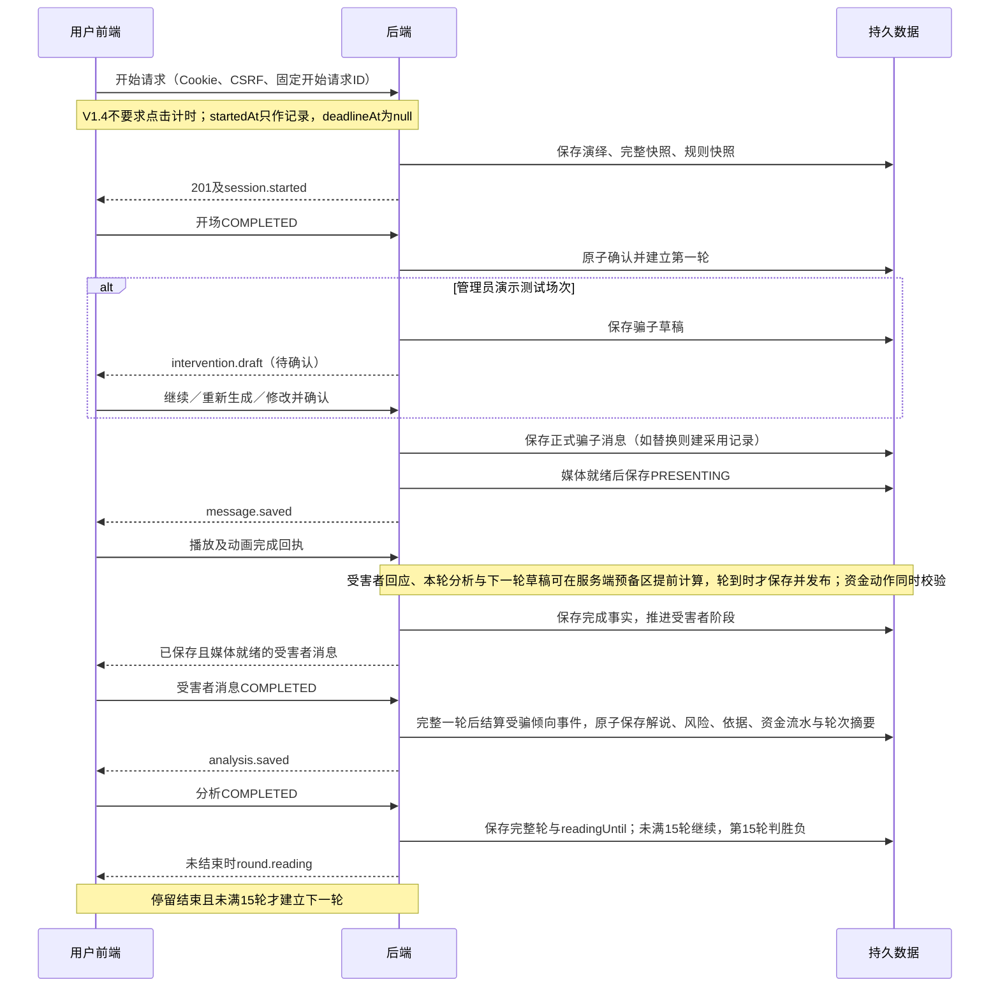
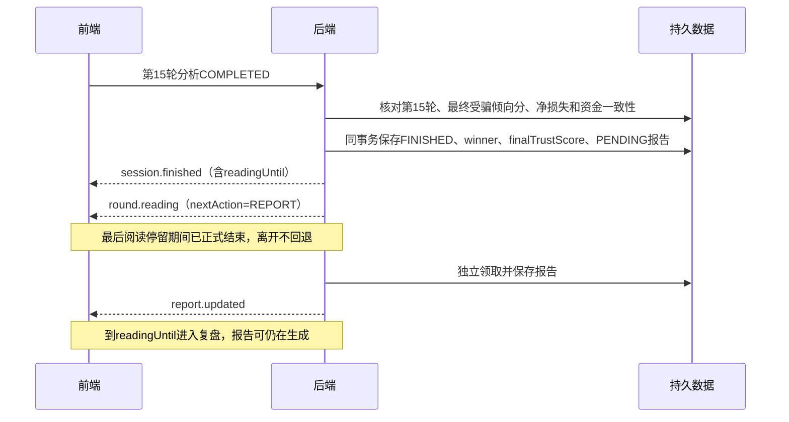
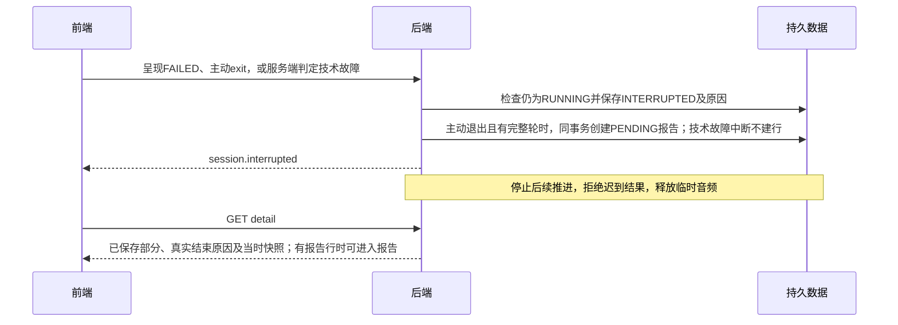
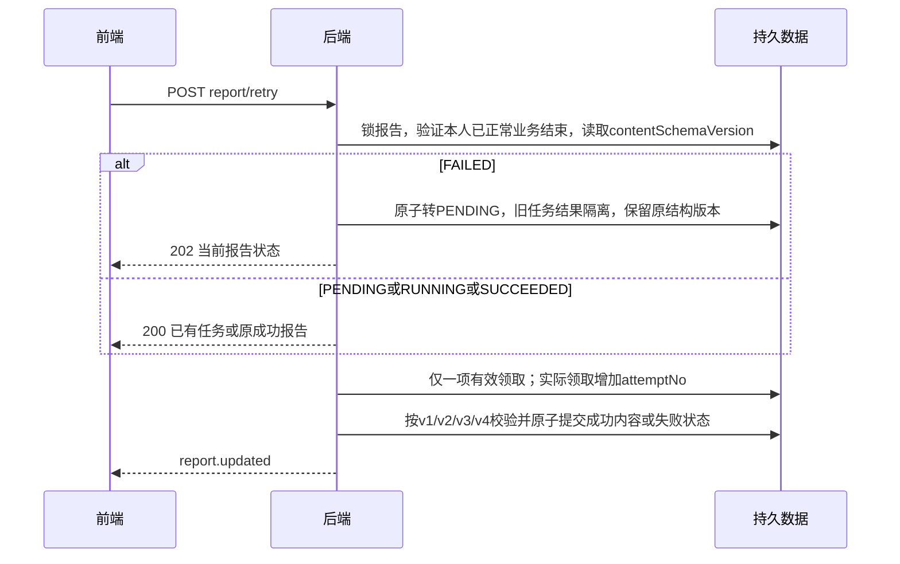

# AI反诈情景推演平台 接口文档 V1.4

> **2026-10-28 本次评审确认（适用于V3.5／V1.4）：**①采纳D6：管理员在启用前人工确认规则不冲突，程序不做自动语义优先级裁决；全部启用规则按`version_no DESC, id ASC`冻结注入，固定业务规则和已保存事实优先，运行时不因规则冲突暂停、中断或等待管理员。②主动退出至少有一个经服务端确认的完整轮才生成报告；没有完整轮时仅保留过程，提示“未形成可复盘内容”，无报告、无报告重试；已有完整轮后在后续半轮或待确认时退出仍生成如实报告，但不判胜负、不展示最终分。本文涉及新会话“有有效／实际对话”的报告条件均按此完整轮门槛理解。③同主题反证有新的可靠确认依据时允许PARTIAL升级CONFIRMED一次，以冻结的人物＋场景初始分减20（下限0）为目标，只降不升；同档重复、请求重试或降档不重复扣分，升级不解除限制。④D9：实时`Analysis`新增`methodShort`/`intentShort`与真实`trustChange`；三栏解说读取短字段，报告和历史继续读取完整`speechAnalysis`/`methodAnalysis`。旧会话和旧报告仍按当时规则读取；本文确认不表示代码已实现。

> **2026-10-28 同步（V1.4）：**按PRD V3.5、架构V1.4与数据库V1.4同步固定15轮、胜负判定、受骗倾向分、魔法球与场景知识库——会话状态增加`winner`、`finalTrustScore`、`intervention`和规则快照；正式结果由“已受骗／已识破／超限结束”改为`SCAMMER_WIN`/`VICTIM_WIN`（旧码只用于旧记录）；新增API-47～54：当前轮干预状态、草稿提交、采用确认、待入库列表、规则归纳、规则提交、规则列表、规则编辑／启停；新增`intervention.draft` SSE事件，事件由11类增至12类；`TrustPolicy`阈值改为40／70／85，报告内容支持`contentSchemaVersion=4`。HTTP操作由46项增至54项。旧记录按当时规则返回。同步`openapi.yaml`属于V1.4实施第一步，完成前不声称OpenAPI已通过。

> **V1.4口径确认：**最终分只在第15轮结束后随报告和历史结果返回；草稿修改/采用请求携带`draftId`与`expectedRevisionNo`；待确认刷新按`USER_EXIT`，不恢复审阅；规则只合并不拆分，API-50支持按`ruleId`查询本人来源。

> **2026-10-22 需求方确认：**第三位受害者改为66岁老年男性周国良（退休会计），同步当前头像、家庭关系和三套场景资料；历史快照仍保留原周桂兰。通过追加 V14 更新当前种子，不改已执行迁移。

> **2026-10-24 同步（V1.3）：**按PRD V3.4、架构V1.3与数据库V1.3同步信任分、信息边界与停滞治理——新增API-45读取、API-46保存“信任分机制”全局阈值；受害者画像与场景资料增加普通／应急预留与四项信任参数；`Funds`增加累计报酬、两类预留与剩余；报告可用性改为按是否存在报告行判断，`Outcome`可为null并新增结束原因；信任分、事件与等待事项不新增任何对外字段。HTTP操作由44项增至46项，SSE仍为11类。旧记录按当时规则返回。


| 项目 | 内容 |
|---|---|
| 编写日期 | 2026-10-16 |
| 文档状态 | 接口设计稿；已按确认计划编写，未实施服务端接口、数据库迁移或真实浏览器联调 |
| 使用对象 | 前端、后端、测试人员 |
| 配套契约 | [openapi.yaml](openapi.yaml)，OpenAPI 3.1.0 |
| 覆盖范围 | 54项正式HTTP操作、12类SSE事件；全部管理端接口纳入本期；V1.4新增8项操作（干预3项、知识库5项） |
| 冻结边界 | 已确认业务与接口选择可作为基线；TBD协议与运行参数不得视为已确认或已通过验证 |
| 最近修订 | 2026-10-28（V1.4）：新增API-47～54（干预状态、草稿提交、采用确认、待入库列表、规则归纳、规则提交、规则列表、规则编辑／启停）及`intervention.draft`事件；`Outcome`改为`SCAMMER_WIN`/`VICTIM_WIN`并保留旧码兼容；`SimulationState`增加`winner`、`finalTrustScore`、`intervention`；`TrustPolicy`改为40／70／85；报告v4增加`winning`与`finalTrustScore`；`deadlineAt`新会话为null、暂停不计时；操作总数46→54，SSE 11→12。旧记录按当时规则返回。2026-10-24（V1.3）：新增`GET/PUT /admin/trust-policy`（API-45/46）；`VictimWrite`/`VictimUpdate`/`VictimProfile`/`AdminVictimProfile`/`VictimScenarioProfile`增加预留分层与四项信任参数；`Funds`增加累计报酬、两类预留与剩余；`ReportView.outcome`可为null并新增`ending`；报告可用性按报告行判断；`INTERRUPTED`分为正常业务结束与技术故障中断；操作总数44→46。2026-10-21（V1.2补充）：按返款规则补充——`Funds`/`FundFlow`说明增加刷单/投资实际返款≤300且≤累计支付、单笔≤原付款、借款无返款、声称返款不入账；`FundFlow`不新增对外字段，内部关联原付款不暴露；同步API-05/10/15/21/22/23验收口径。2026-10-20（V1.2）：按PRD V3.3、架构V1.2、数据库V1.2同步——受害者新增基础事实、三套场景资料、故事时间、可动用资金；新增场景资料对象；正式结果新增`DEFRAUDED`/`IDENTIFIED`/`LIMIT_REACHED`并保留旧四码；新增提前终止原因`FUNDS_EXHAUSTED`/`CHARACTER_EXIT`；状态/历史/报告增加资金摘要与逐笔流水；报告内容支持v1/v2；语音改为Qwen-Audio-3.1-TTS-Flash（`qwen-audio-3.1-tts-flash`，中国北京地域）；旧记录按当时规则返回。仍为44项操作、11类事件。openapi.yaml已同步。2026-10-18（V1.1）：按PRD V3.2同步情景演绎演出层——新增API-43暂停、API-44继续及`session.paused`、`session.resumed`事件；SimulationState增加`paused`、`pausedAt`、`pausedCreditMs`，`deadlineAt`改为可按暂停顺延的有效截止时间；消息增加`actionText`、`audioDurationMs`、`segments`；画像增加张嘴立绘`speakingAvatar`／`speakingAvatarKey`；开场回执覆盖场景介绍与人物卡；计时采样移至演绎页；最低5轮；新增TBD-10、TBD-11。2026-10-16：演绎时限600秒（10分钟）；冻结点击计时协议并并入正式`StartRequest`（原TBD-01）；新增`round.started`事件与`nextAction`兜底（原TBD-05缺口）；明确`CONNECTION_LOST`判定规则；锁定音频格式（原TBD-07）；管理员不提供注册（原权限矩阵张力）；删除MySQL版本差异项（原TBD-08，版本已定为8.0.45） |

## 1. 依据、效力与设计记录

### 1.1 参考依据

- PRD V3.5《正式开发基线版》：业务、权限、账号规则、15轮胜负、受骗倾向分、魔法球、场景规则及验收的依据；V3.2/V3.3/V3.4作为旧记录兼容基线。
- 系统架构设计文档 V1.4：媒体、异步编排、待确认门、保存发布、终态、资金、受骗倾向分、规则快照、重连及V-02/V-03/V-13的依据。
- 数据库设计文档 V1.4：字段语义、快照、幂等、版本条件、资金流水、受骗倾向事件、草稿与采用记录、场景规则、等待事项、报告任务与数据一致性的依据。
- 用户最终接口基线、本轮五项确认及2026-10-20画像/资金/复盘/语音确认稿、2026-10-24信任分确认稿、2026-10-28固定15轮／胜负／受骗倾向分／魔法球确认稿：Cookie Session+CSRF、必要读取接口补齐、报告重试幂等返回、三类回执支持失败、SSE独立事件结构、受骗倾向机制管理、管理员演示测试与场景知识库。

用户最新明确规则优先；本文补充具体传输契约，不重新定义已确认业务。所有“成功”示例都是示意数据，不代表已运行的服务，也不代替PRD初始三场景、两骗子、三名受害者基础档案与九组场景资料的完整初始化内容。各操作示例独立，不应把它们拼成一次完整演绎的连续时间线。V1.2新增字段在部分示例中未逐一展开；示例中的旧结果码、旧报告结构用于展示兼容分支，新会话实际返回以第3章和第7章Schema字典为准。

### 1.2 已确认规则与本次接口设计

| 类别 | 内容与效力 |
|---|---|
| 已确认 | 前缀`/anti.scam/v1`；Cookie Session+CSRF；不使用JWT；单实例内存登录Session，重启重新登录；HttpOnly、Secure、SameSite=Lax |
| 已确认 | 字符串ID、ISO 8601 UTC毫秒时间、游标分页、英文枚举；普通JSON统一`code/message/data/requestId` |
| 已确认 | 普通用户只访问本人演绎相关内容；管理员只维护基础场景、画像、头像、受骗倾向机制和场景知识库，并只能打开本人演示测试场次，不能访问普通用户演绎、报告或AI反向记录 |
| 已确认 | 三类呈现回执必需；只有FAILED报告触发新尝试，其他已有任务/报告幂等返回；成功报告不可改写 |
| 已确认 | 原46项HTTP操作保留，新增API-47～54，合计54项；SSE由11类增至12类，新增`intervention.draft`，均独立于JSON封套 |
| 已确认 | V1.4新会话正式结果只有`SCAMMER_WIN`/`VICTIM_WIN`，由第15轮最终受骗倾向分与实际净损失判定；旧码`DEFRAUDED`/`IDENTIFIED`/`LIMIT_REACHED`及更早四码仅出现在旧记录，按`rulesetVersion`返回旧文案 |
| 已确认 | V1.4第15轮完成前主动退出使用`INTERRUPTED`和`USER_EXIT`，生成报告并写明“未形成胜负结论”；技术故障中断不生成报告；`FUNDS_EXHAUSTED`/`CHARACTER_EXIT`只用于旧记录 |
| 已确认 | V1.2受害者画像包含基础事实、三套场景资料、故事时间“昨天20:00”、可立即动用资金和预留安排；V1.3改为可用资金、普通预留与应急预留；V1.4每套场景资料使用初始受骗倾向分、正向系数、负向系数、小额上限 |
| 已确认 | 管理端“受骗倾向机制”维护40／70／85阈值；观看者在实时逐轮解说接口和`analysis.saved`中可见按已保存事件投影的真实`trustChange`及`methodShort`/`intentShort`，但事件明细、等待事项、阈值、系数、草稿明细和规则内部关联不进入演绎中的用户可见接口、SSE或报告正文；第15轮结束后最终分与净损失随报告和历史结果返回，规则来源仅管理端按规则查询（D9） |
| 已确认 | 报告可用性按是否存在报告行判断：完成15轮建行；主动退出在服务端确认至少一个完整轮时建行，没有完整轮不建行；技术故障中断与只有开场不建行；`winning`可为null，另返回结束原因 |
| 已确认 | V1.2状态、历史和报告增加资金摘要；逐笔流水只在历史详情返回；付款不超余额、不补钱；刷单/投资实际返款每场≤300且≤累计支付，单笔≤原付款，借款无返款；声称返款不入账且实际≤声称 |
| 已确认 | 报告内容按`contentSchemaVersion`区分：V3.5新会话4，V3.4为3，V3.3为2，V3.2及更早为1；旧结构只读，旧失败报告重试仍返回原结构 |
| 已确认 | V1.2角色语音使用Qwen-Audio-3.1-TTS-Flash（`qwen-audio-3.1-tts-flash`，中国北京地域）；音频仍由API-21受控提供，历史不返回音频 |
| 本次接口设计 | Cookie名`JSESSIONID`，Path=`/anti.scam/v1`，不设置Domain；匿名与已登录会话使用同一Cookie机制 |
| 本次接口设计 | JSON字段lowerCamelCase；成功`code="OK"`，失败code使用稳定英文码；requestId为服务端生成UUID，不是幂等键 |
| 本次接口设计 | 演绎stateVersion按非负十进制字符串传输，避免BIGINT精度损失；后台version为整数；轮号、计数与风险分为整数 |
| 本次接口设计 | 分页默认20、上限100；越界400；普通画像列表只接受enabled=true；停用画像普通详情返回404 |
| 本次接口设计 | 未登录401，角色禁止403；已确认角色后，资源不存在或不属于本人均404，避免泄露他人记录存在性 |
| 本次接口设计 | V1.4新会话不要求点击计时协议：`StartRequest.timing`可选，`startedAt`只作过程记录，`deadlineAt`为null；旧会话仍按当时字段读取 |
| 本次接口设计 | 取消600秒业务上限与300秒暂停累计；暂停只冻结演出，`pausedCreditMs`新会话固定0；`readingUntil`不再与截止时间取较早值，但暂停后按剩余停留时间顺延 |
| 本次接口设计 | 管理员不提供注册入口，`/auth/register`仅对匿名与USER开放；管理员演示测试场次与普通用户场次按`userId`隔离 |
| 本次接口设计 | 魔法球接口只接受管理员本人`ADMIN_TEST`场次；草稿不是`message`，确认后才生成正式消息与采用记录；普通用户本期调用返回403 |
| 本次接口设计 | 场景规则接口按`scenarioCode`维护，提交保留来源关联；规则只影响之后新开的同场景场次，进行中读取规则快照 |
| TBD | Session有效期、5MB字节口径、心跳/失联参数、报告运行参数、Qwen音频格式与分句时间；见第9章。V1.4不再有“点击计时协议待验证”阻断项 |

不引入新业务模块、删除/导出/分享/中断后续演、倍速回放、Prompt管理、用户管理、真实资讯或AI反向接口。演绎进行中的设置暂停与继续自V1.1纳入（API-43、API-44）；管理员演示测试、魔法球与场景知识库自V1.4纳入（API-47～54）。角色限制作用于实际接口数据访问，不能以隐藏页面代替。

### 1.3 参考版本差异

四份文档已同步到本轮基线：PRD V3.5、系统架构 V1.4、数据库 V1.4、接口 V1.4。MySQL 8.0.45为统一版本，原8.4差异作废。V1.2新增字段和对象已同步到`openapi.yaml`，`node tools/validate-openapi.mjs`已通过。V1.4新增的API-45～55、`Outcome`胜负值、`SimulationState.intervention`与`ruleSnapshotCount`、`ScammerDraft`、`InterventionRecord`、`SceneRule`、`TrustPolicy` 40／70／85及报告v4字段已同步到`openapi.yaml`；`node tools/validate-openapi.mjs`通过（56项操作、12类SSE事件、报告v1～v4、15轮胜负、解说短字段、管理员干预门与知识库规则）。

## 2. 公共传输、认证与权限

### 2.1 地址、类型和响应

前后端同源HTTPS。OpenAPI的`servers.url=/anti.scam/v1`，`paths`不再重复前缀。客户端不传userId决定归属；身份取服务器会话。JSON请求使用`application/json`，头像上传使用`multipart/form-data`；普通接口成功及失败均返回JSON。

```json
{"code":"OK","message":"成功","data":{},"requestId":"4aca43db-cd49-4b77-9abc-7e3490b55185"}
```

这是封套形状示例，实际data必须满足对应操作Schema，不是任意对象。四个顶层字段始终存在。业务分支依据HTTP状态和code，不依据message。失败data默认为null；字段错误或有权查看的冲突信息放入ErrorDetail。不得把失败都包装成HTTP 200。失败响应整体结构见[ErrorResponse](#schema-ErrorResponse)，字段级错误见[ErrorDetail](#schema-ErrorDetail)。

ID为正整数十进制字符串；`startRequestId/requestId`分别为业务幂等UUID和请求追踪UUID，不能互换。`sessionId`指演绎记录ID，绝不是Cookie中的登录会话值。时间例如`2026-10-15T02:00:00.000Z`，前端展示北京时间10:00；人物`contextTime`为故事时间文案，新画像固定“昨天20:00”，旧记录可保留旧文案。可选字段与可空字段分别按Schema定义，不用空字符串代替null；请求未知字段拒绝400，尤其role、userId、outcome、riskScore、reportContent等越权写入字段。

SSE成功响应是`text/event-stream`；图片和音频成功响应是二进制，两者均不套普通JSON。流/二进制响应开始前可按HTTP状态返回ErrorResponse；一旦已经发送成功响应头，不能再把JSON错误拼进字节流或修改HTTP状态。流中故障按第5章核对；二进制失败中止响应，由客户端提交真实媒体失败回执。

### 2.2 Cookie Session与CSRF调用顺序

1. 登录或注册页面先`GET /auth/csrf`，浏览器接收匿名Session Cookie，前端从JSON读取token。
2. 注册、登录、登出、开始、全部回执、暂停、继续、退出、报告重试及后台写入均携带当前Cookie与`X-CSRF-TOKEN`。二者是同时满足的要求。
3. 登录成功轮换Session标识，设置`JSESSIONID=<opaque>; Path=/anti.scam/v1; HttpOnly; Secure; SameSite=Lax`，不通过JSON返回会话标识或JWT。客户端根据USER/ADMIN进入对应入口。
4. 同浏览器的USER与ADMIN分别保存认证上下文与CSRF；前端用`sessionStorage`记住本标签页身份。`/auth/*`通过`X-Login-Role: ADMIN`选择管理员上下文，缺省为USER；该请求头不授予权限，登录仍按账号真实角色保存。业务接口按URL固定使用用户或管理员上下文。
5. 登录成功后按返回角色重新`GET /auth/csrf`获取对应token；登出后的下一次登录/注册也先重新获取。获取新token不等于已登录。另一角色的登录或退出不清除当前角色的token。
6. POST登出仅清除所选身份；普通用户登出仍中断其RUNNING演绎并撤销媒体访问。另一身份仍登录时保留Session与Cookie，两者均已退出时销毁Session并清除同Path Cookie。登录轮换Session标识时同步迁移计时样本与SSE关联。Session有效期、续期触发条件见TBD-02，不承诺“浏览器关闭必定删除全部凭据”。

注册不自动登录；用户名去首尾空格后按Unicode字符计数2—24，允许汉字、ASCII英文字母、数字、下划线；所有角色全局唯一、英文字母大小写不敏感。密码按Unicode字符计数6—24，空格原样保留，允许常见弱密码，包括123456；确认密码须原样一致。不得因哈希实现而截断或修改密码。登录失败统一“账号或密码错误”。

CSRF错误403，不自动重复可能已经提交的业务写请求；重新获取token后按业务幂等规则核对再处理。Session失效401时停止自动重试、关闭EventSource并引导重新登录。禁止把Cookie、密码、CSRF或供应商密钥写进日志、URL、样例中的真实值或历史快照。

登出时已有RUNNING演绎按主动离开收敛；退出持久化失败不阻止撤销登录凭据，但不得声称演绎中断已保存。后台故障核对保留真实事实。已正式结束的报告任务不因登出取消。Cookie与CSRF获取/刷新机制遵循[Spring Security官方CSRF说明](https://docs.spring.io/spring-security/reference/servlet/exploits/csrf.html)，具体配置必须匹配最终锁定的框架版本。

### 2.3 权限矩阵与访问次序

| 接口组 | 匿名 | USER | ADMIN |
|---|---|---|---|
| csrf、register、login | 允许；写操作仍需匿名Cookie+CSRF | 允许；不提供角色选择 | csrf/login允许；**register返回403**，管理员不提供注册 |
| me、logout | 401 | 当前账号 | 当前账号 |
| home、news、普通场景/画像读取、用户头像 | 401 | 按可用性或本人快照授权 | 403 |
| 演绎创建、状态、SSE、三类回执、暂停继续、退出、音频 | 401 | 本人且符合阶段 | 仅本人`ADMIN_TEST`场次 |
| 干预状态、草稿提交、采用确认（API-47～49） | 401 | 403 | 仅本人`ADMIN_TEST`场次 |
| 个人历史、报告及重试 | 401 | 仅本人，按状态限制 | 仅本人测试记录 |
| 计时采样（/timing/samples） | 401 | 本人当前Session（旧会话兼容） | 403 |
| 待入库记录、规则归纳、场景规则（API-50～54） | 401 | 403 | 可按场景维护；不读取普通用户单场内容 |
| 其余admin路径 | 401 | 403 | 仅基础内容、受骗倾向机制与场景知识库 |

资源归属采用`message→round→session→user`或`report→session→user`的完整关联；路径里的id、messageId、roundNo必须指向同一演绎。管理员不能通过知道ID、请求头、画像权限或历史头像资源反查普通用户记录。禁止只校验消息ID存在。管理员本人的`ADMIN_TEST`场次与普通用户场次使用同一组演绎接口，但服务端必须同时校验角色、`interventionMode`和`userId`归属；普通用户访问干预接口一律403。

在身份与角色允许后，跨用户与不存在统一404且不返回正文、头像归属或诊断信息。CSRF与认证同时失败时不承诺过滤器执行优先级；测试单一错误时确保其他前提有效。受保护API不重定向到HTML登录页。

### 2.4 分页、并发和缓存

- 历史采用`startedAt DESC,id DESC`复合游标；画像采用`id ASC`。首屏cursor省略或空字符串，后续原样传nextCursor。limit默认20、范围1—100，非法值400。
- cursor为服务端可校验的不透明值，绑定当前账号、接口、排序及固定筛选，不暴露SQL；损坏、篡改或跨查询使用返回400 INVALID_CURSOR。游标不是授权凭据，每页仍独立校验权限。分页不是数据库长事务快照，新插入项在刷新首屏后出现；启停可能改变后续可选项，不承诺跨页内容冻结。
- 返回`items/nextCursor/hasMore`；无下一页时nextCursor=null、hasMore=false；不提供total和页码。固定三场景及空资讯不分页；单场历史详情最多15轮、30条角色消息，全量返回。
- 开始请求按本人+startRequestId幂等，同键含义不同409；同账号不同请求若已有RUNNING则409并返回本人activeSessionId。报告重试、回执和启停分别执行各自幂等规则，不泛化为所有POST自动安全重试。
- 后台PUT必须提交读取时version，成功增加版本；同一过期请求重发返回409，读取核对后再决定，不自动覆盖。启停先识别目标状态已达到，再判断版本，避免重复操作误报冲突。
- 认证、用户私有JSON、SSE和临时音频使用no-store；头像采用private, no-store确保每次读取继续校验访问权。缓存不能绕过登出、终态或资源授权检查。

## 3. 领域状态与返回不变量

| 维度 | 对外语义 |
|---|---|
| RUNNING | outcome/winner/finalTrustScore/interruption/endedAt为null；report为null；可有半轮、待确认草稿或已保存但未呈现内容 |
| FINISHED | endedAt、唯一outcome、winner和finalTrustScore存在；interruption=null；报告记录必须存在；缺记录500 DATA_INCONSISTENT；新会话currentRoundNo=15，旧记录按当时轮号（≤20）（V1.4） |
| INTERRUPTED | endedAt与interruption存在；outcome/winner/finalTrustScore为null。原因为`USER_EXIT`且有至少一个完整轮时，report记录存在并可按状态展示；其余原因report=null。技术故障中断不生成部分正式报告（V1.4） |
| 正式结果（V1.4） | 新会话：SCAMMER_WIN、VICTIM_WIN；旧记录：DEFRAUDED、IDENTIFIED、LIMIT_REACHED、GOAL_ACHIEVED、LOSS_STOPPED、NOT_DEFRAUDED、UNDETERMINED。旧`limitReason`只随旧记录返回；新会话为null |
| 报告 | PENDING/RUNNING→生成中；SUCCEEDED→已完成；FAILED→生成失败；只有FAILED的canRetry=true。报告是否可存在按“是否存在报告行”判断，不只看会话状态 |
| 报告内容 | 只有SUCCEEDED时content非null；`contentSchemaVersion`为1、2、3或4；FAILED具有安全error，其他报告状态error=null；GET不生成或重算 |
| 风险 | 仅0/25/50/75/100；没有分析时analysis=null，尚未评分时latestRiskScore=null；不补0 |
| 受骗倾向分（V1.4／D9） | 实时状态和`analysis.saved`中的`Analysis.trustChange`返回本轮真实`before/after/delta`，`methodShort`/`intentShort`返回解说短文案；不返回阈值、系数、事件明细或等待事项明细；第15轮结束后仅最终分与净损失随`Outcome`、报告和历史结果返回，不返回事件级计分过程（`trustChange`本身除外） |
| 资金（V1.3） | `funds`包含初始可用、当前余额、累计支付、累计退回本金、累计到账报酬、实际净损失、追加次数、两类预留释放与剩余；逐笔`flows`只在历史详情返回；缺失/旧记录不补0，按`fundsRecorded=false`表达；本金退回与报酬共用每场300且≤累计支付，借款无实际出款，声称不入账 |
| 完整双方互动 | 双方文本已保存；interactionComplete=true，仍可能媒体未完成 |
| 完整轮结束位置 | 必要双方呈现、分析呈现和受骗倾向结算都经服务端确认，phase=COMPLETE、presentationComplete=true；本轮资金流水已保存 |
| 干预（V1.4） | 仅管理员本人`ADMIN_TEST`场次返回`intervention`；普通用户场次为null。`intervention.currentDraft`是草稿，不是`messages`；确认后才出现在正式消息和采用记录中 |
| 场景规则（V1.4） | 会话只返回`ruleSnapshotCount`等摘要，不返回规则正文给普通用户；管理端规则接口返回正文、状态、版本和来源数 |
| 下一动作 | 会话级`nextAction`与轮次级一致：`NEXT_ROUND`（停留后由服务端建立下一轮）、`REPORT`（进入复盘）、null（尚未确定）；断线重连后以`session.state`中的该字段为准 |
| 设置暂停（V1.4） | `paused=true`时演出、阅读停留到期处理与下一轮调度冻结；`deadlineAt`为null，暂停不累计或顺延任何业务截止时间，但阅读停留按暂停时长冻结、继续后从剩余时间恢复（`remainingMs = max(0, readingUntil − pausedAt)`，恢复后`readingUntil = readingUntil + (resumeAt − pausedAt)`） |
| 固定15轮（V1.4） | 第1至14轮不会产生胜负；第15轮完成才返回SCAMMER_WIN或VICTIM_WIN；主动退出、故障或正常业务结束可使演绎提前终止，但不判胜负 |
| 消息文本（V1.1） | `content`为台词（气泡与语音），`actionText`为动作说明（舞台展示、不朗读）；角色内部意图／心理不经任何接口返回 |

胜负由已保存事实、最终受骗倾向分和资金流水判定，风险0或100不直接触发结果。V1.4新会话固定15轮，第1至14轮不判胜负，第15轮完成后按最终分值与净损失判定；不生成第16轮。每轮正常阅读停留5秒，不因总时长不足而缩短；本版没有600秒业务截止。

第15轮完成前主动退出为INTERRUPTED（USER_EXIT）并生成报告，报告以`ending`说明结束原因、正文写明“未形成胜负结论”，不补写胜负；技术故障中断不生成报告，也不提供重试入口。资金不足或拒绝付款不结束演绎。

主动退出（观看用户主动离开、刷新、关闭）只有在服务端确认至少一个完整轮时才生成报告：报告以`ending`说明结束原因，正文写明“未形成胜负结论”，保留未完成内容但不补写结局；没有完整轮时不生成报告、不提供重试入口，显示未形成可复盘内容；技术故障中断不生成报告，也不提供重试入口。

历史列表和详情从当时快照读取展示内容，头像文件保留真实旧版本。当前画像编辑、停用、替换头像、Prompt或模型升级均不能改写过去。历史详情不含音频字段、不调用TTS、不恢复演出；报告风险曲线取原轮次数据，不由模型再生成一套权威评分。旧记录按rulesetVersion返回旧结果名称和旧报告结构；旧资金不存在的，`fundsRecorded=false`，不把默认0当作真实余额。

## 4. 呈现、终态与异常交互

### 4.1 三类回执规则

| 回执 | COMPLETED条件 | FAILED允许类别 |
|---|---|---|
| 开场 | 场景介绍动画（含名称与简介）、双方人物卡与立绘及必要初始动画正常呈现完毕（V1.1） | TEXT_RENDER_FAILED、AVATAR_LOAD_FAILED、ANIMATION_FAILED |
| 消息 | 台词按分句时间逐步显示完毕、动作说明已展示、语音时间轴及嘴部／身体动画正常完成（V1.1） | TEXT_RENDER_FAILED、ANIMATION_FAILED、AUDIO_LOAD_FAILED、AUDIO_PLAYBACK_FAILED |
| 分析 | 本轮完整解说、风险分与依据已呈现 | TEXT_RENDER_FAILED |

FAILED必须带errorCode，COMPLETED不得带errorCode。设置暂停期间不提交回执，继续后完成本地呈现再提交（V1.1）。其他作用域的错误码400；客户端不提交TTS_FAILED、ANALYSIS_FAILED、PERSISTENCE_FAILED、任意正式结果、余额变化或目标判定。服务端收到合法必要呈现失败后核定MEDIA_FAILED；生成/TTS/保存故障由服务端自己的执行结果核定。

开场完成与第一轮建立必须形成可核对的持久推进事实；首次开场成功提交后，currentRoundNo不再是0。不能仅以内存布尔标记、HTTP 200或SSE发送成功证明开场完成。数据库现有轮次/消息/分析呈现事实支撑后续判断，不要求新增通用回执表。

| 情况 | 处理 |
|---|---|
| 当前阶段首次有效回执 | 保存事实后推进，effect=APPLIED |
| 相同已完成事实重发 | 先识别业务对象事实，返回ALREADY_APPLIED；不因版本变化重复推进 |
| RUNNING下同一对象相反结果 | 409 PRESENTATION_CONFLICT；不覆盖已保存呈现事实 |
| 未来轮次、非当前消息、阶段未满足 | 409 STAGE_CONFLICT；错误归属或错配对象404 |
| 已终态的新回执 | 返回200、IGNORED_TERMINAL和已有状态，不补写完成证据、不改变正式结果 |
| 已终态的已确认成功回执重发 | 可返回ALREADY_APPLIED及当前终态；不能复活演绎 |
| 回执提交结果未知 | 读取权威状态，再重发同对象同事实；不生成新消息或重算分析 |

COMPLETED仅证明技术呈现，不证明用户实际阅读或理解。静音是正常操作，使用静音播放或同一媒体时间轴，不跳过正常顺序或冒充媒体完成。自动播放受阻、后台动画停滞等必须通过V-03验证；无法正常完成必要呈现则按真实故障收敛。

### 4.2 正常推进



### 4.3 正式结束



### 4.4 中断与故障



对话/分析/TTS故障、单步超时、主动退出和连接失联也可触发结束，不要求前端伪造回执。主动退出且服务端确认至少一个完整轮时，服务端在同一事务创建报告行；没有完整轮或技术故障中断都不创建。资金不足或拒绝付款不结束演绎。若数据库不可用，停止推进并显示未保存状态，但不得发送声称已持久化的session.interrupted；恢复后先核对真实提交情况，再持久收敛并发布。不能保证尚未建行的开始请求已有历史记录。

### 4.5 报告失败重试



重复点击只保证同一时刻一个有效尝试，不承诺外部供应商恰好计算或收费一次。旧请求取消可能无法撤回供应商计算，但迟到结果必须不能覆盖新任务或成功报告。重启时PENDING可领取，失去可靠执行上下文且未成功保存的RUNNING报告收敛FAILED供本人重试；成功报告原样保留。旧失败报告重试仍使用当时Prompt、规则版本和报告结构，不升级为v2。

## 5. SSE协议与连接生命周期

原生EventSource连接同源`GET /anti.scam/v1/simulations/{id}/events`，凭Cookie认证，不传URL token，不加Authorization或CSRF头。使用`id:`、`event:`、`data:`并以空行结束一帧；JSON data为独立事件对象，不套普通响应。原生重连可携带Last-Event-ID，按[WHATWG SSE规范](https://html.spec.whatwg.org/multipage/server-sent-events.html)处理。

事件共同字段为eventId、sessionId、stateVersion、data。eventId是事件去重标识；同次发送重发保持，重连快照可用新标识。stateVersion是演绎状态快照版本，单调不下降，允许跳号；它不是消息数量、事件连续序号或报告任务版本。同一版本可包含多种事件，不能简单丢弃所有“版本相等”的事件。

- 客户端先按eventId去重；消息和分析再按业务对象ID/轮号合并，不能把重发当新台词。较旧演绎版本不能回退当前演绎状态，但历史内容是否缺失应按对象核对。
- report.updated可能携带相同演绎stateVersion；报告合并结合attemptNo、状态转换及updatedAt，不能只看演绎版本。旧尝试不得覆盖新尝试；SUCCEEDED不回退。存在不确定乱序时调用GET report重新核对。
- 本期没有持久事件日志，不承诺从Last-Event-ID补发全部事件。首次连接或重连以session.state返回当前演绎和报告事实；缺失完整已保存过程使用GET detail核对。对当前仍允许呈现的内容，按回执事实和当前阶段处理，不能重置时间或播放已经中断的演绎。
- message.saved选择在完整正文已保存、媒体就绪及PRESENTING也已保存后发布。TTS失败前已经保存的文字仍可在历史读取；未发事件不等于数据库未保存。不会增加未确认的audio.ready事件。
- 最后一轮先发布session.finished，再发布round.reading(nextAction=REPORT)，相应readingUntil也包含在状态中，防止漏事件导致前端错误等待。报告生成可在最后停留期间进行。
- **`nextAction`同时出现在`round.reading`事件与会话级`session.state`中**：漏收`round.reading`时，重连得到的`session.state.data.state.nextAction`与`readingUntil`共同决定下一步，前端不得因缺少事件而卡在停留态。
- `round.started`由服务端在建立每一轮时发布，是前端显示“内容生成中”等待态的唯一依据；下一轮的建立时机为`readingUntil`到期且会话仍为RUNNING、未满15轮，由服务端自行调度，**客户端不发起任何推进请求**。若`readingUntil`到期而仍未收到`round.started`，前端以GET状态接口核对后继续等待，不自行重试或跳轮。
- V1.1新增`session.paused`、`session.resumed`：服务端保存暂停／继续事实后发布，客户端以其中状态覆盖本地暂停状态与`readingUntil`；V1.4新会话`deadlineAt`为null，暂停不累计或顺延任何业务截止时间，但阅读停留按暂停时长冻结、继续后从剩余时间恢复。暂停期间服务端不发布`round.started`或新的`message.saved`；重连时以`session.state`中的`paused`字段决定是否保持设置界面。
- V1.4新增`intervention.draft`：仅管理员本人`ADMIN_TEST`场次在草稿保存后收到，携带待确认`ScammerDraft`与待入库数量。普通用户不会收到该事件；事件不表示草稿已生效，也不改变受害者、计分和资金。
- RUNNING短暂失联不得直接误判主动退出；连接恢复只是核对。刷新、关闭、主动导航属于退出而非续演；标签切换不主动中断、不改变轮次或胜负。心跳、失联判断、页面实例区分及刷新兜底见TBD-05/V-03，不凭一个visibilitychange或心跳延迟直接认定退出。
- 导航退出优先带CSRF正常POST；pagehide尽力发送带自定义头的同源fetch keepalive。关闭/挂起不能保证通知送达，禁止以sendBeacon无法携带必需头为由取消CSRF。刷新识别机制冻结前不能宣称已满足退出规则。
- Session到期、登出后立即关闭对应流；浏览器onerror不能可靠取得失败JSON正文，可调用auth/me确认登录态，再按状态接口恢复页面。不得在401后无限重连；不把错误HTTP正文作为SSE事件处理。
- INTERRUPTED、报告SUCCEEDED/FAILED状态确认后客户端关闭无需继续订阅的流；有报告行且报告生成中可继续订阅或通过GET report核对。报告重试返回202后重新建立该场events连接，先以session.state核对新任务；报告后台任务不随断开取消。V1.4新会话的正常业务结束通过`session.interrupted`返回`USER_EXIT`，技术故障中断返回其余原因；`FUNDS_EXHAUSTED`/`CHARACTER_EXIT`只随旧记录返回，均不发布终止事件。
- 心跳采用注释帧，不包含业务结果，不构成业务事件类型；间隔与代理配置见TBD-04。响应禁止缓存和代理缓冲。服务端流已开始后内部错误只能停止/关闭连接或发布已成功保存的合法业务事件，不能假造终态。V1.2状态事件中的`funds`和`report.contentSchemaVersion`以GET同一状态为准。

以下列出十二类事件的载荷与完整帧示例。事件Schema字段表见第7章。

### round.started

服务端已建立本轮并写入`round_no`与初始`phase`；前端据此显示“内容生成中”等待态。本事件不代表已生成内容。

载荷：[RoundStartedEvent](#schema-RoundStartedEvent)。SSE帧：

```text
id: evt-example-round-started
event: round.started
sessionId: 501
data: {"eventId":"evt-example-round-started","sessionId":"501","stateVersion":"8","data":{"roundNo":2,"phase":"SCAMMER_GENERATING","startedAt":"2026-10-15T02:00:25.000Z","deadlineAt":null}}

```

### intervention.draft

仅管理员本人测试场次：本轮骗子草稿已保存，等待继续、重新生成或直接修改；普通用户订阅不会收到本事件。草稿不是正式消息，事件不改变受害者、受骗倾向分或资金。

载荷：[InterventionDraftEvent](#schema-InterventionDraftEvent)。SSE帧：

```text
id: evt-example-intervention-draft
event: intervention.draft
sessionId: 501
data: {"eventId":"evt-example-intervention-draft","sessionId":"501","stateVersion":"8","data":{"roundNo":2,"draft":{"draftId":"91","roundNo":2,"originalContent":"你把资料补齐，我马上给你办退款。","currentContent":"你把资料补齐，我马上给你办退款。","guidanceText":null,"revisionNo":0,"status":"DRAFT","updatedAt":"2026-10-28T02:00:00.000Z"},"pendingInterventionCount":7}}

```

### session.started

演绎、配置快照与起止时间已成功保存，开场可展示；不表示开场已呈现。

载荷：[SessionStartedEvent](#schema-SessionStartedEvent)。SSE帧：

```text
id: evt-example-session-started
event: session.started
data: {"eventId":"evt-example-session-started","sessionId":"501","stateVersion":"0","data":{"sessionId":"501","status":"RUNNING","stateVersion":"0","startedAt":"2026-10-15T02:00:00.000Z","deadlineAt":null,"endedAt":null,"currentRoundNo":0,"configuration":{"scenario":{"id":"1","code":"TASK_REBATE","name":"刷单返利诈骗","description":"以完成任务获得返利为由诱导垫付和追加投入。","focus":"青年群体"},"scammer":{"id":"11","avatar":{"key":"avatar_example_01","url":"/anti.scam/v1/avatars/avatar_example_01"},"name":"示例骗子甲","age":30,"gender":"男","identity":"示例人物身份","description":"仅用于接口字段演示，不代替PRD初始人物卡。","contextTime":"昨天20:00","contextPlace":"家中","currentState":"正在查看手机消息","fraudExperience":"HIGH","speechSkill":"HIGH","manipulationSkill":"MEDIUM","behaviorTraits":"善于利用小额返利建立信任。"},"victim":{"id":"21","avatar":{"key":"avatar_example_01","url":"/anti.scam/v1/avatars/avatar_example_01"},"name":"示例受害者乙","age":30,"gender":"女","identity":"示例人物身份","description":"仅用于接口字段演示，不代替PRD初始人物卡。","contextTime":"昨天20:00","contextPlace":"家中","currentState":"正在查看手机消息","antiFraudAwareness":"MEDIUM","riskTendency":"LOW","personalityTraits":"谨慎，遇到转账要求时会核实。"}},"currentRound":null,"latestRiskScore":null,"outcome":null,"interruption":null,"readingUntil":null,"report":null}}

```


### message.saved

正文已保存且TTS/必要资源已就绪、PRESENTING状态已保存后发布；未就绪时不提前推送可播放事件。

载荷：[MessageSavedEvent](#schema-MessageSavedEvent)。SSE帧：

```text
id: evt-example-message-saved
event: message.saved
data: {"eventId":"evt-example-message-saved","sessionId":"501","stateVersion":"7","data":{"id":"1001","roundNo":1,"speaker":"SCAMMER","content":"完成任务后即可领取返利，请先了解任务规则。","actionText":null,"presentationStatus":"PRESENTING","presentationCompletedAt":null,"presentationErrorCode":null,"savedAt":"2026-10-15T02:00:10.000Z","audioUrl":"/anti.scam/v1/simulations/501/messages/1001/audio","audioDurationMs":9200,"segments":[{"startMs":0,"endMs":4600,"charStart":0,"charEnd":12},{"startMs":4600,"endMs":9200,"charStart":12,"charEnd":21}]}}

```


### analysis.saved

本轮事件、分数、反证状态、解说、风险、依据、`methodShort`/`intentShort`及按已保存事件投影的真实`trustChange`已在同一短事务原子保存，等待呈现回执；事件明细、阈值和系数不随事件发布。EVENT模型新增的`speaker`/`eventOrder`/反证等级属于v3提示词的版本化输出要求，只用于整轮证据归属与排序，不构成向前端公开事件明细的新接口。空事件轮也以本轮分析保存作为结算标记。

载荷：[AnalysisSavedEvent](#schema-AnalysisSavedEvent)。SSE帧：

```text
id: evt-example-analysis-saved
event: analysis.saved
data: {"eventId":"evt-example-analysis-saved","sessionId":"501","stateVersion":"7","data":{"roundNo":1,"analysis":{"fraudStage":"建立信任","speechAnalysis":"通过小额返利承诺吸引关注。","methodAnalysis":"以完成任务为由提出垫付。","methodShort":"小额返利","intentShort":"用返利承诺降低戒心，推动先垫付。","victimPsychology":"对转账要求保持警惕。","riskScore":25,"riskReason":"尚未转账，已提出核实要求。","savedAt":"2026-10-15T02:00:20.000Z","presentedAt":null,"trustChange":{"before":50,"after":62,"delta":12}}}}

```


### round.reading

本轮分析呈现确认及readingUntil已保存；末轮为REPORT且在session.finished之后发送。

载荷：[RoundReadingEvent](#schema-RoundReadingEvent)。SSE帧：

```text
id: evt-example-round-reading
event: round.reading
data: {"eventId":"evt-example-round-reading","sessionId":"501","stateVersion":"7","data":{"roundNo":1,"readingUntil":"2026-10-15T02:00:25.000Z","nextAction":"NEXT_ROUND"}}

```


### session.finished

FINISHED、唯一胜负与报告PENDING已同事务提交，之后可进行最后阅读停留。**示例帧沿用旧结果码展示兼容分支；V1.4新会话的`outcome.code`为`SCAMMER_WIN`/`VICTIM_WIN`，并带`winning`与`finalTrustScore`。**

载荷：[SessionFinishedEvent](#schema-SessionFinishedEvent)。SSE帧：

```text
id: evt-example-session-finished
event: session.finished
data: {"eventId":"evt-example-session-finished","sessionId":"501","stateVersion":"12","data":{"sessionId":"501","status":"FINISHED","stateVersion":"12","startedAt":"2026-10-15T02:00:00.000Z","deadlineAt":null,"endedAt":"2026-10-15T02:00:20.000Z","currentRoundNo":1,"configuration":{"scenario":{"id":"1","code":"TASK_REBATE","name":"刷单返利诈骗","description":"以完成任务获得返利为由诱导垫付和追加投入。","focus":"青年群体"},"scammer":{"id":"11","avatar":{"key":"avatar_example_01","url":"/anti.scam/v1/avatars/avatar_example_01"},"name":"示例骗子甲","age":30,"gender":"男","identity":"示例人物身份","description":"仅用于接口字段演示，不代替PRD初始人物卡。","contextTime":"昨天20:00","contextPlace":"家中","currentState":"正在查看手机消息","fraudExperience":"HIGH","speechSkill":"HIGH","manipulationSkill":"MEDIUM","behaviorTraits":"善于利用小额返利建立信任。"},"victim":{"id":"21","avatar":{"key":"avatar_example_01","url":"/anti.scam/v1/avatars/avatar_example_01"},"name":"示例受害者乙","age":30,"gender":"女","identity":"示例人物身份","description":"仅用于接口字段演示，不代替PRD初始人物卡。","contextTime":"昨天20:00","contextPlace":"家中","currentState":"正在查看手机消息","antiFraudAwareness":"MEDIUM","riskTendency":"LOW","personalityTraits":"谨慎，遇到转账要求时会核实。"}},"currentRound":{"roundNo":1,"phase":"COMPLETE","interactionComplete":true,"presentationComplete":true,"messages":[{"id":"1001","roundNo":1,"speaker":"SCAMMER","content":"完成任务后即可领取返利，请先了解任务规则。","presentationStatus":"COMPLETED","presentationCompletedAt":"2026-10-15T02:00:20.000Z","presentationErrorCode":null,"savedAt":"2026-10-15T02:00:10.000Z","audioUrl":null},{"id":"1002","roundNo":1,"speaker":"VICTIM","content":"我不会转账，也不再参与这个任务。","presentationStatus":"COMPLETED","presentationCompletedAt":"2026-10-15T02:00:20.000Z","presentationErrorCode":null,"savedAt":"2026-10-15T02:00:10.000Z","audioUrl":null}],"analysis":{"fraudStage":"建立信任","speechAnalysis":"通过小额返利承诺吸引关注。","methodAnalysis":"以完成任务为由提出垫付。","methodShort":"小额返利","intentShort":"用返利承诺降低戒心，推动先垫付。","victimPsychology":"对转账要求保持警惕。","riskScore":25,"riskReason":"尚未转账，已提出核实要求。","savedAt":"2026-10-15T02:00:20.000Z","presentedAt":"2026-10-15T02:00:20.000Z","trustChange":{"before":50,"after":62,"delta":12}},"readingUntil":"2026-10-15T02:00:25.000Z"},"latestRiskScore":25,"outcome":{"code":"NOT_DEFRAUDED","displayText":"未受骗结束","reason":"受害者拒绝转账并停止配合，未发生实际受骗行为。","limitReason":null},"interruption":null,"readingUntil":"2026-10-15T02:00:25.000Z","report":{"status":"PENDING","displayText":"生成中","canRetry":false,"attemptNo":0,"updatedAt":"2026-10-15T02:00:20.000Z","error":null}}}

```


### session.interrupted

INTERRUPTED与真实原因已持久化；不形成胜负。主动退出且服务端确认至少一个完整轮时可生成如实报告，没有完整轮时不生成也不开放重试；技术故障中断不生成报告。

载荷：[SessionInterruptedEvent](#schema-SessionInterruptedEvent)。SSE帧：

```text
id: evt-example-session-interrupted
event: session.interrupted
data: {"eventId":"evt-example-session-interrupted","sessionId":"501","stateVersion":"5","data":{"sessionId":"501","status":"INTERRUPTED","stateVersion":"5","startedAt":"2026-10-15T02:00:00.000Z","deadlineAt":null,"endedAt":"2026-10-15T02:00:20.000Z","currentRoundNo":0,"configuration":{"scenario":{"id":"1","code":"TASK_REBATE","name":"刷单返利诈骗","description":"以完成任务获得返利为由诱导垫付和追加投入。","focus":"青年群体"},"scammer":{"id":"11","avatar":{"key":"avatar_example_01","url":"/anti.scam/v1/avatars/avatar_example_01"},"name":"示例骗子甲","age":30,"gender":"男","identity":"示例人物身份","description":"仅用于接口字段演示，不代替PRD初始人物卡。","contextTime":"昨天20:00","contextPlace":"家中","currentState":"正在查看手机消息","fraudExperience":"HIGH","speechSkill":"HIGH","manipulationSkill":"MEDIUM","behaviorTraits":"善于利用小额返利建立信任。"},"victim":{"id":"21","avatar":{"key":"avatar_example_01","url":"/anti.scam/v1/avatars/avatar_example_01"},"name":"示例受害者乙","age":30,"gender":"女","identity":"示例人物身份","description":"仅用于接口字段演示，不代替PRD初始人物卡。","contextTime":"昨天20:00","contextPlace":"家中","currentState":"正在查看手机消息","antiFraudAwareness":"MEDIUM","riskTendency":"LOW","personalityTraits":"谨慎，遇到转账要求时会核实。"}},"currentRound":null,"latestRiskScore":null,"outcome":null,"interruption":{"code":"MEDIA_FAILED","message":"必要媒体呈现失败，本次演绎已中断。"},"readingUntil":null,"report":null}}

```


### report.updated

报告状态变化已保存；不依赖演绎stateVersion增长，不允许重写成功报告。

载荷：[ReportUpdatedEvent](#schema-ReportUpdatedEvent)。SSE帧：

```text
id: evt-example-report-updated
event: report.updated
data: {"eventId":"evt-example-report-updated","sessionId":"501","stateVersion":"7","data":{"sessionId":"501","simulationStatus":"FINISHED","report":{"status":"PENDING","displayText":"生成中","canRetry":false,"attemptNo":0,"updatedAt":"2026-10-15T02:00:20.000Z","error":null},"unavailableReason":null,"outcome":{"code":"NOT_DEFRAUDED","displayText":"未受骗结束","reason":"受害者拒绝转账并停止配合，未发生实际受骗行为。","limitReason":null},"content":null,"riskSeries":[{"roundNo":1,"score":25}]}}

```


### session.state

连接建立或重连时的权威状态核对，包括报告；不是历史事件日志或续演授权。

载荷：[SessionStateEvent](#schema-SessionStateEvent)。SSE帧：

```text
id: evt-example-session-state
event: session.state
data: {"eventId":"evt-example-session-state","sessionId":"501","stateVersion":"7","data":{"state":{"sessionId":"501","status":"RUNNING","stateVersion":"0","startedAt":"2026-10-15T02:00:00.000Z","deadlineAt":null,"endedAt":null,"currentRoundNo":0,"configuration":{"scenario":{"id":"1","code":"TASK_REBATE","name":"刷单返利诈骗","description":"以完成任务获得返利为由诱导垫付和追加投入。","focus":"青年群体"},"scammer":{"id":"11","avatar":{"key":"avatar_example_01","url":"/anti.scam/v1/avatars/avatar_example_01"},"name":"示例骗子甲","age":30,"gender":"男","identity":"示例人物身份","description":"仅用于接口字段演示，不代替PRD初始人物卡。","contextTime":"昨天20:00","contextPlace":"家中","currentState":"正在查看手机消息","fraudExperience":"HIGH","speechSkill":"HIGH","manipulationSkill":"MEDIUM","behaviorTraits":"善于利用小额返利建立信任。"},"victim":{"id":"21","avatar":{"key":"avatar_example_01","url":"/anti.scam/v1/avatars/avatar_example_01"},"name":"示例受害者乙","age":30,"gender":"女","identity":"示例人物身份","description":"仅用于接口字段演示，不代替PRD初始人物卡。","contextTime":"昨天20:00","contextPlace":"家中","currentState":"正在查看手机消息","antiFraudAwareness":"MEDIUM","riskTendency":"LOW","personalityTraits":"谨慎，遇到转账要求时会核实。"}},"currentRound":null,"latestRiskScore":null,"outcome":null,"interruption":null,"readingUntil":null,"report":null},"reportView":{"sessionId":"501","simulationStatus":"RUNNING","report":null,"unavailableReason":"SIMULATION_RUNNING","outcome":null,"content":null,"riskSeries":[]}}}

```


### session.paused

（V1.1）设置暂停已保存：演出、阅读停留到期处理与下一轮调度冻结。

载荷：[SessionPausedEvent](#schema-SessionPausedEvent)。SSE帧（示例省略与本事件无关的`configuration`，实际载荷为完整SimulationState）：

```text
id: evt-example-session-paused
event: session.paused
data: {"eventId":"evt-example-session-paused","sessionId":"501","stateVersion":"9","data":{"sessionId":"501","status":"RUNNING","stateVersion":"9","startedAt":"2026-10-15T02:00:00.000Z","deadlineAt":null,"paused":true,"pausedAt":"2026-10-15T02:01:30.000Z","pausedCreditMs":0,"currentRoundNo":3,"readingUntil":null,"nextAction":null}}

```

### session.resumed

（V1.1/V1.4）继续演绎已保存：V1.4不结算暂停时长、不顺延截止时间；旧会话按当时规则描述。

载荷：[SessionResumedEvent](#schema-SessionResumedEvent)。SSE帧（示例省略`configuration`）：

```text
id: evt-example-session-resumed
event: session.resumed
data: {"eventId":"evt-example-session-resumed","sessionId":"501","stateVersion":"10","data":{"sessionId":"501","status":"RUNNING","stateVersion":"10","startedAt":"2026-10-15T02:00:00.000Z","deadlineAt":null,"paused":false,"pausedAt":null,"pausedCreditMs":0,"currentRoundNo":3,"readingUntil":null,"nextAction":null}}

```


## 6. HTTP接口逐项定义

本章路径均为完整路径。所有有请求体的操作遵循Schema的必填、可空及禁止额外字段约定；无请求体明确标注。读操作不产生业务推进。每项失败示例展示一个主要场景，完整状态码与业务码均列在对应表及OpenAPI responses中。

| 编号 | 方法 | 完整路径 | 用途 | 权限 |
|---|---|---|---|---|
| [API-01](#api-01) | GET | `/anti.scam/v1/auth/csrf` | 获取CSRF令牌 | PUBLIC |
| [API-02](#api-02) | POST | `/anti.scam/v1/auth/register` | 普通用户注册 | PUBLIC |
| [API-03](#api-03) | POST | `/anti.scam/v1/auth/login` | 共用登录 | PUBLIC |
| [API-04](#api-04) | POST | `/anti.scam/v1/auth/logout` | 登出 | USER\|ADMIN |
| [API-05](#api-05) | GET | `/anti.scam/v1/auth/me` | 当前账号 | USER\|ADMIN |
| [API-06](#api-06) | GET | `/anti.scam/v1/home` | 用户首页 | USER |
| [API-07](#api-07) | GET | `/anti.scam/v1/news` | 资讯空结构 | USER |
| [API-08](#api-08) | GET | `/anti.scam/v1/scenarios` | 固定三场景 | USER |
| [API-09](#api-09) | GET | `/anti.scam/v1/scammer-profiles` | 可用骗子画像 | USER |
| [API-10](#api-10) | GET | `/anti.scam/v1/scammer-profiles/{id}` | 骗子画像详情 | USER |
| [API-11](#api-11) | GET | `/anti.scam/v1/victim-profiles` | 可用受害者画像 | USER |
| [API-12](#api-12) | GET | `/anti.scam/v1/victim-profiles/{id}` | 受害者画像详情 | USER |
| [API-13](#api-13) | GET | `/anti.scam/v1/avatars/{key}` | 用户头像读取 | USER |
| [API-14](#api-14) | POST | `/anti.scam/v1/simulations` | 开始演绎 | USER｜ADMIN（本人测试） |
| [API-15](#api-15) | GET | `/anti.scam/v1/simulations/{id}` | 当前演绎状态 | USER |
| [API-16](#api-16) | GET | `/anti.scam/v1/simulations/{id}/events` | 订阅演绎事件 | USER |
| [API-17](#api-17) | POST | `/anti.scam/v1/simulations/{id}/opening/presented` | 开场呈现回执 | USER |
| [API-18](#api-18) | POST | `/anti.scam/v1/simulations/{id}/messages/{messageId}/presentation` | 消息呈现回执 | USER |
| [API-19](#api-19) | POST | `/anti.scam/v1/simulations/{id}/rounds/{roundNo}/analysis/presented` | 分析呈现回执 | USER |
| [API-20](#api-20) | POST | `/anti.scam/v1/simulations/{id}/exit` | 主动退出 | USER |
| [API-21](#api-21) | GET | `/anti.scam/v1/simulations/{id}/messages/{messageId}/audio` | 临时语音访问 | USER |
| [API-22](#api-22) | GET | `/anti.scam/v1/simulations/{id}/report` | 报告状态与内容 | USER |
| [API-23](#api-23) | POST | `/anti.scam/v1/simulations/{id}/report/retry` | 报告失败重试 | USER |
| [API-24](#api-24) | GET | `/anti.scam/v1/simulations` | 本人历史列表 | USER |
| [API-25](#api-25) | GET | `/anti.scam/v1/simulations/{id}/detail` | 本人历史详情 | USER |
| [API-26](#api-26) | GET | `/anti.scam/v1/admin/scenarios` | 后台固定三场景 | ADMIN |
| [API-27](#api-27) | PUT | `/anti.scam/v1/admin/scenarios/{id}` | 编辑场景文案 | ADMIN |
| [API-28](#api-28) | GET | `/anti.scam/v1/admin/scammer-profiles` | 后台骗子画像列表 | ADMIN |
| [API-29](#api-29) | GET | `/anti.scam/v1/admin/scammer-profiles/{id}` | 后台骗子画像详情 | ADMIN |
| [API-30](#api-30) | POST | `/anti.scam/v1/admin/scammer-profiles` | 新增骗子画像 | ADMIN |
| [API-31](#api-31) | PUT | `/anti.scam/v1/admin/scammer-profiles/{id}` | 编辑骗子画像 | ADMIN |
| [API-32](#api-32) | POST | `/anti.scam/v1/admin/scammer-profiles/{id}/disable` | 停用骗子画像 | ADMIN |
| [API-33](#api-33) | POST | `/anti.scam/v1/admin/scammer-profiles/{id}/enable` | 启用骗子画像 | ADMIN |
| [API-34](#api-34) | GET | `/anti.scam/v1/admin/victim-profiles` | 后台受害者画像列表 | ADMIN |
| [API-35](#api-35) | GET | `/anti.scam/v1/admin/victim-profiles/{id}` | 后台受害者画像详情 | ADMIN |
| [API-36](#api-36) | POST | `/anti.scam/v1/admin/victim-profiles` | 新增受害者画像 | ADMIN |
| [API-37](#api-37) | PUT | `/anti.scam/v1/admin/victim-profiles/{id}` | 编辑受害者画像 | ADMIN |
| [API-38](#api-38) | POST | `/anti.scam/v1/admin/victim-profiles/{id}/disable` | 停用受害者画像 | ADMIN |
| [API-39](#api-39) | POST | `/anti.scam/v1/admin/victim-profiles/{id}/enable` | 启用受害者画像 | ADMIN |
| [API-40](#api-40) | POST | `/anti.scam/v1/admin/avatars` | 上传头像 | ADMIN |
| [API-41](#api-41) | GET | `/anti.scam/v1/admin/avatars/{key}` | 管理员头像预览 | ADMIN |
| [API-42](#api-42) | GET | `/anti.scam/v1/timing/samples` | 点击计时采样 | USER |
| [API-43](#api-43) | POST | `/anti.scam/v1/simulations/{id}/pause` | 设置暂停（V1.1） | USER |
| [API-44](#api-44) | POST | `/anti.scam/v1/simulations/{id}/resume` | 继续演绎（V1.1） | USER |
| [API-45](#api-45) | GET | `/anti.scam/v1/admin/trust-policy` | 读取受骗倾向机制（V1.4） | ADMIN |
| [API-46](#api-46) | PUT | `/anti.scam/v1/admin/trust-policy` | 保存受骗倾向机制（V1.4） | ADMIN |
| [API-47](#api-47) | GET | `/anti.scam/v1/simulations/{id}/intervention` | 当前轮干预状态（V1.4） | ADMIN（本人测试场次） |
| [API-48](#api-48) | POST | `/anti.scam/v1/simulations/{id}/intervention/drafts` | 重新生成或修改草稿（V1.4） | ADMIN（本人测试场次） |
| [API-49](#api-49) | POST | `/anti.scam/v1/simulations/{id}/intervention/adopt` | 继续或确认采用（V1.4） | ADMIN（本人测试场次） |
| [API-50](#api-50) | GET | `/anti.scam/v1/admin/interventions` | 干预记录：待入库／按规则追溯来源（V1.4） | ADMIN |
| [API-51](#api-51) | POST | `/anti.scam/v1/admin/interventions/induce` | 归纳规则草稿（V1.4） | ADMIN |
| [API-52](#api-52) | POST | `/anti.scam/v1/admin/scene-rules` | 提交场景规则（V1.4） | ADMIN |
| [API-53](#api-53) | GET | `/anti.scam/v1/admin/scene-rules` | 场景规则列表（V1.4） | ADMIN |
| [API-54](#api-54) | PUT | `/anti.scam/v1/admin/scene-rules/{id}` | 编辑／启停场景规则（V1.4） | ADMIN |

**接口↔事件关系：** API-42保留为旧会话计时采样，V1.4新会话不再依赖；API-17/18/19三类回执仍是唯一可推进演绎的常规写操作；API-43/44只冻结或恢复演出，不推进轮次、不累计计时；API-20/21用于退出与临时语音；API-45/46只维护40／70／85阈值，不影响进行中会话；API-47～49只作用于管理员本人测试场次，确认后才生成正式消息；API-50～54只维护待入库记录与场景规则，不推进任何场次；SSE（API-16）只发布已保存事实，不产生业务推进。事件与接口的对应关系汇总如下。

| SSE事件 | 由哪个操作或服务端动作产生 | 客户端应做什么 |
|---|---|---|
| `session.started` | API-14提交成功后 | 展示开场，完成后调API-17 |
| `round.started` | 服务端建立首轮或`readingUntil`到期后建立下一轮时 | 显示“内容生成中”等待态，不发送推进请求 |
| `intervention.draft` | 管理员测试场次保存骗子草稿后（V1.4） | 显示待确认草稿，调用API-47/48/49处理；普通用户不订阅该事件 |
| `message.saved` | 服务端保存角色消息且媒体就绪后 | 播放文字、语音与动画，完成后调API-18 |
| `analysis.saved` | 服务端原子保存本轮解说与风险后 | 展示解说与风险，完成后调API-19 |
| `round.reading` | 服务端在分析呈现确认后写入`readingUntil`时 | 按`readingUntil`停留；`nextAction`决定下一动作 |
| `session.finished` | 服务端确认正式结束（末轮先于`round.reading`发出） | 按`readingUntil`进入复盘页 |
| `session.interrupted` | API-20或服务端核定正常业务结束／技术故障中断后 | 停止播放，展示原因；有报告行时可进入报告 |
| `report.updated` | 报告任务状态变化时 | 更新报告状态；必要时GET报告核对 |
| `session.state` | 订阅建立或重连时 | 以服务端状态覆盖本地，作为漏事件兜底 |
| `session.paused` | API-43暂停成功后（V1.1） | 保持设置界面与本地冻结状态 |
| `session.resumed` | API-44继续成功后（V1.1/V1.4） | 从原位置恢复演出；V1.4不改变`deadlineAt`（新会话为null），`readingUntil`按暂停时长顺延并保留剩余停留 |

<a id="api-01"></a>

### API-01 获取CSRF令牌

`GET /anti.scam/v1/auth/csrf`

**operationId：** `getCsrf`；**权限：** PUBLIC。

允许匿名与已登录调用；绑定当前Session，必要时创建匿名Session。Cache-Control: no-store。重取不登录、不切换角色。

需求依据：PRD§8.1、BR-P11、PER-01～04；本轮Cookie Session+CSRF确认

**认证与请求参数**

| 参数 | 位置 | 必填 | 类型／约束 | 说明 |
|---|---|---|---|---|
| 无 | — | — | — | 无业务输入 |

**请求体：** 无。

**成功响应**

HTTP **200**，`application/json`。成功；业务载荷见CsrfToken

响应字段：[CsrfTokenResponse](#schema-CsrfTokenResponse)。

```json
{
  "code": "OK",
  "message": "成功",
  "data": {
    "token": "csrf-example-not-a-real-token",
    "headerName": "X-CSRF-TOKEN"
  },
  "requestId": "4aca43db-cd49-4b77-9abc-7e3490b55185"
}
```

**失败响应**

| HTTP状态 | code | 含义 |
|---|---|---|
| 400 | VALIDATION_FAILED | 请求字段不符合规则 |
| 500 | INTERNAL_ERROR | 服务暂时无法完成请求 |
| 503 | SERVICE_UNAVAILABLE | 服务暂不可用 |

失败示例：HTTP **400**。

```json
{
  "code": "VALIDATION_FAILED",
  "message": "请求字段不符合规则",
  "data": {
    "fieldErrors": [
      {
        "field": "$",
        "code": "VALUE_INVALID",
        "message": "字段值不符合接口约定"
      }
    ],
    "activeSessionId": null,
    "currentVersion": null
  },
  "requestId": "4aca43db-cd49-4b77-9abc-7e3490b55185"
}
```


<a id="api-02"></a>

### API-02 普通用户注册

`POST /anti.scam/v1/auth/register`

**operationId：** `register`；**权限：** PUBLIC。

只创建USER；不得提交role。注册成功仍未登录，返回登录页。密码和确认密码按原样比较。重复提交命中同名账号返回409，不重复建号。

需求依据：PRD§8.1、BR-P11、PER-01～04；本轮Cookie Session+CSRF确认

**认证与请求参数**

| 参数 | 位置 | 必填 | 类型／约束 | 说明 |
|---|---|---|---|---|
| JSESSIONID | Cookie | 是 | 不透明会话值 | 可为匿名Session；不是登录成功证明 |
| X-CSRF-TOKEN | Header | 是 | 当前Session绑定令牌 | 通过GET /auth/csrf取得 |

**请求体：** [RegisterRequest](#schema-RegisterRequest)，字段必填与约束见字典。

```json
{
  "username": "示例用户_01",
  "password": "123456",
  "confirmPassword": "123456"
}
```

**成功响应**

HTTP **201**，`application/json`。成功；业务载荷见Registration

响应字段：[RegistrationResponse](#schema-RegistrationResponse)。

```json
{
  "code": "OK",
  "message": "成功",
  "data": {
    "account": {
      "id": "101",
      "username": "示例用户_01",
      "role": "USER"
    },
    "nextAction": "LOGIN"
  },
  "requestId": "4aca43db-cd49-4b77-9abc-7e3490b55185"
}
```

**失败响应**

| HTTP状态 | code | 含义 |
|---|---|---|
| 400 | VALIDATION_FAILED | 请求字段不符合规则 |
| 403 | CSRF_INVALID | CSRF校验失败，请重新获取令牌 |
| 415 | UNSUPPORTED_MEDIA_TYPE | 不支持的请求或图片格式 |
| 409 | USERNAME_TAKEN | 用户名已被使用 |
| 500 | INTERNAL_ERROR | 服务暂时无法完成请求 |
| 503 | SERVICE_UNAVAILABLE | 服务暂不可用 |

失败示例：HTTP **409**。

```json
{
  "code": "USERNAME_TAKEN",
  "message": "用户名已被使用",
  "data": null,
  "requestId": "4aca43db-cd49-4b77-9abc-7e3490b55185"
}
```


<a id="api-03"></a>

### API-03 共用登录

`POST /anti.scam/v1/auth/login`

**operationId：** `login`；**权限：** PUBLIC。

携带匿名或当前Session Cookie及对应CSRF。登录成功轮换Session标识并设置安全Cookie；返回固定角色。随后重新GET /auth/csrf。失败统一账号或密码错误；不返回token/JWT。

需求依据：PRD§8.1、BR-P11、PER-01～04；本轮Cookie Session+CSRF确认

**认证与请求参数**

| 参数 | 位置 | 必填 | 类型／约束 | 说明 |
|---|---|---|---|---|
| JSESSIONID | Cookie | 是 | 不透明会话值 | 可为匿名Session；不是登录成功证明 |
| X-CSRF-TOKEN | Header | 是 | 当前Session绑定令牌 | 通过GET /auth/csrf取得 |

**请求体：** [LoginRequest](#schema-LoginRequest)，字段必填与约束见字典。

```json
{
  "username": "示例用户_01",
  "password": "123456"
}
```

**成功响应**

HTTP **200**，`application/json`。成功；业务载荷见Account

响应字段：[AccountResponse](#schema-AccountResponse)。

```json
{
  "code": "OK",
  "message": "成功",
  "data": {
    "id": "101",
    "username": "示例用户_01",
    "role": "USER"
  },
  "requestId": "4aca43db-cd49-4b77-9abc-7e3490b55185"
}
```

**失败响应**

| HTTP状态 | code | 含义 |
|---|---|---|
| 400 | VALIDATION_FAILED | 请求字段不符合规则 |
| 403 | CSRF_INVALID | CSRF校验失败，请重新获取令牌 |
| 415 | UNSUPPORTED_MEDIA_TYPE | 不支持的请求或图片格式 |
| 401 | INVALID_CREDENTIALS | 账号或密码错误 |
| 500 | INTERNAL_ERROR | 服务暂时无法完成请求 |
| 503 | SERVICE_UNAVAILABLE | 服务暂不可用 |

失败示例：HTTP **401**。

```json
{
  "code": "INVALID_CREDENTIALS",
  "message": "账号或密码错误",
  "data": null,
  "requestId": "4aca43db-cd49-4b77-9abc-7e3490b55185"
}
```


<a id="api-04"></a>

### API-04 登出

`POST /anti.scam/v1/auth/logout`

**operationId：** `logout`；**权限：** USER|ADMIN。

无请求体。有效Session及CSRF下销毁当前Session、清除Cookie，关闭其SSE并撤销临时媒体访问。已有RUNNING演绎按主动离开规则收敛，成功报告不受影响。重复请求若Session已失效返回401，客户端按已登出处理。

需求依据：PRD§8.1、BR-P11、PER-01～04；本轮Cookie Session+CSRF确认

**认证与请求参数**

| 参数 | 位置 | 必填 | 类型／约束 | 说明 |
|---|---|---|---|---|
| JSESSIONID | Cookie | 是 | 不透明会话值 | 有效登录Session，角色必须匹配 |
| X-CSRF-TOKEN | Header | 是 | 当前Session绑定令牌 | 通过GET /auth/csrf取得 |

**请求体：** 无。

**成功响应**

HTTP **200**，`application/json`。成功；业务载荷见LogoutResult

响应字段：[LogoutResultResponse](#schema-LogoutResultResponse)。

```json
{
  "code": "OK",
  "message": "成功",
  "data": {
    "loggedOut": true
  },
  "requestId": "4aca43db-cd49-4b77-9abc-7e3490b55185"
}
```

**失败响应**

| HTTP状态 | code | 含义 |
|---|---|---|
| 400 | VALIDATION_FAILED | 请求字段不符合规则 |
| 401 | UNAUTHENTICATED | 请重新登录 |
| 403 | FORBIDDEN | 当前角色无权访问 |
| 403 | CSRF_INVALID | CSRF校验失败，请重新获取令牌 |
| 415 | UNSUPPORTED_MEDIA_TYPE | 不支持的请求或图片格式 |
| 500 | INTERNAL_ERROR | 服务暂时无法完成请求 |
| 503 | SERVICE_UNAVAILABLE | 服务暂不可用 |

失败示例：HTTP **401**。

```json
{
  "code": "UNAUTHENTICATED",
  "message": "请重新登录",
  "data": null,
  "requestId": "4aca43db-cd49-4b77-9abc-7e3490b55185"
}
```


<a id="api-05"></a>

### API-05 当前账号

`GET /anti.scam/v1/auth/me`

**operationId：** `getMe`；**权限：** USER|ADMIN。

只返回当前账号与既定角色；不接受用户ID。无登录态401，不返回匿名伪账号。读取不改变演绎状态。

需求依据：PRD§8.1、BR-P11、PER-01～04；本轮Cookie Session+CSRF确认

**认证与请求参数**

| 参数 | 位置 | 必填 | 类型／约束 | 说明 |
|---|---|---|---|---|
| JSESSIONID | Cookie | 是 | 不透明会话值 | 有效登录Session，角色必须匹配 |

**请求体：** 无。

**成功响应**

HTTP **200**，`application/json`。成功；业务载荷见Account

响应字段：[AccountResponse](#schema-AccountResponse)。

```json
{
  "code": "OK",
  "message": "成功",
  "data": {
    "id": "101",
    "username": "示例用户_01",
    "role": "USER"
  },
  "requestId": "4aca43db-cd49-4b77-9abc-7e3490b55185"
}
```

**失败响应**

| HTTP状态 | code | 含义 |
|---|---|---|
| 400 | VALIDATION_FAILED | 请求字段不符合规则 |
| 401 | UNAUTHENTICATED | 请重新登录 |
| 403 | FORBIDDEN | 当前角色无权访问 |
| 500 | INTERNAL_ERROR | 服务暂时无法完成请求 |
| 503 | SERVICE_UNAVAILABLE | 服务暂不可用 |

失败示例：HTTP **401**。

```json
{
  "code": "UNAUTHENTICATED",
  "message": "请重新登录",
  "data": null,
  "requestId": "4aca43db-cd49-4b77-9abc-7e3490b55185"
}
```


<a id="api-06"></a>

### API-06 用户首页

`GET /anti.scam/v1/home`

**operationId：** `getHome`；**权限：** USER。

返回固定介绍、资讯空状态及语义入口；管理员不获得用户体验权限。

需求依据：PRD§8.2、FR-HOME-01～03

**认证与请求参数**

| 参数 | 位置 | 必填 | 类型／约束 | 说明 |
|---|---|---|---|---|
| JSESSIONID | Cookie | 是 | 不透明会话值 | 有效登录Session，角色必须匹配 |

**请求体：** 无。

**成功响应**

HTTP **200**，`application/json`。成功；业务载荷见Home

响应字段：[HomeResponse](#schema-HomeResponse)。

```json
{
  "code": "OK",
  "message": "成功",
  "data": {
    "title": "AI反诈情景推演平台",
    "introduction": "观看AI情景演绎，结合逐轮解说、风险与复盘学习反诈知识。",
    "newsState": "EMPTY",
    "entries": [
      "CONFIGURATION",
      "HISTORY"
    ]
  },
  "requestId": "4aca43db-cd49-4b77-9abc-7e3490b55185"
}
```

**失败响应**

| HTTP状态 | code | 含义 |
|---|---|---|
| 400 | VALIDATION_FAILED | 请求字段不符合规则 |
| 401 | UNAUTHENTICATED | 请重新登录 |
| 403 | FORBIDDEN | 当前角色无权访问 |
| 500 | INTERNAL_ERROR | 服务暂时无法完成请求 |
| 503 | SERVICE_UNAVAILABLE | 服务暂不可用 |

失败示例：HTTP **401**。

```json
{
  "code": "UNAUTHENTICATED",
  "message": "请重新登录",
  "data": null,
  "requestId": "4aca43db-cd49-4b77-9abc-7e3490b55185"
}
```


<a id="api-07"></a>

### API-07 资讯空结构

`GET /anti.scam/v1/news`

**operationId：** `listNews`；**权限：** USER。

data固定为[]；无分页、不加载真实或虚构资讯。

需求依据：PRD§8.2、PC-P03

**认证与请求参数**

| 参数 | 位置 | 必填 | 类型／约束 | 说明 |
|---|---|---|---|---|
| JSESSIONID | Cookie | 是 | 不透明会话值 | 有效登录Session，角色必须匹配 |

**请求体：** 无。

**成功响应**

HTTP **200**，`application/json`。成功；业务载荷见News

响应字段：[NewsResponse](#schema-NewsResponse)。

```json
{
  "code": "OK",
  "message": "成功",
  "data": [],
  "requestId": "4aca43db-cd49-4b77-9abc-7e3490b55185"
}
```

**失败响应**

| HTTP状态 | code | 含义 |
|---|---|---|
| 400 | VALIDATION_FAILED | 请求字段不符合规则 |
| 401 | UNAUTHENTICATED | 请重新登录 |
| 403 | FORBIDDEN | 当前角色无权访问 |
| 500 | INTERNAL_ERROR | 服务暂时无法完成请求 |
| 503 | SERVICE_UNAVAILABLE | 服务暂不可用 |

失败示例：HTTP **401**。

```json
{
  "code": "UNAUTHENTICATED",
  "message": "请重新登录",
  "data": null,
  "requestId": "4aca43db-cd49-4b77-9abc-7e3490b55185"
}
```


<a id="api-08"></a>

### API-08 固定三场景

`GET /anti.scam/v1/scenarios`

**operationId：** `listScenarios`；**权限：** USER。

固定三项，不分页；类型与目标不可由文案编辑改变。内容侧重不限制角色组合。

需求依据：PRD§8.3、PC-P01；数据库§5.2

**认证与请求参数**

| 参数 | 位置 | 必填 | 类型／约束 | 说明 |
|---|---|---|---|---|
| JSESSIONID | Cookie | 是 | 不透明会话值 | 有效登录Session，角色必须匹配 |

**请求体：** 无。

**成功响应**

HTTP **200**，`application/json`。成功；业务载荷见ScenarioList

响应字段：[ScenarioListResponse](#schema-ScenarioListResponse)。

```json
{
  "code": "OK",
  "message": "成功",
  "data": [
    {
      "id": "1",
      "code": "TASK_REBATE",
      "name": "刷单返利诈骗",
      "description": "以完成任务获得返利为由诱导垫付和追加投入。",
      "focus": "青年群体"
    },
    {
      "id": "2",
      "code": "FAKE_INVESTMENT",
      "name": "虚假投资诈骗",
      "description": "以投资收益诱导投入资金并支付额外费用。",
      "focus": "中年群体"
    },
    {
      "id": "3",
      "code": "IMPERSONATION_LOAN",
      "name": "冒充亲友借款诈骗",
      "description": "冒充亲友紧急借款并阻碍独立核实。",
      "focus": "老年群体"
    }
  ],
  "requestId": "4aca43db-cd49-4b77-9abc-7e3490b55185"
}
```

**失败响应**

| HTTP状态 | code | 含义 |
|---|---|---|
| 400 | VALIDATION_FAILED | 请求字段不符合规则 |
| 401 | UNAUTHENTICATED | 请重新登录 |
| 403 | FORBIDDEN | 当前角色无权访问 |
| 500 | INTERNAL_ERROR | 服务暂时无法完成请求 |
| 503 | SERVICE_UNAVAILABLE | 服务暂不可用 |

失败示例：HTTP **401**。

```json
{
  "code": "UNAUTHENTICATED",
  "message": "请重新登录",
  "data": null,
  "requestId": "4aca43db-cd49-4b77-9abc-7e3490b55185"
}
```


<a id="api-09"></a>

### API-09 可用骗子画像

`GET /anti.scam/v1/scammer-profiles`

**operationId：** `listScammerProfiles`；**权限：** USER。

只返回启用画像，按ID升序游标分页。enabled省略等同true，false为400。读取成功不保证稍后开始时仍可用。

需求依据：PRD§8.3、FR-CFG-02～04；数据库§5.3～5.4、§7.8

**认证与请求参数**

| 参数 | 位置 | 必填 | 类型／约束 | 说明 |
|---|---|---|---|---|
| JSESSIONID | Cookie | 是 | 不透明会话值 | 有效登录Session，角色必须匹配 |
| cursor | query | 否 | string；— | 首屏省略或空字符串；后续原样传nextCursor；不得跨用户、接口或筛选使用 |
| limit | query | 否 | integer；minimum=1；maximum=100；default=20 | 本次接口设计：默认20，范围1—100；越界400，不静默截断 |
| enabled | query | 否 | boolean；const=true；default=true | 用户端只允许true；false返回400，不能借此读取停用项 |

**请求体：** 无。

**成功响应**

HTTP **200**，`application/json`。成功；业务载荷见ScammerPage

响应字段：[ScammerPageResponse](#schema-ScammerPageResponse)。

```json
{
  "code": "OK",
  "message": "成功",
  "data": {
    "items": [
      {
        "id": "11",
        "avatar": {
          "key": "avatar_example_01",
          "url": "/anti.scam/v1/avatars/avatar_example_01"
        },
        "name": "示例骗子甲",
        "age": 30,
        "gender": "男",
        "identity": "示例人物身份",
        "description": "仅用于接口字段演示，不代替PRD初始人物卡。",
        "contextTime": "昨天20:00",
        "contextPlace": "家中",
        "currentState": "正在查看手机消息",
        "fraudExperience": "HIGH",
        "speechSkill": "HIGH",
        "manipulationSkill": "MEDIUM",
        "behaviorTraits": "善于利用小额返利建立信任。"
      }
    ],
    "nextCursor": null,
    "hasMore": false
  },
  "requestId": "4aca43db-cd49-4b77-9abc-7e3490b55185"
}
```

**失败响应**

| HTTP状态 | code | 含义 |
|---|---|---|
| 400 | VALIDATION_FAILED | 请求字段不符合规则 |
| 401 | UNAUTHENTICATED | 请重新登录 |
| 403 | FORBIDDEN | 当前角色无权访问 |
| 400 | INVALID_CURSOR | 分页游标无效 |
| 500 | INTERNAL_ERROR | 服务暂时无法完成请求 |
| 503 | SERVICE_UNAVAILABLE | 服务暂不可用 |

失败示例：HTTP **400**。

```json
{
  "code": "INVALID_CURSOR",
  "message": "分页游标无效",
  "data": null,
  "requestId": "4aca43db-cd49-4b77-9abc-7e3490b55185"
}
```


<a id="api-10"></a>

### API-10 骗子画像详情

`GET /anti.scam/v1/scammer-profiles/{id}`

**operationId：** `getScammerProfile`；**权限：** USER。

仅当前启用画像；停用或不存在返回404。旧演绎内容通过本人历史快照读取，不通过本接口绕过停用限制。

需求依据：PRD§8.3、BR-P09～10；数据库§10.2

**认证与请求参数**

| 参数 | 位置 | 必填 | 类型／约束 | 说明 |
|---|---|---|---|---|
| JSESSIONID | Cookie | 是 | 不透明会话值 | 有效登录Session，角色必须匹配 |
| id | path | 是 | [Id](#schema-Id)；— | 资源标识 |

**请求体：** 无。

**成功响应**

HTTP **200**，`application/json`。成功；业务载荷见ScammerProfile

响应字段：[ScammerProfileResponse](#schema-ScammerProfileResponse)。

```json
{
  "code": "OK",
  "message": "成功",
  "data": {
    "id": "11",
    "avatar": {
      "key": "avatar_example_01",
      "url": "/anti.scam/v1/avatars/avatar_example_01"
    },
    "name": "示例骗子甲",
    "age": 30,
    "gender": "男",
    "identity": "示例人物身份",
    "description": "仅用于接口字段演示，不代替PRD初始人物卡。",
    "contextTime": "昨天20:00",
    "contextPlace": "家中",
    "currentState": "正在查看手机消息",
    "fraudExperience": "HIGH",
    "speechSkill": "HIGH",
    "manipulationSkill": "MEDIUM",
    "behaviorTraits": "善于利用小额返利建立信任。"
  },
  "requestId": "4aca43db-cd49-4b77-9abc-7e3490b55185"
}
```

**失败响应**

| HTTP状态 | code | 含义 |
|---|---|---|
| 400 | VALIDATION_FAILED | 请求字段不符合规则 |
| 401 | UNAUTHENTICATED | 请重新登录 |
| 403 | FORBIDDEN | 当前角色无权访问 |
| 404 | NOT_FOUND | 资源不存在或不可访问 |
| 500 | INTERNAL_ERROR | 服务暂时无法完成请求 |
| 503 | SERVICE_UNAVAILABLE | 服务暂不可用 |

失败示例：HTTP **404**。

```json
{
  "code": "NOT_FOUND",
  "message": "资源不存在或不可访问",
  "data": null,
  "requestId": "4aca43db-cd49-4b77-9abc-7e3490b55185"
}
```


<a id="api-11"></a>

### API-11 可用受害者画像

`GET /anti.scam/v1/victim-profiles`

**operationId：** `listVictimProfiles`；**权限：** USER。

只返回启用画像，按ID升序游标分页。enabled省略等同true，false为400。读取成功不保证稍后开始时仍可用。

需求依据：PRD§8.3、FR-CFG-02～04；数据库§5.3～5.4、§7.8

**认证与请求参数**

| 参数 | 位置 | 必填 | 类型／约束 | 说明 |
|---|---|---|---|---|
| JSESSIONID | Cookie | 是 | 不透明会话值 | 有效登录Session，角色必须匹配 |
| cursor | query | 否 | string；— | 首屏省略或空字符串；后续原样传nextCursor；不得跨用户、接口或筛选使用 |
| limit | query | 否 | integer；minimum=1；maximum=100；default=20 | 本次接口设计：默认20，范围1—100；越界400，不静默截断 |
| enabled | query | 否 | boolean；const=true；default=true | 用户端只允许true；false返回400，不能借此读取停用项 |

**请求体：** 无。

**成功响应**

HTTP **200**，`application/json`。成功；业务载荷见VictimPage

响应字段：[VictimPageResponse](#schema-VictimPageResponse)。

```json
{
  "code": "OK",
  "message": "成功",
  "data": {
    "items": [
      {
        "id": "21",
        "avatar": {
          "key": "avatar_example_01",
          "url": "/anti.scam/v1/avatars/avatar_example_01"
        },
        "speakingAvatar": {
          "key": "avatar_example_01_open",
          "url": "/anti.scam/v1/avatars/avatar_example_01_open"
        },
        "profileSchemaVersion": 2,
        "name": "示例受害者乙",
        "age": 30,
        "gender": "女",
        "identity": "示例人物身份",
        "description": "仅用于接口字段演示，不代替PRD初始人物卡。",
        "familyStatus": "与家人同住",
        "incomeDescription": "示例固定收入",
        "monthlyExpenseYuan": 3000,
        "initialSavingsYuan": 50000,
        "availableFundsYuan": 10000,
        "reservedFundsYuan": 40000,
        "reservedFundsNote": "长期储蓄与应急预留",
        "generalDecisionTraits": "谨慎，但愿意听取说明",
        "scenarioProfiles": [
          {"scenarioCode": "TASK_REBATE", "needs": "补充收入", "relevantExperience": "无正规兼职经验", "judgmentBasis": "看实际到账", "verificationHabits": "会询问规则", "actionBoundaries": "不透支", "stopConditions": "要求先付款时停止", "recentEvents": "约一周前搜索兼职", "consultationsTransactions": "咨询过同学", "sharedExperiences": "同学分享过求职群", "contactBackground": "群内接触", "initialTrustMode": "基于同学推荐"},
          {"scenarioCode": "FAKE_INVESTMENT", "needs": "学习理财", "relevantExperience": "看过金融安全课程", "judgmentBasis": "核对渠道", "verificationHabits": "咨询家人", "actionBoundaries": "不动预留资金", "stopConditions": "无法核实即停止", "recentEvents": "约两天前比较储蓄产品", "consultationsTransactions": "尚未购买投资产品", "sharedExperiences": "无", "contactBackground": "线上推荐", "initialTrustMode": "先了解再决定"},
          {"scenarioCode": "IMPERSONATION_LOAN", "needs": "帮助朋友", "relevantExperience": "有电话确认习惯", "judgmentBasis": "确认本人", "verificationHabits": "用原有电话回拨", "actionBoundaries": "未确认不转账", "stopConditions": "身份无法确认", "recentEvents": "约四天前见过面", "consultationsTransactions": "无借款往来", "sharedExperiences": "聊过求职和租房", "contactBackground": "同学身份", "initialTrustMode": "认可同学身份"}
        ],
        "contextTime": "昨天20:00",
        "contextPlace": "家中",
        "currentState": "正在查看手机消息",
        "antiFraudAwareness": "MEDIUM",
        "riskTendency": "LOW",
        "personalityTraits": "谨慎，遇到转账要求时会核实。"
      }
    ],
    "nextCursor": null,
    "hasMore": false
  },
  "requestId": "4aca43db-cd49-4b77-9abc-7e3490b55185"
}
```

**失败响应**

| HTTP状态 | code | 含义 |
|---|---|---|
| 400 | VALIDATION_FAILED | 请求字段不符合规则 |
| 401 | UNAUTHENTICATED | 请重新登录 |
| 403 | FORBIDDEN | 当前角色无权访问 |
| 400 | INVALID_CURSOR | 分页游标无效 |
| 500 | INTERNAL_ERROR | 服务暂时无法完成请求 |
| 503 | SERVICE_UNAVAILABLE | 服务暂不可用 |

失败示例：HTTP **400**。

```json
{
  "code": "INVALID_CURSOR",
  "message": "分页游标无效",
  "data": null,
  "requestId": "4aca43db-cd49-4b77-9abc-7e3490b55185"
}
```


<a id="api-12"></a>

### API-12 受害者画像详情

`GET /anti.scam/v1/victim-profiles/{id}`

**operationId：** `getVictimProfile`；**权限：** USER。

仅当前启用画像；停用或不存在返回404。旧演绎内容通过本人历史快照读取，不通过本接口绕过停用限制。

需求依据：PRD§8.3、BR-P09～10；数据库§10.2

**认证与请求参数**

| 参数 | 位置 | 必填 | 类型／约束 | 说明 |
|---|---|---|---|---|
| JSESSIONID | Cookie | 是 | 不透明会话值 | 有效登录Session，角色必须匹配 |
| id | path | 是 | [Id](#schema-Id)；— | 资源标识 |

**请求体：** 无。

**成功响应**

HTTP **200**，`application/json`。成功；业务载荷见VictimProfile

响应字段：[VictimProfileResponse](#schema-VictimProfileResponse)。

```json
{
  "code": "OK",
  "message": "成功",
  "data": {
    "id": "21",
    "avatar": {
      "key": "avatar_example_01",
      "url": "/anti.scam/v1/avatars/avatar_example_01"
    },
    "speakingAvatar": {
      "key": "avatar_example_01_open",
      "url": "/anti.scam/v1/avatars/avatar_example_01_open"
    },
    "profileSchemaVersion": 2,
    "name": "示例受害者乙",
    "age": 30,
    "gender": "女",
    "identity": "示例人物身份",
    "description": "仅用于接口字段演示，不代替PRD初始人物卡。",
    "familyStatus": "与家人同住",
    "incomeDescription": "示例固定收入",
    "monthlyExpenseYuan": 3000,
    "initialSavingsYuan": 50000,
    "availableFundsYuan": 10000,
    "reservedFundsYuan": 40000,
    "reservedFundsNote": "长期储蓄与应急预留",
    "generalDecisionTraits": "谨慎，但愿意听取说明",
    "scenarioProfiles": [
      {"scenarioCode": "TASK_REBATE", "needs": "补充收入", "relevantExperience": "无正规兼职经验", "judgmentBasis": "看实际到账", "verificationHabits": "会询问规则", "actionBoundaries": "不透支", "stopConditions": "要求先付款时停止", "recentEvents": "约一周前搜索兼职", "consultationsTransactions": "咨询过同学", "sharedExperiences": "同学分享过求职群", "contactBackground": "群内接触", "initialTrustMode": "基于同学推荐"},
      {"scenarioCode": "FAKE_INVESTMENT", "needs": "学习理财", "relevantExperience": "看过金融安全课程", "judgmentBasis": "核对渠道", "verificationHabits": "咨询家人", "actionBoundaries": "不动预留资金", "stopConditions": "无法核实即停止", "recentEvents": "约两天前比较储蓄产品", "consultationsTransactions": "尚未购买投资产品", "sharedExperiences": "无", "contactBackground": "线上推荐", "initialTrustMode": "先了解再决定"},
      {"scenarioCode": "IMPERSONATION_LOAN", "needs": "帮助朋友", "relevantExperience": "有电话确认习惯", "judgmentBasis": "确认本人", "verificationHabits": "用原有电话回拨", "actionBoundaries": "未确认不转账", "stopConditions": "身份无法确认", "recentEvents": "约四天前见过面", "consultationsTransactions": "无借款往来", "sharedExperiences": "聊过求职和租房", "contactBackground": "同学身份", "initialTrustMode": "认可同学身份"}
    ],
    "contextTime": "昨天20:00",
    "contextPlace": "家中",
    "currentState": "正在查看手机消息",
    "antiFraudAwareness": "MEDIUM",
    "riskTendency": "LOW",
    "personalityTraits": "谨慎，遇到转账要求时会核实。"
  },
  "requestId": "4aca43db-cd49-4b77-9abc-7e3490b55185"
}
```

**失败响应**

| HTTP状态 | code | 含义 |
|---|---|---|
| 400 | VALIDATION_FAILED | 请求字段不符合规则 |
| 401 | UNAUTHENTICATED | 请重新登录 |
| 403 | FORBIDDEN | 当前角色无权访问 |
| 404 | NOT_FOUND | 资源不存在或不可访问 |
| 500 | INTERNAL_ERROR | 服务暂时无法完成请求 |
| 503 | SERVICE_UNAVAILABLE | 服务暂不可用 |

失败示例：HTTP **404**。

```json
{
  "code": "NOT_FOUND",
  "message": "资源不存在或不可访问",
  "data": null,
  "requestId": "4aca43db-cd49-4b77-9abc-7e3490b55185"
}
```


<a id="api-13"></a>

### API-13 用户头像读取

`GET /anti.scam/v1/avatars/{key}`

**operationId：** `getUserAvatar`；**权限：** USER。

仅当资源被当前启用画像引用，或被当前用户任一已保存演绎快照引用时允许。禁止访问未发布上传物及仅他人快照可见的资源；不允许路径穿越，不以key不可猜代替授权。

需求依据：PRD§8.3、§11.5；数据库§10.2～10.3；本轮清单补齐确认

**认证与请求参数**

| 参数 | 位置 | 必填 | 类型／约束 | 说明 |
|---|---|---|---|---|
| JSESSIONID | Cookie | 是 | 不透明会话值 | 有效登录Session，角色必须匹配 |
| key | path | 是 | [AvatarKey](#schema-AvatarKey)；— | 资源标识 |

**请求体：** 无。

**成功响应**

HTTP **200**，`image/jpeg, image/png`。返回真实JPG/PNG内容；不套JSON。

```http
HTTP/1.1 200 OK
Content-Type: image/png
Cache-Control: private, no-store
X-Content-Type-Options: nosniff

<已授权的二进制内容>
```

**失败响应**

| HTTP状态 | code | 含义 |
|---|---|---|
| 400 | VALIDATION_FAILED | 请求字段不符合规则 |
| 401 | UNAUTHENTICATED | 请重新登录 |
| 403 | FORBIDDEN | 当前角色无权访问 |
| 404 | NOT_FOUND | 资源不存在或不可访问 |
| 500 | INTERNAL_ERROR | 服务暂时无法完成请求 |
| 503 | SERVICE_UNAVAILABLE | 服务暂不可用 |

失败示例：HTTP **404**。

```json
{
  "code": "NOT_FOUND",
  "message": "资源不存在或不可访问",
  "data": null,
  "requestId": "4aca43db-cd49-4b77-9abc-7e3490b55185"
}
```


<a id="api-14"></a>

### API-14 开始演绎

`POST /anti.scam/v1/simulations`

**operationId：** `startSimulation`；**权限：** USER本人；或ADMIN本人演示测试场次；必须核对归属。

先按本人+startRequestId核对原请求，同键同含义返回原场200（即使已终态），不同配置409；再检查单场活动，冲突返回本人activeSessionId。新建事务锁定有效配置并保存完整快照、规则快照与过程起点，成功201；提交后才发布session.started。V1.4新会话不要求`timing`证据，`startedAt`只作过程记录，`deadlineAt`返回null；旧会话仍按当时字段读取。本请求在演绎页资源就绪后点击“开始演绎”时发出；配置页“进入演绎”不调用本接口。管理员演示测试场次的开始请求使用同一路径，但服务端要求管理员本人身份并写入`interventionMode=ADMIN_TEST`。

需求依据：PRD§8.3、BR-P05～06；数据库§7.1、§7.7

**认证与请求参数**

| 参数 | 位置 | 必填 | 类型／约束 | 说明 |
|---|---|---|---|---|
| JSESSIONID | Cookie | 是 | 不透明会话值 | 有效登录Session，角色必须匹配 |
| X-CSRF-TOKEN | Header | 是 | 当前Session绑定令牌 | 通过GET /auth/csrf取得 |

**请求体：** [StartRequest](#schema-StartRequest)，字段必填与约束见字典。

```json
{
  "startRequestId": "c34c01fd-8596-42ba-a356-0e802e1b7eb9",
  "scenarioId": "1",
  "scammerProfileId": "11",
  "victimProfileId": "21"
}
```

**成功响应**

HTTP **201**，`application/json`。成功；业务载荷见SimulationState

响应字段：[SimulationStateResponse](#schema-SimulationStateResponse)。

```json
{
  "code": "OK",
  "message": "成功",
  "data": {
    "sessionId": "501",
    "status": "RUNNING",
    "stateVersion": "0",
    "startedAt": "2026-10-15T02:00:00.000Z",
    "deadlineAt": null,
    "endedAt": null,
    "currentRoundNo": 0,
    "configuration": {
      "scenario": {
        "id": "1",
        "code": "TASK_REBATE",
        "name": "刷单返利诈骗",
        "description": "以完成任务获得返利为由诱导垫付和追加投入。",
        "focus": "青年群体"
      },
      "scammer": {
        "id": "11",
        "avatar": {
          "key": "avatar_example_01",
          "url": "/anti.scam/v1/avatars/avatar_example_01"
        },
        "name": "示例骗子甲",
        "age": 30,
        "gender": "男",
        "identity": "示例人物身份",
        "description": "仅用于接口字段演示，不代替PRD初始人物卡。",
        "contextTime": "昨天20:00",
        "contextPlace": "家中",
        "currentState": "正在查看手机消息",
        "fraudExperience": "HIGH",
        "speechSkill": "HIGH",
        "manipulationSkill": "MEDIUM",
        "behaviorTraits": "善于利用小额返利建立信任。"
      },
      "victim": {
        "id": "21",
        "avatar": {
          "key": "avatar_example_01",
          "url": "/anti.scam/v1/avatars/avatar_example_01"
        },
        "name": "示例受害者乙",
        "age": 30,
        "gender": "女",
        "identity": "示例人物身份",
        "description": "仅用于接口字段演示，不代替PRD初始人物卡。",
        "contextTime": "昨天20:00",
        "contextPlace": "家中",
        "currentState": "正在查看手机消息",
        "antiFraudAwareness": "MEDIUM",
        "riskTendency": "LOW",
        "personalityTraits": "谨慎，遇到转账要求时会核实。"
      }
    },
    "currentRound": null,
    "latestRiskScore": null,
    "outcome": null,
    "interruption": null,
    "readingUntil": null,
    "report": null
  },
  "requestId": "4aca43db-cd49-4b77-9abc-7e3490b55185"
}
```

HTTP **200**，`application/json`。同一开始请求的幂等结果，原记录可处于任意合法状态

响应字段：[SimulationStateResponse](#schema-SimulationStateResponse)。

```json
{
  "code": "OK",
  "message": "成功",
  "data": {
    "sessionId": "501",
    "status": "RUNNING",
    "stateVersion": "0",
    "startedAt": "2026-10-15T02:00:00.000Z",
    "deadlineAt": null,
    "endedAt": null,
    "currentRoundNo": 0,
    "configuration": {
      "scenario": {
        "id": "1",
        "code": "TASK_REBATE",
        "name": "刷单返利诈骗",
        "description": "以完成任务获得返利为由诱导垫付和追加投入。",
        "focus": "青年群体"
      },
      "scammer": {
        "id": "11",
        "avatar": {
          "key": "avatar_example_01",
          "url": "/anti.scam/v1/avatars/avatar_example_01"
        },
        "name": "示例骗子甲",
        "age": 30,
        "gender": "男",
        "identity": "示例人物身份",
        "description": "仅用于接口字段演示，不代替PRD初始人物卡。",
        "contextTime": "昨天20:00",
        "contextPlace": "家中",
        "currentState": "正在查看手机消息",
        "fraudExperience": "HIGH",
        "speechSkill": "HIGH",
        "manipulationSkill": "MEDIUM",
        "behaviorTraits": "善于利用小额返利建立信任。"
      },
      "victim": {
        "id": "21",
        "avatar": {
          "key": "avatar_example_01",
          "url": "/anti.scam/v1/avatars/avatar_example_01"
        },
        "name": "示例受害者乙",
        "age": 30,
        "gender": "女",
        "identity": "示例人物身份",
        "description": "仅用于接口字段演示，不代替PRD初始人物卡。",
        "contextTime": "昨天20:00",
        "contextPlace": "家中",
        "currentState": "正在查看手机消息",
        "antiFraudAwareness": "MEDIUM",
        "riskTendency": "LOW",
        "personalityTraits": "谨慎，遇到转账要求时会核实。"
      }
    },
    "currentRound": null,
    "latestRiskScore": null,
    "outcome": null,
    "interruption": null,
    "readingUntil": null,
    "report": null
  },
  "requestId": "4aca43db-cd49-4b77-9abc-7e3490b55185"
}
```

**失败响应**

| HTTP状态 | code | 含义 |
|---|---|---|
| 400 | VALIDATION_FAILED | 请求字段不符合规则 |
| 401 | UNAUTHENTICATED | 请重新登录 |
| 403 | FORBIDDEN | 当前角色无权访问 |
| 403 | CSRF_INVALID | CSRF校验失败，请重新获取令牌 |
| 415 | UNSUPPORTED_MEDIA_TYPE | 不支持的请求或图片格式 |
| 404 | NOT_FOUND | 资源不存在或不可访问 |
| 409 | ACTIVE_SIMULATION_EXISTS | 已有进行中的演绎 |
| 409 | IDEMPOTENCY_CONFLICT | 同一开始请求不能更换配置 |
| 409 | PROFILE_UNAVAILABLE | 所选画像已不可用，请重新选择 |
| 503 | TIMING_PROTOCOL_NOT_READY | 服务暂时无法生成有效计时样本，暂不能开始演绎 |
| 500 | INTERNAL_ERROR | 服务暂时无法完成请求 |
| 503 | SERVICE_UNAVAILABLE | 服务暂不可用 |

失败示例：HTTP **409**。

```json
{
  "code": "ACTIVE_SIMULATION_EXISTS",
  "message": "已有进行中的演绎",
  "data": {
    "fieldErrors": [],
    "activeSessionId": "501",
    "currentVersion": null
  },
  "requestId": "4aca43db-cd49-4b77-9abc-7e3490b55185"
}
```


<a id="api-15"></a>

### API-15 当前演绎状态

`GET /anti.scam/v1/simulations/{id}`

**operationId：** `getSimulation`；**权限：** USER本人；或ADMIN本人演示测试场次；必须核对归属。

只读本人权威状态、开场快照和当前轮。PENDING消息可见已保存文字但不得播放或提交完成；历史完整过程走/detail。读取、重连不创建任务、不重置时限。终态audioUrl均为null。

需求依据：PRD§8.4；架构§5～6；数据库§7.2～7.3

**认证与请求参数**

| 参数 | 位置 | 必填 | 类型／约束 | 说明 |
|---|---|---|---|---|
| JSESSIONID | Cookie | 是 | 不透明会话值 | 有效登录Session，角色必须匹配 |
| id | path | 是 | [Id](#schema-Id)；— | 所属路径资源标识；必须校验父子关系 |

**请求体：** 无。

**成功响应**

HTTP **200**，`application/json`。成功；业务载荷见SimulationState

响应字段：[SimulationStateResponse](#schema-SimulationStateResponse)。

```json
{
  "code": "OK",
  "message": "成功",
  "data": {
    "sessionId": "501",
    "status": "RUNNING",
    "stateVersion": "0",
    "startedAt": "2026-10-15T02:00:00.000Z",
    "deadlineAt": null,
    "endedAt": null,
    "currentRoundNo": 0,
    "configuration": {
      "scenario": {
        "id": "1",
        "code": "TASK_REBATE",
        "name": "刷单返利诈骗",
        "description": "以完成任务获得返利为由诱导垫付和追加投入。",
        "focus": "青年群体"
      },
      "scammer": {
        "id": "11",
        "avatar": {
          "key": "avatar_example_01",
          "url": "/anti.scam/v1/avatars/avatar_example_01"
        },
        "name": "示例骗子甲",
        "age": 30,
        "gender": "男",
        "identity": "示例人物身份",
        "description": "仅用于接口字段演示，不代替PRD初始人物卡。",
        "contextTime": "昨天20:00",
        "contextPlace": "家中",
        "currentState": "正在查看手机消息",
        "fraudExperience": "HIGH",
        "speechSkill": "HIGH",
        "manipulationSkill": "MEDIUM",
        "behaviorTraits": "善于利用小额返利建立信任。"
      },
      "victim": {
        "id": "21",
        "avatar": {
          "key": "avatar_example_01",
          "url": "/anti.scam/v1/avatars/avatar_example_01"
        },
        "name": "示例受害者乙",
        "age": 30,
        "gender": "女",
        "identity": "示例人物身份",
        "description": "仅用于接口字段演示，不代替PRD初始人物卡。",
        "contextTime": "昨天20:00",
        "contextPlace": "家中",
        "currentState": "正在查看手机消息",
        "antiFraudAwareness": "MEDIUM",
        "riskTendency": "LOW",
        "personalityTraits": "谨慎，遇到转账要求时会核实。"
      }
    },
    "currentRound": null,
    "latestRiskScore": null,
    "outcome": null,
    "interruption": null,
    "readingUntil": null,
    "report": null
  },
  "requestId": "4aca43db-cd49-4b77-9abc-7e3490b55185"
}
```

**失败响应**

| HTTP状态 | code | 含义 |
|---|---|---|
| 400 | VALIDATION_FAILED | 请求字段不符合规则 |
| 401 | UNAUTHENTICATED | 请重新登录 |
| 403 | FORBIDDEN | 当前角色无权访问 |
| 404 | NOT_FOUND | 资源不存在或不可访问 |
| 500 | DATA_INCONSISTENT | 记录状态异常，请稍后重试 |
| 500 | INTERNAL_ERROR | 服务暂时无法完成请求 |
| 503 | SERVICE_UNAVAILABLE | 服务暂不可用 |

失败示例：HTTP **500**。

```json
{
  "code": "DATA_INCONSISTENT",
  "message": "记录状态异常，请稍后重试",
  "data": null,
  "requestId": "4aca43db-cd49-4b77-9abc-7e3490b55185"
}
```


<a id="api-16"></a>

### API-16 订阅演绎事件

`GET /anti.scam/v1/simulations/{id}/events`

**operationId：** `subscribeSimulation`；**权限：** USER本人；或ADMIN本人演示测试场次；必须核对归属。

同源Cookie、原生EventSource，不附加token或自定义认证头。响应开始前完成角色与归属检查；重连先发session.state。仅发布已保存事实；心跳使用SSE注释，不计业务事件。终态不续演；FINISHED可继续订阅报告变化。见第5章。

需求依据：架构§5.4、§10.2；数据库§7.3；本轮SSE确认

**认证与请求参数**

| 参数 | 位置 | 必填 | 类型／约束 | 说明 |
|---|---|---|---|---|
| JSESSIONID | Cookie | 是 | 不透明会话值 | 有效登录Session，角色必须匹配 |
| id | path | 是 | [Id](#schema-Id)；— | 所属路径资源标识；必须校验父子关系 |
| Last-Event-ID | header | 否 | string；— | 原生EventSource重连可自动携带；只作核对提示，不承诺事件日志重放 |

**请求体：** 无。

**成功响应**

HTTP **200**，`text/event-stream`。原生SSE流；事件正文模型见x-event-schemas与第5章。

完整帧示例见第5章；开始响应前的拒绝使用下列JSON错误契约。

**失败响应**

| HTTP状态 | code | 含义 |
|---|---|---|
| 400 | VALIDATION_FAILED | 请求字段不符合规则 |
| 401 | UNAUTHENTICATED | 请重新登录 |
| 403 | FORBIDDEN | 当前角色无权访问 |
| 404 | NOT_FOUND | 资源不存在或不可访问 |
| 500 | INTERNAL_ERROR | 服务暂时无法完成请求 |
| 503 | SERVICE_UNAVAILABLE | 服务暂不可用 |

失败示例：HTTP **404**。

```json
{
  "code": "NOT_FOUND",
  "message": "资源不存在或不可访问",
  "data": null,
  "requestId": "4aca43db-cd49-4b77-9abc-7e3490b55185"
}
```


<a id="api-17"></a>

### API-17 开场呈现回执

`POST /anti.scam/v1/simulations/{id}/opening/presented`

**operationId：** `presentOpening`；**权限：** USER本人；或ADMIN本人演示测试场次；必须核对归属。

仅RUNNING且currentRoundNo=0接受首次回执。COMPLETED必须确认场景介绍动画（含名称与简介）、双方人物卡与立绘、必要动画均已正常呈现完毕（V1.1）；服务端把开场完成与建立首轮的持久事实一起提交后推进。 FAILED只接受本作用域可发生的错误，服务端核定MEDIA_FAILED并停止推进。相同已应用完成事实先做幂等识别；相反结果409；终态中新到回执200返回IGNORED_TERMINAL，不补写、不复活。详见第4章回执矩阵。

需求依据：PRD§8.4、BR-P06；架构§5.3；数据库§7.2～7.3；本轮失败回执确认

**认证与请求参数**

| 参数 | 位置 | 必填 | 类型／约束 | 说明 |
|---|---|---|---|---|
| JSESSIONID | Cookie | 是 | 不透明会话值 | 有效登录Session，角色必须匹配 |
| X-CSRF-TOKEN | Header | 是 | 当前Session绑定令牌 | 通过GET /auth/csrf取得 |
| id | path | 是 | [Id](#schema-Id)；— | 所属路径资源标识；必须校验父子关系 |

**请求体：** [PresentationReceipt](#schema-PresentationReceipt)，字段必填与约束见字典。

```json
{
  "status": "COMPLETED"
}
```

**成功响应**

HTTP **200**，`application/json`。成功；业务载荷见PresentationResult

响应字段：[PresentationResultResponse](#schema-PresentationResultResponse)。

```json
{
  "code": "OK",
  "message": "成功",
  "data": {
    "effect": "APPLIED",
    "state": {
      "sessionId": "501",
      "status": "RUNNING",
      "stateVersion": "1",
      "startedAt": "2026-10-15T02:00:00.000Z",
      "deadlineAt": null,
      "endedAt": null,
      "currentRoundNo": 1,
      "configuration": {
        "scenario": {
          "id": "1",
          "code": "TASK_REBATE",
          "name": "刷单返利诈骗",
          "description": "以完成任务获得返利为由诱导垫付和追加投入。",
          "focus": "青年群体"
        },
        "scammer": {
          "id": "11",
          "avatar": {
            "key": "avatar_example_01",
            "url": "/anti.scam/v1/avatars/avatar_example_01"
          },
          "name": "示例骗子甲",
          "age": 30,
          "gender": "男",
          "identity": "示例人物身份",
          "description": "仅用于接口字段演示，不代替PRD初始人物卡。",
          "contextTime": "昨天20:00",
          "contextPlace": "家中",
          "currentState": "正在查看手机消息",
          "fraudExperience": "HIGH",
          "speechSkill": "HIGH",
          "manipulationSkill": "MEDIUM",
          "behaviorTraits": "善于利用小额返利建立信任。"
        },
        "victim": {
          "id": "21",
          "avatar": {
            "key": "avatar_example_01",
            "url": "/anti.scam/v1/avatars/avatar_example_01"
          },
          "name": "示例受害者乙",
          "age": 30,
          "gender": "女",
          "identity": "示例人物身份",
          "description": "仅用于接口字段演示，不代替PRD初始人物卡。",
          "contextTime": "昨天20:00",
          "contextPlace": "家中",
          "currentState": "正在查看手机消息",
          "antiFraudAwareness": "MEDIUM",
          "riskTendency": "LOW",
          "personalityTraits": "谨慎，遇到转账要求时会核实。"
        }
      },
      "currentRound": {
        "roundNo": 1,
        "phase": "SCAMMER_GENERATING",
        "interactionComplete": false,
        "presentationComplete": false,
        "messages": [],
        "analysis": null,
        "funds": null,
        "readingUntil": null
      },
      "latestRiskScore": null,
      "outcome": null,
      "interruption": null,
      "readingUntil": null,
      "report": null
    }
  },
  "requestId": "4aca43db-cd49-4b77-9abc-7e3490b55185"
}
```

**失败响应**

| HTTP状态 | code | 含义 |
|---|---|---|
| 400 | VALIDATION_FAILED | 请求字段不符合规则 |
| 401 | UNAUTHENTICATED | 请重新登录 |
| 403 | FORBIDDEN | 当前角色无权访问 |
| 403 | CSRF_INVALID | CSRF校验失败，请重新获取令牌 |
| 415 | UNSUPPORTED_MEDIA_TYPE | 不支持的请求或图片格式 |
| 404 | NOT_FOUND | 资源不存在或不可访问 |
| 409 | STAGE_CONFLICT | 当前阶段不接受该呈现回执 |
| 409 | PRESENTATION_CONFLICT | 呈现结果与已保存事实冲突 |
| 500 | INTERNAL_ERROR | 服务暂时无法完成请求 |
| 503 | SERVICE_UNAVAILABLE | 服务暂不可用 |

失败示例：HTTP **409**。

```json
{
  "code": "STAGE_CONFLICT",
  "message": "当前阶段不接受该呈现回执",
  "data": null,
  "requestId": "4aca43db-cd49-4b77-9abc-7e3490b55185"
}
```


<a id="api-18"></a>

### API-18 消息呈现回执

`POST /anti.scam/v1/simulations/{id}/messages/{messageId}/presentation`

**operationId：** `presentMessage`；**权限：** USER本人；或ADMIN本人演示测试场次；必须核对归属。

必须是本人当前轮当前角色消息且PRESENTING；COMPLETED要求台词按分句时间逐步显示完毕、动作说明已展示、嘴部与身体动画及语音时间轴正常结束（V1.1）；设置暂停期间不提交，继续后完成再提交。下载成功或静音按钮状态不能作为完成依据。 FAILED只接受本作用域可发生的错误，服务端核定MEDIA_FAILED并停止推进。相同已应用完成事实先做幂等识别；相反结果409；终态中新到回执200返回IGNORED_TERMINAL，不补写、不复活。详见第4章回执矩阵。

需求依据：PRD§8.4、BR-P06；架构§5.3；数据库§7.2～7.3；本轮失败回执确认

**认证与请求参数**

| 参数 | 位置 | 必填 | 类型／约束 | 说明 |
|---|---|---|---|---|
| JSESSIONID | Cookie | 是 | 不透明会话值 | 有效登录Session，角色必须匹配 |
| X-CSRF-TOKEN | Header | 是 | 当前Session绑定令牌 | 通过GET /auth/csrf取得 |
| id | path | 是 | [Id](#schema-Id)；— | 所属路径资源标识；必须校验父子关系 |
| messageId | path | 是 | [Id](#schema-Id)；— | 所属路径资源标识；必须校验父子关系 |

**请求体：** [PresentationReceipt](#schema-PresentationReceipt)，字段必填与约束见字典。

```json
{
  "status": "COMPLETED"
}
```

**成功响应**

HTTP **200**，`application/json`。成功；业务载荷见PresentationResult

响应字段：[PresentationResultResponse](#schema-PresentationResultResponse)。

```json
{
  "code": "OK",
  "message": "成功",
  "data": {
    "effect": "APPLIED",
    "state": {
      "sessionId": "501",
      "status": "RUNNING",
      "stateVersion": "4",
      "startedAt": "2026-10-15T02:00:00.000Z",
      "deadlineAt": null,
      "endedAt": null,
      "currentRoundNo": 1,
      "configuration": {
        "scenario": {
          "id": "1",
          "code": "TASK_REBATE",
          "name": "刷单返利诈骗",
          "description": "以完成任务获得返利为由诱导垫付和追加投入。",
          "focus": "青年群体"
        },
        "scammer": {
          "id": "11",
          "avatar": {
            "key": "avatar_example_01",
            "url": "/anti.scam/v1/avatars/avatar_example_01"
          },
          "name": "示例骗子甲",
          "age": 30,
          "gender": "男",
          "identity": "示例人物身份",
          "description": "仅用于接口字段演示，不代替PRD初始人物卡。",
          "contextTime": "昨天20:00",
          "contextPlace": "家中",
          "currentState": "正在查看手机消息",
          "fraudExperience": "HIGH",
          "speechSkill": "HIGH",
          "manipulationSkill": "MEDIUM",
          "behaviorTraits": "善于利用小额返利建立信任。"
        },
        "victim": {
          "id": "21",
          "avatar": {
            "key": "avatar_example_01",
            "url": "/anti.scam/v1/avatars/avatar_example_01"
          },
          "name": "示例受害者乙",
          "age": 30,
          "gender": "女",
          "identity": "示例人物身份",
          "description": "仅用于接口字段演示，不代替PRD初始人物卡。",
          "contextTime": "昨天20:00",
          "contextPlace": "家中",
          "currentState": "正在查看手机消息",
          "antiFraudAwareness": "MEDIUM",
          "riskTendency": "LOW",
          "personalityTraits": "谨慎，遇到转账要求时会核实。"
        }
      },
      "currentRound": {
        "roundNo": 1,
        "phase": "VICTIM_GENERATING",
        "interactionComplete": false,
        "presentationComplete": false,
        "messages": [
          {
            "id": "1001",
            "roundNo": 1,
            "speaker": "SCAMMER",
            "content": "完成任务后即可领取返利，请先了解任务规则。",
            "presentationStatus": "COMPLETED",
            "presentationCompletedAt": "2026-10-15T02:00:20.000Z",
            "presentationErrorCode": null,
            "savedAt": "2026-10-15T02:00:10.000Z",
            "audioUrl": null
          }
        ],
        "analysis": null,
        "funds": null,
        "readingUntil": null
      },
      "latestRiskScore": null,
      "outcome": null,
      "interruption": null,
      "readingUntil": null,
      "report": null
    }
  },
  "requestId": "4aca43db-cd49-4b77-9abc-7e3490b55185"
}
```

**失败响应**

| HTTP状态 | code | 含义 |
|---|---|---|
| 400 | VALIDATION_FAILED | 请求字段不符合规则 |
| 401 | UNAUTHENTICATED | 请重新登录 |
| 403 | FORBIDDEN | 当前角色无权访问 |
| 403 | CSRF_INVALID | CSRF校验失败，请重新获取令牌 |
| 415 | UNSUPPORTED_MEDIA_TYPE | 不支持的请求或图片格式 |
| 404 | NOT_FOUND | 资源不存在或不可访问 |
| 409 | STAGE_CONFLICT | 当前阶段不接受该呈现回执 |
| 409 | PRESENTATION_CONFLICT | 呈现结果与已保存事实冲突 |
| 500 | INTERNAL_ERROR | 服务暂时无法完成请求 |
| 503 | SERVICE_UNAVAILABLE | 服务暂不可用 |

失败示例：HTTP **409**。

```json
{
  "code": "STAGE_CONFLICT",
  "message": "当前阶段不接受该呈现回执",
  "data": null,
  "requestId": "4aca43db-cd49-4b77-9abc-7e3490b55185"
}
```


<a id="api-19"></a>

### API-19 分析呈现回执

`POST /anti.scam/v1/simulations/{id}/rounds/{roundNo}/analysis/presented`

**operationId：** `presentAnalysis`；**权限：** USER本人；或ADMIN本人演示测试场次；必须核对归属。

必须本轮双方消息已完成且完整分析已保存、阶段ANALYSIS_PRESENTING；COMPLETED确认解说、风险及依据已呈现，不声称用户已理解。 FAILED只接受本作用域可发生的错误，服务端核定MEDIA_FAILED并停止推进。相同已应用完成事实先做幂等识别；相反结果409；终态中新到回执200返回IGNORED_TERMINAL，不补写、不复活。详见第4章回执矩阵。

需求依据：PRD§8.4、BR-P06；架构§5.3；数据库§7.2～7.3；本轮失败回执确认

**认证与请求参数**

| 参数 | 位置 | 必填 | 类型／约束 | 说明 |
|---|---|---|---|---|
| JSESSIONID | Cookie | 是 | 不透明会话值 | 有效登录Session，角色必须匹配 |
| X-CSRF-TOKEN | Header | 是 | 当前Session绑定令牌 | 通过GET /auth/csrf取得 |
| id | path | 是 | [Id](#schema-Id)；— | 所属路径资源标识；必须校验父子关系 |
| roundNo | path | 是 | integer；minimum=1；maximum=20 | 所属路径资源标识；必须校验父子关系；新会话≤15，旧记录≤20 |

**请求体：** [PresentationReceipt](#schema-PresentationReceipt)，字段必填与约束见字典。

```json
{
  "status": "COMPLETED"
}
```

**成功响应**

HTTP **200**，`application/json`。成功；业务载荷见PresentationResult

响应字段：[PresentationResultResponse](#schema-PresentationResultResponse)。

```json
{
  "code": "OK",
  "message": "成功",
  "data": {
    "effect": "APPLIED",
    "state": {
      "sessionId": "501",
      "status": "FINISHED",
      "stateVersion": "12",
      "startedAt": "2026-10-15T02:00:00.000Z",
      "deadlineAt": null,
      "endedAt": "2026-10-15T02:00:20.000Z",
      "currentRoundNo": 1,
      "configuration": {
        "scenario": {
          "id": "1",
          "code": "TASK_REBATE",
          "name": "刷单返利诈骗",
          "description": "以完成任务获得返利为由诱导垫付和追加投入。",
          "focus": "青年群体"
        },
        "scammer": {
          "id": "11",
          "avatar": {
            "key": "avatar_example_01",
            "url": "/anti.scam/v1/avatars/avatar_example_01"
          },
          "name": "示例骗子甲",
          "age": 30,
          "gender": "男",
          "identity": "示例人物身份",
          "description": "仅用于接口字段演示，不代替PRD初始人物卡。",
          "contextTime": "昨天20:00",
          "contextPlace": "家中",
          "currentState": "正在查看手机消息",
          "fraudExperience": "HIGH",
          "speechSkill": "HIGH",
          "manipulationSkill": "MEDIUM",
          "behaviorTraits": "善于利用小额返利建立信任。"
        },
        "victim": {
          "id": "21",
          "avatar": {
            "key": "avatar_example_01",
            "url": "/anti.scam/v1/avatars/avatar_example_01"
          },
          "name": "示例受害者乙",
          "age": 30,
          "gender": "女",
          "identity": "示例人物身份",
          "description": "仅用于接口字段演示，不代替PRD初始人物卡。",
          "contextTime": "昨天20:00",
          "contextPlace": "家中",
          "currentState": "正在查看手机消息",
          "antiFraudAwareness": "MEDIUM",
          "riskTendency": "LOW",
          "personalityTraits": "谨慎，遇到转账要求时会核实。"
        }
      },
      "currentRound": {
        "roundNo": 1,
        "phase": "COMPLETE",
        "interactionComplete": true,
        "presentationComplete": true,
        "messages": [
          {
            "id": "1001",
            "roundNo": 1,
            "speaker": "SCAMMER",
            "content": "完成任务后即可领取返利，请先了解任务规则。",
            "presentationStatus": "COMPLETED",
            "presentationCompletedAt": "2026-10-15T02:00:20.000Z",
            "presentationErrorCode": null,
            "savedAt": "2026-10-15T02:00:10.000Z",
            "audioUrl": null
          },
          {
            "id": "1002",
            "roundNo": 1,
            "speaker": "VICTIM",
            "content": "我不会转账，也不再参与这个任务。",
            "presentationStatus": "COMPLETED",
            "presentationCompletedAt": "2026-10-15T02:00:20.000Z",
            "presentationErrorCode": null,
            "savedAt": "2026-10-15T02:00:10.000Z",
            "audioUrl": null
          }
        ],
        "analysis": {
          "fraudStage": "建立信任",
          "speechAnalysis": "通过小额返利承诺吸引关注。",
          "methodAnalysis": "以完成任务为由提出垫付。",
          "methodShort": "小额返利",
          "intentShort": "用返利承诺降低戒心，推动先垫付。",
          "victimPsychology": "对转账要求保持警惕。",
          "riskScore": 25,
          "riskReason": "尚未转账，已提出核实要求。",
          "savedAt": "2026-10-15T02:00:20.000Z",
          "presentedAt": "2026-10-15T02:00:20.000Z",
          "trustChange": {"before": 50, "after": 62, "delta": 12}
        },
        "readingUntil": "2026-10-15T02:00:25.000Z"
      },
      "latestRiskScore": 25,
      "outcome": {
        "code": "NOT_DEFRAUDED",
        "displayText": "未受骗结束",
        "reason": "受害者拒绝转账并停止配合，未发生实际受骗行为。",
        "limitReason": null
      },
      "interruption": null,
      "readingUntil": "2026-10-15T02:00:25.000Z",
      "report": {
        "status": "PENDING",
        "displayText": "生成中",
        "canRetry": false,
        "attemptNo": 0,
        "updatedAt": "2026-10-15T02:00:20.000Z",
        "error": null
      }
    }
  },
  "requestId": "4aca43db-cd49-4b77-9abc-7e3490b55185"
}
```

**失败响应**

| HTTP状态 | code | 含义 |
|---|---|---|
| 400 | VALIDATION_FAILED | 请求字段不符合规则 |
| 401 | UNAUTHENTICATED | 请重新登录 |
| 403 | FORBIDDEN | 当前角色无权访问 |
| 403 | CSRF_INVALID | CSRF校验失败，请重新获取令牌 |
| 415 | UNSUPPORTED_MEDIA_TYPE | 不支持的请求或图片格式 |
| 404 | NOT_FOUND | 资源不存在或不可访问 |
| 409 | STAGE_CONFLICT | 当前阶段不接受该呈现回执 |
| 409 | PRESENTATION_CONFLICT | 呈现结果与已保存事实冲突 |
| 500 | INTERNAL_ERROR | 服务暂时无法完成请求 |
| 503 | SERVICE_UNAVAILABLE | 服务暂不可用 |

失败示例：HTTP **409**。

```json
{
  "code": "STAGE_CONFLICT",
  "message": "当前阶段不接受该呈现回执",
  "data": null,
  "requestId": "4aca43db-cd49-4b77-9abc-7e3490b55185"
}
```


<a id="api-20"></a>

### API-20 主动退出

`POST /anti.scam/v1/simulations/{id}/exit`

**operationId：** `exitSimulation`；**权限：** USER本人；或ADMIN本人演示测试场次；必须核对归属。

本人RUNNING按USER_EXIT结束并保存，有完整轮时同事务创建报告行；已终态返回原状态，正式结束不可回退。前端正常导航先提交退出；关闭/刷新通知只能尽力发送，需TBD-05兜底。不能使用无法携带X-CSRF-TOKEN的裸sendBeacon替代本契约。

需求依据：PRD BR-P06；架构§5.4、§9.4；数据库§7.6

**认证与请求参数**

| 参数 | 位置 | 必填 | 类型／约束 | 说明 |
|---|---|---|---|---|
| JSESSIONID | Cookie | 是 | 不透明会话值 | 有效登录Session，角色必须匹配 |
| X-CSRF-TOKEN | Header | 是 | 当前Session绑定令牌 | 通过GET /auth/csrf取得 |
| id | path | 是 | [Id](#schema-Id)；— | 所属路径资源标识；必须校验父子关系 |

**请求体：** [ExitRequest](#schema-ExitRequest)，字段必填与约束见字典。

```json
{
  "reason": "NAVIGATION"
}
```

**成功响应**

HTTP **200**，`application/json`。成功；业务载荷见SimulationState

响应字段：[SimulationStateResponse](#schema-SimulationStateResponse)。

```json
{
  "code": "OK",
  "message": "成功",
  "data": {
    "sessionId": "501",
    "status": "INTERRUPTED",
    "stateVersion": "2",
    "startedAt": "2026-10-15T02:00:00.000Z",
    "deadlineAt": null,
    "endedAt": "2026-10-15T02:00:10.000Z",
    "currentRoundNo": 0,
    "configuration": {
      "scenario": {
        "id": "1",
        "code": "TASK_REBATE",
        "name": "刷单返利诈骗",
        "description": "以完成任务获得返利为由诱导垫付和追加投入。",
        "focus": "青年群体"
      },
      "scammer": {
        "id": "11",
        "avatar": {
          "key": "avatar_example_01",
          "url": "/anti.scam/v1/avatars/avatar_example_01"
        },
        "name": "示例骗子甲",
        "age": 30,
        "gender": "男",
        "identity": "示例人物身份",
        "description": "仅用于接口字段演示，不代替PRD初始人物卡。",
        "contextTime": "昨天20:00",
        "contextPlace": "家中",
        "currentState": "正在查看手机消息",
        "fraudExperience": "HIGH",
        "speechSkill": "HIGH",
        "manipulationSkill": "MEDIUM",
        "behaviorTraits": "善于利用小额返利建立信任。"
      },
      "victim": {
        "id": "21",
        "avatar": {
          "key": "avatar_example_01",
          "url": "/anti.scam/v1/avatars/avatar_example_01"
        },
        "name": "示例受害者乙",
        "age": 30,
        "gender": "女",
        "identity": "示例人物身份",
        "description": "仅用于接口字段演示，不代替PRD初始人物卡。",
        "contextTime": "昨天20:00",
        "contextPlace": "家中",
        "currentState": "正在查看手机消息",
        "antiFraudAwareness": "MEDIUM",
        "riskTendency": "LOW",
        "personalityTraits": "谨慎，遇到转账要求时会核实。"
      }
    },
    "currentRound": null,
    "latestRiskScore": null,
    "outcome": null,
    "interruption": {
      "code": "USER_EXIT",
      "message": "用户主动离开，本次演绎已中断。"
    },
    "readingUntil": null,
    "report": null
  },
  "requestId": "4aca43db-cd49-4b77-9abc-7e3490b55185"
}
```

**失败响应**

| HTTP状态 | code | 含义 |
|---|---|---|
| 400 | VALIDATION_FAILED | 请求字段不符合规则 |
| 401 | UNAUTHENTICATED | 请重新登录 |
| 403 | FORBIDDEN | 当前角色无权访问 |
| 403 | CSRF_INVALID | CSRF校验失败，请重新获取令牌 |
| 415 | UNSUPPORTED_MEDIA_TYPE | 不支持的请求或图片格式 |
| 404 | NOT_FOUND | 资源不存在或不可访问 |
| 500 | INTERNAL_ERROR | 服务暂时无法完成请求 |
| 503 | SERVICE_UNAVAILABLE | 服务暂不可用 |

失败示例：HTTP **404**。

```json
{
  "code": "NOT_FOUND",
  "message": "资源不存在或不可访问",
  "data": null,
  "requestId": "4aca43db-cd49-4b77-9abc-7e3490b55185"
}
```


<a id="api-21"></a>

### API-21 临时语音访问

`GET /anti.scam/v1/simulations/{id}/messages/{messageId}/audio`

**operationId：** `getTemporaryAudio`；**权限：** USER本人；或ADMIN本人演示测试场次；必须核对归属。

校验message→round→session归属及当前阶段。仅RUNNING当前允许呈现的消息可读取；同条播放所需网络重取可用，不提供历史回放。尚未就绪409；终态、已完成呈现或资源释放410。只有授权成功后才区分就绪/过期。禁公开目录与供应商重定向；终态释放。

需求依据：架构§13.4；数据库§5.7、§10.3

**认证与请求参数**

| 参数 | 位置 | 必填 | 类型／约束 | 说明 |
|---|---|---|---|---|
| JSESSIONID | Cookie | 是 | 不透明会话值 | 有效登录Session，角色必须匹配 |
| id | path | 是 | [Id](#schema-Id)；— | 所属路径资源标识；必须校验父子关系 |
| messageId | path | 是 | [Id](#schema-Id)；— | 所属路径资源标识；必须校验父子关系 |

**请求体：** 无。

**成功响应**

HTTP **200**，`audio/mpeg`。返回已授权二进制资源；不套JSON，不跳转到公开供应商URL。音频格式目标为MP3（`audio/mpeg`）；V1.2由Qwen-Audio-3.1-TTS-Flash（`qwen-audio-3.1-tts-flash`，中国北京地域）分句合成、拼接并转码，分句时间通过消息的`segments`字段提供；若供应商返回格式不同，由后端转码，最终子类型在TBD-07关闭。

```http
HTTP/1.1 200 OK
Content-Type: audio/<最终锁定的子类型，见TBD-07>
Cache-Control: private, no-store
X-Content-Type-Options: nosniff

<已授权的二进制内容>
```

**失败响应**

| HTTP状态 | code | 含义 |
|---|---|---|
| 400 | VALIDATION_FAILED | 请求字段不符合规则 |
| 401 | UNAUTHENTICATED | 请重新登录 |
| 403 | FORBIDDEN | 当前角色无权访问 |
| 404 | NOT_FOUND | 资源不存在或不可访问 |
| 409 | AUDIO_NOT_READY | 语音尚未就绪 |
| 410 | AUDIO_EXPIRED | 该消息语音已不可访问 |
| 500 | INTERNAL_ERROR | 服务暂时无法完成请求 |
| 503 | SERVICE_UNAVAILABLE | 服务暂不可用 |

失败示例：HTTP **409**。

```json
{
  "code": "AUDIO_NOT_READY",
  "message": "语音尚未就绪",
  "data": null,
  "requestId": "4aca43db-cd49-4b77-9abc-7e3490b55185"
}
```


<a id="api-22"></a>

### API-22 报告状态与内容

`GET /anti.scam/v1/simulations/{id}/report`

**operationId：** `getReport`；**权限：** USER本人；或ADMIN本人演示测试场次；必须核对归属。

RUNNING返回200且report/content为null，`unavailableReason="SIMULATION_RUNNING"`，不伪造FAILED。技术故障中断返回200且report/content为null，`unavailableReason="TECHNICAL_INTERRUPT"`。PRD-V3.4（接口V1.3）及以上的有效对话正常业务结束按各自当时规则已有报告行，直接按原结构返回；只有旧规则本不生成报告且确实没有报告行的会话（如PRD-V3.3及更早的退出）才返回`unavailableReason="LEGACY_NO_REPORT"`，不补建、不报一致性错误、不开放重试。完成15轮，或主动退出且服务端确认至少一个完整轮时必须有报告行，缺行返回500 DATA_INCONSISTENT；只有开场、未确认草稿或没有完整轮的半轮结束时返回`unavailableReason="NO_DIALOGUE"`且不创建报告。v4报告除结构字段外还返回`winning`与`finalTrustScore`，不得与`Outcome`矛盾；旧v1/v2/v3报告按原结构返回。GET不触发生成或重试。

需求依据：PRD§8.5；数据库§9.1、§9.3

**认证与请求参数**

| 参数 | 位置 | 必填 | 类型／约束 | 说明 |
|---|---|---|---|---|
| JSESSIONID | Cookie | 是 | 不透明会话值 | 有效登录Session，角色必须匹配 |
| id | path | 是 | [Id](#schema-Id)；— | 所属路径资源标识；必须校验父子关系 |

**请求体：** 无。

**成功响应**

HTTP **200**，`application/json`。成功；业务载荷见ReportView

响应字段：[ReportViewResponse](#schema-ReportViewResponse)。

示例 `generating`：

```json
{
  "code": "OK",
  "message": "成功",
  "data": {
    "sessionId": "501",
    "simulationStatus": "FINISHED",
    "report": {
      "status": "PENDING",
      "displayText": "生成中",
      "canRetry": false,
      "attemptNo": 0,
      "updatedAt": "2026-10-15T02:00:20.000Z",
      "error": null
    },
    "unavailableReason": null,
    "outcome": {
      "code": "NOT_DEFRAUDED",
      "displayText": "未受骗结束",
      "reason": "受害者拒绝转账并停止配合，未发生实际受骗行为。",
      "limitReason": null
    },
    "content": null,
    "riskSeries": [
      {
        "roundNo": 1,
        "score": 25
      }
    ]
  },
  "requestId": "4aca43db-cd49-4b77-9abc-7e3490b55185"
}
```

示例 `running`：

```json
{
  "code": "OK",
  "message": "成功",
  "data": {
    "sessionId": "501",
    "simulationStatus": "FINISHED",
    "report": {
      "status": "RUNNING",
      "displayText": "生成中",
      "canRetry": false,
      "attemptNo": 1,
      "updatedAt": "2026-10-15T02:00:20.000Z",
      "error": null
    },
    "unavailableReason": null,
    "outcome": {
      "code": "NOT_DEFRAUDED",
      "displayText": "未受骗结束",
      "reason": "受害者拒绝转账并停止配合，未发生实际受骗行为。",
      "limitReason": null
    },
    "content": null,
    "riskSeries": [
      {
        "roundNo": 1,
        "score": 25
      }
    ]
  },
  "requestId": "4aca43db-cd49-4b77-9abc-7e3490b55185"
}
```

示例 `succeeded`：

```json
{
  "code": "OK",
  "message": "成功",
  "data": {
    "sessionId": "501",
    "simulationStatus": "FINISHED",
    "report": {
      "status": "SUCCEEDED",
      "displayText": "已完成",
      "canRetry": false,
      "attemptNo": 1,
      "updatedAt": "2026-10-15T02:00:20.000Z",
      "error": null
    },
    "unavailableReason": null,
    "outcome": {
      "code": "IDENTIFIED",
      "displayText": "已识破",
      "reason": "受害者拒绝转账并停止配合，未发生实际受骗行为。",
      "limitReason": null,
      "goalAchieved": false,
      "stoppedAfterFraud": false,
      "actualLossYuan": 0
    },
    "contentSchemaVersion": 2,
    "content": {
      "contentSchemaVersion": 2,
      "result": {
        "text": "受害者识破刷单垫付要求并停止配合。",
        "reason": "未发生实际付款，受害者明确拒绝继续。"
      },
      "summary": "接触背景：受害者在兼职信息中接触到刷单任务。诈骗推进：对方以完成任务返利为由要求先垫付。关键判断：受害者核对资金流程后拒绝转账。最终结果：未发生实际受骗，已识破并停止。",
      "keyNodes": [
        {
          "roundNo": 1,
          "quote": "我不会先付钱。",
          "analysis": "受害者把返利承诺与先付款要求区分开，形成关键拒绝。"
        }
      ],
      "preventionAdvice": [
        "凡是要求先垫付、后返利的兼职，都应先停止付款并核实平台资质。",
        "不要用对方提供的链接或账户验证真实性，改用独立渠道确认。"
      ],
      "fundsSummary": {
        "totalPaidYuan": 0,
        "totalRefundedYuan": 0,
        "actualLossYuan": 0
      }
    },
    "riskSeries": [
      {
        "roundNo": 1,
        "score": 25
      }
    ]
  },
  "requestId": "4aca43db-cd49-4b77-9abc-7e3490b55185"
}
```

示例 `failed`：

```json
{
  "code": "OK",
  "message": "成功",
  "data": {
    "sessionId": "501",
    "simulationStatus": "FINISHED",
    "report": {
      "status": "FAILED",
      "displayText": "生成失败",
      "canRetry": true,
      "attemptNo": 1,
      "updatedAt": "2026-10-15T02:00:20.000Z",
      "error": {
        "code": "GENERATION_FAILED",
        "message": "报告生成失败，可手动重试。"
      }
    },
    "unavailableReason": null,
    "outcome": {
      "code": "NOT_DEFRAUDED",
      "displayText": "未受骗结束",
      "reason": "受害者拒绝转账并停止配合，未发生实际受骗行为。",
      "limitReason": null
    },
    "content": null,
    "riskSeries": [
      {
        "roundNo": 1,
        "score": 25
      }
    ]
  },
  "requestId": "4aca43db-cd49-4b77-9abc-7e3490b55185"
}
```

示例 `simulationRunning`：

```json
{
  "code": "OK",
  "message": "成功",
  "data": {
    "sessionId": "501",
    "simulationStatus": "RUNNING",
    "report": null,
    "unavailableReason": "SIMULATION_RUNNING",
    "outcome": null,
    "content": null,
    "riskSeries": []
  },
  "requestId": "4aca43db-cd49-4b77-9abc-7e3490b55185"
}
```

示例 `technicalInterrupt`：

```json
{
  "code": "OK",
  "message": "成功",
  "data": {
    "sessionId": "501",
    "simulationStatus": "INTERRUPTED",
    "report": null,
    "unavailableReason": "TECHNICAL_INTERRUPT",
    "ending": null,
    "outcome": null,
    "content": null,
    "riskSeries": []
  },
  "requestId": "4aca43db-cd49-4b77-9abc-7e3490b55185"
}
```

**失败响应**

| HTTP状态 | code | 含义 |
|---|---|---|
| 400 | VALIDATION_FAILED | 请求字段不符合规则 |
| 401 | UNAUTHENTICATED | 请重新登录 |
| 403 | FORBIDDEN | 当前角色无权访问 |
| 404 | NOT_FOUND | 资源不存在或不可访问 |
| 500 | DATA_INCONSISTENT | 记录状态异常，请稍后重试 |
| 500 | INTERNAL_ERROR | 服务暂时无法完成请求 |
| 503 | SERVICE_UNAVAILABLE | 服务暂不可用 |

失败示例：HTTP **500**。

```json
{
  "code": "DATA_INCONSISTENT",
  "message": "记录状态异常，请稍后重试",
  "data": null,
  "requestId": "4aca43db-cd49-4b77-9abc-7e3490b55185"
}
```


<a id="api-23"></a>

### API-23 报告失败重试

`POST /anti.scam/v1/simulations/{id}/report/retry`

**operationId：** `retryReport`；**权限：** USER本人；或ADMIN本人演示测试场次；必须核对归属。

无请求体。仅本人已正常业务结束（`FINISHED`，或`INTERRUPTED`且原因为`USER_EXIT`，旧记录可含`FUNDS_EXHAUSTED`/`CHARACTER_EXIT`）且报告`FAILED`时原子转PENDING，返回202；PENDING/RUNNING返回当前任务200，SUCCEEDED返回原报告200。`RUNNING`、技术故障中断、只有开场或半轮结束的`INTERRUPTED`返回409。重试保留原配置/Prompt/风险/胜负/报告结构，领取才增加attemptNo，隔离旧任务迟到结果。

需求依据：PRD BR-P07；数据库§9.4；本轮幂等重试确认

**认证与请求参数**

| 参数 | 位置 | 必填 | 类型／约束 | 说明 |
|---|---|---|---|---|
| JSESSIONID | Cookie | 是 | 不透明会话值 | 有效登录Session，角色必须匹配 |
| X-CSRF-TOKEN | Header | 是 | 当前Session绑定令牌 | 通过GET /auth/csrf取得 |
| id | path | 是 | [Id](#schema-Id)；— | 所属路径资源标识；必须校验父子关系 |

**请求体：** 无。

**成功响应**

HTTP **202**，`application/json`。成功；业务载荷见ReportView

响应字段：[ReportViewResponse](#schema-ReportViewResponse)。

```json
{
  "code": "OK",
  "message": "成功",
  "data": {
    "sessionId": "501",
    "simulationStatus": "FINISHED",
    "report": {
      "status": "PENDING",
      "displayText": "生成中",
      "canRetry": false,
      "attemptNo": 1,
      "updatedAt": "2026-10-15T02:00:20.000Z",
      "error": null
    },
    "unavailableReason": null,
    "outcome": {
      "code": "NOT_DEFRAUDED",
      "displayText": "未受骗结束",
      "reason": "受害者拒绝转账并停止配合，未发生实际受骗行为。",
      "limitReason": null
    },
    "content": null,
    "riskSeries": [
      {
        "roundNo": 1,
        "score": 25
      }
    ]
  },
  "requestId": "4aca43db-cd49-4b77-9abc-7e3490b55185"
}
```

HTTP **200**，`application/json`。已有任务或成功报告，未创建新尝试

响应字段：[ReportViewResponse](#schema-ReportViewResponse)。

示例 `generating`：

```json
{
  "code": "OK",
  "message": "成功",
  "data": {
    "sessionId": "501",
    "simulationStatus": "FINISHED",
    "report": {
      "status": "PENDING",
      "displayText": "生成中",
      "canRetry": false,
      "attemptNo": 0,
      "updatedAt": "2026-10-15T02:00:20.000Z",
      "error": null
    },
    "unavailableReason": null,
    "outcome": {
      "code": "NOT_DEFRAUDED",
      "displayText": "未受骗结束",
      "reason": "受害者拒绝转账并停止配合，未发生实际受骗行为。",
      "limitReason": null
    },
    "content": null,
    "riskSeries": [
      {
        "roundNo": 1,
        "score": 25
      }
    ]
  },
  "requestId": "4aca43db-cd49-4b77-9abc-7e3490b55185"
}
```

示例 `running`：

```json
{
  "code": "OK",
  "message": "成功",
  "data": {
    "sessionId": "501",
    "simulationStatus": "FINISHED",
    "report": {
      "status": "RUNNING",
      "displayText": "生成中",
      "canRetry": false,
      "attemptNo": 1,
      "updatedAt": "2026-10-15T02:00:20.000Z",
      "error": null
    },
    "unavailableReason": null,
    "outcome": {
      "code": "NOT_DEFRAUDED",
      "displayText": "未受骗结束",
      "reason": "受害者拒绝转账并停止配合，未发生实际受骗行为。",
      "limitReason": null
    },
    "content": null,
    "riskSeries": [
      {
        "roundNo": 1,
        "score": 25
      }
    ]
  },
  "requestId": "4aca43db-cd49-4b77-9abc-7e3490b55185"
}
```

示例 `succeeded`：

```json
{
  "code": "OK",
  "message": "成功",
  "data": {
    "sessionId": "501",
    "simulationStatus": "FINISHED",
    "report": {
      "status": "SUCCEEDED",
      "displayText": "已完成",
      "canRetry": false,
      "attemptNo": 1,
      "updatedAt": "2026-10-15T02:00:20.000Z",
      "error": null
    },
    "unavailableReason": null,
    "outcome": {
      "code": "IDENTIFIED",
      "displayText": "已识破",
      "reason": "受害者拒绝转账并停止配合，未发生实际受骗行为。",
      "limitReason": null,
      "goalAchieved": false,
      "stoppedAfterFraud": false,
      "actualLossYuan": 0
    },
    "contentSchemaVersion": 2,
    "content": {
      "contentSchemaVersion": 2,
      "result": {
        "text": "受害者识破刷单垫付要求并停止配合。",
        "reason": "未发生实际付款，受害者明确拒绝继续。"
      },
      "summary": "接触背景：受害者在兼职信息中接触到刷单任务。诈骗推进：对方以完成任务返利为由要求先垫付。关键判断：受害者核对资金流程后拒绝转账。最终结果：未发生实际受骗，已识破并停止。",
      "keyNodes": [
        {
          "roundNo": 1,
          "quote": "我不会先付钱。",
          "analysis": "受害者把返利承诺与先付款要求区分开，形成关键拒绝。"
        }
      ],
      "preventionAdvice": [
        "凡是要求先垫付、后返利的兼职，都应先停止付款并核实平台资质。",
        "不要用对方提供的链接或账户验证真实性，改用独立渠道确认。"
      ],
      "fundsSummary": {
        "totalPaidYuan": 0,
        "totalRefundedYuan": 0,
        "actualLossYuan": 0
      }
    },
    "riskSeries": [
      {
        "roundNo": 1,
        "score": 25
      }
    ]
  },
  "requestId": "4aca43db-cd49-4b77-9abc-7e3490b55185"
}
```

**失败响应**

| HTTP状态 | code | 含义 |
|---|---|---|
| 400 | VALIDATION_FAILED | 请求字段不符合规则 |
| 401 | UNAUTHENTICATED | 请重新登录 |
| 403 | FORBIDDEN | 当前角色无权访问 |
| 403 | CSRF_INVALID | CSRF校验失败，请重新获取令牌 |
| 415 | UNSUPPORTED_MEDIA_TYPE | 不支持的请求或图片格式 |
| 404 | NOT_FOUND | 资源不存在或不可访问 |
| 409 | REPORT_NOT_APPLICABLE | 该演绎不具备报告重试条件 |
| 500 | DATA_INCONSISTENT | 记录状态异常，请稍后重试 |
| 500 | INTERNAL_ERROR | 服务暂时无法完成请求 |
| 503 | SERVICE_UNAVAILABLE | 服务暂不可用 |

失败示例：HTTP **409**。

```json
{
  "code": "REPORT_NOT_APPLICABLE",
  "message": "该演绎不具备报告重试条件",
  "data": null,
  "requestId": "4aca43db-cd49-4b77-9abc-7e3490b55185"
}
```


<a id="api-24"></a>

### API-24 本人历史列表

`GET /anti.scam/v1/simulations`

**operationId：** `listSimulations`；**权限：** USER本人；或ADMIN本人演示测试场次；必须核对归属。

仅本人已保存记录，含RUNNING/FINISHED/INTERRUPTED；按startedAt DESC,id DESC稳定分页，名称取快照。无记录items=[]。游标与本人身份及查询绑定，不能传userId读取他人数据。

需求依据：PRD§8.6；数据库§6.4、§10.1～10.2

**认证与请求参数**

| 参数 | 位置 | 必填 | 类型／约束 | 说明 |
|---|---|---|---|---|
| JSESSIONID | Cookie | 是 | 不透明会话值 | 有效登录Session，角色必须匹配 |
| cursor | query | 否 | string；— | 首屏省略或空字符串；后续原样传nextCursor；不得跨用户、接口或筛选使用 |
| limit | query | 否 | integer；minimum=1；maximum=100；default=20 | 本次接口设计：默认20，范围1—100；越界400，不静默截断 |

**请求体：** 无。

**成功响应**

HTTP **200**，`application/json`。成功；业务载荷见HistoryPage

响应字段：[HistoryPageResponse](#schema-HistoryPageResponse)。

```json
{
  "code": "OK",
  "message": "成功",
  "data": {
    "items": [
      {
        "sessionId": "501",
        "startedAt": "2026-10-15T02:00:00.000Z",
        "scenarioName": "刷单返利诈骗",
        "scammerName": "示例骗子甲",
        "victimName": "示例受害者乙",
        "status": "RUNNING",
        "report": null,
        "outcome": null,
        "interruption": null
      }
    ],
    "nextCursor": null,
    "hasMore": false
  },
  "requestId": "4aca43db-cd49-4b77-9abc-7e3490b55185"
}
```

**失败响应**

| HTTP状态 | code | 含义 |
|---|---|---|
| 400 | VALIDATION_FAILED | 请求字段不符合规则 |
| 401 | UNAUTHENTICATED | 请重新登录 |
| 403 | FORBIDDEN | 当前角色无权访问 |
| 404 | NOT_FOUND | 资源不存在或不可访问 |
| 400 | INVALID_CURSOR | 分页游标无效 |
| 500 | INTERNAL_ERROR | 服务暂时无法完成请求 |
| 503 | SERVICE_UNAVAILABLE | 服务暂不可用 |

失败示例：HTTP **400**。

```json
{
  "code": "INVALID_CURSOR",
  "message": "分页游标无效",
  "data": null,
  "requestId": "4aca43db-cd49-4b77-9abc-7e3490b55185"
}
```


<a id="api-25"></a>

### API-25 本人历史详情

`GET /anti.scam/v1/simulations/{id}/detail`

**operationId：** `getSimulationDetail`；**权限：** USER本人；或ADMIN本人演示测试场次；必须核对归属。

返回完整当时配置、规则快照、按轮号及角色排序的已保存过程、真实呈现状态、最终胜负与过程事实或结束原因、资金与三类预留摘要及报告状态。半轮如实保留；没有分析为null。无audioUrl，不重新调用模型/TTS，不续演；历史详情V3.5将逐轮`trustChange`置null，不返回逐轮数值、事件明细、阈值、系数、草稿或等待事项，但保留完整`speechAnalysis`/`methodAnalysis`（不得只返回短字段）；旧记录按原结构读取；FINISHED结果可返回最终分与净损失。

需求依据：PRD§8.6、§11.5；架构§12.3；数据库§10.2

**认证与请求参数**

| 参数 | 位置 | 必填 | 类型／约束 | 说明 |
|---|---|---|---|---|
| JSESSIONID | Cookie | 是 | 不透明会话值 | 有效登录Session，角色必须匹配 |
| id | path | 是 | [Id](#schema-Id)；— | 所属路径资源标识；必须校验父子关系 |

**请求体：** 无。

**成功响应**

HTTP **200**，`application/json`。成功；业务载荷见HistoryDetail

响应字段：[HistoryDetailResponse](#schema-HistoryDetailResponse)。

```json
{
  "code": "OK",
  "message": "成功",
  "data": {
    "sessionId": "501",
    "status": "INTERRUPTED",
    "startedAt": "2026-10-15T02:00:00.000Z",
    "deadlineAt": null,
    "endedAt": "2026-10-15T02:00:20.000Z",
    "rulesetVersion": "PRD-V3.2",
    "funds": {
      "fundsRecorded": false,
      "initialAvailableYuan": null,
      "availableBalanceYuan": null,
      "totalPaidYuan": null,
      "totalRefundedYuan": null,
      "actualLossYuan": null,
      "additionalPaymentCount": null,
      "reserveReleasedYuan": null,
      "flows": null
    },
    "configuration": {
      "scenario": {
        "id": "1",
        "code": "TASK_REBATE",
        "name": "刷单返利诈骗",
        "description": "以完成任务获得返利为由诱导垫付和追加投入。",
        "focus": "青年群体"
      },
      "scammer": {
        "id": "11",
        "avatar": {
          "key": "avatar_example_01",
          "url": "/anti.scam/v1/avatars/avatar_example_01"
        },
        "name": "示例骗子甲",
        "age": 30,
        "gender": "男",
        "identity": "示例人物身份",
        "description": "仅用于接口字段演示，不代替PRD初始人物卡。",
        "contextTime": "昨天20:00",
        "contextPlace": "家中",
        "currentState": "正在查看手机消息",
        "fraudExperience": "HIGH",
        "speechSkill": "HIGH",
        "manipulationSkill": "MEDIUM",
        "behaviorTraits": "善于利用小额返利建立信任。"
      },
      "victim": {
        "id": "21",
        "avatar": {
          "key": "avatar_example_01",
          "url": "/anti.scam/v1/avatars/avatar_example_01"
        },
        "name": "示例受害者乙",
        "age": 30,
        "gender": "女",
        "identity": "示例人物身份",
        "description": "仅用于接口字段演示，不代替PRD初始人物卡。",
        "contextTime": "昨天20:00",
        "contextPlace": "家中",
        "currentState": "正在查看手机消息",
        "antiFraudAwareness": "MEDIUM",
        "riskTendency": "LOW",
        "personalityTraits": "谨慎，遇到转账要求时会核实。"
      }
    },
    "rounds": [
      {
        "roundNo": 1,
        "phase": "SCAMMER_PRESENTING",
        "interactionComplete": false,
        "presentationComplete": false,
        "messages": [
          {
            "id": "1001",
            "roundNo": 1,
            "speaker": "SCAMMER",
            "content": "完成任务后即可领取返利，请先了解任务规则。",
            "presentationStatus": "PRESENTING",
            "presentationCompletedAt": null,
            "presentationErrorCode": null,
            "savedAt": "2026-10-15T02:00:10.000Z"
          }
        ],
        "analysis": null,
        "funds": null,
        "readingUntil": null
      }
    ],
    "outcome": null,
    "interruption": {
      "code": "MEDIA_FAILED",
      "message": "必要媒体呈现失败，本次演绎已中断。"
    },
    "report": null
  },
  "requestId": "4aca43db-cd49-4b77-9abc-7e3490b55185"
}
```

**失败响应**

| HTTP状态 | code | 含义 |
|---|---|---|
| 400 | VALIDATION_FAILED | 请求字段不符合规则 |
| 401 | UNAUTHENTICATED | 请重新登录 |
| 403 | FORBIDDEN | 当前角色无权访问 |
| 404 | NOT_FOUND | 资源不存在或不可访问 |
| 500 | DATA_INCONSISTENT | 记录状态异常，请稍后重试 |
| 500 | INTERNAL_ERROR | 服务暂时无法完成请求 |
| 503 | SERVICE_UNAVAILABLE | 服务暂不可用 |

失败示例：HTTP **500**。

```json
{
  "code": "DATA_INCONSISTENT",
  "message": "记录状态异常，请稍后重试",
  "data": null,
  "requestId": "4aca43db-cd49-4b77-9abc-7e3490b55185"
}
```


<a id="api-26"></a>

### API-26 后台固定三场景

`GET /anti.scam/v1/admin/scenarios`

**operationId：** `adminListScenarios`；**权限：** ADMIN。

固定三项完整管理字段，包含version；不提供新增、删除或停用场景。

需求依据：PRD§8.8、BR-P09；数据库§5.2

**认证与请求参数**

| 参数 | 位置 | 必填 | 类型／约束 | 说明 |
|---|---|---|---|---|
| JSESSIONID | Cookie | 是 | 不透明会话值 | 有效登录Session，角色必须匹配 |

**请求体：** 无。

**成功响应**

HTTP **200**，`application/json`。成功；业务载荷见AdminScenarioList

响应字段：[AdminScenarioListResponse](#schema-AdminScenarioListResponse)。

```json
{
  "code": "OK",
  "message": "成功",
  "data": [
    {
      "id": "1",
      "code": "TASK_REBATE",
      "name": "刷单返利诈骗",
      "description": "以完成任务获得返利为由诱导垫付和追加投入。",
      "focus": "青年群体",
      "version": 0,
      "createdAt": "2026-10-15T02:00:00.000Z",
      "updatedAt": "2026-10-15T02:00:00.000Z"
    },
    {
      "id": "2",
      "code": "FAKE_INVESTMENT",
      "name": "虚假投资诈骗",
      "description": "以投资收益诱导投入资金并支付额外费用。",
      "focus": "中年群体",
      "version": 0,
      "createdAt": "2026-10-15T02:00:00.000Z",
      "updatedAt": "2026-10-15T02:00:00.000Z"
    },
    {
      "id": "3",
      "code": "IMPERSONATION_LOAN",
      "name": "冒充亲友借款诈骗",
      "description": "冒充亲友紧急借款并阻碍独立核实。",
      "focus": "老年群体",
      "version": 0,
      "createdAt": "2026-10-15T02:00:00.000Z",
      "updatedAt": "2026-10-15T02:00:00.000Z"
    }
  ],
  "requestId": "4aca43db-cd49-4b77-9abc-7e3490b55185"
}
```

**失败响应**

| HTTP状态 | code | 含义 |
|---|---|---|
| 400 | VALIDATION_FAILED | 请求字段不符合规则 |
| 401 | UNAUTHENTICATED | 请重新登录 |
| 403 | FORBIDDEN | 当前角色无权访问 |
| 500 | INTERNAL_ERROR | 服务暂时无法完成请求 |
| 503 | SERVICE_UNAVAILABLE | 服务暂不可用 |

失败示例：HTTP **401**。

```json
{
  "code": "UNAUTHENTICATED",
  "message": "请重新登录",
  "data": null,
  "requestId": "4aca43db-cd49-4b77-9abc-7e3490b55185"
}
```


<a id="api-27"></a>

### API-27 编辑场景文案

`PUT /anti.scam/v1/admin/scenarios/{id}`

**operationId：** `adminUpdateScenario`；**权限：** ADMIN。

仅修改name/description；version为读取时条件，成功递增。禁止改code、focus、关键目标。旧版本409，不能覆盖他人修改；历史快照不变。相同内容携带过期版本仍409，客户端重新读取核对。

需求依据：PRD§8.8、BR-P09～10；数据库§5.2

**认证与请求参数**

| 参数 | 位置 | 必填 | 类型／约束 | 说明 |
|---|---|---|---|---|
| JSESSIONID | Cookie | 是 | 不透明会话值 | 有效登录Session，角色必须匹配 |
| X-CSRF-TOKEN | Header | 是 | 当前Session绑定令牌 | 通过GET /auth/csrf取得 |
| id | path | 是 | [Id](#schema-Id)；— | 资源标识 |

**请求体：** [ScenarioUpdate](#schema-ScenarioUpdate)，字段必填与约束见字典。

```json
{
  "name": "刷单返利诈骗",
  "description": "识别垫付与追加投入陷阱。",
  "version": 0
}
```

**成功响应**

HTTP **200**，`application/json`。成功；业务载荷见AdminScenario

响应字段：[AdminScenarioResponse](#schema-AdminScenarioResponse)。

```json
{
  "code": "OK",
  "message": "成功",
  "data": {
    "id": "1",
    "code": "TASK_REBATE",
    "name": "刷单返利诈骗",
    "description": "识别垫付与追加投入陷阱。",
    "focus": "青年群体",
    "version": 1,
    "createdAt": "2026-10-15T02:00:00.000Z",
    "updatedAt": "2026-10-15T02:00:10.000Z"
  },
  "requestId": "4aca43db-cd49-4b77-9abc-7e3490b55185"
}
```

**失败响应**

| HTTP状态 | code | 含义 |
|---|---|---|
| 400 | VALIDATION_FAILED | 请求字段不符合规则 |
| 401 | UNAUTHENTICATED | 请重新登录 |
| 403 | FORBIDDEN | 当前角色无权访问 |
| 403 | CSRF_INVALID | CSRF校验失败，请重新获取令牌 |
| 415 | UNSUPPORTED_MEDIA_TYPE | 不支持的请求或图片格式 |
| 404 | NOT_FOUND | 资源不存在或不可访问 |
| 409 | VERSION_CONFLICT | 内容已被修改，请重新读取 |
| 500 | INTERNAL_ERROR | 服务暂时无法完成请求 |
| 503 | SERVICE_UNAVAILABLE | 服务暂不可用 |

失败示例：HTTP **409**。

```json
{
  "code": "VERSION_CONFLICT",
  "message": "内容已被修改，请重新读取",
  "data": {
    "fieldErrors": [],
    "activeSessionId": null,
    "currentVersion": 1
  },
  "requestId": "4aca43db-cd49-4b77-9abc-7e3490b55185"
}
```


<a id="api-28"></a>

### API-28 后台骗子画像列表

`GET /anti.scam/v1/admin/scammer-profiles`

**operationId：** `adminListScammer`；**权限：** ADMIN。

包含启用及停用项；按ID升序分页，不以enabled=true过滤；返回完整管理字段与version。

需求依据：PRD§8.8、BR-P09～10；数据库§5.3～5.4、§7.8、§10.3

**认证与请求参数**

| 参数 | 位置 | 必填 | 类型／约束 | 说明 |
|---|---|---|---|---|
| JSESSIONID | Cookie | 是 | 不透明会话值 | 有效登录Session，角色必须匹配 |
| cursor | query | 否 | string；— | 首屏省略或空字符串；后续原样传nextCursor；不得跨用户、接口或筛选使用 |
| limit | query | 否 | integer；minimum=1；maximum=100；default=20 | 本次接口设计：默认20，范围1—100；越界400，不静默截断 |

**请求体：** 无。

**成功响应**

HTTP **200**，`application/json`。成功；业务载荷见AdminScammerPage

响应字段：[AdminScammerPageResponse](#schema-AdminScammerPageResponse)。

```json
{
  "code": "OK",
  "message": "成功",
  "data": {
    "items": [
      {
        "id": "11",
        "avatar": {
          "key": "avatar_example_01",
          "url": "/anti.scam/v1/admin/avatars/avatar_example_01"
        },
        "name": "示例骗子甲",
        "age": 30,
        "gender": "男",
        "identity": "示例人物身份",
        "description": "仅用于接口字段演示，不代替PRD初始人物卡。",
        "contextTime": "昨天20:00",
        "contextPlace": "家中",
        "currentState": "正在查看手机消息",
        "fraudExperience": "HIGH",
        "speechSkill": "HIGH",
        "manipulationSkill": "MEDIUM",
        "behaviorTraits": "善于利用小额返利建立信任。",
        "enabled": true,
        "version": 0,
        "createdAt": "2026-10-15T02:00:00.000Z",
        "updatedAt": "2026-10-15T02:00:00.000Z"
      }
    ],
    "nextCursor": null,
    "hasMore": false
  },
  "requestId": "4aca43db-cd49-4b77-9abc-7e3490b55185"
}
```

**失败响应**

| HTTP状态 | code | 含义 |
|---|---|---|
| 400 | VALIDATION_FAILED | 请求字段不符合规则 |
| 401 | UNAUTHENTICATED | 请重新登录 |
| 403 | FORBIDDEN | 当前角色无权访问 |
| 400 | INVALID_CURSOR | 分页游标无效 |
| 500 | INTERNAL_ERROR | 服务暂时无法完成请求 |
| 503 | SERVICE_UNAVAILABLE | 服务暂不可用 |

失败示例：HTTP **400**。

```json
{
  "code": "INVALID_CURSOR",
  "message": "分页游标无效",
  "data": null,
  "requestId": "4aca43db-cd49-4b77-9abc-7e3490b55185"
}
```


<a id="api-29"></a>

### API-29 后台骗子画像详情

`GET /anti.scam/v1/admin/scammer-profiles/{id}`

**operationId：** `adminGetScammer`；**权限：** ADMIN。

读取完整可编辑内容及version，停用项仍可读取。该权限不延伸到任何用户演绎快照。

需求依据：PRD§8.8、BR-P09～10；数据库§5.3～5.4、§7.8、§10.3；本轮清单补齐确认

**认证与请求参数**

| 参数 | 位置 | 必填 | 类型／约束 | 说明 |
|---|---|---|---|---|
| JSESSIONID | Cookie | 是 | 不透明会话值 | 有效登录Session，角色必须匹配 |
| id | path | 是 | [Id](#schema-Id)；— | 资源标识 |

**请求体：** 无。

**成功响应**

HTTP **200**，`application/json`。成功；业务载荷见AdminScammerProfile

响应字段：[AdminScammerProfileResponse](#schema-AdminScammerProfileResponse)。

```json
{
  "code": "OK",
  "message": "成功",
  "data": {
    "id": "11",
    "avatar": {
      "key": "avatar_example_01",
      "url": "/anti.scam/v1/admin/avatars/avatar_example_01"
    },
    "name": "示例骗子甲",
    "age": 30,
    "gender": "男",
    "identity": "示例人物身份",
    "description": "仅用于接口字段演示，不代替PRD初始人物卡。",
    "contextTime": "昨天20:00",
    "contextPlace": "家中",
    "currentState": "正在查看手机消息",
    "fraudExperience": "HIGH",
    "speechSkill": "HIGH",
    "manipulationSkill": "MEDIUM",
    "behaviorTraits": "善于利用小额返利建立信任。",
    "enabled": true,
    "version": 0,
    "createdAt": "2026-10-15T02:00:00.000Z",
    "updatedAt": "2026-10-15T02:00:00.000Z"
  },
  "requestId": "4aca43db-cd49-4b77-9abc-7e3490b55185"
}
```

**失败响应**

| HTTP状态 | code | 含义 |
|---|---|---|
| 400 | VALIDATION_FAILED | 请求字段不符合规则 |
| 401 | UNAUTHENTICATED | 请重新登录 |
| 403 | FORBIDDEN | 当前角色无权访问 |
| 404 | NOT_FOUND | 资源不存在或不可访问 |
| 500 | INTERNAL_ERROR | 服务暂时无法完成请求 |
| 503 | SERVICE_UNAVAILABLE | 服务暂不可用 |

失败示例：HTTP **404**。

```json
{
  "code": "NOT_FOUND",
  "message": "资源不存在或不可访问",
  "data": null,
  "requestId": "4aca43db-cd49-4b77-9abc-7e3490b55185"
}
```


<a id="api-30"></a>

### API-30 新增骗子画像

`POST /anti.scam/v1/admin/scammer-profiles`

**operationId：** `adminCreateScammer`；**权限：** ADMIN。

所有画像业务字段完整填写；avatarKey必须指向受控上传并已验证可读的资源。新增默认启用，version=0。无隐含业务幂等键；响应丢失时先查询核对，不盲目重发创建。

需求依据：PRD§8.8、BR-P09～10；数据库§5.3～5.4、§7.8、§10.3

**认证与请求参数**

| 参数 | 位置 | 必填 | 类型／约束 | 说明 |
|---|---|---|---|---|
| JSESSIONID | Cookie | 是 | 不透明会话值 | 有效登录Session，角色必须匹配 |
| X-CSRF-TOKEN | Header | 是 | 当前Session绑定令牌 | 通过GET /auth/csrf取得 |

**请求体：** [ScammerWrite](#schema-ScammerWrite)，字段必填与约束见字典。

```json
{
  "name": "示例骗子甲",
  "age": 30,
  "gender": "男",
  "identity": "示例人物身份",
  "description": "仅用于接口字段演示，不代替PRD初始人物卡。",
  "contextPlace": "家中",
  "currentState": "正在查看手机消息",
  "fraudExperience": "HIGH",
  "speechSkill": "HIGH",
  "manipulationSkill": "MEDIUM",
  "behaviorTraits": "善于利用小额返利建立信任。",
  "avatarKey": "avatar_example_01",
  "speakingAvatarKey": "avatar_example_01_open"
}
```

**成功响应**

HTTP **201**，`application/json`。成功；业务载荷见AdminScammerProfile

响应字段：[AdminScammerProfileResponse](#schema-AdminScammerProfileResponse)。

```json
{
  "code": "OK",
  "message": "成功",
  "data": {
    "id": "11",
    "avatar": {
      "key": "avatar_example_01",
      "url": "/anti.scam/v1/admin/avatars/avatar_example_01"
    },
    "name": "示例骗子甲",
    "age": 30,
    "gender": "男",
    "identity": "示例人物身份",
    "description": "仅用于接口字段演示，不代替PRD初始人物卡。",
    "contextTime": "昨天20:00",
    "contextPlace": "家中",
    "currentState": "正在查看手机消息",
    "fraudExperience": "HIGH",
    "speechSkill": "HIGH",
    "manipulationSkill": "MEDIUM",
    "behaviorTraits": "善于利用小额返利建立信任。",
    "enabled": true,
    "version": 0,
    "createdAt": "2026-10-15T02:00:00.000Z",
    "updatedAt": "2026-10-15T02:00:00.000Z"
  },
  "requestId": "4aca43db-cd49-4b77-9abc-7e3490b55185"
}
```

**失败响应**

| HTTP状态 | code | 含义 |
|---|---|---|
| 400 | VALIDATION_FAILED | 请求字段不符合规则 |
| 401 | UNAUTHENTICATED | 请重新登录 |
| 403 | FORBIDDEN | 当前角色无权访问 |
| 403 | CSRF_INVALID | CSRF校验失败，请重新获取令牌 |
| 415 | UNSUPPORTED_MEDIA_TYPE | 不支持的请求或图片格式 |
| 400 | INVALID_IMAGE | 图片内容无效或不是静态JPG/PNG |
| 500 | INTERNAL_ERROR | 服务暂时无法完成请求 |
| 503 | SERVICE_UNAVAILABLE | 服务暂不可用 |

失败示例：HTTP **400**。

```json
{
  "code": "INVALID_IMAGE",
  "message": "图片内容无效或不是静态JPG/PNG",
  "data": null,
  "requestId": "4aca43db-cd49-4b77-9abc-7e3490b55185"
}
```


<a id="api-31"></a>

### API-31 编辑骗子画像

`PUT /anti.scam/v1/admin/scammer-profiles/{id}`

**operationId：** `adminUpdateScammer`；**权限：** ADMIN。

全量提交可编辑字段与读取版本；不接受enabled。头像替换使用新键，旧文件及快照保留。版本冲突409；停用画像也可编辑，编辑不重新启用。

需求依据：PRD§8.8、BR-P09～10；数据库§5.3～5.4、§7.8、§10.3

**认证与请求参数**

| 参数 | 位置 | 必填 | 类型／约束 | 说明 |
|---|---|---|---|---|
| JSESSIONID | Cookie | 是 | 不透明会话值 | 有效登录Session，角色必须匹配 |
| X-CSRF-TOKEN | Header | 是 | 当前Session绑定令牌 | 通过GET /auth/csrf取得 |
| id | path | 是 | [Id](#schema-Id)；— | 资源标识 |

**请求体：** [ScammerUpdate](#schema-ScammerUpdate)，字段必填与约束见字典。

```json
{
  "name": "示例骗子甲",
  "age": 30,
  "gender": "男",
  "identity": "示例人物身份",
  "description": "仅用于接口字段演示，不代替PRD初始人物卡。",
  "contextPlace": "家中",
  "currentState": "正在查看手机消息",
  "fraudExperience": "HIGH",
  "speechSkill": "HIGH",
  "manipulationSkill": "MEDIUM",
  "behaviorTraits": "善于利用小额返利建立信任。",
  "avatarKey": "avatar_example_01",
  "speakingAvatarKey": "avatar_example_01_open",
  "version": 0
}
```

**成功响应**

HTTP **200**，`application/json`。成功；业务载荷见AdminScammerProfile

响应字段：[AdminScammerProfileResponse](#schema-AdminScammerProfileResponse)。

```json
{
  "code": "OK",
  "message": "成功",
  "data": {
    "id": "11",
    "avatar": {
      "key": "avatar_example_01",
      "url": "/anti.scam/v1/admin/avatars/avatar_example_01"
    },
    "name": "示例骗子甲",
    "age": 30,
    "gender": "男",
    "identity": "示例人物身份",
    "description": "仅用于接口字段演示，不代替PRD初始人物卡。",
    "contextTime": "昨天20:00",
    "contextPlace": "家中",
    "currentState": "正在查看手机消息",
    "fraudExperience": "HIGH",
    "speechSkill": "HIGH",
    "manipulationSkill": "MEDIUM",
    "behaviorTraits": "善于利用小额返利建立信任。",
    "enabled": true,
    "version": 1,
    "createdAt": "2026-10-15T02:00:00.000Z",
    "updatedAt": "2026-10-15T02:00:10.000Z"
  },
  "requestId": "4aca43db-cd49-4b77-9abc-7e3490b55185"
}
```

**失败响应**

| HTTP状态 | code | 含义 |
|---|---|---|
| 400 | VALIDATION_FAILED | 请求字段不符合规则 |
| 401 | UNAUTHENTICATED | 请重新登录 |
| 403 | FORBIDDEN | 当前角色无权访问 |
| 403 | CSRF_INVALID | CSRF校验失败，请重新获取令牌 |
| 415 | UNSUPPORTED_MEDIA_TYPE | 不支持的请求或图片格式 |
| 404 | NOT_FOUND | 资源不存在或不可访问 |
| 409 | VERSION_CONFLICT | 内容已被修改，请重新读取 |
| 400 | INVALID_IMAGE | 图片内容无效或不是静态JPG/PNG |
| 500 | INTERNAL_ERROR | 服务暂时无法完成请求 |
| 503 | SERVICE_UNAVAILABLE | 服务暂不可用 |

失败示例：HTTP **409**。

```json
{
  "code": "VERSION_CONFLICT",
  "message": "内容已被修改，请重新读取",
  "data": {
    "fieldErrors": [],
    "activeSessionId": null,
    "currentVersion": 1
  },
  "requestId": "4aca43db-cd49-4b77-9abc-7e3490b55185"
}
```


<a id="api-32"></a>

### API-32 停用骗子画像

`POST /anti.scam/v1/admin/scammer-profiles/{id}/disable`

**operationId：** `adminDisableScammer`；**权限：** ADMIN。

先检查目标已处于请求状态则200返回现有内容，不递增版本；否则校验version，冲突409。同类启停并发串行核对，最后一个可用项不得停用。 已开始演绎与历史不受影响。

需求依据：PRD§8.8、BR-P09～10；数据库§5.3～5.4、§7.8、§10.3

**认证与请求参数**

| 参数 | 位置 | 必填 | 类型／约束 | 说明 |
|---|---|---|---|---|
| JSESSIONID | Cookie | 是 | 不透明会话值 | 有效登录Session，角色必须匹配 |
| X-CSRF-TOKEN | Header | 是 | 当前Session绑定令牌 | 通过GET /auth/csrf取得 |
| id | path | 是 | [Id](#schema-Id)；— | 资源标识 |

**请求体：** [VersionRequest](#schema-VersionRequest)，字段必填与约束见字典。

```json
{
  "version": 0
}
```

**成功响应**

HTTP **200**，`application/json`。成功；业务载荷见AdminScammerProfile

响应字段：[AdminScammerProfileResponse](#schema-AdminScammerProfileResponse)。

```json
{
  "code": "OK",
  "message": "成功",
  "data": {
    "id": "11",
    "avatar": {
      "key": "avatar_example_01",
      "url": "/anti.scam/v1/admin/avatars/avatar_example_01"
    },
    "name": "示例骗子甲",
    "age": 30,
    "gender": "男",
    "identity": "示例人物身份",
    "description": "仅用于接口字段演示，不代替PRD初始人物卡。",
    "contextTime": "昨天20:00",
    "contextPlace": "家中",
    "currentState": "正在查看手机消息",
    "fraudExperience": "HIGH",
    "speechSkill": "HIGH",
    "manipulationSkill": "MEDIUM",
    "behaviorTraits": "善于利用小额返利建立信任。",
    "enabled": false,
    "version": 1,
    "createdAt": "2026-10-15T02:00:00.000Z",
    "updatedAt": "2026-10-15T02:00:00.000Z"
  },
  "requestId": "4aca43db-cd49-4b77-9abc-7e3490b55185"
}
```

**失败响应**

| HTTP状态 | code | 含义 |
|---|---|---|
| 400 | VALIDATION_FAILED | 请求字段不符合规则 |
| 401 | UNAUTHENTICATED | 请重新登录 |
| 403 | FORBIDDEN | 当前角色无权访问 |
| 403 | CSRF_INVALID | CSRF校验失败，请重新获取令牌 |
| 415 | UNSUPPORTED_MEDIA_TYPE | 不支持的请求或图片格式 |
| 404 | NOT_FOUND | 资源不存在或不可访问 |
| 409 | VERSION_CONFLICT | 内容已被修改，请重新读取 |
| 409 | LAST_ENABLED_PROFILE | 该类必须保留至少一个可用画像 |
| 500 | INTERNAL_ERROR | 服务暂时无法完成请求 |
| 503 | SERVICE_UNAVAILABLE | 服务暂不可用 |

失败示例：HTTP **409**。

```json
{
  "code": "VERSION_CONFLICT",
  "message": "内容已被修改，请重新读取",
  "data": {
    "fieldErrors": [],
    "activeSessionId": null,
    "currentVersion": 1
  },
  "requestId": "4aca43db-cd49-4b77-9abc-7e3490b55185"
}
```


<a id="api-33"></a>

### API-33 启用骗子画像

`POST /anti.scam/v1/admin/scammer-profiles/{id}/enable`

**operationId：** `adminEnableScammer`；**权限：** ADMIN。

先检查目标已处于请求状态则200返回现有内容，不递增版本；否则校验version，冲突409。启用后可供新演绎选择。 已开始演绎与历史不受影响。

需求依据：PRD§8.8、BR-P09～10；数据库§5.3～5.4、§7.8、§10.3

**认证与请求参数**

| 参数 | 位置 | 必填 | 类型／约束 | 说明 |
|---|---|---|---|---|
| JSESSIONID | Cookie | 是 | 不透明会话值 | 有效登录Session，角色必须匹配 |
| X-CSRF-TOKEN | Header | 是 | 当前Session绑定令牌 | 通过GET /auth/csrf取得 |
| id | path | 是 | [Id](#schema-Id)；— | 资源标识 |

**请求体：** [VersionRequest](#schema-VersionRequest)，字段必填与约束见字典。

```json
{
  "version": 0
}
```

**成功响应**

HTTP **200**，`application/json`。成功；业务载荷见AdminScammerProfile

响应字段：[AdminScammerProfileResponse](#schema-AdminScammerProfileResponse)。

```json
{
  "code": "OK",
  "message": "成功",
  "data": {
    "id": "11",
    "avatar": {
      "key": "avatar_example_01",
      "url": "/anti.scam/v1/admin/avatars/avatar_example_01"
    },
    "name": "示例骗子甲",
    "age": 30,
    "gender": "男",
    "identity": "示例人物身份",
    "description": "仅用于接口字段演示，不代替PRD初始人物卡。",
    "contextTime": "昨天20:00",
    "contextPlace": "家中",
    "currentState": "正在查看手机消息",
    "fraudExperience": "HIGH",
    "speechSkill": "HIGH",
    "manipulationSkill": "MEDIUM",
    "behaviorTraits": "善于利用小额返利建立信任。",
    "enabled": true,
    "version": 1,
    "createdAt": "2026-10-15T02:00:00.000Z",
    "updatedAt": "2026-10-15T02:00:00.000Z"
  },
  "requestId": "4aca43db-cd49-4b77-9abc-7e3490b55185"
}
```

**失败响应**

| HTTP状态 | code | 含义 |
|---|---|---|
| 400 | VALIDATION_FAILED | 请求字段不符合规则 |
| 401 | UNAUTHENTICATED | 请重新登录 |
| 403 | FORBIDDEN | 当前角色无权访问 |
| 403 | CSRF_INVALID | CSRF校验失败，请重新获取令牌 |
| 415 | UNSUPPORTED_MEDIA_TYPE | 不支持的请求或图片格式 |
| 404 | NOT_FOUND | 资源不存在或不可访问 |
| 409 | VERSION_CONFLICT | 内容已被修改，请重新读取 |
| 500 | INTERNAL_ERROR | 服务暂时无法完成请求 |
| 503 | SERVICE_UNAVAILABLE | 服务暂不可用 |

失败示例：HTTP **409**。

```json
{
  "code": "VERSION_CONFLICT",
  "message": "内容已被修改，请重新读取",
  "data": {
    "fieldErrors": [],
    "activeSessionId": null,
    "currentVersion": 1
  },
  "requestId": "4aca43db-cd49-4b77-9abc-7e3490b55185"
}
```


<a id="api-34"></a>

### API-34 后台受害者画像列表

`GET /anti.scam/v1/admin/victim-profiles`

**operationId：** `adminListVictim`；**权限：** ADMIN。

包含启用及停用项；按ID升序分页，不以enabled=true过滤；返回完整管理字段与version。

需求依据：PRD§8.8、BR-P09～10；数据库§5.3～5.4、§7.8、§10.3

**认证与请求参数**

| 参数 | 位置 | 必填 | 类型／约束 | 说明 |
|---|---|---|---|---|
| JSESSIONID | Cookie | 是 | 不透明会话值 | 有效登录Session，角色必须匹配 |
| cursor | query | 否 | string；— | 首屏省略或空字符串；后续原样传nextCursor；不得跨用户、接口或筛选使用 |
| limit | query | 否 | integer；minimum=1；maximum=100；default=20 | 本次接口设计：默认20，范围1—100；越界400，不静默截断 |

**请求体：** 无。

**成功响应**

HTTP **200**，`application/json`。成功；业务载荷见AdminVictimPage

响应字段：[AdminVictimPageResponse](#schema-AdminVictimPageResponse)。

```json
{
  "code": "OK",
  "message": "成功",
  "data": {
    "items": [
      {
        "id": "21",
        "avatar": {
          "key": "avatar_example_01",
          "url": "/anti.scam/v1/admin/avatars/avatar_example_01"
        },
        "name": "示例受害者乙",
        "age": 30,
        "gender": "女",
        "identity": "示例人物身份",
        "description": "仅用于接口字段演示，不代替PRD初始人物卡。",
        "contextTime": "昨天20:00",
        "contextPlace": "家中",
        "currentState": "正在查看手机消息",
        "antiFraudAwareness": "MEDIUM",
        "riskTendency": "LOW",
        "personalityTraits": "谨慎，遇到转账要求时会核实。",
        "enabled": true,
        "version": 0,
        "createdAt": "2026-10-15T02:00:00.000Z",
        "updatedAt": "2026-10-15T02:00:00.000Z"
      }
    ],
    "nextCursor": null,
    "hasMore": false
  },
  "requestId": "4aca43db-cd49-4b77-9abc-7e3490b55185"
}
```

**失败响应**

| HTTP状态 | code | 含义 |
|---|---|---|
| 400 | VALIDATION_FAILED | 请求字段不符合规则 |
| 401 | UNAUTHENTICATED | 请重新登录 |
| 403 | FORBIDDEN | 当前角色无权访问 |
| 400 | INVALID_CURSOR | 分页游标无效 |
| 500 | INTERNAL_ERROR | 服务暂时无法完成请求 |
| 503 | SERVICE_UNAVAILABLE | 服务暂不可用 |

失败示例：HTTP **400**。

```json
{
  "code": "INVALID_CURSOR",
  "message": "分页游标无效",
  "data": null,
  "requestId": "4aca43db-cd49-4b77-9abc-7e3490b55185"
}
```


<a id="api-35"></a>

### API-35 后台受害者画像详情

`GET /anti.scam/v1/admin/victim-profiles/{id}`

**operationId：** `adminGetVictim`；**权限：** ADMIN。

读取完整可编辑内容及version，停用项仍可读取。该权限不延伸到任何用户演绎快照。

需求依据：PRD§8.8、BR-P09～10；数据库§5.3～5.4、§7.8、§10.3；本轮清单补齐确认

**认证与请求参数**

| 参数 | 位置 | 必填 | 类型／约束 | 说明 |
|---|---|---|---|---|
| JSESSIONID | Cookie | 是 | 不透明会话值 | 有效登录Session，角色必须匹配 |
| id | path | 是 | [Id](#schema-Id)；— | 资源标识 |

**请求体：** 无。

**成功响应**

HTTP **200**，`application/json`。成功；业务载荷见AdminVictimProfile

响应字段：[AdminVictimProfileResponse](#schema-AdminVictimProfileResponse)。

```json
{
  "code": "OK",
  "message": "成功",
  "data": {
    "id": "21",
    "avatar": {
      "key": "avatar_example_01",
      "url": "/anti.scam/v1/admin/avatars/avatar_example_01"
    },
    "speakingAvatar": {
      "key": "avatar_example_01_open",
      "url": "/anti.scam/v1/admin/avatars/avatar_example_01_open"
    },
    "profileSchemaVersion": 2,
    "name": "示例受害者乙",
    "age": 30,
    "gender": "女",
    "identity": "示例人物身份",
    "description": "仅用于接口字段演示，不代替PRD初始人物卡。",
    "familyStatus": "与家人同住",
    "incomeDescription": "示例固定收入",
    "monthlyExpenseYuan": 3000,
    "initialSavingsYuan": 50000,
    "availableFundsYuan": 10000,
    "reservedFundsYuan": 40000,
    "reservedFundsNote": "长期储蓄与应急预留",
    "generalDecisionTraits": "谨慎，但愿意听取说明",
    "scenarioProfiles": [
      {"scenarioCode": "TASK_REBATE", "needs": "补充收入", "relevantExperience": "无正规兼职经验", "judgmentBasis": "看实际到账", "verificationHabits": "会询问规则", "actionBoundaries": "不透支", "stopConditions": "要求先付款时停止", "recentEvents": "约一周前搜索兼职", "consultationsTransactions": "咨询过同学", "sharedExperiences": "同学分享过求职群", "contactBackground": "群内接触", "initialTrustMode": "基于同学推荐"},
      {"scenarioCode": "FAKE_INVESTMENT", "needs": "学习理财", "relevantExperience": "看过金融安全课程", "judgmentBasis": "核对渠道", "verificationHabits": "咨询家人", "actionBoundaries": "不动预留资金", "stopConditions": "无法核实即停止", "recentEvents": "约两天前比较储蓄产品", "consultationsTransactions": "尚未购买投资产品", "sharedExperiences": "无", "contactBackground": "线上推荐", "initialTrustMode": "先了解再决定"},
      {"scenarioCode": "IMPERSONATION_LOAN", "needs": "帮助朋友", "relevantExperience": "有电话确认习惯", "judgmentBasis": "确认本人", "verificationHabits": "用原有电话回拨", "actionBoundaries": "未确认不转账", "stopConditions": "身份无法确认", "recentEvents": "约四天前见过面", "consultationsTransactions": "无借款往来", "sharedExperiences": "聊过求职和租房", "contactBackground": "同学身份", "initialTrustMode": "认可同学身份"}
    ],
    "contextTime": "昨天20:00",
    "contextPlace": "家中",
    "currentState": "正在查看手机消息",
    "antiFraudAwareness": "MEDIUM",
    "riskTendency": "LOW",
    "personalityTraits": "谨慎，遇到转账要求时会核实。",
    "enabled": true,
    "version": 0,
    "createdAt": "2026-10-15T02:00:00.000Z",
    "updatedAt": "2026-10-15T02:00:00.000Z"
  },
  "requestId": "4aca43db-cd49-4b77-9abc-7e3490b55185"
}
```

**失败响应**

| HTTP状态 | code | 含义 |
|---|---|---|
| 400 | VALIDATION_FAILED | 请求字段不符合规则 |
| 401 | UNAUTHENTICATED | 请重新登录 |
| 403 | FORBIDDEN | 当前角色无权访问 |
| 404 | NOT_FOUND | 资源不存在或不可访问 |
| 500 | INTERNAL_ERROR | 服务暂时无法完成请求 |
| 503 | SERVICE_UNAVAILABLE | 服务暂不可用 |

失败示例：HTTP **404**。

```json
{
  "code": "NOT_FOUND",
  "message": "资源不存在或不可访问",
  "data": null,
  "requestId": "4aca43db-cd49-4b77-9abc-7e3490b55185"
}
```


<a id="api-36"></a>

### API-36 新增受害者画像

`POST /anti.scam/v1/admin/victim-profiles`

**operationId：** `adminCreateVictim`；**权限：** ADMIN。

所有画像业务字段完整填写；avatarKey必须指向受控上传并已验证可读的资源。三套场景资料必须各带四项受骗倾向参数（初始受骗倾向分、正向系数、负向系数、小额上限），普通预留与应急预留分开提交且合计不大于初始存款。新增默认启用，version=0。无隐含业务幂等键；响应丢失时先查询核对，不盲目重发创建。

需求依据：PRD§8.8、BR-P09、BR-P15；数据库§5.4、§5.10、§7.8、§10.3

**认证与请求参数**

| 参数 | 位置 | 必填 | 类型／约束 | 说明 |
|---|---|---|---|---|
| JSESSIONID | Cookie | 是 | 不透明会话值 | 有效登录Session，角色必须匹配 |
| X-CSRF-TOKEN | Header | 是 | 当前Session绑定令牌 | 通过GET /auth/csrf取得 |

**请求体：** [VictimWrite](#schema-VictimWrite)，字段必填与约束见字典。

```json
{
  "name": "示例受害者乙",
  "age": 30,
  "gender": "女",
  "identity": "示例人物身份",
  "description": "仅用于接口字段演示，不代替PRD初始人物卡。",
  "familyStatus": "与家人同住",
  "incomeDescription": "示例固定收入",
  "monthlyExpenseYuan": 3000,
  "initialSavingsYuan": 50000,
  "availableFundsYuan": 10000,
  "reservedFundsYuan": 40000,
  "reservedFundsNote": "长期储蓄与应急预留",
  "generalDecisionTraits": "谨慎，但愿意听取说明",
  "scenarioProfiles": [
    {"scenarioCode": "TASK_REBATE", "needs": "补充收入", "relevantExperience": "无正规兼职经验", "judgmentBasis": "看实际到账", "verificationHabits": "会询问规则", "actionBoundaries": "不透支", "stopConditions": "要求先付款时停止", "recentEvents": "约一周前搜索兼职", "consultationsTransactions": "咨询过同学", "sharedExperiences": "同学分享过求职群", "contactBackground": "群内接触", "initialTrustMode": "基于同学推荐"},
    {"scenarioCode": "FAKE_INVESTMENT", "needs": "学习理财", "relevantExperience": "看过金融安全课程", "judgmentBasis": "核对渠道", "verificationHabits": "咨询家人", "actionBoundaries": "不动预留资金", "stopConditions": "无法核实即停止", "recentEvents": "约两天前比较储蓄产品", "consultationsTransactions": "尚未购买投资产品", "sharedExperiences": "无", "contactBackground": "线上推荐", "initialTrustMode": "先了解再决定"},
    {"scenarioCode": "IMPERSONATION_LOAN", "needs": "帮助朋友", "relevantExperience": "有电话确认习惯", "judgmentBasis": "确认本人", "verificationHabits": "用原有电话回拨", "actionBoundaries": "未确认不转账", "stopConditions": "身份无法确认", "recentEvents": "约四天前见过面", "consultationsTransactions": "无借款往来", "sharedExperiences": "聊过求职和租房", "contactBackground": "同学身份", "initialTrustMode": "认可同学身份"}
  ],
  "contextPlace": "家中",
  "currentState": "正在查看手机消息",
  "antiFraudAwareness": "MEDIUM",
  "riskTendency": "LOW",
  "personalityTraits": "谨慎，遇到转账要求时会核实。",
  "avatarKey": "avatar_example_01",
  "speakingAvatarKey": "avatar_example_01_open"
}
```

**成功响应**

HTTP **201**，`application/json`。成功；业务载荷见AdminVictimProfile

响应字段：[AdminVictimProfileResponse](#schema-AdminVictimProfileResponse)。

```json
{
  "code": "OK",
  "message": "成功",
  "data": {
    "id": "21",
    "avatar": {
      "key": "avatar_example_01",
      "url": "/anti.scam/v1/admin/avatars/avatar_example_01"
    },
    "speakingAvatar": {
      "key": "avatar_example_01_open",
      "url": "/anti.scam/v1/admin/avatars/avatar_example_01_open"
    },
    "profileSchemaVersion": 2,
    "name": "示例受害者乙",
    "age": 30,
    "gender": "女",
    "identity": "示例人物身份",
    "description": "仅用于接口字段演示，不代替PRD初始人物卡。",
    "familyStatus": "与家人同住",
    "incomeDescription": "示例固定收入",
    "monthlyExpenseYuan": 3000,
    "initialSavingsYuan": 50000,
    "availableFundsYuan": 10000,
    "reservedFundsYuan": 40000,
    "reservedFundsNote": "长期储蓄与应急预留",
    "generalDecisionTraits": "谨慎，但愿意听取说明",
    "scenarioProfiles": [
      {"scenarioCode": "TASK_REBATE", "needs": "补充收入", "relevantExperience": "无正规兼职经验", "judgmentBasis": "看实际到账", "verificationHabits": "会询问规则", "actionBoundaries": "不透支", "stopConditions": "要求先付款时停止", "recentEvents": "约一周前搜索兼职", "consultationsTransactions": "咨询过同学", "sharedExperiences": "同学分享过求职群", "contactBackground": "群内接触", "initialTrustMode": "基于同学推荐"},
      {"scenarioCode": "FAKE_INVESTMENT", "needs": "学习理财", "relevantExperience": "看过金融安全课程", "judgmentBasis": "核对渠道", "verificationHabits": "咨询家人", "actionBoundaries": "不动预留资金", "stopConditions": "无法核实即停止", "recentEvents": "约两天前比较储蓄产品", "consultationsTransactions": "尚未购买投资产品", "sharedExperiences": "无", "contactBackground": "线上推荐", "initialTrustMode": "先了解再决定"},
      {"scenarioCode": "IMPERSONATION_LOAN", "needs": "帮助朋友", "relevantExperience": "有电话确认习惯", "judgmentBasis": "确认本人", "verificationHabits": "用原有电话回拨", "actionBoundaries": "未确认不转账", "stopConditions": "身份无法确认", "recentEvents": "约四天前见过面", "consultationsTransactions": "无借款往来", "sharedExperiences": "聊过求职和租房", "contactBackground": "同学身份", "initialTrustMode": "认可同学身份"}
    ],
    "contextTime": "昨天20:00",
    "contextPlace": "家中",
    "currentState": "正在查看手机消息",
    "antiFraudAwareness": "MEDIUM",
    "riskTendency": "LOW",
    "personalityTraits": "谨慎，遇到转账要求时会核实。",
    "enabled": true,
    "version": 0,
    "createdAt": "2026-10-15T02:00:00.000Z",
    "updatedAt": "2026-10-15T02:00:00.000Z"
  },
  "requestId": "4aca43db-cd49-4b77-9abc-7e3490b55185"
}
```

**失败响应**

| HTTP状态 | code | 含义 |
|---|---|---|
| 400 | VALIDATION_FAILED | 请求字段不符合规则 |
| 401 | UNAUTHENTICATED | 请重新登录 |
| 403 | FORBIDDEN | 当前角色无权访问 |
| 403 | CSRF_INVALID | CSRF校验失败，请重新获取令牌 |
| 415 | UNSUPPORTED_MEDIA_TYPE | 不支持的请求或图片格式 |
| 400 | INVALID_IMAGE | 图片内容无效或不是静态JPG/PNG |
| 500 | INTERNAL_ERROR | 服务暂时无法完成请求 |
| 503 | SERVICE_UNAVAILABLE | 服务暂不可用 |

失败示例：HTTP **400**。

```json
{
  "code": "INVALID_IMAGE",
  "message": "图片内容无效或不是静态JPG/PNG",
  "data": null,
  "requestId": "4aca43db-cd49-4b77-9abc-7e3490b55185"
}
```


<a id="api-37"></a>

### API-37 编辑受害者画像

`PUT /anti.scam/v1/admin/victim-profiles/{id}`

**operationId：** `adminUpdateVictim`；**权限：** ADMIN。

全量提交可编辑字段与读取版本；不接受enabled。三套场景资料必须各带四项受骗倾向参数，普通预留与应急预留分开提交且合计不大于初始存款。头像替换使用新键，旧文件及快照保留。版本冲突409；停用画像也可编辑，编辑不重新启用。

需求依据：PRD§8.8、BR-P09、BR-P15；数据库§5.4、§5.10、§7.8、§10.3

**认证与请求参数**

| 参数 | 位置 | 必填 | 类型／约束 | 说明 |
|---|---|---|---|---|
| JSESSIONID | Cookie | 是 | 不透明会话值 | 有效登录Session，角色必须匹配 |
| X-CSRF-TOKEN | Header | 是 | 当前Session绑定令牌 | 通过GET /auth/csrf取得 |
| id | path | 是 | [Id](#schema-Id)；— | 资源标识 |

**请求体：** [VictimUpdate](#schema-VictimUpdate)，字段必填与约束见字典。

```json
{
  "name": "示例受害者乙",
  "age": 30,
  "gender": "女",
  "identity": "示例人物身份",
  "description": "仅用于接口字段演示，不代替PRD初始人物卡。",
  "familyStatus": "与家人同住",
  "incomeDescription": "示例固定收入",
  "monthlyExpenseYuan": 3000,
  "initialSavingsYuan": 50000,
  "availableFundsYuan": 10000,
  "reservedFundsYuan": 40000,
  "reservedFundsNote": "长期储蓄与应急预留",
  "generalDecisionTraits": "谨慎，但愿意听取说明",
  "scenarioProfiles": [
    {"scenarioCode": "TASK_REBATE", "needs": "补充收入", "relevantExperience": "无正规兼职经验", "judgmentBasis": "看实际到账", "verificationHabits": "会询问规则", "actionBoundaries": "不透支", "stopConditions": "要求先付款时停止", "recentEvents": "约一周前搜索兼职", "consultationsTransactions": "咨询过同学", "sharedExperiences": "同学分享过求职群", "contactBackground": "群内接触", "initialTrustMode": "基于同学推荐"},
    {"scenarioCode": "FAKE_INVESTMENT", "needs": "学习理财", "relevantExperience": "看过金融安全课程", "judgmentBasis": "核对渠道", "verificationHabits": "咨询家人", "actionBoundaries": "不动预留资金", "stopConditions": "无法核实即停止", "recentEvents": "约两天前比较储蓄产品", "consultationsTransactions": "尚未购买投资产品", "sharedExperiences": "无", "contactBackground": "线上推荐", "initialTrustMode": "先了解再决定"},
    {"scenarioCode": "IMPERSONATION_LOAN", "needs": "帮助朋友", "relevantExperience": "有电话确认习惯", "judgmentBasis": "确认本人", "verificationHabits": "用原有电话回拨", "actionBoundaries": "未确认不转账", "stopConditions": "身份无法确认", "recentEvents": "约四天前见过面", "consultationsTransactions": "无借款往来", "sharedExperiences": "聊过求职和租房", "contactBackground": "同学身份", "initialTrustMode": "认可同学身份"}
  ],
  "contextPlace": "家中",
  "currentState": "正在查看手机消息",
  "antiFraudAwareness": "MEDIUM",
  "riskTendency": "LOW",
  "personalityTraits": "谨慎，遇到转账要求时会核实。",
  "avatarKey": "avatar_example_01",
  "speakingAvatarKey": "avatar_example_01_open",
  "version": 0
}
```

**成功响应**

HTTP **200**，`application/json`。成功；业务载荷见AdminVictimProfile

响应字段：[AdminVictimProfileResponse](#schema-AdminVictimProfileResponse)。

```json
{
  "code": "OK",
  "message": "成功",
  "data": {
    "id": "21",
    "avatar": {
      "key": "avatar_example_01",
      "url": "/anti.scam/v1/admin/avatars/avatar_example_01"
    },
    "speakingAvatar": {
      "key": "avatar_example_01_open",
      "url": "/anti.scam/v1/admin/avatars/avatar_example_01_open"
    },
    "profileSchemaVersion": 2,
    "name": "示例受害者乙",
    "age": 30,
    "gender": "女",
    "identity": "示例人物身份",
    "description": "仅用于接口字段演示，不代替PRD初始人物卡。",
    "familyStatus": "与家人同住",
    "incomeDescription": "示例固定收入",
    "monthlyExpenseYuan": 3000,
    "initialSavingsYuan": 50000,
    "availableFundsYuan": 10000,
    "reservedFundsYuan": 40000,
    "reservedFundsNote": "长期储蓄与应急预留",
    "generalDecisionTraits": "谨慎，但愿意听取说明",
    "scenarioProfiles": [
      {"scenarioCode": "TASK_REBATE", "needs": "补充收入", "relevantExperience": "无正规兼职经验", "judgmentBasis": "看实际到账", "verificationHabits": "会询问规则", "actionBoundaries": "不透支", "stopConditions": "要求先付款时停止", "recentEvents": "约一周前搜索兼职", "consultationsTransactions": "咨询过同学", "sharedExperiences": "同学分享过求职群", "contactBackground": "群内接触", "initialTrustMode": "基于同学推荐"},
      {"scenarioCode": "FAKE_INVESTMENT", "needs": "学习理财", "relevantExperience": "看过金融安全课程", "judgmentBasis": "核对渠道", "verificationHabits": "咨询家人", "actionBoundaries": "不动预留资金", "stopConditions": "无法核实即停止", "recentEvents": "约两天前比较储蓄产品", "consultationsTransactions": "尚未购买投资产品", "sharedExperiences": "无", "contactBackground": "线上推荐", "initialTrustMode": "先了解再决定"},
      {"scenarioCode": "IMPERSONATION_LOAN", "needs": "帮助朋友", "relevantExperience": "有电话确认习惯", "judgmentBasis": "确认本人", "verificationHabits": "用原有电话回拨", "actionBoundaries": "未确认不转账", "stopConditions": "身份无法确认", "recentEvents": "约四天前见过面", "consultationsTransactions": "无借款往来", "sharedExperiences": "聊过求职和租房", "contactBackground": "同学身份", "initialTrustMode": "认可同学身份"}
    ],
    "contextTime": "昨天20:00",
    "contextPlace": "家中",
    "currentState": "正在查看手机消息",
    "antiFraudAwareness": "MEDIUM",
    "riskTendency": "LOW",
    "personalityTraits": "谨慎，遇到转账要求时会核实。",
    "enabled": true,
    "version": 1,
    "createdAt": "2026-10-15T02:00:00.000Z",
    "updatedAt": "2026-10-15T02:00:10.000Z"
  },
  "requestId": "4aca43db-cd49-4b77-9abc-7e3490b55185"
}
```

**失败响应**

| HTTP状态 | code | 含义 |
|---|---|---|
| 400 | VALIDATION_FAILED | 请求字段不符合规则 |
| 401 | UNAUTHENTICATED | 请重新登录 |
| 403 | FORBIDDEN | 当前角色无权访问 |
| 403 | CSRF_INVALID | CSRF校验失败，请重新获取令牌 |
| 415 | UNSUPPORTED_MEDIA_TYPE | 不支持的请求或图片格式 |
| 404 | NOT_FOUND | 资源不存在或不可访问 |
| 409 | VERSION_CONFLICT | 内容已被修改，请重新读取 |
| 400 | INVALID_IMAGE | 图片内容无效或不是静态JPG/PNG |
| 500 | INTERNAL_ERROR | 服务暂时无法完成请求 |
| 503 | SERVICE_UNAVAILABLE | 服务暂不可用 |

失败示例：HTTP **409**。

```json
{
  "code": "VERSION_CONFLICT",
  "message": "内容已被修改，请重新读取",
  "data": {
    "fieldErrors": [],
    "activeSessionId": null,
    "currentVersion": 1
  },
  "requestId": "4aca43db-cd49-4b77-9abc-7e3490b55185"
}
```


<a id="api-38"></a>

### API-38 停用受害者画像

`POST /anti.scam/v1/admin/victim-profiles/{id}/disable`

**operationId：** `adminDisableVictim`；**权限：** ADMIN。

先检查目标已处于请求状态则200返回现有内容，不递增版本；否则校验version，冲突409。同类启停并发串行核对，最后一个可用项不得停用。 已开始演绎与历史不受影响。

需求依据：PRD§8.8、BR-P09～10；数据库§5.3～5.4、§7.8、§10.3

**认证与请求参数**

| 参数 | 位置 | 必填 | 类型／约束 | 说明 |
|---|---|---|---|---|
| JSESSIONID | Cookie | 是 | 不透明会话值 | 有效登录Session，角色必须匹配 |
| X-CSRF-TOKEN | Header | 是 | 当前Session绑定令牌 | 通过GET /auth/csrf取得 |
| id | path | 是 | [Id](#schema-Id)；— | 资源标识 |

**请求体：** [VersionRequest](#schema-VersionRequest)，字段必填与约束见字典。

```json
{
  "version": 0
}
```

**成功响应**

HTTP **200**，`application/json`。成功；业务载荷见AdminVictimProfile

响应字段：[AdminVictimProfileResponse](#schema-AdminVictimProfileResponse)。

```json
{
  "code": "OK",
  "message": "成功",
  "data": {
    "id": "21",
    "avatar": {
      "key": "avatar_example_01",
      "url": "/anti.scam/v1/admin/avatars/avatar_example_01"
    },
    "name": "示例受害者乙",
    "age": 30,
    "gender": "女",
    "identity": "示例人物身份",
    "description": "仅用于接口字段演示，不代替PRD初始人物卡。",
    "contextTime": "昨天20:00",
    "contextPlace": "家中",
    "currentState": "正在查看手机消息",
    "antiFraudAwareness": "MEDIUM",
    "riskTendency": "LOW",
    "personalityTraits": "谨慎，遇到转账要求时会核实。",
    "enabled": false,
    "version": 1,
    "createdAt": "2026-10-15T02:00:00.000Z",
    "updatedAt": "2026-10-15T02:00:00.000Z"
  },
  "requestId": "4aca43db-cd49-4b77-9abc-7e3490b55185"
}
```

**失败响应**

| HTTP状态 | code | 含义 |
|---|---|---|
| 400 | VALIDATION_FAILED | 请求字段不符合规则 |
| 401 | UNAUTHENTICATED | 请重新登录 |
| 403 | FORBIDDEN | 当前角色无权访问 |
| 403 | CSRF_INVALID | CSRF校验失败，请重新获取令牌 |
| 415 | UNSUPPORTED_MEDIA_TYPE | 不支持的请求或图片格式 |
| 404 | NOT_FOUND | 资源不存在或不可访问 |
| 409 | VERSION_CONFLICT | 内容已被修改，请重新读取 |
| 409 | LAST_ENABLED_PROFILE | 该类必须保留至少一个可用画像 |
| 500 | INTERNAL_ERROR | 服务暂时无法完成请求 |
| 503 | SERVICE_UNAVAILABLE | 服务暂不可用 |

失败示例：HTTP **409**。

```json
{
  "code": "VERSION_CONFLICT",
  "message": "内容已被修改，请重新读取",
  "data": {
    "fieldErrors": [],
    "activeSessionId": null,
    "currentVersion": 1
  },
  "requestId": "4aca43db-cd49-4b77-9abc-7e3490b55185"
}
```


<a id="api-39"></a>

### API-39 启用受害者画像

`POST /anti.scam/v1/admin/victim-profiles/{id}/enable`

**operationId：** `adminEnableVictim`；**权限：** ADMIN。

先检查目标已处于请求状态则200返回现有内容，不递增版本；否则校验version，冲突409。启用后可供新演绎选择。 已开始演绎与历史不受影响。

需求依据：PRD§8.8、BR-P09～10；数据库§5.3～5.4、§7.8、§10.3

**认证与请求参数**

| 参数 | 位置 | 必填 | 类型／约束 | 说明 |
|---|---|---|---|---|
| JSESSIONID | Cookie | 是 | 不透明会话值 | 有效登录Session，角色必须匹配 |
| X-CSRF-TOKEN | Header | 是 | 当前Session绑定令牌 | 通过GET /auth/csrf取得 |
| id | path | 是 | [Id](#schema-Id)；— | 资源标识 |

**请求体：** [VersionRequest](#schema-VersionRequest)，字段必填与约束见字典。

```json
{
  "version": 0
}
```

**成功响应**

HTTP **200**，`application/json`。成功；业务载荷见AdminVictimProfile

响应字段：[AdminVictimProfileResponse](#schema-AdminVictimProfileResponse)。

```json
{
  "code": "OK",
  "message": "成功",
  "data": {
    "id": "21",
    "avatar": {
      "key": "avatar_example_01",
      "url": "/anti.scam/v1/admin/avatars/avatar_example_01"
    },
    "name": "示例受害者乙",
    "age": 30,
    "gender": "女",
    "identity": "示例人物身份",
    "description": "仅用于接口字段演示，不代替PRD初始人物卡。",
    "contextTime": "昨天20:00",
    "contextPlace": "家中",
    "currentState": "正在查看手机消息",
    "antiFraudAwareness": "MEDIUM",
    "riskTendency": "LOW",
    "personalityTraits": "谨慎，遇到转账要求时会核实。",
    "enabled": true,
    "version": 1,
    "createdAt": "2026-10-15T02:00:00.000Z",
    "updatedAt": "2026-10-15T02:00:00.000Z"
  },
  "requestId": "4aca43db-cd49-4b77-9abc-7e3490b55185"
}
```

**失败响应**

| HTTP状态 | code | 含义 |
|---|---|---|
| 400 | VALIDATION_FAILED | 请求字段不符合规则 |
| 401 | UNAUTHENTICATED | 请重新登录 |
| 403 | FORBIDDEN | 当前角色无权访问 |
| 403 | CSRF_INVALID | CSRF校验失败，请重新获取令牌 |
| 415 | UNSUPPORTED_MEDIA_TYPE | 不支持的请求或图片格式 |
| 404 | NOT_FOUND | 资源不存在或不可访问 |
| 409 | VERSION_CONFLICT | 内容已被修改，请重新读取 |
| 500 | INTERNAL_ERROR | 服务暂时无法完成请求 |
| 503 | SERVICE_UNAVAILABLE | 服务暂不可用 |

失败示例：HTTP **409**。

```json
{
  "code": "VERSION_CONFLICT",
  "message": "内容已被修改，请重新读取",
  "data": {
    "fieldErrors": [],
    "activeSessionId": null,
    "currentVersion": 1
  },
  "requestId": "4aca43db-cd49-4b77-9abc-7e3490b55185"
}
```


<a id="api-40"></a>

### API-40 上传头像

`POST /anti.scam/v1/admin/avatars`

**operationId：** `adminUploadAvatar`；**权限：** ADMIN。

multipart/form-data单个file；真实解码验证静态JPG/PNG、可预览、≤5MB；字节口径TBD-03。校验后完成受控文件写入才返回key。上传不直接更新画像；后续保存画像显式引用。只返回逻辑键，不接受文件路径。

需求依据：PRD§8.8、AP-07；数据库§10.3

**认证与请求参数**

| 参数 | 位置 | 必填 | 类型／约束 | 说明 |
|---|---|---|---|---|
| JSESSIONID | Cookie | 是 | 不透明会话值 | 有效登录Session，角色必须匹配 |
| X-CSRF-TOKEN | Header | 是 | 当前Session绑定令牌 | 通过GET /auth/csrf取得 |

**请求体：** multipart/form-data；必填file，一个静态JPG/PNG二进制文件；不提交磁盘路径。Content-Type的boundary由客户端生成，不手写固定值。

```http
Content-Disposition: form-data; name="file"; filename="avatar.png"
Content-Type: image/png

<PNG二进制内容>
```

**成功响应**

HTTP **201**，`application/json`。成功；业务载荷见AvatarUpload

响应字段：[AvatarUploadResponse](#schema-AvatarUploadResponse)。

```json
{
  "code": "OK",
  "message": "成功",
  "data": {
    "key": "avatar_example_01",
    "previewUrl": "/anti.scam/v1/admin/avatars/avatar_example_01",
    "mediaType": "image/png",
    "sizeBytes": 20480
  },
  "requestId": "4aca43db-cd49-4b77-9abc-7e3490b55185"
}
```

**失败响应**

| HTTP状态 | code | 含义 |
|---|---|---|
| 400 | VALIDATION_FAILED | 请求字段不符合规则 |
| 401 | UNAUTHENTICATED | 请重新登录 |
| 403 | FORBIDDEN | 当前角色无权访问 |
| 403 | CSRF_INVALID | CSRF校验失败，请重新获取令牌 |
| 415 | UNSUPPORTED_MEDIA_TYPE | 不支持的请求或图片格式 |
| 400 | INVALID_IMAGE | 图片内容无效或不是静态JPG/PNG |
| 413 | FILE_TOO_LARGE | 头像超过允许大小 |
| 500 | INTERNAL_ERROR | 服务暂时无法完成请求 |
| 503 | SERVICE_UNAVAILABLE | 服务暂不可用 |

失败示例：HTTP **400**。

```json
{
  "code": "INVALID_IMAGE",
  "message": "图片内容无效或不是静态JPG/PNG",
  "data": null,
  "requestId": "4aca43db-cd49-4b77-9abc-7e3490b55185"
}
```


<a id="api-41"></a>

### API-41 管理员头像预览

`GET /anti.scam/v1/admin/avatars/{key}`

**operationId：** `adminGetAvatar`；**权限：** ADMIN。

只允许受控头像存储中的有效资源，包括待引用上传物和已发布头像版本；不得将key解析为任意本地路径或进入临时语音目录。无用户演绎记录查询能力。

需求依据：PRD§8.8；数据库§10.3

**认证与请求参数**

| 参数 | 位置 | 必填 | 类型／约束 | 说明 |
|---|---|---|---|---|
| JSESSIONID | Cookie | 是 | 不透明会话值 | 有效登录Session，角色必须匹配 |
| key | path | 是 | [AvatarKey](#schema-AvatarKey)；— | 资源标识 |

**请求体：** 无。

**成功响应**

HTTP **200**，`image/jpeg, image/png`。返回真实JPG/PNG内容；不套JSON。

```http
HTTP/1.1 200 OK
Content-Type: image/png
Cache-Control: private, no-store
X-Content-Type-Options: nosniff

<已授权的二进制内容>
```

**失败响应**

| HTTP状态 | code | 含义 |
|---|---|---|
| 400 | VALIDATION_FAILED | 请求字段不符合规则 |
| 401 | UNAUTHENTICATED | 请重新登录 |
| 403 | FORBIDDEN | 当前角色无权访问 |
| 404 | NOT_FOUND | 资源不存在或不可访问 |
| 500 | INTERNAL_ERROR | 服务暂时无法完成请求 |
| 503 | SERVICE_UNAVAILABLE | 服务暂不可用 |

失败示例：HTTP **404**。

```json
{
  "code": "NOT_FOUND",
  "message": "资源不存在或不可访问",
  "data": null,
  "requestId": "4aca43db-cd49-4b77-9abc-7e3490b55185"
}
```


<a id="api-42"></a>

### API-42 点击计时采样

`GET /anti.scam/v1/timing/samples`

**operationId：** `getTimingSample`；**权限：** USER，绑定当前登录Session。

已登录用户在演绎页资源加载期间发起（V1.1：配置页“进入演绎”之后）。服务端生成并绑定一个采样样本：`sampleId`、当前登录Session、服务端采样UTC时间、有效期。样本只在短时间内有效，过期或归属不符时开始请求必须被拒绝。样本用于把客户端单调时钟的点击时刻映射到服务端时间轴，**原始样本不经历史或状态接口暴露**。绑定服务端样本不能证明客户端诚实报告点击值，该信任边界由服务端可接受误差与异常判据约束。

需求依据：PRD BR-P05；架构§11.5；数据库§7.7

**认证与请求参数**

| 参数 | 位置 | 必填 | 类型／约束 | 说明 |
|---|---|---|---|---|
| JSESSIONID | Cookie | 是 | 不透明会话值 | 有效登录Session，角色必须匹配 |
| 请求体 | — | — | 无 | — |

**成功响应**

HTTP **200**，`application/json`；业务载荷见[TimingSampleResponse](#schema-TimingSampleResponse)。

```json
{
  "code": "OK",
  "message": "成功",
  "data": {
    "sampleId": "sample_example_opaque_01",
    "serverSampledAt": "2026-10-15T02:00:00.000Z",
    "expiresAt": "2026-10-15T02:01:00.000Z",
    "methodVersion": "1.0"
  },
  "requestId": "4aca43db-cd49-4b77-9abc-7e3490b55185"
}
```

**失败响应**

| HTTP状态 | code | 含义 |
|---|---|---|
| 400 | VALIDATION_FAILED | 请求字段不符合规则 |
| 401 | UNAUTHENTICATED | 请重新登录 |
| 403 | FORBIDDEN | 当前角色无权访问 |
| 500 | INTERNAL_ERROR | 服务暂时无法完成请求 |
| 503 | SERVICE_UNAVAILABLE | 服务暂不可用 |

失败示例：HTTP **401**。

```json
{
  "code": "UNAUTHENTICATED",
  "message": "请重新登录",
  "data": null,
  "requestId": "4aca43db-cd49-4b77-9abc-7e3490b55185"
}
```


<a id="api-43"></a>

### API-43 设置暂停

`POST /anti.scam/v1/simulations/{id}/pause`

**operationId：** `pauseSimulation`；**权限：** USER本人；或ADMIN本人演示测试场次；必须核对归属。

（V1.1新增）用户点击顶部设置按钮、打开设置界面时调用；前端先本地冻结演出，再提交本请求。仅RUNNING接受：未暂停时记录`pausedAt`，冻结下一轮建立、阅读停留到期处理与轮次调度，返回`APPLIED`并发布`session.paused`；已暂停返回`ALREADY_APPLIED`；终态返回200 `IGNORED_TERMINAL`及当前状态（正式结束后的最后阅读停留中打开设置属于此情形，前端只在本地冻结跳转倒计时）。本操作不改变消息、分析、风险、资金或结果；服务端已在进行的预备计算可以完成，但不发布。

需求依据：PRD FR-SIM-08、BR-P13；架构§16.7；数据库§7.9

**认证与请求参数**

| 参数 | 位置 | 必填 | 类型／约束 | 说明 |
|---|---|---|---|---|
| JSESSIONID | Cookie | 是 | 不透明会话值 | 有效登录Session，角色必须匹配 |
| X-CSRF-TOKEN | Header | 是 | 当前Session绑定令牌 | 通过GET /auth/csrf取得 |
| id | path | 是 | [Id](#schema-Id)；— | 本人演绎ID |

**请求体：** 无。

**成功响应**

HTTP **200**，`application/json`；业务载荷见[PauseResult](#schema-PauseResult)（`state`为完整SimulationState，示例省略`configuration`与`currentRound`）。

```json
{
  "code": "OK",
  "message": "成功",
  "data": {
    "effect": "APPLIED",
    "state": {
      "sessionId": "501",
      "status": "RUNNING",
      "stateVersion": "9",
      "startedAt": "2026-10-15T02:00:00.000Z",
      "deadlineAt": null,
      "paused": true,
      "pausedAt": "2026-10-15T02:01:30.000Z",
      "pausedCreditMs": 0
    }
  },
  "requestId": "4aca43db-cd49-4b77-9abc-7e3490b55185"
}
```

**失败响应**

| HTTP状态 | code | 含义 |
|---|---|---|
| 400 | VALIDATION_FAILED | 请求字段不符合规则 |
| 401 | UNAUTHENTICATED | 请重新登录 |
| 403 | FORBIDDEN | 当前角色无权访问 |
| 403 | CSRF_INVALID | CSRF校验失败，请重新获取令牌 |
| 404 | NOT_FOUND | 资源不存在或不可访问 |
| 500 | INTERNAL_ERROR | 服务暂时无法完成请求 |
| 503 | SERVICE_UNAVAILABLE | 服务暂不可用 |

请求结果未知时，前端保持本地冻结并以API-15核对`paused`后再决定是否重发；重复请求幂等。


<a id="api-44"></a>

### API-44 继续演绎

`POST /anti.scam/v1/simulations/{id}/resume`

**operationId：** `resumeSimulation`；**权限：** USER本人；或ADMIN本人演示测试场次；必须核对归属。

（V1.1新增，V1.4修订）用户在设置界面点击“继续演绎”时调用。仅RUNNING且已暂停时清空`pausedAt`，返回`APPLIED`并发布`session.resumed`。V1.4按暂停发生时的剩余停留恢复：`remainingMs = max(0, readingUntil − pausedAt)`；恢复后`readingUntil = readingUntil + (resumeAt − pausedAt)`，不设300秒累计上限。V1.4不顺延`deadlineAt`（新会话为null），`pausedCreditMs`固定0。未暂停返回`ALREADY_APPLIED`；终态返回200 `IGNORED_TERMINAL`。前端从本地暂停位置继续播放，不重播已完成内容；“继续演绎”点击同时用于解锁浏览器音频播放。

需求依据：PRD FR-SIM-08、BR-P13、BR-P05；架构§16.7；数据库§7.9

**认证与请求参数**

| 参数 | 位置 | 必填 | 类型／约束 | 说明 |
|---|---|---|---|---|
| JSESSIONID | Cookie | 是 | 不透明会话值 | 有效登录Session，角色必须匹配 |
| X-CSRF-TOKEN | Header | 是 | 当前Session绑定令牌 | 通过GET /auth/csrf取得 |
| id | path | 是 | [Id](#schema-Id)；— | 本人演绎ID |

**请求体：** 无。

**成功响应**

HTTP **200**，`application/json`；业务载荷见[PauseResult](#schema-PauseResult)（示例省略`configuration`与`currentRound`）。

```json
{
  "code": "OK",
  "message": "成功",
  "data": {
    "effect": "APPLIED",
    "state": {
      "sessionId": "501",
      "status": "RUNNING",
      "stateVersion": "10",
      "startedAt": "2026-10-15T02:00:00.000Z",
      "deadlineAt": null,
      "paused": false,
      "pausedAt": null,
      "pausedCreditMs": 0
    }
  },
  "requestId": "4aca43db-cd49-4b77-9abc-7e3490b55185"
}
```

**失败响应**

| HTTP状态 | code | 含义 |
|---|---|---|
| 400 | VALIDATION_FAILED | 请求字段不符合规则 |
| 401 | UNAUTHENTICATED | 请重新登录 |
| 403 | FORBIDDEN | 当前角色无权访问 |
| 403 | CSRF_INVALID | CSRF校验失败，请重新获取令牌 |
| 404 | NOT_FOUND | 资源不存在或不可访问 |
| 500 | INTERNAL_ERROR | 服务暂时无法完成请求 |
| 503 | SERVICE_UNAVAILABLE | 服务暂不可用 |

<a id="api-45"></a>

### API-45 读取受骗倾向机制

`GET /anti.scam/v1/admin/trust-policy`

**operationId：** `getTrustPolicy`；**权限：** ADMIN。仅返回全局阈值与规则版本，不返回任何用户分数、事件或等待事项。

需求依据：PRD §8.8、BR-P15；数据库 §5.14、§7.12

**认证与请求参数**

| 参数 | 位置 | 必填 | 类型／约束 | 说明 |
|---|---|---|---|---|
| JSESSIONID | Cookie | 是 | 不透明会话值 | 有效管理员登录Session |

**请求体：** 无。

**成功响应**

HTTP **200**，`application/json`；业务载荷见[TrustPolicyView](#schema-TrustPolicyView)。

```json
{
  "code": "OK",
  "message": "成功",
  "data": {
    "thresholdAccept": 40,
    "thresholdSmall": 70,
    "thresholdLarge": 85,
    "rulesetVersion": "trust-v3",
    "version": 3,
    "updatedAt": "2026-10-24T02:00:00.000Z"
  },
  "requestId": "4aca43db-cd49-4b77-9abc-7e3490b55185"
}
```

**失败响应**

| HTTP状态 | code | 含义 |
|---|---|---|
| 401 | UNAUTHENTICATED | 请重新登录 |
| 403 | FORBIDDEN | 当前角色无权访问（普通用户访问同样返回403） |
| 500 | DATA_INCONSISTENT | 策略单行缺失或阈值不满足递增 |
| 500 | INTERNAL_ERROR | 服务暂时无法完成请求 |

<a id="api-46"></a>

### API-46 保存受骗倾向机制

`PUT /anti.scam/v1/admin/trust-policy`

**operationId：** `updateTrustPolicy`；**权限：** ADMIN。只允许修改三项全局阈值；修改只影响之后新开始的演绎，进行中和历史演绎读取启动时的冻结值。

需求依据：PRD §8.8、BR-P15；数据库 §5.14

**认证与请求参数**

| 参数 | 位置 | 必填 | 类型／约束 | 说明 |
|---|---|---|---|---|
| JSESSIONID | Cookie | 是 | 不透明会话值 | 有效管理员登录Session |
| X-CSRF-TOKEN | Header | 是 | 当前Session绑定令牌 | 通过GET /auth/csrf取得 |

**请求体：** [TrustPolicyUpdate](#schema-TrustPolicyUpdate)。

```json
{
  "thresholdAccept": 40,
  "thresholdSmall": 70,
  "thresholdLarge": 85,
  "version": 3
}
```

**成功响应**

HTTP **200**，`application/json`；返回更新后的[TrustPolicyView](#schema-TrustPolicyView)，`version`加1。

**失败响应**

| HTTP状态 | code | 含义 |
|---|---|---|
| 400 | VALIDATION_FAILED | 阈值不在0—100、未严格递增或缺少version |
| 401 | UNAUTHENTICATED | 请重新登录 |
| 403 | FORBIDDEN | 当前角色无权访问 |
| 403 | CSRF_INVALID | CSRF校验失败，请重新获取令牌 |
| 409 | VERSION_CONFLICT | 读取后配置已被他人修改，需重新读取 |
| 500 | INTERNAL_ERROR | 服务暂时无法完成请求 |

说明：本接口不提供按人物或场景的阈值、不提供事件基础值编辑、不提供任何用户过程的分数查看；这些分别属于画像分场景参数与后台不可见的计分规则。


<a id="api-47"></a>

### API-47 当前轮干预状态

`GET /anti.scam/v1/simulations/{id}/intervention`

**operationId：** `getInterventionState`；**权限：** ADMIN，且必须是本人`ADMIN_TEST`场次。返回当前待确认草稿、修订号、待入库数量和可执行动作；开场`currentRoundNo=0`时`phase`为null；普通用户调用403，非本人或普通用户场次404。

需求依据：PRD §15.1～15.2、BR-P18；数据库 §5.15、§7.14

**认证与请求参数**

| 参数 | 位置 | 必填 | 类型／约束 | 说明 |
|---|---|---|---|---|
| JSESSIONID | Cookie | 是 | 不透明会话值 | 有效管理员登录Session |
| id | path | 是 | [Id](#schema-Id) | 本人测试场次ID；必须校验归属与`interventionMode=ADMIN_TEST` |

**请求体：** 无。

**成功响应**

HTTP **200**，`application/json`；业务载荷见[InterventionState](#schema-InterventionState)。

```json
{
  "code": "OK",
  "message": "成功",
  "data": {
    "sessionId": "501",
    "interventionMode": "ADMIN_TEST",
    "currentRoundNo": 3,
    "phase": "SCAMMER_REVIEW",
    "currentDraft": {
      "draftId": "91",
      "roundNo": 3,
      "originalContent": "你把资料补齐，我马上给你办退款。",
      "currentContent": "你把资料补齐，我马上给你办退款。",
      "guidanceText": null,
      "revisionNo": 0,
      "status": "DRAFT",
      "updatedAt": "2026-10-28T02:00:00.000Z"
    },
    "pendingInterventionCount": 7,
    "canRegenerate": true,
    "canAdopt": true
  },
  "requestId": "4aca43db-cd49-4b77-9abc-7e3490b55185"
}
```

**失败响应**

| HTTP状态 | code | 含义 |
|---|---|---|
| 401 | UNAUTHENTICATED | 请重新登录 |
| 403 | FORBIDDEN | 普通用户或非管理员无权使用 |
| 404 | NOT_FOUND | 场次不存在、不属于本人或不是ADMIN_TEST |
| 409 | STAGE_CONFLICT | 当前不在待确认阶段，`currentDraft`为null |
| 500 | INTERNAL_ERROR | 服务暂时无法完成请求 |

<a id="api-48"></a>

### API-48 重新生成或修改草稿

`POST /anti.scam/v1/simulations/{id}/intervention/drafts`

**operationId：** `reviseScammerDraft`；**权限：** ADMIN，本人`ADMIN_TEST`场次。

**请求体：** [DraftRequest](#schema-DraftRequest)。`draftId`与`expectedRevisionNo`必须指向当前轮当前草稿；`guidance`与`content`二选一：提供`guidance`表示带指导重新生成；提供`content`表示直接修改台词。两者同时提供或都为空返回400。旧轮草稿或修订号不一致返回409。重新生成与直接修改都只改本轮草稿，不推进受害者、不结算事件、不写资金。

```json
{
  "draftId": "91",
  "expectedRevisionNo": 1,
  "guidance": "不要直接承诺马上退款，说明流程和时间。",
  "content": null
}
```

需求依据：PRD §15.2、BR-P18；数据库 §7.14

**认证与请求参数**

| 参数 | 位置 | 必填 | 类型／约束 | 说明 |
|---|---|---|---|---|
| JSESSIONID | Cookie | 是 | 不透明会话值 | 有效管理员登录Session |
| X-CSRF-TOKEN | Header | 是 | 当前Session绑定令牌 | 通过GET /auth/csrf取得 |
| id | path | 是 | [Id](#schema-Id) | 本人测试场次ID |

**成功响应**

HTTP **200**，`application/json`；返回更新后的[InterventionState](#schema-InterventionState)，`revisionNo`加1。

```json
{
  "code": "OK",
  "message": "成功",
  "data": {
    "sessionId": "501",
    "interventionMode": "ADMIN_TEST",
    "currentRoundNo": 3,
    "phase": "SCAMMER_REVIEW",
    "currentDraft": {
      "draftId": "91",
      "roundNo": 3,
      "originalContent": "你把资料补齐，我马上给你办退款。",
      "currentContent": "你把资料补齐，退款按流程会在今天18点前到账。",
      "guidanceText": "不要直接承诺马上退款，说明流程和时间。",
      "revisionNo": 1,
      "status": "DRAFT",
      "updatedAt": "2026-10-28T02:01:00.000Z"
    },
    "pendingInterventionCount": 7,
    "canRegenerate": true,
    "canAdopt": true
  },
  "requestId": "4aca43db-cd49-4b77-9abc-7e3490b55185"
}
```

**失败响应**

| HTTP状态 | code | 含义 |
|---|---|---|
| 400 | VALIDATION_FAILED | 两个输入同时提供／都为空、文本为空或超长；或修改稿未通过事实、身份与资金边界校验，`detail.fieldErrors`中content项code为`CONTENT_REJECTED`，原草稿保留 |
| 401 | UNAUTHENTICATED | 请重新登录 |
| 403 | FORBIDDEN | 普通用户或非本人管理员 |
| 403 | CSRF_INVALID | CSRF校验失败，请重新获取令牌 |
| 404 | NOT_FOUND | 场次或草稿不存在 |
| 409 | STAGE_CONFLICT | 当前不在待确认阶段 |
| 409 | STALE_DRAFT | `draftId`不属于当前轮当前草稿，旧轮草稿不能应用 |
| 409 | DRAFT_REVISION_CONFLICT | 草稿已被其他请求修改，`expectedRevisionNo`已过期，需重新读取 |
| 500 | INTERNAL_ERROR | 草稿保存失败；会话仍在待确认，可重试；不按演绎中断处理 |
| 503 | MODEL_UNAVAILABLE | 重新生成暂时不可用；可重试或直接修改 |

本接口失败不改变受害者回应、受骗倾向分、资金或胜负；草稿保存失败时保留原草稿与待确认状态，不生成技术故障中断。

<a id="api-49"></a>

### API-49 继续或确认采用

`POST /anti.scam/v1/simulations/{id}/intervention/adopt`

**operationId：** `adoptScammerDraft`；**权限：** ADMIN，本人`ADMIN_TEST`场次。

**请求体：** [AdoptRequest](#schema-AdoptRequest)。`draftId`与`expectedRevisionNo`必须指向当前轮当前草稿；`continue=true`表示直接采用原草稿；提供`content`表示采用该最终台词（服务端先按API-48规则保存为草稿再采用）。旧轮草稿或修订号不一致返回409；重复确认同一草稿返回既有状态，不重复生成受害者。采用成功后保存正式骗子消息；如最终台词与原台词不同，同时保存采用记录。响应返回推进后的[SimulationState](#schema-SimulationState)。

```json
{
  "draftId": "91",
  "expectedRevisionNo": 1,
  "continue": true,
  "content": null
}
```

需求依据：PRD §15.2、BR-P18；数据库 §7.3、§7.14

**认证与请求参数**

| 参数 | 位置 | 必填 | 类型／约束 | 说明 |
|---|---|---|---|---|
| JSESSIONID | Cookie | 是 | 不透明会话值 | 有效管理员登录Session |
| X-CSRF-TOKEN | Header | 是 | 当前Session绑定令牌 | 通过GET /auth/csrf取得 |
| id | path | 是 | [Id](#schema-Id) | 本人测试场次ID |

**成功响应**

HTTP **200**，`application/json`；返回[SimulationStateResponse](#schema-SimulationStateResponse)，`currentRound.phase`进入`SCAMMER_PRESENTING`，`intervention.currentDraft`为null。

```json
{
  "code": "OK",
  "message": "成功",
  "data": {
    "sessionId": "501",
    "status": "RUNNING",
    "stateVersion": "12",
    "startedAt": "2026-10-28T02:00:00.000Z",
    "deadlineAt": null,
    "endedAt": null,
    "currentRoundNo": 3,
    "winner": null,
    "finalTrustScore": null,
    "intervention": {
      "interventionMode": "ADMIN_TEST",
      "currentRoundNo": 3,
      "phase": "SCAMMER_PRESENTING",
      "currentDraft": null,
      "pendingInterventionCount": 8,
      "canRegenerate": false,
      "canAdopt": false
    },
    "currentRound": null,
    "latestRiskScore": null,
    "outcome": null,
    "interruption": null,
    "readingUntil": null,
    "report": null
  },
  "requestId": "4aca43db-cd49-4b77-9abc-7e3490b55185"
}
```

**失败响应**

| HTTP状态 | code | 含义 |
|---|---|---|
| 400 | VALIDATION_FAILED | 请求字段不符合规则；或最终台词未通过事实、身份与资金边界校验，`detail.fieldErrors`中content项code为`CONTENT_REJECTED`，原草稿保留 |
| 401 | UNAUTHENTICATED | 请重新登录 |
| 403 | FORBIDDEN | 普通用户或非本人管理员 |
| 403 | CSRF_INVALID | CSRF校验失败，请重新获取令牌 |
| 404 | NOT_FOUND | 场次或草稿不存在 |
| 409 | STAGE_CONFLICT | 当前不在待确认阶段 |
| 409 | STALE_DRAFT | `draftId`不属于当前轮当前草稿；旧轮的“继续”不得应用到本轮 |
| 409 | DRAFT_REVISION_CONFLICT | `expectedRevisionNo`已过期，需重新读取草稿 |
| 409 | ALREADY_ADOPTED | 当前轮已采用不同的最终台词，不能覆盖；同一草稿重复确认返回200既有状态 |
| 500 | INTERNAL_ERROR | 正式消息或采用记录保存失败；会话仍在待确认，可重试；不得只保存一半或提前生成受害者 |

本接口失败不留下半条正式消息、半条采用记录或提前生成的受害者回应；采用失败时会话仍停在待确认，可重新读取草稿后重试。

<a id="api-50"></a>

### API-50 干预记录列表（待入库／按规则追溯）

`GET /anti.scam/v1/admin/interventions`

**operationId：** `listWaitingInterventions`；**权限：** ADMIN。默认返回当前管理员本人演示测试场次中已采用（ADOPTED）且尚未归入规则的待入库记录，可用`sceneCode`按场景筛选；提供`ruleId`时改为返回该规则下本人的来源记录（LINKED），此时不按`sceneCode`筛选。其他管理员与普通用户的记录永不返回。

需求依据：PRD §15.3～15.4、BR-P18；数据库 §5.16、§7.14

**认证与请求参数**

| 参数 | 位置 | 必填 | 类型／约束 | 说明 |
|---|---|---|---|---|
| JSESSIONID | Cookie | 是 | 不透明会话值 | 有效管理员登录Session |
| ruleId | query | 否 | [Id](#schema-Id) | 非空时返回该规则下来自当前管理员本人测试场次的来源记录 |
| sceneCode | query | 否 | 固定三值 | 按场景筛选默认待入库列表；提供ruleId时不参与筛选 |

**请求体：** 无。

**成功响应**

HTTP **200**，`application/json`；`data`直接为[InterventionRecord](#schema-InterventionRecord)数组，无分页包装。

```json
{
  "code": "OK",
  "message": "成功",
  "data": [
    {
      "interventionId": "81",
      "sessionId": "501",
      "sourceSessionId": "501",
      "roundNo": 3,
      "sceneCode": "TASK_REBATE",
      "originalContent": "你把资料补齐，我马上给你办退款。",
      "finalContent": "你把资料补齐，退款按流程会在今天18点前到账。",
      "interventionNote": "不要直接承诺马上退款，说明流程和时间。",
      "status": "ADOPTED",
      "createdAt": "2026-10-28T02:01:00.000Z",
      "ruleId": null
    }
  ],
  "requestId": "4aca43db-cd49-4b77-9abc-7e3490b55185"
}
```

**失败响应**

| HTTP状态 | code | 含义 |
|---|---|---|
| 400 | VALIDATION_FAILED | 出现ruleId、sceneCode之外的未知查询参数，或参数格式非法 |
| 401 | UNAUTHENTICATED | 请重新登录 |
| 403 | FORBIDDEN | 普通用户无权访问 |
| 404 | NOT_FOUND | ruleId不存在或不属于当前管理员 |
| 500 | INTERNAL_ERROR | 服务暂时无法完成请求 |

<a id="api-51"></a>

### API-51 归纳规则草稿

`POST /anti.scam/v1/admin/interventions/induce`

**operationId：** `induceSceneRule`；**权限：** ADMIN。把勾选的一条或多条ADOPTED（已采用、待入库）采用记录归纳为一条规则草稿并返回，不写库、不改变记录状态。相同问题可合并；来源数即本次勾选数。

需求依据：PRD §15.4、BR-P18；数据库 §7.14

**认证与请求参数**

| 参数 | 位置 | 必填 | 类型／约束 | 说明 |
|---|---|---|---|---|
| JSESSIONID | Cookie | 是 | 不透明会话值 | 有效管理员登录Session |
| X-CSRF-TOKEN | Header | 是 | 当前Session绑定令牌 | 通过GET /auth/csrf取得 |

**请求体：** [InduceRequest](#schema-InduceRequest)，`interventionIds`为1—50项。

```json
{
  "interventionIds": ["81", "82"]
}
```

**成功响应**

HTTP **200**，`application/json`；业务载荷见[RuleDraft](#schema-RuleDraft)。

```json
{
  "code": "OK",
  "message": "成功",
  "data": {
    "scenarioCode": "TASK_REBATE",
    "title": "称呼与人物关系一致",
    "ruleText": "称呼应与本场已经确定的人物关系保持一致，不得使用与关系不符的亲属称谓。",
    "sourceInterventionIds": ["81", "82"],
    "sourceCount": 2
  },
  "requestId": "4aca43db-cd49-4b77-9abc-7e3490b55185"
}
```

**失败响应**

| HTTP状态 | code | 含义 |
|---|---|---|
| 400 | VALIDATION_FAILED | ID为空、超过50项或ID格式错误 |
| 401 | UNAUTHENTICATED | 请重新登录 |
| 403 | FORBIDDEN | 普通用户无权访问 |
| 403 | CSRF_INVALID | CSRF校验失败，请重新获取令牌 |
| 404 | NOT_FOUND | 记录不存在、不属于本人或已LINKED |
| 409 | SCENE_MISMATCH | 勾选记录跨场景，不能合并为一条规则 |
| 503 | MODEL_UNAVAILABLE | 归纳服务暂时不可用 |

<a id="api-52"></a>

### API-52 提交场景规则

`POST /anti.scam/v1/admin/scene-rules`

**operationId：** `createSceneRule`；**权限：** ADMIN。提交管理员编辑确认后的规则；服务端校验正文、场景和来源，写入规则并将来源采用记录改为LINKED。本期只合并不拆分，一条来源只能归一条规则；标题重复只能改名，不支持给已有规则追加来源。规则默认ENABLED，只影响之后新开的同场景场次。

需求依据：PRD §15.4～15.5、BR-P19；数据库 §5.17～5.18、§7.14

**认证与请求参数**

| 参数 | 位置 | 必填 | 类型／约束 | 说明 |
|---|---|---|---|---|
| JSESSIONID | Cookie | 是 | 不透明会话值 | 有效管理员登录Session |
| X-CSRF-TOKEN | Header | 是 | 当前Session绑定令牌 | 通过GET /auth/csrf取得 |

**请求体：** [SceneRuleWrite](#schema-SceneRuleWrite)。

```json
{
  "scenarioCode": "TASK_REBATE",
  "title": "称呼与人物关系一致",
  "ruleText": "称呼应与本场已经确定的人物关系保持一致，不得使用与关系不符的亲属称谓。",
  "sourceInterventionIds": ["81", "82"]
}
```

**成功响应**

HTTP **201**，`application/json`；业务载荷见[SceneRule](#schema-SceneRule)。

```json
{
  "code": "OK",
  "message": "成功",
  "data": {
    "id": "31",
    "scenarioCode": "TASK_REBATE",
    "title": "称呼与人物关系一致",
    "ruleText": "称呼应与本场已经确定的人物关系保持一致，不得使用与关系不符的亲属称谓。",
    "status": "ENABLED",
    "version": 1,
    "sourceCount": 2,
    "updatedAt": "2026-10-28T02:05:00.000Z"
  },
  "requestId": "4aca43db-cd49-4b77-9abc-7e3490b55185"
}
```

**失败响应**

| HTTP状态 | code | 含义 |
|---|---|---|
| 400 | VALIDATION_FAILED | 场景、标题、正文或来源为空／超长 |
| 401 | UNAUTHENTICATED | 请重新登录 |
| 403 | FORBIDDEN | 普通用户无权访问 |
| 403 | CSRF_INVALID | CSRF校验失败，请重新获取令牌 |
| 404 | NOT_FOUND | 来源记录不存在或不属于本人 |
| 409 | SCENE_MISMATCH | 来源记录与提交场景不一致 |
| 409 | SOURCE_ALREADY_LINKED | 来源已关联其他规则；本期不支持拆分或复用来源 |
| 409 | RULE_TITLE_CONFLICT | 同场景标题重复，需改名；不支持追加来源到已有规则 |
| 500 | INTERNAL_ERROR | 规则保存失败；不影响任何演绎会话的终态、轮次、分数或资金，可保留草稿重试 |

本接口失败只影响规则入库，不改变任何演绎会话的终态、轮次、分数或资金，不得据此把会话标记为`PERSISTENCE_FAILED`。

<a id="api-53"></a>

### API-53 场景规则列表

`GET /anti.scam/v1/admin/scene-rules`

**operationId：** `listSceneRules`；**权限：** ADMIN。按场景、状态列出规则标题、正文、版本、状态和来源数；不返回来源台词或普通用户数据。

需求依据：PRD §15.5～15.6、BR-P19

**认证与请求参数**

| 参数 | 位置 | 必填 | 类型／约束 | 说明 |
|---|---|---|---|---|
| JSESSIONID | Cookie | 是 | 不透明会话值 | 有效管理员登录Session |
| scenarioCode | query | 否 | 固定三值 | 按场景筛选 |
| status | query | 否 | ENABLED/DISABLED | 按状态筛选 |
| cursor | query | 否 | string | 游标分页 |
| limit | query | 否 | integer 1—100 | 默认20 |

**请求体：** 无。

**成功响应**

HTTP **200**，`application/json`；业务载荷见[SceneRulePage](#schema-SceneRulePage)。

**失败响应**

| HTTP状态 | code | 含义 |
|---|---|---|
| 400 | VALIDATION_FAILED | 场景、状态或分页参数非法 |
| 401 | UNAUTHENTICATED | 请重新登录 |
| 403 | FORBIDDEN | 普通用户无权访问 |

<a id="api-54"></a>

### API-54 编辑或启停场景规则

`PUT /anti.scam/v1/admin/scene-rules/{id}`

**operationId：** `updateSceneRule`；**权限：** ADMIN。编辑标题、正文或状态；`version`必须与读取时一致。编辑产生新版本，只影响之后新开的同场景场次，进行中与历史场次使用规则快照。

需求依据：PRD §15.5～15.6、BR-P19；数据库 §5.17、§7.14

**认证与请求参数**

| 参数 | 位置 | 必填 | 类型／约束 | 说明 |
|---|---|---|---|---|
| JSESSIONID | Cookie | 是 | 不透明会话值 | 有效管理员登录Session |
| X-CSRF-TOKEN | Header | 是 | 当前Session绑定令牌 | 通过GET /auth/csrf取得 |
| id | path | 是 | [Id](#schema-Id) | 规则ID |

**请求体：** [SceneRuleUpdate](#schema-SceneRuleUpdate)。

```json
{
  "title": "称呼与人物关系一致",
  "ruleText": "称呼应与本场已经确定的人物关系保持一致，不得使用与关系不符的亲属称谓。",
  "status": "DISABLED",
  "version": 1
}
```

**成功响应**

HTTP **200**，`application/json`；返回更新后的[SceneRule](#schema-SceneRule)，`version`加1。

**失败响应**

| HTTP状态 | code | 含义 |
|---|---|---|
| 400 | VALIDATION_FAILED | 标题、正文、状态或version非法 |
| 401 | UNAUTHENTICATED | 请重新登录 |
| 403 | FORBIDDEN | 普通用户无权访问 |
| 403 | CSRF_INVALID | CSRF校验失败，请重新获取令牌 |
| 404 | NOT_FOUND | 规则不存在 |
| 409 | VERSION_CONFLICT | 规则已被他人修改，需重新读取 |
| 409 | RULE_TITLE_CONFLICT | 同场景标题重复；需改名，不支持追加来源或合并已有规则 |
| 500 | INTERNAL_ERROR | 规则保存失败；不改变任何演绎会话的终态、轮次、分数或资金 |

本接口失败只影响规则维护，不影响进行中或历史场次。

## 7. 公共对象与字段字典

字段表与OpenAPI使用同一套定义。required表示字段必须出现；nullable表示允许JSON null，二者独立。请求字段writeOnly表示不可作为返回字段，不阻止在虚构请求示例中展示。标量约束、数组元素及组合条件均在对应条目列出；业务关联校验由前面章节和服务端共同约束，不能只靠类型验证代替归属检查。

<a id="schema-TrustPolicyView"></a>

### TrustPolicyView

后台受骗倾向机制的全局阈值与版本；不含任何用户分数、事件或等待事项

| 字段 | 必须出现 | 类型／可空 | 约束 | 说明 |
|---|---|---|---|---|
| thresholdAccept | 是 | integer | 0—100，默认40 | 达到后可更倾向于接受身份、继续交流 |
| thresholdSmall | 是 | integer | 0—100；>thresholdAccept，默认70 | 可考虑小额付款 |
| thresholdLarge | 是 | integer | 0—100；>thresholdSmall，默认85 | 可考虑较大金额付款或动用应急预留 |
| rulesetVersion | 是 | string | minLength=1 | 计分规则版本，当前为`trust-v3`；旧会话按快照返回当时版本；只读 |
| version | 是 | integer | minimum=0 | 配置版本，保存时用于条件更新 |
| updatedAt | 是 | [UtcMillis](#schema-UtcMillis) | — | 最近保存时间 |


<a id="schema-TrustPolicyUpdate"></a>

### TrustPolicyUpdate

保存全局阈值；三项必须严格递增，默认40／70／85；80胜负分界不在本对象内

| 字段 | 必须出现 | 类型／可空 | 约束 | 说明 |
|---|---|---|---|---|
| thresholdAccept | 是 | integer | 0—100 | 见TrustPolicyView |
| thresholdSmall | 是 | integer | 0—100；>thresholdAccept | 见TrustPolicyView |
| thresholdLarge | 是 | integer | 0—100；>thresholdSmall | 见TrustPolicyView |
| version | 是 | integer | minimum=0 | 读取时的version；冲突返回409 |


<a id="schema-InterventionState"></a>

### InterventionState

管理员本人测试场次的当前干预状态；普通用户场次不返回本对象

| 字段 | 必须出现 | 类型／可空 | 约束 | 说明 |
|---|---|---|---|---|
| sessionId | 否 | [Id](#schema-Id) | — | 演绎ID；顶层干预状态返回，嵌套在SimulationState内时可省略 |
| interventionMode | 是 | string | enum=["ADMIN_TEST"] | 本版只返回ADMIN_TEST |
| currentRoundNo | 是 | integer | 0—15 | 当前轮号 |
| phase | 是 | string / null | enum=["SCAMMER_GENERATING","SCAMMER_REVIEW","SCAMMER_PRESENTING","VICTIM_GENERATING","VICTIM_PRESENTING","ANALYZING","ANALYSIS_PRESENTING","COMPLETE"] | 当前轮阶段；开场`currentRoundNo=0`时没有轮次，返回null |
| currentDraft | 是 | [ScammerDraft](#schema-ScammerDraft) / null | — | 待确认草稿；不在待确认阶段为null |
| pendingInterventionCount | 是 | integer | minimum=0 | 本人待入库记录数 |
| canRegenerate | 是 | boolean | — | 当前是否可重新生成 |
| canAdopt | 是 | boolean | — | 当前是否可继续／确认 |

<a id="schema-ScammerDraft"></a>

### ScammerDraft

待确认的骗子草稿；不是正式消息，不进入历史对话

| 字段 | 必须出现 | 类型／可空 | 约束 | 说明 |
|---|---|---|---|---|
| draftId | 是 | [Id](#schema-Id) | — | 草稿ID |
| roundNo | 是 | integer | 1—15 | 所属轮次 |
| originalContent | 是 | string | minLength=1 | 本轮首次生成的台词 |
| currentContent | 是 | string | minLength=1 | 当前最新台词 |
| guidanceText | 是 | string / null | maxLength=1000 | 最近一次干预要求 |
| revisionNo | 是 | integer | minimum=0 | 修订号；旧修订不得覆盖新草稿 |
| status | 是 | string | enum=["DRAFT","ADOPTED","DISCARDED"] | 草稿状态 |
| updatedAt | 是 | [UtcMillis](#schema-UtcMillis) | — | 最近修改时间 |

<a id="schema-DraftRequest"></a>

### DraftRequest

重新生成或直接修改草稿；必须指明当前草稿和修订号，`guidance`与`content`二选一

| 字段 | 必须出现 | 类型／可空 | 约束 | 说明 |
|---|---|---|---|---|
| draftId | 是 | [Id](#schema-Id) | — | 当前待确认草稿ID；旧轮草稿返回409 |
| expectedRevisionNo | 是 | integer | minimum=0 | 调用方看到的修订号；不一致返回409 |
| guidance | 是 | string / null | maxLength=1000 | 输入指导让AI重新生成；与content互斥 |
| content | 是 | string / null | maxLength=500 | 直接修改台词；与guidance互斥 |

<a id="schema-AdoptRequest"></a>

### AdoptRequest

继续采用原稿或确认最终台词；必须指明草稿和修订号

| 字段 | 必须出现 | 类型／可空 | 约束 | 说明 |
|---|---|---|---|---|
| draftId | 是 | [Id](#schema-Id) | — | 当前待确认草稿ID；旧轮草稿返回409 |
| expectedRevisionNo | 是 | integer | minimum=0 | 调用方看到的修订号；不一致返回409 |
| continue | 否 | boolean | — | true表示直接采用原稿 |
| content | 否 | string / null | maxLength=500 | 最终确认台词；与continue=true互斥或同值 |

<a id="schema-InterventionRecord"></a>

### InterventionRecord

一条已采用干预的可追溯记录；ADOPTED表示待入库，LINKED表示已归入某条场景规则；`ruleId`只在按规则查询来源时非空

| 字段 | 必须出现 | 类型／可空 | 约束 | 说明 |
|---|---|---|---|---|
| interventionId | 是 | [Id](#schema-Id) | — | 采用记录ID |
| sessionId | 是 | [Id](#schema-Id) | — | 产生该干预的测试场次ID |
| sourceSessionId | 是 | [Id](#schema-Id) | — | 来源测试场次ID；只返回本人ADMIN_TEST场次 |
| roundNo | 是 | integer | 1—20（V1.4新会话1—15） | 轮次 |
| sceneCode | 是 | string | 固定三值 | 场景代码 |
| originalContent | 是 | string | minLength=1 | 原台词 |
| finalContent | 是 | string | minLength=1 | 最终采用的台词 |
| interventionNote | 是 | string / null | maxLength=1000 | 管理员干预要求；直接修改可为null |
| status | 是 | string | enum=["PENDING","ADOPTED","LINKED"] | PENDING为正式消息尚未生成的瞬态；ADOPTED为已采用、待入库；LINKED为已归入规则 |
| createdAt | 是 | [UtcMillis](#schema-UtcMillis) | — | 采用时间；RFC3339毫秒字符串，如`2026-10-28T02:01:00.000Z` |
| ruleId | 是 | [Id](#schema-Id) / null | — | 仅在该记录作为某条规则的来源返回时非空；默认待入库列表为null |

<a id="schema-InduceRequest"></a>

### InduceRequest

归纳规则草稿的请求

| 字段 | 必须出现 | 类型／可空 | 约束 | 说明 |
|---|---|---|---|---|
| interventionIds | 是 | array&lt;[Id](#schema-Id)&gt; | minItems=1；maxItems=50 | 勾选的待入库记录 |

<a id="schema-RuleDraft"></a>

### RuleDraft

系统归纳的规则草稿；不写库，需管理员编辑确认

| 字段 | 必须出现 | 类型／可空 | 约束 | 说明 |
|---|---|---|---|---|
| scenarioCode | 是 | string | 固定三值 | 场景代码 |
| title | 是 | string | minLength=1；maxLength=100 | 规则标题 |
| ruleText | 是 | string | minLength=1；maxLength=1000 | 可复用约束正文 |
| sourceInterventionIds | 是 | array&lt;[Id](#schema-Id)&gt; | minItems=1 | 来源记录 |
| sourceCount | 是 | integer | minimum=1 | 来源数量 |

<a id="schema-SceneRule"></a>

### SceneRule

已提交的场景规则；只影响之后新开的同场景场次

| 字段 | 必须出现 | 类型／可空 | 约束 | 说明 |
|---|---|---|---|---|
| id | 是 | [Id](#schema-Id) | — | 规则ID |
| scenarioCode | 是 | string | 固定三值 | 所属场景 |
| title | 是 | string | minLength=1；maxLength=100 | 标题 |
| ruleText | 是 | string | minLength=1；maxLength=1000 | 可复用约束正文 |
| status | 是 | string | enum=["ENABLED","DISABLED"] | 启用状态 |
| version | 是 | integer | minimum=1 | 规则版本；编辑时递增 |
| sourceCount | 是 | integer | minimum=1 | 来源记录数 |
| updatedAt | 是 | [UtcMillis](#schema-UtcMillis) | — | 最近修改时间 |

<a id="schema-SceneRuleWrite"></a>

### SceneRuleWrite

提交规则；至少一条来源，来源必须属于同一场景

| 字段 | 必须出现 | 类型／可空 | 约束 | 说明 |
|---|---|---|---|---|
| scenarioCode | 是 | string | 固定三值 | 所属场景 |
| title | 是 | string | minLength=1；maxLength=100 | 标题 |
| ruleText | 是 | string | minLength=1；maxLength=1000 | 正文 |
| sourceInterventionIds | 是 | array&lt;[Id](#schema-Id)&gt; | minItems=1；maxItems=50 | 来源采用记录 |

<a id="schema-SceneRuleUpdate"></a>

### SceneRuleUpdate

编辑标题、正文或启停状态；version用于冲突检测

| 字段 | 必须出现 | 类型／可空 | 约束 | 说明 |
|---|---|---|---|---|
| title | 是 | string | minLength=1；maxLength=100 | 标题 |
| ruleText | 是 | string | minLength=1；maxLength=1000 | 正文 |
| status | 是 | string | enum=["ENABLED","DISABLED"] | 启用状态 |
| version | 是 | integer | minimum=1 | 读取时的规则版本 |

<a id="schema-SceneRulePage"></a>

### SceneRulePage

场景规则分页

| 字段 | 必须出现 | 类型／可空 | 约束 | 说明 |
|---|---|---|---|---|
| items | 是 | array&lt;[SceneRule](#schema-SceneRule)&gt; | maxItems=100 | 当前页规则 |
| nextCursor | 是 | string / null | — | 下一页游标 |
| hasMore | 是 | boolean | — | 是否有下一页 |

额外字段：禁止。不接受按人物、场景或用户的阈值，也不接受事件基础值。


<a id="schema-TrustPolicyViewResponse"></a>

### TrustPolicyViewResponse

| 字段 | 必须出现 | 类型／可空 | 约束 | 说明 |
|---|---|---|---|---|
| code | 是 | string | const="OK" | 固定成功码 |
| message | 是 | string | — | 固定“成功” |
| data | 是 | [TrustPolicyView](#schema-TrustPolicyView) | — | 见引用类型 |
| requestId | 是 | [RequestId](#schema-RequestId) | — | 见引用类型 |


<a id="schema-Id"></a>

### Id

正整数业务ID的十进制字符串；不是数字类型，也不是权限凭据

类型：string。约束：pattern="^[1-9][0-9]{0,19}$"。


<a id="schema-StateVersion"></a>

### StateVersion

演绎状态版本，非负十进制字符串；按整数比较，禁止按字符串字典序比较

类型：string。约束：pattern="^(0|[1-9][0-9]{0,19})$"。


<a id="schema-RequestId"></a>

### RequestId

单次HTTP请求追踪ID；不能作为业务幂等键

类型：string。约束：format="uuid"。


<a id="schema-UtcMillis"></a>

### UtcMillis

UTC时间，必须包含三位毫秒和Z；展示时转换为Asia/Shanghai

类型：string。约束：format="date-time"；pattern="^\\d{4}-\\d{2}-\\d{2}T\\d{2}:\\d{2}:\\d{2}\\.\\d{3}Z$"。


<a id="schema-Role"></a>

### Role

账号固定单角色

类型：string。约束：enum=["USER", "ADMIN"]。


<a id="schema-Level"></a>

### Level

画像定性参数；可在前端映射低/中/高

类型：string。约束：enum=["LOW", "MEDIUM", "HIGH"]。


<a id="schema-SimulationStatus"></a>

### SimulationStatus

演绎状态

类型：string。约束：enum=["RUNNING", "FINISHED", "INTERRUPTED"]。


<a id="schema-OutcomeCode"></a>

### OutcomeCode

正式结果，不能根据风险分或余额直接推导。V1.4新会话只使用前两码；旧码仅用于V3.4及更早记录。

类型：string。约束：enum=["SCAMMER_WIN", "VICTIM_WIN", "DEFRAUDED", "IDENTIFIED", "LIMIT_REACHED", "GOAL_ACHIEVED", "LOSS_STOPPED", "NOT_DEFRAUDED", "UNDETERMINED"]。


<a id="schema-InterruptionCode"></a>

### InterruptionCode

演绎中断或正常业务结束原因，由服务端核定。V1.4新会话只有`USER_EXIT`属于正常业务结束并生成报告；其余为技术故障中断，不生成报告。`FUNDS_EXHAUSTED`/`CHARACTER_EXIT`/`TIME_LIMIT`只用于旧记录。

类型：string。约束：enum=["USER_EXIT", "DIALOGUE_FAILED", "ANALYSIS_FAILED", "TTS_FAILED", "MEDIA_FAILED", "PERSISTENCE_FAILED", "TIME_LIMIT", "FUNDS_EXHAUSTED", "CHARACTER_EXIT", "CONNECTION_LOST", "SERVICE_RESTARTED"]。


<a id="schema-ReportStatus"></a>

### ReportStatus

PENDING/RUNNING均显示生成中；其余分别显示已完成/生成失败

类型：string。约束：enum=["PENDING", "RUNNING", "SUCCEEDED", "FAILED"]。


<a id="schema-PresentationStatus"></a>

### PresentationStatus

消息保存不等于播放完成；PRESENTING只说明资源就绪且允许呈现

类型：string。约束：enum=["PENDING", "PRESENTING", "COMPLETED", "FAILED"]。


<a id="schema-RoundPhase"></a>

### RoundPhase

对外白名单轮内阶段；中断后保留真实阶段

类型：string。约束：enum=["SCAMMER_GENERATING", "SCAMMER_REVIEW", "SCAMMER_PRESENTING", "VICTIM_GENERATING", "VICTIM_PRESENTING", "ANALYZING", "ANALYSIS_PRESENTING", "COMPLETE"]。


<a id="schema-RoundStartedEvent"></a>

### RoundStartedEvent

`round.started`事件载荷：本轮已建立，内容尚未生成；前端显示等待态

| 字段 | 必须出现 | 类型／可空 | 约束 | 说明 |
|---|---|---|---|---|
| eventId | 是 | string | 非空 | 事件去重标识 |
| sessionId | 是 | [Id](#schema-Id) | — | 所属演绎 |
| stateVersion | 是 | [StateVersion](#schema-StateVersion) | — | 建立本轮后的状态版本 |
| data | 是 | object | — | 见下 |

`data`字段：

| 字段 | 必须出现 | 类型／可空 | 约束 | 说明 |
|---|---|---|---|---|
| roundNo | 是 | integer | minimum=1；maximum=15 | 已建立的轮号（V1.4） |
| phase | 是 | [RoundPhase](#schema-RoundPhase) | — | 建立时的初始阶段，通常为SCAMMER_GENERATING |
| startedAt | 是 | [UtcMillis](#schema-UtcMillis) | — | 本轮建立时间 |
| deadlineAt | 是 | [UtcMillis](#schema-UtcMillis) / null | — | V1.4新会话为null；旧会话返回当时截止时间 |


<a id="schema-RoundStartedEventData"></a>

### RoundStartedEventData

`round.started`的事件数据；本轮已建立，内容尚未生成

| 字段 | 必须出现 | 类型／可空 | 约束 | 说明 |
|---|---|---|---|---|
| roundNo | 是 | integer | minimum=1；maximum=15 | 已建立的轮号（V1.4） |
| phase | 是 | [RoundPhase](#schema-RoundPhase) | — | 建立时的初始阶段 |
| startedAt | 是 | [UtcMillis](#schema-UtcMillis) | — | 本轮建立时间 |
| deadlineAt | 是 | [UtcMillis](#schema-UtcMillis) / null | — | V1.4新会话为null；旧会话返回当时截止时间 |

额外字段：禁止。


<a id="schema-InterventionDraftEvent"></a>

### InterventionDraftEvent

`intervention.draft`事件载荷；仅管理员本人测试场次发送

| 字段 | 必须出现 | 类型／可空 | 约束 | 说明 |
|---|---|---|---|---|
| eventId | 是 | string | 非空 | 事件去重标识 |
| sessionId | 是 | [Id](#schema-Id) | — | 所属演绎 |
| stateVersion | 是 | [StateVersion](#schema-StateVersion) | — | 草稿保存后的状态版本 |
| data | 是 | object | — | 见下 |

`data`字段：

| 字段 | 必须出现 | 类型／可空 | 约束 | 说明 |
|---|---|---|---|---|
| roundNo | 是 | integer | 1—15 | 所属轮次 |
| draft | 是 | [ScammerDraft](#schema-ScammerDraft) | — | 待确认草稿 |
| pendingInterventionCount | 是 | integer | minimum=0 | 当前待入库记录数 |

额外字段：禁止。普通用户不订阅该事件，也不应收到草稿正文。


<a id="schema-TimingSampleResponse"></a>

### TimingSampleResponse

TimingSample的统一成功响应

| 字段 | 必须出现 | 类型／可空 | 约束 | 说明 |
|---|---|---|---|---|
| code | 是 | string | const="OK" | 按类型约束 |
| message | 是 | string | — | 供展示的成功说明，不用于程序分支 |
| data | 是 | [TimingSample](#schema-TimingSample) | — | 见引用类型 |
| requestId | 是 | [RequestId](#schema-RequestId) | — | 见引用类型 |

额外字段：禁止。


<a id="schema-PresentationError"></a>

### PresentationError

客户端可报告的技术呈现错误；不能提交TTS或数据库故障、正式结果、余额变化或目标判定

类型：string。约束：enum=["TEXT_RENDER_FAILED", "AVATAR_LOAD_FAILED", "ANIMATION_FAILED", "AUDIO_LOAD_FAILED", "AUDIO_PLAYBACK_FAILED"]。


<a id="schema-RiskScore"></a>

### RiskScore

仅五档已保存风险；未评分在容器字段用null，不用0占位

类型：integer。约束：enum=[0, 25, 50, 75, 100]。


<a id="schema-FieldError"></a>

### FieldError

字段错误

| 字段 | 必须出现 | 类型／可空 | 约束 | 说明 |
|---|---|---|---|---|
| field | 是 | string | — | 请求字段路径 |
| code | 是 | string | — | 字段错误英文码 |
| message | 是 | string | — | 可展示校验说明 |

额外字段：禁止。


<a id="schema-ErrorDetail"></a>

### ErrorDetail

安全的错误补充信息

| 字段 | 必须出现 | 类型／可空 | 约束 | 说明 |
|---|---|---|---|---|
| fieldErrors | 是 | array&lt;[FieldError](#schema-FieldError)&gt; | — | 字段错误；无则空数组 |
| activeSessionId | 是 | [Id](#schema-Id) / null | — | 仅本人活动冲突时返回 |
| currentVersion | 是 | integer / null | minimum=0 | 仅有权访问该内容且版本冲突时返回 |

额外字段：禁止。


<a id="schema-ErrorResponse"></a>

### ErrorResponse

统一失败响应

| 字段 | 必须出现 | 类型／可空 | 约束 | 说明 |
|---|---|---|---|---|
| code | 是 | string | enum=["VALIDATION_FAILED", "INVALID_CURSOR", "UNAUTHENTICATED", "INVALID_CREDENTIALS", "FORBIDDEN", "CSRF_INVALID", "NOT_FOUND", "USERNAME_TAKEN", "ACTIVE_SIMULATION_EXISTS", "IDEMPOTENCY_CONFLICT", "PROFILE_UNAVAILABLE", "STAGE_CONFLICT", "PRESENTATION_CONFLICT", "REPORT_NOT_APPLICABLE", "VERSION_CONFLICT", "LAST_ENABLED_PROFILE", "AUDIO_NOT_READY", "AUDIO_EXPIRED", "FILE_TOO_LARGE", "UNSUPPORTED_MEDIA_TYPE", "INVALID_IMAGE", "INTERNAL_ERROR", "DATA_INCONSISTENT", "SERVICE_UNAVAILABLE", "TIMING_PROTOCOL_NOT_READY"] | 稳定业务错误码 |
| message | 是 | string | — | 安全中文说明，不包含堆栈或供应商原文 |
| data | 是 | [ErrorDetail](#schema-ErrorDetail) / null | — | 见引用类型 |
| requestId | 是 | [RequestId](#schema-RequestId) | — | 见引用类型 |

额外字段：禁止。


<a id="schema-RegisterRequest"></a>

### RegisterRequest

普通注册，不接受role

| 字段 | 必须出现 | 类型／可空 | 约束 | 说明 |
|---|---|---|---|---|
| username | 是 | string | minLength=1 | 输入先去首尾空格，再按Unicode字符计数2—24；只允许汉字、ASCII英文字母、数字、下划线；英文全局大小写不敏感。原始输入不直接套长度限制以免拒绝合法首尾空格 |
| password | 是 | string | minLength=6；maxLength=24；writeOnly=true | 按Unicode字符计数6—24；空格原样保留，允许123456；不做复杂度拦截、不裁剪或规范化 |
| confirmPassword | 是 | string | minLength=6；maxLength=24；writeOnly=true | 须与原样password完全一致 |

额外字段：禁止。


<a id="schema-LoginRequest"></a>

### LoginRequest

共用登录；错误统一，不暴露账号是否存在

| 字段 | 必须出现 | 类型／可空 | 约束 | 说明 |
|---|---|---|---|---|
| username | 是 | string | minLength=1 | 输入先去首尾空格，再按Unicode字符计数2—24；只允许汉字、ASCII英文字母、数字、下划线；英文全局大小写不敏感。原始输入不直接套长度限制以免拒绝合法首尾空格 |
| password | 是 | string | minLength=6；maxLength=24；writeOnly=true | 按Unicode字符计数6—24；空格原样保留，允许123456；不做复杂度拦截、不裁剪或规范化 |

额外字段：禁止。


<a id="schema-Account"></a>

### Account

账号展示信息；无密码、哈希、会话ID

| 字段 | 必须出现 | 类型／可空 | 约束 | 说明 |
|---|---|---|---|---|
| id | 是 | [Id](#schema-Id) | — | 见引用类型 |
| username | 是 | string | — | 去首尾空格后的展示用户名 |
| role | 是 | [Role](#schema-Role) | — | 见引用类型 |

额外字段：禁止。


<a id="schema-CsrfToken"></a>

### CsrfToken

与当前匿名或已登录Session绑定

| 字段 | 必须出现 | 类型／可空 | 约束 | 说明 |
|---|---|---|---|---|
| token | 是 | string | minLength=1 | 不透明CSRF令牌；保存在前端内存，不记录日志 |
| headerName | 是 | string | const="X-CSRF-TOKEN" | 按类型约束 |

额外字段：禁止。


<a id="schema-Registration"></a>

### Registration

注册成功不自动登录

| 字段 | 必须出现 | 类型／可空 | 约束 | 说明 |
|---|---|---|---|---|
| account | 是 | [Account](#schema-Account) | — | 见引用类型 |
| nextAction | 是 | string | const="LOGIN" | 按类型约束 |

额外字段：禁止。


<a id="schema-LogoutResult"></a>

### LogoutResult

当前登录Session已销毁

| 字段 | 必须出现 | 类型／可空 | 约束 | 说明 |
|---|---|---|---|---|
| loggedOut | 是 | boolean | const=true | 按类型约束 |

额外字段：禁止。


<a id="schema-Home"></a>

### Home

普通用户首页，无真实资讯

| 字段 | 必须出现 | 类型／可空 | 约束 | 说明 |
|---|---|---|---|---|
| title | 是 | string | — | 项目标题 |
| introduction | 是 | string | — | 固定项目介绍 |
| newsState | 是 | string | const="EMPTY" | 按类型约束 |
| entries | 是 | array&lt;string&gt; | 元素约束：enum=["CONFIGURATION", "HISTORY"] | 用户首页入口 |

额外字段：禁止。


<a id="schema-News"></a>

### News

本期固定空数组，不接入资讯服务

类型：array&lt;object&gt;。约束：maxItems=0。


<a id="schema-AvatarKey"></a>

### AvatarKey

URL安全的不透明资源键；服务端映射实际文件，不是文件路径

类型：string。约束：pattern="^[A-Za-z0-9_-]+$"。


<a id="schema-AvatarRef"></a>

### AvatarRef

头像版本不可覆盖

| 字段 | 必须出现 | 类型／可空 | 约束 | 说明 |
|---|---|---|---|---|
| key | 是 | [AvatarKey](#schema-AvatarKey) | — | 见引用类型 |
| url | 是 | string | pattern="^/anti\\.scam/v1/(admin/)?avatars/[A-Za-z0-9_-]+$" | 同源受控图片路径。用户DTO用/avatars，管理DTO用/admin/avatars |

额外字段：禁止。


<a id="schema-AvatarUpload"></a>

### AvatarUpload

上传成功必须已完成受控文件写入并可预览

| 字段 | 必须出现 | 类型／可空 | 约束 | 说明 |
|---|---|---|---|---|
| key | 是 | [AvatarKey](#schema-AvatarKey) | — | 见引用类型 |
| previewUrl | 是 | string | pattern="^/anti\\.scam/v1/admin/avatars/[A-Za-z0-9_-]+$" | 仅管理员可读取的预览地址 |
| mediaType | 是 | string | enum=["image/jpeg", "image/png"] | 按实际解码结果确定 |
| sizeBytes | 是 | integer | minimum=1 | 原文件字节数；允许上限见TBD-03 |

额外字段：禁止。


<a id="schema-Scenario"></a>

### Scenario

固定场景展示字段

| 字段 | 必须出现 | 类型／可空 | 约束 | 说明 |
|---|---|---|---|---|
| id | 是 | [Id](#schema-Id) | — | 见引用类型 |
| code | 是 | string | enum=["TASK_REBATE", "FAKE_INVESTMENT", "IMPERSONATION_LOAN"] | 固定场景类型 |
| name | 是 | string | minLength=1；maxLength=100 | 名称 |
| description | 是 | string | minLength=1 | 简介 |
| focus | 是 | string | — | 内容侧重文案，不限制人物选择 |

额外字段：禁止。


<a id="schema-ScenarioList"></a>

### ScenarioList

固定三项，按场景ID升序

类型：array&lt;[Scenario](#schema-Scenario)&gt;。约束：minItems=3；maxItems=3。


<a id="schema-AdminScenario"></a>

### AdminScenario

后台场景，code/focus不可编辑

| 字段 | 必须出现 | 类型／可空 | 约束 | 说明 |
|---|---|---|---|---|
| id | 是 | [Id](#schema-Id) | — | 见引用类型 |
| code | 是 | string | enum=["TASK_REBATE", "FAKE_INVESTMENT", "IMPERSONATION_LOAN"] | 固定场景类型 |
| name | 是 | string | minLength=1；maxLength=100 | 名称 |
| description | 是 | string | minLength=1 | 简介 |
| focus | 是 | string | — | 内容侧重文案，不限制人物选择 |
| version | 是 | integer | minimum=0 | 内容编辑版本；条件更新使用，不是演绎stateVersion |
| createdAt | 是 | [UtcMillis](#schema-UtcMillis) | — | 建立时间 |
| updatedAt | 是 | [UtcMillis](#schema-UtcMillis) | — | 最后修改时间 |

额外字段：禁止。


<a id="schema-AdminScenarioList"></a>

### AdminScenarioList

固定三项

类型：array&lt;[AdminScenario](#schema-AdminScenario)&gt;。约束：minItems=3；maxItems=3。


<a id="schema-ScenarioUpdate"></a>

### ScenarioUpdate

完整提交两个可编辑字段和读取时版本，不接受code/focus/目标

| 字段 | 必须出现 | 类型／可空 | 约束 | 说明 |
|---|---|---|---|---|
| name | 是 | string | minLength=1；maxLength=100 | 名称 |
| description | 是 | string | minLength=1 | 简介 |
| version | 是 | integer | minimum=0 | 内容编辑版本；条件更新使用，不是演绎stateVersion |

额外字段：禁止。


<a id="schema-ScammerWrite"></a>

### ScammerWrite

完整画像输入，所有字段必填；不接受enabled/role/id

| 字段 | 必须出现 | 类型／可空 | 约束 | 说明 |
|---|---|---|---|---|
| name | 是 | string | minLength=1；maxLength=64 | 人物姓名 |
| age | 是 | integer | minimum=1；maximum=65535 | 人物年龄；正整数，不按场景自动改写 |
| gender | 是 | string | minLength=1；maxLength=16 | 性别文案，不擅自增加产品枚举 |
| identity | 是 | string | minLength=1；maxLength=128 | 固定基础身份 |
| description | 是 | string | minLength=1 | 人物描述 |
| contextPlace | 是 | string | minLength=1；maxLength=128 | 情境地点 |
| currentState | 是 | string | minLength=1 | 当前人物状态 |
| fraudExperience | 是 | [Level](#schema-Level) | — | 见引用类型 |
| speechSkill | 是 | [Level](#schema-Level) | — | 见引用类型 |
| manipulationSkill | 是 | [Level](#schema-Level) | — | 见引用类型 |
| behaviorTraits | 是 | string | minLength=1 | 行为特点 |
| avatarKey | 是 | [AvatarKey](#schema-AvatarKey) | — | 闭嘴帧立绘资源键，兼作头像 |
| speakingAvatarKey | 是 | [AvatarKey](#schema-AvatarKey) | — | 张嘴帧立绘资源键（V1.1）；两张均经API-40上传，像素尺寸须与avatarKey一致，否则400 VALIDATION_FAILED |

不传`contextTime`：故事时间由服务端固定为“昨天20:00”。额外字段：禁止。


<a id="schema-ScammerUpdate"></a>

### ScammerUpdate

全量编辑可编辑字段，必须携带读取时version

| 字段 | 必须出现 | 类型／可空 | 约束 | 说明 |
|---|---|---|---|---|
| name | 是 | string | minLength=1；maxLength=64 | 人物姓名 |
| age | 是 | integer | minimum=1；maximum=65535 | 人物年龄；正整数，不按场景自动改写 |
| gender | 是 | string | minLength=1；maxLength=16 | 性别文案，不擅自增加产品枚举 |
| identity | 是 | string | minLength=1；maxLength=128 | 固定基础身份 |
| description | 是 | string | minLength=1 | 人物描述 |
| contextPlace | 是 | string | minLength=1；maxLength=128 | 情境地点 |
| currentState | 是 | string | minLength=1 | 当前人物状态 |
| fraudExperience | 是 | [Level](#schema-Level) | — | 见引用类型 |
| speechSkill | 是 | [Level](#schema-Level) | — | 见引用类型 |
| manipulationSkill | 是 | [Level](#schema-Level) | — | 见引用类型 |
| behaviorTraits | 是 | string | minLength=1 | 行为特点 |
| avatarKey | 是 | [AvatarKey](#schema-AvatarKey) | — | 闭嘴帧立绘资源键，兼作头像 |
| speakingAvatarKey | 是 | [AvatarKey](#schema-AvatarKey) | — | 张嘴帧立绘资源键（V1.1）；两张均经API-40上传，像素尺寸须与avatarKey一致，否则400 VALIDATION_FAILED |
| version | 是 | integer | minimum=0 | 内容编辑版本；条件更新使用，不是演绎stateVersion |

不传`contextTime`。额外字段：禁止。


<a id="schema-ScammerProfile"></a>

### ScammerProfile

普通用户完整画像；历史使用当时快照映射同一展示结构

| 字段 | 必须出现 | 类型／可空 | 约束 | 说明 |
|---|---|---|---|---|
| id | 是 | [Id](#schema-Id) | — | 见引用类型 |
| avatar | 是 | [AvatarRef](#schema-AvatarRef) | — | 闭嘴帧半身立绘，兼作卡片头像 |
| speakingAvatar | 是 | [AvatarRef](#schema-AvatarRef) | — | 张嘴帧半身立绘（V1.1），用于说话时嘴部开合 |
| name | 是 | string | minLength=1；maxLength=64 | 人物姓名 |
| age | 是 | integer | minimum=1；maximum=65535 | 人物年龄；正整数，不按场景自动改写 |
| gender | 是 | string | minLength=1；maxLength=16 | 性别文案，不擅自增加产品枚举 |
| identity | 是 | string | minLength=1；maxLength=128 | 固定基础身份 |
| description | 是 | string | minLength=1 | 人物描述 |
| contextTime | 是 | string | minLength=1；maxLength=128 | 故事时间；新画像固定“昨天20:00”，旧快照可保留旧文案 |
| contextPlace | 是 | string | minLength=1；maxLength=128 | 情境地点 |
| currentState | 是 | string | minLength=1 | 当前人物状态 |
| fraudExperience | 是 | [Level](#schema-Level) | — | 见引用类型 |
| speechSkill | 是 | [Level](#schema-Level) | — | 见引用类型 |
| manipulationSkill | 是 | [Level](#schema-Level) | — | 见引用类型 |
| behaviorTraits | 是 | string | minLength=1 | 行为特点 |

额外字段：禁止。


<a id="schema-AdminScammerProfile"></a>

### AdminScammerProfile

后台完整画像，含停用项；预览地址限管理员

| 字段 | 必须出现 | 类型／可空 | 约束 | 说明 |
|---|---|---|---|---|
| id | 是 | [Id](#schema-Id) | — | 见引用类型 |
| avatar | 是 | [AvatarRef](#schema-AvatarRef) | — | 闭嘴帧半身立绘，兼作卡片头像 |
| speakingAvatar | 是 | [AvatarRef](#schema-AvatarRef) | — | 张嘴帧半身立绘（V1.1），用于说话时嘴部开合 |
| name | 是 | string | minLength=1；maxLength=64 | 人物姓名 |
| age | 是 | integer | minimum=1；maximum=65535 | 人物年龄；正整数，不按场景自动改写 |
| gender | 是 | string | minLength=1；maxLength=16 | 性别文案，不擅自增加产品枚举 |
| identity | 是 | string | minLength=1；maxLength=128 | 固定基础身份 |
| description | 是 | string | minLength=1 | 人物描述 |
| contextTime | 是 | string | minLength=1；maxLength=128 | 故事时间；新画像固定“昨天20:00”，旧快照可保留旧文案 |
| contextPlace | 是 | string | minLength=1；maxLength=128 | 情境地点 |
| currentState | 是 | string | minLength=1 | 当前人物状态 |
| fraudExperience | 是 | [Level](#schema-Level) | — | 见引用类型 |
| speechSkill | 是 | [Level](#schema-Level) | — | 见引用类型 |
| manipulationSkill | 是 | [Level](#schema-Level) | — | 见引用类型 |
| behaviorTraits | 是 | string | minLength=1 | 行为特点 |
| enabled | 是 | boolean | — | 是否可用于新演绎 |
| version | 是 | integer | minimum=0 | 内容编辑版本；条件更新使用，不是演绎stateVersion |
| createdAt | 是 | [UtcMillis](#schema-UtcMillis) | — | 建立时间 |
| updatedAt | 是 | [UtcMillis](#schema-UtcMillis) | — | 最后修改时间 |

额外字段：禁止。


<a id="schema-ScammerPage"></a>

### ScammerPage

游标分页结果，不包含总页数或总数

| 字段 | 必须出现 | 类型／可空 | 约束 | 说明 |
|---|---|---|---|---|
| items | 是 | array&lt;[ScammerProfile](#schema-ScammerProfile)&gt; | — | 本页记录 |
| nextCursor | 是 | string / null | — | 见引用类型 |
| hasMore | 是 | boolean | — | 是否存在下一页 |

额外字段：禁止。


<a id="schema-AdminScammerPage"></a>

### AdminScammerPage

游标分页结果，不包含总页数或总数

| 字段 | 必须出现 | 类型／可空 | 约束 | 说明 |
|---|---|---|---|---|
| items | 是 | array&lt;[AdminScammerProfile](#schema-AdminScammerProfile)&gt; | — | 本页记录 |
| nextCursor | 是 | string / null | — | 见引用类型 |
| hasMore | 是 | boolean | — | 是否存在下一页 |

额外字段：禁止。


<a id="schema-VictimWrite"></a>

### VictimWrite

完整画像输入，所有字段必填；不接受enabled/role/id

| 字段 | 必须出现 | 类型／可空 | 约束 | 说明 |
|---|---|---|---|---|
| name | 是 | string | minLength=1；maxLength=64 | 人物姓名 |
| age | 是 | integer | minimum=1；maximum=65535 | 人物年龄；正整数，不按场景自动改写 |
| gender | 是 | string | minLength=1；maxLength=16 | 性别文案，不擅自增加产品枚举 |
| identity | 是 | string | minLength=1；maxLength=128 | 固定基础身份 |
| description | 是 | string | minLength=1 | 人物描述 |
| familyStatus | 是 | string | minLength=1 | 家庭生活与同住情况 |
| incomeDescription | 是 | string | minLength=1 | 收入说明，可含家庭支持、经营收入或养老金 |
| monthlyExpenseYuan | 是 | integer | minimum=0 | 日常支出，单位元 |
| initialSavingsYuan | 是 | integer | minimum=0 | 初始存款，单位元 |
| availableFundsYuan | 是 | integer | minimum=0；≤initialSavingsYuan | 可用资金，单位元；开始演绎时作为本场余额 |
| generalReserveFundsYuan | 是 | integer | minimum=0 | 普通预留，单位元；符合条件的小额行动可动用（V1.3） |
| emergencyReserveFundsYuan | 是 | integer | minimum=0 | 应急预留，单位元；不论金额均需较大金额门槛（V1.3） |
| reservedFundsNote | 是 | string | minLength=1 | 预留资金安排说明；金额以两项结构化字段为准 |
| generalDecisionTraits | 是 | string | minLength=1 | 一般决策特点 |
| scenarioProfiles | 是 | array&lt;[VictimScenarioProfile](#schema-VictimScenarioProfile)&gt; | minItems=3；maxItems=3；每个scenarioCode各一次；四项受骗倾向参数必填 | 三套场景资料；不齐不能启用 |
| contextPlace | 是 | string | minLength=1；maxLength=128 | 情境地点 |
| currentState | 是 | string | minLength=1 | 当前人物状态 |
| antiFraudAwareness | 是 | [Level](#schema-Level) | — | 见引用类型 |
| riskTendency | 是 | [Level](#schema-Level) | — | 见引用类型 |
| personalityTraits | 是 | string | minLength=1 | 性格特点 |
| avatarKey | 是 | [AvatarKey](#schema-AvatarKey) | — | 闭嘴帧立绘资源键，兼作头像 |
| speakingAvatarKey | 是 | [AvatarKey](#schema-AvatarKey) | — | 张嘴帧立绘资源键（V1.1）；两张均经API-40上传，像素尺寸须与avatarKey一致，否则400 VALIDATION_FAILED |

不传`contextTime`：故事时间由服务端固定为“昨天20:00”。V1.3不再接受`reservedFundsYuan`，预留合计由两项计算且两项之和不得大于`initialSavingsYuan`；提交旧字段返回400 VALIDATION_FAILED。额外字段：禁止。


<a id="schema-VictimUpdate"></a>

### VictimUpdate

全量编辑可编辑字段，必须携带读取时version

| 字段 | 必须出现 | 类型／可空 | 约束 | 说明 |
|---|---|---|---|---|
| name | 是 | string | minLength=1；maxLength=64 | 人物姓名 |
| age | 是 | integer | minimum=1；maximum=65535 | 人物年龄；正整数，不按场景自动改写 |
| gender | 是 | string | minLength=1；maxLength=16 | 性别文案，不擅自增加产品枚举 |
| identity | 是 | string | minLength=1；maxLength=128 | 固定基础身份 |
| description | 是 | string | minLength=1 | 人物描述 |
| familyStatus | 是 | string | minLength=1 | 家庭生活与同住情况 |
| incomeDescription | 是 | string | minLength=1 | 收入说明 |
| monthlyExpenseYuan | 是 | integer | minimum=0 | 日常支出，单位元 |
| initialSavingsYuan | 是 | integer | minimum=0 | 初始存款，单位元 |
| availableFundsYuan | 是 | integer | minimum=0；≤initialSavingsYuan | 可用资金，单位元 |
| generalReserveFundsYuan | 是 | integer | minimum=0 | 普通预留，单位元（V1.3） |
| emergencyReserveFundsYuan | 是 | integer | minimum=0 | 应急预留，单位元（V1.3） |
| reservedFundsNote | 是 | string | minLength=1 | 预留资金安排说明 |
| generalDecisionTraits | 是 | string | minLength=1 | 一般决策特点 |
| scenarioProfiles | 是 | array&lt;[VictimScenarioProfile](#schema-VictimScenarioProfile)&gt; | minItems=3；maxItems=3；每个scenarioCode各一次；四项受骗倾向参数必填 | 三套场景资料；不齐不得保存 |
| contextPlace | 是 | string | minLength=1；maxLength=128 | 情境地点 |
| currentState | 是 | string | minLength=1 | 当前人物状态 |
| antiFraudAwareness | 是 | [Level](#schema-Level) | — | 见引用类型 |
| riskTendency | 是 | [Level](#schema-Level) | — | 见引用类型 |
| personalityTraits | 是 | string | minLength=1 | 性格特点 |
| avatarKey | 是 | [AvatarKey](#schema-AvatarKey) | — | 闭嘴帧立绘资源键，兼作头像 |
| speakingAvatarKey | 是 | [AvatarKey](#schema-AvatarKey) | — | 张嘴帧立绘资源键（V1.1）；两张均经API-40上传，像素尺寸须与avatarKey一致，否则400 VALIDATION_FAILED |
| version | 是 | integer | minimum=0 | 内容编辑版本；条件更新使用，不是演绎stateVersion |

不传`contextTime`。额外字段：禁止。


<a id="schema-VictimProfile"></a>

### VictimProfile

普通用户完整画像；历史使用当时快照映射同一展示结构

| 字段 | 必须出现 | 类型／可空 | 约束 | 说明 |
|---|---|---|---|---|
| id | 是 | [Id](#schema-Id) | — | 见引用类型 |
| avatar | 是 | [AvatarRef](#schema-AvatarRef) | — | 闭嘴帧半身立绘，兼作卡片头像 |
| speakingAvatar | 是 | [AvatarRef](#schema-AvatarRef) | — | 张嘴帧半身立绘（V1.1），用于说话时嘴部开合 |
| profileSchemaVersion | 否 | integer / null | 1、2或3 | 画像展示结构版本；新画像为3，旧记录可为1、2或null |
| name | 是 | string | minLength=1；maxLength=64 | 人物姓名 |
| age | 是 | integer | minimum=1；maximum=65535 | 人物年龄；正整数，不按场景自动改写 |
| gender | 是 | string | minLength=1；maxLength=16 | 性别文案，不擅自增加产品枚举 |
| identity | 是 | string | minLength=1；maxLength=128 | 固定基础身份 |
| description | 是 | string | minLength=1 | 人物描述 |
| familyStatus | 否 | string / null | minLength=1 | 家庭生活；旧快照可为null |
| incomeDescription | 否 | string / null | minLength=1 | 收入说明；旧快照可为null |
| monthlyExpenseYuan | 否 | integer / null | minimum=0 | 日常支出，单位元；旧快照可为null |
| initialSavingsYuan | 否 | integer / null | minimum=0 | 初始存款，单位元；旧快照可为null |
| availableFundsYuan | 否 | integer / null | minimum=0 | 可用资金，单位元；旧快照可为null |
| generalReserveFundsYuan | 否 | integer / null | minimum=0 | 普通预留，单位元；V1.3新会话返回，旧快照null（V1.3） |
| emergencyReserveFundsYuan | 否 | integer / null | minimum=0 | 应急预留，单位元；V1.3新会话返回，旧快照null（V1.3） |
| reservedFundsYuan | 否 | integer / null | minimum=0 | 预留资金合计＝普通＋应急，单位元；旧快照可为null |
| reservedFundsNote | 否 | string / null | minLength=1 | 预留资金安排；旧快照可为null |
| generalDecisionTraits | 否 | string / null | minLength=1 | 一般决策特点；旧快照可为null |
| scenarioProfiles | 否 | array&lt;[PublicVictimScenarioProfile](#schema-PublicVictimScenarioProfile)&gt; / null | maxItems=3 | 新画像为3套；旧快照可为null，不补造；不返回四项受骗倾向参数 |
| contextTime | 是 | string | minLength=1；maxLength=128 | 故事时间；新画像固定“昨天20:00”，旧快照可保留旧文案 |
| contextPlace | 是 | string | minLength=1；maxLength=128 | 情境地点 |
| currentState | 是 | string | minLength=1 | 当前人物状态 |
| antiFraudAwareness | 是 | [Level](#schema-Level) | — | 见引用类型 |
| riskTendency | 是 | [Level](#schema-Level) | — | 见引用类型 |
| personalityTraits | 是 | string | minLength=1 | 性格特点 |

`profileSchemaVersion`为2时必须返回基础事实三套资料和资金字段；为3时还必须返回普通／应急预留；为1或null时，新字段和`scenarioProfiles`可为null。该字段是展示投影，由当前画像结构或快照版本派生，不新增数据库列。普通详情只展示当前所选场景的一套资料；`scenarioProfiles`返回完整三套用于配置和历史完整性，不表示三套都参与本场。普通用户画像不返回受骗倾向分、系数、小额上限和阈值；这些只在后台与管理写入中出现。额外字段：禁止。


<a id="schema-AdminVictimProfile"></a>

### AdminVictimProfile

后台完整画像，含停用项；预览地址限管理员

| 字段 | 必须出现 | 类型／可空 | 约束 | 说明 |
|---|---|---|---|---|
| id | 是 | [Id](#schema-Id) | — | 见引用类型 |
| avatar | 是 | [AvatarRef](#schema-AvatarRef) | — | 闭嘴帧半身立绘，兼作卡片头像 |
| speakingAvatar | 是 | [AvatarRef](#schema-AvatarRef) | — | 张嘴帧半身立绘（V1.1），用于说话时嘴部开合 |
| profileSchemaVersion | 否 | integer / null | 1、2或3 | 画像展示结构版本；新画像为3，旧记录可为1、2或null |
| name | 是 | string | minLength=1；maxLength=64 | 人物姓名 |
| age | 是 | integer | minimum=1；maximum=65535 | 人物年龄；正整数，不按场景自动改写 |
| gender | 是 | string | minLength=1；maxLength=16 | 性别文案，不擅自增加产品枚举 |
| identity | 是 | string | minLength=1；maxLength=128 | 固定基础身份 |
| description | 是 | string | minLength=1 | 人物描述 |
| familyStatus | 否 | string / null | minLength=1 | 家庭生活；旧快照可为null |
| incomeDescription | 否 | string / null | minLength=1 | 收入说明；旧快照可为null |
| monthlyExpenseYuan | 否 | integer / null | minimum=0 | 日常支出，单位元；旧快照可为null |
| initialSavingsYuan | 否 | integer / null | minimum=0 | 初始存款，单位元；旧快照可为null |
| availableFundsYuan | 否 | integer / null | minimum=0 | 可用资金，单位元；旧快照可为null |
| generalReserveFundsYuan | 否 | integer / null | minimum=0 | 普通预留，单位元；V1.3新画像返回（V1.3） |
| emergencyReserveFundsYuan | 否 | integer / null | minimum=0 | 应急预留，单位元；V1.3新画像返回（V1.3） |
| reservedFundsYuan | 否 | integer / null | minimum=0 | 预留资金合计＝普通＋应急，单位元；旧快照可为null |
| reservedFundsNote | 否 | string / null | minLength=1 | 预留资金安排；旧快照可为null |
| generalDecisionTraits | 否 | string / null | minLength=1 | 一般决策特点；旧快照可为null |
| scenarioProfiles | 否 | array&lt;[VictimScenarioProfile](#schema-VictimScenarioProfile)&gt; / null | maxItems=3 | 新画像为3套，含四项受骗倾向参数；旧快照可为null |
| contextTime | 是 | string | minLength=1；maxLength=128 | 故事时间；新画像固定“昨天20:00”，旧快照可保留旧文案 |
| contextPlace | 是 | string | minLength=1；maxLength=128 | 情境地点 |
| currentState | 是 | string | minLength=1 | 当前人物状态 |
| antiFraudAwareness | 是 | [Level](#schema-Level) | — | 见引用类型 |
| riskTendency | 是 | [Level](#schema-Level) | — | 见引用类型 |
| personalityTraits | 是 | string | minLength=1 | 性格特点 |
| enabled | 是 | boolean | — | 是否可用于新演绎 |
| version | 是 | integer | minimum=0 | 内容编辑版本；条件更新使用，不是演绎stateVersion |
| createdAt | 是 | [UtcMillis](#schema-UtcMillis) | — | 建立时间 |
| updatedAt | 是 | [UtcMillis](#schema-UtcMillis) | — | 最后修改时间 |

`profileSchemaVersion`为2时必须返回基础事实、三套资料和资金字段；为3时还必须返回普通／应急预留与四项受骗倾向参数；为4时增加40／70／85阈值与规则快照摘要；为1或null时新字段可为null。额外字段：禁止。


<a id="schema-PublicVictimScenarioProfile"></a>

### PublicVictimScenarioProfile

普通用户可见的场景资料视图；不含受骗倾向分、系数、小额上限等内部参数（V1.4）

| 字段 | 必须出现 | 类型／可空 | 约束 | 说明 |
|---|---|---|---|---|
| scenarioCode | 是 | string | enum=["TASK_REBATE", "FAKE_INVESTMENT", "IMPERSONATION_LOAN"] | 场景代码 |
| needs | 是 | string | minLength=1 | 场景需求 |
| relevantExperience | 是 | string | minLength=1 | 相关经验 |
| judgmentBasis | 是 | string | minLength=1 | 判断依据 |
| verificationHabits | 是 | string | minLength=1 | 核实习惯 |
| actionBoundaries | 是 | string | minLength=1 | 行动边界 |
| stopConditions | 是 | string | minLength=1 | 停止条件 |
| recentEvents | 是 | string | minLength=1 | 近期事件；使用“昨天”“三天前”等相对时间 |
| consultationsTransactions | 是 | string | minLength=1 | 咨询或交易经历 |
| sharedExperiences | 是 | string | minLength=1 | 共同经历 |
| contactBackground | 是 | string | minLength=1 | 接触背景 |
| initialTrustMode | 是 | string | minLength=1 | 初始信任方式 |

额外字段：禁止。该视图只用于普通用户接口与历史；后台接口使用[VictimScenarioProfile](#schema-VictimScenarioProfile)。


<a id="schema-VictimScenarioProfile"></a>

### VictimScenarioProfile

受害者一套场景资料；每名受害者三套，分别对应固定场景代码（V1.2）

| 字段 | 必须出现 | 类型／可空 | 约束 | 说明 |
|---|---|---|---|---|
| scenarioCode | 是 | string | enum=["TASK_REBATE", "FAKE_INVESTMENT", "IMPERSONATION_LOAN"] | 场景代码 |
| needs | 是 | string | minLength=1 | 场景需求 |
| relevantExperience | 是 | string | minLength=1 | 相关经验 |
| judgmentBasis | 是 | string | minLength=1 | 判断依据 |
| verificationHabits | 是 | string | minLength=1 | 核实习惯 |
| actionBoundaries | 是 | string | minLength=1 | 行动边界 |
| stopConditions | 是 | string | minLength=1 | 停止条件 |
| recentEvents | 是 | string | minLength=1 | 近期事件；使用“昨天”“三天前”等相对时间 |
| consultationsTransactions | 是 | string | minLength=1 | 咨询或交易经历 |
| sharedExperiences | 是 | string | minLength=1 | 共同经历 |
| contactBackground | 是 | string | minLength=1 | 接触背景 |
| initialTrustMode | 是 | string | minLength=1 | 初始信任方式 |
| initialTrustScore | 是 | integer / null | 0—100 | 该人物在该场景的初始受骗倾向分；V1.4新画像必填，旧快照为null（V1.4） |
| positiveFactor | 是 | number / null | 0.10—3.00；小数最多两位 | 正向事件乘数；V1.3新画像必填（V1.3） |
| negativeFactor | 是 | number / null | 0.10—3.00；小数最多两位 | 负向事件乘数；V1.3新画像必填（V1.3） |
| smallAmountCapYuan | 是 | integer / null | minimum=0 | 小额上限，单位元；同时用于本次金额与累计未退回本金校验（V1.3） |

额外字段：禁止。四项参数属于后台模拟初始配置，不在普通用户详情中展示，只在后台与管理写入中出现；旧快照返回null，不补默认值。


<a id="schema-VictimPage"></a>

### VictimPage

游标分页结果，不包含总页数或总数

| 字段 | 必须出现 | 类型／可空 | 约束 | 说明 |
|---|---|---|---|---|
| items | 是 | array&lt;[VictimProfile](#schema-VictimProfile)&gt; | — | 本页记录 |
| nextCursor | 是 | string / null | — | 见引用类型 |
| hasMore | 是 | boolean | — | 是否存在下一页 |

额外字段：禁止。


<a id="schema-AdminVictimPage"></a>

### AdminVictimPage

游标分页结果，不包含总页数或总数

| 字段 | 必须出现 | 类型／可空 | 约束 | 说明 |
|---|---|---|---|---|
| items | 是 | array&lt;[AdminVictimProfile](#schema-AdminVictimProfile)&gt; | — | 本页记录 |
| nextCursor | 是 | string / null | — | 见引用类型 |
| hasMore | 是 | boolean | — | 是否存在下一页 |

额外字段：禁止。


<a id="schema-VersionRequest"></a>

### VersionRequest

启停操作的读取版本；目标已处于请求状态时幂等返回

| 字段 | 必须出现 | 类型／可空 | 约束 | 说明 |
|---|---|---|---|---|
| version | 是 | integer | minimum=0 | 内容编辑版本；条件更新使用，不是演绎stateVersion |

额外字段：禁止。


<a id="schema-Configuration"></a>

### Configuration

开始时完整展示快照，不回查当前画像覆盖

| 字段 | 必须出现 | 类型／可空 | 约束 | 说明 |
|---|---|---|---|---|
| scenario | 是 | [Scenario](#schema-Scenario) | — | 见引用类型 |
| scammer | 是 | [ScammerProfile](#schema-ScammerProfile) | — | 见引用类型 |
| victim | 是 | [VictimProfile](#schema-VictimProfile) | — | 见引用类型 |

额外字段：禁止。


<a id="schema-StartRequest"></a>

### StartRequest

开始请求：业务选择、幂等键与已冻结的计时证据。计时证据用于服务端把客户端单调时钟的点击时刻映射到服务端时间轴

| 字段 | 必须出现 | 类型／可空 | 约束 | 说明 |
|---|---|---|---|---|
| startRequestId | 是 | string | format="uuid" | 一次点击生成的UUID；重发保持不变，再次体验使用新值 |
| scenarioId | 是 | [Id](#schema-Id) | — | 见引用类型 |
| scammerProfileId | 是 | [Id](#schema-Id) | — | 见引用类型 |
| victimProfileId | 是 | [Id](#schema-Id) | — | 见引用类型 |
| timing | 是 | [TimingEvidence](#schema-TimingEvidence) | — | 已冻结的点击计时证据；缺失或不可接受时拒绝创建 |
额外字段：禁止。

计数与判据：同一`startRequestId`重发必须返回原场（200），不得重建或重置计时；`timing`不可接受时返回400 `VALIDATION_FAILED`并说明字段问题，不创建会话，也不以服务端接收时间代替点击时间。


<a id="schema-TimingSample"></a>

### TimingSample

`GET /timing/samples`的返回；样本绑定当前登录Session与短有效期，不是权限凭据

| 字段 | 必须出现 | 类型／可空 | 约束 | 说明 |
|---|---|---|---|---|
| sampleId | 是 | string | 不透明值，非空 | 服务端生成并绑定Session的样本标识 |
| serverSampledAt | 是 | [UtcMillis](#schema-UtcMillis) | — | 服务端采样时刻，用于计算偏移 |
| expiresAt | 是 | [UtcMillis](#schema-UtcMillis) | 晚于serverSampledAt | 样本有效期；过期样本不得用于开始 |
| methodVersion | 是 | string | 非空 | 采样与校准方法版本，随实现冻结 |


<a id="schema-TimingEvidence"></a>

### TimingEvidence

点击计时的冻结协议：客户端单调时钟的三个采样值与样本引用。服务端据此计算偏移与不确定性，并建立不可重算的`startedAt`

| 字段 | 必须出现 | 类型／可空 | 约束 | 说明 |
|---|---|---|---|---|
| methodVersion | 是 | string | 非空 | 必须与当前冻结的方法版本一致 |
| sampleId | 是 | string | 非空 | 取自API-42，服务端核对Session归属与有效期 |
| clientSendMonotonicMs | 是 | number | >=0 | 客户端发送采样请求时的单调时钟毫秒值 |
| clientReceiveMonotonicMs | 是 | number | >=clientSendMonotonicMs | 客户端收到采样响应时的单调时钟毫秒值 |
| clientClickMonotonicMs | 是 | number | >=clientReceiveMonotonicMs | 用户点击“开始演绎”时的单调时钟毫秒值 |

额外字段：禁止。

服务端校验顺序：样本存在且未过期→归属当前Session且当前用户→`发送 ≤ 接收 ≤ 点击`→偏移与不确定性在可接受范围内。任一项不满足即拒绝创建，返回400 `VALIDATION_FAILED`（字段级说明），**不得回退为“按接收时间起算”**。重发同一`startRequestId`必须携带原点击证据，不得重新采样或延长`deadlineAt`。


<a id="schema-PresentationReceipt"></a>

### PresentationReceipt

FAILED必须带errorCode；COMPLETED不得带errorCode；不接受客户端结果、风险、余额或时间作为完成依据

| 字段 | 必须出现 | 类型／可空 | 约束 | 说明 |
|---|---|---|---|---|
| status | 是 | string | enum=["COMPLETED", "FAILED"] | 只上报呈现事实 |
| errorCode | 否 | [PresentationError](#schema-PresentationError) | — | 见引用类型 |

额外字段：禁止。

组合约束（与OpenAPI一致）：

```json
{
  "allOf": [
    {
      "if": {
        "properties": {
          "status": {
            "const": "FAILED"
          }
        }
      },
      "then": {
        "required": [
          "errorCode"
        ]
      }
    },
    {
      "if": {
        "properties": {
          "status": {
            "const": "COMPLETED"
          }
        }
      },
      "then": {
        "not": {
          "required": [
            "errorCode"
          ]
        }
      }
    }
  ]
}
```


<a id="schema-ExitRequest"></a>

### ExitRequest

仅主动离开，不接受任意中断码

| 字段 | 必须出现 | 类型／可空 | 约束 | 说明 |
|---|---|---|---|---|
| reason | 是 | string | enum=["NAVIGATION", "REFRESH", "CLOSE", "LOGOUT"] | 客户端可观测的离开动作；服务端统一核定USER_EXIT |

额外字段：禁止。


<a id="schema-Outcome"></a>

### Outcome

第15轮完成时返回；新会话只有SCAMMER_WIN/VICTIM_WIN，旧记录按当时规则返回旧码和旧文案。主动退出的正常业务结束和运行中返回null，结束原因见`ReportView.ending`或状态中的`interruption`（V1.4）。

| 字段 | 必须出现 | 类型／可空 | 约束 | 说明 |
|---|---|---|---|---|
| code | 是 | [OutcomeCode](#schema-OutcomeCode) | — | 见引用类型 |
| displayText | 是 | string | — | 胜负中文展示名；旧记录返回旧名称 |
| reason | 是 | string | — | 已保存结果依据 |
| winning | 否 | string / null | enum=["SCAMMER","VICTIM"] | V1.4新会话FINISHED必填；旧记录为null或省略 |
| finalTrustScore | 否 | integer / null | 0—100 | 第15轮最终受骗倾向分；V1.4新会话FINISHED必填，旧记录为null或省略 |
| limitReason | 是 | string / null | enum=["ROUND_LIMIT", "TIME_LIMIT", "BOTH"] | 旧记录兼容；新会话为null |
| goalAchieved | 否 | boolean / null | — | 是否达到深度卷入参考；旧记录可为null |
| stoppedAfterFraud | 否 | boolean / null | — | 是否受骗后停止；旧记录可为null |
| actualLossYuan | 否 | integer / null | minimum=0 | 正式结束时实际净损失=max(0,支付-退回本金-报酬)；旧记录按当时口径（V1.3） |

额外字段：禁止。

`winning`、`finalTrustScore`、`goalAchieved`、`stoppedAfterFraud`和`actualLossYuan`是服务端从已保存轮次、会话资金摘要和胜负投影的展示字段，不是客户端可写字段；旧记录无法可靠推导时为null。

组合约束（与OpenAPI一致）：

```json
{
  "allOf": [
    {
      "if": {"properties": {"code": {"enum": ["SCAMMER_WIN", "VICTIM_WIN"]}}},
      "then": {"properties": {"winning": {"enum": ["SCAMMER", "VICTIM"]}, "finalTrustScore": {"type": "integer"}, "limitReason": {"type": "null"}}}
    },
    {
      "if": {"properties": {"code": {"const": "LIMIT_REACHED"}}},
      "then": {"properties": {"limitReason": {"type": "string"}}}
    },
    {
      "if": {"properties": {"code": {"const": "UNDETERMINED"}}},
      "then": {"properties": {"limitReason": {"type": "string"}}}
    },
    {
      "if": {"properties": {"code": {"enum": ["IDENTIFIED", "GOAL_ACHIEVED", "LOSS_STOPPED", "NOT_DEFRAUDED"]}}},
      "then": {"properties": {"limitReason": {"type": "null"}}}
    }
  ]
}
```


<a id="schema-Interruption"></a>

### Interruption

只在INTERRUPTED返回；主动退出与技术故障中断均无胜负，是否生成报告由`ReportView`另行表达（V1.4）

| 字段 | 必须出现 | 类型／可空 | 约束 | 说明 |
|---|---|---|---|---|
| code | 是 | [InterruptionCode](#schema-InterruptionCode) | — | 见引用类型；新会话正常结束只有USER_EXIT |
| message | 是 | string | — | 本人可见安全说明；主动退出说明“未形成胜负结论” |

额外字段：禁止。


<a id="schema-Analysis"></a>

### Analysis

已保存分析整体；没有分析时整个对象为null

| 字段 | 必须出现 | 类型／可空 | 约束 | 说明 |
|---|---|---|---|---|
| fraudStage | 是 | string | — | 诈骗阶段 |
| speechAnalysis | 是 | string | — | 完整话术分析；复盘报告与历史详情读取，不用短字段替代 |
| methodAnalysis | 是 | string | — | 完整手段分析；复盘报告与历史详情读取，不用短字段替代 |
| methodShort | 是 | string / null | 2～12个Unicode code point（V3.5新会话） | 实时三栏解说用短手段标签；缺失或长度不合格时保存为null并回退完整字段，不截断文案、不因此重试或中断（D9） |
| intentShort | 是 | string / null | 12～40个Unicode code point（V3.5新会话） | 实时三栏解说用短意图句；缺失或长度不合格时保存为null并回退完整字段，不截断文案、不因此重试或中断（D9） |
| victimPsychology | 是 | string | — | 受害者心理 |
| riskScore | 是 | [RiskScore](#schema-RiskScore) | — | 见引用类型 |
| riskReason | 是 | string | — | 风险依据 |
| savedAt | 是 | [UtcMillis](#schema-UtcMillis) | — | 分析整体保存时间 |
| presentedAt | 是 | [UtcMillis](#schema-UtcMillis) / null | — | 见引用类型 |
| trustChange | 是 | object / null | before/after/delta均为0—100整数；delta=after−before | 本轮真实受骗倾向变化；实时状态与`analysis.saved`返回，历史详情V3.5返回null |

`trustChange`对象字段：`before`（轮初分）、`after`（轮末分）、`delta`（after−before）；无初始分或旧记录缺失时为null，不伪造0或示意数字。V3.5实时接口必须返回，历史详情置null；事件明细、阈值、系数不返回。

额外字段：禁止。


<a id="schema-HistoryMessage"></a>

### HistoryMessage

历史消息不包含音频字段；新会话最多15轮，旧记录可到20

| 字段 | 必须出现 | 类型／可空 | 约束 | 说明 |
|---|---|---|---|---|
| id | 是 | [Id](#schema-Id) | — | 见引用类型 |
| roundNo | 是 | integer | minimum=1；maximum=20 | 所属轮号；新会话≤15，旧记录≤20 |
| speaker | 是 | string | enum=["SCAMMER", "VICTIM"] | 发言角色 |
| content | 是 | string | — | 台词正文（V1.1起不含动作说明），与播报内容一致；按安全文本展示 |
| actionText | 是 | string / null | — | 动作说明（V1.1），舞台展示、不朗读；无行动为null |
| presentationStatus | 是 | [PresentationStatus](#schema-PresentationStatus) | — | 见引用类型 |
| presentationCompletedAt | 是 | [UtcMillis](#schema-UtcMillis) / null | — | 见引用类型 |
| presentationErrorCode | 是 | string / null | — | 见引用类型 |
| savedAt | 是 | [UtcMillis](#schema-UtcMillis) | — | 正文保存时间 |

额外字段：禁止。


<a id="schema-LiveMessage"></a>

### LiveMessage

当前演绎消息；audioUrl不进入历史DTO

| 字段 | 必须出现 | 类型／可空 | 约束 | 说明 |
|---|---|---|---|---|
| id | 是 | [Id](#schema-Id) | — | 见引用类型 |
| roundNo | 是 | integer | minimum=1；maximum=15 | 所属轮号（V1.4新会话） |
| speaker | 是 | string | enum=["SCAMMER", "VICTIM"] | 发言角色 |
| content | 是 | string | — | 台词正文（V1.1起不含动作说明），与播报内容一致；按安全文本展示 |
| actionText | 是 | string / null | — | 动作说明（V1.1），舞台展示、不朗读；无行动为null |
| presentationStatus | 是 | [PresentationStatus](#schema-PresentationStatus) | — | 见引用类型 |
| presentationCompletedAt | 是 | [UtcMillis](#schema-UtcMillis) / null | — | 见引用类型 |
| presentationErrorCode | 是 | string / null | — | 见引用类型 |
| savedAt | 是 | [UtcMillis](#schema-UtcMillis) | — | 正文保存时间 |
| audioUrl | 是 | string / null | — | 见引用类型 |
| audioDurationMs | 是 | integer / null | minimum=1 | 当前音频总时长（V1.1）；audioUrl为null时为null |
| segments | 是 | array<[AudioSegment](#schema-AudioSegment)> / null | — | 分句时间（V1.1）；按顺序覆盖content全部字符且时间递增；audioUrl为null时为null |

额外字段：禁止。


<a id="schema-AudioSegment"></a>

### AudioSegment

（V1.1）台词分句与音频时间的对应关系，供前端逐字显示对齐

| 字段 | 必须出现 | 类型／可空 | 约束 | 说明 |
|---|---|---|---|---|
| startMs | 是 | integer | minimum=0 | 分句在音频中的起始毫秒 |
| endMs | 是 | integer | minimum=1 | 分句结束毫秒，大于startMs |
| charStart | 是 | integer | minimum=0 | 对应content的起始字符下标（含，按Unicode码点） |
| charEnd | 是 | integer | minimum=1 | 对应content的结束字符下标（不含） |

额外字段：禁止。


<a id="schema-LiveRound"></a>

### LiveRound

已保存轮次，允许半轮和未评分

| 字段 | 必须出现 | 类型／可空 | 约束 | 说明 |
|---|---|---|---|---|
| roundNo | 是 | integer | minimum=1；maximum=15 | 轮号（V1.4新会话） |
| phase | 是 | [RoundPhase](#schema-RoundPhase) | — | 见引用类型 |
| interactionComplete | 是 | boolean | — | 双方文本均已保存，不代表必要呈现完成 |
| presentationComplete | 是 | boolean | — | 完整轮结束位置：双方必要呈现及分析均已确认 |
| messages | 是 | array&lt;[LiveMessage](#schema-LiveMessage)&gt; | maxItems=2 | 轮内按SCAMMER、VICTIM排序 |
| analysis | 是 | [Analysis](#schema-Analysis) / null | — | 见引用类型 |
| readingUntil | 是 | [UtcMillis](#schema-UtcMillis) / null | — | 见引用类型 |

额外字段：禁止。


<a id="schema-HistoryRound"></a>

### HistoryRound

已保存轮次，允许半轮和未评分；新会话最多15轮，旧记录可到20

| 字段 | 必须出现 | 类型／可空 | 约束 | 说明 |
|---|---|---|---|---|
| roundNo | 是 | integer | minimum=1；maximum=20 | 轮号；新会话≤15，旧记录≤20 |
| phase | 是 | [RoundPhase](#schema-RoundPhase) | — | 见引用类型 |
| interactionComplete | 是 | boolean | — | 双方文本均已保存，不代表必要呈现完成 |
| presentationComplete | 是 | boolean | — | 完整轮结束位置：双方必要呈现及分析均已确认 |
| messages | 是 | array&lt;[HistoryMessage](#schema-HistoryMessage)&gt; | maxItems=2 | 轮内按SCAMMER、VICTIM排序 |
| analysis | 是 | [Analysis](#schema-Analysis) / null | — | 见引用类型 |
| funds | 是 | [Funds](#schema-Funds) / null | — | 本轮结束资金摘要；旧记录/无资金为null（V1.2） |
| readingUntil | 是 | [UtcMillis](#schema-UtcMillis) / null | — | 见引用类型 |

额外字段：禁止。


<a id="schema-ReportError"></a>

### ReportError

与演绎中断原因分开

| 字段 | 必须出现 | 类型／可空 | 约束 | 说明 |
|---|---|---|---|---|
| code | 是 | string | enum=["GENERATION_FAILED", "VALIDATION_FAILED", "PERSISTENCE_FAILED", "TIMEOUT", "SERVICE_RESTARTED"] | 报告失败安全分类 |
| message | 是 | string | — | 失败中文说明 |

额外字段：禁止。


<a id="schema-ReportSummary"></a>

### ReportSummary

当前报告状态；无报告时整个字段为null

| 字段 | 必须出现 | 类型／可空 | 约束 | 说明 |
|---|---|---|---|---|
| status | 是 | [ReportStatus](#schema-ReportStatus) | — | 见引用类型 |
| displayText | 是 | string | enum=["生成中", "已完成", "生成失败"] | 严格按报告状态映射 |
| canRetry | 是 | boolean | — | 仅FAILED为true |
| attemptNo | 是 | integer | minimum=0 | 已领取次数；排队尚未领取时不加1 |
| updatedAt | 是 | [UtcMillis](#schema-UtcMillis) | — | 当前报告记录更新时间 |
| error | 是 | [ReportError](#schema-ReportError) / null | — | 见引用类型 |

额外字段：禁止。

组合约束（与OpenAPI一致）：

```json
{
  "allOf": [
    {
      "if": {
        "properties": {
          "status": {
            "const": "PENDING"
          }
        }
      },
      "then": {
        "properties": {
          "displayText": {
            "const": "生成中"
          },
          "canRetry": {
            "const": false
          },
          "error": {
            "type": "null"
          }
        }
      }
    },
    {
      "if": {
        "properties": {
          "status": {
            "const": "RUNNING"
          }
        }
      },
      "then": {
        "properties": {
          "displayText": {
            "const": "生成中"
          },
          "canRetry": {
            "const": false
          },
          "error": {
            "type": "null"
          }
        }
      }
    },
    {
      "if": {
        "properties": {
          "status": {
            "const": "SUCCEEDED"
          }
        }
      },
      "then": {
        "properties": {
          "displayText": {
            "const": "已完成"
          },
          "canRetry": {
            "const": false
          },
          "error": {
            "type": "null"
          }
        }
      }
    },
    {
      "if": {
        "properties": {
          "status": {
            "const": "FAILED"
          }
        }
      },
      "then": {
        "properties": {
          "displayText": {
            "const": "生成失败"
          },
          "canRetry": {
            "const": true
          },
          "error": {
            "$ref": "#/components/schemas/ReportError"
          }
        }
      }
    }
  ]
}
```


<a id="schema-SimulationState"></a>

### SimulationState

当前演绎持久事实及受控媒体引用；GET读取不推进演绎
| 字段 | 必须出现 | 类型／可空 | 约束 | 说明 |
|---|---|---|---|---|
| sessionId | 是 | [Id](#schema-Id) | — | 见引用类型 |
| status | 是 | [SimulationStatus](#schema-SimulationStatus) | — | 见引用类型 |
| stateVersion | 是 | [StateVersion](#schema-StateVersion) | — | 见引用类型 |
| startedAt | 是 | [UtcMillis](#schema-UtcMillis) | — | 开始点击时间；V1.4只作过程记录，不是600秒计时起点 |
| deadlineAt | 是 | [UtcMillis](#schema-UtcMillis) / null | — | V1.4新会话为null；旧会话返回当时600秒截止时间 |
| endedAt | 是 | [UtcMillis](#schema-UtcMillis) / null | — | 见引用类型 |
| currentRoundNo | 是 | integer | minimum=0；maximum=20 | 当前已建立轮号；0表示开场；新会话≤15，旧记录≤20（V1.4） |
| configuration | 是 | [Configuration](#schema-Configuration) | — | 见引用类型 |
| currentRound | 是 | [LiveRound](#schema-LiveRound) / null | — | 见引用类型 |
| latestRiskScore | 是 | [RiskScore](#schema-RiskScore) / null | — | 见引用类型 |
| winner | 否 | string / null | enum=["SCAMMER", "VICTIM"] | 第15轮完成后的胜负；其他状态为null。新会话返回，旧记录/部分示例可省略（V1.4） |
| finalTrustScore | 否 | integer / null | 0—100 | 最终受骗倾向分；V1.4新会话FINISHED必填，旧记录可省略（V1.4） |
| intervention | 否 | [InterventionState](#schema-InterventionState) / null | — | 仅管理员本人测试场次返回；普通用户为null，旧示例可省略（V1.4） |
| ruleSnapshotCount | 否 | integer | minimum=0 | 本场冻结的启用规则数；不返回规则正文。旧示例可省略（V1.4） |
| outcome | 是 | [Outcome](#schema-Outcome) / null | — | 见引用类型 |
| interruption | 是 | [Interruption](#schema-Interruption) / null | — | 见引用类型；V1.4正常结束只有USER_EXIT |
| funds | 是 | [Funds](#schema-Funds) | — | 本场资金摘要；旧记录fundsRecorded=false（V1.2） |
| readingUntil | 是 | [UtcMillis](#schema-UtcMillis) / null | — | 见引用类型 |
| nextAction | 是 | string / null | enum=["NEXT_ROUND", "REPORT"] | 停留到期后的动作；漏收`round.reading`时据此恢复，null表示尚未确定 |
| paused | 是 | boolean | — | 是否处于设置暂停（V1.1） |
| pausedAt | 是 | [UtcMillis](#schema-UtcMillis) / null | — | 当前暂停开始时间；未暂停为null（V1.1） |
| pausedCreditMs | 是 | integer | minimum=0 | 旧会话已计入的暂停毫秒数；V1.4新会话固定0（V1.4） |
| report | 是 | [ReportSummary](#schema-ReportSummary) / null | — | 见引用类型 |

额外字段：禁止。


<a id="schema-PresentationResult"></a>

### PresentationResult

回执返回服务端权威状态；200不代表仍可继续播放

| 字段 | 必须出现 | 类型／可空 | 约束 | 说明 |
|---|---|---|---|---|
| effect | 是 | string | enum=["APPLIED", "ALREADY_APPLIED", "IGNORED_TERMINAL"] | 本次回执的处理结果 |
| state | 是 | [SimulationState](#schema-SimulationState) | — | 见引用类型 |

额外字段：禁止。


<a id="schema-PauseResult"></a>

### PauseResult

（V1.1）暂停／继续返回服务端权威状态

| 字段 | 必须出现 | 类型／可空 | 约束 | 说明 |
|---|---|---|---|---|
| effect | 是 | string | enum=["APPLIED", "ALREADY_APPLIED", "IGNORED_TERMINAL"] | 本次请求的处理结果 |
| state | 是 | [SimulationState](#schema-SimulationState) | — | 见引用类型 |

额外字段：禁止。


<a id="schema-FundFlow"></a>

### FundFlow

一笔教学模拟资金流水；只用于报告和历史，不连接现实支付（V1.2）

| 字段 | 必须出现 | 类型／可空 | 约束 | 说明 |
|---|---|---|---|---|
| sequenceNo | 是 | integer | minimum=1 | 本场流水顺序 |
| roundNo | 是 | integer | minimum=1；maximum=15 | 发生轮次（V1.4） |
| messageId | 是 | [Id](#schema-Id) / null | — | 触发消息；系统事件可为null |
| type | 是 | string | enum=["PAYMENT", "REFUND", "RESERVE_RELEASE"] | 支付、实际返款、预留释放 |
| purpose | 是 | string | enum=["INITIAL_PAYMENT", "ADDITIONAL_PAYMENT", "INVESTMENT_PAYMENT", "EXTRA_FEE_PAYMENT", "LOAN_TRANSFER", "OTHER_PAYMENT", "REFUND", "RESERVE_RELEASE"] | 与type组合一致 |
| amountYuan | 是 | integer | minimum=1 | 金额，单位元 |
| balanceAfterYuan | 是 | integer | minimum=0 | 发生后可动用余额 |
| reason | 是 | string / null | maxLength=255 | 预留释放必填；其他可为null |
| occurredAt | 是 | [UtcMillis](#schema-UtcMillis) | — | 业务发生时间 |

额外字段：禁止。

`REFUND`的实际到账金额才进入本对象；声称金额不入账；内部原付款关联字段不对外返回。刷单/投资累计实际返款≤300且≤累计支付，单笔≤原付款；借款不产生`REFUND`。


<a id="schema-Funds"></a>

### Funds

一次演绎的资金摘要；历史详情可带逐笔流水（V1.2）

| 字段 | 必须出现 | 类型／可空 | 约束 | 说明 |
|---|---|---|---|---|
| fundsRecorded | 是 | boolean | — | false表示旧记录没有资金事实，不能把null/0当真实余额 |
| initialAvailableYuan | 是 | integer / null | minimum=0 | 初始可用资金；旧记录null |
| availableBalanceYuan | 是 | integer / null | minimum=0 | 当前余额；旧记录null |
| totalPaidYuan | 是 | integer / null | minimum=0 | 累计实际支付；旧记录null |
| totalRefundedYuan | 是 | integer / null | minimum=0 | 累计实际退回本金，不含报酬；旧记录null |
| totalRewardedYuan | 是 | integer / null | minimum=0 | 累计实际到账报酬；V1.3新会话，旧记录null（V1.3） |
| actualLossYuan | 是 | integer / null | minimum=0 | 当前实际净损失=max(0,支付-退回本金-报酬)；旧记录按当时口径（V1.3） |
| additionalPaymentCount | 是 | integer / null | minimum=0 | 首笔后的追加次数；旧记录null |
| reserveReleasedYuan | 是 | integer / null | minimum=0 | 累计预留释放合计；旧记录null |
| generalReserveTotalYuan | 是 | integer / null | minimum=0 | 开始时冻结的普通预留总额；旧记录null（V1.3） |
| generalReserveRemainingYuan | 是 | integer / null | minimum=0 | 尚未释放的普通预留；旧记录null（V1.3） |
| emergencyReserveTotalYuan | 是 | integer / null | minimum=0 | 开始时冻结的应急预留总额；旧记录null（V1.3） |
| emergencyReserveRemainingYuan | 是 | integer / null | minimum=0 | 尚未释放的应急预留；旧记录null（V1.3） |
| flows | 是 | array&lt;[FundFlow](#schema-FundFlow)&gt; / null | — | 历史详情返回；状态和报告可为null |

额外字段：禁止。

出款规则：刷单/投资累计实际退回本金＋到账报酬≤300；退回本金另须≤累计支付且≤原付款，报酬不受累计支付限制，没有先前付款也可以到账；借款无实际出款；骗子声称的金额只是话术，不进入`Funds`/`FundFlow`；`FundFlow`不返回内部`relatedPaymentId`。旧会话按`funds-v1`/`funds-v2`沿用当时口径，不适用报酬与300共用上限。


<a id="schema-RiskPoint"></a>

### RiskPoint

直接引用已保存评分

| 字段 | 必须出现 | 类型／可空 | 约束 | 说明 |
|---|---|---|---|---|
| roundNo | 是 | integer | minimum=1；maximum=15 | 已有分析的轮号（V1.4） |
| score | 是 | [RiskScore](#schema-RiskScore) | — | 见引用类型 |

额外字段：禁止。


<a id="schema-ReportContent"></a>

### ReportContent

只在成功保存后返回；`contentSchemaVersion`为1、2、3或4，分别对应旧五字段、v2精简结构、v3扩展资金摘要或v4胜负结构（V1.4）

类型：oneOf [ReportContentV1](#schema-ReportContentV1) / [ReportContentV2](#schema-ReportContentV2) / [ReportContentV3](#schema-ReportContentV3) / [ReportContentV4](#schema-ReportContentV4)，以`contentSchemaVersion`区分。不含可执行HTML。

额外字段：禁止。


<a id="schema-ReportResult"></a>

### ReportResult

一句话胜负结果及依据（V1.4）

| 字段 | 必须出现 | 类型／可空 | 约束 | 说明 |
|---|---|---|---|---|
| text | 是 | string | minLength=1 | 一句话胜负或结束原因 |
| reason | 是 | string | minLength=1 | 结果依据，含最终分值与净损失 |

额外字段：禁止。


<a id="schema-ReportKeyNode"></a>

### ReportKeyNode

最多3个关键节点之一（V1.2）

| 字段 | 必须出现 | 类型／可空 | 约束 | 说明 |
|---|---|---|---|---|
| roundNo | 是 | integer | minimum=1；maximum=20 | 实际轮号 |
| quote | 是 | string / null | — | 简短原话；无引用为null |
| analysis | 是 | string | minLength=1 | 该节点作用 |

额外字段：禁止。


<a id="schema-ReportFundsSummary"></a>

### ReportFundsSummary

v2报告中的资金摘要，必须与保存流水一致；旧报告只读（V1.2）

| 字段 | 必须出现 | 类型／可空 | 约束 | 说明 |
|---|---|---|---|---|
| totalPaidYuan | 是 | integer | minimum=0 | 累计实际支付 |
| totalRefundedYuan | 是 | integer | minimum=0 | 累计实际退回本金 |
| actualLossYuan | 是 | integer | minimum=0 | 旧口径亏损＝支付－退回本金；v2报告没有报酬字段，按当时口径只读，不改写 |

额外字段：禁止。


<a id="schema-ReportContentV1"></a>

### ReportContentV1

旧报告结构；只读展示，不按v2重新校验

| 字段 | 必须出现 | 类型／可空 | 约束 | 说明 |
|---|---|---|---|---|
| contentSchemaVersion | 是 | integer | const=1 | 结构版本 |
| summary | 是 | string | — | 过程总结 |
| roundAnalyses | 是 | array&lt;object&gt; | minItems=1；maxItems=20 | 与实际完整轮对应 |
| roundAnalyses[].roundNo | 是 | integer | minimum=1；maximum=20 | 实际轮号 |
| roundAnalyses[].analysis | 是 | string | — | 本轮复盘解释 |
| speechAnalysis | 是 | string | — | 骗子话术分析 |
| victimBehaviorAnalysis | 是 | string | — | 受害者行为分析 |
| outcomeAnalysis | 是 | string | — | 与旧正式结果一致的解释 |

额外字段：禁止。


<a id="schema-ReportContentV2"></a>

### ReportContentV2

新精简报告结构；约400—600字，最多3个关键节点（V1.2）

| 字段 | 必须出现 | 类型／可空 | 约束 | 说明 |
|---|---|---|---|---|
| contentSchemaVersion | 是 | integer | const=2 | 结构版本 |
| result | 是 | [ReportResult](#schema-ReportResult) | — | 一句话结果及依据 |
| summary | 是 | string | minLength=1 | 新生成目标80—120字，短场可更短：接触方式、关键行为变化及实际结果；兼容旧长摘要（最多800字） |
| keyNodes | 是 | array&lt;[ReportKeyNode](#schema-ReportKeyNode)&gt; | maxItems=3 | 关键节点；可少于3个 |
| preventionAdvice | 是 | array&lt;string&gt; | minItems=2；maxItems=3 | 防范建议 |
| fundsSummary | 是 | [ReportFundsSummary](#schema-ReportFundsSummary) | — | 资金摘要 |

额外字段：禁止。


<a id="schema-ReportFundsSummaryV3"></a>

### ReportFundsSummaryV3

v3报告中的七项资金事实，全部由程序计算并逐项校验（V1.3）

| 字段 | 必须出现 | 类型／可空 | 约束 | 说明 |
|---|---|---|---|---|
| totalPaidYuan | 是 | integer | minimum=0 | 累计实际支付 |
| totalRefundedYuan | 是 | integer | minimum=0 | 累计实际退回本金 |
| totalRewardedYuan | 是 | integer | minimum=0 | 累计实际到账报酬 |
| actualLossYuan | 是 | integer | minimum=0 | 实际净损失=max(0,支付-退回本金-报酬) |
| availableBalanceYuan | 是 | integer | minimum=0 | 结束时可动用余额 |
| generalReserveRemainingYuan | 是 | integer | minimum=0 | 结束时普通预留剩余 |
| emergencyReserveRemainingYuan | 是 | integer | minimum=0 | 结束时应急预留剩余 |

额外字段：禁止。七项必须与流水和会话摘要一致，模型不得改算。


<a id="schema-ReportContentV3"></a>

### ReportContentV3

v3报告结构；在v2基础上扩展资金摘要，支持无胜负时以结束原因作一句话结果（V1.3，V1.4仅旧记录）

| 字段 | 必须出现 | 类型／可空 | 约束 | 说明 |
|---|---|---|---|---|
| contentSchemaVersion | 是 | integer | const=3 | 结构版本 |
| result | 是 | [ReportResult](#schema-ReportResult) | — | 旧记录有正式结果时为结果名称及依据；无正式结果时为结束原因，且必须写明“未形成受骗或识破结论” |
| summary | 是 | string | minLength=1 | 按接触背景→诈骗推进→关键判断→最终结果组织；约400—600字 |
| keyNodes | 是 | array&lt;[ReportKeyNode](#schema-ReportKeyNode)&gt; | maxItems=3 | 关键节点；可少于3个 |
| preventionAdvice | 是 | array&lt;string&gt; | minItems=2；maxItems=3 | 防范建议 |
| fundsSummary | 是 | [ReportFundsSummaryV3](#schema-ReportFundsSummaryV3) | — | 七项资金事实 |

额外字段：禁止。


<a id="schema-ReportContentV4"></a>

### ReportContentV4

v4报告结构；在v3基础上增加胜负与最终受骗倾向分（V1.4）

| 字段 | 必须出现 | 类型／可空 | 约束 | 说明 |
|---|---|---|---|---|
| contentSchemaVersion | 是 | integer | const=4 | 结构版本 |
| result | 是 | [ReportResult](#schema-ReportResult) | — | 有胜负时为胜负名称及依据；主动退出时为结束原因且写明“未形成胜负结论” |
| winning | 是 | string / null | enum=["SCAMMER", "VICTIM"] | 有胜负时必填；主动退出为null |
| finalTrustScore | 是 | integer / null | 0—100 | 第15轮最终受骗倾向分；主动退出为null |
| summary | 是 | string | minLength=1 | 按接触背景→诈骗推进→关键判断→最终结果组织；约400—600字 |
| keyNodes | 是 | array&lt;[ReportKeyNode](#schema-ReportKeyNode)&gt; | maxItems=3 | 关键节点；可少于3个 |
| preventionAdvice | 是 | array&lt;string&gt; | minItems=2；maxItems=3 | 防范建议 |
| fundsSummary | 是 | [ReportFundsSummaryV3](#schema-ReportFundsSummaryV3) | — | 七项资金事实 |

额外字段：禁止。`winning`与`finalTrustScore`必须与`Outcome`和会话一致。


<a id="schema-ReportView"></a>

### ReportView

报告查询；正常业务结束且有完整轮时必须有报告行，缺行为500，不包装为正常空报告；技术故障中断与只有开场／半轮结束的返回`unavailableReason`

| 字段 | 必须出现 | 类型／可空 | 约束 | 说明 |
|---|---|---|---|---|
| sessionId | 是 | [Id](#schema-Id) | — | 见引用类型 |
| simulationStatus | 是 | [SimulationStatus](#schema-SimulationStatus) | — | 见引用类型 |
| report | 是 | [ReportSummary](#schema-ReportSummary) / null | — | 存在报告行时返回；技术故障中断可为null |
| unavailableReason | 是 | string / null | enum=["SIMULATION_RUNNING", "TECHNICAL_INTERRUPT", "NO_DIALOGUE", "LEGACY_NO_REPORT"] | 无报告行时说明原因；有报告行时为null。`LEGACY_NO_REPORT`只用于旧规则本不生成报告且确实无报告行的会话（PRD-V3.3及更早）；PRD-V3.4及以上正常结束缺行按DATA_INCONSISTENT处理；`NO_DIALOGUE`表示只有开场或没有完整轮 |
| ending | 是 | [Ending](#schema-Ending) / null | — | 无胜负但有报告时的结束原因；有胜负或运行中为null（V1.4） |
| outcome | 是 | [Outcome](#schema-Outcome) / null | — | 有胜负时返回；无胜负为null |
| contentSchemaVersion | 否 | integer / null | 1、2、3或4 | 报告结构版本；有content时返回，无内容可为null或省略 |
| content | 是 | [ReportContent](#schema-ReportContent) / null | — | 见引用类型；v1、v2、v3或v4 |
| riskSeries | 是 | array&lt;[RiskPoint](#schema-RiskPoint)&gt; | — | 有报告资格时的实际风险序列；无报告资格时为空 |

额外字段：禁止。


<a id="schema-Ending"></a>

### Ending

无胜负的主动退出说明；不写成骗子胜或受害者胜（V1.4）

| 字段 | 必须出现 | 类型／可空 | 约束 | 说明 |
|---|---|---|---|---|
| code | 是 | string | enum=["USER_EXIT", "FUNDS_EXHAUSTED", "CHARACTER_EXIT"] | 结束原因码，与`interruption.code`一致；新会话只有USER_EXIT，另两值仅旧记录 |
| displayText | 是 | string | minLength=1 | 中文说明，如“主动退出”；“资金耗尽”“角色退出”仅随旧记录返回 |
| reason | 是 | string | minLength=1 | 已保存的服务端说明；明确“未形成胜负结论” |

额外字段：禁止。该对象不包含受骗倾向分、阈值或等待事项。


<a id="schema-HistoryItem"></a>

### HistoryItem

历史列表包含本人已保存的RUNNING/FINISHED/INTERRUPTED记录

| 字段 | 必须出现 | 类型／可空 | 约束 | 说明 |
|---|---|---|---|---|
| sessionId | 是 | [Id](#schema-Id) | — | 见引用类型 |
| startedAt | 是 | [UtcMillis](#schema-UtcMillis) | — | 当时点击起点 |
| scenarioName | 是 | string | — | 快照场景名 |
| scammerName | 是 | string | — | 快照骗子姓名 |
| victimName | 是 | string | — | 快照受害者姓名 |
| status | 是 | [SimulationStatus](#schema-SimulationStatus) | — | 见引用类型 |
| report | 是 | [ReportSummary](#schema-ReportSummary) / null | — | 见引用类型 |
| outcome | 是 | [Outcome](#schema-Outcome) / null | — | 见引用类型 |
| interruption | 是 | [Interruption](#schema-Interruption) / null | — | 见引用类型 |

额外字段：禁止。


<a id="schema-HistoryPage"></a>

### HistoryPage

个人历史分页，不返回total

| 字段 | 必须出现 | 类型／可空 | 约束 | 说明 |
|---|---|---|---|---|
| items | 是 | array&lt;[HistoryItem](#schema-HistoryItem)&gt; | — | 按startedAt DESC,id DESC |
| nextCursor | 是 | string / null | — | 见引用类型 |
| hasMore | 是 | boolean | — | 是否还有下一页 |

额外字段：禁止。


<a id="schema-HistoryDetail"></a>

### HistoryDetail

长期只读详情，最多40条角色消息；不分页、不补写、不返回音频URL

| 字段 | 必须出现 | 类型／可空 | 约束 | 说明 |
|---|---|---|---|---|
| sessionId | 是 | [Id](#schema-Id) | — | 见引用类型 |
| status | 是 | [SimulationStatus](#schema-SimulationStatus) | — | 见引用类型 |
| startedAt | 是 | [UtcMillis](#schema-UtcMillis) | — | 当时点击起点 |
| deadlineAt | 是 | [UtcMillis](#schema-UtcMillis) | — | 当时截止时间 |
| endedAt | 是 | [UtcMillis](#schema-UtcMillis) / null | — | 见引用类型 |
| rulesetVersion | 是 | string | — | 当时规则版本；旧记录可为“PRD-V3.2”（V1.2） |
| configuration | 是 | [Configuration](#schema-Configuration) | — | 见引用类型 |
| rounds | 是 | array&lt;[HistoryRound](#schema-HistoryRound)&gt; | maxItems=15 | 按轮号升序，最多15轮（V1.4） |
| funds | 是 | [Funds](#schema-Funds) | — | 本场资金摘要与逐笔流水；旧记录fundsRecorded=false（V1.2） |
| outcome | 是 | [Outcome](#schema-Outcome) / null | — | 见引用类型 |
| interruption | 是 | [Interruption](#schema-Interruption) / null | — | 见引用类型；正常业务结束带资金、角色或主动退出原因 |
| report | 是 | [ReportSummary](#schema-ReportSummary) / null | — | 见引用类型 |

额外字段：禁止。


<a id="schema-AccountResponse"></a>

### AccountResponse

Account 的统一成功响应

| 字段 | 必须出现 | 类型／可空 | 约束 | 说明 |
|---|---|---|---|---|
| code | 是 | string | const="OK" | 按类型约束 |
| message | 是 | string | — | 供展示的成功说明，不用于程序分支 |
| data | 是 | [Account](#schema-Account) | — | 见引用类型 |
| requestId | 是 | [RequestId](#schema-RequestId) | — | 见引用类型 |

额外字段：禁止。


<a id="schema-CsrfTokenResponse"></a>

### CsrfTokenResponse

CsrfToken 的统一成功响应

| 字段 | 必须出现 | 类型／可空 | 约束 | 说明 |
|---|---|---|---|---|
| code | 是 | string | const="OK" | 按类型约束 |
| message | 是 | string | — | 供展示的成功说明，不用于程序分支 |
| data | 是 | [CsrfToken](#schema-CsrfToken) | — | 见引用类型 |
| requestId | 是 | [RequestId](#schema-RequestId) | — | 见引用类型 |

额外字段：禁止。


<a id="schema-RegistrationResponse"></a>

### RegistrationResponse

Registration 的统一成功响应

| 字段 | 必须出现 | 类型／可空 | 约束 | 说明 |
|---|---|---|---|---|
| code | 是 | string | const="OK" | 按类型约束 |
| message | 是 | string | — | 供展示的成功说明，不用于程序分支 |
| data | 是 | [Registration](#schema-Registration) | — | 见引用类型 |
| requestId | 是 | [RequestId](#schema-RequestId) | — | 见引用类型 |

额外字段：禁止。


<a id="schema-LogoutResultResponse"></a>

### LogoutResultResponse

LogoutResult 的统一成功响应

| 字段 | 必须出现 | 类型／可空 | 约束 | 说明 |
|---|---|---|---|---|
| code | 是 | string | const="OK" | 按类型约束 |
| message | 是 | string | — | 供展示的成功说明，不用于程序分支 |
| data | 是 | [LogoutResult](#schema-LogoutResult) | — | 见引用类型 |
| requestId | 是 | [RequestId](#schema-RequestId) | — | 见引用类型 |

额外字段：禁止。


<a id="schema-HomeResponse"></a>

### HomeResponse

Home 的统一成功响应

| 字段 | 必须出现 | 类型／可空 | 约束 | 说明 |
|---|---|---|---|---|
| code | 是 | string | const="OK" | 按类型约束 |
| message | 是 | string | — | 供展示的成功说明，不用于程序分支 |
| data | 是 | [Home](#schema-Home) | — | 见引用类型 |
| requestId | 是 | [RequestId](#schema-RequestId) | — | 见引用类型 |

额外字段：禁止。


<a id="schema-NewsResponse"></a>

### NewsResponse

News 的统一成功响应

| 字段 | 必须出现 | 类型／可空 | 约束 | 说明 |
|---|---|---|---|---|
| code | 是 | string | const="OK" | 按类型约束 |
| message | 是 | string | — | 供展示的成功说明，不用于程序分支 |
| data | 是 | [News](#schema-News) | — | 见引用类型 |
| requestId | 是 | [RequestId](#schema-RequestId) | — | 见引用类型 |

额外字段：禁止。


<a id="schema-AvatarUploadResponse"></a>

### AvatarUploadResponse

AvatarUpload 的统一成功响应

| 字段 | 必须出现 | 类型／可空 | 约束 | 说明 |
|---|---|---|---|---|
| code | 是 | string | const="OK" | 按类型约束 |
| message | 是 | string | — | 供展示的成功说明，不用于程序分支 |
| data | 是 | [AvatarUpload](#schema-AvatarUpload) | — | 见引用类型 |
| requestId | 是 | [RequestId](#schema-RequestId) | — | 见引用类型 |

额外字段：禁止。


<a id="schema-ScenarioListResponse"></a>

### ScenarioListResponse

ScenarioList 的统一成功响应

| 字段 | 必须出现 | 类型／可空 | 约束 | 说明 |
|---|---|---|---|---|
| code | 是 | string | const="OK" | 按类型约束 |
| message | 是 | string | — | 供展示的成功说明，不用于程序分支 |
| data | 是 | [ScenarioList](#schema-ScenarioList) | — | 见引用类型 |
| requestId | 是 | [RequestId](#schema-RequestId) | — | 见引用类型 |

额外字段：禁止。


<a id="schema-AdminScenarioResponse"></a>

### AdminScenarioResponse

AdminScenario 的统一成功响应

| 字段 | 必须出现 | 类型／可空 | 约束 | 说明 |
|---|---|---|---|---|
| code | 是 | string | const="OK" | 按类型约束 |
| message | 是 | string | — | 供展示的成功说明，不用于程序分支 |
| data | 是 | [AdminScenario](#schema-AdminScenario) | — | 见引用类型 |
| requestId | 是 | [RequestId](#schema-RequestId) | — | 见引用类型 |

额外字段：禁止。


<a id="schema-AdminScenarioListResponse"></a>

### AdminScenarioListResponse

AdminScenarioList 的统一成功响应

| 字段 | 必须出现 | 类型／可空 | 约束 | 说明 |
|---|---|---|---|---|
| code | 是 | string | const="OK" | 按类型约束 |
| message | 是 | string | — | 供展示的成功说明，不用于程序分支 |
| data | 是 | [AdminScenarioList](#schema-AdminScenarioList) | — | 见引用类型 |
| requestId | 是 | [RequestId](#schema-RequestId) | — | 见引用类型 |

额外字段：禁止。


<a id="schema-ScammerPageResponse"></a>

### ScammerPageResponse

ScammerPage 的统一成功响应

| 字段 | 必须出现 | 类型／可空 | 约束 | 说明 |
|---|---|---|---|---|
| code | 是 | string | const="OK" | 按类型约束 |
| message | 是 | string | — | 供展示的成功说明，不用于程序分支 |
| data | 是 | [ScammerPage](#schema-ScammerPage) | — | 见引用类型 |
| requestId | 是 | [RequestId](#schema-RequestId) | — | 见引用类型 |

额外字段：禁止。


<a id="schema-VictimPageResponse"></a>

### VictimPageResponse

VictimPage 的统一成功响应

| 字段 | 必须出现 | 类型／可空 | 约束 | 说明 |
|---|---|---|---|---|
| code | 是 | string | const="OK" | 按类型约束 |
| message | 是 | string | — | 供展示的成功说明，不用于程序分支 |
| data | 是 | [VictimPage](#schema-VictimPage) | — | 见引用类型 |
| requestId | 是 | [RequestId](#schema-RequestId) | — | 见引用类型 |

额外字段：禁止。


<a id="schema-ScammerProfileResponse"></a>

### ScammerProfileResponse

ScammerProfile 的统一成功响应

| 字段 | 必须出现 | 类型／可空 | 约束 | 说明 |
|---|---|---|---|---|
| code | 是 | string | const="OK" | 按类型约束 |
| message | 是 | string | — | 供展示的成功说明，不用于程序分支 |
| data | 是 | [ScammerProfile](#schema-ScammerProfile) | — | 见引用类型 |
| requestId | 是 | [RequestId](#schema-RequestId) | — | 见引用类型 |

额外字段：禁止。


<a id="schema-VictimProfileResponse"></a>

### VictimProfileResponse

VictimProfile 的统一成功响应

| 字段 | 必须出现 | 类型／可空 | 约束 | 说明 |
|---|---|---|---|---|
| code | 是 | string | const="OK" | 按类型约束 |
| message | 是 | string | — | 供展示的成功说明，不用于程序分支 |
| data | 是 | [VictimProfile](#schema-VictimProfile) | — | 见引用类型 |
| requestId | 是 | [RequestId](#schema-RequestId) | — | 见引用类型 |

额外字段：禁止。


<a id="schema-AdminScammerPageResponse"></a>

### AdminScammerPageResponse

AdminScammerPage 的统一成功响应

| 字段 | 必须出现 | 类型／可空 | 约束 | 说明 |
|---|---|---|---|---|
| code | 是 | string | const="OK" | 按类型约束 |
| message | 是 | string | — | 供展示的成功说明，不用于程序分支 |
| data | 是 | [AdminScammerPage](#schema-AdminScammerPage) | — | 见引用类型 |
| requestId | 是 | [RequestId](#schema-RequestId) | — | 见引用类型 |

额外字段：禁止。


<a id="schema-AdminVictimPageResponse"></a>

### AdminVictimPageResponse

AdminVictimPage 的统一成功响应

| 字段 | 必须出现 | 类型／可空 | 约束 | 说明 |
|---|---|---|---|---|
| code | 是 | string | const="OK" | 按类型约束 |
| message | 是 | string | — | 供展示的成功说明，不用于程序分支 |
| data | 是 | [AdminVictimPage](#schema-AdminVictimPage) | — | 见引用类型 |
| requestId | 是 | [RequestId](#schema-RequestId) | — | 见引用类型 |

额外字段：禁止。


<a id="schema-AdminScammerProfileResponse"></a>

### AdminScammerProfileResponse

AdminScammerProfile 的统一成功响应

| 字段 | 必须出现 | 类型／可空 | 约束 | 说明 |
|---|---|---|---|---|
| code | 是 | string | const="OK" | 按类型约束 |
| message | 是 | string | — | 供展示的成功说明，不用于程序分支 |
| data | 是 | [AdminScammerProfile](#schema-AdminScammerProfile) | — | 见引用类型 |
| requestId | 是 | [RequestId](#schema-RequestId) | — | 见引用类型 |

额外字段：禁止。


<a id="schema-AdminVictimProfileResponse"></a>

### AdminVictimProfileResponse

AdminVictimProfile 的统一成功响应

| 字段 | 必须出现 | 类型／可空 | 约束 | 说明 |
|---|---|---|---|---|
| code | 是 | string | const="OK" | 按类型约束 |
| message | 是 | string | — | 供展示的成功说明，不用于程序分支 |
| data | 是 | [AdminVictimProfile](#schema-AdminVictimProfile) | — | 见引用类型 |
| requestId | 是 | [RequestId](#schema-RequestId) | — | 见引用类型 |

额外字段：禁止。


<a id="schema-SimulationStateResponse"></a>

### SimulationStateResponse

SimulationState 的统一成功响应

| 字段 | 必须出现 | 类型／可空 | 约束 | 说明 |
|---|---|---|---|---|
| code | 是 | string | const="OK" | 按类型约束 |
| message | 是 | string | — | 供展示的成功说明，不用于程序分支 |
| data | 是 | [SimulationState](#schema-SimulationState) | — | 见引用类型 |
| requestId | 是 | [RequestId](#schema-RequestId) | — | 见引用类型 |

额外字段：禁止。


<a id="schema-PresentationResultResponse"></a>

### PresentationResultResponse

PresentationResult 的统一成功响应

| 字段 | 必须出现 | 类型／可空 | 约束 | 说明 |
|---|---|---|---|---|
| code | 是 | string | const="OK" | 按类型约束 |
| message | 是 | string | — | 供展示的成功说明，不用于程序分支 |
| data | 是 | [PresentationResult](#schema-PresentationResult) | — | 见引用类型 |
| requestId | 是 | [RequestId](#schema-RequestId) | — | 见引用类型 |

额外字段：禁止。


<a id="schema-ReportViewResponse"></a>

### ReportViewResponse

ReportView 的统一成功响应

| 字段 | 必须出现 | 类型／可空 | 约束 | 说明 |
|---|---|---|---|---|
| code | 是 | string | const="OK" | 按类型约束 |
| message | 是 | string | — | 供展示的成功说明，不用于程序分支 |
| data | 是 | [ReportView](#schema-ReportView) | — | 见引用类型 |
| requestId | 是 | [RequestId](#schema-RequestId) | — | 见引用类型 |

额外字段：禁止。


<a id="schema-HistoryPageResponse"></a>

### HistoryPageResponse

HistoryPage 的统一成功响应

| 字段 | 必须出现 | 类型／可空 | 约束 | 说明 |
|---|---|---|---|---|
| code | 是 | string | const="OK" | 按类型约束 |
| message | 是 | string | — | 供展示的成功说明，不用于程序分支 |
| data | 是 | [HistoryPage](#schema-HistoryPage) | — | 见引用类型 |
| requestId | 是 | [RequestId](#schema-RequestId) | — | 见引用类型 |

额外字段：禁止。


<a id="schema-HistoryDetailResponse"></a>

### HistoryDetailResponse

HistoryDetail 的统一成功响应

| 字段 | 必须出现 | 类型／可空 | 约束 | 说明 |
|---|---|---|---|---|
| code | 是 | string | const="OK" | 按类型约束 |
| message | 是 | string | — | 供展示的成功说明，不用于程序分支 |
| data | 是 | [HistoryDetail](#schema-HistoryDetail) | — | 见引用类型 |
| requestId | 是 | [RequestId](#schema-RequestId) | — | 见引用类型 |

额外字段：禁止。


<a id="schema-AnalysisEventData"></a>

### AnalysisEventData

分析事件业务载荷

| 字段 | 必须出现 | 类型／可空 | 约束 | 说明 |
|---|---|---|---|---|
| roundNo | 是 | integer | minimum=1；maximum=15 | 轮号（V1.4新会话） |
| analysis | 是 | [Analysis](#schema-Analysis) | — | 见引用类型 |

额外字段：禁止。


<a id="schema-ReadingEventData"></a>

### ReadingEventData

阅读停留载荷

| 字段 | 必须出现 | 类型／可空 | 约束 | 说明 |
|---|---|---|---|---|
| roundNo | 是 | integer | minimum=1；maximum=20 | 轮号 |
| readingUntil | 是 | [UtcMillis](#schema-UtcMillis) | — | 阅读截止时间 |
| nextAction | 是 | string | enum=["NEXT_ROUND", "REPORT"] | 截止后行为；NEXT_ROUND仍须服从状态与总截止时间 |

额外字段：禁止。


<a id="schema-StateEventData"></a>

### StateEventData

同一次权威核对的演绎与报告视图

| 字段 | 必须出现 | 类型／可空 | 约束 | 说明 |
|---|---|---|---|---|
| state | 是 | [SimulationState](#schema-SimulationState) | — | 见引用类型 |
| reportView | 是 | [ReportView](#schema-ReportView) | — | 见引用类型 |

额外字段：禁止。


<a id="schema-SessionStartedEvent"></a>

### SessionStartedEvent

演绎、配置快照与起止时间已成功保存，开场可展示；不表示开场已呈现。

| 字段 | 必须出现 | 类型／可空 | 约束 | 说明 |
|---|---|---|---|---|
| eventId | 是 | string | — | 不透明事件标识；同次推送重发保持，快照可产生新标识 |
| sessionId | 是 | [Id](#schema-Id) | — | 见引用类型 |
| stateVersion | 是 | [StateVersion](#schema-StateVersion) | — | 见引用类型 |
| data | 是 | [SimulationState](#schema-SimulationState) | — | 见引用类型 |

额外字段：禁止。


<a id="schema-MessageSavedEvent"></a>

### MessageSavedEvent

正文已保存且TTS/必要资源已就绪、PRESENTING状态已保存后发布；未就绪时不提前推送可播放事件。

| 字段 | 必须出现 | 类型／可空 | 约束 | 说明 |
|---|---|---|---|---|
| eventId | 是 | string | — | 不透明事件标识；同次推送重发保持，快照可产生新标识 |
| sessionId | 是 | [Id](#schema-Id) | — | 见引用类型 |
| stateVersion | 是 | [StateVersion](#schema-StateVersion) | — | 见引用类型 |
| data | 是 | [LiveMessage](#schema-LiveMessage) | — | 见引用类型 |

额外字段：禁止。


<a id="schema-AnalysisSavedEvent"></a>

### AnalysisSavedEvent

本轮解说、风险、依据已原子保存，等待呈现回执。

| 字段 | 必须出现 | 类型／可空 | 约束 | 说明 |
|---|---|---|---|---|
| eventId | 是 | string | — | 不透明事件标识；同次推送重发保持，快照可产生新标识 |
| sessionId | 是 | [Id](#schema-Id) | — | 见引用类型 |
| stateVersion | 是 | [StateVersion](#schema-StateVersion) | — | 见引用类型 |
| data | 是 | [AnalysisEventData](#schema-AnalysisEventData) | — | 见引用类型 |

额外字段：禁止。


<a id="schema-RoundReadingEvent"></a>

### RoundReadingEvent

本轮分析呈现确认及readingUntil已保存；末轮为REPORT且在session.finished之后发送。

| 字段 | 必须出现 | 类型／可空 | 约束 | 说明 |
|---|---|---|---|---|
| eventId | 是 | string | — | 不透明事件标识；同次推送重发保持，快照可产生新标识 |
| sessionId | 是 | [Id](#schema-Id) | — | 见引用类型 |
| stateVersion | 是 | [StateVersion](#schema-StateVersion) | — | 见引用类型 |
| data | 是 | [ReadingEventData](#schema-ReadingEventData) | — | 见引用类型 |

额外字段：禁止。


<a id="schema-SessionFinishedEvent"></a>

### SessionFinishedEvent

FINISHED、唯一胜负与报告PENDING已同事务提交，之后可进行最后阅读停留。

| 字段 | 必须出现 | 类型／可空 | 约束 | 说明 |
|---|---|---|---|---|
| eventId | 是 | string | — | 不透明事件标识；同次推送重发保持，快照可产生新标识 |
| sessionId | 是 | [Id](#schema-Id) | — | 见引用类型 |
| stateVersion | 是 | [StateVersion](#schema-StateVersion) | — | 见引用类型 |
| data | 是 | [SimulationState](#schema-SimulationState) | — | 见引用类型 |

额外字段：禁止。


<a id="schema-SessionInterruptedEvent"></a>

### SessionInterruptedEvent

INTERRUPTED与真实原因已持久化；不形成胜负。主动退出且服务端确认至少一个完整轮时可生成如实报告，没有完整轮时不生成也不开放重试；技术故障中断不生成报告。

| 字段 | 必须出现 | 类型／可空 | 约束 | 说明 |
|---|---|---|---|---|
| eventId | 是 | string | — | 不透明事件标识；同次推送重发保持，快照可产生新标识 |
| sessionId | 是 | [Id](#schema-Id) | — | 见引用类型 |
| stateVersion | 是 | [StateVersion](#schema-StateVersion) | — | 见引用类型 |
| data | 是 | [SimulationState](#schema-SimulationState) | — | 见引用类型 |

额外字段：禁止。


<a id="schema-ReportUpdatedEvent"></a>

### ReportUpdatedEvent

报告状态变化已保存；不依赖演绎stateVersion增长，不允许重写成功报告。

| 字段 | 必须出现 | 类型／可空 | 约束 | 说明 |
|---|---|---|---|---|
| eventId | 是 | string | — | 不透明事件标识；同次推送重发保持，快照可产生新标识 |
| sessionId | 是 | [Id](#schema-Id) | — | 见引用类型 |
| stateVersion | 是 | [StateVersion](#schema-StateVersion) | — | 见引用类型 |
| data | 是 | [ReportView](#schema-ReportView) | — | 见引用类型 |

额外字段：禁止。


<a id="schema-SessionStateEvent"></a>

### SessionStateEvent

连接建立或重连时的权威状态核对，包括报告；不是历史事件日志或续演授权。

| 字段 | 必须出现 | 类型／可空 | 约束 | 说明 |
|---|---|---|---|---|
| eventId | 是 | string | — | 不透明事件标识；同次推送重发保持，快照可产生新标识 |
| sessionId | 是 | [Id](#schema-Id) | — | 见引用类型 |
| stateVersion | 是 | [StateVersion](#schema-StateVersion) | — | 见引用类型 |
| data | 是 | [StateEventData](#schema-StateEventData) | — | 见引用类型 |

额外字段：禁止。


<a id="schema-SessionPausedEvent"></a>

### SessionPausedEvent

（V1.1）设置暂停已保存。

| 字段 | 必须出现 | 类型／可空 | 约束 | 说明 |
|---|---|---|---|---|
| eventId | 是 | string | — | 不透明事件标识；同次推送重发保持，快照可产生新标识 |
| sessionId | 是 | [Id](#schema-Id) | — | 见引用类型 |
| stateVersion | 是 | [StateVersion](#schema-StateVersion) | — | 见引用类型 |
| data | 是 | [SimulationState](#schema-SimulationState) | — | 见引用类型 |

额外字段：禁止。


<a id="schema-SessionResumedEvent"></a>

### SessionResumedEvent

（V1.1）继续演绎已保存，截止时间与停留已按计入时长顺延。

| 字段 | 必须出现 | 类型／可空 | 约束 | 说明 |
|---|---|---|---|---|
| eventId | 是 | string | — | 不透明事件标识；同次推送重发保持，快照可产生新标识 |
| sessionId | 是 | [Id](#schema-Id) | — | 见引用类型 |
| stateVersion | 是 | [StateVersion](#schema-StateVersion) | — | 见引用类型 |
| data | 是 | [SimulationState](#schema-SimulationState) | — | 见引用类型 |

额外字段：禁止。


## 8. 错误码、字段校验与安全示例

同一HTTP状态可对应多个业务码。调用方根据code区分行为，requestId仅用于排查；不把服务器堆栈、供应商报错、SQL、密码或模型提示词放入message/data。

| HTTP状态 | code | 默认说明 |
|---|---|---|
| 400 | VALIDATION_FAILED | 请求字段不符合规则 |
| 400 | INVALID_CURSOR | 分页游标无效 |
| 401 | UNAUTHENTICATED | 请重新登录 |
| 401 | INVALID_CREDENTIALS | 账号或密码错误 |
| 403 | FORBIDDEN | 当前角色无权访问 |
| 403 | CSRF_INVALID | CSRF校验失败，请重新获取令牌 |
| 404 | NOT_FOUND | 资源不存在或不可访问 |
| 409 | USERNAME_TAKEN | 用户名已被使用 |
| 409 | ACTIVE_SIMULATION_EXISTS | 已有进行中的演绎 |
| 409 | IDEMPOTENCY_CONFLICT | 同一开始请求不能更换配置 |
| 409 | PROFILE_UNAVAILABLE | 所选画像已不可用，请重新选择 |
| 409 | STAGE_CONFLICT | 当前阶段不接受该呈现回执 |
| 409 | PRESENTATION_CONFLICT | 呈现结果与已保存事实冲突 |
| 409 | REPORT_NOT_APPLICABLE | 该演绎不具备报告重试条件 |
| 409 | VERSION_CONFLICT | 内容已被修改，请重新读取 |
| 409 | LAST_ENABLED_PROFILE | 该类必须保留至少一个可用画像 |
| 409 | AUDIO_NOT_READY | 语音尚未就绪 |
| 410 | AUDIO_EXPIRED | 该消息语音已不可访问 |
| 413 | FILE_TOO_LARGE | 头像超过允许大小 |
| 415 | UNSUPPORTED_MEDIA_TYPE | 不支持的请求或图片格式 |
| 400 | INVALID_IMAGE | 图片内容无效或不是静态JPG/PNG |
| 500 | INTERNAL_ERROR | 服务暂时无法完成请求 |
| 500 | DATA_INCONSISTENT | 记录状态异常，请稍后重试 |
| 503 | SERVICE_UNAVAILABLE | 服务暂不可用 |
| 503 | TIMING_PROTOCOL_NOT_READY | 服务暂时无法生成有效计时样本，暂不能开始演绎 |

字段错误返回ErrorDetail.fieldErrors；每项含field、code、message。字段错误英文码使用本次接口设计的`REQUIRED`、`TYPE_INVALID`、`LENGTH_INVALID`、`VALUE_INVALID`、`PASSWORD_MISMATCH`、`UNKNOWN_FIELD`，不返回输入的密码原值。登录失败不得返回用户名是否存在的字段错误。请求格式错误可以在进入凭据核对前返回400，但有效格式的错误账号或密码必须统一401 INVALID_CREDENTIALS。

未知客户端结果、风险、余额或报告写入字段拒绝400；例如呈现回执包含`outcomeCode`不能被忽略后采信。字符串长度上限中有明确DB容量的字段按容量校验，避免截断；人物描述等TEXT字段的字符/UTF-8字节限制尚未统一，见TBD-09，不把数据库容量直接宣称为已确认产品长度。性别和故事时间保持文案，不添加未确认枚举或日期格式。

资源不存在/跨用户404正文一致；ADMIN访问演绎类路径先按角色403，不通过其基础内容权限继续查询任何用户记录。avatarKey是逻辑键，不是磁盘路径；当前用户头像访问只根据启用画像引用或本人快照引用授权。已发布头像实际内容不可覆盖、不可因临时语音清理而删除。上传成功仅表示文件可引用，不表示画像保存成功。

## 9. TBD与验证关闭清单

### 9.1 点击计时协议（V1.4旧会话兼容，新会话不再要求）

**状态：V1.4取消600秒业务上限，新会话不再依赖计时协议；API-42与`StartRequest.timing`只保留给旧会话兼容。**协议细节见 API-42 与第7章`TimingSample`、`TimingEvidence`；新会话`startedAt`只作过程记录，`deadlineAt`为null。以下历史设计仅用于解释旧字段，不构成新会话的验收要求。

冻结后的最小交互：

1. 已登录用户在演绎页资源加载期间调用`GET /anti.scam/v1/timing/samples`（API-42）。服务端保存并绑定`sampleId`、当前登录Session、服务端采样UTC及有效期；响应返回`sampleId`、`serverSampledAt`、`expiresAt`、`methodVersion`，不接受用户自选归属。
2. 同一页面以performance时间原点记录发送、接收单调值。点击开始时记录`clientClickMonotonicMs`及`startRequestId`；网络重发不得更换原点击或延长时间。
3. 旧会话开始请求携带第7章的`timing`对象；服务端核对样本归属、有效期与`发送≤接收≤点击`关系，计算偏移及不确定性，并保存方法版本、采样证据、校准后的`startedAt`和初始`deadlineAt`（= `startedAt` + 600秒）。V1.4新会话不要求该对象，`deadlineAt`为null，服务端只记录`startedAt`。
4. 旧会话对不可接受样本、原点改变、过期样本和预算已耗尽的请求拒绝创建，返回400 `VALIDATION_FAILED`；新会话不因缺少`timing`拒绝开始，但仍校验配置与单场活动。

```json
{
  "timing": {
    "methodVersion": "1.0",
    "sampleId": "sample_example_opaque_01",
    "clientSendMonotonicMs": 1000.0,
    "clientReceiveMonotonicMs": 1040.0,
    "clientClickMonotonicMs": 2400.0
  }
}
```

绑定服务端样本不能证明客户端诚实报告点击值；该信任边界由服务端的可接受误差与异常判据约束，不把任意客户端自报值直接作为权威起点。采样次数、网络不对称影响、样本有效期取值、可接受误差仍待V-02实测后锁定为运行参数（参数调整不改变本契约的字段与校验顺序）。原始timing证据不经历史/状态接口原样暴露。

V1.4新会话不再验证600秒临界；改为验证第15轮收束、胜负保存与页面切换没有提前判胜负或隐式宽限。设备挂起、完全失联、数据库不可用等场景按技术故障中断处理，不提前判胜负，也不回填deadlineAt掩盖晚提交。

**`CONNECTION_LOST`判定规则（原缺口已补，V1.4修订）：** 仅当同时满足下列条件时，服务端才可将RUNNING演绎按`CONNECTION_LOST`中断——①该场SSE连接断开且超过心跳容忍窗口未重连；②服务端未能通过API-20或任何回执收到该演绎的进展；③该场已处于单步超时或长时间无推进，继续等待无法完成必要呈现。V1.4新会话没有`deadlineAt`，不得用“已过600秒”作为条件；旧会话仍按当时截止时间。任一条件不满足时保持RUNNING，等待重连核对；单纯切换标签页、单次心跳延迟、单次页面隐藏事件均**不得**用于判定，也不得因此暂停或提前中断。

### 9.2 待定项台账

| 编号 | 影响范围 | 负责方向 | 关闭条件 | 最晚关闭时点 |
|---|---|---|---|---|
| TBD-01a / V-02 | 计时协议运行参数（仅旧会话兼容） | 前端/后端/测试 | 旧会话样本有效期、可接受误差、采样次数实测并锁定；新会话不再要求timing，改为验证15轮收束 | 旧会话兼容联调前定参数；新会话交付前验证AP-17 |
| TBD-02 | 登录Session有效期、续期、同时登录与过期时SSE行为 | 后端/前端 | 锁定闲置/绝对有效期策略及实际请求续期行为；验证过期后读写、流、音频全部失效 | 认证联调前 |
| TBD-03 | 头像≤5MB字节口径 | 产品/前后端/测试 | 明确十进制或二进制字节阈值；浏览器、代理、后端一致；边界-1/等于/+1测试 | 上传实现及验收前 |
| TBD-04 | SSE心跳、代理超时、缓存缓冲 | 后端/部署/前端 | 锁定运行参数并实测同源连接和长连接行为；心跳不用于虚构业务事实 | SSE部署联调前 |
| TBD-05 / V-03 | 刷新关闭识别与失联收敛的运行参数 | 前端/后端/测试 | 在`CONNECTION_LOST`判定规则已明确（第9.1节）的前提下，实测心跳容忍窗口与页面实例识别；不能靠单次延迟中断或在刷新后续演 | 连接生命周期联调前定参数，交付前验证 |
| TBD-06 | 报告尝试超时、队列、并发和供应商迟到 | 后端/部署 | 在目标环境测量并锁定尝试预算、领取与隔离；同场只有一个有效尝试 | 报告运行联调前 |
| TBD-07 / V-03 | Qwen音频格式与浏览器实测 | 前后端/测试 | 目标为MP3（`audio/mpeg`）；若Qwen返回其他格式须后端转码；在PC Chrome/Edge目标版本验证顺序、静音、自动播放、后台与必要动画 | 媒体联调及交付前 |
| TBD-09 | TEXT类输入长度和整体请求大小 | 前后端/部署 | 明确字符、UTF-8字节及代理body限制；不截断已接受内容、不改变既定产品规则 | 对应维护接口实现前 |
| TBD-10 / V-09 | Qwen TTS模型、音色、分句时间与合成延迟 | 后端/部署 | 实测合成实时率与流水线可隐藏等待；锁定模型标识、北京地域、音色库、参数与音频格式 | 媒体联调前 |
| TBD-11 / V-10 | 设置暂停的前后端状态一致性与暂停中失联 | 前端/后端/测试 | 暂停／继续请求丢失、重复、乱序时状态一致；暂停不累计计时；暂停中刷新按USER_EXIT | 演绎联调前 |

已关闭：**TBD-01**（协议部分，见第9.1节，仅余运行参数TBD-01a）、**TBD-08**（MySQL版本已统一为8.0.45，不再存在版本差异）。

TBD不是许可随意实现。依赖上述项目的部分不能标记为已冻结可上线契约；其余账号、权限、状态、字段语义和禁止行为仍须遵守。每次关闭TBD同步更新Markdown、OpenAPI、示例与验收场景，并记录依据；本轮关闭了TBD-01（协议部分）与TBD-08，V-02/V-03的运行参数仍未关闭。

## 10. 静态校验与后续联调验收

### 10.1 本次文档静态检查

**V1.4状态：本Markdown已完成本轮静态一致性修订；API-47～55、`intervention.draft`事件、胜负码、`InterventionState`/`ScammerDraft`/`InterventionRecord`/`SceneRule`等Schema已同步到`openapi.yaml`，`node tools/validate-openapi.mjs`通过：56项操作、12类SSE、报告v1/v2/v3/v4、胜负码兼容、草稿与规则权限隔离、`deadlineAt`为null和暂停不计时。**V1.3曾通过：46项操作、11类SSE、报告v1/v2/v3、公开画像字段隔离和管理阈值结构；该历史结论不覆盖V1.4新增和变更字段。此结论仅为静态契约检查，不代表全量联调或真实模型验收通过。

静态检查验证文本契约一致性，不验证服务端鉴权、事务隔离、真实媒体、模型质量、计时精度或浏览器退出可靠性。所有示例使用虚构账号、逻辑资源键和说明性文本，不包含实际密码凭据、会话值或供应商密钥。

### 10.2 按需联调场景

以下为按需选择的关键联调场景，不要求全量、反复或大规模执行；开发完成后以简单功能测试和人工检查为主。

| 编号 | 场景 | 验收结果 |
|---|---|---|
| API-01 | 注册用户名长度1/2/24/25、汉字/字母/数字/下划线、首尾空格、大小写重名；密码5/6/24/25、空格、123456、确认不一致 | 保持PRD原规则；成功注册不自动登录；普通注册不能指定角色 |
| API-02 | Cookie缺失、过期、服务重启；CSRF缺失/错误/旧token；登录后重新取token；登出后SSE和音频 | 认证与CSRF分别生效；旧会话不能继续访问；流不无限重连 |
| API-03 | 其他用户id、messageId/roundNo父子错配、管理员直接访问演绎/历史/报告/重试/流/音频 | 用户跨归属404；角色越权403；响应不泄露受限正文 |
| API-04 | 用户头像为启用画像引用、本人旧快照引用、仅他人快照引用、未发布上传物、恶意路径 | 仅前两项成功；admin预览不对USER开放；不能读取磁盘任意文件 |
| API-05 | 双击、同key重发、同key换配置、不同key多标签、旧请求结束后重发、提交结果未知 | 一人一场活动；同请求返回原记录；冲突不重置时间、不新建替代 |
| API-06 | 配置选择后停用、开始与停用并发、两管理员停用最后两项、版本过期、受害者三套场景资料缺失 | 开始复核、快照一致；每类至少一个启用；三套不齐不能启用；冲突不静默覆盖 |
| API-07 | 开场/消息/分析正常回执、失败类别越界、重复、乱序、未来轮号、相反结果、终态迟到 | 正确推进一次；无客户端正式结果/风险/余额写入；终态不补证据、不回退 |
| API-08 | 消息保存成功但TTS失败、推送丢失、回执提交丢失、数据库提交不确定 | 保留真实已保存过程；核对而不生成另一份；不能发布未保存终态 |
| API-09 | 静音、媒体加载/播放/动画故障、自动播放受阻、后台标签 | 静音正常且顺序不变；必要媒体故障中断；切标签不主动中断、不改变轮次或胜负 |
| API-10 | 初始无评分、半轮、分析已存未呈现、风险0/100 | null不补0；完整轮依据呈现证据；风险值不直接决定正式结果 |
| API-11 | 第1至14轮达到80、付款、反证、资金不足、拒绝付款；第15轮完整/不完整；第15轮已有受骗 | 第1至14轮不判胜负；第15轮完成后按最终分值与净损失判胜负；不提前结束、不加宽限；末轮确认后离开不回退 |
| API-12 | 原页面暂断重连、刷新关闭未上报、页面导航、标签切换、完全断网、服务重启 | 恢复只核对；刷新不续演；失联有可靠收敛；持久历史不丢失；V-02/V-03留实测证据 |
| API-13 | FAILED重试并发、PENDING/RUNNING重复调用、SUCCEEDED再调用、旧任务迟到、报告缺行 | 同场一个有效尝试；成功不重写；无报告不伪造FAILED；异常缺行500；旧报告仍用原结构 |
| API-14 | 改场景/画像/头像、切Prompt、旧场报告重试；中断历史访问音频 | 当时快照和文件保持；原风险/结果/资金不变；音频不可历史回放；旧v1报告只读 |
| API-15 | 同时刻历史记录、插入新记录、非法/跨用户/跨接口游标、空页、limit越界 | 稳定复合排序、无跨用户读取；非法游标400；首屏刷新发现新增项 |
| API-16 | 真JPG/PNG、伪后缀、坏图、动画图、超限、临界大小、上传失败或画像保存失败 | 真实内容与大小校验；成功引用无半文件；旧头像版本可读 |
| API-17 | 进入演绎页加载、开始、场景介绍与人物卡；快照立绘与预加载不一致 | 加载完成才显示开始；V1.4不设600秒业务计时；开场回执覆盖场景介绍与人物卡；不一致时补充加载 |
| API-18 | 说话中、停留中、正式结束后停留中暂停／继续；重复暂停继续；停留剩余2秒时暂停30秒；暂停中刷新 | 冻结正确且幂等；暂停不累计或顺延任何业务截止时间，但阅读停留按剩余时间恢复；刷新按USER_EXIT；结束后不回退 |
| API-19 | 第1～4轮出现拒绝或立即转账倾向；预检重新生成超限；第3轮时限到达 | 第1至14轮不判胜负；第15轮必须收束，不合格候选重新生成；超限DIALOGUE_FAILED，不提前判胜负 |
| API-20 | 台词与动作说明、分句时间、静音、后台标签；画像缺张嘴帧或尺寸不一致 | 动作不朗读；逐字按分句对齐；静音同时间轴；历史含actionText、不含内部意图与音频；立绘不合规拒绝保存 |
| API-05/10/15 | 首笔、追加、返款/声称500实际50、借款返款、超300、超原付款、超累计支付、预留释放/超预留、超余额、重复回执、旧记录无资金 | 流水与摘要一致、不透支、不补钱、返款≤300且≤累计支付/原付款、借款无返款、声称不入账、重复不重复计数；旧记录fundsRecorded=false |
| API-22/23 | v1/v2/v3旧报告读取、v4新报告生成/校验、旧失败报告重试 | 旧报告只读不改写；v4胜负、最终分、结构/字数/节点/建议/资金摘要合规；旧失败仍写原结构 |
| API-21 | Qwen音频访问、过期、终态释放、历史不返回音频；旧结果名称 | 音频受控、终态释放、历史无音频；旧结果按rulesetVersion返回旧名称 |
| API-24 | 管理员本人测试场次与普通用户场次的干预权限；普通用户调用API-47～49；跨账号访问 | 管理员只能访问本人ADMIN_TEST场次；普通用户403；跨账号404；不泄露草稿或普通用户数据 |
| API-25 | 草稿生成、重新生成、直接修改、继续、确认；未确认刷新；旧轮/旧修订迟到 | 请求携带draftId与期望revisionNo；旧轮/旧修订冲突；重复确认同一草稿幂等；草稿不进入message；确认后才生成正式消息与采用记录；刷新按USER_EXIT，不恢复审阅 |
| API-26 | 待入库列表、按ruleId查来源、归纳、提交、规则编辑/停用；新会话规则快照 | 只有采用记录进入待入库；一条来源只归一条规则，不拆分、不追加来源；来源可按ruleId追溯；提交后只影响新会话；进行中/历史读快照；规则正文不含内部阈值或用户数据 |

### 10.3 需求追踪与来源定位

| 契约主题 | 来源 |
|---|---|
| 账号、角色与权限 | PRD§4、§8.1、BR-P11、PER-01～04；架构§13.1～13.2 |
| 首页、场景、人物与后台 | PRD§8.2～8.3、§8.8、§11.3、PC-P01～03；数据库§5.2～5.4、§7.8 |
| 保存、呈现、结果与15轮胜负 | PRD§8.4、§10、BR-P01～06、BR-P14、BR-P17；架构§5、§8.4、§9～11；数据库§7 |
| 报告、重试与历史 | PRD§8.5～8.6、BR-P07～10；架构§12；数据库§9～10 |
| 头像、临时音频、快照 | PRD§8.8、§11.5；架构§13.4；数据库§10.2～10.3 |
| 15轮收束、待确认与浏览器未验证项 | 架构§15.3 V-02/V-03/V-13；数据库§7.7、附录A.2 |
| 本轮新增及澄清 | 已确认计划：3项必要读取、报告幂等重试、统一失败回执、独立SSE载荷、计时候选附录 |
| V1.1情景演绎演出层 | PRD V3.2 第10.6、10.7、14章，BR-P12、BR-P13、PC-P06；架构§16；数据库§5.3～5.7、§7.9～7.10 |
| V1.2画像、资金、复盘与语音 | PRD V3.3 §8.3～8.6、§10.8、§11.3、§11.6、BR-P14、AC-31～34、AP-12～13；架构§8.4、§16.8；数据库§5.4、§5.10、§5.11、§7.11 |
| V1.3信任分、门槛与报告范围 | PRD V3.4 §8.8、§10.9～10.10、§11.7、BR-P15～16、AC-35～40、AP-14～16；架构§7.1～7.3、§8.5、§9.4、§12.2；数据库§5.12～5.14、§7.12～7.13、§9 |
| V1.4固定15轮、胜负、魔法球与场景规则 | PRD V3.5 §10.3～10.4、§11.7、§15、BR-P17～19、PC-P09～11、AC-41～48、AP-17～20；架构§8.6、§9.7、§16.4～16.5；数据库§5.15～5.18、§7.14 |
| V1.4管理员演示测试与权限 | PRD PER-05、PER-06、FR-SIM-11、AC-48；架构§13.1～13.2；数据库§10.1 |

技术规范参照：[OpenAPI 3.1.0](https://spec.openapis.org/oas/v3.1.0.html)、[WHATWG Server-sent events](https://html.spec.whatwg.org/multipage/server-sent-events.html)、[Spring Security CSRF](https://docs.spring.io/spring-security/reference/servlet/exploits/csrf.html)。这些规范提供协议依据，不代表本项目实现已通过验证。

本次使用grilling核对既有决策与缺口、rest-api-conventions保持契约一致、Ponytail控制交付范围。四份文档已同步至PRD V3.5／架构V1.4／数据库V1.4／接口V1.4基线；`openapi.yaml`尚未同步API-47～54、`intervention.draft`、胜负码及V1.4新Schema，同步与校验属于实施第一步；未开发接口、未迁移数据库；V-02/V-03/V-13仍需真实环境验证。


### 2026-10-31 报告与规则展示补充

ReportKeyNode 新增可选 `title: string|null`（目标8—16字，上限32字），新提示词要求具体事件标题；旧节点缺失时显示标题未保存，不改写逐字 quote。带标题节点 analysis 上限140字，旧节点仍兼容300字。报告结果、资金一致性、实际轮号及原话连续引用校验继续生效。新 REPORT 模板经 V51 新增版本，不覆盖原有模板和报告，查看时不调用AI。

节点信任来自 `riskSeries[].trustChange` 已保存的信任事件及初始分，不使用AI或最终分；含 before/after/delta，0 显示不变，null 显示未保存。资金文字由 fundsSummary 原值组织，独立报酬与本金返款分开，预留释放不算损失，零损失不推断识破。

场景规则接口不变。列表仅对 ruleText 中完整的“适用情况：…\n话术指导：…”结构字段进行只读展示；超过80字或不符合结构时提示未保存简短说明、查看全文，不截断、不写回正文。归纳时提示生成20—40字条件和作用、新标题8—16字；全文编辑、启停、来源、版本冲突和场次快照保持原链路。
