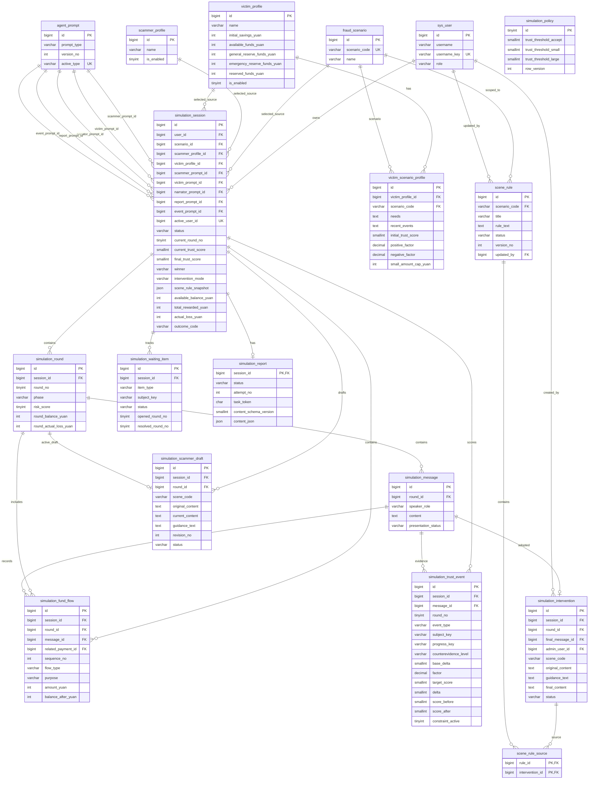
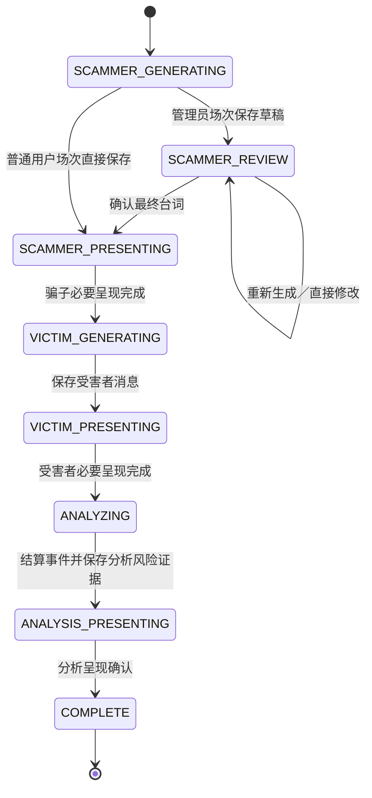
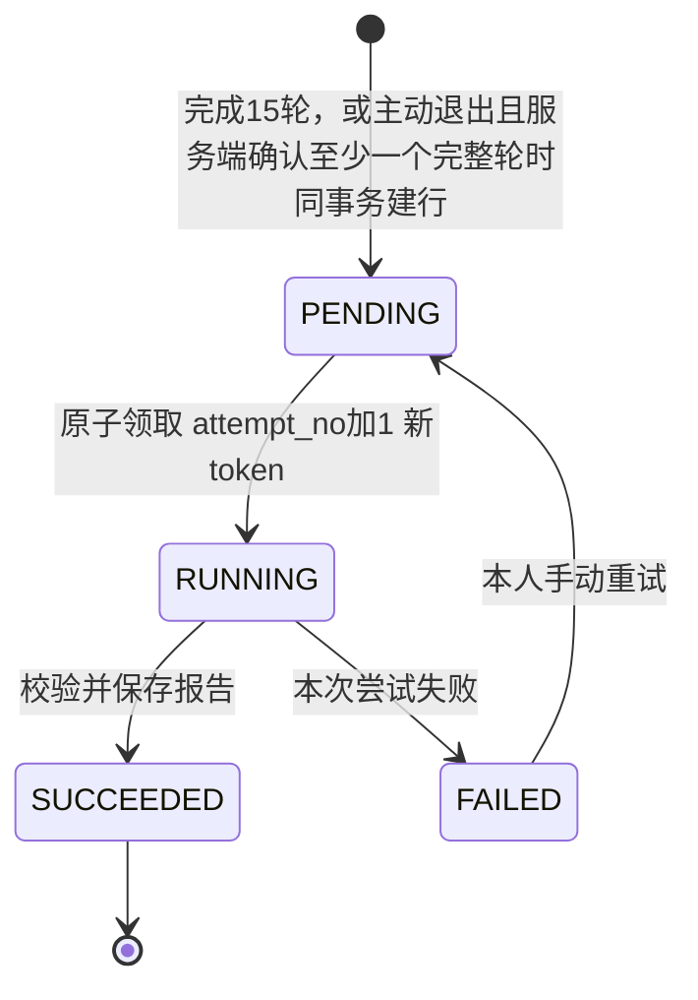

# AI反诈情景推演平台 数据库设计文档 V1.4

> **2026-10-28 本次评审确认（适用于V3.5／V1.4）：**①采纳D6：管理员在启用前人工确认规则不冲突，程序不做自动语义优先级裁决；全部启用规则按`version_no DESC, id ASC`冻结注入，固定业务规则和已保存事实优先，运行时不因规则冲突暂停、中断或等待管理员。②主动退出至少有一个经服务端确认的完整轮才生成报告；没有完整轮时仅保留过程，提示“未形成可复盘内容”，无报告、无报告重试；已有完整轮后在后续半轮或待确认时退出仍生成如实报告，但不判胜负、不展示最终分。本文涉及新会话“有有效／实际对话”的报告条件均按此完整轮门槛理解。③同主题反证有新的可靠确认依据时允许PARTIAL升级CONFIRMED一次，以冻结的人物＋场景初始分减20（下限0）为目标，只降不升；同档重复、请求重试或降档不重复扣分，升级不解除限制。④D9：观看者的实时三栏解说读取按已保存事件投影的`trustChange`；`simulation_round`新增`method_short`/`intent_short`短文案，完整`speech_analysis`/`method_analysis`保留供报告和历史。旧会话和旧报告仍按当时规则读取；本文确认不表示代码已实现。

> **2026-10-28 同步（V1.4／D9）：**按PRD V3.5与架构V1.4同步固定15轮、胜负判定、受骗倾向分、魔法球与场景知识库——新增`simulation_scammer_draft`、`simulation_intervention`、`scene_rule`、`scene_rule_source`四张表；`simulation_session`增加`winner`、最终分、规则快照、干预模式，`current_round_no`改为0—15（0为开场，实际轮次1—15），停用新会话的`minimum_rounds_exception`；`simulation_round`增加待确认阶段和`method_short`/`intent_short`并取消提前结果约束；`simulation_trust_event`沿用既有`progress_key`并增加`target_score`、反证等级与成立状态（不重加、不回填进展键）；`simulation_policy`阈值改为40／70／85；`simulation_report`内容结构支持v4（胜负、最终分值）。业务表由14张增至18张，迁移从旧版本继续。旧会话按当时规则，不批量重写。

> **V1.4口径确认：**最终分只在第15轮结束后随报告和历史结果展示；待确认刷新按主动退出，不恢复审阅；场景规则只合并不拆分，`scene_rule_source.intervention_id`唯一；旧记录FINISHED允许winner/final_trust_score为空，新会话必须同时有15轮和新胜负字段。

> **2026-10-22 需求方确认：**第三位受害者改为66岁老年男性周国良（退休会计），同步当前头像、家庭关系和三套场景资料；历史快照仍保留原周桂兰。通过追加 V14 更新当前种子，不改已执行迁移。

> **2026-10-24 同步（V1.3）：**按PRD V3.4与架构V1.3同步信任分、信息边界与停滞治理——新增`simulation_trust_event`、`simulation_waiting_item`、`simulation_policy`三张表；`victim_scenario_profile`增加四项信任参数；`victim_profile`预留拆为普通／应急两列、合计改为生成列；`simulation_session`增加信任分与两类预留字段、累计报酬；`simulation_fund_flow`增加`REWARD`类型与用途；报告行改为按“有有效对话的正常业务结束”创建。业务表由11张增至14张，迁移从V16继续。旧会话按当时规则，不批量重写。


| 文档信息 | 内容 |
|---|---|
| 产品名称 | AI反诈情景推演平台 |
| 文档版本 | V1.4 |
| 编制日期 | 2026年10月15日 |
| 文档状态 | 设计评审稿；已完成文档一致性审查，尚未由需求方冻结；未执行建库、迁移或数据库集成测试 |
| 业务基线 | 《AI反诈情景推演平台 PRD V3.5 正式开发基线版》 |
| 架构基线 | 《AI反诈情景推演平台 系统架构设计文档 V1.4》 |
| 补充依据 | 既有讨论：18张表、轮次与消息分表、提示词版本固定、报告表兼任持久化任务、先设计后生成SQL；已确认MySQL 8.0.45 |
| 适用范围 | 参赛MVP、PC浏览器、Spring Boot模块化单体、MySQL 8.0.45、单实例运行起点 |
| 最近修订 | 2026-10-28（V1.4）：按PRD V3.5与架构V1.4同步——新增待确认草稿、已采用干预、场景规则及规则来源四张表；会话增加胜负、最终受骗倾向分、规则快照和干预模式，轮号改1—15；受骗倾向分改为完整一轮后结算、下一轮生效，阈值40／70／85，反证两档降至初始分或初始分减20；报告支持v4；业务表14→18张，新增DBD-23～26及DBV-33～38。2026-10-24（V1.3）：按PRD V3.4与架构V1.3同步——新增信任事件、等待事项与全局策略三张表；受害者场景资料增加初始信任分、正负向系数、小额上限；预留资金拆分普通与应急；资金流水增加报酬类型并与本金退回共用出款上限；报告改为正常业务结束均创建；业务表11→14张，新增DBD-20～22及DBV-26～32。2026-10-21（V1.2补充）：`simulation_fund_flow`增加内部`related_payment_id`关联原付款；补充返款规则——刷单/投资实际返款每场≤300且≤累计支付，单笔≤原付款，借款无返款；声称返款不入账；预留释放累计≤预留总额；`fund_ruleset_version=funds-v2`。2026-10-20（V1.2）：按PRD V3.3与架构V1.2同步——受害者增加基础事实、故事时间与可动用资金；新增受害者场景资料表；新增逐笔资金流水表及会话/轮次资金摘要；正式结果增加“已受骗／已识破／超限结束”与资金／角色退出提前终止；报告内容支持v1/v2；骗子三项能力沿用；Qwen语音只影响运行快照，不新增媒体表；业务表由9张增至11张。2026-10-18（V1.1）：按PRD V3.2与架构V1.1同步情景演绎演出层——画像增加张嘴立绘键；消息拆分台词`content`、动作说明`action_text`与内部`internal_note`；会话增加`paused_at`、`paused_total_ms`，`deadline_at`由生成列改为可顺延的存储列；最低5轮约束；预备区不落库；新增第7.9、7.10节、DBV-18～20、DBD-11～15；仍为9张业务表。2026-10-16：按PRD已确认修订，演绎时长上限300秒→600秒；数据库版本确定并锁定为MySQL 8.0.45（原8.4表述作废）；补`focus`固定映射表；明确`interruption_detail`由服务端填充 |
| 本文交付 | 实体关系、完整字段字典、约束与索引、状态与短事务、快照、提示词、报告任务、初始化迁移备份及验证计划 |
| 本文边界 | 不提供建表SQL，不修改两份输入文档，不新增产品页面，不代替接口、Prompt正文或端到端验证 |

## 目录

1. 文档概述与设计依据
2. 数据库总体设计与设计原则
3. 数据库表清单及职责划分
4. 数据库ER关系设计
5. 十八张数据表的详细字段设计
6. 数据完整性、唯一约束与索引设计
7. 演绎过程的数据保存及状态管理
8. Agent提示词版本管理
9. 复盘报告的异步任务与数据一致性
10. 用户权限、数据安全及历史快照
11. 数据库初始化、迁移与备份方案
12. 设计验证与需求追踪

附录A：技术决策与待验证项  
附录B：官方技术参考

## 1. 文档概述与设计依据

### 1.1 依据及效力

| 来源 | 本文承接的内容 |
|---|---|
| PRD第4、8.1节 | 固定单角色、用户名规则、普通用户本人数据隔离、管理员禁止访问用户演绎与报告 |
| PRD第8.3、8.8、11.1～11.7、15章 | 三个固定场景、双方画像分开维护、受害者基础事实（含普通／应急预留）与三套场景资料及四项受骗倾向参数、故事时间、可用资金、定性参数、情境和有效头像、各类至少一项可用、受骗倾向机制管理、魔法球与场景知识库 |
| PRD第10、11.4～11.5节 | 五档风险、受骗倾向分与事件计分、反证两档、付款门槛、实际行为与胜负分离、资金约束、固定15轮、先保存再展示、完整快照、长期保存 |
| 架构第6、8.4～8.6、9～12章 | 短事务、资金流水与余额、受骗倾向与门槛、待确认草稿与采用记录、规则快照、重启收敛、呈现回执、原子终态、报告持久任务、历史只读 |
| 架构第13～15章 | 安全边界、管理员测试场次、版本化头像、Qwen语音、备份恢复、单机部署及必须实测的技术事项 |
| 本次补充讨论 | 固定采用本文18张表；提示词由开发人员受控维护；不增加独立历史、风险、调用日志或任务表；受骗倾向事件、等待事项、全局策略、干预与规则各自成表，不建通用配置中心或向量知识库 |

业务规则以PRD为准。本文选择实现方法，不重新开放已确认的业务需求。技术决策使用`DBD-xx`编号，验证使用`DBV-xx`编号，不占用或假装新增既有架构文档的AD编号。

本次未能直接读取所引用聊天的完整记录；讨论依据是用户在本次聊天中提供的补充文本。本文没有将未取得的聊天内容当作已确认事实。

### 1.2 本次设计计划及完成判据

| 步骤 | 工作 | 验证判据 |
|---|---|---|
| 1 | 将已确认规则分配到18张表及应用事务 | 每项关键规则均有存储位置和执行责任 |
| 2 | 完成字段、ER、约束、索引及状态转换 | 无孤立关系；半轮、失败、重复、待确认与迟到请求可表达 |
| 3 | 审查主链路、异常链路和需求追踪 | 不违反权限、唯一终态、快照、资金、受骗倾向、15轮及胜负口径 |
| 4 | 提交V1.4供冻结，随后进入SQL阶段 | 本文明确标注设计与实测的边界；不把设计说明写成测试通过 |

### 1.3 不变量

1. 每个普通用户同时至多有一条`RUNNING`演绎；管理员本人演示测试场次同样按账号单场约束。重复请求不能替换原记录。
2. 每条角色消息只能在保存成功后发布；消息存在不等于必要媒体完成。未确认草稿不是`simulation_message`，不得发布为正式台词。
3. 每轮至多一条骗子正式消息、一条受害者消息、一组解说及风险；解说不算额外一轮；资金动作按逐笔流水记录。
4. 风险缺失为`NULL`；合法分数只有0、25、50、75、100；风险下降不删除既有受骗事实，也不改变资金余额。
5. 演绎只有`RUNNING → FINISHED`或`RUNNING → INTERRUPTED`，终态不可逆；主动退出的正常业务结束以`INTERRUPTED`保存独立原因，仅在服务端确认至少一个完整轮时生成报告；技术故障中断同样为`INTERRUPTED`但不生成报告；胜负的唯一权威是`simulation_session`（V1.4）。
6. 胜负只存于演绎主记录；技术故障中断没有胜负与报告任务；主动退出在服务端确认至少一个完整轮时没有胜负但必须建立报告任务，没有完整轮时不建任务（V1.4）。
7. 正常业务结束和报告待处理记录在同一事务提交；成功报告不可改写。
8. 当时场景、全部画像内容、基础事实、当前场景资料、四项受骗倾向参数、冻结阈值、规则快照、头像版本和提示词版本固定，后续维护不影响旧记录。
9. 本人历史不自动过期；临时语音不进入长期数据库或历史回放。
10. 服务端预备区内容不落库；正常演绎固定15轮，第1至14轮不判胜负，第15轮完成后才按最终分值与净损失判定；不再有5轮下限、20轮上限或提前结束例外（V1.4）。
11. 旧会话的`deadline_at`、`paused_total_ms`和600秒口径只用于兼容读取；新会话没有600秒业务截止时间和300秒暂停累计，相关字段可为NULL或0（V1.4）。
12. 付款、本金退回、到账报酬、预留释放只由服务端写入；逐笔流水是权威，余额、累计支付／退回本金／报酬、净损失、两类预留和追加次数由流水同事务汇总，不得透支或凭空补钱（V1.2）。本金退回与到账报酬共用每场≤300总出款，退回≤原付款，借款无实际出款；声称不入账（V1.3）。
13. 旧会话按`runtime_snapshot.ruleset_version`和`content_schema_version`展示旧结果、旧资金口径与旧报告；新会话使用V3.5胜负与v4报告结构，不批量重写（V1.4）。
14. 受骗倾向分只存于后台，事件行唯一可复算；骗子、受害者和观看者的任何接口、SSE、报告或日志都不得出现分数、阈值和计分规则（V1.4）。
15. 同一受骗倾向事件只计分一次；被拒绝的候选回应、重新生成的回应和重试不产生重复事件、重复计分或重复付款（V1.4）。
16. 草稿可以覆盖，只有最终采用版本才建采用记录并进入待入库列表；普通用户场次不产生采用记录（V1.4）。
17. 场景规则按场景版本化；开始演绎时冻结规则快照，之后规则修改不影响进行中和历史场次（V1.4）。
18. 管理员演示测试场次与普通用户场次按`user_id`隔离；管理员只能访问本人测试场次，不能读取普通用户草稿、采用记录或规则来源（V1.4）。

## 2. 数据库总体设计与设计原则

### 2.1 存储基线

| 项目 | 本文设计选择 | 说明 |
|---|---|---|
| 数据库 | 单个MySQL业务库，建议库名`anti_scam` | 三类业务信息不等于三个物理数据库 |
| 版本 | 按MySQL **8.0.45**设计；小版本锁定为8.0.45 | 本项目已确定使用MySQL 8.0.45，无需改用8.4；本文依赖的生成列、生成列索引、`CHECK`约束、`utf8mb4_0900_bin`排序规则与`DESC`索引均为MySQL 8.0 GA特性，实际建表时按`DBV-01`复核 |
| 引擎 | InnoDB | 使用事务、行锁和物理外键 |
| 字符集 | `utf8mb4` | 保留中文及模型生成文本 |
| 默认排序规则 | `utf8mb4_0900_bin` | 精确比较代码和文本；用户名另用规范化键实现英文大小写无关 |
| 事务隔离 | 应用业务事务显式使用`READ COMMITTED` | 并发不变量靠锁和唯一约束，不能依赖普通查询的先查后写 |
| 主键 | `BIGINT UNSIGNED`自增 | 例外：报告以`session_id`同时作为主键和外键；前端传输ID使用字符串 |
| 时间 | `DATETIME(3)`，统一写入UTC | 数据库连接、应用和后台任务统一UTC；界面按Asia/Shanghai展示 |
| 枚举 | `VARCHAR`加`CHECK` | 便于阅读与迁移；不建立通用字典表，不依靠魔法数字 |
| JSON | 配置快照、运行配置、行为证据、报告v1/v2结构 | 不把需关联和查询的核心ID、状态、轮次、风险、余额全塞入JSON |
| 删除策略 | 无业务软删除字段，无级联删除 | 画像使用启停；历史、提示词版本和头像引用保留 |
| 执行条件 | 单实例Spring Boot，受控后台执行器 | 多实例扩容须重审恢复和任务所有权，不视为已支持 |

MySQL的唯一索引允许多条`NULL`，生成列可参与索引；本文利用这两项能力约束“至多一场活动演绎”和“每类至多一个当前提示词”。这属于本项目设计组合，能力依据见[MySQL索引说明](https://dev.mysql.com/doc/refman/8.0/en/create-table.html)与[生成列说明](https://dev.mysql.com/doc/refman/8.0/en/create-table-generated-columns.html)。

### 2.2 字段字典约定

- `N`：不允许为空；`Y`：允许为空；`G`：数据库生成列，由表达式决定，不由应用写入。
- 默认值`—`：无默认值，插入时必须明确提供。`NULL`：尚无事实；不能用空字符串、0或当前时间补造。
- `NOW`：默认`CURRENT_TIMESTAMP(3)`；只用于数据库记录创建时间，不能代替用户点击开始时间。
- `AI`：数据库自增。`GEN`：按本章及第6章表达式生成，后续DDL采用存储生成列。
- 所有外键字段与目标字段类型一致，采用`ON DELETE RESTRICT / ON UPDATE RESTRICT`，主键不可修改。
- 文本长度为建议存储容量，不新增PRD业务上限。若页面需要限制，须一致提示并拒绝超限；禁止静默截断。正文使用`TEXT/MEDIUMTEXT`，提交前校验数据库可容纳的字节长度。
- 年龄为画像年龄；故事时间统一为“昨天20:00”，由系统固定，不能转成当前时间戳；旧快照可能保留旧文案。性别保留文案，不擅自新增产品枚举规则。
- 金额字段统一为整数“元”（`INT UNSIGNED`），不存小数或负值；预留资金不自动进入本场可动用余额。资金流水发生顺序用显式序号，不用自增ID代表业务顺序。
- 账号与密码的“字符数”前后端按Unicode码点一致处理；密码不执行trim、大小写转换或Unicode规范化。

### 2.3 权威数据与必要冗余

| 信息 | 唯一权威位置 | 使用方式 |
|---|---|---|
| 当前可选场景与画像 | 三张基础内容表＋`victim_scenario_profile` | 配置页和后台使用；受害者三套场景资料与四项受骗倾向参数分表保存 |
| 某次演绎的完整配置 | `simulation_session`的三份快照＋规则快照 | 本场生成、历史及报告使用；不得回查当前表替换内容 |
| 角色实际内容 | `simulation_message.content`／`action_text` | 台词`content`供气泡、TTS与历史；动作说明`action_text`供舞台、证据与历史，不朗读；`internal_note`仅供解说与报告内部使用（V1.1）；未确认草稿不属于角色消息 |
| 逐轮解说、风险、事实分析 | `simulation_round` | 风险折线不在报告里复制另一套分数；轮次资金摘要与流水对应 |
| 受骗倾向分与事件 | `simulation_trust_event`＋`simulation_session.current_trust_score` | 事件行是计分依据，分数由事件累计；事件明细只在后台保留，观看者实时只读取按已保存事件投影的真实`trustChange`和前后分；第15轮结束后最终分随报告和历史结果返回，阈值、系数和事件明细不对外展示（V1.4／D9） |
| 等待事项与材料 | `simulation_waiting_item` | 要求的依据、状态与已提供材料的事实来源；不按轮重建（V1.3） |
| 资金流水 | `simulation_fund_flow` | 逐笔支付／本金退回／到账报酬／预留释放是权威；会话和轮次资金摘要是同事务汇总 |
| 胜负、过程事实与结束原因 | `simulation_session.winner/final_trust_score/outcome_reason`或`interruption_code` | 报告只解释该胜负或原因，不另存可冲突的结论；旧结果按规则版本展示 |
| 正式报告内容与生成状态 | `simulation_report` | 同时承担待处理工作与当前尝试状态；`content_schema_version`区分v1/v2/v3/v4 |
| 全局付款阈值 | `simulation_policy`单行 | 唯一当前配置（40／70／85），开始演绎时冻结进运行快照；修改只影响新会话（V1.4） |
| 待确认草稿 | `simulation_scammer_draft` | 只供本人管理员审阅；同一轮只保留最新草稿；不是正式消息（V1.4） |
| 已采用干预 | `simulation_intervention` | 原台词、干预要求、最终台词和来源消息；只保存最终采用的版本（V1.4） |
| 场景规则与来源 | `scene_rule`＋`scene_rule_source` | 规则正文、启用状态、版本及来源记录关联；开始演绎时复制为规则快照（V1.4） |
| 角色模板正文 | 不可变的`agent_prompt`版本行 | 会话固定其ID，不复制五份大段Prompt到快照；规则快照另存于会话（V1.4） |

画像快照与基础表内容重复是历史要求带来的有意冗余。会话的当前轮号、版本号和资金摘要是执行控制字段；已完成轮数、最新风险、历史列表名称均从保存内容读取，不另加可漂移的汇总列。资金摘要是流水的同事务汇总，不作为逐笔事实的替代。

## 3. 数据库表清单及职责划分

| 序号 | 表名 | 中文名称 | 职责 | 明确不承担 |
|---|---|---|---|---|
| 1 | `sys_user` | 用户表 | 登录凭据、固定角色、数据归属、开始事务锁定锚点 | 用户管理、角色切换、用户能力评分 |
| 2 | `fraud_scenario` | 诈骗场景表 | 三类固定场景代码及可编辑名称简介 | 动态目标、流程、策略或RAG知识库 |
| 3 | `scammer_profile` | 骗子画像表 | 基础信息、三个定性参数、行为情境、头像及启停 | 个人私有画像、永久删除 |
| 4 | `victim_profile` | 受害者画像表 | 基础事实、两个定性参数、性格情境、可用资金与普通／应急预留、头像及启停 | 观看用户画像、能力测评 |
| 5 | `victim_scenario_profile` | 受害者场景资料表 | 每名受害者三套场景的决策特点、经历及四项受骗倾向参数，支撑跨场景差异 | 教学设计标签、运行时风险分、独立策略库 |
| 6 | `simulation_session` | 演绎记录表 | 归属、快照、规则快照、版本绑定、资金摘要、受骗倾向分、活动约束、唯一胜负与终态 | 复制整场消息或风险曲线 |
| 7 | `simulation_round` | 演绎轮次表 | 轮内阶段（含待确认）、解说、风险、行为证据、轮次资金摘要、完成和阅读停留 | 复制角色消息、存储正式报告 |
| 8 | `simulation_message` | 演绎消息表 | 双方台词与动作说明、内部意图／心理、角色唯一性、必要呈现状态 | 解说的第二份存储、永久音频、预备区候选内容、未确认草稿 |
| 9 | `simulation_fund_flow` | 演绎资金流水表 | 逐笔支付、本金退回、到账报酬、预留释放及发生后余额 | 真实支付、独立评分、可编辑资金策略 |
| 10 | `simulation_report` | 复盘报告表 | 一场一份报告、待处理状态、尝试令牌与v1/v2/v3/v4成功内容 | 独立演绎、完整尝试日志库 |
| 11 | `agent_prompt` | Agent提示词配置表 | 模板正文、类型、不可变版本和当前启用版本 | 新增管理员Prompt管理页面 |
| 12 | `simulation_trust_event` | 受骗倾向事件表 | 每场每次计分的事件类型、主题键、进展键、基础值、系数、目标分／增量、变化前后分数、反证状态与原文依据（V1.4） | 独立评分体系、用户可见的受骗倾向分、可编辑计分规则库 |
| 13 | `simulation_waiting_item` | 等待事项表 | 本场提出的要求、依据、状态、已提供材料与结果（V1.3） | 亲友Agent、真实图片、跨场共享的待办中心 |
| 14 | `simulation_policy` | 全局演绎策略表 | 单行保存40／70／85阈值及版本（V1.4） | 通用配置中心、按角色或场景的阈值、用户级配置 |
| 15 | `simulation_scammer_draft` | 骗子草稿表 | 每轮待确认草稿、原台词、当前版本、干预要求、修订号与状态（V1.4） | 正式消息、历史对话、每次未采用尝试的流水 |
| 16 | `simulation_intervention` | 已采用干预表 | 最终采用的干预、原台词、干预要求、最终台词、场景、轮次、来源消息与待入库状态（V1.4） | 普通用户干预、未采用草稿、公共知识库正文 |
| 17 | `scene_rule` | 场景规则表 | 按场景保存可复用约束正文、标题、启用状态、版本与修改人（V1.4） | 向量检索、通用知识库、按场次或按用户的临时指令 |
| 18 | `scene_rule_source` | 场景规则来源表 | 规则与已采用干预的一对多关联：一条规则可有多条来源，一条来源只能归一条规则（V1.4） | 规则正文复制、用户数据、来源场次正文 |

报告提示词也采用同表的`REPORT`类型，事件判定采用同表的`EVENT`类型，因此表内共五类模板：三个演绎Agent、一个事件判定任务和一个报告任务。这样报告重试和事件判定都能引用固定版本，避免同时维护数据库模板和无版本文件两套机制。本选择属于`DBD-06`，不是增加新的演绎Agent。

不新增历史记录表、风险历史表、模型调用日志表、执行日志表、独立任务表、通用资源表或通用配置表。新增`victim_scenario_profile`是基础内容的三套资料与参数，`simulation_fund_flow`是演绎过程的逐笔事实，`simulation_trust_event`是后台计分依据，`simulation_waiting_item`是本场要求的状态，`simulation_policy`是单行全局阈值，`simulation_scammer_draft`是待确认过程，`simulation_intervention`是已采用修改，`scene_rule`与`scene_rule_source`是结构化场景约束及来源；它们都不是独立策略系统、通用配置中心或向量知识库。登录会话首期使用应用已有的服务端会话能力；重启要求重新登录，不因此引入额外业务表。

## 4. 数据库ER关系设计

### 4.1 ER图



图中唯一键仅简示单列项；组合唯一约束详见第6章。图中的一对多不代表无限消息：V1.4新会话最多15个轮号，旧会话最多20个；每轮至多两个角色消息；资金流水按实际动作数量增加，但同一轮同一消息的重复记录不重复计数。`simulation_policy`不与任何表建立外键：阈值在开始演绎时复制进会话字段和运行快照，之后修改只影响新会话（V1.4）。规则快照保存在会话JSON中，`scene_rule`只提供新会话的规则来源。

### 4.2 关系及约束责任

| 关系 | 基数与约束 |
|---|---|
| 用户 → 演绎 | 一对多；普通用户和本人演示测试管理员均可拥有，物理外键只校验用户存在，角色与本人归属由服务层检查 |
| 基础场景/画像 → 演绎 | 一对多；ID保留来源关系，显示内容以快照为准；停用不是删除 |
| 受害者 → 场景资料 | 一名受害者恰好三套；`(victim_profile_id, scenario_code)`唯一；三套不齐或四项受骗倾向参数缺失不得启用 |
| 场景代码 → 场景资料 | 固定三值；物理外键指向`fraud_scenario.scenario_code`，不接受新增类型 |
| 提示词 → 演绎 | 五条命名外键，每条均多对一；服务层分别验证对应类型 |
| 演绎 → 轮次 | V1.4新会话零到15条，旧会话最多20条；`(session_id, round_no)`唯一，轮号连续由事务保证 |
| 轮次 → 消息 | 零到2条；`(round_id, speaker_role)`唯一；先骗子后受害者由阶段控制 |
| 演绎 → 资金流水 | 零到多条；`(session_id, sequence_no)`唯一；流水必须属于本场轮次和可选消息 |
| 演绎 → 受骗倾向事件 | 零到多条；`(session_id, event_type, subject_key, progress_key)`唯一；事件必须属于本场并引用本场消息 |
| 演绎 → 等待事项 | 零到多条；`(session_id, item_type, subject_key)`唯一；状态与轮号同事务更新 |
| 演绎 → 骗子草稿 | 零到多条历史草稿，同一轮至多一条活动草稿；草稿不是正式消息，只有采用后才生成消息与采用记录（V1.4） |
| 演绎/轮次/消息 → 采用记录 | 采用记录必须指向本场本轮最终骗子消息；只有发生替换时创建，普通用户场次不创建（V1.4） |
| 采用记录 → 规则来源 | 一对多；一条规则可关联多条来源，一条采用记录只能归入一条规则；`(rule_id, intervention_id)`唯一且`intervention_id`唯一（V1.4） |
| 场景代码 → 场景规则 | 一对多；规则只属于一个固定场景，启用规则进入新会话规则快照；不建向量索引（V1.4） |
| 全局策略 → 演绎 | 无物理外键；开始演绎时复制40／70／85阈值进会话字段与运行快照，修改只影响新会话 |
| 演绎 → 报告 | 零或一条；完成15轮，或主动退出且服务端确认至少一个完整轮时必须同事务创建一条；进行中、只有开场或没有完整轮的半轮结束不得有报告 |

消息通过轮次找到演绎和用户，不重复保存`session_id/user_id`；报告通过其主键找到演绎和归属；资金流水通过演绎、轮次和可选消息关联，重复归属由服务层校验。避免多处归属不一致。证据JSON中的消息ID是应用校验的引用，不冒称为JSON内部物理外键。

## 5. 十八张数据表的详细字段设计

为保持既有章节编号，V1.2新增表放在第5.10、5.11节，V1.3新增表放在第5.12～5.14节；表清单序号分别为5、9、12、13、14。

### 5.1 `sys_user`——用户表

| 字段 | 类型 | 空 | 默认 | 键/约束 | 业务说明 |
|---|---|---|---|---|---|
| `id` | BIGINT UNSIGNED | N | AI | PK | 账号ID |
| `username` | VARCHAR(24) | N | — | 长度2～24 | 去首尾空格且通过字符规则校验后的原展示名称 |
| `username_key` | VARCHAR(24) | G | GEN | UQ | `LOWER(username)`，使用`utf8mb4_0900_bin`；不由客户端提供 |
| `password_hash` | VARCHAR(255) | N | — | 非空 | 带算法标识和盐的密码哈希编码；不存确认密码 |
| `role` | VARCHAR(16) | N | `USER` | USER/ADMIN | 单一固定角色；注册服务强制USER |
| `created_at` | DATETIME(3) | N | NOW | — | 建立账号时间 |

全局唯一索引覆盖普通用户和管理员。对PRD允许的汉字、ASCII英文字母、数字和下划线，英文转小写后精确比较即可满足规则；不使用通用不区分重音的排序规则扩大等价范围。字符合法性、去首尾空格由服务层校验，DB校验长度并派生唯一键。数据库生成列与`LOWER()`行为必须纳入`DBV-01`实测。[MySQL字符串函数](https://dev.mysql.com/doc/refman/8.0/en/string-functions.html)

密码哈希采用Spring Security的带盐自适应单向方案，建议使用其PBKDF2编码器并保存算法标识，具体参数随锁定的框架版本进行成本测试；不手写加密算法。必须覆盖24个多字节字符、首尾空格和弱密码的接受行为，不能因哈希实现限制偷偷截断输入或改变PRD。算法升级不引入密码找回页面。[Spring Security密码存储](https://docs.spring.io/spring-security/reference/features/authentication/password-storage.html)

### 5.2 `fraud_scenario`——诈骗场景表

| 字段 | 类型 | 空 | 默认 | 键/约束 | 业务说明 |
|---|---|---|---|---|---|
| `id` | BIGINT UNSIGNED | N | AI | PK | 场景来源ID |
| `scenario_code` | VARCHAR(32) | N | — | UQ，固定三值 | 不可编辑的业务类型标识 |
| `name` | VARCHAR(100) | N | — | 非空 | 可编辑名称 |
| `description` | TEXT | N | — | 非空 | 可编辑简介 |
| `row_version` | INT UNSIGNED | N | 0 | 更新条件 | 防止两个后台编辑互相静默覆盖 |
| `created_at` | DATETIME(3) | N | NOW | — | 初始化时间 |
| `updated_at` | DATETIME(3) | N | NOW | 写入时更新 | 文案最后修改时间 |

| `scenario_code` | 初始名称 | 深度卷入参考（不触发结束与胜负） |
|---|---|---|
| `TASK_REBATE` | 刷单返利诈骗 | 首次垫付后至少追加1次，且追加累计3次或累计实际净损失达到1000元之一 |
| `FAKE_INVESTMENT` | 虚假投资诈骗 | 投资款已投入后又实际支付提现、解冻等额外费用 |
| `IMPERSONATION_LOAN` | 冒充亲友借款诈骗 | 未通过独立渠道核实身份即实际完成借款转账 |

`CHECK`限制代码集合，唯一键限制同代码只有一行；“恰好存在三行”由初始化、运行权限和启动检查保证，不能声称单行约束可以保证全表行数。年龄侧重和深度卷入参考不是可编辑字段，不落库；接口与快照所需的`focus`由`scenario_code`按固定映射派生，映射如下表，不在后台可编辑范围内，随本设计版本受控维护。刷单参考的金额条件、追加计数和净损失计算由会话资金摘要与逐笔流水共同支撑，不在场景行保存进度。绑定的`ruleset_version`见会话运行快照。场景可通过`scene_rule.scenario_code`挂接多条规则，但规则正文不复制到场景行。

| `scenario_code` | 固定`focus`文案（接口`focus`字段与`scenario_snapshot`取值） |
|---|---|
| `TASK_REBATE` | 青年群体 |
| `FAKE_INVESTMENT` | 中年群体 |
| `IMPERSONATION_LOAN` | 老年群体 |

### 5.3 `scammer_profile`——骗子画像表

| 字段 | 类型 | 空 | 默认 | 键/约束 | 业务说明 |
|---|---|---|---|---|---|
| `id` | BIGINT UNSIGNED | N | AI | PK | 画像ID |
| `name` | VARCHAR(64) | N | — | 非空 | 人物姓名，不设全局唯一 |
| `avatar_key` | VARCHAR(255) | N | — | 不可覆盖资源键 | 闭嘴帧半身立绘，兼作卡片头像；例如含内容摘要的`avatars/<sha256>.png`，不存临时签名URL |
| `speaking_avatar_key` | VARCHAR(255) | N | — | 不可覆盖资源键 | 张嘴帧半身立绘（V1.1）；与`avatar_key`像素尺寸一致，用于说话时嘴部开合 |
| `age` | SMALLINT UNSIGNED | N | — | 正整数 | 人物年龄，不按场景自动改写 |
| `gender` | VARCHAR(16) | N | — | 非空 | 性别文案 |
| `identity` | VARCHAR(128) | N | — | 非空 | 固定基础身份，不是演绎中临时冒充身份 |
| `description` | TEXT | N | — | 非空 | 人物描述 |
| `fraud_experience` | VARCHAR(8) | N | — | LOW/MEDIUM/HIGH | 诈骗经验 |
| `speech_skill` | VARCHAR(8) | N | — | LOW/MEDIUM/HIGH | 话术能力 |
| `manipulation_skill` | VARCHAR(8) | N | — | LOW/MEDIUM/HIGH | 心理操控能力 |
| `behavior_traits` | TEXT | N | — | 非空 | 行为特点 |
| `context_time` | VARCHAR(128) | N | — | 非空 | 人物情境时间文字 |
| `context_place` | VARCHAR(128) | N | — | 非空 | 人物情境地点文字 |
| `current_state` | TEXT | N | — | 非空 | 当时人物状态 |
| `is_enabled` | TINYINT UNSIGNED | N | 1 | 0/1 | 是否可被新演绎选择 |
| `row_version` | INT UNSIGNED | N | 0 | 更新条件 | 编辑和启停时递增 |
| `created_at` | DATETIME(3) | N | NOW | — | 建立时间 |
| `updated_at` | DATETIME(3) | N | NOW | 写入时更新 | 最后修改时间 |

初始画像为陈启明、梁悦；完整内容直接取PRD第11.3节，不用简化示例覆盖原人物卡。MVP不限制画像总数为2。`context_time`新数据固定为“昨天20:00”，旧数据可保留旧文案；三项能力取低／中／高，不同能力掌握相同信息范围，信息范围不落库为画像私有字段。

### 5.4 `victim_profile`——受害者画像表

| 字段 | 类型 | 空 | 默认 | 键/约束 | 业务说明 |
|---|---|---|---|---|---|
| `id` | BIGINT UNSIGNED | N | AI | PK | 画像ID |
| `name` | VARCHAR(64) | N | — | 非空 | 人物姓名 |
| `avatar_key` | VARCHAR(255) | N | — | 不可覆盖资源键 | 闭嘴帧半身立绘，兼作卡片头像；与骗子画像采用同一文件管理规则 |
| `speaking_avatar_key` | VARCHAR(255) | N | — | 不可覆盖资源键 | 张嘴帧半身立绘（V1.1）；与`avatar_key`像素尺寸一致 |
| `age` | SMALLINT UNSIGNED | N | — | 正整数 | 人物年龄 |
| `gender` | VARCHAR(16) | N | — | 非空 | 性别文案 |
| `identity` | VARCHAR(128) | N | — | 非空 | 人物身份 |
| `description` | TEXT | N | — | 非空 | 人物描述 |
| `family_status` | TEXT | N | — | 非空 | 家庭生活与同住情况（V1.2） |
| `income_description` | TEXT | N | — | 非空 | 收入说明，可含固定收入、家庭支持或养老金文字（V1.2） |
| `monthly_expense_yuan` | INT UNSIGNED | N | 0 | 非负整数 | 日常支出金额，单位元（V1.2） |
| `initial_savings_yuan` | INT UNSIGNED | N | 0 | 非负整数 | 初始存款金额，单位元（V1.2） |
| `available_funds_yuan` | INT UNSIGNED | N | 0 | 非负整数；≤initial_savings | 可用资金，单位元；开始演绎时作为本场初始余额（V1.2） |
| `general_reserve_funds_yuan` | INT UNSIGNED | N | 0 | 非负整数 | 普通预留，单位元；符合条件的小额行动可动用（V1.3） |
| `emergency_reserve_funds_yuan` | INT UNSIGNED | N | 0 | 非负整数 | 应急预留，单位元；不论金额均需较大金额门槛（V1.3） |
| `reserved_funds_yuan` | INT UNSIGNED | G | GEN | 生成列；=普通＋应急；≤initial_savings | 预留资金合计，单位元；不自动计入本场可用余额（V1.2/V1.3） |
| `reserved_funds_note` | TEXT | N | — | 非空 | 预留资金安排文字说明；不再作为金额来源，金额以两列结构化字段为准（V1.2/V1.3） |
| `general_decision_traits` | TEXT | N | — | 非空 | 一般决策特点（V1.2） |
| `anti_fraud_awareness` | VARCHAR(8) | N | — | LOW/MEDIUM/HIGH | 防骗意识，不是当前风险分数 |
| `risk_tendency` | VARCHAR(8) | N | — | LOW/MEDIUM/HIGH | 风险倾向；与防骗意识保持独立维度 |
| `personality_traits` | TEXT | N | — | 非空 | 性格特点 |
| `context_time` | VARCHAR(128) | N | — | 非空 | 故事时间；新数据固定“昨天20:00”，旧数据可保留旧文案 |
| `context_place` | VARCHAR(128) | N | — | 非空 | 人物情境地点文字 |
| `current_state` | TEXT | N | — | 非空 | 当时人物状态 |
| `is_enabled` | TINYINT UNSIGNED | N | 1 | 0/1 | 是否可供新演绎选择 |
| `row_version` | INT UNSIGNED | N | 0 | 更新条件 | 编辑和启停时递增 |
| `created_at` | DATETIME(3) | N | NOW | — | 建立时间 |
| `updated_at` | DATETIME(3) | N | NOW | 写入时更新 | 最后修改时间 |

初始画像为林晓、赵诚、周国良；基础事实和金额直接取PRD第11.3节。每名受害者必须在`victim_scenario_profile`具有三套场景资料和四项受骗倾向参数才能启用；任一可用受害者可与任一场景组合，数据库不建立场景年龄限制或角色强制匹配表，“重点易受骗／相对不易受骗”不落库为标签或分数。普通预留与应急预留之和不得超过初始存款；`reserved_funds_note`只作说明，金额以两列结构化字段为准（V1.4）。

### 5.5 `simulation_session`——演绎记录表

| 字段 | 类型 | 空 | 默认 | 键/约束 | 业务说明 |
|---|---|---|---|---|---|
| `id` | BIGINT UNSIGNED | N | AI | PK | 一次演绎ID |
| `user_id` | BIGINT UNSIGNED | N | — | FK→sys_user | 由认证上下文确定 |
| `start_request_id` | CHAR(36) | N | — | 与user_id组合UQ | 一次点击对应的UUID；网络重发保持同值 |
| `scenario_id` | BIGINT UNSIGNED | N | — | FK→fraud_scenario | 所选基础场景来源 |
| `scammer_profile_id` | BIGINT UNSIGNED | N | — | FK→scammer_profile | 所选骗子来源 |
| `victim_profile_id` | BIGINT UNSIGNED | N | — | FK→victim_profile | 所选受害者来源 |
| `snapshot_schema_version` | SMALLINT UNSIGNED | N | 4 | 正整数；新会话4，旧会话1/2/3 | 以下快照结构版本 |
| `scenario_snapshot` | JSON | N | — | OBJECT | 场景ID、代码、名称、简介、row_version及内容侧重 |
| `scammer_snapshot` | JSON | N | — | OBJECT | 骗子全量业务信息、三项能力、头像键及来源版本 |
| `victim_snapshot` | JSON | N | — | OBJECT | 受害者全量业务信息、基础事实、三套场景资料与四项受骗倾向参数、故事时间、可用资金、普通／应急预留、头像键及来源版本 |
| `scammer_prompt_id` | BIGINT UNSIGNED | N | — | FK→agent_prompt | 固定SCAMMER版本 |
| `victim_prompt_id` | BIGINT UNSIGNED | N | — | FK→agent_prompt | 固定VICTIM版本 |
| `narrator_prompt_id` | BIGINT UNSIGNED | N | — | FK→agent_prompt | 固定NARRATOR版本 |
| `report_prompt_id` | BIGINT UNSIGNED | N | — | FK→agent_prompt | 固定REPORT版本，失败重试继续使用 |
| `event_prompt_id` | BIGINT UNSIGNED | N | — | FK→agent_prompt | 固定EVENT版本，本轮事件判定使用（V1.3） |
| `runtime_snapshot` | JSON | N | — | OBJECT | 规则、应用构建、调用配置与冻结阈值，详见第8.3节 |
| `intervention_mode` | VARCHAR(16) | N | `NONE` | NONE/ADMIN_TEST | 本场干预模式；V1.4新会话只有NONE或ADMIN_TEST，普通用户本地干预为未来值（V1.4） |
| `scene_rule_snapshot` | JSON | N | — | ARRAY | 开始时冻结的启用规则ID、版本和正文；只注入骗子上下文，不进入用户可见内容（V1.4） |
| `status` | VARCHAR(16) | N | `RUNNING` | RUNNING/FINISHED/INTERRUPTED | 演绎过程状态；主动退出的正常业务结束和技术故障中断都使用INTERRUPTED，差别见`interruption_code`（V1.4） |
| `active_user_id` | BIGINT UNSIGNED | G | GEN | UQ，可为NULL | RUNNING时为user_id，否则NULL；管理员本人测试场次按管理员账号占位 |
| `current_round_no` | TINYINT UNSIGNED | N | 0 | 0～20（新会话0～15） | 0为尚未建立首轮；否则为已建立的当前轮号；旧会话可到20（V1.4） |
| `minimum_rounds_exception` | TINYINT UNSIGNED | N | 0 | 0/1 | 旧会话兼容字段；V1.4新会话固定0，不再使用。旧记录按当时规则读取（V1.4） |
| `state_version` | BIGINT UNSIGNED | N | 0 | 单调递增 | 同场任务、回执与迟到写入的版本闸门 |
| `initial_available_funds_yuan` | INT UNSIGNED | N | — | 非负整数 | 开始时的可用资金，取自受害者快照（V1.2） |
| `available_balance_yuan` | INT UNSIGNED | N | — | 非负整数 | 当前可用余额；由逐笔流水汇总（V1.2） |
| `total_paid_yuan` | INT UNSIGNED | N | 0 | 非负整数 | 累计实际支付（V1.2） |
| `total_refunded_yuan` | INT UNSIGNED | N | 0 | 非负整数 | 累计实际退回本金，不含报酬（V1.2/V1.3） |
| `total_rewarded_yuan` | INT UNSIGNED | N | 0 | 非负整数 | 累计实际到账报酬（V1.3） |
| `actual_loss_yuan` | INT UNSIGNED | N | 0 | 非负整数；等于max(0,total_paid-total_refunded-total_rewarded) | 当前实际净损失（V1.3；旧会话沿用旧口径） |
| `additional_payment_count` | SMALLINT UNSIGNED | N | 0 | 非负整数 | 首笔之后的实际追加次数（V1.2） |
| `general_reserve_total_yuan` | INT UNSIGNED | N | 0 | 非负整数 | 开始时冻结的普通预留总额（V1.3） |
| `emergency_reserve_total_yuan` | INT UNSIGNED | N | 0 | 非负整数 | 开始时冻结的应急预留总额（V1.3） |
| `general_reserve_released_yuan` | INT UNSIGNED | N | 0 | ≤general_reserve_total | 累计释放的普通预留（V1.3） |
| `emergency_reserve_released_yuan` | INT UNSIGNED | N | 0 | ≤emergency_reserve_total | 累计释放的应急预留（V1.3） |
| `reserve_released_yuan` | INT UNSIGNED | G | GEN | =两类释放之和 | 累计释放的预留资金合计（V1.2/V1.3） |
| `initial_trust_score` | TINYINT UNSIGNED | N | — | 0～100 | 开始时冻结的初始受骗倾向分，取自本场场景资料快照；内部字段名沿用trust_*（V1.4） |
| `current_trust_score` | TINYINT UNSIGNED | N | — | 0～100 | 当前受骗倾向分；只由事件累计并在完整一轮后结算，模型不能直接写入（V1.4） |
| `final_trust_score` | TINYINT UNSIGNED | Y | NULL | 0～100 | 第15轮结算后的最终受骗倾向分；V1.4新会话FINISHED必填且与current_trust_score一致；旧记录FINISHED为NULL（V1.4） |
| `trust_positive_factor` | DECIMAL(3,2) | N | — | 0.10～3.00 | 冻结的正向系数（V1.3） |
| `trust_negative_factor` | DECIMAL(3,2) | N | — | 0.10～3.00 | 冻结的负向系数（V1.3） |
| `trust_small_cap_yuan` | INT UNSIGNED | N | 0 | 非负整数 | 冻结的小额上限，单位元（V1.3） |
| `trust_threshold_accept` | SMALLINT UNSIGNED | N | 40 | 0～100 | 冻结的接受身份倾向阈值（V1.4） |
| `trust_threshold_small` | SMALLINT UNSIGNED | N | 70 | 0～100，>accept | 冻结的小额付款阈值（V1.4） |
| `trust_threshold_large` | SMALLINT UNSIGNED | N | 85 | 0～100，>small | 冻结的较大金额阈值（V1.4） |
| `winner` | VARCHAR(16) | Y | NULL | SCAMMER/VICTIM | 第15轮完成后的唯一胜负；V1.4新会话FINISHED必填；旧记录FINISHED和INTERRUPTED为NULL（V1.4） |
| `counterevidence_active` | TINYINT UNSIGNED | N | 0 | 0/1 | 当前是否处于反证成立状态；为1时普通正向事件不加分；由事件事务更新（V1.4） |
| `started_at` | DATETIME(3) | N | — | 不可修改 | 点击开始的服务端时间；旧会话用于600秒计时，新会话只作风控与排查（V1.4） |
| `received_at` | DATETIME(3) | N | — | 服务端记录 | 开始请求最初到达时间，不能替代started_at |
| `timing_evidence` | JSON | Y | NULL | 旧会话OBJECT | 旧会话起点校准依据；V1.4新会话不再要求，可为NULL（V1.4） |
| `deadline_at` | DATETIME(3) | Y | NULL | 旧会话必填 | 旧会话600秒有效截止时间；V1.4新会话为NULL，不再作为结束条件（V1.4） |
| `paused_at` | DATETIME(3) | Y | NULL | 仅RUNNING可非NULL | 当前设置暂停的开始时间；暂停只冻结演出，不累计计时（V1.4） |
| `paused_total_ms` | INT UNSIGNED | N | 0 | 0～300000（旧） | 旧会话已计入有效时长的暂停毫秒数；V1.4新会话固定0（V1.4） |
| `ended_at` | DATETIME(3) | Y | NULL | 终态必填 | 已确认终态对应的事件时间，故障后收敛不得伪造早已提交 |
| `outcome_code` | VARCHAR(24) | Y | NULL | 正式结束才有 | 新：SCAMMER_WIN/VICTIM_WIN；旧：DEFRAUDED/IDENTIFIED/LIMIT_REACHED及更早四码，仅旧记录（V1.4） |
| `outcome_reason` | TEXT | Y | NULL | 与正式结果同时存在 | 最终依据，引用轮次、消息、最终分值和资金事实；不是仅保存一个分数 |
| `limit_reason` | VARCHAR(16) | Y | NULL | 旧会话ROUND_LIMIT/TIME_LIMIT/BOTH | 旧会话兼容字段；V1.4新会话为NULL（V1.4） |
| `interruption_code` | VARCHAR(32) | Y | NULL | 技术故障中断或主动退出才有 | 稳定原因；`USER_EXIT`属于正常业务结束，只有服务端确认至少一个完整轮时才生成报告，其余原因属于技术故障中断；`FUNDS_EXHAUSTED`/`CHARACTER_EXIT`只用于旧记录，详见第7.6节（V1.4） |
| `interruption_detail` | VARCHAR(255) | Y | NULL | 安全说明 | 本人可见的简短原因；由服务端按`interruption_code`填充默认文案，不接受客户端提交，不存堆栈、密钥或模型原始异常 |
| `created_at` | DATETIME(3) | N | NOW | — | 记录创建时间，不作为演绎计时起点 |
| `updated_at` | DATETIME(3) | N | NOW | 写入时更新 | 最近一次成功持久化修改时间 |

不存`report_status`、最终风险和已完成轮数的第二份值。历史列表从本行快照取名称、关联报告状态；详情从实际轮次与消息读取过程。`state_version`每次状态或阶段事实变更时递增；V1.4新会话的`deadline_at`为NULL，`paused_total_ms`为0，其他写入不得改变旧会话的这些字段。

资金摘要不是逐笔事实的替代：`available_balance_yuan`、`total_paid_yuan`、`total_refunded_yuan`、`total_rewarded_yuan`、`actual_loss_yuan`、`additional_payment_count`、两类预留释放额和`reserve_released_yuan`必须由`simulation_fund_flow`在同一事务内汇总；任何写入不得使摘要与流水不一致。`actual_loss_yuan`按`max(0, total_paid - total_refunded - total_rewarded)`计算；旧会话仍按当时没有报酬的口径读取（V1.3）。`initial_available_funds_yuan`、两类预留总额、受骗倾向参数、40／70／85阈值和规则快照在建行时固定，后续不修改。

受骗倾向分摘要不是计分依据：`current_trust_score`必须等于`initial_trust_score`加上本场全部`simulation_trust_event.delta`的结果；`delta`为逐事件夹取或反证目标降分后的实际生效增量，不再二次夹取。事件行是唯一依据，任何写入不得使分数与事件不一致（V1.4）。V1.4新会话的`final_trust_score`必须等于第15轮结算后的`current_trust_score`；`winner`按最终分值与`actual_loss_yuan`计算，不能由模型或管理端直接填写。旧记录FINISHED的`winner`与`final_trust_score`保持NULL，不补写。

### 5.6 `simulation_round`——演绎轮次表

| 字段 | 类型 | 空 | 默认 | 键/约束 | 业务说明 |
|---|---|---|---|---|---|
| `id` | BIGINT UNSIGNED | N | AI | PK | 轮次记录ID |
| `session_id` | BIGINT UNSIGNED | N | — | FK→simulation_session | 所属演绎 |
| `round_no` | TINYINT UNSIGNED | N | — | 1～20（新会话1～15），组合UQ | 同场内顺序号；旧会话可到20（V1.4） |
| `phase` | VARCHAR(32) | N | `SCAMMER_GENERATING` | 第7.2节枚举 | 持久推进位置；新增`SCAMMER_REVIEW`；中断时保留最后实际阶段（V1.4） |
| `fraud_stage` | TEXT | Y | NULL | 分析成组写入 | 当前诈骗阶段描述 |
| `speech_analysis` | TEXT | Y | NULL | 分析成组写入 | 骗子话术完整分析；供复盘报告和历史详情 |
| `method_analysis` | TEXT | Y | NULL | 分析成组写入 | 诈骗手段完整分析；供复盘报告和历史详情 |
| `method_short` | VARCHAR(32) | Y | NULL | 分析成组写入 | 实时三栏解说用2～12字手段标签；不得覆盖`method_analysis`（V1.4／D9） |
| `intent_short` | VARCHAR(120) | Y | NULL | 分析成组写入 | 实时三栏解说用12～40字意图句；不得覆盖`speech_analysis`（V1.4／D9） |
| `victim_psychology` | TEXT | Y | NULL | 分析成组写入 | 受害者心理分析 |
| `risk_score` | TINYINT UNSIGNED | Y | NULL | 0/25/50/75/100 | 本轮实际评分；NULL是尚未评分 |
| `risk_reason` | TEXT | Y | NULL | 分析成组写入 | 本轮风险依据 |
| `actual_fraud_occurred` | TINYINT UNSIGNED | Y | NULL | 0/1 | 截至本轮是否已有实际受骗行为；分析前为NULL |
| `goal_achieved` | TINYINT UNSIGNED | Y | NULL | 0/1 | 截至本轮是否达到场景深度卷入参考；只用于复盘解释，不触发结束或胜负（V1.4） |
| `cooperation_stopped` | TINYINT UNSIGNED | Y | NULL | 0/1 | 本轮是否明确终止继续配合，不等于准备核实；不结束演绎（V1.4） |
| `round_paid_yuan` | INT UNSIGNED | N | 0 | 非负整数 | 本轮实际支付合计（V1.2） |
| `round_refunded_yuan` | INT UNSIGNED | N | 0 | 非负整数 | 本轮实际退回本金合计（V1.2/V1.3） |
| `round_rewarded_yuan` | INT UNSIGNED | N | 0 | 非负整数 | 本轮实际到账报酬合计（V1.3） |
| `round_reserve_released_yuan` | INT UNSIGNED | N | 0 | 非负整数 | 本轮释放的预留资金（V1.2） |
| `round_balance_yuan` | INT UNSIGNED | N | — | 非负整数 | 本轮结束时可动用余额（V1.2） |
| `round_actual_loss_yuan` | INT UNSIGNED | N | 0 | 非负整数 | 本轮结束时实际净损失；按累计支付减累计退回本金和累计报酬计算（V1.3） |
| `additional_payment_count_total` | SMALLINT UNSIGNED | N | 0 | 非负整数 | 截至本轮结束的累计追加次数（V1.2） |
| `evidence_json` | JSON | Y | NULL | ARRAY | 实际事实及判断引用，结构详见第7.4节 |
| `candidate_outcome` | VARCHAR(24) | Y | NULL | 旧会话兼容字段 | V1.4新会话固定NULL，不再产生候选结果或提前结束；旧记录按当时规则读取（V1.4） |
| `candidate_reason` | TEXT | Y | NULL | 旧会话兼容字段 | V1.4新会话固定NULL（V1.4） |
| `analysis_saved_at` | DATETIME(3) | Y | NULL | 成组保存时写入 | 解说、风险与证据均已持久化 |
| `analysis_presented_at` | DATETIME(3) | Y | NULL | 验证回执后写入 | 必要分析呈现已完成的服务端确认时间 |
| `reading_until` | DATETIME(3) | Y | NULL | 完成呈现后写入 | 正常为确认时间+5秒；暂停时按暂停时长顺延，保留剩余停留；V1.4新会话不再与600秒截止时间取较早值（V1.4） |
| `created_at` | DATETIME(3) | N | NOW | — | 建立当前轮的时间 |

`actual_fraud_occurred/goal_achieved`是每轮分析的累计事实，不是整个用户的属性；已经为1的事实在后轮不能回到0。应用依据既有消息验证，不由字段默认值替模型判定。`cooperation_stopped`是当前行为状态，不能用“风险为0”推导。V1.4中`goal_achieved`只是复盘参考，不能再据此提交正式结果或结束会话。

`round_paid_yuan`、`round_refunded_yuan`、`round_reserve_released_yuan`、`round_balance_yuan`、`round_actual_loss_yuan`和`additional_payment_count_total`由本轮`simulation_fund_flow`在同一事务内汇总；没有资金动作时保持0，余额取会话当前余额。它们不是可独立编辑的分析文本。

分析必须一次性保存完整字段组。尚未分析时，上述分析字段全部为NULL；已保存分析时必须具有合法分数、四项完整分析、风险理由、三个布尔值和证据数组。`method_short`/`intent_short`用于V3.5新会话实时解说，分别限2～12、12～40个Unicode code point；旧记录可为NULL，读取时回退完整字段。短字段不能替代或覆盖`speech_analysis`/`method_analysis`，复盘报告和历史详情只读完整字段。资金汇总列可为0，但必须与流水一致。候选结果可以仍为NULL。整个约束不能仅写`CHECK(risk_score IN (...))`而遗漏成组完整性。

### 5.7 `simulation_message`——演绎消息表

| 字段 | 类型 | 空 | 默认 | 键/约束 | 业务说明 |
|---|---|---|---|---|---|
| `id` | BIGINT UNSIGNED | N | AI | PK | 消息ID，也是呈现回执关联对象 |
| `round_id` | BIGINT UNSIGNED | N | — | FK→simulation_round | 通过轮次追溯会话和本人归属 |
| `speaker_role` | VARCHAR(16) | N | — | SCAMMER/VICTIM，组合UQ | 不存NARRATOR消息；解说只在轮次表 |
| `content` | TEXT | N | — | 非空，正文不可改写 | 角色台词正文（V1.1起不再包含模拟行动叙述）；气泡字幕与TTS使用同一内容 |
| `action_text` | TEXT | Y | NULL | 不可改写 | 模拟行动说明（V1.1），舞台展示、不朗读，可作为证据引用；无行动为NULL |
| `internal_note` | TEXT | Y | NULL | 不可改写，不对外暴露 | 骗子内部意图或受害者内部心理状态（V1.1）；只供解说Agent与报告任务读取，不进入对方角色上下文，不经任何用户接口返回 |
| `presentation_status` | VARCHAR(16) | N | `PENDING` | PENDING/PRESENTING/COMPLETED/FAILED | PENDING包括语音尚未就绪，保存不等于播放 |
| `presentation_completed_at` | DATETIME(3) | Y | NULL | COMPLETED时必填 | 服务端验证该条必要呈现完成回执的时间 |
| `presentation_error_code` | VARCHAR(32) | Y | NULL | FAILED时必填 | TTS、播放、动画等已明确的故障类别 |
| `created_at` | DATETIME(3) | N | NOW | — | 完整消息写入时间 |

没有消息行表示尚无可靠保存的完整内容，不插入空消息占位。不持久化模型逐字草稿；保存内容不允许以重试结果覆盖。排序使用轮号升序及明确的SCAMMER→VICTIM顺序，不用自增ID代表业务因果顺序。

临时语音以会话/消息ID映射到受控临时存储，终态释放；数据库不保存永久音频地址。分句时间与音频总时长随临时语音保存在临时存储，同样不入库（V1.1）。若仅整场超时或退出，不把所有未完成消息伪记为“媒体失败”，保留真实呈现状态并由父会话说明中断。

### 5.8 `simulation_report`——复盘报告表

| 字段 | 类型 | 空 | 默认 | 键/约束 | 业务说明 |
|---|---|---|---|---|---|
| `session_id` | BIGINT UNSIGNED | N | — | PK、FK→simulation_session | 一场最多一份；不再增加无用途的报告自增ID |
| `status` | VARCHAR(16) | N | `PENDING` | PENDING/RUNNING/SUCCEEDED/FAILED | 前两种对用户均映射“生成中” |
| `attempt_no` | INT UNSIGNED | N | 0 | 领取时递增 | 初始等待为0；每次真正领取递增1 |
| `task_token` | CHAR(36) | Y | NULL | 领取时生成UUID | 本次尝试令牌；与状态和次数共同阻止迟到写入 |
| `queued_at` | DATETIME(3) | N | — | 排队索引 | 首次正式结束或手动重试入队时间 |
| `started_at` | DATETIME(3) | Y | NULL | RUNNING时必填 | 当前尝试被领取时间 |
| `attempt_deadline_at` | DATETIME(3) | Y | NULL | started_at之后 | 该次生成/保存尝试的超时预算，独立于演绎轮次 |
| `finished_at` | DATETIME(3) | Y | NULL | 成功/失败必填 | 最近尝试结束时间 |
| `content_schema_version` | SMALLINT UNSIGNED | N | 4 | 1、2、3或4 | 报告JSON结构版本；新会话4，旧会话1/2/3（V1.4） |
| `content_json` | JSON | Y | NULL | SUCCEEDED时必填OBJECT | 经过验证并成功保存的正式报告内容 |
| `error_code` | VARCHAR(32) | Y | NULL | FAILED时必填 | 生成失败、校验失败、保存失败、超时、重启等类别 |
| `created_at` | DATETIME(3) | N | NOW | — | 首次正式结束时建行 |
| `updated_at` | DATETIME(3) | N | NOW | 写入时更新 | 当前尝试或报告状态的最近更新时间 |

`content_schema_version=1`的旧报告最小结构为`summary`、`round_analyses`、`speech_analysis`、`victim_behavior_analysis`、`outcome_analysis`，只读展示，不按v2重新校验或改写。

`content_schema_version=2`的新报告结构为：

```json
{
  "contentSchemaVersion": 2,
  "result": {"text": "一句话结果", "reason": "判断依据"},
  "summary": "按接触背景→诈骗推进→关键判断→最终结果组织的400—600字总结",
  "keyNodes": [
    {"roundNo": 2, "quote": "简短原话或null", "analysis": "该节点作用"}
  ],
  "preventionAdvice": ["建议1", "建议2"],
  "fundsSummary": {"totalPaidYuan": 0, "totalRefundedYuan": 0, "actualLossYuan": 0}
}
```

`keyNodes`最多3项，每项必须指向本场已有轮次；`preventionAdvice`为2—3条；`fundsSummary`必须与会话/流水一致。风险曲线从`simulation_round`读取；正式结果从会话读取，不让模型再写一套权威风险值、资金或结果。报告默认约400—600字，校验允许约300—800字，超限或结构不合格视为失败。

`content_schema_version=3`（V1.3新会话）在v2结构上只扩展资金摘要，其余字段相同：

```json
{
  "contentSchemaVersion": 3,
  "result": {"text": "一句话结果或结束原因", "reason": "判断依据"},
  "summary": "按接触背景→诈骗推进→关键判断→最终结果组织的400—600字总结",
  "keyNodes": [{"roundNo": 2, "quote": "简短原话或null", "analysis": "该节点作用"}],
  "preventionAdvice": ["建议1", "建议2"],
  "fundsSummary": {
    "totalPaidYuan": 0,
    "totalRefundedYuan": 0,
    "totalRewardedYuan": 0,
    "actualLossYuan": 0,
    "availableBalanceYuan": 0,
    "generalReserveRemainingYuan": 0,
    "emergencyReserveRemainingYuan": 0
  }
}
```

v3的七项资金摘要必须由程序计算并逐项校验，模型不得改算；无正式结果时`result.text`写结束原因且必须包含“未形成受骗或识破结论”。v1/v2报告保持只读，不升级为v3。

`content_schema_version=4`（V1.4新会话）在v3结构上增加胜负与最终受骗倾向分：

```json
{
  "contentSchemaVersion": 4,
  "result": {"text": "骗子胜／受害者胜／未形成胜负结论", "reason": "判断依据"},
  "winning": "SCAMMER",
  "finalTrustScore": 82,
  "summary": "按接触背景→诈骗推进→关键判断→最终结果组织的400—600字总结",
  "keyNodes": [{"roundNo": 2, "quote": "简短原话或null", "analysis": "该节点作用"}],
  "preventionAdvice": ["建议1", "建议2"],
  "fundsSummary": {
    "totalPaidYuan": 0,
    "totalRefundedYuan": 0,
    "totalRewardedYuan": 0,
    "actualLossYuan": 0,
    "availableBalanceYuan": 0,
    "generalReserveRemainingYuan": 0,
    "emergencyReserveRemainingYuan": 0
  }
}
```

v4的`winning`只能取`SCAMMER`、`VICTIM`或`null`，必须与会话唯一胜负一致；`finalTrustScore`必须等于`simulation_session.final_trust_score`；`fundsSummary`七项必须与流水和会话摘要逐项一致，模型不得改算。主动退出时`winning`和`finalTrustScore`为`null`，`result.text`必须包含“未形成胜负结论”。v1/v2/v3报告保持只读，不升级为v4。

本表保留当前/最近尝试状态，不承诺保存历次尝试正文。失败类型、尝试编号与耗时可进受限应用日志；成功后本行冻结。旧失败报告重试仍使用原`content_schema_version`和原Prompt。

### 5.9 `agent_prompt`——Agent提示词配置表

| 字段 | 类型 | 空 | 默认 | 键/约束 | 业务说明 |
|---|---|---|---|---|---|
| `id` | BIGINT UNSIGNED | N | AI | PK | 不可变模板版本ID |
| `prompt_type` | VARCHAR(16) | N | — | SCAMMER/VICTIM/NARRATOR/REPORT | 模板用途，建立后不修改 |
| `version_no` | INT UNSIGNED | N | — | 正整数，组合UQ | 同类型内版本号 |
| `template_content` | MEDIUMTEXT | N | — | 非空，建立后不修改 | 模板正文，不能包含供应商密钥或用户正文 |
| `is_active` | TINYINT UNSIGNED | N | 0 | 0/1 | 是否供新会话使用 |
| `active_type` | VARCHAR(16) | G | GEN | UQ，可为NULL | 启用时为prompt_type，否则NULL |
| `created_at` | DATETIME(3) | N | NOW | — | 版本发布时间 |

旧版本不更新正文、不删除；修正产生新行。当前版本切换只修改`is_active`，由受控部署流程完成。每类至少存在一个当前版本由发布/启动检查保证，唯一键只保证“至多一个”。普通业务数据库账号对本表只读。V1.2新增的Prompt正文以新版本行写入并启用；旧会话继续固定旧ID。

### 5.10 `victim_scenario_profile`——受害者场景资料表（V1.2）

为保持既有章节编号，新增表放在本节；表清单序号为5。

| 字段 | 类型 | 空 | 默认 | 键/约束 | 业务说明 |
|---|---|---|---|---|---|
| `id` | BIGINT UNSIGNED | N | AI | PK | 场景资料行ID |
| `victim_profile_id` | BIGINT UNSIGNED | N | — | FK→victim_profile；组合UQ | 所属受害者 |
| `scenario_code` | VARCHAR(32) | N | — | FK→fraud_scenario.scenario_code；组合UQ | 场景代码，固定三值 |
| `needs` | TEXT | N | — | 非空 | 场景需求 |
| `relevant_experience` | TEXT | N | — | 非空 | 相关经验 |
| `judgment_basis` | TEXT | N | — | 非空 | 判断依据 |
| `verification_habits` | TEXT | N | — | 非空 | 核实习惯 |
| `action_boundaries` | TEXT | N | — | 非空 | 行动边界 |
| `stop_conditions` | TEXT | N | — | 非空 | 停止条件 |
| `recent_events` | TEXT | N | — | 非空 | 近期事件，使用“昨天”“三天前”等相对时间 |
| `consultations_transactions` | TEXT | N | — | 非空 | 咨询、交易或往来经历 |
| `shared_experiences` | TEXT | N | — | 非空 | 共同经历 |
| `contact_background` | TEXT | N | — | 非空 | 接触背景 |
| `initial_trust_mode` | TEXT | N | — | 非空 | 初始信任方式 |
| `initial_trust_score` | TINYINT UNSIGNED | N | 45 | 0～100 | 该人物在该场景的初始受骗倾向分；已包含接触关系、场景与个人背景，不再叠加熟人加分（V1.4） |
| `positive_factor` | DECIMAL(3,2) | N | 1.00 | 0.10～3.00 | 正向事件乘数（V1.4） |
| `negative_factor` | DECIMAL(3,2) | N | 1.00 | 0.10～3.00 | 负向事件乘数（V1.4） |
| `small_amount_cap_yuan` | INT UNSIGNED | N | 200 | 非负整数 | 该人物在该场景的小额上限，单位元；同时用于本次金额与累计未退回本金校验（V1.3） |
| `row_version` | INT UNSIGNED | N | 0 | 更新条件 | 编辑时递增 |
| `created_at` | DATETIME(3) | N | NOW | — | 建立时间 |
| `updated_at` | DATETIME(3) | N | NOW | 写入时更新 | 最后修改时间 |

`(victim_profile_id, scenario_code)`唯一，同一名受害者的同一场景只有一行。服务层要求每名受害者恰好三套；数据库不尝试用单行约束保证跨行数量。资料是基础内容，不是运行时风险分；不存“重点易受骗”标签。`scenario_code`必须属于固定的`TASK_REBATE/FAKE_INVESTMENT/IMPERSONATION_LOAN`。四项受骗倾向参数属于模拟初始配置，不是现实受骗概率；新建或编辑时必须完整填写，缺失不得启用（V1.4）。九组默认值取第10.9节的三个候选档位，具体映射见PRD第11.7节；数据库只保存最终值，不用CHECK把三档组合写死。

### 5.11 `simulation_fund_flow`——演绎资金流水表（V1.2）

为保持既有章节编号，新增表放在本节；表清单序号为9。

| 字段 | 类型 | 空 | 默认 | 键/约束 | 业务说明 |
|---|---|---|---|---|---|
| `id` | BIGINT UNSIGNED | N | AI | PK | 流水ID |
| `session_id` | BIGINT UNSIGNED | N | — | FK→simulation_session；组合UQ | 所属演绎 |
| `round_id` | BIGINT UNSIGNED | N | — | FK→simulation_round | 发生轮次 |
| `message_id` | BIGINT UNSIGNED | Y | NULL | FK→simulation_message | 触发动作的消息；系统事件可为NULL |
| `related_payment_id` | BIGINT UNSIGNED | Y | NULL | FK→simulation_fund_flow；内部字段 | 本金退回关联的原付款流水；REFUND必填、REWARD必须为空，其他类型为空；不对外返回（V1.3） |
| `sequence_no` | INT UNSIGNED | N | — | 与session_id组合UQ；从1递增 | 本场流水顺序，不用自增ID代表业务顺序 |
| `flow_type` | VARCHAR(16) | N | — | PAYMENT/REFUND/REWARD/RESERVE_RELEASE | 支付、本金退回、到账报酬、预留释放（V1.3） |
| `purpose` | VARCHAR(32) | N | — | 见下方组合 | 首笔、追加、投资、额外费用、借款、退回本金、报酬或预留释放 |
| `amount_yuan` | INT UNSIGNED | N | — | >0 | 金额，单位元 |
| `balance_after_yuan` | INT UNSIGNED | N | — | 非负整数 | 本次流水后的可用余额 |
| `reason` | VARCHAR(255) | Y | NULL | 预留释放必填 | 预留释放依据或必要的简短说明；不存内部心理 |
| `reserve_tier` | VARCHAR(16) | Y | NULL | GENERAL/EMERGENCY；RESERVE_RELEASE必填 | 本次释放来自普通预留还是应急预留；其他类型为空（V1.3） |
| `occurred_at` | DATETIME(3) | N | — | — | 业务发生时间 |
| `created_at` | DATETIME(3) | N | NOW | — | 写入时间 |

`purpose`组合：

- `PAYMENT`：`INITIAL_PAYMENT`、`ADDITIONAL_PAYMENT`、`INVESTMENT_PAYMENT`、`EXTRA_FEE_PAYMENT`、`LOAN_TRANSFER`、`OTHER_PAYMENT`。
- `REFUND`：`REFUND`（退回本金）。
- `REWARD`：`REWARD`（到账报酬），可以与先前付款无关，也可以在本金之外（V1.3）。
- `RESERVE_RELEASE`：`RESERVE_RELEASE`，且`reason`非空、`reserve_tier`非空。

流水是资金事实的权威来源；会话和轮次资金摘要由同一事务汇总。同一消息内多个动作使用`sequence_no`区分；重复提及、重复回执或同一交易不得重复写入。`message_id`为空只允许服务端产生的系统事件，正常支付／出款应关联到消息。

出款额外规则（2026-10-21补充，V1.3修订）：

- 只有`TASK_REBATE`、`FAKE_INVESTMENT`允许`REFUND`和`REWARD`；`IMPERSONATION_LOAN`不得写入两者，未来归还承诺不记账。
- 退回本金与到账报酬共用每场累计≤300元总出款上限，不各有一份额度。
- 刷单/投资退回本金还须≤累计实际支付；`REWARD`不受累计支付限制，没有先前付款也可以到账；`REFUND`单笔对该付款的累计退回≤该付款金额。
- `REFUND`必须填写`related_payment_id`，指向本场已存在的`PAYMENT`；`REWARD`必须为空。服务层校验同场、类型、累计额度。
- 骗子声称的返款或奖励只是话术，不落库、不增加余额；实际出款以本表金额为准，且不得超过本轮声称金额。
- `related_payment_id`为内部追溯字段，不进入任何用户API/SSE/历史DTO。

### 5.12 `simulation_trust_event`——受骗倾向事件表（V1.3，V1.4修订）

为保持既有章节编号，新增表放在本节；表清单序号为12。

| 字段 | 类型 | 空 | 默认 | 键/约束 | 业务说明 |
|---|---|---|---|---|---|
| `id` | BIGINT UNSIGNED | N | AI | PK | 事件ID |
| `session_id` | BIGINT UNSIGNED | N | — | FK→simulation_session；组合UQ | 所属演绎 |
| `round_no` | TINYINT UNSIGNED | N | — | 1～20（新会话1～15） | 事件发生轮次；旧事件可到20（V1.4） |
| `message_id` | BIGINT UNSIGNED | Y | NULL | FK→simulation_message | 事件依据的消息；系统事实可为NULL |
| `event_type` | VARCHAR(32) | N | — | 固定十二值 | 事件类型，见第7.12节（V1.4） |
| `subject_key` | VARCHAR(128) | N | — | 非空；与event_type、progress_key组合UQ | 事件主题键，防止同一事由重复计分 |
| `progress_key` | VARCHAR(128) | N | — | 非空 | 进展键；同一主题出现新的有效进展时允许再次计分（V1.4） |
| `base_delta` | SMALLINT | N | — | −10～+5 | 普通事件基础变化；反证事件可为0，以`target_score`为准（V1.4） |
| `factor` | DECIMAL(3,2) | N | — | 0.10～3.00 | 本次采用的正向或负向系数；反证固定1.00（V1.4） |
| `counterevidence_level` | VARCHAR(16) | Y | NULL | PARTIAL/CONFIRMED | 反证档位：有依据但仍有合理解释／可靠确认骗局；普通事件为NULL（V1.4） |
| `target_score` | TINYINT UNSIGNED | Y | NULL | 0～100 | 反证降分目标值：初始分或初始分减20；普通事件为NULL（V1.4） |
| `delta` | SMALLINT | N | — | −100～+100 | 实际生效增量；普通事件为夹取后差值，反证为`min(0, target_score − score_before)` |
| `score_before` | TINYINT UNSIGNED | N | — | 0～100 | 变化前分数 |
| `score_after` | TINYINT UNSIGNED | N | — | 0～100；=score_before+delta | 变化后分数 |
| `constraint_active` | TINYINT UNSIGNED | N | 0 | 0/1 | 本事件生效后是否处于反证成立状态；为1时后续普通正向事件不加分（V1.4） |
| `evidence_source` | VARCHAR(16) | N | — | CONTENT/ACTION/SYSTEM | 依据来自台词、动作说明或系统事实 |
| `evidence_quote` | VARCHAR(255) | N | — | 非空 | 逐字引用的原文片段或系统事实说明 |
| `created_at` | DATETIME(3) | N | NOW | — | 写入时间 |

`(session_id, event_type, subject_key, progress_key)`唯一：同一事由的同一进展在本场只计分一次；新的进展应使用新的`progress_key`。事件必须属于本场，`message_id`必须指向本场消息；`evidence_quote`必须是该消息台词或动作说明中连续出现的片段，系统事实除外。模型的`speaker`/`eventOrder`只用于整轮证据归属与排序，不新增表列：`message_id`表示说话角色，事件插入顺序表示同角色顺序。按发生顺序复算：首条`score_before`等于`initial_trust_score`，其后的`score_before`等于前一条`score_after`；`score_after`必须等于`score_before + delta`，且与服务端结算一致；最后一条`score_after`等于`simulation_session.current_trust_score`。普通事件名义增量为`ROUND(base_delta × factor)`；反证事件的`target_score`为初始分或初始分减20，`delta`只降不升；同主题反证最高档位必须从历史事件重建，解除后仍保留最高档位历史。该表只在后台读取；事件明细、阈值和系数不对外发布；观看者只读取按已保存事件投影的本轮`trustChange`（变化量、轮初分→轮末分），第15轮结束后仅最终分随报告和历史结果返回（V1.4／D9）。

### 5.13 `simulation_waiting_item`——等待事项表（V1.3）

为保持既有章节编号，新增表放在本节；表清单序号为13。

| 字段 | 类型 | 空 | 默认 | 键/约束 | 业务说明 |
|---|---|---|---|---|---|
| `id` | BIGINT UNSIGNED | N | AI | PK | 事项ID |
| `session_id` | BIGINT UNSIGNED | N | — | FK→simulation_session；组合UQ | 所属演绎 |
| `item_type` | VARCHAR(24) | N | — | MATERIAL/INFORMATION/CONSULTATION/VERIFICATION | 材料、信息、亲友咨询或独立核实 |
| `subject_key` | VARCHAR(128) | N | — | 非空；与item_type组合UQ | 事项主题键，防止每轮重建同一事项 |
| `request_text` | VARCHAR(255) | N | — | 非空 | 提出了什么要求 |
| `basis_text` | VARCHAR(255) | N | — | 非空 | 提出该要求的依据 |
| `status` | VARCHAR(16) | N | `OPEN` | OPEN/RESPONDED/SATISFIED/UNAVAILABLE/ABANDONED | 尚未反馈／已反馈／已满足／暂时无法取得／主动不再等待 |
| `resolution_text` | VARCHAR(255) | Y | NULL | 已反馈、已满足或无法取得时非空 | 具体回复、材料摘要或明确的结果说明 |
| `opened_round_no` | TINYINT UNSIGNED | N | — | 1～20（新会话1～15） | 提出轮次；旧事项可到20（V1.4） |
| `resolved_round_no` | TINYINT UNSIGNED | Y | NULL | ≥opened_round_no；新会话≤15 | 状态发生变化时的轮次 |
| `created_at` | DATETIME(3) | N | NOW | — | 建立时间 |
| `updated_at` | DATETIME(3) | N | NOW | 写入时更新 | 最近修改时间 |

材料类事项的`resolution_text`必须写明金额、日期、户名、用途等可核对信息，不能只写“已提供证明”；已满足只表示材料齐全，不表示内容真实。咨询类事项只有实际发出咨询才创建，`resolution_text`取场景规则的固定回复或“暂时联系不上”，不由受骗倾向分决定真假，也不得写成“已核实”（V1.4）。第15轮结束前必须给出最终状态，不停在`OPEN`或`RESPONDED`。

### 5.14 `simulation_policy`——全局演绎策略表（V1.3，V1.4修订）

为保持既有章节编号，新增表放在本节；表清单序号为14。

| 字段 | 类型 | 空 | 默认 | 键/约束 | 业务说明 |
|---|---|---|---|---|---|
| `id` | TINYINT UNSIGNED | N | 1 | PK；`CHECK (id = 1)` | 单行配置标识 |
| `trust_threshold_accept` | SMALLINT UNSIGNED | N | 40 | 0～100 | 更倾向于接受身份、继续交流 |
| `trust_threshold_small` | SMALLINT UNSIGNED | N | 70 | 0～100，>accept | 可考虑小额资金行动 |
| `trust_threshold_large` | SMALLINT UNSIGNED | N | 85 | 0～100，>small | 可考虑较大金额行动或动用应急预留 |
| `row_version` | INT UNSIGNED | N | 0 | 更新条件 | 后台保存时递增，冲突返回409 |
| `updated_at` | DATETIME(3) | N | NOW | 写入时更新 | 最近修改时间 |

该表只有一行，由初始化迁移插入默认值40/70/85。开始演绎时把三项阈值复制进`simulation_session`和运行快照；此后修改只影响新开始的会话，进行中和历史会话读取冻结值。该表不存事件基础值、系数、反证减分、80胜负分界或按角色／场景的阈值，也不是通用配置中心（V1.4）。

### 5.15 `simulation_scammer_draft`——骗子待确认草稿表（V1.4）

为保持既有章节编号，新增表放在本节；表清单序号为15。

| 字段 | 类型 | 空 | 默认 | 键/约束 | 业务说明 |
|---|---|---|---|---|---|
| `id` | BIGINT UNSIGNED | N | AI | PK | 草稿ID |
| `session_id` | BIGINT UNSIGNED | N | — | FK→simulation_session | 所属演绎 |
| `round_id` | BIGINT UNSIGNED | N | — | FK→simulation_round | 所属轮次 |
| `scene_code` | VARCHAR(32) | N | — | FK→fraud_scenario.scenario_code | 场景代码，用于待入库筛选 |
| `original_content` | TEXT | N | — | 不可改写 | 本轮首次生成的骗子台词 |
| `current_content` | TEXT | N | — | 非空 | 当前最新草稿；重新生成或直接修改时覆盖 |
| `action_text` | TEXT | Y | NULL | 可空 | 草稿对应的模拟行动说明；不得据此新增实际资金事实 |
| `guidance_text` | TEXT | Y | NULL | 可空 | 管理员最近一次干预要求；只保留当前有效要求 |
| `revision_no` | INT UNSIGNED | N | 0 | 单调递增 | 修订号；旧修订的迟到结果不得覆盖新草稿 |
| `status` | VARCHAR(16) | N | `DRAFT` | DRAFT/ADOPTED/DISCARDED | 待确认、已采用、已丢弃 |
| `adopted_message_id` | BIGINT UNSIGNED | Y | NULL | FK→simulation_message | ADOPTED时指向正式骗子消息；其他状态为NULL |
| `created_at` | DATETIME(3) | N | NOW | — | 建立时间 |
| `updated_at` | DATETIME(3) | N | NOW | 写入时更新 | 最近修改时间 |

同一`round_id`至多一条`DRAFT`草稿；已采用或丢弃的草稿保留作审计，但不能再次采用。草稿不是正式消息，不进入受害者上下文、受骗倾向事件、资金流水、历史对话或报告。普通用户场次可以不建草稿行；管理员场次在骗子生成后建行并进入待确认。

### 5.16 `simulation_intervention`——已采用干预表（V1.4）

为保持既有章节编号，新增表放在本节；表清单序号为16。

| 字段 | 类型 | 空 | 默认 | 键/约束 | 业务说明 |
|---|---|---|---|---|---|
| `id` | BIGINT UNSIGNED | N | AI | PK | 采用记录ID |
| `session_id` | BIGINT UNSIGNED | N | — | FK→simulation_session | 所属演绎 |
| `round_id` | BIGINT UNSIGNED | N | — | FK→simulation_round | 所属轮次 |
| `final_message_id` | BIGINT UNSIGNED | N | — | FK→simulation_message；UQ | 最终采用的骗子正式消息 |
| `admin_user_id` | BIGINT UNSIGNED | N | — | FK→sys_user | 采用该干预的管理员；服务层校验本人 |
| `scene_code` | VARCHAR(32) | N | — | FK→fraud_scenario.scenario_code | 场景代码 |
| `original_content` | TEXT | N | — | 不可改写 | 草稿首次生成的骗子台词 |
| `guidance_text` | TEXT | Y | NULL | 可空 | 管理员干预要求；直接修改可为空 |
| `final_content` | TEXT | N | — | 不可改写 | 最终采用的骗子台词 |
| `status` | VARCHAR(16) | N | `PENDING` | PENDING/ADOPTED/LINKED | PENDING为正式消息尚未生成的瞬态；ADOPTED为已采用、待入库；LINKED为已关联规则（V1.4） |
| `created_at` | DATETIME(3) | N | NOW | — | 采用时间 |

只有最终台词与原台词不同（重新生成或直接修改）时才建行；直接采用原稿不建行。一条正式骗子消息至多一条采用记录；未采用的草稿不建行。待入库列表只读取`status=ADOPTED`的记录；`status=LINKED`表示已进入某条场景规则的来源，记录仍保留，但不再出现在待入库列表。普通用户场次不建采用记录（V1.4）。按规则查询来源时，`sourceSessionId`直接取本表的`session_id`，`ruleId`由`scene_rule_source`关联得到，不需要新增冗余列。

### 5.17 `scene_rule`——场景规则表（V1.4）

为保持既有章节编号，新增表放在本节；表清单序号为17。

| 字段 | 类型 | 空 | 默认 | 键/约束 | 业务说明 |
|---|---|---|---|---|---|
| `id` | BIGINT UNSIGNED | N | AI | PK | 规则ID |
| `scenario_code` | VARCHAR(32) | N | — | FK→fraud_scenario.scenario_code | 规则所属固定场景 |
| `title` | VARCHAR(100) | N | — | 非空 | 规则标题，例如“称呼与人物关系一致” |
| `rule_text` | TEXT | N | — | 非空 | 可复用约束正文；不复制某场人名、余额或临时台词 |
| `status` | VARCHAR(16) | N | `ENABLED` | ENABLED/DISABLED | 是否进入之后新开场次 |
| `version_no` | INT UNSIGNED | N | 1 | 正整数 | 每次编辑递增；历史会话读快照 |
| `updated_by` | BIGINT UNSIGNED | N | — | FK→sys_user | 最近修改的管理员 |
| `row_version` | INT UNSIGNED | N | 0 | 更新条件 | 编辑冲突检测 |
| `created_at` | DATETIME(3) | N | NOW | — | 建立时间 |
| `updated_at` | DATETIME(3) | N | NOW | 写入时更新 | 最近修改时间 |

规则只保存场景级约束，不保存向量、文档或普通用户数据。提交成功后默认`ENABLED`；停用只影响之后新开的场次。规则正文不允许为空、不允许包含内部阈值或事件分值、不允许逐字复制某场台词。

### 5.18 `scene_rule_source`——场景规则来源表（V1.4）

为保持既有章节编号，新增表放在本节；表清单序号为18。

| 字段 | 类型 | 空 | 默认 | 键/约束 | 业务说明 |
|---|---|---|---|---|---|
| `rule_id` | BIGINT UNSIGNED | N | — | PK、FK→scene_rule | 规则ID |
| `intervention_id` | BIGINT UNSIGNED | N | — | PK、FK→simulation_intervention | 来源采用记录 |
| `created_at` | DATETIME(3) | N | NOW | — | 关联时间 |

`(rule_id, intervention_id)`为主键，`intervention_id`另设唯一键：同一规则与同一采用记录只关联一次；一条规则可关联多条来源，一条采用记录只能归入一条规则。本期只合并不拆分，不支持把已有规则来源追加到另一条规则。来源只用于追溯，不把来源台词、用户数据或管理员身份复制进规则正文。规则停用或编辑不删除来源；删除规则不是本版业务操作，历史快照已保存规则正文。

## 6. 数据完整性、唯一约束与索引设计

### 6.1 主键、唯一约束和生成表达式

| 表 | 约束名 | 字段/表达式 | 目的 |
|---|---|---|---|
| 所有表 | PRIMARY | 第5章所列主键 | 行标识，报告以session_id作主键 |
| sys_user | `uq_user_username_key` | username_key=`LOWER(username)` | 全局用户名唯一且英文忽略大小写 |
| fraud_scenario | `uq_scenario_code` | scenario_code | 固定代码不重复 |
| simulation_session | `uq_session_start_request` | (user_id, start_request_id) | 同一次开始请求即使终态后重发也不新建 |
| simulation_session | `uq_session_active_user` | active_user_id=`CASE WHEN status='RUNNING' THEN user_id ELSE NULL END` | 每用户至多一个活动会话 |
| simulation_round | `uq_round_session_no` | (session_id, round_no) | 同场轮号不重复；新会话1～15 |
| simulation_message | `uq_message_round_role` | (round_id, speaker_role) | 同轮同角色正式消息不重复 |
| victim_scenario_profile | `uq_victim_scenario` | (victim_profile_id, scenario_code) | 同一受害者同一场景只有一套资料 |
| simulation_fund_flow | `uq_fund_session_sequence` | (session_id, sequence_no) | 同场流水顺序不重复 |
| simulation_trust_event | `uq_trust_session_event_progress` | (session_id, event_type, subject_key, progress_key) | 同一事由的同一进展在本场只计分一次（V1.4） |
| simulation_waiting_item | `uq_waiting_session_type_subject` | (session_id, item_type, subject_key) | 同一要求在本场只有一条状态 |
| simulation_policy | `ck_policy_singleton` | `id = 1` | 阈值只保留一份当前配置 |
| simulation_scammer_draft | `uq_draft_round_active` | 活动草稿按`round_id`唯一，或生成列`active_round_id=CASE WHEN status='DRAFT' THEN round_id ELSE NULL END` | 同一轮至多一条活动草稿（V1.4） |
| simulation_intervention | `uq_intervention_final_message` | final_message_id | 一条正式骗子消息至多一条采用记录（V1.4） |
| scene_rule | `uq_scene_rule_scene_title` | (scenario_code, title) | 同一场景标题不重复；允许后续改标题（V1.4） |
| scene_rule_source | PRIMARY | (rule_id, intervention_id) | 同一规则与来源只关联一次（V1.4） |
| scene_rule_source | `uq_source_intervention` | intervention_id | 一条采用记录只能归入一条规则（V1.4） |
| simulation_report | PRIMARY | session_id | 一场至多一份报告与任务状态 |
| agent_prompt | `uq_prompt_type_version` | (prompt_type, version_no) | 同类型版本号唯一 |
| agent_prompt | `uq_prompt_active_type` | active_type=`CASE WHEN is_active=1 THEN prompt_type ELSE NULL END` | 每类至多一个当前版本 |

`deadline_at`（V1.1改为存储列）只用于旧会话兼容：旧记录在建行时写入`started_at + INTERVAL 600 SECOND`，并在继续事务中顺延；V1.4新会话该字段为NULL，不再建立CHECK等式。`paused_total_ms`旧会话位于0～300000，新会话固定0。生成列具体DDL与MySQL版本兼容性在SQL阶段验证（目标版本MySQL 8.0.45）。禁止用`UNIQUE(user_id,status)`替代活动约束：它会错误阻止同一用户拥有多条已结束或中断记录。

`scene_rule`的`(scenario_code, title)`唯一是防止同一场景重复标题的辅助约束；若产品允许同标题多版本，可改为`(scenario_code, title, version_no)`，但必须在SQL阶段与规则编辑流程一起确认，不能静默允许重复规则。

V1.3新增两个生成列，均以存储生成列实现并在SQL阶段复核兼容性：`victim_profile.reserved_funds_yuan = general_reserve_funds_yuan + emergency_reserve_funds_yuan`；`simulation_session.reserve_released_yuan = general_reserve_released_yuan + emergency_reserve_released_yuan`。原`reserved_funds_yuan`列由普通列改为生成列，属于结构变更，需要新增迁移并保留旧值校验（见第11章）。

### 6.2 外键清单

| 子表字段 | 父表字段 |
|---|---|
| simulation_session.user_id | sys_user.id |
| simulation_session.scenario_id | fraud_scenario.id |
| simulation_session.scammer_profile_id | scammer_profile.id |
| simulation_session.victim_profile_id | victim_profile.id |
| simulation_session.scammer_prompt_id | agent_prompt.id |
| simulation_session.victim_prompt_id | agent_prompt.id |
| simulation_session.narrator_prompt_id | agent_prompt.id |
| simulation_session.report_prompt_id | agent_prompt.id |
| simulation_session.event_prompt_id | agent_prompt.id |
| victim_scenario_profile.victim_profile_id | victim_profile.id |
| victim_scenario_profile.scenario_code | fraud_scenario.scenario_code |
| simulation_round.session_id | simulation_session.id |
| simulation_message.round_id | simulation_round.id |
| simulation_fund_flow.session_id | simulation_session.id |
| simulation_fund_flow.round_id | simulation_round.id |
| simulation_fund_flow.message_id | simulation_message.id |
| simulation_fund_flow.related_payment_id | simulation_fund_flow.id |
| simulation_trust_event.session_id | simulation_session.id |
| simulation_trust_event.message_id | simulation_message.id |
| simulation_waiting_item.session_id | simulation_session.id |
| simulation_report.session_id | simulation_session.id |
| simulation_scammer_draft.session_id | simulation_session.id |
| simulation_scammer_draft.round_id | simulation_round.id |
| simulation_scammer_draft.adopted_message_id | simulation_message.id |
| simulation_intervention.session_id | simulation_session.id |
| simulation_intervention.round_id | simulation_round.id |
| simulation_intervention.final_message_id | simulation_message.id |
| simulation_intervention.admin_user_id | sys_user.id |
| scene_rule.scenario_code | fraud_scenario.scenario_code |
| scene_rule.updated_by | sys_user.id |
| scene_rule_source.rule_id | scene_rule.id |
| scene_rule_source.intervention_id | simulation_intervention.id |

以上均为物理外键。数据库和资源本身均无业务删除入口，不设置级联删除。外键不校验当前用户是否有权访问，也不校验Prompt类型、JSON内引用或父会话是否正常结束，这些责任不能遗漏。`simulation_policy`不设外键，阈值以复制方式冻结到会话（V1.3）。[MySQL外键约束](https://dev.mysql.com/doc/refman/8.0/en/create-table-foreign-keys.html)

### 6.3 CHECK与跨行规则分工

| 规则 | 数据库可直接约束 | 服务层/事务必须完成 |
|---|---|---|
| 字段合法性 | 枚举、布尔0/1、轮号1～20（新会话1～15）、用户名长度、风险五档或NULL、金额非负、流水方向/用途组合 | Unicode字符规则、正文语义、图片真实格式与大小、金额与台词语义一致；按ruleset版本限制新会话轮号 |
| 活动唯一性 | active_user_id唯一 | 同账号开始锁、终态后不复活、重复请求返回原记录；管理员测试场次按本人账号占位 |
| 完整轮 | 本行分析字段组与阶段的空值一致性 | 双方消息已保存且必要呈现完成、分析回执有效、受骗倾向结算与资金流水一致 |
| 分析一致性 | 未分析全部NULL；已分析必填；goal_achieved=1要求actual_fraud_occurred=1 | 历史受骗事实不丢失、深度卷入参考证据与本场规则一致、资金事实不丢失；goal_achieved不触发结束 |
| 候选结果 | V1.4新会话固定NULL；旧会话候选与理由成对，只允许旧结果码 | 新会话不产生候选结果、不提前结束；旧记录按当时规则 |
| 正式结果 | 新会话FINISHED时必须`outcome_code IN ('SCAMMER_WIN','VICTIM_WIN')`、winner与final_trust_score非NULL且`current_round_no=15`；旧会话FINISHED允许旧结果码、轮号1～20且winner/final_trust_score为NULL；两类结果码不得混用；INTERRUPTED时三者均为NULL | 新会话第15轮完成；winner按最终分值与净损失计算；不能由模型或管理端直接填写；旧记录不补写新字段 |
| 资金流水 | amount>0、余额非负、flow_type/purpose组合、REFUND的related_payment_id非空、REWARD必空、RESERVE_RELEASE的reason与reserve_tier非空、sequence唯一 | 付款不超余额和70／85门槛、退回本金与报酬真实到账且合计≤300、退回本金≤累计支付且≤原付款、报酬不受累计支付限制、借款无出款、声称不入账、流水归属本场、摘要由流水汇总、重复记录不重复计数 |
| 受骗倾向事件 | event_type十二值、普通base_delta与类型对应、factor区间、counterevidence_level与target_score仅反证使用、score_after=score_before+delta、score_before接前一条、四列唯一 | 普通事件名义增量夹取；反证降至初始分或初始分减20且只降不升；反证成立期间普通正向事件delta=0；解除事件只将constraint_active置0、不加分；事件必须引用本场消息；原文逐字出现；末值等于会话分数；拒绝候选与重试不产生事件 |
| 等待事项 | item_type四值、status五值、resolved_round_no≥opened_round_no（新会话≤15）、同场同类型同主题键唯一 | 只有实际发出咨询才建咨询事项、材料补齐才置SATISFIED、已满足不得无依据重建、第15轮前收束；随本轮分析事务保存，下一轮受害者回应前可用；旧事项可到20 |
| 全局阈值 | id=1、三项0～100且严格递增（40／70／85） | 保存带版本号、冲突409、开始演绎时复制进会话；80胜负分界不在此表 |
| 报告状态 | 状态与内容、令牌、时间、错误码组合；content_schema_version为1、2、3或4 | 进行中不得有行；完成15轮，或主动退出且服务端确认至少一个完整轮时必须有行；技术故障中断与无完整轮的半轮结束不得有行；终态和建行原子；尝试领取与迟到隔离；v2/v3/v4结构由服务校验 |
| 待确认草稿 | status三值；同一轮至多一条DRAFT；adopted_message_id仅在ADOPTED时非空 | 草稿不是正式消息；确认后转ADOPTED并保存正式消息与采用记录；旧修订迟到写入被拒绝 |
| 采用记录 | status三值；final_message_id唯一；只有替换时建行 | 普通用户场次不建行；采用记录只保存最终版本；待入库列表只读ADOPTED，按`ruleId`查询时只读当前管理员本人的LINKED来源 |
| 场景规则 | scenario_code固定三值；status两值；version_no正整数；标题与正文非空 | 提交时校验至少一条来源；启用规则进入新会话快照；停用不影响进行中和历史 |
| 规则来源 | (rule_id, intervention_id)唯一，intervention_id唯一 | 一条来源只能归一条规则；本期只合并不拆分，提交后不追加来源；规则正文不复制来源台词或用户数据 |
| 最低可用画像 | is_enabled只能0/1；场景代码固定三值 | 同类启停串行化并重新计数，不以普通COUNT先查后写；受害者三套资料与四项受骗倾向参数齐全才能启用 |
| 历史不变 | 外键防止被引用对象直接删除 | 快照、正文、分析、资金、规则快照和成功报告禁止覆盖，头像文件不覆盖；旧结果/旧报告按版本展示 |

会话空值组合必须精确约束：

- `RUNNING`：ended_at、outcome_code、outcome_reason、winner、final_trust_score、limit_reason、interruption_code、interruption_detail均为NULL；`current_round_no`新会话位于0～15，旧会话可到20。
- `FINISHED`：ended_at、outcome_code、outcome_reason非NULL，interruption_code/detail为NULL。若`outcome_code IN ('SCAMMER_WIN','VICTIM_WIN')`（V1.4新会话），则winner、final_trust_score非NULL，`current_round_no=15`，`final_trust_score=current_trust_score`，`limit_reason`为NULL；若为旧结果码，则winner、final_trust_score必须为NULL，允许轮号1～20和旧`limit_reason`。不得把新结果码与空winner或旧轮号混用，也不得给旧记录补写新胜负字段。
- `INTERRUPTED`：ended_at和interruption_code非NULL；outcome_code、outcome_reason、winner、final_trust_score、limit_reason为NULL；interruption_detail可选。`USER_EXIT`属于正常业务结束，仅在服务端确认至少一个完整轮时同事务创建报告行；其余原因属于技术故障中断，不得创建报告行。旧记录中的`FUNDS_EXHAUSTED`/`CHARACTER_EXIT`仍按正常业务结束读取（V1.4）。
- `paused_at`：仅RUNNING可为非NULL；终态行为NULL。`paused_total_ms`旧会话位于0～300000，新会话固定0；`deadline_at`旧会话非NULL，新会话为NULL（V1.4）。
- 轮次：V1.4新会话`candidate_outcome`和`candidate_reason`必须均为NULL；旧会话允许成对存在，按当时规则读取。
- 胜负约束：仅对`winner`非NULL的新会话FINISHED记录，`winner=SCAMMER`当且仅当`final_trust_score>=80 OR actual_loss_yuan>0`；`winner=VICTIM`当且仅当`final_trust_score<80 AND actual_loss_yuan=0`。旧记录winner为NULL，不参与该约束。服务层计算，数据库只校验空值组合与枚举。
- 资金摘要：`available_balance_yuan`、`total_paid_yuan`、`total_refunded_yuan`、`total_rewarded_yuan`、`actual_loss_yuan`、`additional_payment_count`、两类预留释放额与合计均非负；`actual_loss_yuan = CASE WHEN total_paid_yuan > total_refunded_yuan + total_rewarded_yuan THEN total_paid_yuan - total_refunded_yuan - total_rewarded_yuan ELSE 0 END`；`initial_available_funds_yuan`、两类预留总额、受骗倾向参数、阈值和规则快照建行后不再修改。
- 受骗倾向摘要：`current_trust_score`位于0～100，等于`initial_trust_score`加上本场全部事件`delta`的结果（`delta`已逐事件夹取或按反证目标计算，不再二次夹取）；三类阈值满足`accept < small < large`；`counterevidence_active`为0/1，与最后一条事件`constraint_active`一致。
- 草稿：同一轮至多一条`DRAFT`；`ADOPTED`时`adopted_message_id`必须指向本场本轮骗子消息；`DISCARDED`时为空。草稿内容不得进入`simulation_message`，除非已采用。
- 采用记录：`final_message_id`必须属于本场本轮且角色为SCAMMER；`final_content`必须等于对应消息`content`；`original_content`与`final_content`不同；`admin_user_id`必须是本场`user_id`。
- 规则：`scene_rule.scenario_code`固定三值；`rule_text`非空且不得包含内部阈值或事件分值；`status=ENABLED`或`DISABLED`；`version_no`随编辑递增；`scene_rule_source`至少一条（服务层校验）。

报告字段组合：

- `PENDING`：task_token、started_at、attempt_deadline_at、finished_at、content_json、error_code均为NULL；attempt_no可以为0或已尝试次数。
- `RUNNING`：attempt_no≥1，task_token、started_at、attempt_deadline_at非NULL；finished_at、content_json、error_code为NULL。
- `SUCCEEDED`：保留有效尝试令牌与开始/结束时间，content_json非NULL，error_code为NULL；`content_schema_version`为1、2、3或4，v2必须具有`result`、`summary`、`keyNodes`、`preventionAdvice`和三项`fundsSummary`，v3为七项资金摘要，v4另含`winning`与`finalTrustScore`（V1.4）。
- `FAILED`：保留有效尝试令牌与开始/结束时间，error_code非NULL，content_json为NULL。

资金流水字段组合：

- `PAYMENT`：`purpose`为`INITIAL_PAYMENT/ADDITIONAL_PAYMENT/INVESTMENT_PAYMENT/EXTRA_FEE_PAYMENT/LOAN_TRANSFER/OTHER_PAYMENT`，增加支付摘要；`related_payment_id`与`reserve_tier`必须为NULL。
- `REFUND`：`purpose='REFUND'`，退回本金；`related_payment_id`必须非NULL并指向本场PAYMENT；仅刷单/投资允许；`reserve_tier`为NULL。
- `REWARD`：`purpose='REWARD'`，到账报酬；`related_payment_id`必须为NULL；仅刷单/投资允许；可与先前付款无关；`reserve_tier`为NULL（V1.3）。
- `RESERVE_RELEASE`：`purpose='RESERVE_RELEASE'`且`reason`、`reserve_tier`非空，增加预留释放和余额，不增加累计支付；`related_payment_id`必须为NULL。
- 所有流水：金额>0，余额>=0，`(session_id, sequence_no)`唯一；`message_id`非空时必须属于本场对应轮次。
- 出款合计：同一事务内校验`REFUND`与`REWARD`累计不超过300；`REFUND`另须不超过累计实际支付，`REWARD`不受该限制；声称不入账。
- 建议DB CHECK：`(flow_type='REFUND' AND related_payment_id IS NOT NULL) OR (flow_type IN ('PAYMENT','REWARD','RESERVE_RELEASE') AND related_payment_id IS NULL)`；`(flow_type='RESERVE_RELEASE' AND reserve_tier IS NOT NULL) OR (flow_type<>'RESERVE_RELEASE' AND reserve_tier IS NULL)`；同场/同类型/累计额度由服务层校验。

受骗倾向事件字段组合（V1.4）：

- `event_type`固定十二值：`NEW_EFFECTIVE_EXPLANATION`=+3、`PROFESSIONAL_EXPLANATION`=+3、`DOUBT_RESOLVED`=+4、`RELEVANT_MATERIAL`=+4、`PROMISE_FULFILLED`=+5、`INDEPENDENT_SUPPORT`=+2、`INDEPENDENT_DOUBT`=−3、`EVASIVE_RESPONSE`=−3、`NEW_CONTRADICTION`=−6、`REPEAT_NO_PROGRESS`=0、`DECISIVE_COUNTEREVIDENCE`=0（以`target_score`为准）、`COUNTEREVIDENCE_RESOLVED`=0（解除限制，不额外加分）。旧七值只用于旧记录。
- 普通正向事件`factor`取会话冻结的正向系数，负向事件取负向系数，零事件固定1.00；反证事件固定1.00，不按普通乘法计算。
- 普通事件名义增量＝`ROUND(base_delta × factor)`；`score_after`＝`min(100, max(0, score_before + 名义增量))`；`delta`＝`score_after − score_before`。反证事件`target_score`为初始分或初始分减20（下限0）；`delta=min(0, target_score−score_before)`；当前分更低时`delta=0`。
- 反证成立期间，普通正向事件的实际`delta`固定为0，但仍可写事件行；`constraint_active=1`。有效回应反证后，写入`constraint_active=0`的恢复事件，之后普通事件才加分。
- `score_before`必须等于同场上一事件的`score_after`，首条等于`initial_trust_score`；`REPEAT_NO_PROGRESS`只记录“本轮无新进展”，不改变分数。
- 建议DB CHECK约束`base_delta`与`event_type`的对应关系、`score_before/score_after`区间、`target_score`仅反证事件非空；四列唯一由唯一索引保证。

等待事项字段组合（V1.3，V1.4修订）：

- `OPEN`：`resolution_text`与`resolved_round_no`均为NULL。
- `RESPONDED`、`SATISFIED`、`UNAVAILABLE`：`resolution_text`非空、`resolved_round_no`非空且≥`opened_round_no`且≤15。
- `ABANDONED`：`resolution_text`可为NULL，`resolved_round_no`非空且≤15。
- 材料类`SATISFIED`必须由服务层确认材料信息明确（金额、日期、户名、用途等）；咨询类只有实际发出咨询才建行，`resolution_text`取场景规则固定内容或“暂时联系不上”，不得写成已核实。第15轮结束前所有事项必须离开`OPEN`/`RESPONDED`。

全局阈值字段组合（V1.4）：

- `id=1`；`trust_threshold_accept < trust_threshold_small < trust_threshold_large`，三项均在0～100，默认40／70／85；保存时校验`row_version`。80胜负分界不在此表，不能通过修改阈值改变胜负。

草稿与规则字段组合（V1.4）：

- `DRAFT`：`adopted_message_id`为空；同一轮至多一条；`revision_no`≥0。
- `ADOPTED`：`adopted_message_id`非空且指向本场本轮SCAMMER消息；`DISCARDED`：为空。
- `scene_rule.status=ENABLED/DISABLED`；`rule_text`非空；`version_no`≥1；`scene_rule_source`至少一条由服务层校验。

消息COMPLETED时必须有presentation_completed_at且无错误码；FAILED时必须有错误码且无完成时间；PENDING/PRESENTING两者都为空。分析呈现时间存在时，已保存分析必须存在且phase为COMPLETE；`reading_until`不得早于分析呈现时间，正常为呈现时间+5秒；暂停后可等于原停留时间加暂停时长，保留剩余停留；V1.4新会话不再与600秒deadline比较，旧会话仍按当时规则校验。

MySQL `CHECK`表达式为`UNKNOWN`时也能通过，因此有条件必填必须显式写`IS NOT NULL`及字段组的两种合法组合，不能只用含NULL的等式。跨表规则不尝试塞入CHECK。[MySQL CHECK约束](https://dev.mysql.com/doc/refman/8.0/en/create-table-check-constraints.html)

### 6.4 查询索引

| 表 | 索引名 | 列顺序 | 对应访问 |
|---|---|---|---|
| simulation_session | `idx_session_user_history` | (user_id, started_at DESC, id DESC) | 本人历史，稳定排序和游标分页 |
| simulation_session | `idx_session_status_deadline` | (status, deadline_at, id) | 旧会话到期扫描；新会话deadline为NULL，不依赖该索引 |
| simulation_report | `idx_report_queue` | (status, queued_at, session_id) | 领取PENDING报告 |
| simulation_report | `idx_report_deadline` | (status, attempt_deadline_at, session_id) | 查找超时RUNNING尝试 |
| simulation_session | `idx_session_scenario` | (scenario_id) | 外键支撑 |
| simulation_session | `idx_session_scammer` | (scammer_profile_id) | 外键支撑 |
| simulation_session | `idx_session_victim` | (victim_profile_id) | 外键支撑 |
| simulation_session | `idx_session_scammer_prompt` | (scammer_prompt_id) | 外键支撑 |
| simulation_session | `idx_session_victim_prompt` | (victim_prompt_id) | 外键支撑 |
| simulation_session | `idx_session_narrator_prompt` | (narrator_prompt_id) | 外键支撑 |
| simulation_session | `idx_session_report_prompt` | (report_prompt_id) | 外键支撑 |
| simulation_session | `idx_session_event_prompt` | (event_prompt_id) | 外键支撑（V1.3） |
| victim_scenario_profile | `uq_victim_scenario` | (victim_profile_id, scenario_code) | 三套场景资料唯一，兼作受害者查询 |
| victim_scenario_profile | `idx_victim_scenario_code` | (scenario_code) | 外键支撑与按场景校验 |
| simulation_fund_flow | `uq_fund_session_sequence` | (session_id, sequence_no) | 本场流水顺序唯一 |
| simulation_fund_flow | `idx_fund_session_round` | (session_id, round_id) | 按轮读取资金流水与摘要 |
| simulation_fund_flow | `idx_fund_message` | (message_id) | 外键支撑与按消息追溯 |
| simulation_fund_flow | `idx_fund_related_payment` | (related_payment_id) | 外键支撑与按原付款追溯退回 |
| simulation_trust_event | `uq_trust_session_event_progress` | (session_id, event_type, subject_key, progress_key) | 去重与按场读取事件 |
| simulation_trust_event | `idx_trust_message` | (message_id) | 外键支撑与按消息追溯 |
| simulation_waiting_item | `uq_waiting_session_type_subject` | (session_id, item_type, subject_key) | 去重与按场读取事项 |
| simulation_waiting_item | `idx_waiting_status` | (session_id, status) | 生成上下文时筛选未结事项 |
| simulation_scammer_draft | `uq_draft_round_active` | active_round_id（生成列，DRAFT时=round_id） | 同一轮至多一条活动草稿 |
| simulation_scammer_draft | `idx_draft_session_round` | (session_id, round_id, revision_no DESC) | 读取最新草稿与审计 |
| simulation_intervention | `uq_intervention_final_message` | final_message_id | 一条正式消息至多一条采用记录 |
| simulation_intervention | `idx_intervention_pending` | (admin_user_id, scene_code, status, created_at DESC) | 待入库列表按场景筛选 |
| simulation_intervention | `idx_intervention_session_round` | (session_id, round_id) | 按场读取采用记录 |
| scene_rule | `uq_scene_rule_scene_title` | (scenario_code, title) | 同场景标题唯一 |
| scene_rule | `idx_rule_scene_status` | (scenario_code, status, updated_at DESC) | 新会话读取启用规则、后台列表 |
| scene_rule_source | PRIMARY | (rule_id, intervention_id) | 来源关联唯一，兼作按规则查询 |
| scene_rule_source | `uq_source_intervention` | intervention_id | 一条来源只能归一条规则，支持按规则追溯且禁止拆分复用 |

其余访问复用主键或组合唯一索引：轮次按(session_id,round_no)，消息按(round_id,speaker_role)，场景资料按(victim_profile_id,scenario_code)，资金流水按(session_id,sequence_no)或(session_id,round_id)，报告按session_id，当前Prompt按active_type，账号按username_key。user_id外键已有索引前缀，无需再建单列重复索引。

三场景、少量基础画像及每名受害者的三套场景资料直接按主键或唯一键浏览，暂不对低选择性`is_enabled`单独建索引；不对JSON正文、全文或未经需求支持的搜索建索引。历史分页先限制会话数量，再读取快照和报告状态；详情只加载一场最多15轮、30条角色消息及对应资金流水，不在历史列表关联展开全部消息。待入库列表按管理员、场景和状态读取，不跨管理员聚合；规则库按场景和启用状态读取，不建向量或全文索引。

## 7. 演绎过程的数据保存及状态管理

### 7.1 开始事务与请求幂等

一次新演绎按以下顺序执行；全部数据库动作使用同一个短事务，不在事务内调用模型、TTS或等待浏览器：

1. 从登录会话取得用户ID并确认角色：普通用户走普通场次；管理员只能走本人演示测试模式并生成ADMIN_TEST场次。V1.4新会话不要求时间校准证据。
2. 锁定该`sys_user`行。先按(user_id,start_request_id)查找既有请求：存在则核对所选ID与请求含义一致并返回原记录；同一键却不同参数按冲突处理。
3. 检查该用户是否已有RUNNING会话，有则反馈既有活动状态；不得用新的请求替换它。
4. 依次读取并共享锁定所选场景、骗子画像、受害者画像及该受害者的三套场景资料；确认两画像仍启用、资源有效、三套资料与四项受骗倾向参数齐全。按当前已锁定内容构建完整快照，包含基础事实、选定场景代码、场景资料、四项受骗倾向参数、故事时间、可用资金和两类预留；同时读取`simulation_policy`单行取得40／70／85阈值，读取该场景`ENABLED`规则形成规则快照，与运行配置一并冻结（V1.4）。
5. 一次查询取得五种类型的当前Prompt。确认每类恰好一项、类型与ID匹配；将这五个不可变版本和运行配置固定到新会话，并确定本次使用的报告结构版本（新会话v4）。
6. 插入RUNNING会话，current_round_no=0，winner/final_trust_score为NULL，intervention_mode按角色设为NONE或ADMIN_TEST；以受害者`available_funds_yuan`初始化`initial_available_funds_yuan`和`available_balance_yuan`，以本场场景资料的初始分初始化`initial_trust_score`和`current_trust_score`，冻结正负向系数、小额上限与三项阈值，两类预留总额取画像值，累计支付／出款／净损失／追加次数为0；V1.4新会话的deadline_at为NULL、paused_total_ms为0。事务提交后才发布已开始状态、显示开场并调度首轮。

开始事务只初始化资金与受骗倾向摘要，不写资金流水或受骗倾向事件；首笔支付和首个事件在后续轮次写入。若受害者三套场景资料或四项受骗倾向参数不齐，开始失败并要求管理员补齐，不以空资料开始。规则快照只保存当时启用规则，之后规则修改不影响本场。

用户行锁提供清晰的串行入口，活动唯一索引承担最后一道数据库保护。唯一冲突不能转换成“未知错误后再创建”；回查既有请求或活动记录。数据库连接中断导致提交结果不确定时，使用同一个start_request_id核对；没有可靠建行就不能宣称已产生可回看的完整记录。

开始事务不因可重试数据库异常更换请求ID或点击时间。多个不同请求ID竞争同一用户时，只允许其中一个成为活动会话。已经结束的旧请求重发仍返回旧会话；用户再次体验必须新生成一次点击请求ID。

### 7.2 轮内阶段与呈现状态

| `simulation_round.phase` | 本阶段进入条件/保存事实 | 下一正常动作 |
|---|---|---|
| `SCAMMER_GENERATING` | 创建本轮；上轮已满足推进条件，首轮则开场已正常呈现 | 生成骗子草稿；普通用户场次直接保存消息，管理员场次保存草稿 |
| `SCAMMER_REVIEW` | 管理员场次已保存草稿（V1.4） | 等待继续、重新生成或直接修改；确认后保存正式骗子消息并转SCAMMER_PRESENTING |
| `SCAMMER_PRESENTING` | 骗子正式消息已保存；消息可能仍PENDING等待TTS | 完成语音准备、发布文字与媒体，接收必要呈现回执 |
| `VICTIM_GENERATING` | 骗子消息COMPLETED | 预备区已有被接受的受害者回应则直接保存；否则等待其生成完成后保存 |
| `VICTIM_PRESENTING` | 受害者消息已保存 | 准备并呈现受害者文字、语音与动画 |
| `ANALYZING` | 双方消息均COMPLETED | 先完成完整一轮受骗倾向事件与反证结算，再生成、验证本轮解说、风险、事实和资金动作并保存 |
| `ANALYSIS_PRESENTING` | 本轮分析字段组和analysis_saved_at已原子保存 | 发布本轮分析、风险和资金摘要，等待有效呈现回执 |
| `COMPLETE` | 双方必要呈现及分析呈现均已验证，受骗倾向事件、资金流水、轮次摘要与等待事项状态已保存 | 未满15轮则阅读停留后建立下一轮；第15轮则判胜负 |

同场正常顺序：



任一未终结阶段都可能使父会话转为INTERRUPTED（主动退出或技术故障中断）；轮次保留中断时的真实phase，不强制回退或填成COMPLETE。待确认草稿不是message，`SCAMMER_REVIEW`阶段不会生成受害者回应。

V1.4：阶段描述“落库位置”，不是“计算起点”。受害者回应、候选分析和下一轮骗子草稿可以在前一阶段于服务端预备区提前计算，但只在对应阶段到达时以第7.3节事务保存；数据库中不存在“预备”状态的消息、资金流水或分析行。待确认期间不生成受害者候选，确认并保存正式骗子消息后才生成。草稿作为待确认对象持久化，便于页面未刷新时的SSE重连核对；页面刷新或关闭按USER_EXIT收敛，不恢复审阅。只有采用后才生成正式消息。受骗倾向事件必须在双方内容完成后结算，不能提前写分。

消息状态为：保存时PENDING；语音等资源已经就绪且准备发送时PRESENTING；验证实际呈现完成回执后COMPLETED；明确媒体故障则FAILED。PRESENTING不声称浏览器已经收到或播放。推送失败可核对并重发相同事实，不产生第二条内容，也不自动确认完成。

“完整双方互动”可由两条保存的角色消息识别；“完整轮结束位置”必须是phase=COMPLETE并具有相应完成证据。二者分别展示，不能把已有两条文本的轮次误当作已完整呈现，也不能因分析存在就补齐媒体完成。

### 7.3 短事务、版本与重复事件

| 事务 | 必须同时完成的写入 | 失败后处理 |
|---|---|---|
| 建立本轮 | 锁会话、检查RUNNING及按ruleset的轮号上限（新会话15、旧会话20）、插入round、更新current_round_no和state_version | 不产生悬空当前轮号；新会话第16轮、旧会话第21轮拒绝 |
| 保存骗子草稿 | 管理员场次：插入或覆盖本轮DRAFT草稿、递增revision_no、更新phase=SCAMMER_REVIEW和state_version | 旧修订迟到写入被拒绝；普通用户场次不建草稿 |
| 采用草稿 | 按`draft_id`和期望`revision_no`校验草稿属于本场本轮、仍为DRAFT且修订匹配；插入或返回唯一骗子正式消息，更新草稿ADOPTED和adopted_message_id；如发生替换则同事务插入采用记录 | 旧轮或旧修订返回冲突；重复采用同一草稿幂等；不保留半条消息；未确认草稿不生成消息 |
| 保存角色消息与资金动作 | 检查期望会话版本和阶段、插入唯一消息、按角色校验并插入资金流水、更新轮次资金摘要与会话资金摘要、更新phase和state_version；骗子侧返款／报酬随该消息同一事务落库，受害者侧付款／预留释放同理（V1.3） | 不保留半条消息、半笔流水或只更新摘要；到账与付款先成为持久事实 |
| 保存整轮事件与分析（v3） | 同一短事务：ANALYZING阶段校验事件引用属于本轮、四列唯一、speaker/eventOrder、分数衔接、反证目标与状态，插入事件并更新会话分数/反证状态；同时写完整分析、`method_short`/`intent_short`、风险、累计事实、证据、等待事项状态，推进phase，递增state_version；空事件轮也保存分析作为结算标记 | 失败则事件、分数、反证状态与分析全部回滚，本轮不推进并按技术故障中断；不留孤立事件、半更新分数或半条分析；旧版独立事件事务保留 |
| 媒体就绪 | 检查本条消息及期望版本，将PENDING转PRESENTING、递增state_version | 不发放过期媒体或推进终态会话 |
| 角色完成回执 | 检查本人、当前消息与阶段，将消息置COMPLETED、推进phase、递增state_version | 重复回执只返回既有事实 |
| 保存本轮分析（旧版） | 旧v1/v2保持既有事件与分析的独立事务语义；不用于v3 | 不改变旧记录行为 |
| 分析完成回执 | 写呈现时间和reading_until，phase=COMPLETE；未满15轮则调度下一轮，第15轮则进入胜负判定，递增state_version | 不能把只有前端本地完成的状态当落库成功；不提前判胜负 |
| 正式结束 | 写FINISHED、winner、final_trust_score、outcome_code（SCAMMER_WIN/VICTIM_WIN）和outcome_reason，与PENDING报告建行同事务 | 任一失败全部回滚；不宣告正式结束 |
| 正常业务结束 | 原子RUNNING→INTERRUPTED，写USER_EXIT及时间、递增state_version，并在同一事务按是否存在完整轮决定是否建报告行；终态paused_at为NULL | 不删除过程；技术故障原因不建报告行（V1.4） |
| 暂停（V1.1/V1.4） | 锁会话，核对RUNNING且paused_at为NULL；写paused_at、递增state_version | 已暂停则幂等返回；不改变消息、资金、分析与结果 |
| 继续（V1.1/V1.4） | 锁会话，核对RUNNING且paused_at非NULL；计算暂停时长，若`reading_until`未到期则顺延该停留时间；清空paused_at、递增state_version | 未暂停则幂等返回；不顺延deadline_at，不改变started_at、轮次或分数 |
| 提交场景规则 | 校验规则正文、场景和至少一条来源，且每条来源尚未关联其他规则；插入scene_rule、scene_rule_source，更新采用记录status=LINKED | 失败不改变规则、来源记录或会话终态；不重写历史场次；不支持拆分或给已有规则追加来源 |
| 编辑／启停规则 | 锁规则行，按row_version更新正文或状态、version_no递增、递增row_version | 冲突返回409；不影响进行中场次 |

所有演绎写入先锁所属会话，再按“轮次→消息→资金流水”的顺序访问子行；核对`status=RUNNING`、期望轮号/phase和任务捕获的`state_version`。外部调用之前捕获版本，返回后重新检查，版本不符或已终态则丢弃结果。任何后台调用不得仅凭“数据库里还没有消息”直接插入，也不得仅凭模型输出直接改余额。

重复事件先识别业务对象是否已经完成，再作幂等返回；不能因版本已变化就把同一次合法重发误判成新的失败。对同一(round_id,speaker_role)的重复保存只读取原文本；若新载荷不同，拒绝覆盖并记录受限诊断。已保存分析和资金流水不可重新评分或重写。前端回执只指明会话、轮次、消息及呈现事实，不接受客户端提交的正式结果、余额或目标判定。

提交后才发送SSE。会话ID、轮号、消息ID和事件类别可标识重复推送；不为MVP增加事件总线或Outbox表。通知丢失时查持久状态并重发同一事实；若已结束或技术故障中断，只显示历史和终态，不恢复演出。保存返回不确定时先核对，不能重新生成另一段内容填补不确定性。

死锁或锁等待失败时回滚完整短事务，在仍有业务预算且已核对幂等结果的条件下有限重试。固定锁顺序并保持事务短小；不因重试延长deadline_at。[MySQL锁定读](https://dev.mysql.com/doc/refman/8.0/en/innodb-locking-reads.html)、[死锁处理](https://dev.mysql.com/doc/refman/8.0/en/innodb-deadlocks-handling.html)

### 7.4 风险、事实和目标证据

`evidence_json`按已发生事件保存证据。最小项目结构如下，示意字段约定，不代表真实用户记录：

```json
[
  {
    "fact_code": "INITIAL_PAYMENT_COMPLETED",
    "message_id": "8802",
    "fund_flow_id": "771",
    "amount_yuan": 500,
    "event_order": 1,
    "quote": "我已经完成了第一笔垫付。"
  },
  {
    "fact_code": "ADDITIONAL_PAYMENT_COMPLETED",
    "message_id": "8804",
    "fund_flow_id": "772",
    "amount_yuan": 300,
    "event_order": 1,
    "quote": "我又实际转出了一笔追加款。"
  }
]
```

固定事实代码至少覆盖：首笔垫付完成、追加投入完成、投资款投入完成、额外费用支付完成、借款转账完成、实际返款到账、预留资金释放、独立核实完成、明确终止配合，以及其他实际危险操作的已执行事实。它们是PRD判据的结构表达，不建立可由管理员编辑的策略库。金额和方向以`simulation_fund_flow`为准，证据只引用流水和消息，不另造一套金额。

证据保存前必须校验：

1. 消息存在、属于本场且不晚于当前轮；`quote`确实出现在被引用消息的`content`或`action_text`中（V1.1）。实际受害行为、核实和停止不能只引用骗子声称。资金类证据还必须引用本场`simulation_fund_flow`，金额、方向与流水一致。
2. `event_order`表达同一条消息内多个行为的先后。首笔投入和追加投入可以出现在同一条消息，但必须有两个明确、先后成立的实际行为证据；不能将一笔交易重复计为两次，也不能重复引用同一流水。
3. 三场景深度卷入参考按固定判据检查：刷单为首笔后至少追加1次且（追加累计3次或累计实际净损失≥1000元）；投资和借款不另设金额门槛。承诺、考虑和准备不编码为“已经完成”。冒充亲友借款须校验核实与转账的先后。参考值只用于复盘解释，不触发结束。
4. 每轮证据保留本轮判断所依据的既有关键事实引用；无对应事实时可为空数组，不制造示例证据。累计受骗或参考字段为1时必须有可追溯依据。
5. 既有实际受骗及深度卷入事实不得被后续风险下降、拒绝或模板变化抹去。跨轮累计一致性由服务层依据已保存消息、分析、资金流水和轮次摘要检查。
6. 付款不得超过当前余额和70／85门槛；本金退回与到账报酬只能来自实际到账流水；承诺、平台余额和未兑现收益不入库。实际净损失按累计支付减累计退回本金和累计报酬计算，结果小于0按0处理（V1.3）。
7. 追加次数从首笔之后开始计数；重复提及、重复回执或同一交易不得重复计数。刷单净损失≥1000元或追加累计3次时继续演绎，不提前结束；胜负仍按第15轮最终分值与净损失（V1.4）。

风险由解说Agent给出合法五档，非法值按输出校验失败处理，不就近取整。V1.4新会话不产生`candidate_outcome`，也不以场景目标、风险分或付款提前结束。0分/100分都不是程序自动结束条件。旧会话的`DEFRAUDED`/`IDENTIFIED`/`LIMIT_REACHED`候选只按当时规则读取。

### 7.5 第15轮胜负确认

胜负确认事务锁会话并核对当前轮号=15、phase=COMPLETE、双方呈现完成、本轮解说和风险已保存展示、受骗倾向事件已结算。然后：

1. 读取`current_trust_score`和`actual_loss_yuan`；`final_trust_score=current_trust_score`。
2. `final_trust_score>=80 OR actual_loss_yuan>0` → `winner=SCAMMER`、`outcome_code=SCAMMER_WIN`；否则`winner=VICTIM`、`outcome_code=VICTIM_WIN`。
3. 写`outcome_reason`，引用第15轮最终状态、最终分值和资金事实；不得只保存一个分数。
4. 第1至14轮一律保持RUNNING，不写候选结果、不提前判胜负。

胜负事务还必须核对会话资金摘要与流水一致、受骗倾向摘要与事件一致；资金未落库、余额不一致或分数与事件不一致时不得提交胜负。`winner`、`final_trust_score`、`outcome_code`、`status=FINISHED`、`ended_at`、`state_version`递增和报告PENDING行同事务提交。重复请求返回既有胜负；不能在报告已存在时覆盖它。

主动退出的正常业务结束（`USER_EXIT`）另按第7.6节处理：status=INTERRUPTED、interruption_code非空、outcome_code/winner/final_trust_score为空，并在同一事务创建报告PENDING行；只有存在至少一个完整轮（双方消息、本轮分析与资金流水均已保存）时才创建，否则不创建并记录“未形成可复盘内容”。技术故障中断不创建报告行。旧记录中的`FUNDS_EXHAUSTED`/`CHARACTER_EXIT`只按当时规则读取，V1.4不再产生。

最后阅读停留不是胜负确认的前置条件。确认后可在剩余5秒停留内生成报告；此时用户离开不回退为中断。

禁止生成第16轮。第15轮若尚未完成必要呈现即失败或超过单步超时，按中断处理，不因为轮号已是15就补造胜负。

### 7.6 中断、失败及重启收敛

| interruption_code | 触发条件 | 保存原则 |
|---|---|---|
| `USER_EXIT` | 第15轮完成前主动离开、刷新、关闭 | 正常业务结束；保留已保存内容，仅当服务端确认至少一个完整轮时才在同一事务创建报告行并写明“未形成胜负结论”，否则不建行、不开放重试并记录“未形成可复盘内容”；单纯切换标签不使用此码（V1.4） |
| `DIALOGUE_FAILED` | 角色生成或输出校验失败且无法继续 | 技术故障中断；不补造缺失消息，不创建报告行 |
| `ANALYSIS_FAILED` | 解说、风险或证据无法生成/通过校验 | 技术故障中断；不补0分或默认分析，不创建报告行 |
| `TTS_FAILED` | 必要角色语音合成失败 | 技术故障中断；消息已保存也不能算完整体验 |
| `MEDIA_FAILED` | 播放、动画等必要呈现故障 | 技术故障中断；已确认失败的消息标FAILED |
| `PERSISTENCE_FAILED` | 消息、分析、资金、胜负等演绎关键写入失败 | 技术故障中断；数据库恢复后核对，不可假称失败原因已立即落库 |
| `CONNECTION_LOST` | 已按连接策略确认无法继续 | 技术故障中断；不以一次心跳延迟或页面隐藏直接认定 |
| `SERVICE_RESTARTED` | 未终结会话执行上下文因重启丢失 | 技术故障中断；不从中间轮续演 |
| `TIME_LIMIT` | V1.4不再产生 | 旧会话兼容；新会话不设600秒截止，保留半轮时按其他技术故障原因处理 |
| `FUNDS_EXHAUSTED` | V1.4不再产生 | 旧会话兼容；新会话资金不足不结束演绎，受害者可继续拒绝或只表达意向 |
| `CHARACTER_EXIT` | V1.4不再产生 | 旧会话兼容；新会话受害者必须完成15轮回应 |

V1.4起，`interruption_code`中只有`USER_EXIT`属于正常业务结束，且仅在存在至少一个完整轮时创建报告行；其余均为技术故障中断，不创建报告行。`FUNDS_EXHAUSTED`/`CHARACTER_EXIT`/`TIME_LIMIT`只用于旧记录。报告可用性以是否存在`simulation_report`行为准，不能只看`status`字段。

`PERSISTENCE_FAILED`不覆盖草稿或规则类失败：草稿保存失败时保留待确认状态并返回操作错误，不中断演绎；采用记录保存失败时不保存正式骗子消息；规则归纳、提交、编辑或停用失败时只返回管理操作错误，不改变会话终态、不创建报告、不撤销当前场次继续资格。只有演绎关键写入失败才使用技术故障中断。

中断与胜负竞争时均锁同一会话并验证当前事实，只有一次合法终态转换可以提交；后到操作返回既有终态。不能简单将所有竞争定义为无条件“先到先得”：胜负仍须满足第15轮、必要呈现、资金和分数条件，中断仍须有真实原因。

重启恢复在接受新开始请求和启动业务执行前完成：先核对是否已经提交FINISHED，已提交则保持胜负并检查报告行；仍未终结且上下文丢失的会话一律按SERVICE_RESTARTED故障中断收敛，释放活动唯一占位。即使已有COMPLETE轮次，也不能在重启后补写第15轮胜负；保留原轮次事实即可。这是故障恢复规则，不替代正常运行的第15轮确认路径。

结束前的中断和提前终止不会删除候选分析、已保存消息或资金流水。存储不可用时前端先停止继续播放并如实显示状态未知/保存失败；恢复后以数据库真实提交结果收敛。不得先在内存宣布正式完成，再试图补写数据库。

### 7.7 旧600秒字段与新会话边界（V1.4修订）

V1.4取消600秒业务上限，新会话不再建立截止时间。以下字段只用于旧会话兼容和过程记录：

| 字段 | 旧会话含义 | V1.4新会话 |
|---|---|---|
| started_at | 校准后的点击起点 | 记录点击时间，用于风控与排查，不作为结束条件 |
| received_at | 开始请求首次到达时间 | 保留为服务端记录时间 |
| deadline_at | started_at+600秒+已计入暂停时长 | NULL；不再建立CHECK等式，不参与调度 |
| timing_evidence | 起点校准依据 | 可NULL；新会话不要求时间校准协议 |
| paused_total_ms | 已计入的暂停毫秒数 | 固定0；暂停不累计 |

旧会话仍按当时`deadline_at`读取和展示，但不得用新规则重算。新会话的单步生成、TTS、保存和媒体播放仍受技术超时保护；技术超时按中断处理，不判胜负，不写`TIME_LIMIT`以外的业务结论。第15轮完成与胜负保存仍须在真实时间内可靠提交，但不存在“600秒到达即结束”的数据库逻辑。

历史阅读不恢复旧会话的计时，也不把旧`deadline_at`解释为新会话的胜负条件。若旧记录缺少时间事实，按`snapshot_schema_version`显示“未记录”，不补造。

### 7.8 画像编辑、最低可用数量及开始竞争

同类画像规模很小，采用同类行集合的短时锁定，避免另加计数表、分布式锁或通用锁表：

1. 启停事务按主键升序锁定该类型全部画像行并读取当前is_enabled值，在READ COMMITTED下根据锁定结果重新判断。
2. 停用目标若已停用，幂等返回；若当前可用总数为1，拒绝停用；否则更新目标、递增row_version并提交。
3. 并发的同类启停采用同样锁顺序，后一个请求只能基于前一个提交后的结果决策。禁止在事务外先COUNT，再仅锁目标行。
4. 正常编辑使用row_version条件更新，头像必须先准备好；启停字段不接受普通编辑请求偷偷覆盖。受害者编辑必须在同一事务内保存`victim_profile`和三行`victim_scenario_profile`（三个固定场景各一行），并校验金额、故事时间和三套齐全；任一行失败则整体回滚。
5. 开始事务对选中画像使用共享行锁，并锁定受害者三套场景资料行；在同事务复制快照。停用先提交则开始拒绝，开始先提交则后续停用不影响本场快照。
6. 新增受害者时，基础行和三套场景资料在同一事务建立；未齐三套时为不可启用状态。不得先建一条可用画像再补资料。

同类新增只增加可用项，不允许凭空插入禁用占位或永久删除旧行；初始化完成前不开放业务。新增、编辑与启停遇锁冲突回滚后重新读取，不忽略版本条件。不同模块不得出现“先锁画像再锁已有会话”的反向路径；内容管理不访问用户会话。`victim_scenario_profile`的`scenario_code`固定三值，不接受新增类型；教学设计标签不落库。

此方案用少量基础行的串行维护换取简单可靠；它不锁用户整场演绎。若画像规模和后台并发明显增长，再根据实测缩小锁范围，不预建复杂设施。

### 7.9 设置暂停的数据处理（V1.1，V1.4修订）

1. 暂停事务：锁会话，核对`status=RUNNING`且`paused_at IS NULL`（已暂停则幂等返回）；写`paused_at=当前UTC`，递增`state_version`。
2. 继续事务：锁会话，核对RUNNING且`paused_at`非NULL（未暂停则幂等返回）；按`remainingMs = max(0, reading_until − paused_at)`保留暂停时剩余停留，`reading_until`非NULL时令`reading_until = reading_until + (resume_at − paused_at)`（即从剩余停留继续），不设300秒累计上限；清空`paused_at`，递增`state_version`。V1.4不修改`deadline_at`（新会话为NULL）或`paused_total_ms`（新会话固定0）。
3. 暂停期间不建立下一轮、不结算事件、不发布新消息；已在进行的预备区计算可以完成但不落库。
4. 终态转换发生在暂停中时，同事务清空`paused_at`；终态行`paused_at`必须为NULL。
5. 暂停与继续不改变消息、分析、风险、资金流水与余额、受骗倾向事件、胜负或`started_at`。
6. 不新增暂停历史表；旧会话的暂停累计和截止时间只按当时字段读取，新会话`paused_total_ms`固定0、`deadline_at`为NULL；阅读停留顺延不改变轮次、分数、资金或胜负。

### 7.10 固定15轮与预备区（V1.4）

- 预备区候选内容（草稿、台词、动作说明、内部意图／心理、候选分析、候选资金动作）不落库，只有轮到对应阶段时按第7.3节事务保存；管理员草稿作为待确认对象持久化，供页面未刷新时的SSE重连核对，但不是正式消息；页面刷新或关闭按USER_EXIT收敛，不恢复审阅。
- `simulation_round`约束：V1.4新会话`candidate_outcome`和`candidate_reason`必须均为NULL；`round_no`位于1～15；`phase`包含`SCAMMER_REVIEW`。V3.5已保存分析时，`method_short`/`intent_short`必须同时非NULL且长度分别为2～12、12～40个字符；旧记录两列可为NULL，不得用短字段替代`speech_analysis`/`method_analysis`。
- `simulation_session`约束：V1.4新会话`FINISHED`时`current_round_no=15`、`winner`和`final_trust_score`非NULL、`outcome_code`为新胜负码；旧会话FINISHED允许旧码、轮号1～20且winner/final_trust_score为NULL。V1.4新会话不使用`minimum_rounds_exception`，固定为0。旧会话的5轮下限和提前结果只按当时规则读取。
- 第15轮必须完成最终态度和资金结果，不停在等待材料、等待回应或准备核实的中间状态；候选回应不合格时丢弃并重新生成，单轮不超过2次，超限按`DIALOGUE_FAILED`中断。
- 第1至14轮的实际付款、识破、拒绝和反证照常写入证据、流水、事件和轮次摘要，但不形成胜负；风险按实际行为定档。

### 7.11 资金流水、余额与目标（V1.2）

1. 开始时以受害者快照的`available_funds_yuan`初始化会话`initial_available_funds_yuan`和`available_balance_yuan`；两类预留总额取画像值并冻结；累计支付／退回本金／报酬／净损失／追加次数／两类释放为0，不写流水。
2. 每次实际支付、本金退回、到账报酬或预留释放，锁会话并核对`RUNNING`、当前轮与阶段，读取当前余额，校验金额、方向、用途、角色、关联消息，付款还必须先通过第7.12节付款门槛校验；插入`simulation_fund_flow`，再在同一事务更新轮次摘要与会话摘要，递增`state_version`。
3. `sequence_no`在本场从1递增；同一消息内多个动作按实际顺序编号。重复回执先识别已有流水，不重复插入。
4. 付款由Victim消息产生，不得超过当前`available_balance_yuan`，也不得越过70／85门槛；使用上一轮已保存的受骗倾向分，不得使用本轮尚未结算的新分；不得凭空补钱或临时增加额度。
5. 本金退回由Scammer消息产生，只接受实际到账；承诺/声称、平台余额、未兑现收益不写流水。仅`TASK_REBATE`/`FAKE_INVESTMENT`允许`REFUND`；必须写`related_payment_id`，服务层校验同场、目标为PAYMENT、单笔累计≤原付款；`IMPERSONATION_LOAN`不得写。
6. 到账报酬由Scammer消息产生，只接受实际到账；可以与先前付款无关，也可以在本金之外；`REWARD`不写`related_payment_id`；仅`TASK_REBATE`/`FAKE_INVESTMENT`允许（V1.3）。
7. 本金退回与到账报酬共用每场300元总出款上限；退回本金另须≤累计实际支付，报酬不受该限制；声称不入账，实际出款不得超过本轮声称。
8. 预留释放必须有非空`reason`和`reserve_tier`（普通或应急），且理由属于剧情中明确、合理的依据；按“可用资金→普通预留→应急预留”顺序只释放本次所需差额；两类各自累计释放不得超过冻结总额。
9. 轮末按流水汇总：`round_paid_yuan`、`round_refunded_yuan`、`round_rewarded_yuan`、`round_reserve_released_yuan`、`round_balance_yuan`、`round_actual_loss_yuan`、`additional_payment_count_total`；会话摘要同步累计（V1.3）。
10. 实际净损失按`CASE WHEN total_paid > total_refunded + total_rewarded THEN total_paid - total_refunded - total_rewarded ELSE 0 END`；已发生受骗事实不因出款或风险下降删除。
11. 深度卷入参考在本轮全部流水落库后计算：刷单需首笔后至少追加1次且（追加累计3次或累计净损失≥1000元）。它只写入`goal_achieved`和复盘证据，不形成正式结果、不提前结束；胜负仍按第15轮最终分值与净损失（V1.4）。
12. 旧会话没有资金事实，迁移后的资金列默认0只用于结构兼容；读取时按`snapshot_schema_version<2`显示“未记录”，不得把默认0当作真实余额或净损失；旧会话按`funds-v1`或`funds-v2`沿用当时口径，不适用报酬与300共用上限。

### 7.12 受骗倾向分与事件（V1.3，V1.4修订）

1. 开始时从本场场景资料快照读取`initial_trust_score`、`positive_factor`、`negative_factor`、`small_amount_cap_yuan`，从`simulation_policy`读取40／70／85阈值，一并写入会话字段和`runtime_snapshot.trust_config`；此后不再读取当前画像或当前阈值。
2. 完整一轮（骗子正式消息、受害者消息、动作说明、实际资金行为与呈现事实）完成后，在ANALYZING阶段执行一次整轮事件判定调用。模型输出事件类型、主题键、进展键、反证等级、speaker、eventOrder和逐字引用；程序校验引用属于本轮、事件类型合法、四列未计分、反证等级有依据，再按第4条结算，并在保存本轮分析的同一短事务中写入`simulation_trust_event`、更新`current_trust_score`和`counterevidence_active`。EVENT/NARRATOR的模型调用在事务外准备；该事务不与消息保存合并，失败时事件、分数、反证状态与分析全部回滚，本轮不推进。
3. 不允许在受害者回应前提前加分，也不允许只凭骗子解释认定说服成功。上一轮已保存分值用于本轮受害者回应和付款；本轮结算的新分值从下一轮起生效。空事件轮也必须保存分析作为结算标记。
4. 计算规则：普通事件名义增量`nominal = round(base_delta × 对应方向系数)`，`REPEAT_NO_PROGRESS`为0；`score_after = min(100, max(0, score_before + nominal))`；实际生效增量`delta = score_after − score_before`。反证事件按`counterevidence_level`确定目标分：`PARTIAL`为初始分，`CONFIRMED`为初始分减20（下限0）；`delta = min(0, target_score − score_before)`；当前分更低时`delta=0`。
5. 反证成立状态：以`subject_key`区分主题，反证事件写入后该主题`constraint_active=1`；仍有任何未解除主题时，普通正向事件的`delta=0`，但仍可记录事件。只有有效回应对应主题时写入`COUNTEREVIDENCE_RESOLVED`事件（`delta=0`、该主题`constraint_active=0`、`target_score/counterevidence_level`为NULL），不得解除其他主题；全部主题解除后，后续普通事件才正常加分。恢复本身不额外加分。同一主题有新的可靠确认依据时允许由PARTIAL升级CONFIRMED一次，以新的`progress_key`记录，目标为冻结初始分减20（下限0），只降不升；同档重复、请求重试或降档不重复扣分，升级不解除该主题或其他主题的限制。两类状态都只由已保存事件重建：会话`counterevidence_active`表示仍生效的主题集合，每个主题的最高档位保留在历史事件中、解除后仍可据此判断是否已升级过。
6. 去重：唯一键为`(session_id, event_type, subject_key, progress_key)`。同一笔到账及其引起的“我放心了”只写到账事件；同一疑点持续存在不重复扣分；新的矛盾、新的有效解释、新的核实结果或新的心理进展使用新进展键，可以形成新事件；同一次让步不能被多个事件重复计分。
7. 不按轮次自动加分，付款本身不自动加分。反证可触发停止资金行动，由服务层在生成受害者上下文时表达为自然倾向，不等总分降到阈值；反证不自动结束演绎。
8. 候选回应、重新生成的回应、被拒绝的资金动作、未采用草稿和重试请求不写事件；v3事件必须与完整一轮分析在同一短事务提交，且在双方正式消息、必要呈现与资金动作提交之后执行，不允许先计分后保存失败，也不允许事件已提交而分析回滚。旧版独立事件事务保留。
9. 实时状态和`analysis.saved`读取按已保存事件投影的`trustChange`；历史详情对V3.5场次将逐轮`trustChange`置null，只保留完整分析、风险与最终分，不返回逐轮分数或事件明细。该规则是读取投影，不新增或改写历史事件行。
10. 旧会话没有V1.4事件类型与进展键，读取时按旧事件行和旧阈值复算，不补造新事件，不反推受骗倾向状态。

### 7.13 等待事项与材料（V1.3，V1.4修订）

1. 由事件判定或本轮解说识别“提出了什么要求、依据是什么”，按`(session_id, item_type, subject_key)`插入或更新`simulation_waiting_item`；同一要求不因再次提及而新建。
2. 状态转换：`OPEN → RESPONDED / SATISFIED / UNAVAILABLE / ABANDONED`，`RESPONDED → SATISFIED / ABANDONED`；每次转换写入`resolved_round_no`和必要的`resolution_text`。等待事项由事件判定或本轮解说识别，但**随本轮分析、资金摘要同一事务保存**，不要求与产生它的消息同一事务；保存后在本轮结束前完成，下一轮受害者回应前可用。消息已经保存后再识别出的变化不得回写消息事务，也不得因此重复生成消息。
3. 材料类：骗子提供材料时，事件判定必须提取金额、日期、户名、用途等明确信息写入`resolution_text`；信息明确才置`SATISFIED`，此后不再以“信息缺失／模糊”重复要求。完整不等于真实，真实性疑虑作为独立疑点保留。
4. 咨询类：只有受害者实际发出咨询才创建；在下一次受害者回应前，按PRD第10.11节的四条固定场景规则给出具体回复或“暂时联系不上”，写入`resolution_text`。规则为代码常量，后台不可编辑，不按受骗倾向分改变真假；状态只影响是否继续等待和如何理解回复。
5. 核实类：独立核实必须有受害者实际完成的动作；等待超时不视为核实通过，`ABANDONED`也不表示外部事实已核实。
6. 生成受害者上下文时只取未结事项和已满足事项的公开摘要，不展示内部状态名、轮次或分数；已满足事项用于避免无依据重复提出。
7. 第15轮结束前，所有事项必须离开`OPEN`/`RESPONDED`，形成已满足、无法取得或不再等待的最终状态；服务层在第15轮预检中拒绝停在中间态的候选回应。
8. 旧会话没有事项行，按当时对话内容展示，不补造。

### 7.14 当场干预与场景规则（V1.4）

1. 管理员演示测试场次的骗子草稿写入`simulation_scammer_draft`，状态DRAFT；`round.phase=SCAMMER_REVIEW`。草稿不是`simulation_message`，不进入受害者上下文、受骗倾向事件、资金流水、历史对话或报告。
2. 重新生成或直接修改时递增`revision_no`并覆盖`current_content`；旧修订的迟到响应必须校验修订号，不得覆盖新草稿。直接采用不改台词时不建采用记录。
3. 确认时按`draft_id`和期望`revision_no`校验草稿属于本场本轮、状态DRAFT、修订匹配、内容与资金事实合规；通过后保存正式骗子消息，更新草稿ADOPTED和`adopted_message_id`；若最终台词与原台词不同，插入`simulation_intervention`，状态ADOPTED（已采用、待入库）。旧轮草稿或旧修订返回冲突，重复确认同一草稿返回既有结果。
4. 采用记录只保存最终采用的版本，字段包括原台词、干预要求、最终台词、场景、轮次、来源消息和采用管理员；不保存每次未采用的重写。普通用户场次不建采用记录。
5. 待入库列表默认只读取`admin_user_id`为当前管理员、`status=ADOPTED`（已采用、待入库）的采用记录，按场景筛选；按`ruleId`查询时改为读取该规则下当前管理员本人的LINKED来源，返回原台词、干预要求、最终台词、`ruleId`和`sourceSessionId`，不展示普通用户数据。
6. 规则归纳由服务层调用模型生成草稿文本并返回前端，不直接写库；管理员编辑确认后，在提交事务中校验场景、正文、至少一条来源，且每条来源尚未关联其他规则，插入`scene_rule`和`scene_rule_source`，把采用记录状态改为LINKED。本期只合并不拆分，不支持把已有规则来源追加到另一条规则；标题重复只能改名。
7. 新会话开始时读取`scene_rule.status=ENABLED`的规则，按场景以`version_no DESC、id ASC`的固定顺序组装规则快照写入`simulation_session.scene_rule_snapshot`，注入骗子上下文；该顺序只保证确定性，不代表跨规则语义优先级，运行时不因启用规则冲突暂停或等待管理员。进行中的会话只读快照，后台编辑或停用不影响本场。
8. 规则不能覆盖固定业务规则、已保存事实、付款门槛、反证判断或15轮胜负；不得通过规则让受害者忽略明确反证、凭空到账或改分。规则正文不包含内部阈值、事件分值或用户数据。

## 8. Agent提示词版本管理

### 8.1 发布与切换

1. 新模板生成新的(prompt_type,version_no)行，默认未启用；完成模板变量、输出结构与业务反例检查。
2. 受控发布事务锁定需要切换的类型版本，先停用旧版本，再启用新版本，整个切换同事务完成。
3. 五类模板需要协同升级时，在一个发布事务中一起切换，避免新会话混用不相容的模板组合。
4. 发布完成后检查五种类型均恰好一个active；缺任一种，新会话不能静默使用空模板或错误角色模板。
5. 切换只影响新开始的会话。旧会话及其报告、报告重试均读取已固定的五个ID。

开始时一次查询取得五个当前版本，利用发布事务的原子可见性得到同一已提交组合；正文版本不可变且外键阻止删除。这里不需要独立“模板包表”。如果确实需要更复杂的多组灰度发布，属于未来实证需求。

应用管理员无Prompt管理页面、接口或直接数据库权限。受控脚本是开发部署工具，不新增产品管理能力。模板升级不得用来绕过PRD的场景参考、权限、风险、受骗倾向或胜负规则。

### 8.2 REPORT、EVENT类型及失败重试

REPORT只是总结模板类型，EVENT只是事件判定模板类型，两者都不改变三Agent协作模型。创建演绎时绑定`report_prompt_id`和`event_prompt_id`；正常业务结束后报告任务读取前者，用户手动重试也读取它；事件判定在完整一轮后固定读取后者。模板新版本不能重写已成功报告，不能让同一场的重试悄悄换一套结果规则。

报告结构按会话规则版本固定：V3.5新会话使用`content_schema_version=4`，V3.4使用3，V3.3使用2，V3.2及更早使用1。旧失败报告重试继续使用原Prompt、原规则和原结构；新模板不能把旧报告升级为v2/v3/v4。报告只能引用快照、规则快照、消息、分析、资金流水、三类预留、最终受骗倾向分、胜负或结束原因，不重新判定。

EVENT模板的输出契约固定为事件数组，只含事件类型、主题键、进展键、反证等级和逐字引用，不含分数；程序负责取整、去重、反证目标降分、封顶和写入。旧会话没有绑定事件模板，不执行事件判定，也不产生受骗倾向事件（V1.4）。

若旧版本存在必须修复的问题，应通过受控缺陷修复流程评估原输入与生成错误，不提供面向普通用户或管理员的“升级历史报告”功能。MVP不自动重生成成功内容。

### 8.3 运行配置快照

`runtime_snapshot`是内部执行配置，不通过用户历史接口原样暴露。V1.4最小内容如下：

| 项 | 内容 |
|---|---|
| schema_version | 运行配置结构版本；V1.4为4 |
| app_build | 应用构建标识，用于追踪渲染及规则执行代码 |
| ruleset_version | 与PRD判据相对应的固定规则版本；新会话`PRD-V3.5`，旧会话`PRD-V3.2`/`V3.3`/`V3.4` |
| model_config | 五种用途的供应商名称、请求模型标识、必要生成参数；不含密钥 |
| media_config | Qwen供应商、模型标识`qwen-audio-3.1-tts-flash`、中国北京地域、双方映射后的音色标识及映射规则版本、分句合成参数、音频格式、基础动画/呈现配置版本、场景介绍动画资源版本；不含永久音频URL |
| pacing_config | 固定15轮、第15轮单轮重新生成上限2次、台词与解说长度目标、开场时长上限、报告目标字数与关键节点上限、待确认审阅不设业务时限（V1.4） |
| trust_config | 40／70／85冻结阈值、事件基础值表版本、反证减分参数、取整规则版本、`trust_ruleset_version=trust-v3`；不含实时分数（V1.4；旧会话按当时版本读取） |
| intervention_config | 干预模式、待确认开关、草稿最大修订策略、规则归纳用途标识；不含采用记录正文或用户数据（V1.4） |
| fund_ruleset_version | 资金规则版本；新会话为`funds-v3`（含报酬、300共用上限、预留分层、声称校验），旧会话保持`funds-v1`/`funds-v2`；都固定净损失公式、追加计数和参考条件 |
| report_content_schema_version | 本场报告结构版本；V1.4新会话为4，V3.4为3、V3.3为2、V3.2及更早为1 |
| report_attempt_timeout_ms | 本场报告尝试预算，实测后配置；独立于演绎轮次 |

固定模板和请求模型标识不等于能够重放得到相同输出。供应商别名可能映射变化；实际返回模型标识、调用耗时、用量可在受限应用日志记录，但本期不创建调用日志表，也不承诺逐次模型响应的完整数据库审计。

角色上下文只装配本场相关事实。骗子/受害者不得读取解说答案或其他用户历史；骗子可读取本场规则快照正文，但不读取规则来源、管理员身份或普通用户数据；REPORT只能读取本次完成15轮或主动退出的快照、规则快照、消息、分析、资金流水、三类预留、最终分值与胜负或结束原因。模板渲染中的变量和模型返回均按不可信文本处理，不执行其中的SQL或指令。

## 9. 复盘报告的异步任务与数据一致性

### 9.1 状态及用户映射



| 内部情况 | 用户展示 | 是否可手动重试 |
|---|---|---|
| 会话RUNNING，报告无行 | 演绎进行中 | 否 |
| 会话技术故障中断，报告无行 | 中断，无正式报告 | 否 |
| 会话INTERRUPTED且原因为`USER_EXIT`，有报告行 | 生成中／已完成／生成失败 | 仅在FAILED时可重试 |
| 会话FINISHED，报告PENDING/RUNNING | 生成中 | 否，重复点击关联当前工作 |
| 会话FINISHED，报告SUCCEEDED | 已完成 | 否 |
| 会话FINISHED，报告FAILED | 生成失败 | 是 |
| 会话正常业务结束但缺报告行（PRD-V3.4及以上） | 若此前存在完整轮则视为一致性异常；否则显示未形成可复盘内容 | 不是正常“无报告”，不能掩盖缺行 |
| 旧规则本不生成报告的会话（PRD-V3.3及更早） | 显示旧版无报告（`LEGACY_NO_REPORT`），不补建、不开放重试 | 不视为缺行或一致性异常 |

### 9.2 持久触发及任务领取

正常业务结束事务（完成15轮，或主动退出且至少一个完整轮）创建PENDING行，并按`runtime_snapshot.report_content_schema_version`写入`content_schema_version`（新会话4，旧会话3/2/1）。后台按队列索引扫描，无需依赖一次内存事件；内存通知只能加速发现。首次attempt_no=0，真正领取时在短事务中：

1. 锁定候选报告行，确认仍PENDING，父会话已正常业务结束（`FINISHED`，或`INTERRUPTED`且原因为`USER_EXIT`）。
2. 生成新的task_token，将attempt_no加1，设置RUNNING、started_at、attempt_deadline_at，清空上次错误和正文。
3. 事务提交后才调用外部模型。两个执行器竞争时只有一个能从PENDING变为RUNNING，另一个读取当前状态后退出。

读取父会话仅作已冻结事实校验，报告执行路径不反向锁会话；需要同时写父子时统一“会话→报告”锁顺序。执行器不持有跨模型调用的数据库事务。

报告上下文按是否有胜负分支：有胜负时引用`winner`、`final_trust_score`和资金事实，校验报告文本包含胜负名称；无胜负（`USER_EXIT`）时引用结束原因，校验报告写明“未形成胜负结论”，且不得出现“骗子胜”“受害者胜”或旧“已受骗”“已识破”作为本场结论。

### 9.3 成功提交及迟到隔离

模型返回后按`content_schema_version`校验报告结构、关键节点引用、实际受骗事实、资金摘要、最终胜负与风险曲线来源。v2校验：字数约300—800、关键节点≤3、建议2—3条、三项`fundsSummary`与流水一致；v3把`fundsSummary`扩为七项（支付、退回本金、报酬、净损失、结束余额、普通预留剩余、应急预留剩余）并逐项核对；v4在v3基础上校验`winning`与`finalTrustScore`与会话一致；v1只按旧五字段校验。合格后，以以下全部条件进行原子保存：

- session_id对应本任务；
- status仍为RUNNING；
- attempt_no和task_token与领取时一致；
- 当前尝试未被取消/超时收敛，保存仍在允许的尝试预算内。

同一次提交写入content_json、finished_at并设置SUCCEEDED。受影响行数必须为1才可宣告本尝试成功；为0时读取当前结果，可能已经由同一提交成功、已失败或已进入更新尝试，禁止无条件覆盖。

报告内容和成功状态在同一行同一事务中提交，因此不存在“正文已成功落库却状态尚未成功”的正常中间态。若提交应答丢失，先按主键核对：已经SUCCEEDED则返回原报告；否则按原令牌核对，不重新请求模型来猜测结果。

### 9.4 手动重试及失败保存

重试先认证USER并验证父会话归属和已正常业务结束，再锁报告行：

- SUCCEEDED：返回已有报告，不重新生成。
- PENDING/RUNNING：返回已有任务，不增加attempt_no、不创建第二次有效尝试。
- FAILED：更新为PENDING、刷新queued_at，并将`task_token、started_at、attempt_deadline_at、finished_at、error_code、content_json`全部置NULL；`content_schema_version`保持不变，attempt_no暂保留，实际领取时才加1。

任何旧回调即使知道session_id，也因状态/次数/token不匹配而无法覆盖新任务或成功结果。失败保存同样必须匹配当前尝试；数据库暂不可用时先停止成功发布，恢复后核对实际提交结果，不能声称FAILED已即时写入。

报告失败不修改会话的终态、胜负或结束原因、原风险、原消息或资金流水。已保存成功报告不可编辑；历史阅读不触发模型重算。

### 9.5 重启、超时和“仅一次”的实际含义

单实例进程启动时，在开启报告执行器前核对：PENDING仍可正常领取；SUCCEEDED原样保留；旧进程留下的RUNNING先确认成功内容是否已经原子提交，未成功者以SERVICE_RESTARTED收敛为FAILED，供本人手动重试。

运行中达到attempt_deadline_at时，原子将仍属该token的RUNNING标为FAILED并停止接收其结果，尝试取消外部请求。只有完成这种隔离后，手动重试才可建立下一次有效工作；不能见等待较久就直接领取第二次。

数据库保证一份正式报告和同一时刻一个有效尝试，不保证外部供应商只计算或收费一次。超时取消可能无法撤回已经发出的请求；旧任务可以在供应商侧继续，但其迟到响应不能写入本系统。此限制不以增加任务表掩盖。

报告行缺失的恢复逻辑：先核对会话是否正常业务结束、是否至少有一个完整轮、原事务是否已产生报告；满足条件时在会话锁内补一条PENDING并记录诊断。技术故障中断、只有开场／半轮结束不得补任务，也不能绕过唯一键。此机制仅用于故障/历史数据修复，不是允许平时分两步提交的理由。

## 10. 用户权限、数据安全及历史快照

### 10.1 数据访问规则

| 操作 | 普通用户 | 应用管理员 | 服务端后台任务 |
|---|---|---|---|
| 查询基础场景、可用画像 | 可 | 可，含维护所需停用项 | 按需 |
| 维护场景/画像 | 禁止 | 仅PRD规定内容 | 初始化/受控维护 |
| 创建演绎 | 可，归属自身 | 仅本人演示测试场次（ADMIN_TEST） | 不代用户任意开场，不访问普通用户场次 |
| 历史、详情、报告、报告重试 | 仅本人 | 仅本人演示测试记录 | 仅任务绑定会话 |
| SSE、媒体、呈现回执 | 仅本人且符合阶段 | 仅本人测试场次 | 受编排控制 |
| 草稿、采用记录、待入库记录 | 不提供 | 仅本人测试场次产生 | 不读取普通用户干预 |
| 场景规则库 | 不提供 | 可维护启用／停用 | 不读取普通用户单场内容 |
| Prompt读取/版本切换 | 不提供 | 不提供 | 应用只读；切换由部署维护身份完成 |

所有私有对象先验证普通用户角色，再根据已认证user_id限制会话归属。消息路径为message→round→session，报告路径为report→session；不能只校验一条孤立message_id或report_id。客户端传入的user_id不作为授权依据。

MySQL外键不是行级授权机制。应用管理员没有共享数据库凭据；受限运维身份与产品管理员分开。持有主机或数据库最高权限者属于运维安全边界，本文不声称应用角色规则能约束其直接读库行为。

### 10.2 完整快照结构

| 快照 | 必须包含 |
|---|---|
| scenario_snapshot | id、scenario_code、name、description、row_version、PRD固定内容侧重；固定目标按runtime_snapshot.ruleset_version追踪 |
| scammer_snapshot | id、row_version、name、avatar_key、speaking_avatar_key、age、gender、identity、description、fraud_experience、speech_skill、manipulation_skill、behavior_traits、context_time（新数据固定“昨天20:00”）、context_place、current_state、开始时is_enabled |
| victim_snapshot | id、row_version、name、avatar_key、speaking_avatar_key、age、gender、identity、description、family_status、income_description、monthly_expense_yuan、initial_savings_yuan、available_funds_yuan、general_reserve_funds_yuan、emergency_reserve_funds_yuan、reserved_funds_yuan、reserved_funds_note、general_decision_traits、anti_fraud_awareness、risk_tendency、personality_traits、context_time（新数据固定“昨天20:00”）、context_place、current_state、开始时is_enabled、selected_scenario_code、victim_scenario_profiles |
| victim_scenario_profiles | 三套资料的数组，每项包含scenario_code、needs、relevant_experience、judgment_basis、verification_habits、action_boundaries、stop_conditions、recent_events、consultations_transactions、shared_experiences、contact_background、initial_trust_mode、initial_trust_score、positive_factor、negative_factor、small_amount_cap_yuan |
| runtime_snapshot.trust_config | 40／70／85冻结阈值、事件基础值表版本、反证减分参数、取整规则版本、`trust_ruleset_version=trust-v3`；不含实时分数与事件明细（旧会话按当时版本读取） |
| scene_rule_snapshot | 本场启用的规则ID、版本、标题和正文数组；来源记录与管理员身份不进入快照 |

三个JSON均为完整对象，不以“未变化所以省略”制造依赖当前基础表的增量快照。BIGINT ID在JSON中使用十进制字符串，避免浏览器整数精度丢失。快照写入后不可更新；历史接口只映射用户需要的配置字段，不暴露内部Prompt正文、模型密钥、运行诊断信息、受骗倾向分、事件明细或来源记录。`snapshot_schema_version=2`要求包含基础事实、三套场景资料和资金字段；`=3`还要求两类预留和四项受骗倾向参数；`=4`在3基础上增加40／70／85阈值、规则快照和V3.5规则版本。旧快照为1/2/3，读取时按缺失字段降级，不把默认0显示为真实余额。接口返回的`profileSchemaVersion`由当前画像结构或快照版本派生，不新增画像列；旧记录可为1、2、3或null。快照保留三套资料以保证历史完整，本场演绎只使用`selected_scenario_code`对应的一套；普通详情按当前场景展示，不把三套都当作本场资料。

后续基础表新增展示业务字段时，要同步升级snapshot_schema_version与写入/读取映射；旧快照按原版本读取，不用当前字段值填成“当时就有”。新增字段若影响业务需求，先更新PRD。

### 10.3 头像、媒体和外部资源一致性

1. 头像上传先验证真实JPG/PNG内容、≤5MB、可预览，并完成受控文件写入；不可仅验证文件后缀。大小的字节口径与接口统一，验收包含临界文件。
2. 文件使用不可覆盖键，推荐内容摘要命名；写入采用临时文件完成后原子落到正式资源位置，再在数据库事务中引用。数据库提交失败时可能留下未引用文件，但不能留下指向半文件的成功画像。
3. 更新头像形成新键。旧快照继续指向旧文件；旧文件不能被“换头像”或临时语音清理覆盖、删除。
4. MVP不自动清理已发布的头像版本。确需处理上传残留时，仅清理确认未发布的临时上传区，并避免与进行中的上传竞争，不扫描历史引用后盲删。
5. 临时演绎音频走本人权限校验，按会话终态释放；不进入业务备份，不提供历史回放。基础动画和声音配置版本随应用发布追踪。
6. V1.1：画像保存时校验闭嘴（`avatar_key`）与张嘴（`speaking_avatar_key`）两张立绘均有效且像素尺寸一致；两键均为不可覆盖资源，并纳入备份清单。

当前18表方案不引入通用资源表，因此资源引用完整性由上传顺序、不可变文件键、备份清单及恢复验证共同承担；不能把JSON里有一个路径当作头像内容已经长期保存的充分条件。

### 10.4 凭据、日志和最小数据库权限

数据库运行账号只获得必需SELECT/INSERT/UPDATE权限，不获得DDL或业务DELETE；对固定场景只允许规定文案及版本/更新时间更新；对agent_prompt只读。迁移、初始化和备份使用受限的独立运维凭据，不向应用管理员开放。

普通业务账号不应更新用户role或画像主键。模板正文、消息正文、已保存分析、会话快照和成功报告的不可变性由明确写入方法及条件更新保护；不声称普通CHECK能禁止所有从旧值到新值的非法修改。数据库账号与应用被完全攻破后的任意改写不属于行约束可单独解决的能力。

密码、会话Cookie、供应商密钥不写日志或快照；SQL采用参数绑定。日志默认只记ID、阶段、错误类别、耗时、尝试编号和用量，不记录完整对话、报告和模板渲染上下文。前端按安全文本呈现模型内容，报告结构不允许执行HTML/脚本。

### 10.5 数据生命周期

| 数据 | MVP保留策略 |
|---|---|
| 账号 | 保留，无自助注销/删除/角色切换功能 |
| 固定场景、画像 | 场景不增删停用；画像可启停但不永久删除；受害者三套场景资料随画像保留 |
| 演绎、消息、轮次、胜负 | 保留实际成功保存内容，无自动到期和用户删除入口 |
| 资金流水与摘要 | 保留逐笔支付／本金退回／报酬／预留释放及会话/轮次摘要；不因报告失败或界面变化删除 |
| 受骗倾向事件与分数 | 事件明细只在后台保留，用于复算与排查；观看者在实时三栏解说中只读取按已保存事件投影的`trustChange`（变化量、轮初分→轮末分），不读取事件明细、阈值或系数；第15轮结束后仅最终分与净损失随报告和历史结果展示（V1.4／D9） |
| 等待事项与材料 | 随演绎保留，用于复现当时的等待与已满足状态；不跨场共享（V1.3） |
| 全局阈值 | 保留当前单行配置40／70／85；历史会话读取冻结值，不因后续修改而变（V1.4） |
| 待确认草稿 | 只为本人演示测试场次保留；供页面未刷新时的SSE重连核对，页面刷新或关闭按USER_EXIT收敛、不恢复审阅；不进入历史对话；未采用草稿可随过程清理，但不得影响已采用消息或报告（V1.4） |
| 采用记录与待入库状态 | 保留原台词、干预要求和最终台词；已关联规则后仍保留来源；普通用户未来本地干预不入库（V1.4） |
| 场景规则及来源 | 规则版本保留，停用不删除；历史会话已冻结规则快照，不依赖当前规则正文（V1.4） |
| 正式报告及当前任务状态 | 保留；成功内容不可修改，失败可按规则重试；v1/v2/v3/v4结构按版本保留 |
| Prompt旧版本 | 保留，特别是已有会话引用的版本 |
| 历史头像文件 | 保留实际内容版本，纳入备份 |
| 临时语音 | Qwen合成音频与分句时间在终态后释放；重启时核对孤立临时资源后清理 |
| 运行日志与备份副本 | 受限运维周期，部署前确定；不能替代或删除线上用户历史 |

## 11. 数据库初始化、迁移与备份方案

### 11.1 初始化顺序

1. 锁定MySQL小版本、字符集、排序规则、严格SQL模式及UTC连接配置；采用可追踪的迁移文件建立表和约束。
2. 先建用户、固定场景、双方画像、受害者场景资料与Prompt，再建会话、轮次、消息、资金流水、报告，最后建草稿、采用记录、场景规则与来源；不得依靠关闭外键来长期运行。
3. 以固定scenario_code插入PRD三场景。种子脚本只首次插入，不在每次启动覆盖管理员已编辑名称简介。
4. 准备并校验五个初始画像的闭嘴、张嘴共十张有效立绘，按PRD完整初始化陈启明、梁悦、林晓、赵诚、周国良；为三名受害者各插入三套`victim_scenario_profile`，并写入基础事实、故事时间“昨天20:00”、初始存款、可用资金、普通／应急预留和四项受骗倾向参数。九组默认值取PRD第11.7节的三类候选档位。没有真实有效图片时不能用描述文字或坏路径冒充已完成初始化。
5. 初始化SCAMMER、VICTIM、NARRATOR、REPORT、EVENT五种模板，每类一个当前版本；V1.2/V1.3新增模板以新版本行写入并启用，旧版本保留。Prompt正文单独设计与验证，本文不附虚构“已验证模板”。
6. 插入`simulation_policy`唯一行，默认阈值40/70/85；不得以空表启动，否则新会话无法冻结阈值。场景规则表可以为空，但必须存在；空规则快照是合法状态。
7. 通过受控过程预开通ADMIN账号，凭据由环境安全注入并哈希存储；不提交通用明文默认密码，不新增管理员注册页。
8. 启动校验：三场景齐全、每类至少一个可用画像、每名受害者三套场景资料与四项受骗倾向参数齐全、头像可读、五类Prompt当前版本齐全且角色正确、策略单行存在且阈值递增、规则表可读、约束实际生效。

初始化种子不写示例用户演绎到正式历史，不用虚构历史填空页面。工具自己的迁移历史表属于运维元数据，不属于本文18张业务表；若团队使用现成迁移工具，不应为“必须只有18张物理表”删除其必要元数据。

### 11.2 迁移和版本控制

本期无已给定的旧业务数据库，不设计未经需要的数据搬迁。首次建库SQL在本文冻结后生成。迁移文件提交后不可原地篡改已执行版本；后续变更追加新版本，并记录与本设计章节的对应。

V1.2新增迁移从V7起，至少覆盖：受害者基础事实/金额列（先可空或带默认，回填种子后收紧）、`victim_scenario_profile`建表与九组种子、会话/轮次资金列、`simulation_fund_flow`建表、结果码与`limit_reason`约束调整、报告`content_schema_version`默认值与旧行保留、Prompt新版本。不得修改已执行的V1～V6。旧会话的资金列默认0只用于结构兼容，读取时按`snapshot_schema_version<2`视为未记录；旧快照和旧报告不批量重写。

V1.3新增迁移从V17继续，至少覆盖（顺序建议）：

1. `victim_profile`增加`general_reserve_funds_yuan`、`emergency_reserve_funds_yuan`并按“现有`reserved_funds_yuan`＋预留说明”回填九组；回填后把`reserved_funds_yuan`改为生成列，或保留普通列并由服务层校验等于两项之和，二选一在SQL阶段确认。
2. `victim_scenario_profile`增加四项信任参数，先带默认值回填九组确认值，再收紧为NOT NULL并加区间CHECK；默认值只用于其他历史行，不代替管理员配置。
3. `simulation_session`增加`event_prompt_id`、`minimum_rounds_exception`、两类预留总额与释放额、`total_rewarded_yuan`、信任分与三项阈值列；`reserve_released_yuan`改为生成列；`actual_loss_yuan`约束改为扣除报酬的口径，旧行按`funds-v1`/`funds-v2`读取。
4. 新建`simulation_trust_event`、`simulation_waiting_item`、`simulation_policy`三表及唯一键、外键和CHECK；插入策略单行。
5. `simulation_fund_flow`增加`reserve_tier`列与`REWARD`用途，调整CHECK；旧行`reserve_tier`按`RESERVE_RELEASE`回填为`GENERAL`并标记为迁移推断值。
6. 报告约束与服务代码改为按“是否存在报告行”判断可用性，不再要求父会话必须为`FINISHED`；`simulation_report.content_schema_version`扩为1/2/3，新会话默认3；该类调整以新迁移追加CHECK，不修改历史迁移。
7. 新增EVENT模板版本行并启用，SCAMMER/VICTIM/NARRATOR/REPORT分别新增版本行（REPORT新版本用于v3报告）；旧版本保留，会话固定五个ID。

V1.4新增迁移从现有最高版本V43继续，按V44（核心结构）、V45（SCAMMER/EVENT/NARRATOR提示词）、V46（管理员干预）、V47（场景规则）、V48（采用记录待入库状态区分PENDING/ADOPTED/LINKED）实施，至少覆盖（顺序建议）：

1. `simulation_session`增加`winner`、`final_trust_score`、`counterevidence_active`、`intervention_mode`、`scene_rule_snapshot`；`snapshot_schema_version`默认改为4；新会话`current_round_no`限制为**0～15**（0表示开场），旧会话保留最多20；`minimum_rounds_exception`保留为旧字段但新会话固定0；`deadline_at`、`timing_evidence`改为可空，`paused_total_ms`新会话固定0。
2. `simulation_round`新会话轮号限制为1～15、旧会话保留最多20；增加`SCAMMER_REVIEW`阶段；增加`method_short`、`intent_short`（NULL，旧行不回填）；新会话`candidate_outcome`/`candidate_reason`固定NULL；`goal_achieved`注释改为深度卷入参考。
3. `simulation_trust_event`仅追加`counterevidence_level`、`target_score`、`constraint_active`，扩展`event_type`到十二值，调整基础值与CHECK；`progress_key`和四列唯一键由既有V38提供，**不回填、不覆盖旧进展键**；旧事件行新列保持NULL/0，由服务层按旧规则读取。
4. `simulation_policy`阈值默认改为40/70/85；仅更新仍为默认60/80/90且未被管理员修改的行，保留自定义值。
5. 新建`simulation_scammer_draft`、`simulation_intervention`、`scene_rule`、`scene_rule_source`四表及唯一键、外键和CHECK；规则表初始为空。
6. `simulation_report.content_schema_version`扩为1/2/3/4，新会话默认4；报告约束改为完成15轮或`USER_EXIT`可建行；旧报告保留原结构。
7. 新增SCAMMER/VICTIM/NARRATOR/REPORT/EVENT模板版本行（REPORT新版本用于v4报告，EVENT新版本支持进展键与反证等级）；旧版本保留，会话固定五个ID。
8. 旧会话不追溯胜负、反证、规则快照或40／70／85阈值；旧结果码、旧600秒字段和旧报告按`README`中的规则版本读取。

结构演进优先采用“增加兼容字段/索引→兼容应用读写→验证→另次移除旧结构”的方式。JSON结构按schema_version读取；不批量把旧快照改成新人物卡。模板升级插入新版本行，不修改历史引用。报告v1/v2/v3/v4按`content_schema_version`读取，旧失败报告重试仍写原结构。旧会话不追溯受骗倾向分、反证、规则快照、胜负或15轮口径。

回退应用时必须确认旧应用能读当前结构；不能把恢复旧整库备份当作每次发布的常规回退手段，避免覆盖发布后新增用户数据。破坏性迁移需独立评审，本文未授权执行。

### 11.3 备份内容与一致性

备份包含：18张业务表及约束、迁移记录、所有已发布头像版本、场景规则正文与来源关联、应用/规则版本与部署配置清单。密钥通过独立受限机制管理；不将明文密钥塞进普通备份清单。

对InnoDB可采用一致性逻辑备份；备份期间禁止DDL。MySQL官方说明了`mysqldump --single-transaction`的一致性用途和DDL限制；具体命令及账户权限在部署方案中落实。[MySQL备份方法](https://dev.mysql.com/doc/refman/8.0/en/backup-methods.html)、[mysqldump说明](https://dev.mysql.com/doc/refman/8.0/en/mysqldump.html)

头像先落文件后提交数据库、已发布文件只增不改不删，因此可先取得数据库一致性备份，再收集该备份引用的全部头像文件和摘要清单；复制时多带几个后来新增的文件不影响一致性，漏掉被备份数据库引用的文件则不可接受。若资源存储方案无法保证此顺序，采用短维护窗口冻结写入后备份两者。

备份应保存到受限且独立于原主机故障域的位置。建议演示阶段至少每日备份且每次发布前备份；频率、保留代数、可接受数据损失与恢复时长仍需按实际部署确定，不能将本建议当作已验证SLA。启用及保留binlog可作为需要更小恢复损失时的后续配置，不能宣称仅每日备份能做到零丢失。

### 11.4 恢复演练

在隔离环境恢复数据库及匹配的头像目录，禁止直接覆盖现有运行库作验证。至少检查：

- 表、唯一键、外键、CHECK、生成列和字符集与设计一致，主键续号可用。
- 三场景、两类可用画像、当前及历史Prompt完整。
- 抽取正式结束和中断记录，快照头像可读，轮次/消息/风险/结果/报告相互对应。
- 多条同用户历史可同时存在，活动唯一约束仍生效。
- 恢复后不续演旧RUNNING会话；报告根据持久状态核对，成功报告不重生成。
- 用户A、用户B与管理员访问边界仍成立，备份访问不暴露给产品管理员。

记录实际备份时间点、恢复耗时和能够恢复的数据范围。没有恢复演练，不将“已生成备份文件”写成可恢复验证通过。

## 12. 设计验证与需求追踪

### 12.1 数据库与集成验证矩阵

以下是后续实现按需验证的关键项，不表示当前已经通过，也不要求全量、反复或大规模执行。开发中可写少量测试验证关键规则，完成后以简单功能测试和人工检查为主。

| 编号 | 触发场景 | 必须成立的结果 | 需求/架构关联 |
|---|---|---|---|
| DBV-01 | 用户名1/2/24/25字符、中文、ABC/abc、首尾空格；密码5/6/24/25及多字节、首尾空格、123456 | 名称规则及全局唯一准确，密码原样校验和哈希，不偷偷收紧规则 | BR-P11、AP-08 |
| DBV-02 | 同用户两个标签同时开始；同请求重发；旧请求结束后重发；不同用户并发 | 同账号一场活动、同请求一条记录，不重置起点；不同账号正常并发 | BR-P06、AP-05、V-04 |
| DBV-03 | 重复轮号、角色消息、报告、当前Prompt；插入风险10/NULL/0；非法状态空值组合；非法结果码/limit组合 | 数据库约束拒绝非法结构，NULL不伪装为0，合法多条历史不受阻 | BR-P01～02、BR-P04、DATA-03～04 |
| DBV-04 | 仅骗子保存、双方保存但语音失败、分析保存但未展示、提交成功推送丢失 | 半轮按事实可回看，无虚构分析/呈现；未满足完整位置不正式结束 | AP-02、AP-03、AP-05～06 |
| DBV-05 | 首笔支付/追加、承诺未执行、风险100后0、同轮达到参考后停止、第15轮前已有受骗、退回本金与报酬后净损失下降 | 事实不丢、深度卷入参考依据正确，报告和历史不重判；净损失下降不回退胜负 | AP-01、AP-03、AP-12 |
| DBV-06 | 第1至14轮达到80分、付款、反证、资金不足、拒绝付款；第15轮完整/不完整；第15轮已有受骗 | 第1至14轮不判胜负；第15轮完成后按最终分值与净损失判胜负；无第16轮；不完整故障中断无报告 | BR-P05、BR-P17、AP-04、AP-17 |
| DBV-07 | 后台标签、生成/语音等待、单步超时、迟到回执；新会话deadline为NULL | 无600秒业务截止；单步超时按中断、不判胜负；迟到不回退；记录实测结果 | AP-04、架构V-02/V-03 |
| DBV-08 | 正式结束与中断竞争；外部调用返回时已终态；服务重启 | 只有合法唯一终态，迟到数据不能复活会话；不续演 | AP-03、AP-05、V-04 |
| DBV-09 | 正式结束事务中途失败、提交后进程退出、报告未领取时重启 | 结果与PENDING任务全有或全无，持久扫描能发现待处理工作 | BR-P07、AP-06 |
| DBV-10 | 两工作线程领取、并发重试、旧token迟到、保存应答丢失、成功后重复生成 | 每场一份报告和一个有效尝试；原成功不可改写，旧token无写入权 | AP-06、V-04 |
| DBV-11 | 场景/画像/头像更新；模板切换；旧场报告失败后重试；旧快照/旧报告读取 | 当时完整配置与文件不变，固定Prompt版本不变，旧风险和报告不变；旧v1按原结构 | BR-P10、AC-34、AP-06～07 |
| DBV-12 | 两管理员同时停用最后两画像；开始与停用竞争；编辑版本冲突；三套场景资料缺失 | 每类至少一个启用，确定开始先后，停用后未开始必须重选；三套不齐不能启用 | BR-P09、AP-07、V-04 |
| DBV-13 | 用户A访问B的会话、消息、报告、重试、SSE、回执、音频；管理员同样访问 | 全部拒绝受限访问，不只隐藏页面；无正文泄漏 | PER-01～04、AC-03～05 |
| DBV-14 | 有效图片、伪后缀、超限、上传中断、头像替换与资源恢复 | 图片引用真实有效、旧文件不覆盖、数据库与资源恢复一致 | AP-07、V-06/V-07 |
| DBV-15 | 历史分页、半轮详情、未评分图表、报告失败入口、颜色边条、滚动框、旧结果名称 | 稳定顺序、本人数据、无缺失补0、无媒体回放、中断无报告重试；颜色/滚动/旧名称符合PC-P05与UX-07 | PC-P05、UX-07、AC-19～20、AC-32、AC-34 |
| DBV-16 | 按需并发并含后台报告，注入数据库/网络/模型/TTS/资金失败 | 锁等待和报告不拖垮截止控制，保存结果真实，容量以实测为准 | C-04、V-01～06、AP-09 |
| DBV-17 | 重复初始化、迁移失败、隔离环境恢复 | 不覆盖维护内容、约束完整、历史/资金/头像可恢复，无静默数据丢失 | DATA-01～04、架构第14章 |
| DBV-18 | 角色说话中、停留中、第15轮结束后暂停；重复暂停／继续；停留剩余2秒时暂停30秒再继续；暂停中刷新/中断 | 暂停不累计或顺延任何业务截止时间，但阅读停留按剩余时间恢复；重复请求幂等；终态paused_at为NULL；消息/资金/分析/胜负不变 | BR-P13、AP-11 |
| DBV-19 | 第1～14轮写入候选结果；第15轮完成写入FINISHED；第15轮未完成中断；第1至14轮达到80/付款/反证；旧8轮已受骗记录 | 新会话candidate为空；新会话FINISHED要求轮号15、winner与final_trust_score；旧FINISHED允许旧码、旧轮号且winner/final为空；第1至14轮保持RUNNING | BR-P12、BR-P04、BR-P17、AP-10 |
| DBV-20 | 仅台词消息、台词＋动作消息、证据引用动作说明、写入内部意图后读取历史接口；画像缺张嘴帧或两帧尺寸不一致 | 动作说明可作证据；内部意图不出现在任何用户DTO；立绘缺失或尺寸不一致拒绝保存 | PC-P06、BR-P09 |
| DBV-21 | 新建受害者仅填基础事实或只填部分场景资料；补齐三套后启用；故事时间非“昨天20:00” | 未齐三套不能启用；补齐后可启用；故事时间固定，金额满足非负与上限校验 | BR-P09、AC-09、AC-10、AP-07 |
| DBV-22 | 首笔、追加、退回本金／声称500实际50、报酬、借款出款、合计超300、超原付款、超累计支付、预留分层释放／超预留、超余额支付、重复回执、同轮多动作 | 流水与摘要一致、余额不透支、出款合计≤300且≤累计支付/退回≤原付款、借款无出款、声称不入账、预留按层级释放且需理由、重复不重复计数、目标按轮末净额 | BR-P14、AC-31、AP-12 |
| DBV-23 | 旧结果、骗子胜/受害者胜、主动退出、技术故障中断 | 旧结果保留并按版本展示；胜负组合正确；主动退出有报告且无胜负、技术故障中断无报告 | BR-P04、BR-P07、BR-P10、BR-P17、AC-18、AC-39、AC-34、AC-42 |
| DBV-24 | v1/v2/v3旧报告读取、v4新报告生成/校验、旧失败报告重试 | 旧报告只读不改写；v4胜负、最终分、字段/字数/节点/建议/资金摘要合规；旧失败仍写原结构 | BR-P07、AC-17、AC-34、AC-42 |
| DBV-25 | Qwen运行快照、音色映射、音频格式/分句时间 | media_config记录provider/model/region/voices；临时音频不持久化地址 | PC-P04、AC-33 |
| DBV-26 | 同轮到账＋新矛盾、同一疑点连续三轮、到账后“我放心了”、重复解释、两类反证、反证后重复解释/催促、有效回应后恢复计分 | 正负事件分别写入且分数可复算；到账与放心只计一次；疑点不重复扣分；重复为0；反证降至初始分或初始分减20且只降不升；反证成立期间正向为0，恢复后才加分 | BR-P15、AC-44、AP-14 |
| DBV-27 | 完整一轮后判定事件、下一轮使用新分；本轮付款使用上一轮分值；候选回应被拒绝后重试；并发重复事件 | 事件在完整一轮后结算，下一轮生效；付款不得使用本轮新分；拒绝与重试不产生事件；唯一键阻止重复计分；分数末值与事件一致 | BR-P15、AC-43、AP-14 |
| DBV-28 | 付款门槛边界（69/70、84/85）、小额边界（本次金额、累计未退回本金分别跨越）、应急预留、普通预留、门槛不足付款、口头同意后降分 | 低于70不付、70—84仅小额、≥85可考虑较大金额；两项都不超才按小额；应急预留不论金额需85门槛；超门槛付款不落库；已完成付款不被撤销 | BR-P14～15、AC-31、AC-40、AC-43 |
| DBV-29 | 无先前付款的报酬、本金外报酬、报酬＋退回合计超300、借款场景出款、报酬冲抵追加、报销/承诺不入账 | 分别记流水；合计≤300且≤累计支付；借款无实际出款；报酬不冲抵追加；承诺不入账；净损失按新公式 | BR-P14、AC-31、AP-12 |
| DBV-30 | 材料补齐后再次要求、咨询亲友、亲友联系不上、放弃等待、等待超时 | 已满足不再重复要求；咨询只在真实发出后触发；联系不上不等于已核实；放弃等待不改变外部事实 | BR-P16、AC-38 |
| DBV-31 | 主动退出、资金不足、拒绝付款、技术故障中断、只有开场即结束；报告可用性与重试 | 主动退出有完整轮时生成报告并写明“未形成胜负结论”；资金不足/拒绝付款不结束；技术故障与只有开场不建行；报告不可用时无重试入口 | BR-P07、BR-P14、AC-39、AP-15 |
| DBV-32 | 修改40／70／85后开始新场次并继续进行中场次；修改初始分与系数；非法阈值与非递增阈值 | 新场次使用新值；进行中和历史沿用冻结值；非法值被拒绝且保留原配置；80胜负分界不被修改；历史复算不受影响 | BR-P15、BR-P09、AP-16 |
| DBV-33 | 最终分≥80无付款、≥80有付款、＜80有损失、＜80无损失、曾付款后追回、曾达到80后回落、中途识破但最终分仍≥80、骗子胜但无付款 | winner与final_trust_score、净损失组合正确；胜负与过程事实同时保留；报告与历史引用同一胜负 | BR-P17、AC-42、AP-20 |
| DBV-34 | 管理员草稿生成、重新生成、直接修改、继续、确认；未确认刷新；旧轮/旧修订迟到；文字声称已到账/已退款 | 确认携带draftId与期望revisionNo；旧轮/旧修订冲突，重复确认同一草稿幂等；草稿不进入message；确认后才生成正式消息与采用记录；刷新按USER_EXIT，未确认不影响受害者/计分/资金；文字不新增流水或余额 | BR-P18、AC-45、AP-18 |
| DBV-35 | 一条/多条采用记录归纳、相同问题合并、编辑提交、按规则查询来源；后台编辑/停用规则；普通用户场次 | 仅采用记录进入待入库；一条来源只能归一条规则，来源可按规则追溯；提交后只影响新会话；进行中/历史读快照；普通用户不产生采用记录 | BR-P19、AC-46、AC-47、AP-19 |
| DBV-36 | 新会话读取启用规则并冻结快照；规则修改/停用后继续本场；新开同场景；规则冲突/超长正文 | 本场只读快照；新场按version_no DESC, id ASC冻结全部启用规则；停用不影响进行中；管理员启用前人工排查冲突，运行时不做自动语义裁决、不因冲突暂停或中断；固定业务规则与已保存事实优先；正文不含内部阈值 | BR-P19、AC-47、AP-19 |
| DBV-37 | 管理员访问普通用户场次/草稿/采用记录/规则来源；普通用户访问管理员测试场次；两管理员并发 | 跨账号一律404/403；管理员只能访问本人测试场次；普通用户无魔法球数据 | PER-02、PER-05、AC-48 |
| DBV-38 | 15轮完整/不完整报告、胜负/主动退出报告、v4资金摘要与最终分、旧报告重试 | 完整15轮按规则建行；主动退出仅在至少一个完整轮时建行；v4胜负与最终分逐项一致；旧报告保持原结构 | BR-P07、BR-P17、AC-42、AP-20 |

数据库级约束测试应在锁定的MySQL版本上运行，不能用SQLite等替代库证明生成列、排序规则和行锁正确。并发案例至少用两个独立连接，复现“同时读、随后竞争写”的时序；只有串行单元测试不足以证明单场、领取和最低可用数量约束。

### 12.2 需求到存储追踪

| 需求 | 存储与实现位置 |
|---|---|
| FR-AUTH、BR-P11 | sys_user及第5.1、6.1、10.1节 |
| FR-HOME、PC-P03 | 静态介绍及资讯空状态，无额外业务表 |
| FR-CFG、FR-ADM、DATA-01～02 | fraud_scenario、scammer_profile、victim_profile及第7.8节 |
| FR-SIM、AGT-01～04、BR-P02 | session→round→message；第7.1～7.4节 |
| BR-P01、BR-C01～03 | round.risk_score/risk_reason、累计事实及evidence_json |
| FR-CFG、FR-ADM、DATA-01～02 | fraud_scenario、scammer_profile、victim_profile、victim_scenario_profile及第7.8节 |
| BR-P03～05、BR-P17 | round深度卷入参考与呈现证据；session轮号0～15、winner、final_trust_score；旧会话limit_reason |
| BR-P06、BR-P08 | 活动唯一键、start_request_id、state_version、短事务及中断收敛 |
| BR-P14、DATA-03 | simulation_fund_flow、session/round资金摘要及第7.11节 |
| BR-P15、DATA-03 | simulation_trust_event、session受骗倾向分/反证状态/冻结阈值、simulation_policy及第7.12节 |
| BR-P16、DATA-03 | simulation_waiting_item及第7.13节 |
| FR-ADM-05、BR-P09 | simulation_policy单行40／70／85、victim_scenario_profile四项参数及第7.8节 |
| FR-SIM-10～11、BR-P18、DATA-05 | simulation_scammer_draft、simulation_intervention、intervention_mode、待确认/采用流程及第7.14节 |
| FR-ADM-06～08、BR-P19、DATA-05 | scene_rule、scene_rule_source、scene_rule_snapshot及第7.14节 |
| FR-REV、BR-P07、DATA-04 | simulation_report及第9章；v1/v2/v3/v4按content_schema_version；报告可用性按是否存在报告行 |
| FR-HIS、BR-P10、PC-P05 | 本人会话查询、JSON快照、固定消息/风险/资金/胜负与报告；旧记录按版本 |
| PER-01～06、UX-04 | 认证角色、管理员测试场次与归属查询、第10章，不能仅依赖外键 |
| PC-P02、PC-P04、PC-P09 | 画像资源键、消息呈现状态、轮次呈现证据、草稿/采用记录、临时媒体管理、Qwen运行快照 |
| 架构第6、8.6、10、12章 | 短事务、不可逆终态、固定事实集、报告行持久领取与重试、规则快照 |
| 用户补充：提示词独立存储 | agent_prompt、会话五个版本ID及第8章 |

### 12.3 本轮设计审查结论

| 审查项 | 文档检查结果 |
|---|---|
| 18表范围 | 覆盖MVP；在14表基础上新增骗子草稿、已采用干预、场景规则和规则来源；无独立历史、风险、调用日志或任务表 |
| 分层存储 | 会话、轮次、双方消息、资金流水、报告职责分离；解说不重复存消息表；草稿不是消息 |
| 数据权威性 | 胜负与结束原因仅会话、风险仅轮次、正文仅消息、资金仅流水、受骗倾向仅事件、等待仅事项表、报告正文仅报告；摘要为同事务汇总 |
| 干预与规则 | 草稿可覆盖、只有最终采用版本建采用记录；待入库只读采用记录；规则按场景版本化，一条来源只归一条规则，新会话冻结快照 |
| 不完整过程 | 可保留单条消息、已保存未呈现分析、实际中断阶段、已发生流水和待确认草稿，不补缺失内容 |
| 并发与幂等 | 同用户活动唯一、请求唯一、轮号/角色唯一、报告领取令牌、同类画像启停锁、资金顺序唯一、事件四列唯一、草稿活动唯一、规则来源唯一 |
| 配置与提示词 | 快照包含基础事实/三套场景资料/四项受骗倾向参数/两类预留/40／70／85阈值/规则快照；头像不可覆盖；五种模板在开始时固定；无Prompt管理产品功能 |
| 权限与留存 | 管理员不访问普通用户内容，仅本人测试场次；受骗倾向分与事件不进用户可见内容；历史不自动清理；临时音频不作历史资产 |
| 第15轮边界 | 新会话轮号1～15，FINISHED要求轮号15、winner与final_trust_score；旧结果、旧deadline、旧limit只按版本读取 |
| 当前完成程度 | 文档静态审查完成；没有执行DDL、真实并发、模型、媒体、部署或恢复验证 |

### 12.4 冻结与下一阶段入口

本次不需要重新评审已确认的产品范围，也无需逐项向需求方询问常规字段。冻结前需接受本文明确提出的技术取舍：MySQL 8.0.45设计基线、物理外键、JSON完整快照、受害者场景资料分表、资金流水为权威、受骗倾向事件为计分权威、报告Prompt与事件判定Prompt同表并在开始时固定、报告v1/v2/v3/v4按结构版本读取、报告行兼任任务且决定报告可用性、单实例恢复边界、预留合计与释放合计使用生成列、草稿与采用记录分离、规则快照冻结。

数据库文档冻结可以先于媒体和性能实测；但第15轮收束、待确认刷新退出、规则提交、单步超时和报告v4校验必须在交付验收前关闭，V-02/V-03/V-13等阻断项按实际证据关闭。不得把“文档已冻结”当作技术风险已验证。冻结后再生成MySQL建表及初始化迁移SQL，并按DBV矩阵实施验证。

## 附录A：技术决策与待验证项

### A.1 技术决策

| 编号 | 本次选择 | 理由及代价 |
|---|---|---|
| DBD-01 | 固定18张业务表 | 在14表基础上新增骗子草稿、已采用干预、场景规则和规则来源四张表；历史通过已有数据读取，受骗倾向分不进历史展示 |
| DBD-02 | MySQL 8.0.45、InnoDB、物理外键、CHECK和生成列 | 已确定使用MySQL 8.0.45；用数据库约束兜底，生成列与CHECK表达式在建表时按DBV-01实测 |
| DBD-03 | 两类画像分表、受害者场景资料单独分表、定性参数用明确列 | 与现有管理边界一致；重复少量公共字段，避免泛化角色模型 |
| DBD-04 | 会话保存三份JSON完整快照和规则快照，资源键不可覆盖 | 保留历史原貌；需维护JSON版本、规则版本和文件备份一致性 |
| DBD-05 | 用户行锁+活动生成列唯一索引+开始请求键 | 并发与重发分开处理；依赖短事务和一致锁顺序 |
| DBD-06 | Prompt不可变版本，含REPORT与EVENT，开始时绑定五个ID | 防止运行/重试漂移；模板切换走受控发布，无后台页面 |
| DBD-07 | 轮次保存解说风险事实和资金摘要，消息只保存双方内容 | 维持单一权威来源；语义证据引用和资金流水由服务层验证 |
| DBD-08 | 报告以session_id为主键并兼任务，使用attempt_no/token | 不增加任务表；不提供完整尝试历史，外部调用不保证恰好一次 |
| DBD-09 | 同类画像启停锁定少量现有行 | 简单保证至少一项启用；基础维护并发暂时串行 |
| DBD-10 | 应用单实例恢复，不续演旧任务 | 符合MVP与架构；增加实例前须重审恢复所有权 |
| DBD-11 | 预备区只在内存，消息、资金与分析仍在阶段到达时落库 | 历史不含未展示内容；重启丢失预备内容，与中断收敛规则一致 |
| DBD-12 | V1.4新会话`deadline_at`为NULL，暂停只记录`paused_at`，不累计`paused_total_ms` | 取消600秒业务上限；旧字段保留兼容读取，不建立新CHECK等式 |
| DBD-13 | 台词`content`、动作`action_text`、内部`internal_note`分列 | TTS只读台词；内部信息不外泄需应用层映射保证 |
| DBD-14 | 立绘两帧：`avatar_key`闭嘴兼头像、`speaking_avatar_key`张嘴 | 新增画像需上传两张图；快照同步两个资源键 |
| DBD-15 | 固定15轮以轮号范围、FINISHED轮号和winner/final_trust_score CHECK兜底；新会话不再有候选结果与5轮下限 | 第15轮收束预检在服务层完成，数据库只防止非法落库；旧会话按旧规则读取 |
| DBD-16 | 资金以逐笔流水为权威，会话/轮次摘要同事务汇总；付款不超余额、不补钱 | 可追溯；需维护摘要与流水一致性；不引入独立资金策略系统 |
| DBD-17 | 报告内容v1/v2/v3/v4按`content_schema_version`读取，新会话v4，旧报告只读 | 兼容历史；需保留四套校验映射，旧失败报告不升级结构 |
| DBD-18 | Qwen语音只进入`runtime_snapshot.media_config`，不新增媒体表 | 临时音频不入库；需在V-05/V-09核对供应商参数、格式与区域 |
| DBD-19 | 旧会话按`ruleset_version`和`snapshot_schema_version`读取旧结果、旧快照与旧报告 | 不批量重写；读取映射需长期保留，旧资金列默认0视为未记录 |
| DBD-20 | 受骗倾向分由程序在完整一轮后按事件计算，事件以（类型＋主题键＋进展键）唯一，分数必须等于初始分加全部增量并夹取；反证按目标分降分 | 可复算、可排查；模型只识别事件与反证等级，不能直接写分数 |
| DBD-21 | 报告可用性按是否存在`simulation_report`行判断；新会话以winner区分胜负，旧结果码仅用于旧记录 | 主动退出与技术故障中断用`interruption_code`区分；历史与接口以报告行为准，减少状态分支 |
| DBD-22 | 预留拆普通与应急两列，合计由生成列维护；本金退回与报酬共用出款上限并新增`reserve_tier` | 便于按层级校验与报告；需要回填迁移和生成列兼容性验证 |
| DBD-23 | 骗子草稿独立成表，可覆盖但只保留最新草稿；采用后生成正式消息，替换时另建采用记录 | 未确认内容不进入消息、计分与资金；避免保存每次未采用尝试 |
| DBD-24 | 采用记录与场景规则来源分表，规则正文不复制来源台词；规则按场景版本化并冻结快照 | 可追溯、可合并、可审计；避免规则库退化为临时指令集合 |
| DBD-25 | 管理员演示测试场次沿用`simulation_session`，以`intervention_mode=ADMIN_TEST`和`user_id`隔离 | 不新增角色或第二套演绎表；服务层强制本人访问，禁止跨普通用户 |
| DBD-26 | 新会话取消600秒和5轮下限，旧字段与旧结果保留为兼容读取 | 统一15轮胜负口径；旧数据不批量重写，读取映射长期保留 |

### A.2 后续必须关闭的事项

| 事项 | 负责人方向 | 关闭时点/证据 |
|---|---|---|
| MySQL 8.0.45及JDK/框架小版本、生成列与CHECK兼容 | 后端/部署 | 生成SQL和部署前；实际建库及约束测试 |
| 15轮收束、第15轮胜负与浏览器显示 | 前后端/测试 | 交付前提供端到端测量，不提前判胜负 |
| 待确认草稿、修订号、刷新退出与采用幂等 | 后端/前端 | 接口实现前定协议，按DBV-34验证 |
| 规则归纳、提交事务、规则快照与停用影响 | 后端/内容 | SQL阶段及验收前按DBV-35/36验证 |
| 五类Prompt正文（v4）和输出校验 | 后端/内容 | 真实模型验证通过，不以数据库schema替代语义正确性 |
| 五名初始人物、九组场景资料、头像、动画/声音兼容与5MB字节口径 | 前端/后端 | 初始化及上传接口验收前 |
| Qwen模型标识、北京地域、音色、分句时间与音频格式 | 后端/部署 | V-05/V-09关闭前实测并记录 |
| 资金流水、余额、净损失、追加次数和深度卷入参考的约束与反例 | 后端/测试 | SQL阶段及验收前按DBV-22验证 |
| 报告v4结构、胜负、最终分、字数、关键节点、建议与资金摘要 | 后端/内容 | 真实模型验证通过，旧v1/v2/v3报告保持只读 |
| 报告尝试超时、并发执行数和密码哈希成本 | 后端/部署 | 在目标环境测量后锁定，不凭设计文档宣称性能 |
| 旧会话600秒字段、旧结果码与旧报告读取 | 后端/测试 | SQL阶段及验收前按DBV-23/24验证；不批量重写 |
| 备份频率、保留策略及恢复目标 | 部署/项目负责人 | 云交付前明确，并完成隔离恢复演练 |

## 附录B：官方技术参考

以下资料仅用于核对MySQL与Spring Security机制，不作为修改PRD业务规则的依据；查阅日期为2026年10月15日。

- [MySQL 8.0：表与唯一索引](https://dev.mysql.com/doc/refman/8.0/en/create-table.html)
- [MySQL 8.0：生成列](https://dev.mysql.com/doc/refman/8.0/en/create-table-generated-columns.html)
- [MySQL 8.0：CHECK约束](https://dev.mysql.com/doc/refman/8.0/en/create-table-check-constraints.html)
- [MySQL 8.0：外键约束](https://dev.mysql.com/doc/refman/8.0/en/create-table-foreign-keys.html)
- [MySQL 8.0：事务隔离级别](https://dev.mysql.com/doc/refman/8.0/en/innodb-transaction-isolation-levels.html)
- [MySQL 8.0：锁定读](https://dev.mysql.com/doc/refman/8.0/en/innodb-locking-reads.html)
- [MySQL 8.0：死锁处理](https://dev.mysql.com/doc/refman/8.0/en/innodb-deadlocks-handling.html)
- [MySQL 8.0：字符串函数](https://dev.mysql.com/doc/refman/8.0/en/string-functions.html)
- [MySQL 8.0：备份方法](https://dev.mysql.com/doc/refman/8.0/en/backup-methods.html)
- [MySQL 8.0：mysqldump](https://dev.mysql.com/doc/refman/8.0/en/mysqldump.html)
- [MySQL 8.0.45发布说明](https://dev.mysql.com/doc/relnotes/mysql/8.0/en/news-8-0-45.html)
- [Spring Security：密码存储](https://docs.spring.io/spring-security/reference/features/authentication/password-storage.html)

---

文档结束。本版（V1.4）完成数据库设计表达，不代表数据库已经建立、业务已实现或技术验证已经通过。

