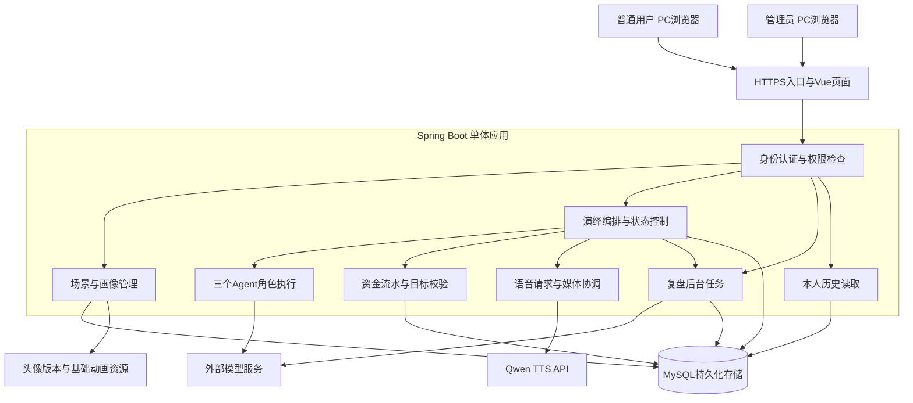
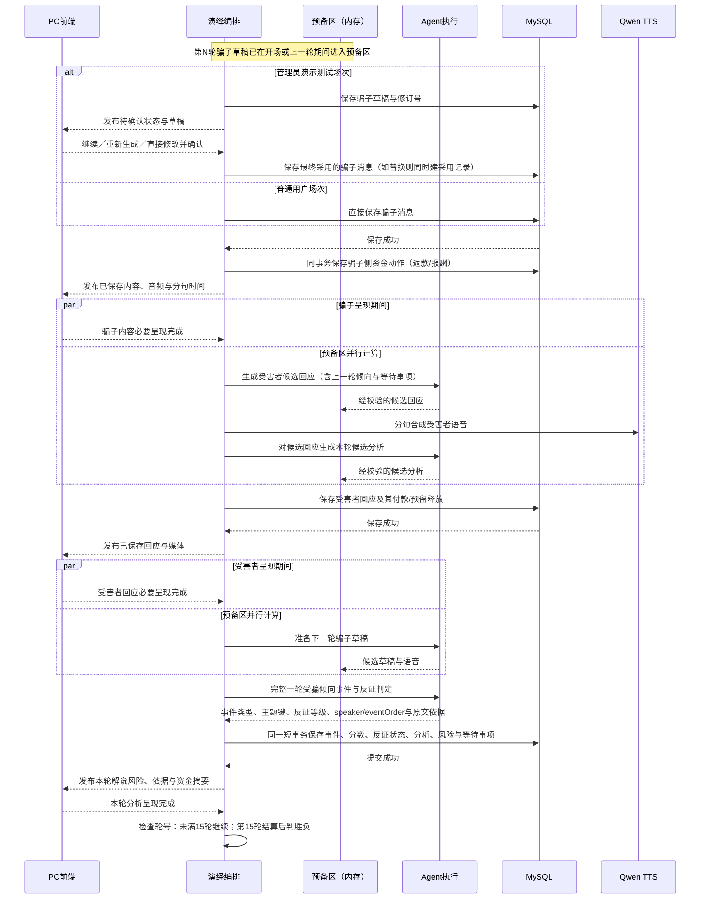
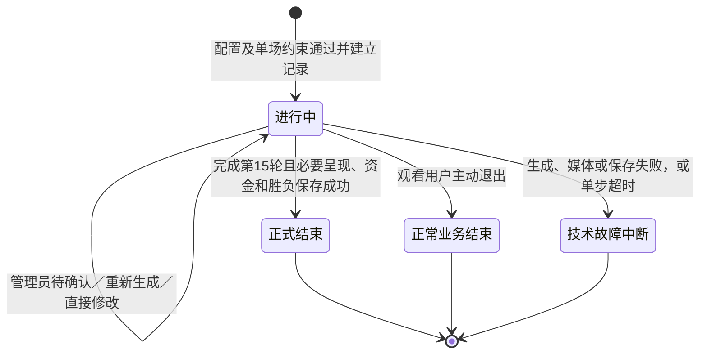
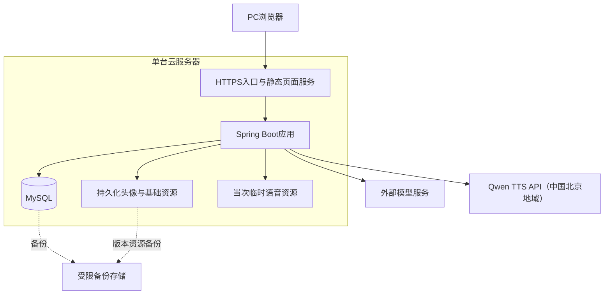

# AI反诈情景推演平台 系统架构设计文档 V1.4

> **2026-10-28 本次评审确认（适用于V3.5／V1.4）：**①采纳D6：管理员在启用前人工确认规则不冲突，程序不做自动语义优先级裁决；全部启用规则按`version_no DESC, id ASC`冻结注入，固定业务规则和已保存事实优先，运行时不因规则冲突暂停、中断或等待管理员。②主动退出至少有一个经服务端确认的完整轮才生成报告；没有完整轮时仅保留过程，提示“未形成可复盘内容”，无报告、无报告重试；已有完整轮后在后续半轮或待确认时退出仍生成如实报告，但不判胜负、不展示最终分。本文涉及新会话“有有效／实际对话”的报告条件均按此完整轮门槛理解。③同主题反证有新的可靠确认依据时允许PARTIAL升级CONFIRMED一次，以冻结的人物＋场景初始分减20（下限0）为目标，只降不升；同档重复、请求重试或降档不重复扣分，升级不解除限制。④D9：观看者在实时逐轮解说三栏卡中可见真实`trustChange`（变化量、轮初分→轮末分、趋势），骗子和受害者不可见；实时使用`methodShort`/`intentShort`，复盘报告和历史详情继续使用完整`methodAnalysis`/`speechAnalysis`。旧会话和旧报告仍按当时规则读取；本文确认不表示代码已实现。

> **2026-10-28 同步（V1.4）：**按PRD V3.5同步固定15轮、胜负判定、受骗倾向分、魔法球与场景知识库——取消600秒业务上限与5轮／20轮双上限，第15轮结束后按最终受骗倾向分与实际净损失判定骗子胜／受害者胜；信任分更名为受骗倾向分，改为完整一轮结束后结算、下一轮生效，付款门槛40／70／85，反证两档降至初始分或初始分减20并限制正向加分；新增演绎页待确认门、魔法球草稿、已采用干预、待入库记录、规则归纳提交、规则快照与后台规则维护；新增管理员本人演示测试场次权限与普通用户未来本地干预边界。修改第1.1、1.3、1.4、2.3、4.1、5.1～5.3、6.1、7.1～7.4、8.2～8.5、9.1～9.6、10.1～10.4、11.1～11.6、12.1～12.3、13.1～13.2、14.4、15.1～15.5、16.1～16.9节及附录A、B；新增第8.6节。旧会话按当时规则，不批量重写。

> **V1.4口径确认：**最终分只在第15轮结束后随报告和历史结果展示；待确认刷新按主动退出，不恢复审阅；场景规则只合并不拆分，一条来源只归一条规则；后台按`ruleId`查询本人来源。

> **2026-10-22 需求方确认：**第三位受害者改为66岁老年男性周国良（退休会计），同步当前头像、家庭关系和三套场景资料；历史快照仍保留原周桂兰。通过追加 V14 更新当前种子，不改已执行迁移。

> **2026-10-24 同步（V1.3）：**按PRD V3.4同步信任分、信息边界与停滞治理——后台信任分与事件计分（骗子本轮事件在受害者回应前生效，新增一次事件判定调用）、九组初始分与正负向系数、行动门槛与金额边界、普通／应急预留分层、独立报酬与300元共用出款上限、等待事项与材料状态、来源收窄的双方可见信息、正常业务结束报告范围、第1至4轮决定性反证例外、信任分机制管理入口。修改第1.1、2.3、4.1、7.1～7.3、8.2～8.5、9.2～9.4、10.2、11.1、12.2、13.2、15.1、16.4节及附录A。旧会话按当时规则，不批量重写。

| 文档信息 | 内容 |
|---|---|
| 产品名称 | AI反诈情景推演平台 |
| 文档版本 | V1.4 |
| 编制日期 | 2026年10月14日 |
| 业务基线 | 《AI反诈情景推演平台 PRD V3.5 正式开发基线版》 |
| 设计状态 | 总体架构方案已确认；本版用于实现设计与评审，技术验证尚未执行 |
| 最近修订 | 2026-10-28（V1.4）：按PRD V3.5同步固定15轮与胜负判定、受骗倾向分及完整一轮结算、付款门槛40／70／85、反证两档与成立状态、魔法球待确认门、已采用干预与待入库记录、场景规则归纳提交与规则快照、管理员演示测试场次和普通用户未来本地干预边界；取消600秒业务上限与5轮／20轮双上限；新增第8.6节、第9.7节。2026-10-24（V1.3）：按PRD V3.4补充信任分与事件计分、行动门槛与金额边界、预留分层、报酬与净损失、等待事项与外部反馈、信息边界收紧、正常业务结束报告范围、决定性反证例外和信任分机制管理；新增第8.5节。2026-10-21（V1.2补充）：按返款规则补充——刷单/投资实际返款每场≤300且≤累计支付，单笔≤原付款，借款无返款；骗子可声称大额返款但声称不入账、实际≤声称并尽量少；预留释放累计≤预留总额；资金不足按可用余额＋可释放预留判断；同步第8.4节。2026-10-20（V1.2）：按PRD V3.3同步画像、资金、结果、复盘与语音——受害者基础事实＋三套场景资料、骗子三档能力与信息边界、逐笔资金流水与本场余额、三类正式结果与提前终止、精简报告v2与旧报告兼容、风险颜色与历史滚动、本地CosyVoice替换为Qwen-Audio-3.1-TTS-Flash；修改第1.1～1.4、2.1～2.3、3.1～3.2、4.1～4.2、5.1～5.2、7.1～7.3、8.1～8.4、9.1～9.6、10.2～10.4、11.1～11.5、12.1～12.3、13.3～13.5、14.1～14.3、15.1～15.5、16.3～16.9节及附录A、B。2026-10-18（V1.1）：按PRD V3.2同步情景演绎演出层——演绎页开始计时、场景介绍＋人物卡开场、半身立绘两帧、服务端预备区流水线、分句同步、设置暂停停表（累计计入≤300秒）、最低5轮预检、自部署CosyVoice与音色映射；新增第16章 |
| 适用阶段 | 传智杯参赛项目 MVP，受控演示与内部试用 |
| 适用读者 | 项目负责人、前后端开发人员、测试与部署人员 |
| 实施条件 | 三人小组，主要开发工作由一人承担；约三周开发期，目标在11月初完成 |
| 技术基础 | Spring Boot、Vue、MySQL；外部模型与Qwen-Audio-3.1-TTS-Flash语音合成API；云部署为本次交付内容 |
| 文档边界 | 规定系统职责、协作、状态、数据流、部署及验证要求；不规定数据库表字段、接口参数、详细 Prompt 或代码 |

## 文档摘要

系统采用 Vue 前端、Spring Boot 模块化单体后端和 MySQL 关系型存储。后端集中编排骗子、受害者和解说三个 Agent，协调逐轮生成、待确认干预、可靠保存、人物动画、角色语音、风险分析、资金流水与结果确认。完成15轮后，由后台任务基于已保存过程生成简洁复盘报告，历史页面读取同一份过程、风险、受骗倾向、资金事实、胜负与过程事实。

核心设计约束是：**先保存再正式展示，按轮次推进，必要呈现完成后才能确认正式结束。** V1.1起，后续内容可在服务端预备区提前计算，但在轮到呈现前不落库、不下发（第16章）。V1.2起，骗子掌握受害者公开资料但不读取内部心理或解说结论；受害者不知道自己处于演绎中；付款、返款、亏损和追加次数按固定规则保存与判断。V1.3起，后台另维护一套受骗倾向分（原信任分）：AI在完整一轮结束后识别事件并给出原文依据，程序按固定基础值和人物系数结算，分数只决定某笔资金行动是否可以考虑，是否真的付款仍由人物表现和程序校验共同决定；角色上下文不包含分数、阈值或事件明细，观看者在实时三栏解说中只看到程序投影的真实`trustChange`和前后分，第15轮结束后报告和历史结果仅展示最终分与净损失。V1.4起，正常演绎固定15轮，第15轮结束后按最终分值与实际净损失判定胜负；管理员本人演示测试场次增加待确认门与魔法球，只有最终采用的骗子台词才落库并影响受害者、计分和资金；场景规则只进入之后新开的同场景场次。模型负责生成角色行为、短解说文案和分析判定，应用程序负责权限、轮次、持久化、资金校验、规则快照与状态转换。模型输出、前端回执和网络连接状态都不能单独决定演绎成功。

首期按 PC 浏览器、约3场同时演绎进行验证，优先验证 Chrome 和 Edge。该规模是技术验证目标，不构成新增的平台人数上限。模型优先验证 DeepSeek Flash；语音合成采用 Qwen-Audio-3.1-TTS-Flash（模型标识`qwen-audio-3.1-tts-flash`，中国北京地域），模型版本、音色、调用预算和服务器规格仍需实测。系统不承诺未经验证的性能或可用性指标。

## 目录

1. 设计基线与范围
2. 架构概述与系统边界
3. 技术架构与选型依据
4. 系统模块及责任边界
5. 前端与媒体呈现架构
6. 后端会话与任务架构
7. 三 Agent 协作架构
8. 风险、资金与结果处理
9. 核心业务流程架构
10. 数据流与保存一致性
11. 状态管理与时间控制
12. 复盘与历史架构
13. 安全与权限架构
14. 部署与运行架构
15. 性能异常与验证计划
16. 情景演绎演出层架构（V1.1新增，V1.2修订）

附录A 需求追踪矩阵  
附录B 架构决策记录  
附录C 参考资料

## 1 设计基线与范围

### 1.1 输入效力

PRD V3.5 是唯一业务需求基线。页面草图及批注用于辅助理解页面区域、操作顺序和模块关系，不得恢复 PRD 已取消或排除的能力。本文承接已确认的架构方向；出现新的业务歧义或范围变化时，应按 PRD 第5.4节处理，不能以技术默认值修改业务规则。

本文引用 PRD 原有需求编号。实施条件使用 C-01 至 C-06 标识；架构决策使用 AD 编号；待验证技术事项使用 V 编号。这些编号用于追踪，不取代 PRD 需求编号。

### 1.2 已确认实施条件

| 编号 | 实施条件 | 设计影响 |
|---|---|---|
| C-01 | MVP用于受控演示和内部试用，只支持PC浏览器 | 不建设移动端专用交互；明确浏览器验收范围 |
| C-02 | 三人小组，主要由一人开发；熟悉Spring Boot、Vue、MySQL | 沿用已有技术能力，集中部署与调试 |
| C-03 | 约三周开发期，目标在11月初完成 | 首周验证完整演绎主链路和云环境，避免末期首次集成 |
| C-04 | 暂按最多约3人同时演绎考虑 | 以3场活动演绎为容量验证场景，不新增业务人数限制 |
| C-05 | 允许外部模型；语音合成采用Qwen-Audio-3.1-TTS-Flash（模型标识`qwen-audio-3.1-tts-flash`，中国北京地域），质量优先并控制成本 | 不自建模型训练；语音经受控外部API调用，不部署本地推理集群；测量合成速度、分句时间与费用 |
| C-06 | 云部署与公网访问为本次交付内容，尚无服务器 | 采用单机部署起点，提前验证网络、证书与外部依赖 |

### 1.3 MVP交付边界

本期交付普通用户注册与双方共用登录、首页、场景画像配置、AI情景演绎、分析复盘、本人历史和管理后台七个模块。固定三个诈骗场景，初始两个骗子画像、三个受害者画像；每名受害者包含基础事实和三套场景资料，管理员可以扩充画像。用户选择配置并观看，不代替角色输入对话。管理员另有本人“演示测试模式”，在同一演绎页使用魔法球当场干预并归纳场景规则。

本期不提供 AI反向、优秀对局训练、用户画像投稿或调节、雷达图、用户能力测评、真实资讯加载、独立环境选择、通用RAG／向量检索知识库、独立流程或策略库、独立评分体系、亲友智能体、真实图片生成或识别、中断后续演、倍速、音视频回放、历史删除导出分享、账号角色切换或管理员用户管理。演绎进行中的设置暂停与继续自V1.1纳入本期（PRD BR-P13）；资金约束与正常业务结束自V1.2纳入本期（PRD BR-P14、BR-P04）；受骗倾向分与付款门槛自V1.3纳入本期（PRD BR-P15）；固定15轮、胜负判定、魔法球与场景知识库自V1.4纳入本期（PRD BR-P17～19）。普通用户使用魔法球为未来能力，本期不开放。

首页保留项目介绍和有效体验入口，资讯区域明确显示空状态。场景仅允许管理员编辑固定三项的名称和简介；画像支持新增、编辑、停用和重新启用，不永久删除。管理员不具备普通用户体验权限，也不得访问任何普通用户演绎或报告；本人演示测试场次是唯一例外，且只限本人。

**依据：**SCP-01～07、PER-01～06、FR-HOME、FR-CFG、FR-ADM、FUT-01～03。

### 1.4 设计目标与完成判据

| 设计目标 | 必须成立的结果 | 主要验收 |
|---|---|---|
| 演绎可控 | 同账号单场活动、固定15轮、完成第15轮才判胜负；取消600秒业务上限；设置暂停不累计计时 | AP-04、AP-05、AP-10、AP-11、AP-17 |
| 媒体与内容一致 | 角色可辨、字声一致、语音顺序不重叠、逐轮解说 | AC-13、AC-14 |
| 事实与判断一致 | 五档风险、受骗行为、受骗倾向、资金亏损、胜负与过程事实分别表达，报告不改判 | AP-01、AP-03、AP-12、AP-20 |
| 资金可核验 | 本场余额、逐笔支付／本金退回／报酬、实际净损失、三类预留和追加次数一致；付款不超余额和70／85门槛，不凭空补钱 | AC-31、AP-12、AC-40 |
| 保存真实 | 未保存内容不正式展示，部分失败不伪装为全部成功 | AP-02、AP-06 |
| 历史稳定 | 当时完整配置、风险、资金与已完成报告不受后台修改影响；旧记录按当时规则展示 | AP-06、AP-07、AC-34 |
| 权限完整 | 本人数据隔离；管理员无用户内容访问能力 | AC-03～05 |
| 可部署可演示 | 云端完整流程可用，并按需完成关键场景和故障验证 | C-04、C-06、AP-09 |

## 2 架构概述与系统边界

### 2.1 整体结构

图中连接表示逻辑关系，不表示所有角色均有相应权限。所有普通操作、媒体访问和实时订阅都经过身份及归属检查。管理员只能进入基础内容维护分支。资金校验属于编排内的固定业务规则，不是独立服务或策略系统。

### 2.2 系统负责的事项

系统负责管理本次演绎的配置、上下文、调用顺序、保存顺序、呈现反馈、15轮、唯一胜负、资金流水与余额、报告任务和历史归属。前端负责可见呈现与实际播放反馈，后端负责业务状态和数据事实。

外部模型提供角色内容与分析候选，Qwen-Audio-3.1-TTS-Flash合成已确定的角色台词（动作说明不合成）。外部服务不拥有本系统的用户权限、会话生命周期、资金余额或正式结束决定权。模拟行动只存在于文本与演绎状态中，不连接真实转账、验证码获取、账号控制或其他现实执行工具；资金流水仅为教学模拟记录。

### 2.3 架构不变量

1. 同一用户同时只有一场活动演绎；重复开始不能替换既有记录。管理员本人演示测试场次同样受单场活动限制，并只能由本人访问。
2. 每段完整对话、每轮解说、风险、受骗倾向事件、已采用干预和资金流水在可靠保存后才能正式展示。
3. 一轮由骗子一次发言或行动与受害者一次回应组成，解说不另计轮。
4. 生成完成、保存完成、媒体完成、资金落库和正式结束是不同事实。
5. 正式结束、主动退出的正常业务结束和技术故障中断均为不可逆的演绎终态；后续迟到结果不得复活任务。
6. 正常演绎固定15轮；完成第15轮并结算后才形成唯一胜负，报告和历史共同引用。受骗行为、实际净损失、当前风险、受骗倾向状态、胜负和过程事实分别表达。
7. 技术故障中断不生成报告；主动退出只有在服务端确认至少一个完整轮时才生成如实报告，没有完整轮时不生成、不开放重试；两者均不续演、不自动重开。
8. 画像、场景、头像、40／70／85阈值和场景规则后续变更不得改写本次或历史配置；规则快照在开始时冻结，只影响之后新开的场次。
9. 服务端预备区内容在轮到呈现前不落库、不下发；技术故障中断、正常业务结束、正式结束或重启时丢弃（V1.1）。
10. 第1至14轮不形成提前结束的正式结果；分值达到80、付款、反证、资金不足、拒绝付款或场景关键目标参考均不结束演绎；第15轮完成才按最终分值与净损失判胜负（V1.4）。
11. 付款不得超出本场可用余额和70／85付款门槛，不得凭空补钱；实际净损失、追加次数和资金事实以已保存的逐笔流水为准（V1.4）。
12. 旧会话按当时规则版本展示旧结果、旧资金口径和旧报告，不批量重写；新会话使用V3.5胜负与报告结构（V1.4）。
13. 受骗倾向分由程序结算，不进入角色上下文或正文日志；骗子和受害者不可见分数、阈值、系数和事件明细；观看者在实时逐轮解说中可见程序投影的真实变化量和前后分（`trustChange`），但看不到事件明细；第15轮结束后报告和历史结果仅展示最终分与净损失；AI不能直接给出总分（V1.4／D9）。
14. 同一受骗倾向事件只计分一次；被拒绝的候选回应、重新生成的回应和重试不产生重复计分、重复付款或无效事实（V1.4）。
15. 受骗倾向分在完整一轮结束后结算；本轮使用上一轮已保存分值，新分值从下一轮生效，不得先付款再补分（V1.4）。
16. 魔法球未确认草稿不属于正式消息，不影响受害者、计分、资金或报告；只有最终采用版本落库（V1.4）。
17. 场景规则按场景生效，只进入之后新开的同场景场次；进行中场次读取开始时的规则快照（V1.4）。

**依据：**AGT-04、BR-P02～08、BR-P10、BR-P14～19、DATA-03～05、AC-31、AC-35、AC-40、AC-42、AC-45、AC-47。

## 3 技术架构与选型依据

### 3.1 已确认技术方向

| 层次 | 设计选择 | 选择依据 |
|---|---|---|
| 前端应用 | Vue，集中实现用户页和管理员页的角色分流 | C-01、C-02、FR-AUTH-03 |
| 后端应用 | Spring Boot模块化单体，采用Spring MVC处理Web交互 | C-02、C-03；降低开发与部署成本 |
| 实时更新 | 普通HTTP操作配合SSE推送 | 观看模式以下行为主；FR-SIM、SCP-05 |
| 任务执行 | 后端受控异步任务，关键业务、资金流水与任务状态保存在MySQL | BR-P06～08、BR-P14 |
| 业务存储 | 一个MySQL数据库，业务上区分对象及归属；资金流水与轮次摘要同事务保存 | DATA-01～04、PRD第12.3节 |
| 模型能力 | 外部模型调用，优先验证DeepSeek Flash | C-05、AGT-01～04 |
| 语音能力 | Qwen-Audio-3.1-TTS-Flash（`qwen-audio-3.1-tts-flash`，中国北京地域）；按画像性别与年龄段映射预设音色，双方可区分且同场固定；分句合成，目标输出MP3及分句时间，最终格式经V-09/TBD-07确认 | C-05、FR-SIM-04、PC-P04 |
| 人物呈现 | 半身立绘闭嘴／张嘴两帧与通用基础待机／说话动画；场景介绍为按场景代码映射的预制动画 | FR-SIM-01、FR-SIM-03、PC-P02、PC-P04、PC-P06 |
| 部署 | 单台云服务器起步，外部使用模型服务和Qwen TTS API；不再部署本地CosyVoice推理实例 | C-03、C-04、C-06 |

Spring MVC官方文档提供异步请求与SSE支持，采用该方式不要求将应用整体改为响应式技术栈。[Spring官方说明](https://docs.spring.io/spring-framework/reference/web/webmvc/mvc-ann-async.html)。具体框架、JDK、数据库与依赖版本在实施前选取相容且受支持的组合，并锁定版本；本版不猜测团队现有版本。

### 3.2 模型与语音选型状态

DeepSeek官方当前文档将`deepseek-flash`对应到DeepSeek-V4.1-Flash；旧的V4-Flash名称仍兼容，但会路由到新版。[DeepSeek官方说明](https://api-docs.deepseek.com/quick_start/pricing/)。本项目将DeepSeek Flash列为优先验证候选，部署时记录实际模型标识与调用配置，不能将兼容别名当作版本固定保证。

三个角色可先使用同一模型，通过不同职责与上下文组织实现分工。报告也可复用该模型能力，但使用独立的总结任务。若人物一致性、分析质量或耗时不达标，依据对比结果调整选型，而非直接增加多模型路由系统。

V1.2起语音合成改用Qwen-Audio-3.1-TTS-Flash（模型标识`qwen-audio-3.1-tts-flash`，中国北京地域），经受控后端调用，不再本地部署CosyVoice推理实例。具体音色、参数、音频格式和分句时间获取方式经V-09实测确定；预设音色在开发验收阶段由需求方试听，重点检查中老年听感。音色映射与分句同步见第16.3、16.8节。验收关注中文自然度、双方声音可辨、字声一致、短句响应、合成实时率、可识别的播放完成与失败，以及调用成本。静音时仍保持相同文本与动画流程，不因此取消风险分析或改变演绎规则。

### 3.3 MVP复杂度控制

本期不引入微服务、服务注册中心、独立消息中间件、Redis集群、专用Agent平台、模型训练流水线或额外知识库。现有需求可由应用内模块、受控任务执行和MySQL持久化状态承担。

这些取舍不削减权限、校验、事务、失败处理和媒体能力。若后续容量证据表明必须拆分，应针对实际瓶颈调整部署或任务执行方式，不预建未被MVP需要的设施。

## 4 系统模块及责任边界

### 4.1 模块责任矩阵

| 模块 | 主要职责 | 不得承担的职责 | 追踪依据 |
|---|---|---|---|
| 身份与权限 | 注册、共用登录、固定角色分流、本人归属检查 | 管理员自助注册、用户管理、角色切换 | FR-AUTH、PER、BR-P11 |
| 基础内容 | 三场景文案、双方画像详情及可用性、受害者基础事实与三套场景资料、头像版本 | 用户私人画像、场景目标编辑、独立环境选择 | FR-CFG、FR-ADM、BR-P09 |
| 演绎编排 | 创建会话、固定15轮推进、保存与媒体协调、待确认门、终态控制 | 凭风险分数或余额另行推断结果，或提前宣布胜负 | FR-SIM、BR-P02～06、BR-P17 |
| 资金与目标 | 按画像初始化可用资金与普通／应急预留，记录逐笔支付／本金退回／报酬／预留释放，维护余额、净损失、三类预留、追加次数，按上一轮受骗倾向分与70／85门槛校验付款资格；场景关键目标只作复盘参考 | 形成独立评分体系、允许超余额或越过门槛支付、凭空补钱、按关键目标提前结束 | BR-P03、BR-P14～15、DATA-03 |
| 受骗倾向 | 完整一轮后识别事件、结算分数、处理反证降分与反证成立状态；冻结阈值和参数 | 向角色或用户展示分数，或由模型直接写总分 | BR-P15、AC-35、AC-43 |
| 干预与规则 | 保存待确认草稿、已采用干预和待入库记录；归纳提交场景规则；冻结规则快照 | 让未确认草稿生效、创造实际资金事实、让规则改写历史场次 | BR-P18～19、FR-SIM-10、FR-ADM-06～08 |
| Agent执行 | 按角色构造上下文、调用模型、校验内容及分析结果；骗子只读受害者公开资料和规则快照 | 自行操作数据库、授权用户、无限循环或读取内部心理／解说结论 | AGT-01～04 |
| 媒体协调 | 语音合成请求、音色映射、分句时间、临时音频访问、播放顺序与失败上报 | 永久媒体回放、情绪动作增强 | PC-P04、BR-P08 |
| 复盘 | 正式结束后生成和保存报告，控制重复任务与手动重试；按报告结构版本读取 | 重跑演绎、重评风险、改写成功报告 | FR-REV、BR-P07 |
| 历史 | 读取本人快照、已保存过程、风险、资金、结果和报告；旧记录按当时规则 | 读取他人数据、恢复演绎、导出分享 | FR-HIS、PER-01、BR-P10 |
| 运行支持 | 配置、受限诊断、任务状态检查、备份与部署 | 提供应用管理员浏览用户正文的旁路 | UX-02、UX-04、C-06 |

### 4.2 调用与写入责任

演绎过程状态由编排模块统一写入；资金与目标模块在同一事务内保存流水和轮次摘要；受骗倾向模块在完整一轮后保存事件与分数；干预与规则模块保存草稿、采用记录和规则快照。其他模块提供结果或发出失败信号。Agent执行模块不直接宣布正式结束、不直接修改余额，媒体模块不根据播放完成创建报告，历史模块不触发重新评分。

复盘模块管理报告生命周期，但只能读取已完成15轮或主动退出演绎的固定事实集。正式结束与报告任务建立关联后，报告失败不会回写演绎为中断。技术故障中断，以及只有开场、未确认草稿或无完整轮的半轮结束不创建报告任务；主动退出的正常业务结束只有在服务端确认至少一个完整轮时才创建报告任务，历史只展示已保存过程。

各模块可在同一应用内采用清晰的服务边界，不要求创建独立部署单元。复杂度应集中在真实业务规则与状态协作上，而非重复抽象和远程调用。

## 5 前端与媒体呈现架构

### 5.1 页面组织与状态归属

Vue前端按登录注册、首页、配置、演绎、复盘、历史和后台组织页面。登录成功后按服务端确认的固定角色进入首页或后台；隐藏导航不能代替服务端权限检查。

前端仅维护选中项、声音开关、当前呈现位置和加载反馈等展示状态。演绎归属、正式轮次、风险、资金摘要、胜负、过程状态和报告完成状态以服务端保存结果为准。浏览器本地状态不得成为历史记录来源。

配置页展示双方完整画像。开始时重新检查可用性，已被停用的画像必须要求重选，不能静默替换。场景年龄侧重不限制受害者选择，也不改变所选身份、年龄、防骗意识或当前场景资料；受害者详情按所选场景展示基础事实、决策特点和经历，不展示教学设计标签。

### 5.2 内容发布与播放顺序

前端收到已保存的完整角色内容后，按骗子、受害者顺序显示文字并播放对应语音。动画由同一呈现控制器切换待机与说话状态，避免文字、声音和角色高亮各自推进。双方语音不得重叠。

“实时”指逐段、逐轮及时发布已保存内容，不把未经保存的模型逐字输出直接当作正式对话。生成等待使用等待状态表达，不补造台词、风险数值或资金流水。

受害者回应完成后呈现该轮解说、风险与依据；解说仅使用文字。对话和分析区视觉上区分，未评分显示“尚未评分”。下一轮不得越过本轮必要媒体、分析展示和阅读停留。资金变化只通过动作说明和复盘／历史体现，舞台不新增独立资金面板。舞台、气泡、分句同步、解说保留与设置暂停的前端架构见第16.2～16.7节。

### 5.3 呈现反馈

前端向后端反馈当前内容的实际呈现进度与媒体结果。后端检查反馈是否来自本次演绎的本人、是否对应当前阶段、是否重复或过期，再将其用于推进。前端不能自行提交胜负或资金变化来代替服务端确认。

播放完成事件和动画组件状态用于确认技术呈现，不声称证明用户实际阅读或理解。音频下载成功不等于播放完成；语音生成成功也不等于浏览器能够播放。

静音采用静音播放或等效的同一媒体时间轴，使文字、说话状态、风险与停留按正常顺序推进。浏览器自动播放策略、静音切换和后台行为必须通过V-03验证，不能假定不同设备具有相同行为。

### 5.4 退出与连接管理

主动页面导航、刷新和关闭按PRD进入正常业务结束处理；切换标签页不主动结束，也不改变轮次或胜负。打开设置界面属于设置暂停（第16.7节），不属于离开页面。浏览器关闭通知不是可靠的唯一依据，后台动画回调也可能受限制。[MDN页面关闭说明](https://developer.mozilla.org/en-US/docs/Web/API/Window/pagehide_event)、[MDN后台页面说明](https://developer.mozilla.org/en-US/docs/Web/API/Page_Visibility_API)。

前端退出通知、连接存活检查、服务端任务超时与持久化任务核对共同用于收敛状态。不能把一次页面隐藏事件或单次心跳延迟直接等同于用户退出。浏览器连接恢复只可核对当前状态和已保存内容，不能恢复已经结束或技术故障中断的演绎。

本版不设600秒业务截止时间，前端没有“到时即结束”的业务时钟；单步生成、语音合成、保存和媒体播放仍设技术超时。技术超时按中断处理，不形成胜负。完全失联或设备挂起造成的可见状态延迟属于必须明确验证的技术边界。

**依据：**FR-CFG-03～04、FR-SIM-01～07、PC-P04、UX-01～07、BR-P05～06、BR-P14。

## 6 后端会话与任务架构

### 6.1 Session生命周期

Session表示一个用户以一组固定配置开始的一次演绎。创建时将身份、配置校验和单场活动约束作为一个一致性边界处理，防止双击、多个标签页或重复请求产生并行演绎。

“单场约束”必须在服务端成立，不能只依赖前端按钮禁用。单实例下的进程锁可以辅助执行，但不能成为唯一事实依据；应用重启后仍需依据持久化状态辨认尚未收敛的会话。

每场演绎按因果顺序执行下一步，同场不允许多个任务同时争抢下一轮。不同用户的演绎可并发推进。任务进入外部调用、保存或媒体等待前都检查当前终态、轮次和待确认状态；返回时再次检查，避免迟到结果继续执行。本版不按600秒业务预算终止会话，但单步调用和媒体等待仍受技术超时保护。

### 6.2 异步执行与事务边界

创建及控制请求不占用一个HTTP请求等待整场演绎结束。编排任务在后端受控执行，前端通过状态推送获得进度。等待模型、TTS、媒体反馈和阅读停留时，不持有长时间数据库事务，也不独占用于轮次调度的执行能力。

写入采用短事务完成当前业务动作。对话保存、同轮分析保存、资金流水与轮次摘要保存、胜负确认、报告保存分别具有明确成功边界。外部服务调用不能加入本地数据库事务并被假定可以一起回滚。

演绎任务、报告任务和单步超时检查需要有明确的执行资源边界，避免慢报告占满所有执行机会，导致正在演绎的会话无法推进或收敛。具体并发数与任务等待配置通过按需并发验证确定，不凭人数直接推算固定线程数，也不默认执行大规模组合或反复测试。

### 6.3 终态与迟到结果

正式结束（第15轮判胜负）、主动退出的正常业务结束和技术故障中断的转换需要原子检查，只有仍处于允许阶段的会话才能完成转换。同一结束操作重复到达时返回既有结果，不产生第二份胜负或第二个报告任务。

任务取消同时包含“停止后续推进”和“尝试取消正在执行的外部请求”。供应商不一定能够撤回已发出的计算或费用，因此必须拒绝迟到响应覆盖已保存内容、资金流水或改变终态，不能把取消请求发出视为已成功取消。

### 6.4 重启与失联收敛

服务重启后首先核对持久化过程和任务状态。已正式结束或主动退出的演绎保留原结果；未结束且执行上下文已经丢失的演绎按故障中断收敛，不从某一轮恢复演出。已保存部分保持本人可见。

报告任务按自身状态核对：尚未执行的持久任务可正常领取；已执行但失去可靠完成证据的任务应核对实际报告保存结果，不能仅因等待过久就启动第二个生成任务。若无法确认原任务仍可完成，安全终止该次尝试并标为失败，供用户手动重试。旧尝试的迟到结果不得覆盖新尝试或成功报告。

**依据：**BR-P06～08、BR-P14、DATA-03～04、AP-05～06。

## 7 三 Agent 协作架构

### 7.1 职责与上下文

| 角色 | 主要上下文 | 主要产出 | 必须限制的行为 |
|---|---|---|---|
| 骗子Agent | 本次诈骗类型、本人画像及三项能力、受害者公开资料（公开职业与身份、接触经历、共同经历、本次交流已披露的信息）、已发生公开互动、当前轮号、开始时的场景规则快照 | 一次台词、可选的模拟行动说明、内部意图及轻度语气提示；按规则可产生的返款或报酬行动 | 不改写基础身份，不读取解说答案、受害者内部心理、受骗倾向参数与实时受骗倾向分、精确余额与预留划分或未来内容，不超出场景合理可知范围，不自行判定系统结束或修改余额；必须保持身份、说法与历史事实连贯，响应场景规则约束，补充场景允许的模拟材料 |
| 受害者Agent | 本人基础事实与经济情况、当前场景决策特点与经历、上一轮已结算受骗倾向分转成的自然倾向、已经收到的对话与材料、等待事项的公开进展、当前可用余额、既有互动、骗子本次台词与动作说明、当前轮号（1—15） | 一次台词、必要的模拟行动说明、实际支付／预留释放、内部心理状态及轻度语气提示 | 不因场景年龄侧重更换人物，不知道自己处于演绎中，不引用尚未收到的信息、后续剧情、内部评分或行动阈值，不重复已解决的问题，不使用场景名称／风险分／解说结论，不预设必然受骗或识破，不替骗子宣告事实，不读取骗子内部意图；每轮必须回应，可以持续拒绝、核实或只表达付款意向，不被强迫重新相信或付款 |
| 解说Agent | 本次配置、规则快照、已保存互动、既有受骗事实、逐笔资金流水与余额、本场受骗倾向参数与阈值、本轮双方台词、动作说明与内部意图／心理、PRD判据 | 完整话术／手段／心理分析、2～12字手段短标签、12～40字意图短句、五档风险和依据、本轮受骗倾向事件与反证原文依据、资金事实、技术故障依据；第15轮解释由程序判定的胜负 | 不评价观看者能力，不凭分数或余额替代结果，不把承诺／准备当作已执行，不补造未完成行为；不直接给出或修改受骗倾向总分，不另判胜负，重复表达或没有新进展不得计为事件；短文案不得替代完整分析 |

每个角色使用相互隔离的调用上下文。其他用户历史、个人报告和管理员维护操作不进入当前角色上下文。角色内部意图／心理状态只供解说Agent与复盘任务使用，不进入对方角色上下文，也不向用户展示。解说具有分析所需事实，但其教学分析不自动回灌给表演角色，避免后者因预先知道分析结论而改变角色表现。

骗子长期观察受害者的预设只体现为公开资料范围：财务、消费、家庭健康、社交、出行和网络行为中与档案一致的内容；不同能力档位掌握相同范围的信息，差异只体现在理解完整度、话术自然度和对反馈的把握上。骗子不能读取受害者内部心理、解说结论或未来行为，也不能靠主动暴露骗局或说错既定事实制造能力差异。

受害者上下文不包含场景名称、场景代码、关键目标、风险分、解说结论或未来剧情；受害者按基础事实和当前场景资料行动，不知道自己处于演绎中。资金余额是受害者可感知的自身事实，但实际净损失、追加次数、累计未退回本金和场景关键目标参考不属于受害者已知信息；受骗倾向分只以“基于已知事实的自然倾向”形式出现，不出现分数、阈值或“可以转账”的提示。等待事项中已经反馈、已经满足或暂时无法取得的结果可以进入上下文，尚未发生的外部反馈不能提前出现（V1.4）。

### 7.2 调用顺序

本期采用集中编排的角色协作，原则为**落库与呈现严格顺序，计算允许流水线提前**（V1.1修订）。业务事实顺序为：骗子草稿→（管理员演示测试场次先待确认）→正式骗子内容保存并呈现→受害者回应保存并呈现→双方必要呈现完成后进入ANALYZING→整轮事件、分数、反证状态、完整分析与短解说同事务保存→本轮解说、风险与资金流水呈现→阅读停留后的下一轮；第15轮完成后判胜负（V1.4）。计算上，编排模块可在服务端预备区提前生成（第16.4节）：开场期间准备第1轮骗子草稿；待确认期间不生成受害者候选；最终骗子消息保存并进入呈现后，才准备受害者候选回应及语音；v3的最终EVENT/NARRATOR在ANALYZING阶段、事务外准备，不提前写入分数；受害者候选回应被接受后即开始准备下一轮骗子草稿。

依赖关系不变：受害者只基于已确认的骗子内容、上一轮已结算的受骗倾向状态和已收到的事实回应；下一轮骗子只基于已接受的受害者回应和规则快照；角色不读取解说结果。同场不并行生成相互依赖的同一内容，也不预先生成整场脚本来替代逐轮演绎。受骗倾向事件必须在完整一轮结束、双方必要呈现完成后，以本轮双方内容与资金事实为依据结算，不能只凭骗子解释提前加分；v3模型只输出事件类型、主题键、进展键、反证等级、speaker/eventOrder和原文依据，计分由程序执行，事件与分析同事务提交。预备内容在轮到其呈现前不落库、不下发前端；本轮完成、主动退出或技术故障中断时，预备的下一轮内容直接丢弃。未确认干预草稿在页面未刷新的SSE重连中可按服务端状态重发；页面刷新、关闭或离开按主动退出收敛，不恢复审阅，草稿也不属于正式消息。V3.5取消最低5轮预检（PRD BR-P12已废止），改为固定15轮与第15轮收束校验（第16.5节）。

### 7.3 输出校验与职责分离

模型返回内容先在应用边界校验，再进入保存和发布。校验包括角色归属、内容完整性、风险档位、分析与轮次对应、证据是否指向已有行为、资金动作是否在余额和70／85门槛内且金额／方向可追溯、受骗倾向事件是否有本轮原文依据且主题键／进展键未被计分、反证等级是否有依据，以及胜负判定与PRD规则是否明显矛盾（V1.4）。管理员干预草稿另校验：是否回应本轮问题、是否与身份／称呼／已披露事实一致、是否引入未发生的资金事实、是否包含系统提示或内部规则文本；未通过不得采用。

解说Agent负责语义分析及业务判定，应用程序负责验证固定规则、资金余额和状态转换。程序不能悄悄将不合法分数四舍五入到合法档位，也不能用另一套启发式规则覆盖已保存风险、余额或结果。模型给出不可信或无法使用的结果时，按生成失败路径处理，不以默认分数、虚构解释或补钱继续。

对模型是否能够稳定区分“承诺、准备、实际执行、停止”，以及“首笔／追加／本金退回／报酬／预留释放”，必须用PRD场景和反例评估。结构化输出能力只解决输出形式，不能替代语义正确性验证。受骗倾向事件同样如此：模型负责判断“完整一轮是否真的回应了具体疑问”“是否出现了新矛盾或反证”“反证属于哪一档”，程序负责去重、取整、封顶、反证降分和写入分数；模型给出的总分或分值变化一律不采信（V1.4）。

### 7.4 上下文与成本

每次调用只包含该角色需要的配置、规则和本场相关过程，不携带其他用户数据或无关页面信息。本期固定15轮，优先验证直接使用本场必要历史的方案；未证明需要前不引入摘要记忆服务。

若后续必须压缩上下文，不能丢失已实际受骗、当前付款与净损失、停止配合或拒绝付款、当前余额、三类预留情况、上一轮已结算受骗倾向分与未解决疑点、反证成立状态、规则快照等关键事实。模型配置变化不得重新生成历史分析或报告。技术诊断可记录实际模型及规则版本、调用耗时和用量，但不向应用管理员开放用户正文，也不记录受骗倾向分、阈值、事件明细或待入库记录正文。

**依据：**AGT-01～04、BR-P01～04、BR-P08、BR-P14、PER-01～04。

## 8 风险、资金与结果处理

### 8.1 五档风险规则

风险是受害者当前状态的教学指标，不是现实概率，不是观看用户的能力分，也不是历史受骗事实的替代值。

| 分值 | PRD规定的本轮结束状态 |
|---|---|
| 0 | 明确拒绝并停止配合，或完成独立核实后终止当前诈骗互动 |
| 25 | 仍接触但保持警惕、尚未建立信任，或暂停配合并核实 |
| 50 | 表现出信任或考虑配合，尚未承诺、准备或执行危险操作 |
| 75 | 已承诺或正在准备危险操作，尚未实际执行，也未完成有效核实 |
| 100 | 正在执行危险操作，或已经执行且仍继续配合 |

每轮依据当前行为重新定档，不累计加分、不插值、不平滑。实际行为优先于口头态度。骗子提出危险要求不代表受害者已执行；受害者后来拒绝可以降分，但不能删除此前已转账或交出账户控制权等事实。

风险初始无值，半轮不补评分。演绎、复盘折线和历史读取同一条实际风险序列；缺失值不补0，不由图表平滑生成新的业务分数。风险分不因余额、本金退回、报酬或净损失变化而调整；资金、风险和受骗倾向分分别表达，不能互相替代。

### 8.2 三场景的深度卷入参考

| 场景 | 深度卷入参考（不触发结束） |
|---|---|
| 刷单返利诈骗 | 首次垫付后至少追加1次，且“追加累计3次”或“累计实际净损失达到1000元”之一成立 |
| 虚假投资诈骗 | 已投入投资款后，又实际支付一次所谓提现、解冻等额外费用 |
| 冒充亲友借款诈骗 | 未通过独立渠道核实身份，就实际完成借款转账 |

刷单参考口径：

- 首笔垫付不计入追加次数；后续每笔实际追加投入计1次。
- 实际净损失＝累计实际付款－累计退回本金－累计到账报酬；结果不大于0时视为尚无净损失。报酬不能当作本金退回，也不冲抵追加次数。
- 首笔即净损失1000元、没有追加的，不构成“追加累计3次或净损失达到1000元”的参考，但仍是重要过程事实。
- 按本轮全部已完成行为落库后的资金情况计算；同轮先付款后到账按轮末净额计算。
- 参考值不形成正式结果、不提前结束、不改变第15轮胜负判定。
- 承诺、平台余额、未兑现收益不算实际到账；重复提及或重复记录不能重复计数。

投资和借款场景不另设金额门槛。承诺或准备不算实际完成，证据来自受害者已经完成的模拟行动和资金流水，不能只根据骗子宣称成功判断。场景名称和简介的后台修改不会更改这些参考；参考判据属于固定业务规则，不新增后台目标编辑、诈骗流程维护、独立策略管理或评分体系。

### 8.3 第15轮胜负与结束关系

| 第15轮结束时的最终状态 | 胜方 |
|---|---|
| 最终受骗倾向分≥80，无论是否付款、是否存在损失 | 骗子胜 |
| 最终受骗倾向分＜80，但实际净损失＞0 | 骗子胜 |
| 最终受骗倾向分＜80，且实际净损失＝0 | 受害者胜 |

程序检查最终分、资金流水与过程事实：

- 最终分值取第15轮结算后的受骗倾向分；曾经达到80、曾经付款或中途识破均不单独锁定胜负。
- 曾经付款后追回、净损失归零，仍可能受害者胜；报告保留曾付款和追回过程。
- 骗子胜但未发生付款时，报告不虚构损失；受害者胜时，报告不删除曾发生的受骗行为。
- 资金不足或拒绝付款不结束演绎、不自动判负；剩余轮次继续回应，第15轮收束。
- 技术故障中断是过程状态，不是胜负；主动退出的正常业务结束也没有胜负，两者在报告和历史中分别表达。
- 新会话正式结果只有骗子胜／受害者胜；旧记录中的“已受骗／已识破／超限结束／未受骗结束／结局未定”只用于V3.4及更早记录。

系统可以保存尚未形成胜负的分析和资金证据，但在第15轮必要呈现、资金落库和胜负保存完成前不能向用户宣告整场正式结束。

### 8.4 资金状态与流水

资金事实用于教学模拟，不是支付系统，也不形成独立评分或策略体系。架构按以下事实维护：

| 事实 | 维护方式 |
|---|---|
| 本场可用资金 | 开始时从受害者快照的“可立即动用资金”初始化；普通预留与应急预留都不自动计入 |
| 逐笔流水 | 每次实际支付、本金退回、到账报酬、预留释放各写入一笔流水，包含轮次、消息、方向、用途、金额、发生顺序、发生后余额；本金退回另存内部关联原付款ID（不对外） |
| 会话摘要 | 当前余额、累计支付、累计退回本金、累计到账报酬、实际净损失、两类预留各自释放额、追加次数 |
| 轮次摘要 | 本轮支付、本轮退回本金、本轮报酬、轮末余额、轮末净损失、累计追加次数；与流水同事务写入 |
| 权威来源 | 逐笔流水是权威来源；会话和轮次摘要由流水在同一事务内汇总，不得只写摘要丢失逐笔依据 |

资金校验规则：

- 付款金额必须大于0且不超过当前可用余额；不允许透支或凭空补钱。
- 付款前先按第8.5节执行付款门槛校验：付款使用上一轮已保存的受骗倾向分；小额行动、较大金额行动和应急预留分别比较该分值与冻结阈值，并同时校验本次金额和本次付款后累计未退回本金。
- 本金退回与到账报酬只增加余额，必须来自实际到账行为；承诺/声称、平台余额、未兑现收益不写入流水。骗子可声称大额返款或奖励诱导追加，但声称只是话术/内部校验字段，实际出款应尽可能少且不得超过声称。
- 退回本金与到账报酬共用每场300元总出款上限，不各有一份额度；退回本金仍须≤其关联原付款、≤累计实际支付；冒充亲友借款不安排实际还款，也不产生实际出款（可说“以后还”）。
- 预留资金按“可用资金→普通预留→应急预留”顺序释放，只在本次实际执行的付款差额不足时释放对应金额，必须有明确、可追溯的理由；两类预留各自累计释放不得超过画像对应额度，不能无依据临时增加。
- 实际净损失＝max（0，累计支付－累计退回本金－累计到账报酬）；净损失下降不回退已形成的胜负。
- 首笔垫付不计入追加次数；重复提及、重复记录或同一交易不得重复计数；跨轮复述旧付款/旧出款不产生新流水；报酬不冲抵追加次数。
- 资金不足按可用余额＋尚可释放预留判断，不是简单余额为0；某次拟付款不足时不执行该付款，演绎不结束；余额为0但仍有可释放预留时不算资金不足。
- 付款、本金退回、报酬、预留释放和余额只由服务端写入，Agent输出和前端回执不能直接修改；管理员干预文本不能新增或放大实际出款。

**依据：**BR-C01～05、BR-P01、BR-P03～04、BR-P14～16、AGT-03、AP-01、AP-03、AP-12。

### 8.5 受骗倾向分与付款门槛（V1.3新增，V1.4修订）

受骗倾向分（原信任分）与第8.1节五档风险完全独立：风险分由解说重新定档并展示，受骗倾向分由程序在完整一轮结束后结算；骗子和受害者始终不可见，观看者在实时三栏解说中看到本轮真实变化量和前后分（`Analysis.trustChange`），但看不到事件明细；第15轮结束后报告和历史结果仅展示最终分与净损失。系统按以下方式维护：

| 事项 | 处理方式 |
|---|---|
| 初始值 | 开始演绎时从受害者快照中本场场景资料读取初始分、正向系数、负向系数和小额上限，并冻结40／70／85阈值；不在运行时由模型生成底分 |
| 事件识别 | 双方台词、动作说明、实际资金行为与本轮呈现事实完成后，在ANALYZING阶段执行一次整轮事件判定调用（复用解说角色，输出事件类型、主题键／进展键、反证等级、speaker、eventOrder和逐字引用）；不能仅凭骗子单方面解释认定说服成功，也不能在受害者回应前提前加分 |
| 计分 | 程序按普通事件基础分×对应方向系数计算单事件名义增量，按发生顺序逐个生效：从当前分加上取整后的名义增量，夹取到0—100，实际生效增量写入事件记录；同轮多事件依次生效，不先求和再统一封顶；不按轮次自动加分，付款本身不加分；反证目标使用冻结的初始分而非当前分 |
| 反证 | 有依据但仍有可验证合理解释的，降至初始分；可靠确认骗局、难以合理推翻的，降至初始分减20；同主题PARTIAL→CONFIRMED只允许一次升级，最高档位从历史重建，解除后仍保留；两档只降不升，当前分更低时保留；反证成立期间普通正向事件实际增量为0，需有效回应反证后才恢复普通计分；降分不受正负系数的普通乘法影响 |
| 时序 | 完整一轮结束后结算并保存，新分值从下一轮起影响对话、行动和付款资格；本轮已发生的付款以本轮开始时已保存的分值为准，不允许先付款再补分；v3的EVENT/NARRATOR在数据库事务外准备，事件、分数、反证状态、分析与等待事项在同一个短事务提交 |
| 去重 | 按“事件类型＋主题键＋进展键”在本场内唯一；同一笔到账及其引起的放心只算到账；同一疑点不按轮重复扣分；同一让步不能被多个事件重复计分；新的进展可形成新事件；空事件轮仍以分析保存作为结算标记 |
| 保存 | 事件判定结果与本轮分析在同一短事务写入（事件类型、主题键、进展键、基础值、系数、目标分／实际生效增量、变化前后分数、反证状态、原文依据、来源消息；分析、风险、等待事项和阶段）；同一事务更新会话分数和反证状态，`analysis.saved`在提交后发布；保存失败则事件、分数、反证状态与分析一起回滚，本轮按技术故障中断处理；旧版独立事件事务保持不变 |
| 使用 | 只在生成受害者上下文时转成“基于已知事实的自然倾向”文本，并在程序校验资金动作时比较门槛；阈值、系数和事件明细不写入角色台词、解说正文或报告正文；观看者只在实时三栏解说中读取程序投影的真实`trustChange`和前后分，事件明细不对外发布；最终分仅在FINISHED后的报告和历史结果中展示 |
| 配置 | 分场景参数随画像维护，40／70／85阈值由“受骗倾向机制管理”维护，事件基础分和“初始分减20”属于候选规则参数；都只影响新开始的会话，进行中和历史会话读取启动时的冻结值；80胜负分界固定，不由管理配置修改 |
| 解说字段 | 每轮分析同时保存完整`speechAnalysis`/`methodAnalysis`（供报告和历史详情）与`methodShort`/`intentShort`（2～12字手段标签、12～40字意图句，仅实时三栏解说）；短字段不覆盖完整字段，旧记录缺失短字段时回退显示完整字段 |

付款门槛判定顺序（程序侧，V1.4）：

1. 读取上一轮已保存的受骗倾向分；本轮结算的新分尚未保存或尚未生效时，不得用于本轮付款。
2. 判定本次付款是否动用应急预留：动用则需要较大金额门槛（默认85）并核对理由，不论金额大小。
3. 否则比较本次付款金额和本次付款后累计未退回本金与小额上限：两项都不超过为小额行动（默认门槛70），任一项超过为较大金额行动（默认门槛85）。
4. 低于70不允许实际付款，可以表达付款意向；40只表示更倾向于接受身份、继续交流，不授予付款权限。
5. 需要释放预留时，按可用资金、普通预留、应急预留的顺序只释放差额；普通预留可用于符合条件的小额行动。
6. 达到门槛只表示可以考虑；是否真的执行仍由受害者回应决定。校验不通过的付款不落库，也不得先记“已付款”再补校验。
7. 已经完成的付款保留事实；后续分数下降不撤销记录，也不自动退款。口头同意但尚未付款的，按上一轮已保存分值与当前状态重新判断。

**依据：**BR-P15、BR-P14、AGT-02～03、AC-35、AC-40、AC-43、AC-44、AP-14。

### 8.6 当场干预与场景规则架构（V1.4新增）

本版在演绎页增加管理员本人演示测试场次的待确认门与魔法球，在后台增加场景知识库。它不新增Agent，也不引入通用RAG或向量检索。

| 组件 | 职责 | 不承担 |
|---|---|---|
| 待确认门 | 每轮骗子草稿生成后暂停向受害者推进；保存草稿供管理员查看；接受继续、重新生成、直接修改和确认；请求必须携带草稿ID与期望修订号 | 让未确认草稿进入正式消息、计分、资金或报告；接受旧轮或旧修订 |
| 干预草稿 | 保存原台词、当前版本、干预要求、修订次数和场景；可覆盖为最新草稿 | 保存每次未采用的重写版本，或成为历史对话 |
| 采用记录 | 最终采用的干预与原台词、干预要求、最终台词、来源消息、轮次关联保存；只对发生替换的干预建记录 | 由普通用户场次产生，或自动进入知识库 |
| 待入库列表 | 按场景列出本人PENDING采用记录，支持勾选和状态；按`ruleId`可追溯本人在该规则下的LINKED来源 | 展示普通用户数据，或堆积未采用草稿；不允许拆分或复用来源 |
| 规则归纳 | 对勾选记录生成规则草稿；管理员编辑确认后提交；只合并不拆分，一条来源只归一条规则，并保留来源关联 | 自动提交、复制具体人名或余额、批量导入文档、把一条来源拆到多条规则或给已有规则追加来源 |
| 场景规则库 | 按场景保存规则正文、标题、启用状态、版本和来源关联 | 向量检索、通用知识库、按用户或按场次规则 |
| 规则快照 | 开始演绎时冻结启用规则ID、版本和正文；注入骗子提示 | 参考当前规则表动态变化，或改写已开始场次 |

**待确认门的持久化与幂等：**

- 草稿属于独立对象，不是`message`；轮次阶段增加“待确认”，受害者生成、事件判定和资金处理必须在该阶段之后。
- 同一轮重复提交“继续”或确认请求时，按同一`draftId`识别已采用事实，返回既有结果，不重复生成受害者回应或重复扣款。
- 重新生成、直接修改和确认都携带`draftId`与期望`revisionNo`；只有当前轮当前修订可被处理，旧轮草稿或旧修订返回冲突，不得应用到新一轮。
- 重新生成使用同一轮草稿的修订号递增；旧修订的迟到响应不得覆盖新草稿。
- 直接修改与重新生成都经过与正式台词相同的输出校验；未通过时保留原草稿并返回可显示的错误，不静默采用。
- 草稿、采用记录、规则提交和规则快照的保存失败按对应业务失败处理：草稿保存失败留在待确认并提示，不推进受害者；采用记录保存失败不保存正式消息；规则提交或规则快照失败返回操作错误，不改变会话终态；只有消息、分析、资金或胜负等演绎关键写入失败才按技术故障中断。

**规则注入与权限：**

- 新会话开始时按场景读取启用规则，写入规则快照并注入骗子上下文；骗子只看到规则正文，不看到来源场次、管理员身份、分数或阈值。
- 进行中的会话只读取快照；后台编辑或停用规则不改变该场，也不重写历史。
- 管理员演示测试场次由管理员本人创建并拥有，只允许本人访问；普通用户场次不出现在管理员列表，管理员不能通过规则库或待入库列表读取普通用户内容。
- 普通用户未来干预只在本人当前场次生效，不写采用记录、不进入待入库列表、不修改长期提示词；本期不开放。
- 规则不能覆盖固定业务规则、已保存事实、付款门槛、反证判断或15轮胜负；管理员在启用前人工排查冲突，运行时不自动比较语义优先级，规则冲突不导致场次暂停、中断或等待管理员。启用规则按`version_no DESC, id ASC`全部冻结并注入，排序只保证确定性，不代表跨规则优先级。

## 9 核心业务流程架构

### 9.1 开始演绎

1. 用户在配置页确认一个场景和双方各一个画像后点击“进入演绎”（不建立记录）；演绎页加载场景介绍动画与双方立绘，就绪后显示“开始演绎”。管理员从演示测试入口进入同一演绎页，创建本人测试场次。
2. 后端检查账号角色与单场活动限制、配置仍可用；普通用户走普通场次，管理员只能创建本人演示测试场次；被停用画像要求重新选择。
3. 固定当时场景与双方全部画像内容，包括头像版本、受害者基础事实、三套场景资料（本场使用所选场景）、四项受骗倾向参数、40／70／85阈值、故事时间、可用资金与普通／应急预留，以及本场场景的启用规则快照；按可用资金初始化本场余额，按本场场景资料初始化受骗倾向分，可靠建立本次过程记录。
4. 前端依次展示场景介绍动画与双方人物卡，风险显示“尚未评分”；若快照立绘与预加载资源不一致，补充加载。本版不按600秒业务时长计时。编排模块同时在预备区准备第1轮骗子草稿。
5. 编排模块进入第一轮；管理员演示测试场次在草稿完成后进入待确认，普通用户场次直接采用草稿。开始失败或记录未能可靠创建时，不宣称已经存在可回看的完整记录，也不得留下已扣款或余额不一致的记录。

重复开始只反馈既有活动情况，不替换原记录。再次体验仅在不存在另一场活动演绎的条件下创建新记录。单场活动按账号计数：普通用户账号最多一场活动演绎，管理员账号最多一场本人测试场次；两类账号互不占用名额。

### 9.2 一轮演绎的顺序

此图表示正常路径的因果顺序，不包含接口定义。每一步失败均进入对应异常处理；发布前必须确认保存成功。语音准备与资源预载的具体优化只能在不改变这些因果关系和失败规则的前提下验证。V1.1起，预备区计算与前台呈现并行（第16.4节），落库与发布的先后顺序不变。V1.4起：管理员待确认草稿不保存为`message`，确认后才保存正式骗子消息；角色消息与其资金动作在同一事务保存；受骗倾向事件在完整一轮结束后、ANALYZING阶段判定，EVENT/NARRATOR在事务外准备，事件、分数、反证状态、分析和等待事项在同一短事务提交，失败则全部回滚并按技术故障中断；事件明细不在对外SSE发布，但本轮真实`trustChange`随已保存分析一起发布。本轮分析、等待事项与分析同事务保存；余额不足、超出门槛或动作不合规时不得发布该轮资金结果。第15轮完成后不再建立第16轮。

### 9.3 正式结束与最后阅读停留

第15轮完成、双方对话与必要媒体呈现、本轮解说风险和资金流水保存后，编排模块结算本轮受骗倾向分并按第8.3节判定胜负。第1至14轮不提交正式结果，也不提前判胜负；分值达到80、付款、反证、资金不足、拒绝付款或场景关键目标参考均不形成结束。胜负、过程事实和报告待处理工作在同一一致性边界内保持一致。胜负保存成功后才正式确认结束并启动报告任务；主动退出的正常业务结束在服务端确认至少一个完整轮时才创建报告任务，没有完整轮或技术故障中断都不创建。

最后阅读停留正常为5秒，不因时间不足而缩短；本版没有600秒截止时间。正式结束确认后，最后停留期间离开页面不回退为中断。报告可以在此期间开始生成，但不得借报告等待改变已保存胜负。

第15轮必须完成收束，不追加“收尾对话”或第16轮。未满15轮且没有故障或退出时，阅读停留完成后再进入下一轮。正式结束后报告的风险曲线、净损失与三类预留说明直接引用已保存轮次与资金流水，不另行重算。

### 9.4 中断与正常业务结束

第15轮完成前发生无法继续的生成失败、语音或动画故障、保存失败、单步超时或服务重启，编排模块停止推进并取消后续任务，标记为技术故障中断。观看用户主动退出按正常业务结束处理，保留已保存过程并生成如实报告。资金不足、受害者拒绝付款或角色不想继续付款不结束演绎，不按技术故障处理，也不把剩余轮次写成无法完成。

保存已经成功的内容保留在历史中，未完成轮明确标注。没有生成的回应、解说、风险、资金流水或胜负不补造。数据库不可用时，系统只能保证既有持久内容，不应宣称中断原因本身已即时保存；存储恢复后核对并收敛未终结任务。

技术故障中断记录没有正式报告入口，也不能伪装成报告生成失败而开放重试；主动退出但只有开场或半轮时，同样不生成报告并明确说明未形成可复盘内容。用户重新体验创建新的记录，旧记录不恢复。

### 9.5 报告失败后的手动重试

用户从报告或历史页面发起重试时，后端检查本人归属、已完成15轮或带`USER_EXIT`的主动退出、报告未成功且不存在另一有效生成任务。技术故障中断与运行中不开放重试。重试使用同一份已保存过程、当时绑定的Prompt、规则版本和报告结构，不重新运行角色互动；旧失败报告仍生成旧结构，新会话按报告结构v4生成。

重复点击只关联同一个有效任务。任务完成后先保存报告，再发布完成状态；失败则显示报告失败，保留原演绎终态。成功报告不提供再次改写入口。

### 9.6 基础内容与规则维护

场景固定三项，只编辑名称和简介。画像新增或编辑必须完整有效，并具有可预览、符合格式和大小要求的头像。受害者必须同时具备基础事实（含可用资金、普通预留与应急预留）、防骗意识与风险倾向、故事时间“昨天20:00”、三套场景资料以及每套的初始受骗倾向分、正向系数、负向系数和小额上限；任一缺失不能启用，已启用后编辑也不得留下缺失。骗子三项能力可取低／中／高，能力不改变信息范围。骗子与受害者各至少保留一个可用画像；并发停用也不能使某类可用数量变为零。

40／70／85阈值由“受骗倾向机制管理”单独维护，只保存一份当前配置，写入需要版本号防止覆盖他人修改。场景规则由知识库按场景维护，编辑产生新版本，启用／停用只影响之后新开的场次。开始演绎与停用画像、阈值修改、规则修改需要在一致性边界内确定先后：若停用或修改先成立，则开始读取新值；若开始先成立并形成快照，则后续修改不影响该场。后台编辑头像时保留旧版本内容，不能覆盖历史引用。资金字段保存时校验非负整数、可用资金与两类预留之和均不大于初始存款、两类预留之和不小于0且合计等于预留合计；故事时间由系统固定，不接受管理员覆盖。

**依据：**FR-CFG-04、FR-SIM、FR-REV-05、FR-ADM、BR-P02～10、BR-P14～19、AP-02～07、AP-12、AP-19。

### 9.7 干预与规则流程（V1.4新增）

1. 骗子草稿生成后，编排模块把草稿写入待确认对象并发布待确认状态；普通用户场次跳过此步，直接采用草稿。
2. 管理员可点“继续”采用原稿，或提交干预要求重新生成，或直接修改草稿；请求携带`draftId`与期望`revisionNo`，每次操作递增草稿修订号，旧轮草稿或旧修订的迟到结果丢弃。
3. 确认时校验草稿属于当前轮当前修订，并校验内容、资金事实和角色归属；通过后保存正式骗子消息；若最终台词与原台词不同，同时保存采用记录（原台词、干预要求、最终台词、来源消息、轮次、场景）。重复确认同一草稿返回既有结果。
4. 受害者只基于最终采用的骗子消息生成回应；未确认草稿、被替换草稿和失败修订不参与受害者上下文、受骗倾向事件、资金流水或报告。
5. 采用记录进入本人待入库列表；管理员可勾选一条或多条记录请求规则归纳，系统返回规则草稿，不自动写库。本期只合并不拆分，一条来源记录只能归入一条规则。
6. 管理员编辑确认后提交场景规则；提交事务校验场景、正文、来源记录和状态，成功后记录状态改为“已关联规则”，规则默认启用；标题重复只能改名，不支持给已有规则追加来源。规则卡可按`ruleId`查询本人来源记录，返回原台词、干预要求、最终台词和来源场次。
7. 新会话开始时读取该场景启用规则并写入规则快照，注入骗子上下文；进行中的会话只读快照，后台修改或停用不影响本场。
8. 规则归纳、提交、编辑或停用失败时保留原记录和草稿，不显示为已入库；规则不能绕过固定业务规则、资金校验或反证限制。

## 10 数据流与保存一致性

### 10.1 信息责任与存储划分

本章描述业务信息及生命周期，不给出表名、字段类型、索引或接口参数。账号是身份与归属依据；场景、双方画像、演绎过程和报告在同一MySQL存储中保持清晰关系，不因共用物理数据库取消权限隔离。

| 信息 | 权威来源与用途 | 保存及变更原则 |
|---|---|---|
| 基础场景与画像 | 管理员维护，用户查看选择 | 当前内容可按PRD维护，历史快照不随之更新 |
| 当时完整配置 | 开始时固定的场景与双方画像 | 本次演绎、复盘和历史共同使用，包含头像实际版本、受害者基础事实、三套场景资料（本场使用所选场景）、本场初始受骗倾向分与正负向系数、小额上限、冻结的40／70／85阈值、场景规则快照、故事时间、可用资金与普通／应急预留安排 |
| 角色对话与行动 | 本次角色生成并校验的完整结果 | 按顺序及时保存，半轮中断仍可保留；实际支付、本金退回、到账报酬与预留释放以结构化资金动作和流水记录；未确认草稿不是正式对话 |
| 解说风险与依据 | 解说Agent依据本轮和历史事实分析 | 同轮一致保存，不由历史或报告重算；风险与资金分别表达 |
| 受骗倾向事件与分数 | 完整一轮后判定事件与反证，程序结算 | 按类型、主题键和进展键唯一，不重复计分；事件明细只在后台保留，观看者实时只读取按已保存事件投影的真实`trustChange`和前后分；第15轮结束后最终分随报告和历史结果返回（V1.4／D9） |
| 等待事项与材料 | 本场提出的要求、依据、状态与已提供材料 | 跨轮持续保存并更新状态，不每轮重建；已满足事项不再无依据重复要求（V1.3） |
| 资金流水与摘要 | 编排与资金校验模块按逐笔行为写入 | 流水是权威来源，会话和轮次摘要同事务汇总；付款不超余额和70／85门槛，不凭空补钱 |
| 胜负、过程事实、正常业务结束或技术故障中断 | 编排模块在规定条件下确认 | 第15轮完成后胜负唯一；主动退出在有完整轮时关联结束原因并生成报告，没有完整轮时不生成；技术故障中断不生成报告；均不能被迟到结果回退 |
| 当场干预与规则 | 待确认草稿、采用记录、待入库记录、规则草稿、规则快照 | 草稿不生效；采用记录只保存最终替换；规则只影响新会话；规则快照随会话冻结（V1.4） |
| 复盘报告及任务状态 | 完成15轮或主动退出后的后台任务 | 成功后不改写，失败可按规则重试；新报告v4、旧报告v1/v2/v3按结构版本读取 |
| 头像与基础动画资源 | 受控文件存储 | 头像版本长期保留以维持历史；不保存演绎媒体回放 |
| 当次语音 | Qwen TTS合成的临时资源及分句时间 | 只用于当次播放，终态后释放，不能成为历史播放入口 |
| 预备区内容（V1.1） | 编排模块提前生成的候选台词、动作说明、内部意图／心理、事件判定、语音与分析 | 仅存于服务端内存，轮到呈现时才保存并发布；正常业务结束、技术故障中断、正式结束或重启时丢弃，不进入历史 |

### 10.2 保存成功后发布

保存与推送是两个独立动作，不能假定网络推送和数据库提交具有同一个事务。设计采用“先提交业务事实，再发布”的顺序。

- 保存失败：停止推进，未保存内容不作为正式内容展示；资金动作未成功落库时，不得先展示“已付款”或更新余额；受骗倾向事件未落库时不得使用该增量继续推进下一轮（V1.4）。
- 保存成功但通知失败：保留已保存事实，核对当前会话及呈现状态；不得因此再次生成不同内容或直接推进下一轮。
- 保存返回不确定：先根据同一次操作核对持久化结果，避免盲目重写或宣布成功；单步超时按技术故障中断处理，不延长业务轮次或改判胜负。
- 重复推送或回执：按本场既定顺序识别，避免重复播放、重复计轮、重复扣款、重复计分、重复采用草稿或重复创建报告。

连接恢复可用于核对已保存事实和当前终态，但不构成中断续演或历史媒体回放。已技术故障中断的记录永远只能查看保存的文字过程、已有分析和资金摘要；主动退出的正常业务结束同样不续演，但有如实报告。

### 10.3 短事务与原子边界

建议将以下动作各自作为需要可靠一致完成的业务单元：

1. 校验单场活动限制、固定可用配置、冻结受骗倾向参数与40／70／85阈值、冻结场景规则快照、初始化资金余额并建立演绎。
2. 保存骗子草稿及其修订号；管理员确认时在同一事务切换为正式消息并保存采用记录（如发生替换）。
3. 保存一段完整角色内容、其结构化资金动作（骗子侧返款／报酬，受害者侧付款／预留释放）及对应推进位置；到账与付款在同一事务内成为持久事实，轮次资金摘要同事务汇总。
4. 完整一轮后的v3受骗倾向事件与分析同事务：在ANALYZING阶段校验事件引用、主题键／进展键、反证等级、speaker/eventOrder和分数衔接，写入事件记录、更新会话分数与反证状态，同时保存本轮解说（含完整分析、短标签与短意图）、风险、依据、等待事项及分析进度；任一失败全部回滚，本轮不推进。旧版独立事件事务保留。
5. 本轮分析事务提交后发布`analysis.saved`和真实`trustChange`；不发布事件明细、阈值或系数。
6. 确认第15轮胜负或主动退出原因；正式结束与报告待处理工作同一事务建立。
7. 领取一个有效报告尝试，或保存该尝试的成功报告与完成状态。
8. 执行画像启停、三套场景资料、四项受骗倾向参数和场景规则的完整性及最低可用数量检查。
9. 保存规则归纳草稿、提交规则及来源关联；提交失败不改变任何场次。

外部调用与媒体等待不占据这些事务。事件判定与NARRATOR调用在事务之外完成，结果只通过第4项事务落库，不能把模型调用放进数据库事务。文档不要求把整个Session放进一个长事务，也不要求跨模型供应商实现分布式事务。资金流水与轮次摘要必须在同一事务内同时提交，不能出现只写摘要不写流水或流水成功而余额未更新的正常中间态。v3事件、分数、反证状态、分析与等待事项必须同事务提交，空事件轮也以分析保存为结算标记。

### 10.4 快照与历史不变性

快照包含当时场景名称和简介、双方所有人物信息、行为参数、情境与头像内容版本；受害者快照还必须包含基础事实、三套场景资料与每套四项受骗倾向参数、故事时间、可用资金、普通／应急预留、冻结阈值和本场启用的场景规则快照。三套资料用于历史完整性与后台追溯，本场演绎只使用所选场景的一套；普通详情按当前场景展示。仅保留指向当前画像的引用不足以满足历史一致性。

会话同时固定规则版本（新`PRD-V3.5`，旧`PRD-V3.2`/`V3.3`/`V3.4`）、资金规则版本（新`funds-v3`，旧`funds-v2`/`funds-v1`）、受骗倾向规则版本（新`trust-v3`，旧`trust-v2`/`trust-v1`）、快照结构版本（新4，旧1/2/3）、报告内容结构版本（新4，旧1/2/3）和场景规则版本快照。旧快照按当时结构和默认缺失规则读取，不用当前字段值填成“当时就有”；新快照使用V1.4结构（`snapshot_schema_version=4`）。头像更新采用新资源版本，已被快照引用的内容不能覆盖。数据库与文件备份应能恢复相互对应的状态。新增画像采用相同基础动画机制，不能让新头像绕过必需的角色表现能力。

用户历史无自动到期清理和删除入口。临时语音资源的释放属于运行资源管理，不改变长期保存演绎文字、资金事实与报告的业务要求，也不能借此删除头像历史版本。旧结果、旧报告和旧Prompt不批量重写。

**依据：**DATA-01～05、BR-P08～10、BR-P14～19、PC-P05、AC-19～23、AC-31、AC-34、AC-42、AC-47。

## 11 状态管理与时间控制

### 11.1 状态维度

| 维度 | 需要表达的事实 | 状态责任 |
|---|---|---|
| 演绎过程 | 进行中、正式结束（完成15轮并判胜负）、主动退出的正常业务结束、技术故障中断 | 后端编排与持久化状态 |
| 轮内阶段 | 骗子草稿生成、待确认（仅管理员测试）、骗子呈现、受害者生成与呈现、完整一轮结算、分析呈现、阅读停留 | 后端控制，前端反馈实际呈现 |
| 内容保存 | 尚未形成完整内容、草稿、待保存、已可靠保存 | 后端保存结果 |
| 必要呈现 | 尚未发布、正在播放或展示、已完成、失败 | 前端实际事件与后端顺序校验 |
| 风险、事实与资金 | 尚未评分或五档风险、已有受骗行为、受骗倾向分与事件、逐笔流水与余额／净损失／三类预留／追加次数 | 保存的解说分析、受骗倾向事件、资金流水与原过程 |
| 胜负 | “骗子胜／受害者胜”之一，仅在第15轮完成后成立 | 唯一胜负 |
| 正常业务结束 | 观看用户主动退出，无胜负，附结束原因 | 结束原因与已保存过程 |
| 干预与规则 | 草稿待确认、已采用／未采用、待入库、已关联规则、规则启用／停用、规则快照 | 干预与规则模块；历史场次只读快照 |
| 报告 | 生成中、已完成、生成失败 | 报告模块；技术故障中断和只有开场／半轮结束不进入此生命周期 |

内部执行阶段可以细分，但不能新增用户胜负类型，不能将“已生成”显示为“已保存”，也不能把“草稿待确认”显示为“已正式发言”。

### 11.2 过程状态转换

正式结束后报告的成功或失败只改变报告状态。用户离开、重复回执、后到的模型或TTS响应均不能回退演绎终态。正常业务结束和技术故障中断都没有返回进行中的转换；两者在报告上分别处理：主动退出在服务端确认至少一个完整轮时生成如实报告，没有完整轮时显示未形成可复盘内容且不开放重试；技术故障中断不生成正式报告。资金不足、拒绝付款或角色不愿继续付款不是终态。

### 11.3 完整轮结束位置

“双方已生成文本”不足以构成完整轮结束位置。必须同时具有双方完成的互动、本轮解说和风险的保存及正常展示、必要媒体的完成证据、本轮受骗倾向事件与分数已结算，以及本轮资金动作已按流水保存（如有）。

| 情形 | 是否可作为完整轮结束位置 |
|---|---|
| 只有骗子草稿或待确认草稿 | 否，不补回应、不结算 |
| 只有骗子正式消息 | 否，不补回应或风险 |
| 双方文本已保存，但受害者语音仍在播放 | 否 |
| 双方媒体完成，但解说风险尚未保存或展示 | 否 |
| 本轮有付款／返款，但资金流水或轮次摘要尚未保存 | 否，不推进 |
| 双方内容、分析、受骗倾向结算和资金流水均完成 | 是，可据此检查轮号和胜负 |
| 第15轮完成且胜负保存，但最后阅读停留尚未结束 | 演绎保持正式结束，离开不回退 |

### 11.4 固定15轮控制

只有骗子行动和受害者回应形成的一轮才按PRD口径计轮。未完成轮保留实际内容并标注不完整，不能靠把半轮算作完成轮绕过验收。

第15轮完成后不得发起第16轮，也不再追加“收尾对话”。第15轮必须完成最终态度和资金结果；若第15轮尚未完成必要呈现或资金未落库便发生故障，按技术故障中断处理，不提前判胜负。第1至14轮不提前判胜负；分值达到80、付款、反证、资金不足、拒绝付款或场景关键目标参考都不结束演绎。

### 11.5 15轮节奏与时间控制

本版取消600秒业务截止时间，不存在“点击开始后必须在600秒内结束”的业务规则；点击起点仅用于过程记录和排查，不作为结束条件。单步生成、TTS、保存和媒体播放仍设技术超时；技术超时按中断处理，不判胜负。

每轮语音完成且解说、风险展示后停留5秒，再进入下一轮或复盘；不因总时长不足而缩短或取消停留。可以约束台词、解说长度和推进节奏，但不能用频繁中断代替正常15轮。

设置暂停只冻结演出、阅读停留与下一轮调度（第16.7节），不累计或顺延任何业务截止时间；阅读停留按暂停时长冻结，继续后从剩余停留时间恢复。暂停期间不推进轮次、不改分、不改资金，也不影响最终胜负。

### 11.6 第15轮与结束确认边界

第15轮完成且位于完整轮结束位置时，程序结算本轮受骗倾向分并读取实际净损失，按第8.3节形成唯一胜负。未完成必要内容或资金未落库时发生技术故障，显示中断原因，不生成正式报告，也不提前判胜负。

正常路径必须特别验证：第15轮证据、最终分值和资金流水可以提前准备，但不能在第15轮尚未完成时提前提交胜负；也不能等最后一刻才开始保存和跳转，却声称它们不占流程。结束提交、前端获知终态和页面切换均须纳入端到端设计与测量。

在完全断网、数据库不可用或浏览器被操作系统挂起时，单靠应用设计无法保证各端同时落库并立即显示结果。本版将“第15轮收束与保存”“待确认刷新退出”“后台与失联行为”列为V-02、V-03的交付阻断验证项。不得将其默认改成额外宽限、提前判胜负或一律中断。若实测表明无法满足PRD，必须提出具体证据并按需求变更流程处理，不能自行改口径。

**依据：**PRD第1.4、6.2、10.3～10.5节，BR-P02～06、BR-P14～19、PC-P04、AP-02～05、AP-12、AP-17。

## 12 复盘与历史架构

### 12.1 复盘输入与输出责任

复盘输入仅限本次完成15轮或主动退出的配置快照、规则快照、已保存对话、逐轮解说与风险、逐笔资金流水与净损失、三类预留剩余、最终受骗倾向分与胜负或结束原因及其依据。报告输出为：一句话胜负结果及依据、按“接触背景→诈骗推进→关键判断→最终结果”组织的400—600字过程总结、最多3个关键节点、2—3条防范建议、最终分值、实际净损失与三类预留说明，以及实际风险折线图。取消逐轮必分析和重复长篇栏目。

原始对话、轮次、风险值、资金事实、预留情况和胜负或结束原因直接引用保存数据；模型负责解释与总结。生成后的报告应校验：

- 字数在允许范围（目标400—600字，校验约300—800字），关键节点不超过3个，建议为2—3条。
- 关键节点引用的轮次和原话确实存在，不补造阶段、不凑节点。
- 胜负与最终分值、净损失一致：分≥80或净损失＞0为骗子胜；分＜80且净损失＝0为受害者胜。
- 不把“骗子胜”等同于一定发生付款，不把“受害者胜”写成从未发生风险行为；曾付款后追回照实说明。
- 付款、本金退回、到账报酬、净损失和三类预留与资金流水一致；不把承诺或平台余额写成已到账。
- 主动退出时写明结束原因和“未形成胜负结论”，不得补写胜负。
- 报告结构v4的`fundsSummary`七项（支付、退回本金、报酬、净损失、结束余额、普通预留剩余、应急预留剩余）与`winning`、`finalTrustScore`必须与流水和会话摘要逐项一致，模型不得改算。
- 不把画像表现写成观看用户能力，不暴露内部备注、过程分、阈值或事件明细；报告结果区只写最终分与净损失，不重新评分或改判结果。

报告结构使用版本号：V3.5新会话生成v4（胜负、最终分、四段总结、≤3关键节点、2～3建议、含7项资金事实的摘要）；V3.4及更早报告保持v1/v2/v3只读，按原结构展示和校验。旧失败报告重试仍使用当时绑定的Prompt、规则版本和报告结构。

### 12.2 报告任务的可靠触发

完成15轮，或主动退出且服务端确认至少一个完整轮时，与报告待处理工作在同一本地一致性边界内建立关联；技术故障中断，以及只有开场、未确认草稿或无完整轮的半轮结束不创建报告任务。后台执行器从持久状态领取工作，不依赖浏览器保持连接，也不依赖一次可能丢失的内存通知。

同一演绎同时只允许一个有效生成尝试。页面离开不取消生成；服务重启后的核对按第6.4节处理。生成完成但保存失败属于报告失败，不得显示“已完成”。本期不要求自动重试，用户手动重试时仍使用原始事实集、原Prompt和原报告结构。

### 12.3 历史读取

历史列表展示开始时间、场景、双方画像名称、演绎状态和报告状态。详情展示当时完整配置、规则快照、按顺序保存的对话与解说、逐轮风险、资金摘要与三类预留、最终胜负与过程事实或结束原因、技术故障中断情况，以及符合条件的报告入口。全部对话放在固定高度可滚动框内，默认从第1轮开始；框外保留场景、人物、最终胜负或结束原因和报告入口。历史列表和详情不展示过程分、阈值、系数或事件明细；第15轮结束后的历史结果可展示最终分与净损失，等待事项内部状态仍不展示。

风险按整轮使用彩色边条：100红、75橙、50黄、25蓝、0绿、无评分灰并标注“未评分”；已评分轮次不显示风险数值或文字标牌，正文不整体染色。颜色取本轮结束时已保存风险，缺失评分不补0。

技术故障中断记录明确说明不生成正式复盘；主动退出且服务端确认至少一个完整轮的记录显示如实报告，没有完整轮时显示未形成可复盘内容且不开放重试；半轮标注不完整。旧记录按当时规则显示旧结果名称（如“已受骗”“已识破”“超限结束”“未受骗结束”“结局未定”）和旧资金口径，不改写为新胜负。历史无记录时展示本人暂无记录，不用其他用户数据或虚构记录填充。管理员演示测试记录只显示本人场次，并可在本人记录中查看待入库干预入口。

历史阅读不调用模型补写过去的内容，不重新运行TTS，不恢复动画演出。成功报告、原风险、原资金事实不因后台配置、规则修改、模型升级或当前画像变化而更新。

**依据：**FR-REV-01～05、FR-HIS-01～03、BR-P07～08、BR-P10、BR-P14～19、PC-P05、AC-17～20、AC-31～34、AC-42。

## 13 安全与权限架构

### 13.1 身份与角色边界

普通用户和管理员共用登录入口，角色由服务端账号记录确定。注册只能建立普通用户，管理员预先开通。普通用户不得通过页面或直接请求获得管理能力，管理员也不能以管理身份进入普通用户演绎与历史功能。管理员可进入本人的“演示测试模式”，创建并观看本人测试场次、使用魔法球、查看本人待入库记录并归纳规则；该模式只允许访问本人场次，不构成访问普通用户内容的例外。

首期优先采用前后端同源部署与服务端登录会话，使用安全Cookie承载登录状态，并结合相应的跨站请求防护。具体会话参数由后续安全与接口设计确定；不在本期新增外部身份平台、短信验证、邮箱验证、密码找回或用户管理功能。

用户名按PRD去除首尾空格后校验，并在普通用户与管理员之间保持全局唯一、英文字母不分大小写。数据库默认比较规则不能未经核对直接作为完整业务校验依据。密码接受规则仍为6—24个字符、允许空格与常见弱密码，不自动去除首尾空格；安全存储采用适当的带盐密码哈希，不保存明文或可逆密码。

登录错误按PRD统一反馈账号或密码错误。传输保护、凭据安全存储和适度的滥用防护不能被当作擅自提高密码复杂度的理由。弱密码带来的剩余风险保留在交付说明中。

### 13.2 数据访问控制

| 访问对象 | 普通用户 | 管理员 |
|---|---|---|
| 可用基础场景和画像 | 可查看选择 | 可按PRD维护 |
| 本人的活动演绎及实时内容 | 可访问，受当前状态约束 | 仅本人演示测试场次可访问 |
| 本人的历史与正式报告 | 可访问 | 仅本人演示测试记录可访问 |
| 其他用户的演绎和报告 | 不可访问 | 不可访问 |
| 普通用户演绎的魔法球、待入库记录和规则 | 本期不可用 | 不可访问 |
| 本人演示测试场次的草稿、采用记录和待入库记录 | 不可访问 | 可访问 |
| 受骗倾向机制与场景规则库 | 不可访问 | 可维护；不查看普通用户单场分数或事件 |
| 画像维护与启停 | 不可操作 | 可操作，受最低可用数量等规则约束 |

权限检查覆盖列表、详情、报告、报告重试、SSE订阅、呈现反馈、暂停与继续和临时演绎音频访问。服务器使用已认证身份检查归属，不信任客户端宣称的用户身份。访问失败不返回受限正文或具有敏感信息的调试详情。

应用管理员与部署运维身份是不同边界。本系统不为应用管理员提供数据库浏览、用户记录审核或完整诊断正文入口。运维账号、数据库凭据和备份访问应按最小权限管理，不能宣称一套应用角色控制能够限制持有主机最高权限的人。

### 13.3 外部服务与模型边界

模型和TTS密钥只在后端或受控部署配置中使用，不出现在前端包、浏览器日志、仓库或文档样例中。向外部服务发送生成所需的最小内容，不发送用户密码、登录凭据、无关用户历史或内部备注。

配置文案和模型返回都按不可信内容处理。角色内容不能注入新的系统权限、数据库操作、前端脚本或现实行动工具。前端以安全文本方式呈现模型内容；如报告采用富文本，必须限制其可执行能力并处理不可信标记。

外部模型服务的数据处理、日志保留及可访问区域属于供应商核对项V-05；选择服务不意味着已验证其所有数据政策。Qwen-Audio-3.1-TTS-Flash为中国北京地域的外部语音API，合成文本会发送至该服务；只发送当前台词，不发送动作说明、内部心理、用户身份或无关历史，并在V-05核对数据政策与区域合规。

### 13.4 图片与临时媒体

管理员头像上传必须验证实际文件内容、有效JPG／PNG格式、大小不超过5MB并能预览，不仅检查扩展名。资源名称与路径由服务端受控管理，防止覆盖系统文件和越出资源目录。旧头像版本在被历史引用时保留。

临时演绎语音包含本次内容，应通过受控访问提供，不能把整个临时资源目录公开为无权限的历史库。终态后释放临时媒体，保留必要的清理与容量管理，不建立音视频回放产品能力。Qwen返回的音频与分句时间按当前消息绑定临时存储，终止后不播放迟到内容。

### 13.5 日志与备份

日志记录会话阶段、耗时、失败类别、任务状态、资金校验结果与用量等定位信息，默认不记录完整对话、报告、资金流水明细、密码或供应商密钥。确需诊断正文时，必须由受限运维流程单独处理，不能扩大应用管理员权限。

备份覆盖MySQL业务数据、资金流水和仍被引用的头像版本，限制访问并验证能够恢复。历史不自动清理；演绎日志或临时音频的运行维护周期不得替代用户历史保存规则。

**依据：**PER-01～04、BR-P09～11、BR-P14、UX-04、FR-AUTH、FR-ADM-04、DATA-03～04。

## 14 部署与运行架构

### 14.1 首期部署拓扑

采用一个前端交付包、一个后端应用和一个MySQL实例作为起点。持久数据不放在会随发布替换的临时应用目录中。数据库不直接向公网开放，用户入口使用HTTPS；SSE和媒体访问经过同一权限边界。

静态页面及HTTPS入口可由常用反向代理承担，具体工具随实施环境确定，不形成额外产品模块。反向代理必须验证SSE不会因缓冲或不合适的连接超时而积压状态更新。

### 14.2 配置与资源选择

开发与云环境分别管理数据库连接、供应商配置、资源路径和凭据。镜像、容器或直接进程部署选择团队可维护的方式，不把学习新的部署平台作为交付前提。

当前不指定CPU、内存、带宽或实例型号。Qwen TTS的调用延迟、并发限额、分句合成耗时和费用按V-09实测确定；若合成慢于实时播放，第16.4节流水线无法隐藏等待。先以完整链路测量应用、MySQL、临时媒体和并发任务资源需求，再选择足够的单机规格。不能仅凭“3人同时使用”就宣称某一最小实例已经满足质量要求。

云环境必须在首周进入验证：外部模型与Qwen TTS能否访问、HTTPS入口是否可用、SSE连接是否稳定、语音首播与文件权限是否正常。最后一周不应成为第一次云端运行。

### 14.3 发布与回退

发布前保存可用应用版本、数据库与资源备份，核对配置和凭据。演示或验证期间避免直接重启仍有活动演绎的应用；必须重启时，未正式结束的会话按故障中断规则收敛，不宣称无感恢复。

回退以恢复可用应用和一致的持久资源为目标，不覆盖已确认的新用户数据。数据库演进与回退的具体方法由后续数据库设计和发布方案规定，本版不预设表结构迁移脚本。

单机部署具有单点故障风险，主机不可用会影响全部在线演绎。为参赛交付准备可运行的本地部署副本、部署说明和备份恢复方法；本地副本仍需联网调用外部模型和Qwen TTS API，并配置相应凭据，不是离线演绎产品功能。

### 14.4 运行观测

运行观测服务于定位问题与验收，不建设业务统计大屏。至少能够辨认：当前活动演绎数量、各阶段耗时、当前轮号、待确认状态、外部调用失败、保存失败、媒体失败、资金校验失败、余额不一致、报告状态、异常未收敛任务及磁盘使用情况。

这些信号由受限的运行诊断方式获取，不向应用管理员暴露任意用户正文。告警阈值、日志周期、备份频率和恢复目标在首次测量与演示要求明确后记录，不虚构可用性SLA。

**依据：**C-01～06、BR-P06～08、BR-P10、UX-02、UX-04、AP-09。

## 15 性能异常与验证计划

### 15.1 时间与成本预算

固定15轮，每轮候选组织仍为“骗子、完整一轮事件判定、受害者、解说”四次模型调用；15轮约60次模型调用和30段角色语音，另有报告任务。管理员演示测试场次的重新生成、草稿审阅和规则归纳会增加调用量；未采用草稿的语音与候选分析应尽量不提前合成，避免浪费。V1.4沿用第16.9节的分轮估算。

15轮各正常停留5秒，停留约75秒；每轮播放、生成、保存和衔接约25秒时，总计约375秒，加开场约25秒，约400秒。该估算只用于容量与体验检查，不再构成600秒业务上限；若实测较慢，应优化流水线和内容长度，而不是引入新的业务截止时间或提前判胜负。

预算测量应分别记录模型等待、输出长度、TTS准备、实际播放、保存、状态传输、阅读停留和待确认等待。优化优先级为减少无关上下文、控制台词长度、避免重复生成和完善正常推进节奏；不能以降低必要媒体能力、改变业务判据或频繁中断换取指标通过。

成本按实际模型输入输出用量、语音用量、重试次数、待确认重新生成次数、云资源及备份计算。当前没有固定费用上限，不在本文承诺单场价格或月总费用。供应商价格变动需要在部署时重新核对。

### 15.2 异常处理矩阵

| 异常 | 处理原则 | 对保存与报告的影响 |
|---|---|---|
| 配置已失效 | 开始校验失败，要求重选，不自动换人 | 不建立错误配置的演绎 |
| 同账号重复开始 | 保持原活动演绎，不替换、不重置时间 | 不创建并行记录 |
| 模型调用或输出校验失败且无法继续 | 停止推进并中断 | 保留已保存内容，不补评分或资金、不生成正式报告 |
| 资金动作超出余额、方向／金额不可追溯或重复计数 | 拒绝该候选动作并重新生成；仍不合规则按对话生成失败中断 | 不写流水、不改余额，不展示已付款 |
| 预留释放无合理依据 | 拒绝释放；继续按当前余额推进或自然收尾 | 不增加可动用额度 |
| TTS失败或浏览器播放／动画故障 | 正式结束确认前按媒体故障中断 | 已保存文本可保留，不能标为完整成功体验 |
| 静音 | 正常操作，保持文本动画分析及时间轴 | 不作为媒体故障 |
| 预备内容生成或合成失败（V1.1） | 在单步超时内对未发布内容透明重试；轮到呈现时仍不可用，按对应生成或TTS失败中断 | 预备内容不落库 |
| 管理员草稿重新生成或直接修改失败（V1.4） | 保留原草稿并提示；不推进受害者，不采用失败版本 | 草稿不生效，不产生采用记录或资金事实 |
| 管理员待确认期间刷新或离开（V1.4） | 按主动退出收敛；有完整轮时生成如实报告，只有草稿或半轮时说明未形成可复盘内容；不恢复待确认、不补造受害者回应 | 未确认草稿不进入正式对话，不重开审阅 |
| 设置暂停（V1.1/V1.4） | 冻结演出、停留与下一轮调度；不累计或顺延任何业务截止时间 | 不新增中断类型，不改变轮次或胜负 |
| 内容保存失败或结果不确定 | 停止正式发布，核对实际提交结果 | 只承诺已保存部分可回看 |
| 推送失败或重复事件 | 核对已保存内容、当前阶段和连接状态 | 不重新生成替代事实，不重复计轮或扣款 |
| 退出刷新关闭 | 第15轮前按主动退出；第15轮完成后不回退 | 主动退出生成如实报告且不判胜负；已结束报告继续 |
| 资金不足或拒绝付款 | 不执行该次付款，演绎继续；受害者可在剩余轮次拒绝、核实或只表达意向 | 不凭空补钱；不写成正常业务结束或技术故障 |
| 第15轮完成 | 结算本轮受骗倾向分与实际净损失，按最终状态判胜负 | 不生成第16轮；胜负与过程事实同时保存 |
| 规则归纳、提交或停用失败（V1.4） | 保留待入库记录和规则草稿，提示失败；不改变任何场次 | 不显示为已入库，不影响进行中或历史场次 |
| 报告生成或保存失败 | 保持演绎已结束，允许手动重试 | 不重跑角色、不覆盖成功报告；旧报告仍用旧结构 |
| 应用重启或任务失联 | 核对持久状态，未结束演绎中断收敛；草稿丢弃，不恢复审阅 | 不续演；报告按独立尝试核对 |
| 数据库或主机不可用 | 停止推进，如实反馈，恢复后核对状态 | 不伪造保存成功、资金余额或历史完整性 |

透明技术重试仅可在未发布结果、错误可恢复且仍有总预算的条件下评估采用；具体策略在实测后确定。终态之后不再重试演绎；不能把明确的媒体故障包装成正常成功体验。报告按PRD提供手动重试，本期不要求自动重试。

### 15.3 待验证事项与关闭条件

| 编号 | 待验证事项 | 关闭条件 | 对交付的影响 |
|---|---|---|---|
| V-01 | 模型角色一致性与分析正确性 | 三场景、不同画像及关键反例符合AGT和AP-01、03、12；记录真实失败情况并修正 | 核心能力阻断项 |
| V-02 | 15轮收束、待确认刷新退出与端到端流程 | 第1至14轮不提前判胜负；第15轮完成、收束和胜负保存符合AP-04、AP-17；待确认刷新按USER_EXIT收敛，不恢复审阅 | 核心流程阻断项 |
| V-03 | PC媒体与浏览器生命周期 | Chrome、Edge目标版本通过语音、动画、静音、标签切换、刷新关闭及故障验证 | 媒体与状态阻断项 |
| V-04 | 并发、保存和任务一致性 | 按需并发验证，覆盖重复开始、迟到结果、写入失败、报告并发重试、后台并发停用 | 一致性阻断项 |
| V-05 | 模型供应商与Qwen TTS适配 | 模型与`qwen-audio-3.1-tts-flash`的质量、延迟、可达性、收费、限额、数据处理和北京地域条件明确，且主链路实测可用 | 依赖选型阻断项 |
| V-06 | 云资源与运行恢复 | 规格依据测量确定；HTTPS、SSE、备份恢复和重启收敛检查通过 | 云交付阻断项 |
| V-07 | 画像素材及新增画像兼容 | 五名初始人物、九组场景资料与有效头像到位，新增画像仍具备基础角色动画、可辨语音和三套资料 | 内容与媒体阻断项 |
| V-08 | 框架及运行版本 | 确定相容且受支持的版本组合，锁定依赖并完成构建部署验证 | 实施基础阻断项 |
| V-09 | Qwen TTS音色、分句与合成速度 | 目标环境下合成实时率满足流水线隐藏等待；分句时间、音频格式与MP3转码可被第16.4节处理；音色满足可辨与中老年听感 | 媒体与时限阻断项 |
| V-10 | 分句同步、立绘两帧与设置暂停 | Chrome、Edge下逐字进度误差不超过当前分句；静音、后台标签、暂停继续后不重播不错位；嘴部帧随说话状态切换 | 媒体体验阻断项 |
| V-11 | 15轮故事节奏与规则有效性 | 三场景、五名人物组合中15轮有推进、质疑与反证得到回应、第13至15轮收束；身份／称呼／事实矛盾、答非所问和重复显著减少；不只以单场胜负判断 | 业务规则阻断项 |
| V-12 | 资金规则与胜负判断一致性 | 首笔／追加／返款／预留释放、余额、净损失、追加次数、最终分值与胜负在关键反例下与PRD一致；不超余额、不补钱、不提前判胜负 | 业务规则阻断项 |
| V-13 | 魔法球、待入库记录与场景规则（V1.4） | 未确认草稿不影响受害者、计分和资金；只有采用记录进入待入库；规则归纳、编辑、提交、启用／停用与规则快照符合AP-18、AP-19；普通用户不可用 | 业务规则与权限阻断项 |

关闭条件要求有可复核的验证记录，不以本文中的设计说明代替测试结果。出现无法满足的业务边界时，列出失败情形与证据，按PRD变更流程处理。

### 15.4 验证分层

开发中可写少量测试验证关键规则；开发完成后只进行简单功能测试。不默认执行90场模拟、18种全组合、大规模并发或反复测试；发现问题后只验证相关修复。整体效果主要由用户人工检查，不能以有限自动化样本宣称全部验收通过。

规则验证重点覆盖五档风险、实际行为优先、场景深度卷入参考、固定15轮、第15轮胜负、主动退出、技术故障中断、受骗倾向事件计分与去重、反证两档与成立状态、付款门槛、资金余额与净损失、未确认草稿不生效、采用记录和规则快照。使用可控输入定位规则错误，但不能仅凭预设结束材料证明真实演绎能自动结束。

集成验证按需覆盖保存后发布、重复消息、并发开始、终态竞争、报告任务唯一性、画像／场景资料／头像版本、资金流水、草稿修订冲突、规则提交并发与权限穿透。异常验证可注入或实际触发模型、TTS、播放、动画、数据库或网络失败，检查保存事实、资金余额与用户反馈一致。

端到端验证从注册登录、首页、选择配置到15轮演绎、判胜负、复盘、历史完成一次主链路，再按需覆盖主动退出、技术故障中断和报告失败重试；管理员另走一次演示测试、魔法球干预、待入库归纳和规则提交。不要求穷举全部人物组合；人工重点检查：

- 事实一致，人物行为符合基础事实和当前场景资料。
- 同人跨场景、同场景跨人物的差异同时成立。
- 骗子三档能力有可辨差异，低能力仍有基本沟通。
- 对话合理，15轮有推进，第13至15轮完成收束，没有无意义周旋。
- 轮数、资金、胜负、过程事实和中断处理正确。
- 未确认草稿不影响受害者、计分和资金；采用记录与规则快照正确。
- 复盘简洁、有实际证据、亏损与胜负表述准确。
- 风险颜色、历史滚动框和旧记录兼容清楚。
- 语音自然、人物可区分、中老年年龄听感适当。

并发与容量只按实际测量结论描述，不把“3场并行”直接写成已达标；若实测容量不足，应调整资源或实现后复测。

### 15.5 实施顺序

| 阶段 | 主要交付 | 退出条件 |
|---|---|---|
| 第一周 | 云端最小部署、身份与权限基础、一个既定场景和一组画像的真实完整演绎 | 真实模型、保存、语音动画、逐轮分析、资金初始化和结束可串联；关键技术风险有测量结果 |
| 第二周 | 全部MVP模块及三场景、五名人物、九组场景资料、后台维护、复盘、历史、15轮胜负、魔法球与场景知识库 | 主要正常与异常流程完整，权限、资金、快照、规则和旧记录兼容检查通过 |
| 第三周 | 15轮收束、按需并发、失败恢复、云端部署与演示材料 | AC与AP适用条目完成核对，阻断项关闭，备份与部署说明可用 |

该安排是实施顺序，不减少最终交付范围，也不保证无需调整即可在三周完成。语音动画、15轮收束、待确认与规则、资金一致性和保存一致性的风险优先验证；不能将它们推迟到页面完成之后才首次集成。

## 16 情景演绎演出层架构（V1.1新增，V1.4修订）

本章承接PRD V3.5第14、15章及BR-P13、BR-P14、BR-P15、BR-P17～19、PC-P06、PC-P09，规定演出层的前后端协作、预备区、同步、暂停、资金、受骗倾向分、待确认干预与规则快照实现架构；不改变第2.3节“先保存再展示”等不变量。

### 16.1 开场与资源预加载

1. 配置页“进入演绎”只携带所选场景与双方画像ID进入演绎页，不调用开始接口、不建立记录。管理员从演示测试入口进入时，页面标识“演示测试”，并只加载本人测试入口。
2. 演绎页读取画像详情，加载双方闭嘴／张嘴立绘与场景介绍动画（按`scenario_code`映射的前端静态资源）；全部就绪后显示“开始演绎”。本版不要求点击计时采样。
3. 点击后提交开始请求。返回的当时配置若与预加载的立绘资源键不一致，补充加载。
4. 前端依次播放场景介绍（≤15秒，画面文字取快照名称与简介）与人物卡（合计≤8秒），完成后提交开场回执；任一必要资源失败按开场FAILED回执处理。
5. 开始事务提交后，编排模块立即在预备区准备第1轮骗子草稿，使开场时长覆盖首轮生成等待；管理员测试场次的草稿在开场展示结束后进入待确认。

### 16.2 舞台与前端播放时钟

- 前端设单一演出控制器（播放时钟／状态机），统一驱动角色说话状态、嘴部帧、气泡出现、逐字显示、动作说明、解说区与风险节点、阅读停留、等待态和暂停；语音、文字与动画不得各自独立计时。
- 时钟源：角色发言期间以当前音频的播放进度为唯一时钟；无音频阶段（开场、解说停留、等待）以单调时钟计时，并受暂停冻结。
- 嘴部开合：播放期间按音频音量包络或固定节奏在闭嘴／张嘴两帧间切换；静音时按固定节奏切换；语音结束回到闭嘴帧与待机浮动。
- 演出控制器只消费服务端已保存事实形成的事件（`message.saved`、`analysis.saved`、`round.reading`等），确定性地转换为演出指令，不另外调用模型生成“演出计划”。
- 风险节点、复盘轮次色条和历史轮次边条使用固定语义色：100红、75橙、50黄、25蓝、0绿、无评分灰并标注“未评分”。颜色只由已保存风险分映射，不在前端重新评分；已评分轮次不渲染分值或文字标牌（PRD UX-07）。
- 表现层技术（Canvas／PixiJS或DOM＋CSS动画）由实现选择；业务状态、事件协议与动画引擎解耦，为后续小程序端替换表现层保留空间。

### 16.3 文字与语音分句同步

- 使用Qwen-Audio-3.1-TTS-Flash（`qwen-audio-3.1-tts-flash`，中国北京地域）。服务端按句末与逗号类标点将台词切分为分句，逐句合成后拼接为单个音频（目标MP3），记录每个分句的音频起止毫秒、字符区间（`segments`）及总时长；若供应商直接返回可用分句时间则直接采用，否则按逐句合成结果计算。
- 前端在分句内按字符比例随播放进度显示，分句边界严格对齐；误差不超过当前分句。本期不做字级强制对齐。
- 静音：仍以静音方式播放同一音频，保持相同时间轴；静音不是媒体故障。
- 后台标签页：逐字进度由音频播放进度计算，不依赖动画帧计数，帧率节流不会造成字声错位。
- 完成判定：音频结束、文字完整显示、嘴部回到待机后提交消息COMPLETED回执；音频加载、解码、播放失败或必要动画失败提交FAILED回执，服务端核定MEDIA_FAILED并中断，不降级为纯文字。
- 点击“开始演绎”和“继续演绎”均为用户手势，用于解锁浏览器音频播放。

### 16.4 服务端预备区与流水线

- 预备区是编排模块为每场演绎维护的服务端内存区域，按（演绎ID、轮号、对象类型、捕获的stateVersion）标识候选内容；只存放经校验的候选台词、动作说明、内部意图／心理、已合成的临时音频与分句时间、候选分析。
- 预备区内容不写数据库，也不经SSE或任何接口下发前端；轮到对应阶段时才按数据库设计第7.3节的短事务保存，再按既有顺序发布。

| 前台阶段 | 预备区并行计算 | 落库与发布时机 |
|---|---|---|
| 场景介绍＋人物卡 | 第1轮骗子草稿 | 开场回执COMPLETED、首轮建立后 |
| 骗子待确认（管理员） | 无受害者内容；记录草稿修订号 | 草稿保存后发布待确认；确认后才保存正式骗子消息 |
| 骗子发言呈现 | 受害者候选回应与语音；不提前生成最终事件或完整分析 | 骗子回执COMPLETED后保存受害者回应；事件判定和最终分析不得在双方呈现完成前提前执行 |
| 受害者回应呈现 | 下一轮骗子草稿与语音（候选回应被接受后即开始） | 双方正式消息、资金动作和必要呈现完成后进入ANALYZING，执行EVENT+NARRATOR；事件、分数、反证状态、完整分析与短文案在同一短事务保存；下一轮草稿在readingUntil到期、下一轮建立后保存 |
| 解说停留 | 未完成的下一轮骗子草稿继续计算 | 同上 |

- 丢弃：本轮完成、主动退出、技术故障中断、stateVersion不匹配或服务重启时丢弃预备区内容；丢弃内容从未保存或展示，资金动作和受骗倾向事件均不生效。页面未刷新的SSE重连可按服务端待确认状态重发草稿；页面刷新、关闭或离开按USER_EXIT收敛，不恢复审阅。
- 失败：候选生成或合成失败时，在单步超时内透明重试；轮到呈现时仍不可用，按DIALOGUE_FAILED、ANALYSIS_FAILED或TTS_FAILED中断。资金动作超出余额或无法追溯时按输出校验失败处理；轮到呈现时尚未就绪，前端显示轻量等待态，不改变轮次或胜负。
- 下发：内容轮到时才下发，前端此时拉取音频；不提前向前端发送下一轮内容。待确认草稿只向本人管理员返回，不进入普通用户SSE或历史。
- 资源：预备区随会话终态释放；单实例运行，重启后不恢复，未终结会话按SERVICE_RESTARTED中断收敛。

### 16.5 第15轮收束与待确认预检（V1.4）

- 生成约束：骗子按节奏逐步推进；受害者每轮回应，可怀疑、质疑、拖延、核实、拒绝付款或持续拒绝，但不以结束对话代替回应，也不被强迫重新相信或付款。节奏参数固定于`runtime_snapshot`。
- 第15轮预检：第15轮候选受害者回应必须在预备区由解说Agent生成本轮候选分析；候选分析必须给出最终态度和资金结果，不得停在等待材料、等待回应或准备核实的中间状态。不合格时丢弃候选回应并带强化约束重新生成。
- 上限：第15轮单轮重新生成不超过2次；仍不合规时按DIALOGUE_FAILED中断（输出不满足业务约束视同输出校验失败），不提前判胜负。
- 判定独立：解说Agent如实判定，不为凑收束修改事实；被接受回应对应的候选分析即为该轮保存的分析。
- 待确认预检：管理员草稿在保存正式骗子消息前完成内容校验；未确认、被替换或校验失败的草稿不进入受害者上下文、计分和资金。
- 第1至14轮不判胜负；第15轮完成后按第8.3节以最终分值与净损失判胜负。取消BR-P12的5轮下限、前4轮保护和决定性反证提前结束例外；`minimum_rounds_exception`不再用于新会话。旧会话按当时规则展示。

### 16.6 前端显示状态与持久数据边界

| 仅前端显示状态 | 服务端持久事实 |
|---|---|
| 当前舞台气泡、逐字进度、音频播放位置、说话状态与嘴部帧、设置界面开关、静音开关、上一轮解说的保留显示、风险颜色、草稿的本地编辑框 | 消息（台词、动作说明、内部意图／心理）、草稿与采用记录、分析与风险、受骗倾向事件与分数、等待事项与材料状态、资金流水与余额／净损失／三类预留、轮次阶段、暂停状态、规则快照、胜负、结束原因或技术故障中断、报告及其结构版本 |

- 气泡清理、解说替换、静音切换、颜色渲染不调用任何写接口，不影响历史。
- 仅限页面未刷新的SSE短暂失联重连：以`session.state`的当前轮和待确认状态重建舞台，已呈现完成的本轮消息直接完整显示、不重复播放；待确认草稿按服务端状态重发；正在呈现的消息按回执规则处理。刷新或关闭按主动退出处理并生成如实报告，不恢复演出或审阅。
- 历史与复盘只读持久数据，与舞台显示无关；旧记录按当时规则版本展示；未确认草稿不进入历史对话。

### 16.7 设置暂停（BR-P13）

- 暂停是服务端记录的状态：前端打开设置界面时立即冻结本地演出（暂停音频、逐字、动画、停留倒计时），同时提交暂停请求；点击继续时提交继续请求，收到服务端状态后从原位置恢复。
- 服务端暂停期间：冻结下一轮建立与阅读停留到期处理；不发布新的`round.started`或`message.saved`；已在进行的预备区计算可以完成但不发布。
- 本版取消600秒业务截止时间和300秒暂停累计；暂停不产生任何业务截止时间顺延，但阅读停留按暂停时长冻结、继续后从剩余停留时间恢复：`remainingMs = max(0, readingUntil − pausedAt)`，恢复后`readingUntil = readingUntil + (resumeAt − pausedAt)`；`deadlineAt`不因暂停改变（新会话为null）。暂停不改变轮次、分数、资金或胜负。单步外部调用超时仍按技术故障处理。
- 暂停期间刷新、关闭页面仍为USER_EXIT；切换标签页不自动暂停；连接失联判定在暂停期间同样适用。暂停不改变资金余额、流水或已保存结果。
- 设置界面“退出演绎”经二次确认后调用退出接口；第15轮完成前为正常业务结束（不判胜负），第15轮完成后（最后阅读停留中）直接进入复盘，不回退。
- 第15轮完成后的最后阅读停留中暂停，只推迟进入复盘页，报告任务照常执行。
- 暂停不提供中断后续演、倍速或回放。管理员魔法球审阅不属于设置暂停，另行记录待确认状态。

### 16.8 角色语音与音色映射

- 语音合成采用Qwen-Audio-3.1-TTS-Flash（模型标识`qwen-audio-3.1-tts-flash`，中国北京地域），由后端经受控外部API调用；不再部署本地CosyVoice推理服务。模型版本、音色、参数和音频格式经V-09确定。
- 音色库：预设青年／中年／老年×男／女，每类至少两种音色（主选与备选）；年龄段为18—34、35—59、60岁及以上；性别文案不是“男”“女”时，按年龄段选取中性备选音色。预设音色在开发验收阶段由需求方试听，重点检查中老年听感。
- 映射：开始演绎时按双方画像映射音色；双方映射到同一音色时，受害者改用备选音色；结果连同映射规则版本、供应商和模型标识固定在`runtime_snapshot.media_config`，同场不变。
- 语气：Agent可输出轻度语气提示（语速、停顿、语气倾向），映射为受限的合成参数；不追求复杂情绪语音，提示不改变文本内容。
- 输出：分句合成、拼接、目标转码为MP3（接口目标`audio/mpeg`），连同分句时间存于临时存储，终态释放，不进入历史。若Qwen返回非MP3格式，由后端转码；具体格式经TBD-07关闭。

### 16.9 文本长度与时间预算

- 台词以约50字以内为目标，解说每项与风险依据以约40字以内为目标；作为生成约束，并在Agent上下文中提供当前轮号，使第13至15轮台词服务于收束而非引入新支线；已保存内容不截断。
- 估算（待V-02、V-09实测）：按约4.5字／秒，单条40字台词约9秒；一轮约为骗子9秒＋受害者9秒＋解说呈现约1秒＋停留5秒＋衔接约1秒，约25秒；15轮约375秒，加开场约25秒，总计约400秒。该估算成立的前提是第16.4节流水线把生成与合成耗时隐藏在播放时间内；若合成慢于实时播放，须调整供应商参数、缩短内容或改善调用方式。资金校验和流水保存为本地短事务，不额外增加模型调用时间。
- 本版不设600秒业务上限，上述估算只用于容量与体验检查；管理员待确认审阅时间不进入估算，也不改变轮次或胜负。

## 附录A 需求追踪矩阵

| PRD或实施依据 | 主要架构位置 | 验证条目 |
|---|---|---|
| SCP-01～07 | 第1～4章，七模块、15轮、魔法球与范围排除 | AC-06、07、09、11、12、25、27、41、45 |
| PER-01～06 | 第4、5、12、13章，所有读取、管理员测试场次及实时通道授权 | AC-03～05、AC-24、AC-48 |
| FR-AUTH-01～03、BR-P11 | 第5.1、13.1节，固定角色与账号规则 | AC-01、02、AP-08 |
| FR-HOME-01～03、PC-P03 | 第1.3、5.1节，介绍入口与资讯空状态 | AC-08 |
| FR-CFG-01～04、PC-P01～02 | 第4、5.1、9.1节，场景画像选择、三套场景资料及开始校验 | AC-09～12、AC-22、AP-07 |
| FR-SIM-01～04、PC-P04 | 第5、9、11、16章，开场、字声动画、声音开关、Qwen语音 | AC-12、13、24、AC-33、AP-04、05 |
| FR-SIM-05～06、BR-P01～02 | 第7、8.1、9.2、11.3节，逐轮分析与五档风险 | AC-14、15、AP-01、02 |
| FR-SIM-07、BR-P03～06、BR-P14、BR-P17 | 第6、8.2～8.4、9.3～9.4、10、11章，15轮与胜负 | AC-16、AC-31、AC-41、AC-42、AP-03～05、AP-12、AP-20 |
| FR-SIM-10～11、BR-P18 | 第5、7.2、8.6、9.7、16.4节，待确认门、魔法球与演示测试 | AC-45、AP-18 |
| FR-ADM-06～08、BR-P19 | 第4、8.6、9.7、13.2节，待入库记录、规则归纳与规则快照 | AC-46、AC-47、AP-19 |
| AGT-01～04 | 第2、6、7、8章，职责、信息边界、上下文及统一判据 | AC-14、22、AP-03、09、AP-13 |
| BR-C01～09 | 第8、11、12章，风险、受骗倾向、资金、胜负及报告关系 | AC-15～19、AC-31、AC-42、AC-44 |
| FR-REV-01～05、BR-P07 | 第6.4、9.5、12章，报告任务、v1/v2/v3/v4结构与失败重试 | AC-17～20、AC-32、AP-06 |
| FR-HIS-01～03、PC-P05 | 第10、12.3节，本人历史、滚动框、颜色与旧记录 | AC-20、AC-32、AC-34、AP-05、06 |
| BR-P08 | 第5.2、6.2、9.4、10、12章，保存与展示顺序，资金流水同事务 | AC-20、AP-02、05、06 |
| FR-ADM-01～04、BR-P09 | 第4、9.6、13章，场景及画像维护边界、三套资料与故事时间 | AC-04、21、AP-07 |
| BR-P10 | 第9.6、10.4、12.3、14章，配置、资金与头像快照、旧记录兼容 | AC-20、21、AC-34、AP-06、07 |
| DATA-01～02 | 第4、9.1、9.6、10章，基础内容、基础事实、场景资料及当时配置 | AC-09、10、22、23 |
| DATA-03～05 | 第6、10～13章，过程、资金、干预与报告的结构版本及归属 | AC-17、20、23、AC-31、AC-45、AC-47 |
| UX-01～10 | 第5、9～15章，媒体、等待、失败、空状态、权限、颜色、滚动与魔法球 | AC-03、04、13、14、19、24、AC-32、AC-45、AC-46 |
| FUT-01～03、PRD第5.3节 | 第1.3、3.3节，不恢复未来功能或预留开发；普通用户干预仅未来本地生效 | AC-07、25、27、AC-48 |
| PRD第1.1、12.3节 | 全文，不设计表字段、接口参数、Prompt或代码 | AC-26、27 |
| C-01～06 | 第1.2、3、14、15章，技术栈、容量及交付条件 | 结合AP-09和V-01～13验证 |
| BR-P01～19、PC-P01～11 | 第9、15章，完整普通用户、管理员演示测试与规则维护路径 | AP-09、AP-17～20 |
| BR-P13～19、PC-P06～11（PRD V3.5） | 第7.2、8.5～8.6、9、11.4、16章，15轮、暂停、资金、受骗倾向、反证、魔法球与规则快照 | AC-28～48、AP-10～19 |

## 附录B 架构决策记录

| 编号 | 决策 | 状态与依据 | 未选择方案及原因 |
|---|---|---|---|
| AD-01 | Spring Boot模块化单体＋Vue＋MySQL | 总体方案已确认；C-02、C-03 | 微服务增加跨服务状态和部署工作，不符合首期规模与人力 |
| AD-02 | 后端集中编排三个角色 | 已确认；AGT、BR-P02～06、BR-P17 | 自主Agent循环难以统一15轮、呈现、待确认门、资金与胜负 |
| AD-03 | 普通操作请求＋SSE推送 | 已确认方向；FR-SIM、Spring能力依据 | 本期无用户实时聊天需求，未采用双向长连接作为默认方案 |
| AD-04 | 单一MySQL存储，逻辑区分业务信息 | 已确认；DATA、BR-P08、10 | 按草图拆多个物理库增加事务和运维复杂度，PRD无此要求 |
| AD-05 | 基础动画＋Qwen角色语音（见AD-11） | 已确认；PC-P04、C-05 | 整段生成视频及专属情绪动作扩大范围；浏览器自带语音未作为主方案 |
| AD-06 | 报告后台任务与持久化状态 | 已确认；BR-P07～08 | 单纯浏览器触发或内存任务不能可靠满足离页后继续生成 |
| AD-07 | 单机云部署起点 | 已确认方向；C-04、C-06 | 集群与多活缺乏当前容量依据；接受单机故障风险并准备恢复 |
| AD-08 | DeepSeek Flash优先验证，同模型承担多角色 | 候选；C-05、V-01、V-05 | 未实测前不锁定具体模型版本，不引入多模型路由 |
| AD-09 | 供应商、资源规格、单步超时与并发参数经实测确定 | 待验证；V-02～06、V-08、V-09、V-12 | 不用未经验证的默认值承诺15轮体验或容量达标 |
| AD-10 | 服务端预备区流水线：计算提前，落库与发布顺序不变 | 已确认（V1.1/V1.4）；PRD第14.7节、V-02 | 严格串行会让15轮体验过慢；提前下发内容到前端会违反不提前展示 |
| AD-11 | 语音改用Qwen-Audio-3.1-TTS-Flash外部API（`qwen-audio-3.1-tts-flash`，中国北京地域），按性别年龄段映射预设音色 | 已确认（V1.2）；C-05、V-05、V-09 | 本地CosyVoice需要GPU部署与参考音频维护；用户逐场选音色会增加交互与偏好存储 |
| AD-12 | 设置暂停为服务端状态，冻结演出、阅读停留与调度，但不累计任何业务截止时间 | 已确认（V1.1/V1.4）；PRD BR-P13 | 本版取消600秒业务上限，但阅读停留仍需按剩余时间恢复；服务端冻结可避免暂停期间建立下一轮或发布新内容 |
| AD-13 | 固定15轮以第15轮收束预检＋重新生成实现；取消最低5轮 | 已确认（V1.4）；PRD BR-P05、BR-P17、V-11 | 5轮下限和提前结束与固定15轮冲突；改写解说判定破坏判定独立性；第15轮不停在等待中间态 |
| AD-14 | 资金以逐笔流水为权威，会话和轮次余额／净损失／三类预留／追加次数同事务汇总；付款不超余额并先过付款门槛、不补钱；本金退回与到账报酬共用每场≤300总出款，退回≤原付款，借款无实际出款；声称不入账 | 已确认（V1.2/2026-10-21补充/V1.3）；PRD BR-P14、V-12 | 只存汇总难以追溯；由Agent或前端直接改余额无法验证；独立资金策略系统超出MVP |
| AD-15 | 报告v4结构（胜负、最终分值、四段总结、≤3关键节点、2～3建议、七项资金摘要）；旧报告v1/v2/v3只读，按结构版本读取 | 已确认（V1.4）；PRD §8.5、AC-17、AC-34、AC-42 | 继续逐轮分析会冗长；批量重写旧报告破坏历史；单一结构无法兼容旧记录 |
| AD-16 | 新会话正式结果只有“骗子胜／受害者胜”，第15轮后按最终分值与净损失判定；主动退出为无胜负的正常业务结束；技术故障中断无报告；旧结果按ruleset版本显示 | 已确认（V1.4）；PRD §10.3、BR-P04、BR-P17、BR-P07、BR-P10 | 继续使用三类旧结果会与固定15轮冲突；直接改名旧记录会误读历史；胜负与过程事实分开保存 |
| AD-17 | 受骗倾向分由程序在完整一轮后结算、模型只识别事件；本轮新分从下一轮生效，付款使用上一轮已保存分 | 已确认（V1.4）；PRD BR-P15 | 骗子回应前提前加分会让受害者使用未结算分数；先付款后补分会破坏门槛；把分数交给模型自由生成不可复算 |
| AD-18 | 分场景受骗倾向参数与金额边界随画像维护，40／70／85阈值由“受骗倾向机制管理”维护，事件分值与反证参数为候选规则；都只影响新会话 | 已确认（V1.4）；PRD BR-P09、BR-P15、FR-ADM-05 | 新建独立配置中心超出MVP；放运行时配置文件则管理员无法维护且无法按场冻结；80胜负分界固定，不进入配置 |
| AD-19 | 管理员待确认草稿独立于正式消息；只有最终采用版本保存为骗子消息，替换时另存采用记录 | 已确认（V1.4）；PRD BR-P18、FR-SIM-10 | 草稿直接当消息会让未确认内容影响受害者和资金；保存每次重写会堆积无用流水 |
| AD-20 | 场景规则由采用记录归纳、管理员确认后提交；规则按场景版本化并在开始时冻结快照，不做向量检索 | 已确认（V1.4）；PRD BR-P19、FR-ADM-06～08 | 自动入库会放大临时指令；按场次规则无法复用；通用RAG超出MVP且难审计 |
| AD-21 | 管理员演示测试场次只由本人拥有和访问；普通用户场次与测试场次数据隔离 | 已确认（V1.4）；PRD PER-05、FR-SIM-11 | 允许管理员打开任意用户场次会突破PER-02；新增独立角色会扩大权限模型 |

已确认方向允许在实现细节中作必要选择，但不能改变PRD业务规则。对比方案的取舍仅说明本期决策，不构成未来建设承诺。

## 附录C 参考资料

| 标识 | 资料 | 用途 |
|---|---|---|
| B1 | AI反诈情景推演平台 PRD V3.5 正式开发基线版 | 唯一业务需求基线；章节、需求和验收编号均来自此文档 |
| U1 | 需求方于2026年10月14日在架构规划阶段确认的Q1～Q6及总体方案；2026-10-20画像、资金、复盘与语音确认稿 | 实施条件C-01～06与架构方向；不代替PRD业务规则 |
| T1 | [Spring Framework异步请求与SSE官方说明](https://docs.spring.io/spring-framework/reference/web/webmvc/mvc-ann-async.html) | 核实Spring MVC具备异步与SSE能力，不构成项目性能验证 |
| T2 | [DeepSeek模型与计费官方说明](https://api-docs.deepseek.com/quick_start/pricing/) | 核实Flash当前名称与模型映射；部署时再次核对 |
| T3 | [MDN页面关闭事件说明](https://developer.mozilla.org/en-US/docs/Web/API/Window/pagehide_event) | 页面关闭事件不保证可靠送达的技术依据 |
| T4 | [MDN页面可见性与后台行为说明](https://developer.mozilla.org/en-US/docs/Web/API/Page_Visibility_API) | 后台计时和动画限制的技术依据 |
| T5 | Qwen-Audio-3.1-TTS-Flash供应商文档（模型标识、中国北京地域、音色、音频格式与计费） | 在V-05/V-09关闭时补充实际文档链接与核对日期；本文不预填未核实参数 |

外部技术资料核对日期为2026年10月14日。资料说明平台能力与限制，不代表本项目已实现、完成测试或取得任何供应商性能保证。

---

**交付状态：**本文完成系统架构V1.4正文（含2026-10-28固定15轮、胜负判定、受骗倾向分、魔法球与场景知识库修订），供后续数据库设计、接口设计、Agent行为与Prompt设计、前后端实现及测试计划使用。实施必须遵循PRD V3.5，V-01～13需按实际验证关闭；本文不包含软件实现或测试通过结论。
