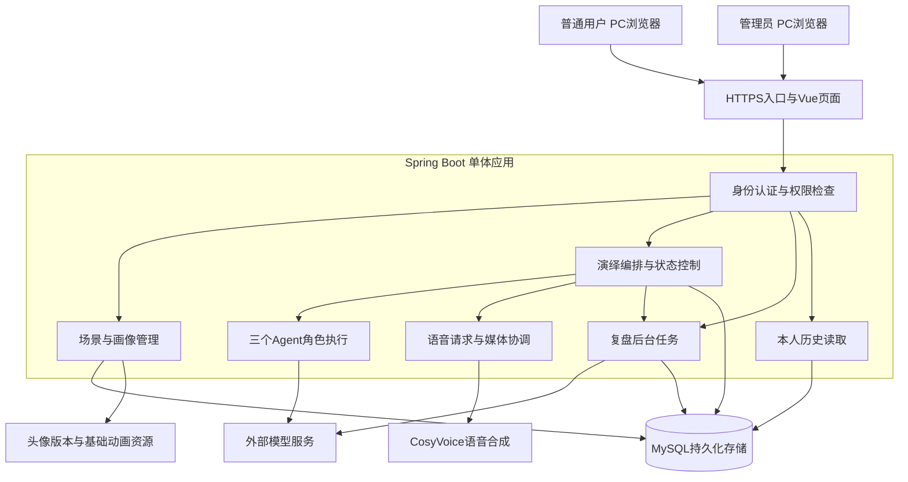
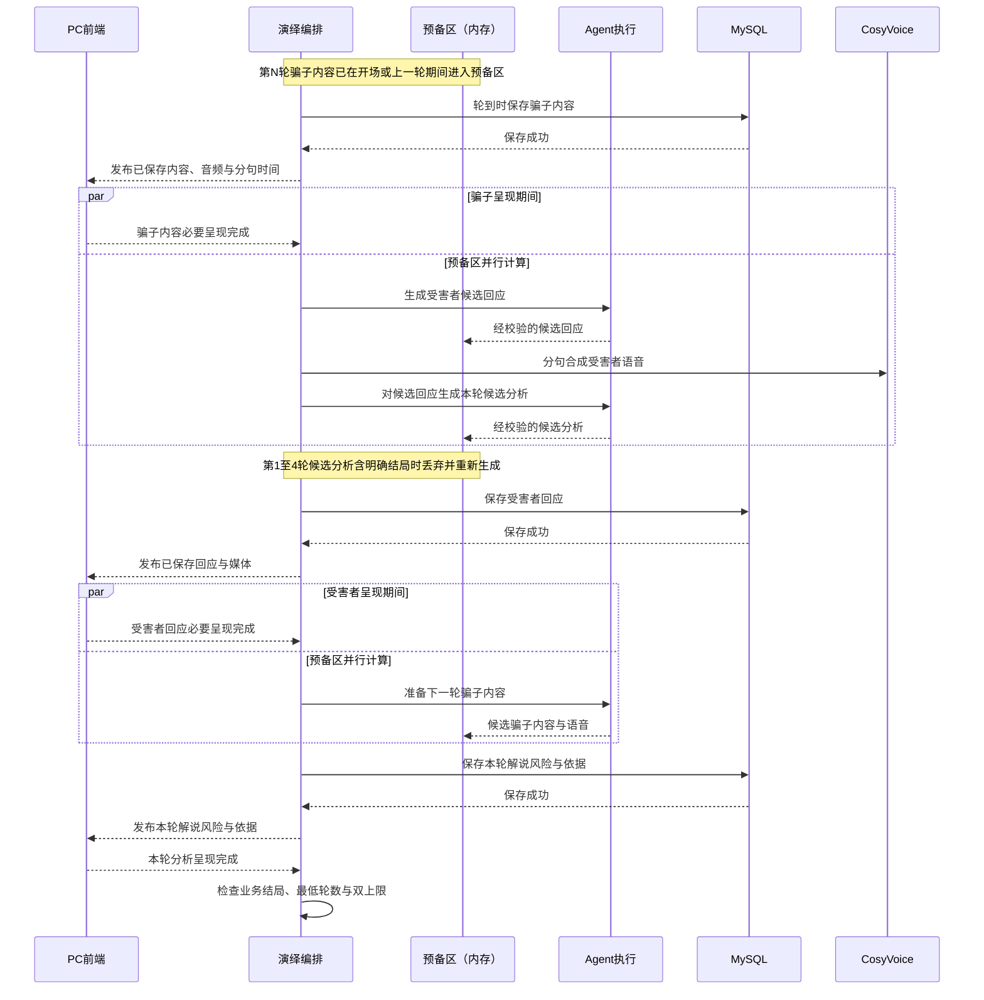
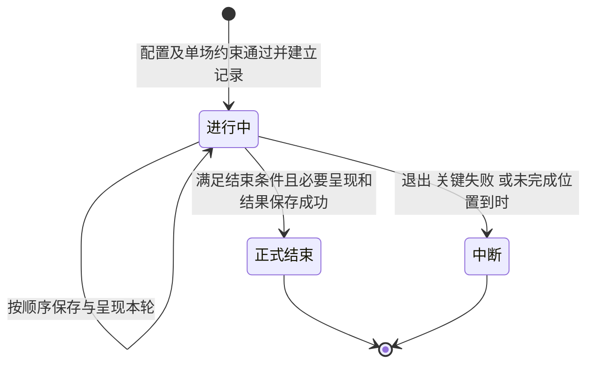
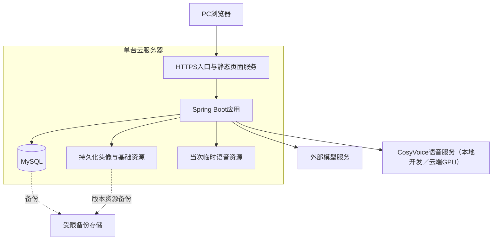

# AI反诈情景推演平台 系统架构设计文档 V1.1

| 文档信息 | 内容 |
|---|---|
| 产品名称 | AI反诈情景推演平台 |
| 文档版本 | V1.1 |
| 编制日期 | 2026年10月14日 |
| 业务基线 | 《AI反诈情景推演平台 PRD V3.2 正式开发基线版》 |
| 设计状态 | 总体架构方案已确认；本版用于实现设计与评审，技术验证尚未执行 |
| 最近修订 | 2026-10-18（V1.1）：按PRD V3.2同步情景演绎演出层——演绎页开始计时、场景介绍＋人物卡开场、半身立绘两帧、服务端预备区流水线、分句同步、设置暂停停表（累计计入≤300秒）、最低5轮预检、自部署CosyVoice与音色映射；新增第16章，修改第1.2、1.3、1.4、2.1、2.2、2.3、3.1、3.2、4.1、5.2、5.4、7.1、7.2、9.1～9.3、10.1、11.5、13.2、13.3、14.1～14.3、15.1～15.3章节及附录A、B、C。2026-10-16：按PRD已确认修订，演绎时长上限300秒→600秒（10分钟）；同步第1.4、9.1、9.3、11.4～11.6、15.1～15.5节及附录B的AD-09 |
| 适用阶段 | 传智杯参赛项目 MVP，受控演示与内部试用 |
| 适用读者 | 项目负责人、前后端开发人员、测试与部署人员 |
| 实施条件 | 三人小组，主要开发工作由一人承担；约三周开发期，目标在11月初完成 |
| 技术基础 | Spring Boot、Vue、MySQL；外部模型与自部署CosyVoice语音合成（先本地、后云端）；云部署为本次交付内容 |
| 文档边界 | 规定系统职责、协作、状态、数据流、部署及验证要求；不规定数据库表字段、接口参数、详细 Prompt 或代码 |

## 文档摘要

系统采用 Vue 前端、Spring Boot 模块化单体后端和 MySQL 关系型存储。后端集中编排骗子、受害者和解说三个 Agent，协调逐轮生成、可靠保存、人物动画、角色语音、风险分析与结束确认。正式结束后，由后台任务基于已保存过程生成复盘报告，历史页面读取同一份过程、风险和正式结果。

核心设计约束是：**先保存再正式展示，按轮次推进，必要呈现完成后才能确认正式结束。** V1.1起，后续内容可在服务端预备区提前计算，但在轮到呈现前不落库、不下发（第16章）。 模型负责生成角色行为和分析判定，应用程序负责权限、时间、轮次、持久化与状态转换。模型输出、前端回执和网络连接状态都不能单独决定演绎成功。

首期按 PC 浏览器、约3场同时演绎进行验证，优先验证 Chrome 和 Edge。该规模是技术验证目标，不构成新增的平台人数上限。模型优先验证 DeepSeek Flash；语音合成采用自部署CosyVoice（V1.1修订，先本地开发、后迁移云服务器），模型版本、推理硬件、服务器规格和调用预算仍需实测。系统不承诺未经验证的性能或可用性指标。

## 目录

1. 设计基线与范围
2. 架构概述与系统边界
3. 技术架构与选型依据
4. 系统模块及责任边界
5. 前端与媒体呈现架构
6. 后端会话与任务架构
7. 三 Agent 协作架构
8. 风险与业务结局处理
9. 核心业务流程架构
10. 数据流与保存一致性
11. 状态管理与时间控制
12. 复盘与历史架构
13. 安全与权限架构
14. 部署与运行架构
15. 性能异常与验证计划
16. 情景演绎演出层架构（V1.1新增）

附录A 需求追踪矩阵  
附录B 架构决策记录  
附录C 参考资料

## 1 设计基线与范围

### 1.1 输入效力

PRD V3.2 是唯一业务需求基线。页面草图及批注用于辅助理解页面区域、操作顺序和模块关系，不得恢复 PRD 已取消或排除的能力。本文承接已确认的架构方向；出现新的业务歧义或范围变化时，应按 PRD 第5.4节处理，不能以技术默认值修改业务规则。

本文引用 PRD 原有需求编号。实施条件使用 C-01 至 C-06 标识；架构决策使用 AD 编号；待验证技术事项使用 V 编号。这些编号用于追踪，不取代 PRD 需求编号。

### 1.2 已确认实施条件

| 编号 | 实施条件 | 设计影响 |
|---|---|---|
| C-01 | MVP用于受控演示和内部试用，只支持PC浏览器 | 不建设移动端专用交互；明确浏览器验收范围 |
| C-02 | 三人小组，主要由一人开发；熟悉Spring Boot、Vue、MySQL | 沿用已有技术能力，集中部署与调试 |
| C-03 | 约三周开发期，目标在11月初完成 | 首周验证完整演绎主链路和云环境，避免末期首次集成 |
| C-04 | 暂按最多约3人同时演绎考虑 | 以3场活动演绎为容量验证场景，不新增业务人数限制 |
| C-05 | 允许外部模型；语音合成采用开源CosyVoice自部署（V1.1修订），质量优先并控制成本 | 不自建模型训练；CosyVoice作为单个内部推理服务部署，不建设推理集群；测量合成速度、GPU需求与费用 |
| C-06 | 云部署与公网访问为本次交付内容，尚无服务器 | 采用单机部署起点，提前验证网络、证书与外部依赖 |

### 1.3 MVP交付边界

本期交付普通用户注册与双方共用登录、首页、场景画像配置、AI情景演绎、分析复盘、本人历史和管理后台七个模块。固定三个诈骗场景，初始两个骗子画像、三个受害者画像；管理员可以扩充画像。用户选择配置并观看，不代替角色输入对话。

本期不提供 AI反向、优秀对局训练、用户画像投稿或调节、雷达图、用户能力测评、真实资讯加载、独立环境选择、RAG知识库、独立流程或策略库、中断后续演、倍速、音视频回放、历史删除导出分享、账号角色切换或管理员用户管理。演绎进行中的设置暂停与继续自V1.1纳入本期（PRD BR-P13）。

首页保留项目介绍和有效体验入口，资讯区域明确显示空状态。场景仅允许管理员编辑固定三项的名称和简介；画像支持新增、编辑、停用和重新启用，不永久删除。管理员不具备普通用户体验权限，也不得访问任何用户演绎或报告。

**依据：**SCP-01～06、PER-01～04、FR-HOME、FR-CFG、FR-ADM、FUT-01～02。

### 1.4 设计目标与完成判据

| 设计目标 | 必须成立的结果 | 主要验收 |
|---|---|---|
| 演绎可控 | 同账号单场活动、最少5轮、最多20轮、有效时长不超过600秒（10分钟），设置暂停停表且累计计入不超过300秒 | AP-04、AP-05、AP-10、AP-11 |
| 媒体与内容一致 | 角色可辨、字声一致、语音顺序不重叠、逐轮解说 | AC-13、AC-14 |
| 事实与判断一致 | 五档风险、实际行为和正式结局分别表达，报告不改判 | AP-01、AP-03 |
| 保存真实 | 未保存内容不正式展示，部分失败不伪装为全部成功 | AP-02、AP-06 |
| 历史稳定 | 当时完整配置、风险与已完成报告不受后台修改影响 | AP-06、AP-07 |
| 权限完整 | 本人数据隔离；管理员无用户内容访问能力 | AC-03～05 |
| 可部署可演示 | 云端完整流程可用，并完成约3场并行和故障验证 | C-04、C-06、AP-09 |

## 2 架构概述与系统边界

### 2.1 整体结构

图中连接表示逻辑关系，不表示所有角色均有相应权限。所有普通操作、媒体访问和实时订阅都经过身份及归属检查。管理员只能进入基础内容维护分支。

### 2.2 系统负责的事项

系统负责管理本次演绎的配置、上下文、调用顺序、保存顺序、呈现反馈、轮次、计时、唯一结果、报告任务和历史归属。前端负责可见呈现与实际播放反馈，后端负责业务状态和数据事实。

外部模型提供角色内容与分析候选，自部署CosyVoice语音服务合成已确定的角色台词（动作说明不合成）。外部服务不拥有本系统的用户权限、会话生命周期或正式结束决定权。模拟行动只存在于文本与演绎状态中，不连接真实转账、验证码获取、账号控制或其他现实执行工具。

### 2.3 架构不变量

1. 同一用户同时只有一场活动演绎；重复开始不能替换既有记录或重置时间。
2. 每段完整对话、每轮解说和风险在可靠保存后才能正式展示。
3. 一轮由骗子一次发言或行动与受害者一次回应组成，解说不另计轮。
4. 生成完成、保存完成、媒体完成和正式结束是不同事实。
5. 正式结束和中断均为不可逆的演绎终态；后续迟到结果不得复活任务。
6. 一次演绎最多具有一份正式结果，报告和历史共同引用。
7. 中断保留已保存过程，不续演、不自动重开、不生成正式报告。
8. 画像、场景和头像后续变更不得改写本次或历史配置。
9. 服务端预备区内容在轮到呈现前不落库、不下发；中断、正式结束或重启时丢弃（V1.1）。
10. 第1至4轮不形成正式业务结局（PRD BR-P12，V1.1）。

**依据：**AGT-04、BR-P02～08、BR-P10、DATA-03～04。

## 3 技术架构与选型依据

### 3.1 已确认技术方向

| 层次 | 设计选择 | 选择依据 |
|---|---|---|
| 前端应用 | Vue，集中实现用户页和管理员页的角色分流 | C-01、C-02、FR-AUTH-03 |
| 后端应用 | Spring Boot模块化单体，采用Spring MVC处理Web交互 | C-02、C-03；降低开发与部署成本 |
| 实时更新 | 普通HTTP操作配合SSE推送 | 观看模式以下行为主；FR-SIM、SCP-05 |
| 任务执行 | 后端受控异步任务，关键业务与任务状态保存在MySQL | BR-P06～08 |
| 业务存储 | 一个MySQL数据库，业务上区分对象及归属 | DATA-01～04、PRD第12.3节 |
| 模型能力 | 外部模型调用，优先验证DeepSeek Flash | C-05、AGT-01～04 |
| 语音能力 | 自部署CosyVoice；按画像性别与年龄段映射预设音色，双方可区分且同场固定；分句合成并输出MP3及分句时间 | C-05、FR-SIM-04、PC-P04 |
| 人物呈现 | 半身立绘闭嘴／张嘴两帧与通用基础待机／说话动画；场景介绍为按场景代码映射的预制动画 | FR-SIM-01、FR-SIM-03、PC-P02、PC-P04、PC-P06 |
| 部署 | 单台云服务器起步，外部使用模型服务；CosyVoice部署于具备GPU的实例（与应用同机或独立实例，经V-09确定） | C-03、C-04、C-06 |

Spring MVC官方文档提供异步请求与SSE支持，采用该方式不要求将应用整体改为响应式技术栈。[Spring官方说明](https://docs.spring.io/spring-framework/reference/web/webmvc/mvc-ann-async.html)。具体框架、JDK、数据库与依赖版本在实施前选取相容且受支持的组合，并锁定版本；本版不猜测团队现有版本。

### 3.2 模型与语音选型状态

DeepSeek官方当前文档将`deepseek-flash`对应到DeepSeek-V4.1-Flash；旧的V4-Flash名称仍兼容，但会路由到新版。[DeepSeek官方说明](https://api-docs.deepseek.com/quick_start/pricing/)。本项目将DeepSeek Flash列为优先验证候选，部署时记录实际模型标识与调用配置，不能将兼容别名当作版本固定保证。

三个角色可先使用同一模型，通过不同职责与上下文组织实现分工。报告也可复用该模型能力，但使用独立的总结任务。若人物一致性、分析质量或耗时不达标，依据对比结果调整选型，而非直接增加多模型路由系统。

V1.1起语音合成采用开源CosyVoice自部署，先在本地开发测试，后迁移至云服务器；具体模型版本、推理接口与硬件经V-09实测确定，音色映射与分句合成见第16.3、16.8节。验收关注中文自然度、双方声音可辨、字声一致、短句响应、合成实时率、可识别的播放完成与失败，以及推理资源成本。静音时仍保持相同文本与动画流程，不因此取消风险分析或改变演绎规则。

### 3.3 MVP复杂度控制

本期不引入微服务、服务注册中心、独立消息中间件、Redis集群、专用Agent平台、模型训练流水线或额外知识库。现有需求可由应用内模块、受控任务执行和MySQL持久化状态承担。

这些取舍不削减权限、校验、事务、失败处理和媒体能力。若后续容量证据表明必须拆分，应针对实际瓶颈调整部署或任务执行方式，不预建未被MVP需要的设施。

## 4 系统模块及责任边界

### 4.1 模块责任矩阵

| 模块 | 主要职责 | 不得承担的职责 | 追踪依据 |
|---|---|---|---|
| 身份与权限 | 注册、共用登录、固定角色分流、本人归属检查 | 管理员自助注册、用户管理、角色切换 | FR-AUTH、PER、BR-P11 |
| 基础内容 | 三场景文案、双方画像详情及可用性、头像版本 | 用户私人画像、场景目标编辑、独立环境选择 | FR-CFG、FR-ADM、BR-P09 |
| 演绎编排 | 创建会话、逐轮推进、计时、保存与媒体协调、终态控制 | 凭风险分数另行推断结局 | FR-SIM、BR-P02～06 |
| Agent执行 | 按角色构造上下文、调用模型、校验内容及分析结果 | 自行操作数据库、授权用户或无限循环 | AGT-01～04 |
| 媒体协调 | 语音合成请求、音色映射、分句时间、临时音频访问、播放顺序与失败上报 | 永久媒体回放、情绪动作增强 | PC-P04、BR-P08 |
| 复盘 | 正式结束后生成和保存报告，控制重复任务与手动重试 | 重跑演绎、重评风险、改写成功报告 | FR-REV、BR-P07 |
| 历史 | 读取本人快照、已保存过程、结果和报告 | 读取他人数据、恢复演绎、导出分享 | FR-HIS、PER-01 |
| 运行支持 | 配置、受限诊断、任务状态检查、备份与部署 | 提供应用管理员浏览用户正文的旁路 | UX-02、UX-04、C-06 |

### 4.2 调用与写入责任

演绎过程状态由编排模块统一写入；其他模块提供结果或发出失败信号。Agent执行模块不直接宣布正式结束，媒体模块不根据播放完成创建报告，历史模块不触发重新评分。

复盘模块管理报告生命周期，但只能读取已正式结束演绎的固定事实集。正式结束与报告任务建立关联后，报告失败不会回写演绎为中断。

各模块可在同一应用内采用清晰的服务边界，不要求创建独立部署单元。复杂度应集中在真实业务规则与状态协作上，而非重复抽象和远程调用。

## 5 前端与媒体呈现架构

### 5.1 页面组织与状态归属

Vue前端按登录注册、首页、配置、演绎、复盘、历史和后台组织页面。登录成功后按服务端确认的固定角色进入首页或后台；隐藏导航不能代替服务端权限检查。

前端仅维护选中项、声音开关、当前呈现位置和加载反馈等展示状态。演绎归属、正式轮次、风险、结局、过程状态和报告完成状态以服务端保存结果为准。浏览器本地状态不得成为历史记录来源。

配置页展示双方完整画像。开始时重新检查可用性，已被停用的画像必须要求重选，不能静默替换。场景年龄侧重不限制受害者选择，也不改变所选身份、年龄或防骗意识。

### 5.2 内容发布与播放顺序

前端收到已保存的完整角色内容后，按骗子、受害者顺序显示文字并播放对应语音。动画由同一呈现控制器切换待机与说话状态，避免文字、声音和角色高亮各自推进。双方语音不得重叠。

“实时”指逐段、逐轮及时发布已保存内容，不把未经保存的模型逐字输出直接当作正式对话。生成等待使用等待状态表达，不补造台词或风险数值。

受害者回应完成后呈现该轮解说、风险与依据；解说仅使用文字。对话和分析区视觉上区分，未评分显示“尚未评分”。下一轮不得越过本轮必要媒体、分析展示和阅读停留。舞台、气泡、分句同步、解说保留与设置暂停的前端架构见第16.2～16.7节。

### 5.3 呈现反馈

前端向后端反馈当前内容的实际呈现进度与媒体结果。后端检查反馈是否来自本次演绎的本人、是否对应当前阶段、是否重复或过期，再将其用于推进。前端不能自行提交一个正式结局来代替服务端确认。

播放完成事件和动画组件状态用于确认技术呈现，不声称证明用户实际阅读或理解。音频下载成功不等于播放完成；语音生成成功也不等于浏览器能够播放。

静音采用静音播放或等效的同一媒体时间轴，使文字、说话状态、风险与停留按正常顺序推进。浏览器自动播放策略、静音切换和后台行为必须通过V-03验证，不能假定不同设备具有相同行为。

### 5.4 退出与连接管理

主动页面导航、刷新和关闭按PRD进入中断处理；切换标签页不主动结束，也不暂停计时。打开设置界面属于设置暂停（第16.7节），不属于离开页面。浏览器关闭通知不是可靠的唯一依据，后台计时和动画回调也可能受限制。[MDN页面关闭说明](https://developer.mozilla.org/en-US/docs/Web/API/Window/pagehide_event)、[MDN后台页面说明](https://developer.mozilla.org/en-US/docs/Web/API/Page_Visibility_API)。

前端退出通知、连接存活检查、服务端截止控制与持久化任务核对共同用于收敛状态。不能把一次页面隐藏事件或单次心跳延迟直接等同于用户退出。浏览器连接恢复只可核对当前状态和已保存内容，不能恢复已经中断的演绎。

前端到时立即停止继续播放与推进；结果呈现仍须遵循第11章的正式结束和中断规则，不能仅凭本地计时显示“已成功结束”。完全失联或设备挂起造成的可见状态延迟属于必须明确验证的技术边界。

**依据：**FR-CFG-03～04、FR-SIM-01～07、PC-P04、UX-01～05、BR-P05～06。

## 6 后端会话与任务架构

### 6.1 Session生命周期

Session表示一个用户以一组固定配置开始的一次演绎。创建时将身份、配置校验和单场活动约束作为一个一致性边界处理，防止双击、多个标签页或重复请求产生并行演绎。

“单场约束”必须在服务端成立，不能只依赖前端按钮禁用。单实例下的进程锁可以辅助执行，但不能成为唯一事实依据；应用重启后仍需依据持久化状态辨认尚未收敛的会话。

每场演绎按因果顺序执行下一步，同场不允许多个任务同时争抢下一轮。不同用户的演绎可并发推进。任务进入外部调用、保存或媒体等待前都检查当前终态与剩余时间；返回时再次检查，避免迟到结果继续执行。

### 6.2 异步执行与事务边界

创建及控制请求不占用一个HTTP请求等待整场演绎结束。编排任务在后端受控执行，前端通过状态推送获得进度。等待模型、TTS、媒体反馈和阅读停留时，不持有长时间数据库事务，也不独占用于时间控制的执行能力。

写入采用短事务完成当前业务动作。对话保存、同轮分析保存、正式结果确认、报告保存分别具有明确成功边界。外部服务调用不能加入本地数据库事务并被假定可以一起回滚。

演绎任务、报告任务和截止检查需要有明确的执行资源边界，避免慢报告占满所有执行机会，导致正在演绎的会话无法按时停止。具体并发数与任务等待配置通过3场并行测试确定，不凭人数直接推算固定线程数。

### 6.3 终态与迟到结果

正式结束和中断的转换需要原子检查，只有仍处于允许阶段的会话才能完成转换。同一结束操作重复到达时返回既有结果，不产生第二份正式结果或第二个报告任务。

任务取消同时包含“停止后续推进”和“尝试取消正在执行的外部请求”。供应商不一定能够撤回已发出的计算或费用，因此必须拒绝迟到响应覆盖已保存内容或改变终态，不能把取消请求发出视为已成功取消。

### 6.4 重启与失联收敛

服务重启后首先核对持久化过程和任务状态。已正式结束的演绎保留原结果；未结束且执行上下文已经丢失的演绎按故障中断收敛，不从某一轮恢复演出。已保存部分保持本人可见。

报告任务按自身状态核对：尚未执行的持久任务可正常领取；已执行但失去可靠完成证据的任务应核对实际报告保存结果，不能仅因等待过久就启动第二个生成任务。若无法确认原任务仍可完成，安全终止该次尝试并标为失败，供用户手动重试。旧尝试的迟到结果不得覆盖新尝试或成功报告。

**依据：**BR-P06～08、DATA-03～04、AP-05～06。

## 7 三 Agent 协作架构

### 7.1 职责与上下文

| 角色 | 主要上下文 | 主要产出 | 必须限制的行为 |
|---|---|---|---|
| 骗子Agent | 本次诈骗类型、本人画像、已发生公开互动、当前阶段与剩余时长 | 一次台词、可选的模拟行动说明、内部意图及轻度语气提示 | 不改写基础身份，不读取解说答案、对方内部心理或未来内容，不自行判定系统结束 |
| 受害者Agent | 本人完整画像、场景公开信息、既有互动、骗子本次台词与动作说明、当前轮号与最低轮数约束 | 一次台词、必要的模拟行动说明、内部心理状态及轻度语气提示 | 不因场景年龄侧重更换人物，不预设必然受骗，不替骗子宣告事实，不读取骗子内部意图；第1至4轮不作出明确终止配合或完成关键目标的决定性行为 |
| 解说Agent | 本次配置、已保存互动、既有受骗事实、本轮双方台词、动作说明与内部意图／心理、PRD判据 | 阶段话术手段心理分析、五档风险和依据、业务结局判定及证据 | 不评价观看者能力，不凭分数替代结局，不补造未完成行为 |

每个角色使用相互隔离的调用上下文。其他用户历史、个人报告和管理员维护操作不进入当前角色上下文。角色内部意图／心理状态只供解说Agent与复盘任务使用，不进入对方角色上下文，也不向用户展示。解说具有分析所需事实，但其教学分析不自动回灌给表演角色，避免后者因预先知道分析结论而改变角色表现。

### 7.2 调用顺序

本期采用集中编排的角色协作，原则为**落库与呈现严格顺序，计算允许流水线提前**（V1.1修订）。业务事实顺序不变：骗子内容保存并呈现→受害者回应保存并呈现→本轮解说保存并呈现→检查结束或进入阅读停留后的下一轮。计算上，编排模块可在服务端预备区提前生成（第16.4节）：开场期间准备第1轮骗子内容；骗子呈现期间生成受害者候选回应及语音，并对候选回应生成本轮候选分析；受害者候选回应被接受后即开始准备下一轮骗子内容。

依赖关系不变：受害者只基于已确定的骗子内容回应，下一轮骗子只基于已接受的受害者回应，角色不读取解说结果；同场不并行生成相互依赖的同一内容，也不预先生成整场脚本来替代逐轮演绎。预备内容在轮到其呈现前不落库、不下发前端；本轮形成正式结束时，预备的下一轮内容直接丢弃，它从未保存或展示，不构成结局明确后的额外角色对话。第1至4轮的最低轮数预检见第16.5节。

### 7.3 输出校验与职责分离

模型返回内容先在应用边界校验，再进入保存和发布。校验包括角色归属、内容完整性、风险档位、分析与轮次对应、证据是否指向已有行为，以及结束判定与PRD规则是否明显矛盾。

解说Agent负责语义分析及业务判定，应用程序负责验证固定规则和执行状态转换。程序不能悄悄将不合法分数四舍五入到合法档位，也不能用另一套启发式规则覆盖已保存风险。模型给出不可信或无法使用的结果时，按生成失败路径处理，不以默认分数和虚构解释继续。

对模型是否能够稳定区分“承诺、准备、实际执行、停止”，必须用PRD场景和反例评估。结构化输出能力只解决输出形式，不能替代语义正确性验证。

### 7.4 上下文与成本

每次调用只包含该角色需要的配置、规则和本场相关过程，不携带其他用户数据或无关页面信息。本期最多20轮，优先验证直接使用本场必要历史的方案；未证明需要前不引入摘要记忆服务。

若后续必须压缩上下文，不能丢失已实际受骗、是否达成关键目标和停止配合等关键事实。模型配置变化不得重新生成历史分析。技术诊断可记录实际模型及规则版本、调用耗时和用量，但不向应用管理员开放用户正文。

**依据：**AGT-01～04、BR-P01～04、BR-P08、PER-01～04。

## 8 风险与业务结局处理

### 8.1 五档风险规则

风险是受害者当前状态的教学指标，不是现实概率，不是观看用户的能力分，也不是历史受骗事实的替代值。

| 分值 | PRD规定的本轮结束状态 |
|---|---|
| 0 | 明确拒绝并停止配合，或完成独立核实后终止当前诈骗互动 |
| 25 | 仍接触但保持警惕、尚未建立信任，或暂停配合并核实 |
| 50 | 表现出信任或考虑配合，尚未承诺、准备或执行危险操作 |
| 75 | 已承诺或正在准备危险操作，尚未实际执行，也未完成有效核实 |
| 100 | 正在执行危险操作，或已经执行且仍继续配合 |

每轮依据当前行为重新定档，不累计加分、不插值、不平滑。实际行为优先于口头态度。骗子提出危险要求不代表受害者已执行；受害者后来拒绝可以降分，但不能删除此前已转账或交出账户控制权等事实。

风险初始无值，半轮不补评分。演绎、复盘折线和历史读取同一条实际风险序列；缺失值不补0，不由图表平滑生成新的业务分数。

### 8.2 三场景的固定关键目标

| 场景 | 关键目标达成证据 |
|---|---|
| 刷单返利诈骗 | 已完成首笔垫付后，又实际完成一次追加投入 |
| 虚假投资诈骗 | 已投入投资款后，又实际支付一次所谓提现、解冻等额外费用 |
| 冒充亲友借款诈骗 | 未通过独立渠道核实身份，就实际完成借款转账 |

不设金额门槛，承诺或准备不算实际完成。证据来自受害者已经完成的模拟行动描述，不能只根据骗子宣称成功判断。前两个场景的首笔投入不等于关键目标完成。

场景名称和简介的后台修改不会更改这些目标。目标判据属于固定业务规则，不新增后台目标编辑、诈骗流程维护或策略管理能力。

### 8.3 正式结局与优先关系

| 正式结局 | 判定条件 |
|---|---|
| 诈骗目标达成 | 已满足本场景关键目标；同轮随后停止也保留该结局 |
| 受骗后止损 | 已实际受骗，关键目标未达成，随后明确终止继续配合 |
| 未受骗结束 | 尚无实际受骗行为，明确拒绝并终止继续配合 |
| 结局未定 | 到达轮数或时长上限，位于完整轮结束位置，仍不满足前三类 |

解说Agent形成业务判定与依据。程序检查场景目标及优先关系：关键目标达成优先于同轮停止；已有明确业务结局优先于上限未定。考虑、等待或准备核实本身不等于终止互动。0分和100分均不是自动结束阈值。

“结局未定”可以包含已经发生的受骗行为；“中断”是演绎过程状态，不是第五种诈骗结局。系统可以保存尚未正式成立的分析证据，但在必要呈现和结果保存完成前不能向用户宣告整场正式结束。

**依据：**BR-C01～04、BR-P01、BR-P03～04、AGT-03、AP-01、AP-03。

## 9 核心业务流程架构

### 9.1 开始演绎

1. 用户在配置页确认一个场景和双方各一个画像后点击“进入演绎”（不建立记录、不计时）；演绎页加载场景介绍动画与双方立绘并完成计时采样，就绪后显示“开始演绎”，点击即开始计时。
2. 后端检查普通用户身份、单场活动限制和配置仍可用；被停用画像要求重新选择。
3. 固定当时场景与双方全部画像内容，包括头像版本；可靠建立本次过程记录。
4. 前端依次展示场景介绍动画与双方人物卡，风险显示“尚未评分”；若快照立绘与预加载资源不一致，补充加载。开始后的准备、网络、生成和保存等待都计入600秒有效时长。编排模块同时在预备区准备第1轮骗子内容。
5. 编排模块进入第一轮。开始失败或记录未能可靠创建时，不宣称已经存在可回看的完整记录。

重复开始只反馈既有活动情况，不替换原记录、不重新计时。再次体验仅在不存在另一场活动演绎的条件下创建新记录。

### 9.2 一轮演绎的顺序

此图表示正常路径的因果顺序，不包含接口定义。每一步失败均进入对应异常处理；发布前必须确认保存成功。语音准备与资源预载的具体优化只能在不改变这些因果关系和失败规则的前提下验证。V1.1起，预备区计算与前台呈现并行（第16.4节），落库与发布的先后顺序不变。

### 9.3 正式结束与最后阅读停留

在本轮对话、解说、风险和必要媒体正常呈现后，编排模块检查结束条件；第1至4轮不提交正式业务结局（第16.5节）。明确业务结局或完整轮到上限时，可靠保存唯一正式结果，并与报告待处理工作保持一致。结果保存成功后才正式确认结束，随后启动报告任务。

最后阅读停留正常为5秒，剩余总时间不足时缩短；到达600秒时应已进入复盘页面或显示符合规则的中断结果。正式结束确认后，最后停留期间离开页面不回退为中断。报告可以在此期间开始生成，但不能借报告等待延长演绎画面的600秒限制。

关键目标达成后，不追加“收尾对话”或为凑轮数继续演出。没有结束条件时，正常阅读停留完成后再进入下一轮；等待和停留都继续计时。

### 9.4 中断流程

正式结束前发生退出、无法继续的生成失败、语音或动画故障、保存失败、未完成位置超时等事件，编排模块停止推进并取消后续任务。前端停止角色播放和新的内容呈现，显示实际原因。

保存已经成功的内容保留在历史中，未完成轮明确标注。没有生成的回应、解说、风险或结局不补造。数据库不可用时，系统只能保证既有持久内容，不应宣称中断原因本身已即时保存；存储恢复后核对并收敛未终结任务。

中断记录没有正式报告入口，也不能伪装成报告生成失败而开放重试。用户重新体验创建新的记录，旧记录不恢复。

### 9.5 报告失败后的手动重试

用户从报告或历史页面发起重试时，后端检查本人归属、演绎已正式结束、报告未成功且不存在另一有效生成任务。重试使用同一份已保存过程，不重新运行角色互动。

重复点击只关联同一个有效任务。任务完成后先保存报告，再发布完成状态；失败则显示报告失败，保留原演绎终态。成功报告不提供再次改写入口。

### 9.6 基础内容维护

场景固定三项，只编辑名称和简介。画像新增或编辑必须完整有效，并具有可预览、符合格式和大小要求的头像。骗子与受害者各至少保留一个可用画像；并发停用也不能使某类可用数量变为零。

开始演绎与停用画像需要在一致性边界内确定先后：若停用先成立，则开始被拒绝并要求重选；若开始先成立并形成快照，则后续停用不影响该场。后台编辑头像时保留旧版本内容，不能覆盖历史引用。

**依据：**FR-CFG-04、FR-SIM、FR-REV-05、FR-ADM、BR-P02～10、AP-02～07。

## 10 数据流与保存一致性

### 10.1 信息责任与存储划分

本章描述业务信息及生命周期，不给出表名、字段类型、索引或接口参数。账号是身份与归属依据；场景、双方画像、演绎过程和报告在同一MySQL存储中保持清晰关系，不因共用物理数据库取消权限隔离。

| 信息 | 权威来源与用途 | 保存及变更原则 |
|---|---|---|
| 基础场景与画像 | 管理员维护，用户查看选择 | 当前内容可按PRD维护，历史快照不随之更新 |
| 当时完整配置 | 开始时固定的场景与双方画像 | 本次演绎、复盘和历史共同使用，包含头像实际版本 |
| 角色对话与行动 | 本次角色生成并校验的完整结果 | 按顺序及时保存，半轮中断仍可保留 |
| 解说风险与依据 | 解说Agent依据本轮和历史事实分析 | 同轮一致保存，不由历史或报告重算 |
| 正式结果或中断情况 | 编排模块在规定条件下确认 | 正式结果唯一，过程终态不能被迟到结果回退 |
| 复盘报告及任务状态 | 正式结束后的后台任务 | 成功后不改写，失败可按规则重试 |
| 头像与基础动画资源 | 受控文件存储 | 头像版本长期保留以维持历史；不保存演绎媒体回放 |
| 当次语音 | CosyVoice合成的临时资源及分句时间 | 只用于当次播放，终态后释放，不能成为历史播放入口 |
| 预备区内容（V1.1） | 编排模块提前生成的候选台词、动作说明、内部意图／心理、语音与分析 | 仅存于服务端内存，轮到呈现时才保存并发布；中断、正式结束或重启时丢弃，不进入历史 |

### 10.2 保存成功后发布

保存与推送是两个独立动作，不能假定网络推送和数据库提交具有同一个事务。设计采用“先提交业务事实，再发布”的顺序。

- 保存失败：停止推进，未保存内容不作为正式内容展示。
- 保存成功但通知失败：保留已保存事实，核对当前会话及呈现状态；不得因此再次生成不同内容或直接推进下一轮。
- 保存返回不确定：先根据同一次操作核对持久化结果，避免盲目重写或宣布成功；超过剩余时间不能继续等待演绎。
- 重复推送或回执：按本场既定顺序识别，避免重复播放、重复计轮或重复创建报告。

连接恢复可用于核对已保存事实和当前终态，但不构成中断续演或历史媒体回放。已中断的记录永远只能查看保存的文字过程与已有分析。

### 10.3 短事务与原子边界

建议将以下动作各自作为需要可靠一致完成的业务单元：

1. 校验单场活动限制、固定可用配置并建立演绎。
2. 保存一段完整角色内容及对应推进位置。
3. 保存同轮解说、风险、依据及对应分析进度。
4. 确认唯一正式结果并建立报告待处理工作。
5. 领取一个有效报告尝试，或保存该尝试的成功报告与完成状态。
6. 执行画像启停及最低可用数量检查。

外部调用与媒体等待不占据这些事务。文档不要求把整个Session放进一个长事务，也不要求跨模型供应商实现分布式事务。

### 10.4 快照与历史不变性

快照包含当时场景名称和简介、双方所有人物信息、行为参数、情境与头像内容版本。仅保留指向当前画像的引用不足以满足历史一致性。

头像更新采用新资源版本，已被快照引用的内容不能覆盖。数据库与文件备份应能恢复相互对应的状态。新增画像采用相同基础动画机制，不能让新头像绕过必需的角色表现能力。

用户历史无自动到期清理和删除入口。临时语音资源的释放属于运行资源管理，不改变长期保存演绎文字与报告的业务要求，也不能借此删除头像历史版本。

**依据：**DATA-01～04、BR-P08～10、PC-P05、AC-19～23。

## 11 状态管理与时间控制

### 11.1 状态维度

| 维度 | 需要表达的事实 | 状态责任 |
|---|---|---|
| 演绎过程 | 进行中、正式结束、中断 | 后端编排与持久化状态 |
| 轮内阶段 | 骗子内容、受害者回应、分析、呈现、阅读停留的推进位置 | 后端控制，前端反馈实际呈现 |
| 内容保存 | 尚未形成完整内容、待保存、已可靠保存 | 后端保存结果 |
| 必要呈现 | 尚未发布、正在播放或展示、已完成、失败 | 前端实际事件与后端顺序校验 |
| 风险与事实 | 尚未评分或五档风险、已有受骗行为与目标证据 | 保存的解说分析与原过程 |
| 正式结局 | 四类业务结局之一，仅随正式结束成立 | 唯一正式结果 |
| 报告 | 生成中、已完成、生成失败 | 报告模块；中断不进入此生命周期 |

内部执行阶段可以细分，但不能新增用户业务结局，不能将“已生成”显示为“已保存”，也不能把“模型判断目标达成”显示为“已正式结束”。

### 11.2 过程状态转换

正式结束后报告的成功或失败只改变报告状态。用户离开、重复回执、后到的模型或TTS响应均不能回退演绎终态。中断没有返回进行中的转换。

### 11.3 完整轮结束位置

“双方已生成文本”不足以构成完整轮结束位置。必须同时具有双方完成的互动、本轮解说和风险的保存及正常展示，以及必要媒体的完成证据。

| 情形 | 是否可作为完整轮结束位置 |
|---|---|
| 只有骗子消息 | 否，不补回应或风险 |
| 双方文本已保存，但受害者语音仍在播放 | 否 |
| 双方媒体完成，但解说风险尚未保存或展示 | 否 |
| 对话分析均保存展示，必要媒体均完成 | 是，可据此检查结局和上限 |
| 最后阅读停留尚未结束，但此前已正式确认结束 | 演绎保持正式结束，离开不回退 |

### 11.4 20轮控制

只有骗子行动和受害者回应形成的一轮才按PRD口径计轮。未完成轮保留实际内容并标注不完整，不能靠把半轮算作完成轮绕过验收。

第20轮完成后不得发起第21轮。若已有明确业务结局，使用实际结局；否则在完整轮结束位置以轮数上限形成“结局未定”。如果第20轮尚未完成必要呈现便发生故障或达到600秒，则依相应中断规则处理。

### 11.5 600秒控制

计时起点为用户在演绎页点击“开始演绎”（配置页“进入演绎”与演绎页资源加载不计时）。前端采用适合持续计时的时间依据，服务端独立控制可核验的截止时间；首次网络传输和准备等待不能被排除。不能简单在后端收到开始请求时重新给出完整600秒，也不能无条件信任任意客户端时间声明。前后端起点关联与校准方式由后续交互设计落实，并通过V-02验证。

所有步骤使用本次统一的剩余时间预算。单次外部请求超时、任务等待和重试不得跨越总截止时间。切换标签页不暂停计时；浏览器计时回调发生延迟，也不能把延迟解释为尚有额外演绎时间。

正常每轮语音完成且分析与风险展示后停留5秒，只有总剩余不足5秒时才缩短。不得以另设较短的固定停留或强制倍速满足时限。可以约束生成内容长度和推进节奏；最少轮数仅按PRD BR-P12执行（5轮），不得另行增加或强制每场20轮。

设置暂停期间有效计时停止（第16.7节）：有效截止时间＝点击起点＋600秒＋已计入暂停时长，单场累计计入不超过300秒；暂停期间截止检查、阅读停留与下一轮调度冻结，继续后统一顺延。累计计入达到上限后，即使仍处于暂停，截止检查也按实时恢复。

### 11.6 到时与结束确认的边界

到达上限且位于完整轮结束位置时，明确业务结局优先；没有明确结局则为“结局未定”。未完成必要内容时到达600秒，显示“中断：达到时长上限”，不生成正式报告。

时间上限路径必须特别验证：完整轮证据和候选结果可以提前准备，但不能在上限尚未到达且没有其他结束条件时，提前把“结局未定”提交为正式结果。另一方面，也不能等600秒才开始一串保存和跳转操作，却声称它们不占时间。结束提交、前端获知终态和页面切换均须纳入端到端设计与测量。

在完全断网、数据库不可用或浏览器被操作系统挂起时，单靠应用设计无法保证各端同时落库并立即显示结果。本版将“完整轮临界到时的保存与呈现”“起点校准”“后台与失联行为”列为V-02、V-03的交付阻断验证项。不得将其默认改成额外宽限、提前未定或一律中断。若实测表明无法满足PRD，必须提出具体证据并按需求变更流程处理，不能自行改口径。

**依据：**PRD第1.4、6.2、10.3～10.5节，BR-P02～06、PC-P04、AP-02～05。

## 12 复盘与历史架构

### 12.1 复盘输入与输出责任

复盘输入仅限本次已正式结束的配置快照、已保存对话、逐轮解说与风险、唯一正式结果及其依据。报告包括过程总结、逐轮分析、骗子话术分析、受害者行为与结局分析，以及实际风险折线图。

原始对话、轮次、风险值和正式结局直接引用保存数据；模型负责解释与总结。生成后的报告应校验是否遗漏关键事实、把“未定”写成“未受骗”、把画像表现写成用户能力，或生成与原结局矛盾的描述。不通过时不能保存为完成报告。

### 12.2 报告任务的可靠触发

正式结果保存与报告待处理工作在同一本地一致性边界内建立关联。后台执行器从持久状态领取工作，不依赖浏览器保持连接，也不依赖一次可能丢失的内存通知。

同一演绎同时只允许一个有效生成尝试。页面离开不取消生成；服务重启后的核对按第6.4节处理。生成完成但保存失败属于报告失败，不得显示“已完成”。本期不要求自动重试，用户手动重试时仍使用原始事实集。

### 12.3 历史读取

历史列表展示开始时间、场景、双方画像名称、演绎状态和报告状态。详情展示当时完整配置、按顺序保存的对话与解说、已有风险、正式结果或中断情况，以及符合条件的报告入口。

中断记录明确说明不生成正式复盘；半轮标注不完整。没有实际评分的位置不补0。历史无记录时展示本人暂无记录，不用其他用户数据或虚构记录填充。

历史阅读不调用模型补写过去的内容，不重新运行TTS，不恢复动画演出。成功报告及原风险不因后台配置、模型升级或当前画像变化而更新。

**依据：**FR-REV-01～05、FR-HIS-01～03、BR-P07～08、BR-P10、PC-P05、AC-17～20。

## 13 安全与权限架构

### 13.1 身份与角色边界

普通用户和管理员共用登录入口，角色由服务端账号记录确定。注册只能建立普通用户，管理员预先开通。普通用户不得通过页面或直接请求获得管理能力，管理员也不能以管理身份进入普通用户演绎与历史功能。

首期优先采用前后端同源部署与服务端登录会话，使用安全Cookie承载登录状态，并结合相应的跨站请求防护。具体会话参数由后续安全与接口设计确定；不在本期新增外部身份平台、短信验证、邮箱验证、密码找回或用户管理功能。

用户名按PRD去除首尾空格后校验，并在普通用户与管理员之间保持全局唯一、英文字母不分大小写。数据库默认比较规则不能未经核对直接作为完整业务校验依据。密码接受规则仍为6—24个字符、允许空格与常见弱密码，不自动去除首尾空格；安全存储采用适当的带盐密码哈希，不保存明文或可逆密码。

登录错误按PRD统一反馈账号或密码错误。传输保护、凭据安全存储和适度的滥用防护不能被当作擅自提高密码复杂度的理由。弱密码带来的剩余风险保留在交付说明中。

### 13.2 数据访问控制

| 访问对象 | 普通用户 | 管理员 |
|---|---|---|
| 可用基础场景和画像 | 可查看选择 | 可按PRD维护 |
| 本人的活动演绎及实时内容 | 可访问，受当前状态约束 | 不可访问 |
| 本人的历史与正式报告 | 可访问 | 不可访问 |
| 其他用户的演绎和报告 | 不可访问 | 不可访问 |
| 画像维护与启停 | 不可操作 | 可操作，受最低可用数量等规则约束 |

权限检查覆盖列表、详情、报告、报告重试、SSE订阅、呈现反馈、暂停与继续和临时演绎音频访问。服务器使用已认证身份检查归属，不信任客户端宣称的用户身份。访问失败不返回受限正文或具有敏感信息的调试详情。

应用管理员与部署运维身份是不同边界。本系统不为应用管理员提供数据库浏览、用户记录审核或完整诊断正文入口。运维账号、数据库凭据和备份访问应按最小权限管理，不能宣称一套应用角色控制能够限制持有主机最高权限的人。

### 13.3 外部服务与模型边界

模型和TTS密钥只在后端或受控部署配置中使用，不出现在前端包、浏览器日志、仓库或文档样例中。向外部服务发送生成所需的最小内容，不发送用户密码、登录凭据或无关用户历史。

配置文案和模型返回都按不可信内容处理。角色内容不能注入新的系统权限、数据库操作、前端脚本或现实行动工具。前端以安全文本方式呈现模型内容；如报告采用富文本，必须限制其可执行能力并处理不可信标记。

外部模型服务的数据处理、日志保留及可访问区域属于供应商核对项V-05；选择服务不意味着已验证其所有数据政策。CosyVoice自部署于本系统受控环境，合成文本不发往外部语音供应商，其服务不对公网开放。

### 13.4 图片与临时媒体

管理员头像上传必须验证实际文件内容、有效JPG／PNG格式、大小不超过5MB并能预览，不仅检查扩展名。资源名称与路径由服务端受控管理，防止覆盖系统文件和越出资源目录。旧头像版本在被历史引用时保留。

临时演绎语音包含本次内容，应通过受控访问提供，不能把整个临时资源目录公开为无权限的历史库。终态后释放临时媒体，保留必要的清理与容量管理，不建立音视频回放产品能力。

### 13.5 日志与备份

日志记录会话阶段、耗时、失败类别、任务状态与用量等定位信息，默认不记录完整对话、报告、密码或供应商密钥。确需诊断正文时，必须由受限运维流程单独处理，不能扩大应用管理员权限。

备份覆盖MySQL业务数据和仍被引用的头像版本，限制访问并验证能够恢复。历史不自动清理；演绎日志或临时音频的运行维护周期不得替代用户历史保存规则。

**依据：**PER-01～04、BR-P09～11、UX-04、FR-AUTH、FR-ADM-04、DATA-03～04。

## 14 部署与运行架构

### 14.1 首期部署拓扑

采用一个前端交付包、一个后端应用和一个MySQL实例作为起点。持久数据不放在会随发布替换的临时应用目录中。数据库不直接向公网开放，用户入口使用HTTPS；SSE和媒体访问经过同一权限边界。

静态页面及HTTPS入口可由常用反向代理承担，具体工具随实施环境确定，不形成额外产品模块。反向代理必须验证SSE不会因缓冲或不合适的连接超时而积压状态更新。

### 14.2 配置与资源选择

开发与云环境分别管理数据库连接、供应商配置、资源路径和凭据。镜像、容器或直接进程部署选择团队可维护的方式，不把学习新的部署平台作为交付前提。

当前不指定CPU、内存、带宽或实例型号。CosyVoice推理对GPU的需求、合成实时率与显存占用按V-09实测确定；若合成慢于实时播放，第16.4节流水线无法隐藏等待。先以完整链路测量应用、MySQL、临时媒体和并发任务资源需求，再选择足够的单机规格。不能仅凭“3人同时使用”就宣称某一最小实例已经满足质量要求。

云环境必须在首周进入验证：外部服务能否访问、HTTPS入口是否可用、SSE连接是否稳定、语音首播与文件权限是否正常。最后一周不应成为第一次云端运行。

### 14.3 发布与回退

发布前保存可用应用版本、数据库与资源备份，核对配置和凭据。演示或验证期间避免直接重启仍有活动演绎的应用；必须重启时，未正式结束的会话按故障中断规则收敛，不宣称无感恢复。

回退以恢复可用应用和一致的持久资源为目标，不覆盖已确认的新用户数据。数据库演进与回退的具体方法由后续数据库设计和发布方案规定，本版不预设表结构迁移脚本。

单机部署具有单点故障风险，主机不可用会影响全部在线演绎。为参赛交付准备可运行的本地部署副本、部署说明和备份恢复方法；本地副本仍需联网调用外部模型，并需可用的CosyVoice推理环境，不是离线演绎产品功能。

### 14.4 运行观测

运行观测服务于定位问题与验收，不建设业务统计大屏。至少能够辨认：当前活动演绎数量、各阶段耗时、剩余时间、外部调用失败、保存失败、媒体失败、报告状态、异常未收敛任务及磁盘使用情况。

这些信号由受限的运行诊断方式获取，不向应用管理员暴露任意用户正文。告警阈值、日志周期、备份频率和恢复目标在首次测量与演示要求明确后记录，不虚构可用性SLA。

**依据：**C-01～06、BR-P06～08、BR-P10、UX-02、UX-04、AP-09。

## 15 性能异常与验证计划

### 15.1 时间与成本预算

以“每轮三个角色各调用一次”为候选组织方式，20轮最多涉及60次角色模型调用和40段角色语音，另有结束后的报告任务；重试会增加调用量。第1至4轮最低轮数预检的重新生成、正式结束时丢弃的预备内容也会增加少量调用。V1.1的分轮时间估算见第16.9节。这是预算估算，不要求每次演绎达到20轮。

若20轮各正常停留5秒，停留约占100秒。其余约500秒需要覆盖开始与开场、生成、保存、语音及切换；最后停留不足5秒时可按PRD缩短。仅凭供应商标称响应速度无法证明整个流程可在600秒内完成；600秒相对20轮完整演绎仍不宽裕，实测不足时应按PRD第10.4节调整内容长度与推进节奏，而不是放宽时限。

预算测量应分别记录模型等待、输出长度、TTS准备、实际播放、保存、状态传输和阅读停留。优化优先级为减少无关上下文、控制台词长度、避免重复生成和完善正常推进节奏；不能以降低必要媒体能力、改变业务判据或频繁超时中断换取指标通过。

成本按实际模型输入输出用量、语音用量、重试次数、云资源及备份计算。当前没有固定费用上限，不在本文承诺单场价格或月总费用。供应商价格变动需要在部署时重新核对。

### 15.2 异常处理矩阵

| 异常 | 处理原则 | 对保存与报告的影响 |
|---|---|---|
| 配置已失效 | 开始校验失败，要求重选，不自动换人 | 不建立错误配置的演绎 |
| 同账号重复开始 | 保持原活动演绎，不替换、不重置时间 | 不创建并行记录 |
| 模型调用或输出校验失败且无法继续 | 停止推进并中断 | 保留已保存内容，不补评分、不生成正式报告 |
| TTS失败或浏览器播放／动画故障 | 正式结束确认前按媒体故障中断 | 已保存文本可保留，不能标为完整成功体验 |
| 静音 | 正常操作，保持文本动画分析及时间轴 | 不作为媒体故障 |
| 预备内容生成或合成失败（V1.1） | 在剩余预算内对未发布内容透明重试；轮到呈现时仍不可用，按对应生成或TTS失败中断 | 预备内容不落库 |
| 第1至4轮候选回应形成明确结局（V1.1） | 丢弃候选回应及候选分析并重新生成，单轮不超过2次，超限按对话生成失败中断 | 不合规回应不保存、不展示 |
| 设置暂停超过累计计入上限（V1.1） | 恢复有效计时，舞台保持暂停，按时限规则收敛 | 不新增中断类型 |
| 内容保存失败或结果不确定 | 停止正式发布，核对实际提交结果 | 只承诺已保存部分可回看 |
| 推送失败或重复事件 | 核对已保存内容、当前阶段和连接状态 | 不重新生成替代事实，不重复计轮 |
| 退出刷新关闭 | 确认前中断；确认后不回退 | 中断无正式报告，已结束报告继续 |
| 第20轮或600秒上限 | 按完整轮、必要呈现和实际结局处理 | 正式结束可复盘，未完成位置到时中断 |
| 报告生成或保存失败 | 保持演绎已结束，允许手动重试 | 不重跑角色、不覆盖成功报告 |
| 应用重启或任务失联 | 核对持久状态，未结束演绎中断收敛 | 不续演；报告按独立尝试核对 |
| 数据库或主机不可用 | 停止推进，如实反馈，恢复后核对状态 | 不伪造保存成功或历史完整性 |

透明技术重试仅可在未发布结果、错误可恢复且仍有总预算的条件下评估采用；具体策略在实测后确定。终态之后不再重试演绎；不能把明确的媒体故障包装成正常成功体验。报告按PRD提供手动重试，本期不要求自动重试。

### 15.3 待验证事项与关闭条件

| 编号 | 待验证事项 | 关闭条件 | 对交付的影响 |
|---|---|---|---|
| V-01 | 模型角色一致性与分析正确性 | 三场景、不同画像及关键反例符合AGT和AP-01、03；记录真实失败情况并修正 | 核心能力阻断项 |
| V-02 | 600秒起点、临界结束与端到端预算 | 首次等待计入；完整轮到时、半轮到时、最后停留及结束提交符合AP-04 | 核心时限阻断项 |
| V-03 | PC媒体与浏览器生命周期 | Chrome、Edge目标版本通过语音、动画、静音、标签切换、刷新关闭及故障验证 | 媒体与状态阻断项 |
| V-04 | 并发、保存和任务一致性 | 约3场并行，并覆盖重复开始、迟到结果、写入失败、报告并发重试、后台并发停用 | 一致性阻断项 |
| V-05 | 模型供应商与CosyVoice部署适配 | 质量、延迟、可达性、收费、限额和数据处理条件明确，且主链路实测可用 | 依赖选型阻断项 |
| V-06 | 云资源与运行恢复 | 规格依据测量确定；HTTPS、SSE、备份恢复和重启收敛检查通过 | 云交付阻断项 |
| V-07 | 画像素材及新增画像兼容 | 五张初始卡与有效头像到位，新增画像仍具备基础角色动画和可辨语音 | 内容与媒体阻断项 |
| V-08 | 框架及运行版本 | 确定相容且受支持的版本组合，锁定依赖并完成构建部署验证 | 实施基础阻断项 |
| V-09 | CosyVoice版本、推理硬件与合成速度 | 目标环境下合成实时率低于1，分句合成、拼接与MP3转码耗时可被第16.4节流水线隐藏；音色库满足可辨与年龄段匹配 | 媒体与时限阻断项 |
| V-10 | 分句同步、立绘两帧与设置暂停 | Chrome、Edge下逐字进度误差不超过当前分句；静音、后台标签、暂停继续后不重播不错位；嘴部帧随说话状态切换 | 媒体体验阻断项 |
| V-11 | 最低5轮预检有效性 | 三场景、五画像组合中前4轮无正式结局；记录重新生成发生率与超限中断率，确认不影响时限 | 业务规则阻断项 |

关闭条件要求有可复核的验证记录，不以本文中的设计说明代替测试结果。出现无法满足的业务边界时，列出失败情形与证据，按PRD变更流程处理。

### 15.4 验证分层

规则验证覆盖五档风险、实际行为优先、三场景目标、四类结局、同轮目标达成后停止、20轮上限与不完整轮。使用可控输入定位规则错误，但不能仅凭预设结束材料证明真实演绎能自动结束。

集成验证覆盖保存后发布、重复消息、并发开始、终态竞争、报告任务唯一性、头像版本和权限穿透。异常验证应注入或实际触发模型、TTS、播放、动画、数据库及网络失败，检查保存的事实与用户反馈一致。

端到端验证从注册登录、首页、选择配置到演绎、正式结束、复盘、历史完整执行，再覆盖中断与报告失败重试。初始内容组合为3个场景、2个骗子、3个受害者，共18种；配置组合可穷举校验，真实模型与媒体演绎应覆盖三场景、不同画像及主要结局，不宣称有限样本证明模型永远正确。

约3场并行测试同时覆盖活跃演绎与后台报告，确认报告不会拖延演绎截止控制。若实际验证容量不足，应调整资源或实现后复测，不能将“验证目标3场”直接写成已达标。

### 15.5 实施顺序

| 阶段 | 主要交付 | 退出条件 |
|---|---|---|
| 第一周 | 云端最小部署、身份与权限基础、一个既定场景和一组画像的真实完整演绎 | 真实模型、保存、语音动画、逐轮分析和结束可串联；关键技术风险有测量结果 |
| 第二周 | 全部MVP模块及三场景五画像、后台维护、复盘、历史 | 主要正常与异常流程完整，权限和快照一致性检查通过 |
| 第三周 | 临界时限、约3场并行、失败恢复、云端部署与演示材料 | AC与AP适用条目完成核对，阻断项关闭，备份与部署说明可用 |

该安排是实施顺序，不减少最终交付范围，也不保证无需调整即可在三周完成。语音动画、600秒时限和保存一致性的风险优先验证；不能将它们推迟到页面完成之后才首次集成。

## 16 情景演绎演出层架构（V1.1新增）

本章承接PRD V3.2第14章及BR-P12、BR-P13、PC-P06，规定演出层的前后端协作、预备区、同步、暂停与最低轮数实现架构；不改变第2.3节“先保存再展示”等不变量。

### 16.1 开场与资源预加载

1. 配置页“进入演绎”只携带所选场景与双方画像ID进入演绎页，不调用开始接口、不建立记录。
2. 演绎页读取画像详情，加载双方闭嘴／张嘴立绘与场景介绍动画（按`scenario_code`映射的前端静态资源），并调用计时采样接口；全部就绪后显示“开始演绎”。
3. 点击后提交开始请求。返回的当时配置若与预加载的立绘资源键不一致，补充加载，耗时计入有效时长。
4. 前端依次播放场景介绍（≤15秒，画面文字取快照名称与简介）与人物卡（合计≤8秒），完成后提交开场回执；任一必要资源失败按开场FAILED回执处理。
5. 开始事务提交后，编排模块立即在预备区准备第1轮骗子内容，使开场时长覆盖首轮生成等待。

### 16.2 舞台与前端播放时钟

- 前端设单一演出控制器（播放时钟／状态机），统一驱动角色说话状态、嘴部帧、气泡出现、逐字显示、动作说明、解说区与风险节点、阅读停留、等待态和暂停；语音、文字与动画不得各自独立计时。
- 时钟源：角色发言期间以当前音频的播放进度为唯一时钟；无音频阶段（开场、解说停留、等待）以单调时钟计时，并受暂停冻结。
- 嘴部开合：播放期间按音频音量包络或固定节奏在闭嘴／张嘴两帧间切换；静音时按固定节奏切换；语音结束回到闭嘴帧与待机浮动。
- 演出控制器只消费服务端已保存事实形成的事件（`message.saved`、`analysis.saved`、`round.reading`等），确定性地转换为演出指令，不另外调用模型生成“演出计划”。
- 表现层技术（Canvas／PixiJS或DOM＋CSS动画）由实现选择；业务状态、事件协议与动画引擎解耦，为后续小程序端替换表现层保留空间。

### 16.3 文字与语音分句同步

- 服务端合成前按句末与逗号类标点将台词切分为分句，逐句合成后拼接为单个MP3，记录每个分句的音频起止毫秒、字符区间（`segments`）及总时长。
- 前端在分句内按字符比例随播放进度显示，分句边界严格对齐；误差不超过当前分句。本期不做字级强制对齐。
- 静音：仍以静音方式播放同一音频，保持相同时间轴；静音不是媒体故障。
- 后台标签页：逐字进度由音频播放进度计算，不依赖动画帧计数，帧率节流不会造成字声错位。
- 完成判定：音频结束、文字完整显示、嘴部回到待机后提交消息COMPLETED回执；音频加载、解码、播放失败或必要动画失败提交FAILED回执，服务端核定MEDIA_FAILED并中断，不降级为纯文字。
- 点击“开始演绎”和“继续演绎”均为用户手势，用于解锁浏览器音频播放。

### 16.4 服务端预备区与流水线

- 预备区是编排模块为每场演绎维护的服务端内存区域，按（演绎ID、轮号、对象类型、捕获的stateVersion）标识候选内容；只存放经校验的候选台词、动作说明、内部意图／心理、已合成的临时音频与分句时间、候选分析。
- 预备区内容不写数据库，也不经SSE或任何接口下发前端；轮到对应阶段时才按数据库设计第7.3节的短事务保存，再按既有顺序发布。

| 前台阶段 | 预备区并行计算 | 落库与发布时机 |
|---|---|---|
| 场景介绍＋人物卡 | 第1轮骗子内容与语音 | 开场回执COMPLETED、首轮建立后 |
| 骗子发言呈现 | 受害者候选回应与语音；对候选回应生成本轮候选分析 | 骗子回执COMPLETED后保存受害者回应 |
| 受害者回应呈现 | 下一轮骗子内容与语音（候选回应被接受后即开始） | 受害者回执COMPLETED后保存本轮分析；下一轮骗子内容在readingUntil到期、下一轮建立后保存 |
| 解说停留 | 未完成的下一轮骗子内容继续计算 | 同上 |

- 丢弃：本轮形成正式结束、演绎中断、stateVersion不匹配或服务重启时丢弃预备区内容；丢弃内容从未保存或展示。
- 失败：候选生成或合成失败时，在剩余预算内透明重试；轮到呈现时仍不可用，按DIALOGUE_FAILED、ANALYSIS_FAILED或TTS_FAILED中断。轮到呈现时尚未就绪，前端显示轻量等待态，等待计入有效时长。
- 下发：内容轮到时才下发，前端此时拉取音频；不提前向前端发送下一轮内容。
- 资源：预备区随会话终态释放；单实例运行，重启后不恢复，未终结会话按SERVICE_RESTARTED中断收敛。

### 16.5 最低5轮预检（BR-P12）

- 生成约束：骗子按节奏逐步推进；受害者在第1至4轮可怀疑、质疑、拖延或着手核实，但不作出明确终止配合或完成关键目标的决定性行为。节奏参数固定于`runtime_snapshot`。
- 预检：第1至4轮，受害者候选回应必须先在预备区由解说Agent生成本轮候选分析；候选分析给出明确业务结局（候选结局非空）时，丢弃候选回应与候选分析，带强化约束重新生成受害者回应。
- 上限：单轮重新生成不超过2次；仍不合规时按DIALOGUE_FAILED中断（输出不满足业务约束视同输出校验失败）。重新生成耗时计入有效时长。
- 判定独立：解说Agent如实判定，不为满足最低轮数修改判定；被接受回应对应的候选分析即为该轮保存的分析。
- 第5轮起按第8.3节正常判定；最低轮数不延长或豁免时限、故障与退出规则；数据库对第1至4轮候选结局设约束兜底。

### 16.6 前端显示状态与持久数据边界

| 仅前端显示状态 | 服务端持久事实 |
|---|---|
| 当前舞台气泡、逐字进度、音频播放位置、说话状态与嘴部帧、设置界面开关、静音开关、上一轮解说的保留显示 | 消息（台词、动作说明、内部意图／心理）、分析与风险、轮次阶段、暂停状态与累计、正式结果或中断、报告 |

- 气泡清理、解说替换、静音切换不调用任何写接口，不影响历史。
- SSE短暂失联重连时，以`session.state`的当前轮重建舞台：已呈现完成的本轮消息直接完整显示、不重复播放；正在呈现的消息按回执规则处理。刷新或关闭仍按USER_EXIT中断，不恢复演出。
- 历史与复盘只读持久数据，与舞台显示无关。

### 16.7 设置暂停（BR-P13）

- 暂停是服务端记录的状态：前端打开设置界面时立即冻结本地演出（暂停音频、逐字、动画、停留倒计时），同时提交暂停请求；点击继续时提交继续请求，收到服务端状态后从原位置恢复。
- 服务端暂停期间：冻结下一轮建立、阅读停留到期处理与截止检查；不发布新的`round.started`或`message.saved`；已在进行的预备区计算可以完成但不发布。
- 有效截止时间＝点击起点＋600秒＋已计入暂停时长；本次计入时长＝min（本次暂停时长，300秒－已累计计入）。继续时累计并顺延截止时间与当前`readingUntil`。累计计入达到300秒后，即使仍处于暂停，截止检查也按实时恢复，并按第11.6节到时规则收敛。
- 暂停期间刷新、关闭页面仍为USER_EXIT；切换标签页不自动暂停；连接失联判定在暂停期间同样适用。
- 设置界面“退出演绎”经二次确认后调用退出接口；正式结束前为中断，正式结束后（最后阅读停留中）直接进入复盘，不回退。
- 正式结束后的最后阅读停留中暂停，只推迟进入复盘页，报告任务照常执行。
- 暂停不提供中断后续演、倍速或回放。

### 16.8 角色语音与音色映射

- 语音合成采用开源CosyVoice自部署：开发阶段本地运行，交付阶段部署于云端GPU实例；作为应用调用的内部服务，不对公网开放；模型版本与推理接口经V-09确定。
- 音色库：预设青年／中年／老年×男／女，每类至少两种音色（主选与备选）；年龄段为18—34、35—59、60岁及以上；性别文案不是“男”“女”时，按年龄段选取中性备选音色。
- 映射：开始演绎时按双方画像映射音色；双方映射到同一音色时，受害者改用备选音色；结果连同映射规则版本固定在`runtime_snapshot.media_config`，同场不变。
- 语气：Agent可输出轻度语气提示（语速、停顿、语气倾向），映射为受限的合成参数；不追求复杂情绪语音，提示不改变文本内容。
- 输出：分句合成、拼接、转码为MP3（接口已锁定`audio/mpeg`），连同分句时间存于临时存储，终态释放，不进入历史。

### 16.9 文本长度与时间预算

- 台词以约50字以内为目标，解说每项与风险依据以约40字以内为目标；作为生成约束，并在Agent上下文中提供剩余有效时长，使后期轮次台词缩短；已保存内容不截断。
- 估算（待V-02、V-09实测）：按约4.5字／秒，单条40字台词约9秒；一轮约为骗子9秒＋受害者9秒＋解说呈现约1秒＋停留5秒＋衔接约1秒，约25秒；20轮约500秒，加开场约25秒，总计约525秒。该估算成立的前提是第16.4节流水线把生成与合成耗时隐藏在播放时间内；若合成慢于实时播放，须提升推理硬件或缩短内容。
- 最低5轮约需125秒以上，正常情况下不与600秒冲突；截止时间落在半轮中间时，仍按TIME_LIMIT中断且无正式报告。

## 附录A 需求追踪矩阵

| PRD或实施依据 | 主要架构位置 | 验证条目 |
|---|---|---|
| SCP-01～06 | 第1～4章，七模块及范围排除 | AC-06、07、09、11、12、25、27 |
| PER-01～04 | 第4、5、12、13章，所有读取及实时通道授权 | AC-03～05、AC-24 |
| FR-AUTH-01～03、BR-P11 | 第5.1、13.1节，固定角色与账号规则 | AC-01、02、AP-08 |
| FR-HOME-01～03、PC-P03 | 第1.3、5.1节，介绍入口与资讯空状态 | AC-08 |
| FR-CFG-01～04、PC-P01～02 | 第4、5.1、9.1节，场景画像选择及开始校验 | AC-09～12、AP-07 |
| FR-SIM-01～04、PC-P04 | 第5、9、11章，开场、字声动画、声音开关 | AC-12、13、24、AP-04、05 |
| FR-SIM-05～06、BR-P01～02 | 第7、8.1、9.2、11.3节，逐轮分析与五档风险 | AC-14、15、AP-01、02 |
| FR-SIM-07、BR-P03～06 | 第6、8.2～8.3、9.3～9.4、11章 | AC-16、AP-03～05 |
| AGT-01～04 | 第2、6、7、8章，职责与上下文及统一判据 | AC-14、22、AP-03、09 |
| BR-C01～04 | 第8、11、12章，风险事实结局及报告关系 | AC-15～19 |
| FR-REV-01～05、BR-P07 | 第6.4、9.5、12章，报告任务与失败重试 | AC-17～20、AP-06 |
| FR-HIS-01～03、PC-P05 | 第10、12.3节，本人历史与部分过程 | AC-20、AP-05、06 |
| BR-P08 | 第5.2、6.2、9.4、10、12章，保存与展示顺序 | AC-20、AP-02、05、06 |
| FR-ADM-01～04、BR-P09 | 第4、9.6、13章，场景及画像维护边界 | AC-04、21、AP-07 |
| BR-P10 | 第9.6、10.4、12.3、14章，配置与头像快照 | AC-20、21、AP-06、07 |
| DATA-01～02 | 第4、9.1、9.6、10章，基础内容及当时配置 | AC-09、10、23 |
| DATA-03～04 | 第6、10～13章，过程与报告的归属及关联 | AC-17、20、23 |
| UX-01～05 | 第5、9～15章，媒体、等待、失败、空状态及权限 | AC-03、04、13、14、19、24、AP-04 |
| FUT-01～02、PRD第5.3节 | 第1.3、3.3节，不恢复未来功能或预留开发 | AC-07、25、27 |
| PRD第1.1、12.3节 | 全文，不设计表字段、接口参数、Prompt或代码 | AC-26、27 |
| C-01～06 | 第1.2、3、14、15章，技术栈、容量及交付条件 | 结合AP-09和V-01～08验证 |
| BR-P01～11、PC-P01～05 | 第9、15章，完整普通用户与管理员路径 | AP-09 |
| BR-P12～13、PC-P06（PRD V3.2） | 第7.2、9、11.5、16章，最低轮数、设置暂停与演出层 | AC-28～30、AP-10、AP-11 |

## 附录B 架构决策记录

| 编号 | 决策 | 状态与依据 | 未选择方案及原因 |
|---|---|---|---|
| AD-01 | Spring Boot模块化单体＋Vue＋MySQL | 总体方案已确认；C-02、C-03 | 微服务增加跨服务状态和部署工作，不符合首期规模与人力 |
| AD-02 | 后端集中编排三个角色 | 已确认；AGT、BR-P02～06 | 自主Agent循环难以统一时限、呈现和正式结束 |
| AD-03 | 普通操作请求＋SSE推送 | 已确认方向；FR-SIM、Spring能力依据 | 本期无用户实时聊天需求，未采用双向长连接作为默认方案 |
| AD-04 | 单一MySQL存储，逻辑区分业务信息 | 已确认；DATA、BR-P08、10 | 按草图拆多个物理库增加事务和运维复杂度，PRD无此要求 |
| AD-05 | 基础动画＋角色语音（V1.1起为自部署CosyVoice，见AD-11） | 已确认；PC-P04、C-05 | 整段生成视频及专属情绪动作扩大范围；浏览器自带语音未作为主方案 |
| AD-06 | 报告后台任务与持久化状态 | 已确认；BR-P07～08 | 单纯浏览器触发或内存任务不能可靠满足离页后继续生成 |
| AD-07 | 单机云部署起点 | 已确认方向；C-04、C-06 | 集群与多活缺乏当前容量依据；接受单机故障风险并准备恢复 |
| AD-08 | DeepSeek Flash优先验证，同模型承担多角色 | 候选；C-05、V-01、V-05 | 未实测前不锁定具体模型版本，不引入多模型路由 |
| AD-09 | 供应商、资源规格、超时与并发参数经实测确定 | 待验证；V-02～06、V-08 | 不用未经验证的默认值承诺600秒或容量达标 |
| AD-10 | 服务端预备区流水线：计算提前，落库与发布顺序不变 | 已确认（V1.1）；PRD第14.7节、V-02 | 严格串行无法在600秒内完成多轮；提前下发内容到前端会违反不提前展示 |
| AD-11 | 自部署CosyVoice，按性别年龄段映射预设音色 | 已确认（V1.1）；C-05、V-09 | 云端TTS按量付费为原方向，按需求方偏好改为自部署；管理员逐画像选音色增加后台字段 |
| AD-12 | 设置暂停为服务端状态，停表且累计计入≤300秒 | 已确认（V1.1）；PRD BR-P13 | 仅前端暂停无法冻结服务端调度与截止；无上限停表会使活动演绎长期占用 |
| AD-13 | 最低5轮以受害者回应呈现前预检＋重新生成实现 | 已确认（V1.1）；PRD BR-P12、V-11 | 强制继续已终止的互动违背结局规则；改写解说判定破坏判定独立性 |

已确认方向允许在实现细节中作必要选择，但不能改变PRD业务规则。对比方案的取舍仅说明本期决策，不构成未来建设承诺。

## 附录C 参考资料

| 标识 | 资料 | 用途 |
|---|---|---|
| B1 | AI反诈情景推演平台 PRD V3.2 正式开发基线版 | 唯一业务需求基线；章节、需求和验收编号均来自此文档 |
| U1 | 需求方于2026年10月14日在架构规划阶段确认的Q1～Q6及总体方案 | 实施条件C-01～06与架构方向；不代替PRD业务规则 |
| T1 | [Spring Framework异步请求与SSE官方说明](https://docs.spring.io/spring-framework/reference/web/webmvc/mvc-ann-async.html) | 核实Spring MVC具备异步与SSE能力，不构成项目性能验证 |
| T2 | [DeepSeek模型与计费官方说明](https://api-docs.deepseek.com/quick_start/pricing/) | 核实Flash当前名称与模型映射；部署时再次核对 |
| T3 | [MDN页面关闭事件说明](https://developer.mozilla.org/en-US/docs/Web/API/Window/pagehide_event) | 页面关闭事件不保证可靠送达的技术依据 |
| T4 | [MDN页面可见性与后台行为说明](https://developer.mozilla.org/en-US/docs/Web/API/Page_Visibility_API) | 后台计时和动画限制的技术依据 |

外部技术资料核对日期为2026年10月14日。资料说明平台能力与限制，不代表本项目已实现、完成测试或取得任何供应商性能保证。

---

**交付状态：**本文完成系统架构V1.1正文（含2026-10-18情景演绎演出层修订），供后续数据库设计、接口设计、Agent行为与Prompt设计、前后端实现及测试计划使用。实施必须遵循PRD，V-01～11需通过实际验证关闭；本文不包含软件实现或测试通过结论。
